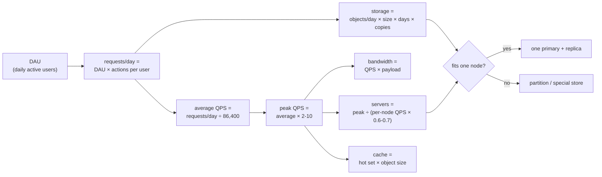
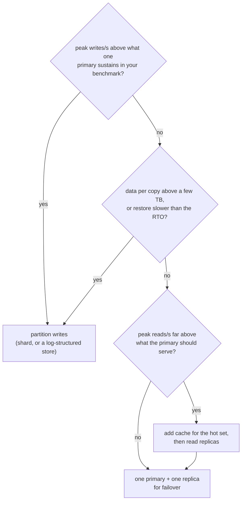

# Back-of-the-Envelope Estimation

> [!summary] TL;DR
> Back-of-the-envelope estimation is quick arithmetic, done in a few minutes with rounded numbers, that tells you roughly how many requests per second, how much storage, how much bandwidth and how many servers a system needs. The goal is the right **order of magnitude**, because that is what decides the design: one database or fifty, a cache or not.

> [!abstract] Core idea
> - Turn daily counts into per-second rates: `QPS = per-day count ÷ 86,400`, and 1 day ≈ 10⁵ seconds is close enough.
> - Design for the peak (2-10× the average), not the average.
> - Storage = objects/day × bytes × days kept × copies; bandwidth = QPS × payload size.
> - Servers = peak QPS ÷ (load-tested QPS per node × 60-70% utilisation).
> - Estimate only what changes a decision, write units on every number, and sanity-check the result.

## 1. Why it exists

Two candidates design a URL shortener. One draws Kafka, Cassandra and twelve microservices. The other spends three minutes on arithmetic, finds 1,200 writes per second and 116,000 reads per second, and concludes: writes fit one relational primary, reads need a cache, and five years of data (about 91 TB per copy) will not fit on one node, so the store must be partitioned. Same problem; the second design is justified by numbers and the first is guesswork.

Estimation is how you decide whether a component is needed at all, and how large it must be.

## 2. Mental model

It is like planning a wedding dinner. You do not count every grain of rice; you estimate guests (300), plates per guest (1.2), kitchen throughput (60 plates per cook per hour) and get "6 cooks for a 1-hour service". If the answer were "0.1 cooks" or "500 cooks", you would know your inputs were wrong. The precision is low; the decision ("hire 6 cooks, not 1 and not 50") is solid.

## 3. How it works

### The pipeline



### Units and powers of two

| Power of 2 | Exact | Approx | Name |
| --- | --- | --- | --- |
| 2¹⁰ | 1,024 | 10³ | KB (strictly KiB) |
| 2²⁰ | 1,048,576 | 10⁶ | MB |
| 2³⁰ | 1,073,741,824 | 10⁹ | GB |
| 2⁴⁰ | about 1.1 × 10¹² | 10¹² | TB |
| 2⁵⁰ | about 1.13 × 10¹⁵ | 10¹⁵ | PB |

The 2.4% (KB) to 12.6% (PB) gap between binary and decimal units does not matter at this precision.

Handy sizes: an ASCII character is 1 byte; a UUID is 16 bytes binary (36 as text); an `int64` or a Unix timestamp is 8 bytes; a short URL row with metadata is a few hundred bytes; a compressed photo is a few hundred KB to a few MB.

### Time shortcuts

- 1 day = 86,400 s ≈ 10⁵ s. Dividing by 10⁵ instead of 86,400 understates the rate by about 14%; fine for estimates, and you can say so.
- 1 million per day ≈ 12 per second. 1 billion per day ≈ 11,600 per second.
- 1 month ≈ 2.6 × 10⁶ s. 1 year ≈ 3.15 × 10⁷ s.

### Latency numbers (orders of magnitude)

These are approximate values from Jeff Dean's list and Colin Scott's updated version; the owning note is [[Latency Numbers Every Engineer Should Know]].

| Operation | Approx time |
| --- | --- |
| L1 cache reference | ~1 ns |
| Main memory (RAM) reference | ~100 ns |
| Read 1 MB sequentially from RAM | ~a few µs to 10 µs |
| SSD random read (4 KB) | ~16-100 µs |
| Round trip inside one data centre | ~0.5 ms |
| Read 1 MB sequentially from SSD | ~50 µs to 1 ms |
| Disk (HDD) seek | ~2-10 ms |
| Round trip across a continent or ocean (for example California to Netherlands) | ~150 ms |

Consequences: a Redis `GET` across the data centre costs about one network round trip (sub-millisecond), so 20 sequential cache calls cost several milliseconds; a request that crosses an ocean twice cannot meet a 100 ms p99.

### The formulas

| Quantity | Formula | Remember |
| --- | --- | --- |
| Average QPS | requests/day ÷ 86,400 | Split read QPS and write QPS |
| Peak QPS | average × peak factor | 2-3× for smooth global traffic, up to 10× for spiky (sales, match days) |
| Storage | objects/day × bytes × retention days × replication factor (often 3) | Add indexes and overhead (often +30-100%, estimate) |
| Bandwidth | QPS × payload bytes | Ingress (uploads) and egress (downloads) separately; × 8 for bits |
| Cache | hot objects × bytes | 80/20: about 20% of items get most reads; cache that 20% |
| Servers | ⌈peak QPS ÷ (per-node QPS × target utilisation)⌉ | Per-node QPS comes from a load test, not a guess |
| DB connections | app instances × pool size | Must stay under the DB limit (PostgreSQL 17 default `max_connections` = 100) |

## 4. Worked example

### Whiteboard version

```text
100M new links/day      -> 100e6 / 86,400     ≈ 1.2k writes/s
read:write 100:1        -> 116k reads/s avg,  peak x2 ≈ 230k/s
row 500 B x 100M/day    -> 50 GB/day -> 18 TB/yr -> 91 TB in 5 yr -> x3 = 274 TB
egress 116k/s x 500 B   ≈ 58 MB/s ≈ 460 Mbit/s
cache 20M hot x 500 B   = 10 GB  -> fits one Redis node
servers 231k / (10k x 0.7) -> 34
Decision: writes fit one primary; data does not -> partitioned store + cache
```

### Example 1: daily requests to RPS

20 million requests per day: `20,000,000 ÷ 86,400 ≈ 231 requests/s` on average. With a 10× peak factor, plan for about `2,300 requests/s`. That is a handful of app servers, not a cluster of fifty.

### Example 2: URL shortener

Assumptions (all estimates, stated out loud in an interview): 100 M new short links per day, 100 reads per write, 500 bytes per stored row, 5 years retention, 3 copies, peak = 2× average, one app node handles 10,000 RPS (from a load test), run at 70%.

| Quantity | Arithmetic | Result |
| --- | --- | --- |
| Write QPS | 100 × 10⁶ ÷ 86,400 /s | ≈ 1,157 writes/s |
| Read QPS | 1,157 /s × 100 | ≈ 115,741 reads/s (peak ≈ 231,000/s) |
| Storage per day | 100 × 10⁶ × 500 B | 50 GB/day |
| Storage, 5 years, 1 copy | 50 GB/day × 1,825 days | ≈ 91 TB |
| Storage, 3 copies | 91.25 TB × 3 | ≈ 274 TB |
| Egress | 115,741 /s × 500 B | ≈ 58 MB/s ≈ 463 Mbit/s |
| Ingress | 1,157 /s × 500 B | ≈ 0.6 MB/s |
| Cache | 20% of 100 M URLs read per day (estimate) = 20 M × 500 B | 10 GB |
| App servers | ⌈231,481 ÷ (10,000 × 0.7)⌉ | 34 |
| Key space | 7 base-62 characters = 62⁷ | ≈ 3.5 × 10¹² keys vs 1.8 × 10¹¹ needed in 5 years |

**What the numbers decided:** about 1,200 writes/s (2,300/s at peak) fits one well-indexed relational primary comfortably (an estimate; benchmark your hardware). 91 TB per copy does not fit one node comfortably, so the data store must be partitioned (see [[Partitioning and Sharding]]) or be a key-value store built for it. 231k reads/s is far above what the database should serve, but the 10 GB hot set fits in one Redis node, so a cache absorbs most reads. Seven characters are enough keys. The full design is in [[Case Study - URL Shortener]].

### Example 3: chat

Assumptions (estimates): 50 M DAU, 40 messages per user per day, 200 bytes per message including metadata, 3 copies, peak = 3× average, 20% of DAU connected at peak.

| Quantity | Arithmetic | Result |
| --- | --- | --- |
| Messages/s | 50 × 10⁶ × 40 ÷ 86,400 /s | ≈ 23,148 /s (peak ≈ 69,000 /s) |
| Storage per day | 2 × 10⁹ × 200 B | 400 GB/day |
| Storage per year, 3 copies | 400 GB × 365 × 3 | ≈ 438 TB/year |
| Concurrent connections | 50 × 10⁶ × 0.2 | 10 M WebSockets |
| Gateway nodes | 10 M ÷ 50,000 per node (estimate; load-test it) | 200 nodes |

**What the numbers decided:** the message store is write-heavy (69k writes/s at peak) and grows by 438 TB a year, which points to a partitioned, write-optimised store (see [[Wide-Column Stores and Cassandra]]) rather than one PostgreSQL primary. Ten million long-lived connections make the connection tier its own scaling problem: [[Scaling WebSockets]] and [[Case Study - Chat System]].

### Go code for the arithmetic

This calculator and its tests pass `go vet` and `go test -race` on Go 1.24, so every number in the two tables above is checked.

```go
package estimate

import "math"

const SecondsPerDay = 86_400

// AvgQPS converts a daily count into an average per-second rate.
func AvgQPS(perDay float64) float64 { return perDay / SecondsPerDay }

// StorageBytes = new objects per day x bytes each x days kept x copies.
func StorageBytes(objectsPerDay, bytesEach float64, days int, replicas int) float64 {
	return objectsPerDay * bytesEach * float64(days) * float64(replicas)
}

// Servers is how many nodes serve peakQPS when each node is load-tested at
// perNodeQPS and we only run it at the target utilisation (e.g. 0.7).
func Servers(peakQPS, perNodeQPS, utilisation float64) int {
	return int(math.Ceil(peakQPS / (perNodeQPS * utilisation)))
}
```

```go
package estimate

import (
	"math"
	"testing"
)

func within(got, want, relTol float64) bool { return math.Abs(got-want) <= relTol*want }

func TestDAUToRPS(t *testing.T) {
	avg := AvgQPS(20e6) // 20 M requests per day
	if !within(avg, 231.48, 0.001) {
		t.Fatalf("avg = %.2f, want 231.48", avg)
	}
	if peak := avg * 10; !within(peak, 2314.8, 0.001) {
		t.Fatalf("peak = %.1f, want 2314.8", peak)
	}
}

func TestURLShortener(t *testing.T) {
	writes := AvgQPS(100e6) // 100 M new links per day
	reads := writes * 100   // 100:1 read:write
	if !within(writes, 1157.4, 0.001) || !within(reads, 115_740.7, 0.001) {
		t.Fatalf("writes=%.1f reads=%.1f", writes, reads)
	}
	// 500 B per row, kept 5 years, 3 copies.
	st := StorageBytes(100e6, 500, 5*365, 3)
	if !within(st, 273.75e12, 1e-9) {
		t.Fatalf("storage = %.4g B, want 273.75 TB", st)
	}
	if egress := reads * 500; !within(egress, 57.87e6, 0.001) { // bytes/s
		t.Fatalf("egress = %.4g B/s", egress)
	}
	if n := Servers(reads*2, 10_000, 0.7); n != 34 {
		t.Fatalf("servers = %d, want 34", n)
	}
}

func TestChat(t *testing.T) {
	msgs := AvgQPS(50e6 * 40) // 50 M DAU x 40 messages
	if !within(msgs, 23_148.1, 0.001) {
		t.Fatalf("msgs/s = %.1f", msgs)
	}
	perYear := StorageBytes(2e9, 200, 365, 3)
	if !within(perYear, 438e12, 1e-9) {
		t.Fatalf("storage/year = %.4g, want 438 TB", perYear)
	}
}
```

## 5. Variants and comparison

| What you estimate | When it changes the design | Skip it when |
| --- | --- | --- |
| Read and write QPS | Always: decides cache, replicas, sharding | Never skip |
| Peak factor | Spiky traffic (ticket sales, flash sales) | Traffic is flat and internal |
| Storage and growth | Retention is long or objects are large | Data is small and short-lived |
| Bandwidth | Media, file downloads, video | Small JSON APIs |
| Cache size | Read-heavy with a hot set | Write-heavy systems |
| Connections | Real-time systems, DB connection budgets | Short stateless requests with pooling |
| Cost | Large storage or egress | Interviews that do not ask |

| Peak shape | Typical factor (estimate) | Example |
| --- | --- | --- |
| Global, steady | 2-3× | Messaging used across time zones |
| Single-country daily cycle | 3-5× | Food delivery at dinner time |
| Event-driven spike | 10× or more | Concert ticket on-sale, sports final |

## 6. Trade-offs and when not to use

- **False precision wastes time.** "1,157.4 writes/s" and "about 1,200" lead to the same design. Round aggressively; keep one or two significant figures.
- **Do not estimate what does not matter.** If storage is 2 GB, say "small, fits anywhere" and move on.
- **Estimates are not capacity plans.** Production sizing needs load tests, measured per-node throughput and real traffic curves; see [[Load and Performance Testing]] and [[Performance Engineering and Capacity Planning]].
- **Per-node throughput is the most invented number.** A Go service can do 1,000 RPS or 50,000 RPS depending on what each request does. State it as an assumption.

## 7. In production

- **Real systems:** Capacity planning at most companies follows the same arithmetic, fed with measured data: traffic forecasts from analytics, per-instance throughput from load tests, storage growth from database size metrics.
- **Failure modes → fixes:**
	- Sized for the average, fell over at peak → size for peak plus a lost zone; keep headroom.
	- Forgot replication → raw storage was 3× the estimate; always multiply by the replication factor and add index overhead.
	- Forgot metadata and indexes → a 100-byte message became 300 bytes on disk; add 30-100% overhead (estimate) or measure a sample.
	- Forgot growth → plan for 12-24 months of growth, not today's size.
	- Connection budget exceeded → 40 pods × 10 connections = 400 against `max_connections` = 100 in PostgreSQL 17; add a pooler.
- **What to monitor:** actual vs estimated QPS, peak-to-average ratio, storage growth per day, per-instance throughput at the SLO, and egress cost.

## 8. Deep dive

- **Little's law** links three numbers you estimate: `concurrency = arrival rate × time in system`. 2,000 RPS at 50 ms average latency means about 100 requests in flight at once, which sizes worker pools, DB connection pools and goroutine counts. At 500 ms latency the same load needs 1,000 in flight.
- **Hot sets are skewed.** Request popularity often follows a power law, so a cache of 1-20% of items can serve most reads. The exact share depends on the workload; measure the hit-rate curve with real keys.
- **IOPS, not just bytes.** A disk that stores 10 TB may still not keep up with 50,000 random reads/s. Estimate operations per second against the volume's IOPS limit as well as capacity.
- **When one PostgreSQL stops being enough.** Rules of thumb (estimates that depend heavily on hardware and query shape): a few thousand to a few tens of thousands of simple writes per second on one primary, and data up to a few TB per node before backups, restores and index rebuilds become slow. Crossing either is the signal to look at partitioning; below both, one primary plus a replica is usually the right answer.
- **Turning numbers into decisions.** The thresholds below are the estimates from the previous bullet, so treat them as prompts to benchmark, not limits:



- **Sanity checks.** Cross-check from a second angle: storage per user (`274 TB ÷ users`) should look plausible; bandwidth in Gbit/s should fit a few network cards, not a thousand; if a number implies more servers than the company could plausibly run, an input is wrong.

## 9. Interview questions

> [!question]- How do you go from DAU to peak QPS?
> requests/day = DAU × actions per user; average QPS = requests/day ÷ 86,400 (≈ 10⁵); peak = average × 2-10 depending on how spiky the traffic is. Do it separately for reads and writes.

> [!question]- Estimate storage for 100 M new 500-byte records per day kept 5 years.
> 100 M × 500 B = 50 GB/day; × 1,825 days ≈ 91 TB; × 3 replicas ≈ 274 TB, plus index overhead. That decides that one node will not hold it.

> [!question]- How do you size a cache?
> Estimate the hot set, not the total: with 80/20 skew, cache about 20% of the items read per day. 20 M hot URLs × 500 B = 10 GB, which fits one Redis node with room for replication.

> [!question]- Trap: you computed QPS from the average. What did you forget?
> The peak. Traffic is not flat; capacity must cover peak (2-10× average) plus the loss of a zone, at 60-70% utilisation. Sizing for the average guarantees an outage at the busiest hour.

> [!question]- How many app servers do you need?
> ⌈peak QPS ÷ (per-node QPS × target utilisation)⌉, with per-node QPS from a load test. 231k ÷ (10k × 0.7) = 34. Then check that the DB connection budget allows that many pools.

> [!question]- Which numbers would make you shard the database?
> Sustained writes beyond what one primary can take on your hardware, or data per node beyond what you can back up and restore in your recovery time objective. If neither is crossed, one primary plus replicas and a cache is simpler.

## 10. Cheat sheet

- `QPS = per day ÷ 86,400`; 1 day ≈ 10⁵ s; 1 M/day ≈ 12/s; 1 B/day ≈ 11.6k/s.
- Peak = 2-10× average. Split reads and writes.
- Storage = objects/day × size × days × 3 copies + index overhead.
- Bandwidth = QPS × payload; × 8 for bits.
- Cache ≈ 20% of the daily hot set × object size.
- Servers = ⌈peak ÷ (per-node × 0.6-0.7)⌉; check DB connections.
- Little's law: in-flight = rate × latency.
- Estimate what changes a decision; round; sanity-check.

## Links

- **Before this:** [[System Design Fundamentals]], [[Latency Numbers Every Engineer Should Know]]
- **Next:** [[Load Balancing]], [[System Design Interview Framework]], [[Case Study - URL Shortener]], [[Case Study - Chat System]]
- **Compare with:** [[Performance Engineering and Capacity Planning]] (measured capacity planning in production), [[Scaling Basics]] (what to do once the numbers say you must scale)
