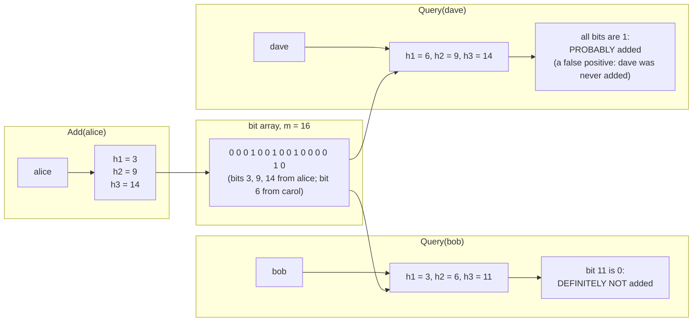
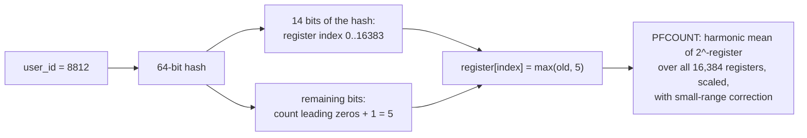

# Bloom Filters and Probabilistic Data Structures

> [!summary] TL;DR
> A **Bloom filter** is a tiny bit array that answers "have I seen this item?" with either **"definitely not"** or **"probably yes"**. It uses about 10 bits per item for a 1% error rate, no matter how big the items are. Its cousins answer other questions approximately: **HyperLogLog** counts distinct items, and a **Count-Min Sketch** estimates how often each item appears.

> [!abstract] Core idea
> - Trade a small, known error rate for a huge saving in memory: a fixed number of bits per item instead of storing the items.
> - A Bloom filter never gives a false "no". It can give a false "yes" (a **false positive**), at a rate you choose when sizing it.
> - Put it in front of an expensive lookup (disk, database, network) to skip the lookups that would find nothing.
> - HyperLogLog: count unique items in 12 KB with about 0.81% error. Count-Min Sketch: frequencies that are never under, only over, the truth.

## 1. Why it exists

A signup form checks "is this username taken?" on every keystroke. There are 1 billion usernames averaging 12 bytes. Some options:

- **Ask the database every time.** Most usernames people type are *not* taken, so most queries do an index lookup only to find nothing. At 20,000 checks per second this is pure wasted load.
- **Keep all usernames in a hash set in memory.** 1 billion × (12 bytes of text + string header and hash-table overhead, roughly 40 bytes or more) ≈ **50 GB or more** (an estimate). Too big for one app server.
- **Keep a Bloom filter in memory.** At a 1% false-positive rate it needs 9.585 bits per name: 1,000,000,000 × 9.585 bits = 9.585 × 10^9 bits ÷ 8 = **1.2 GB** (1.12 GiB). If the filter says "definitely not taken", answer immediately. If it says "probably taken", check the database. Now 99% of the "free" names never touch the database.

The same pattern appears all over backend systems: skip a disk read for a key that is not in this file, skip a cache-miss query for an ID that does not exist, skip a URL the crawler has already fetched.

## 2. Mental model

Picture a wall of 1,000 light switches, all off.

- To **add** "alice", you run "alice" through 7 different hash functions, get 7 switch numbers, and turn those switches on.
- To **check** "bob", you compute bob's 7 switch numbers. If **any** of them is off, bob was never added: nobody would have turned that switch on. If **all** are on, bob was **probably** added, but maybe those switches were turned on by other names.

The wall never stores the names, only switches, which is why it is small. And you cannot remove a name, because turning off its switches might turn off switches other names also need.

## 3. How it works

### Add and query



The steps:

1. Create an array of `m` bits, all zero.
2. **Add(x):** compute `k` positions `h_1(x) … h_k(x)` in `[0, m)` and set those bits to 1.
3. **MayContain(x):** compute the same `k` positions. If any bit is 0, return false (certain). If all are 1, return true (probable).

### The math, with units

With `n` items added, `m` bits and `k` hash functions:

- The chance that one particular bit is still 0 after all inserts is about `e^(−kn/m)`.
- A false positive needs all `k` bits of a new item to be 1: `p ≈ (1 − e^(−kn/m))^k`.
- The best number of hash functions is `k = (m/n) × ln 2`.
- For a target `p`, the bits needed per item are `m/n = −ln p / (ln 2)^2 ≈ 1.44 × log2(1/p)`.

| Target false-positive rate `p` | Bits per item `m/n` | Hash functions `k` | Memory for 1 billion items |
| --- | --- | --- | --- |
| 10% | 4.79 | 3 | 0.60 GB |
| 1% | 9.59 | 7 | 1.20 GB |
| 0.1% | 14.38 | 10 | 1.80 GB |
| 0.01% | 19.17 | 13 | 2.40 GB |

Every 10× fewer false positives costs another 4.79 bits per item. The size of the items does not appear anywhere: a 12-byte username and a 2 KB URL cost the same.

At the optimal `k`, about half the bits end up set. That fill ratio is a useful health metric (section 7).

### What happens when you add too many items

Sized for `n` at 1% (9.585 bits per item, k = 7), then filled past `n`:

| Items actually added | False-positive rate |
| --- | --- |
| n | 1.0% |
| 1.5 n | 5.8% |
| 2 n | 15.7% |
| 3 n | 43.6% |

(Computed from the formula above.) An overfilled filter degrades fast, so size it for the peak, or use a scalable Bloom filter, which adds a new, larger filter whenever the current one is full and checks all of them on a query.

## 4. Worked example

### Whiteboard version

The bare idea, with `k` hash functions made by seeding FNV-1a with a different byte each time:

```go
package wb

import "hash/fnv"

// Bloom is the bare idea: k positions per key in an m-bit array.
type Bloom struct {
	bits []bool
	k    int
}

func (b *Bloom) pos(key string, i int) int {
	h := fnv.New64a()
	h.Write([]byte{byte(i)}) // a different seed byte per hash function
	h.Write([]byte(key))
	return int(h.Sum64() % uint64(len(b.bits)))
}

func (b *Bloom) Add(key string) {
	for i := 0; i < b.k; i++ {
		b.bits[b.pos(key, i)] = true
	}
}

func (b *Bloom) MayContain(key string) bool {
	for i := 0; i < b.k; i++ {
		if !b.bits[b.pos(key, i)] {
			return false // definitely never added
		}
	}
	return true // probably added
}
```

This uses one byte per bit and runs `k` full hashes per call. The full version below packs 64 bits per word and computes only two hashes.

### A production-shaped Bloom filter in Go

It sizes itself from `n` and `p` using the formulas above, and uses **double hashing**: `position_i = h1 + i × h2 (mod m)`. Kirsch and Mitzenmacher (2006) showed that two hashes combined this way give the same false-positive rate as `k` independent ones, so each call does two hash computations instead of seven.

```go
// Package bloom has a Bloom filter and a Count-Min Sketch.
package bloom

import (
	"hash/fnv"
	"math"
)

// Filter is a Bloom filter with m bits and k hash functions. Not safe for
// concurrent writes; wrap it in a mutex if several goroutines add.
type Filter struct {
	bits []uint64
	m, k uint64
}

// New sizes the filter for n items at false-positive rate p:
// m = -n ln p / (ln 2)^2,  k = (m/n) ln 2.
func New(n int, p float64) *Filter {
	m := uint64(math.Ceil(-float64(n) * math.Log(p) / (math.Ln2 * math.Ln2)))
	k := uint64(math.Round(float64(m) / float64(n) * math.Ln2))
	return &Filter{bits: make([]uint64, (m+63)/64), m: m, k: max(k, 1)}
}

// hashes returns two 64-bit hashes; position i is h1 + i*h2 (double hashing,
// Kirsch & Mitzenmacher 2006), so only two hash computations per key.
func hashes(key []byte) (uint64, uint64) {
	h := fnv.New64a()
	h.Write(key)
	h1 := h.Sum64()
	h.Write([]byte{0x9e}) // continue the stream to get a second, different hash
	h2 := h.Sum64() | 1   // odd, so it never collapses to a single position
	return h1, h2
}

func (f *Filter) Add(key []byte) {
	h1, h2 := hashes(key)
	for i := uint64(0); i < f.k; i++ {
		pos := (h1 + i*h2) % f.m
		f.bits[pos/64] |= 1 << (pos % 64)
	}
}

// MayContain is false only if key was never added. True means "probably".
func (f *Filter) MayContain(key []byte) bool {
	h1, h2 := hashes(key)
	for i := uint64(0); i < f.k; i++ {
		pos := (h1 + i*h2) % f.m
		if f.bits[pos/64]&(1<<(pos%64)) == 0 {
			return false
		}
	}
	return true
}

func (f *Filter) Params() (m, k uint64) { return f.m, f.k }
```

### Count-Min Sketch in Go

A Count-Min Sketch is a `d × w` grid of counters. Each row has its own hash. **Add** increments one counter per row; **Estimate** returns the smallest of those `d` counters. Collisions only ever add to a counter, so the estimate is never below the truth, and taking the minimum picks the row with the fewest collisions. With `w = ⌈e/ε⌉` and `d = ⌈ln(1/δ)⌉`, the overcount is at most `ε × N` (N = total of all counts) with probability at least `1 − δ`.

```go
package bloom

import "math"

// CountMin estimates item frequencies in a stream. Estimates never undercount;
// they overcount by at most eps*N with probability 1-delta.
type CountMin struct {
	w, d  uint64
	table [][]uint32
}

// NewCountMin: width = ceil(e/eps), depth = ceil(ln(1/delta)).
func NewCountMin(eps, delta float64) *CountMin {
	w := uint64(math.Ceil(math.E / eps))
	d := uint64(math.Ceil(math.Log(1 / delta)))
	t := make([][]uint32, d)
	for i := range t {
		t[i] = make([]uint32, w)
	}
	return &CountMin{w: w, d: d, table: t}
}

func (c *CountMin) Add(key []byte, n uint32) {
	h1, h2 := hashes(key)
	for i := uint64(0); i < c.d; i++ {
		c.table[i][(h1+i*h2)%c.w] += n
	}
}

// Estimate is the minimum over the rows: the row with the fewest collisions.
func (c *CountMin) Estimate(key []byte) uint32 {
	h1, h2 := hashes(key)
	est := uint32(math.MaxUint32)
	for i := uint64(0); i < c.d; i++ {
		est = min(est, c.table[i][(h1+i*h2)%c.w])
	}
	return est
}

func (c *CountMin) Dims() (w, d uint64) { return c.w, c.d }
```

### Tests

```go
package bloom

import (
	"fmt"
	"testing"
)

func TestSizing(t *testing.T) {
	f := New(1_000_000, 0.01)
	m, k := f.Params()
	if m != 9_585_059 || k != 7 { // ~9.59 bits per item, 7 hashes
		t.Fatalf("m=%d k=%d", m, k)
	}
}

func TestNoFalseNegativesAndFPRate(t *testing.T) {
	const n = 100_000
	f := New(n, 0.01)
	for i := 0; i < n; i++ {
		f.Add([]byte(fmt.Sprintf("user:%d", i)))
	}
	for i := 0; i < n; i++ {
		if !f.MayContain([]byte(fmt.Sprintf("user:%d", i))) {
			t.Fatalf("false negative for user:%d", i)
		}
	}
	fp := 0
	const probes = 200_000
	for i := 0; i < probes; i++ {
		if f.MayContain([]byte(fmt.Sprintf("other:%d", i))) {
			fp++
		}
	}
	rate := float64(fp) / probes
	t.Logf("measured false-positive rate: %.4f (%d of %d)", rate, fp, probes)
	if rate > 0.015 {
		t.Fatalf("false-positive rate %.4f is far above the 1%% target", rate)
	}
}

func TestCountMinNeverUndercounts(t *testing.T) {
	c := NewCountMin(0.001, 0.01) // w = 2719, d = 5
	if w, d := c.Dims(); w != 2719 || d != 5 {
		t.Fatalf("dims %d x %d", w, d)
	}
	truth := map[string]uint32{}
	for i := 0; i < 50_000; i++ {
		k := fmt.Sprintf("url:%d", i%5_000) // 5,000 distinct keys, 10 hits each
		if i%10 == 0 {
			k = "url:hot" // one heavy hitter: 5,000 hits
		}
		truth[k]++
		c.Add([]byte(k), 1)
	}
	var total uint32 = 50_000
	for k, v := range truth {
		est := c.Estimate([]byte(k))
		if est < v {
			t.Fatalf("%s undercounted: %d < %d", k, est, v)
		}
		if k == "url:hot" && est > v+uint32(0.001*float64(total)) {
			t.Fatalf("hot key estimate %d too far above %d", est, v)
		}
	}
}
```

`go vet` is clean and `go test -race` passes all three tests (Go 1.24.4, darwin/arm64). **Measured:** with 100,000 items in a filter sized for 1% (958,506 bits, 7 hashes), probing 200,000 keys that were never added gave **1,965 false positives = 0.98%**, matching the formula. The sizing test confirms 1,000,000 items at 1% → 9,585,059 bits (1.2 MB) and k = 7. In the Count-Min test, `ε = 0.001` and `δ = 0.01` give a 2,719 × 5 grid (13,595 counters, 54 KB as `uint32`), and the heavy hitter's estimate stays within `0.001 × 50,000 = 50` of its true count of 5,000.

### Sizing a real one: crawler URL dedupe

A crawler expects to see 5 billion URLs and can tolerate re-skipping 0.1% of new URLs (a false positive means "already seen", so the URL is wrongly skipped). Bits = 5 × 10^9 × 14.38 = 7.19 × 10^10 bits ÷ 8 = **9.0 GB**, with k = 10. That is too big for one machine's comfort, so partition the filter by host hash across crawler workers, which the crawler already does for politeness (see [[Case Study - Web Crawler]]). Storing the URLs themselves (average 80 bytes, an estimate) would be 400 GB before any index overhead.

## 5. Variants and comparison

| Structure | Question it answers | Memory | Error | Deletes? | Use when |
| --- | --- | --- | --- | --- | --- |
| Hash set | Is x in the set? | All items + overhead | None | Yes | The set fits in memory |
| Bloom filter | Is x in the set? | ~1.44 log2(1/p) bits per item | False positives only | No | Skip expensive lookups for absent keys |
| Counting Bloom | Is x in the set? | Typically 4-bit counters: about 4× a Bloom | False positives; counter overflow | Yes | Need deletes, can afford 4× |
| Cuckoo filter | Is x in the set? | Fingerprints in a cuckoo hash table | False positives only | Yes | Need deletes; better than Bloom below about 3% FP (Fan et al., 2014) |
| HyperLogLog | How many distinct items? | 12 KB in Redis, for any count | ~0.81% standard error | No (but mergeable) | Unique visitors, distinct search terms |
| Count-Min Sketch | How often did x appear? | `d × w` counters | Overcounts by ≤ εN with prob. 1 − δ | Only with care | Heavy hitters, top-K in streams |

How the two non-membership structures work:

- **HyperLogLog** hashes each item and looks at the number of leading zeros. Seeing a hash that starts with 20 zero bits is a 1-in-2^20 event, so it suggests about a million distinct items have passed. To smooth out luck, it splits items into many buckets (registers) by the first bits of the hash, keeps the maximum leading-zero count per register, and combines them with a harmonic mean. Redis uses 16,384 registers of 6 bits each: 16,384 × 6 ÷ 8 = **12,288 bytes (12 KB)**, with a standard error of 1.04 / √16,384 = **0.81%**. `PFMERGE` combines HLLs by taking the maximum per register, so you can count daily uniques per server and merge them.
- **Cuckoo filter** stores a short fingerprint of each item in one of two possible buckets. To delete, remove the fingerprint. Inserts can fail when the table is nearly full, so size it with headroom.



## 6. Trade-offs and when not to use

- **Only for "skip work" decisions.** A false positive must be harmless: it costs one extra lookup. Never use a Bloom filter as the source of truth for something like "this username is taken, reject the signup"; a false positive would wrongly reject a free name.
- **No deletes, no listing.** You cannot remove items from a plain Bloom filter or list what is in it. If items expire (sessions, cached keys), you need a counting Bloom or cuckoo filter, or rebuild periodically.
- **You must know `n` in advance.** Overfilling raises the error sharply (from 1% to 15.7% at twice the planned size).
- **Small sets do not need it.** For 100,000 items, a Go `map[string]struct{}` costs a few megabytes and has zero error. Use a Bloom filter when the set is too big for memory or must be shipped over the network.
- **Hash choice matters.** Fast non-cryptographic hashes are fine, but for a filter that is persisted or shared between services, every reader must use the same hash and seed. Go's `hash/maphash` uses a random seed per process, so it is unsuitable for a filter you save to disk.
- **HLL and CMS give estimates.** Fine for dashboards and top-K; not for billing or anything that needs an exact count.

## 7. In production

- **Real systems:**
	- **LSM-tree databases** keep a Bloom filter per SSTable file, so a read for a key skips every file that does not contain it (see [[Storage Engines - B-tree vs LSM and WAL]]). RocksDB's filters are commonly configured at about 10 bits per key, which gives roughly a 1% false-positive rate. Cassandra exposes the target as the table option `bloom_filter_fp_chance`.
	- **Redis** has HyperLogLog built in (`PFADD`, `PFCOUNT`, `PFMERGE`). Bloom and cuckoo filters (`BF.RESERVE`, `BF.ADD`, `BF.EXISTS`, `CF.*`) come from the RedisBloom module, which ships with Redis Stack and with Redis 8.
	- **Akamai** used Bloom filters to avoid caching "one-hit wonders" (objects requested only once): an object is cached only on its second request, saving disk space and writes on its edge servers (Maggs and Sitaraman, 2015).
	- **Cache penetration defence:** put a Bloom filter of all valid IDs in front of the cache, so requests for IDs that do not exist are rejected without a database query (see [[Cache Failure Modes - Stampede, Avalanche, Penetration, Hot and Big Keys]]).
	- **Heavy hitters:** a Count-Min Sketch plus a small min-heap of the current top K tracks the most frequent items in a stream (see [[Case Study - Leaderboard and Top-K]]).
- **Failure modes and fixes:**
	- *The filter fills past its design size* and false positives soar → monitor the fill ratio and rebuild at a larger size, or use a scalable filter.
	- *A filter built from stale data* says "definitely not" for an item added after the build → that is a **false negative** from the system's point of view. Add new items to the filter in the same code path that writes them, or rebuild on a schedule and fall back to the database for recent items.
	- *Different hash or seed between writer and reader* → every lookup is wrong. Version the filter format and record the hash and seed.
	- *Counting Bloom counter overflow* → 4-bit counters saturate at 15; never decrement a saturated counter.
- **What to monitor:** the fill ratio (fraction of bits set; about 50% at the design load), the measured false-positive rate (the share of "probably yes" answers that the database then says no to), the item count against the design `n`, and the filter's memory.

## 8. Deep dive

### Where the formula comes from

After `n` inserts with `k` hashes, `kn` bits have been set, chosen at random among `m`. The chance that a given bit was never chosen is `(1 − 1/m)^(kn) ≈ e^(−kn/m)`. A new item is a false positive when all its `k` bits are set, giving `p ≈ (1 − e^(−kn/m))^k`. Minimising over `k` gives `k = (m/n) ln 2`, at which point exactly half the bits are expected to be set, and `p = (1/2)^k = 0.6185^(m/n)`. Solving for `m/n` gives the 9.585 bits per item at 1%.

### Cache-friendly (blocked) Bloom filters

A query with k = 7 touches 7 random bits spread over a large array, so for a 1 GB filter it can cause up to 7 cache misses. A **blocked Bloom filter** first hashes the item to one 64-byte block (one CPU cache line) and puts all `k` bits inside it, so each query costs one cache miss. The price is a slightly higher false-positive rate for the same memory, because blocks fill unevenly. RocksDB's newer filter formats use this idea.

### Set operations

Two Bloom filters with the same `m`, `k` and hashes can be combined: bitwise **OR** gives a filter of the union (exactly what you would get by adding both sets). Bitwise **AND** approximates the intersection, but with a higher false-positive rate than a filter built from the intersection directly. HyperLogLogs merge by taking the per-register maximum, which is exact for the union.

### Count-Min Sketch refinements

- **Conservative update:** on Add, only increase the counters that equal the current minimum. This reduces overcounting and keeps the "never undercount" guarantee, but it no longer supports subtracting counts.
- **Top-K:** after each Add, if `Estimate(x)` exceeds the smallest count in a size-K min-heap, insert or update `x` in the heap. Memory is `d × w` counters plus K entries, independent of how many distinct items exist.
- **Sliding windows:** keep one sketch per minute and sum the last N sketches (sketches with the same dimensions and hashes add counter by counter).

### HyperLogLog at the edges

Raw HLL is biased when few items have been seen, because most registers are still zero; implementations switch to a different estimate (linear counting) for small cardinalities. Redis also stores small HLLs in a compact **sparse** encoding and converts to the 12 KB **dense** form as they grow, so a key with a handful of items uses far less than 12 KB.

## 9. Interview questions

> [!question]- What can a Bloom filter tell you for certain?
> Only that an item is **not** in the set: if any of its `k` bits is 0, it was never added. "All bits set" means probably present, with the false-positive rate you sized for. It never stores the items, so it cannot list or delete them.

> [!question]- Size a Bloom filter for 1 billion items at 1% false positives.
> `m/n = −ln(0.01) / (ln 2)^2 ≈ 9.59` bits per item, so 9.59 × 10^9 bits ≈ 1.2 GB, with `k = 9.59 × ln 2 ≈ 7` hash functions. Each further 10× reduction in the error costs about 4.8 more bits per item.

> [!question]- Trap: "We use a Bloom filter so we never query the database for usernames." Correct?
> No. A "probably yes" can be a false positive, so a "taken" answer must be confirmed by the database. The filter only lets you skip the database when it says "definitely not". Also, if the filter is rebuilt from a snapshot, items added after the snapshot will be missing, which looks like a false negative to the application.

> [!question]- How does an LSM storage engine use Bloom filters?
> Each SSTable has a Bloom filter of its keys. A point read checks the filters first and opens only the files whose filter says "maybe", so a read for a missing key usually touches no data files. This is why LSM point reads stay fast even with many levels; range scans cannot use the filter.

> [!question]- Count unique daily visitors across 50 servers with minimal memory.
> Each server does `PFADD visitors:2026-11-04:<server> <user_id>` (or all write to one key). At the end, `PFMERGE` the per-server keys and `PFCOUNT` the result. Each HLL is 12 KB in Redis, with about 0.81% standard error, regardless of whether there are a thousand or a billion visitors.

> [!question]- You need deletes. What do you use?
> A cuckoo filter (stores fingerprints, so you can remove one; better space than Bloom below about 3% false positives) or a counting Bloom filter (counters instead of bits, about 4× the memory). Only delete items that were actually added, or you can create false negatives.

> [!question]- Find the top 100 most-searched terms in a stream of 1 billion searches per day.
> A Count-Min Sketch to estimate each term's count, plus a min-heap of size 100. On each search, add it to the sketch, read its estimate, and update the heap if the estimate beats the heap's minimum. Memory is fixed by `ε` and `δ`, not by the number of distinct terms. Keep one sketch per time bucket to get "top in the last hour".

## 10. Cheat sheet

- Bloom: "definitely not" or "probably yes"; no false negatives, no deletes, no listing.
- `m/n = −ln p / (ln 2)^2`, `k = (m/n) ln 2`: 9.59 bits and 7 hashes for 1%; +4.79 bits per 10× better.
- Double hashing `h1 + i·h2` gives k positions from two hashes.
- Overfilled filters degrade fast: 2× the planned items turns 1% into 15.7%.
- Cuckoo or counting Bloom when you need deletes.
- HyperLogLog: distinct counts, Redis `PFADD`/`PFCOUNT`/`PFMERGE`, 12 KB, 0.81% error.
- Count-Min Sketch: frequencies that only overcount; `w = e/ε`, `d = ln(1/δ)`; with a heap for top-K.

## Links

- **Before this:** [[Hash Tables and Go Maps]], [[Rate Limiting - Algorithms and Distributed Design]]
- **Next:** [[Service Discovery]]
- **Compare with:** [[Union-Find and Skip Lists]] (other specialised structures), [[Storage Engines - B-tree vs LSM and WAL]] (Bloom filters per SSTable), [[Cache Failure Modes - Stampede, Avalanche, Penetration, Hot and Big Keys]] (Bloom filters against cache penetration), [[Case Study - Web Crawler]], [[Case Study - Leaderboard and Top-K]]
