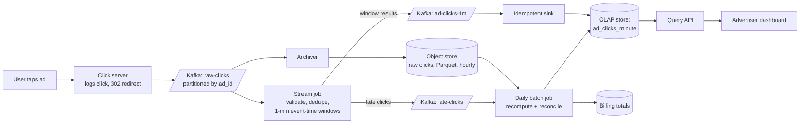
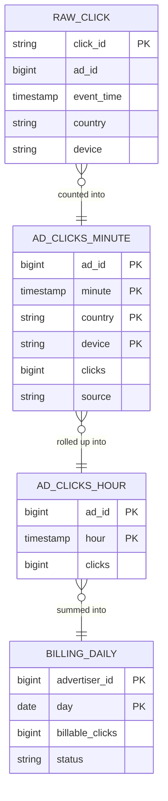
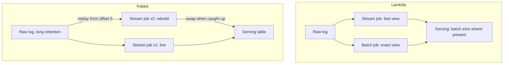
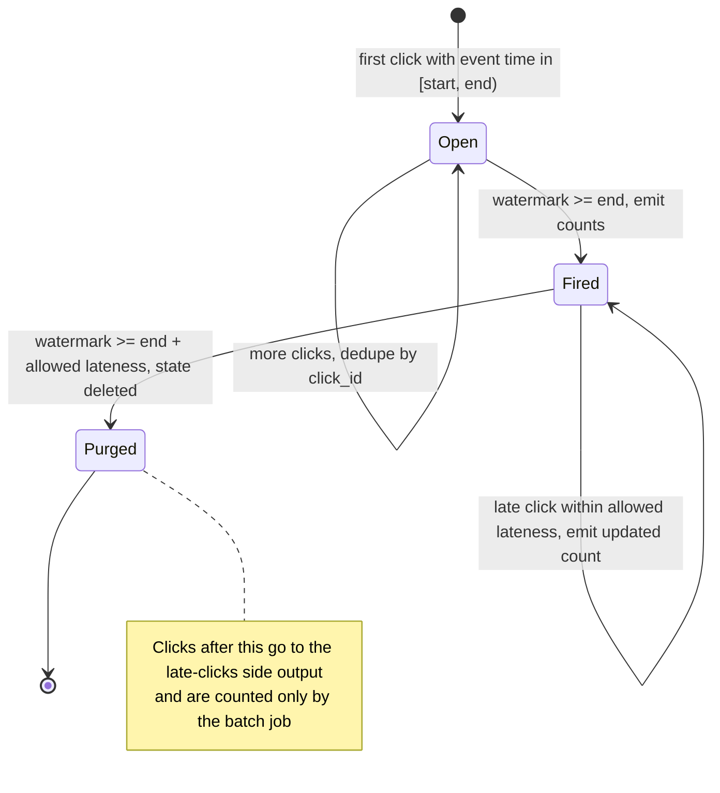
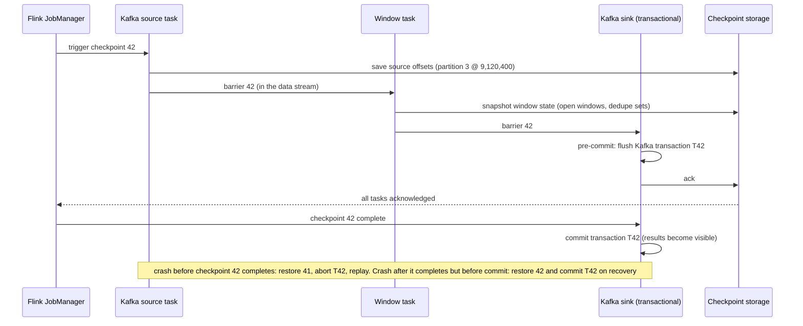

# Case Study - Ad Click Aggregation

> [!summary] TL;DR
> Design the system that counts how many times each ad was clicked, per minute, so advertisers see near-real-time dashboards and get billed correctly. Clicks arrive as a fast, messy stream (late, duplicated, out of order), and the counts must still be exact enough to send invoices.

> [!abstract] Core idea
> - Count by **event time** (when the user clicked), not by arrival time, in fixed windows such as one minute per ad.
> - A **watermark** is the stream's estimate of "all clicks up to time T have arrived"; a window's result is emitted when the watermark passes its end. Clicks that arrive later go to a side output.
> - Exactly-once counts come from deduplicating by click ID, checkpointing state together with Kafka offsets, and writing results idempotently (overwrite, not add).
> - A batch job recomputes the same counts from the raw log later and is the source of truth for billing; the stream is the fast, approximate-but-close view.
> - Classic mistake: `UPDATE counts SET clicks = clicks + 1` for every click. It cannot survive retries, replays or 50,000 clicks per second on one popular ad.

## 1. Why it exists - requirements

An ad network charges advertisers per click. A user clicks an ad on a phone in a tunnel; the app retries the click event when the connection returns 3 minutes later; a load balancer retry sends it twice. If the system counts by arrival time, that click lands in the wrong minute. If it counts every delivery, the advertiser pays twice. Over 1 billion clicks a day, small error rates are real money, and advertisers audit invoices.

**Terms used below:**
- **Event time:** when the click happened, stamped by the device or the click server.
- **Processing time:** when the aggregation job sees the event.
- **Tumbling window:** fixed, non-overlapping time buckets, such as 12:00–12:01 and 12:01–12:02.
- **Watermark:** a timestamp carried through the stream that says "no more events older than this are expected".
- **Allowed lateness:** extra time after the watermark during which a window still accepts updates.
- **Checkpoint:** a consistent snapshot of the job's state and its input offsets, used to restart after a crash.

**Functional requirements:**
- Count clicks per `ad_id` per minute, also sliced by a few dimensions (country, device type).
- Query: clicks for an ad over the last M minutes or a date range; the top N most-clicked ads in the last minute.
- Filter invalid clicks (duplicates, known bots) before counting.
- Daily billing totals per advertiser.

**Non-functional requirements:**
- Dashboard freshness: results within a few minutes of the click.
- Correctness: billing totals exact; no double counting after retries or job restarts.
- Throughput: 1 billion clicks/day with peaks of 5× average (estimates for the exercise).
- Raw events kept so any result can be recomputed.

## 2. Mental model

Think of a polling station counting votes by the hour each ballot was cast. Ballots arrive by post, some days late. The counters keep one tally sheet per hour. They publish the 9 am sheet once they are fairly sure all 9 am ballots have arrived (the watermark). A ballot stamped 9:15 that turns up after the 9 am sheet is published goes into a separate "late" tray. Every ballot has a serial number, so a photocopy is spotted and ignored. At the end of the week an auditor recounts every ballot from the archive (the batch job), and the official result is the auditor's count.

## 3. How it works - high-level design



**Step by step:**
1. The click server receives `GET /c/{token}`, decodes the ad and impression from the signed token, assigns a click ID, writes the event to Kafka and redirects the user to the advertiser's page. It does no counting; it must stay fast because the user is waiting.
2. Kafka's `raw-clicks` topic is partitioned by `ad_id`, so all clicks for one ad reach the same stream task. It is retained for days so the job can replay; see [[Case Study - Distributed Message Queue]].
3. An archiver copies raw clicks to object storage in hourly Parquet files. This is the permanent record.
4. The stream job (Apache Flink in this design) validates events, drops duplicates by click ID, assigns each click to a one-minute event-time window, and emits a window's counts when the watermark passes the window's end.
5. Results go to a Kafka topic and then to an OLAP store through an idempotent sink: the row for `(ad_id, minute)` is overwritten with the window's total, so replaying a result is harmless.
6. Late clicks go to a side topic. The daily batch job recounts everything from raw files (including late clicks), writes corrected rows and produces billing totals.

## 4. Worked example - estimates, API and data model

### Whiteboard version

```text
click -> Kafka(raw, key=ad_id) -> stream job -> Kafka(results) -> OLAP (upsert by ad_id, minute)
              |                    |  window = floor(event_time, 1 min)
              |                    |  watermark = max event time seen - 10 s
              |                    |  emit window when watermark >= window end
              |                    |  click_id seen in window? drop
              |                    +-> late clicks -> side topic
              +-> archive (Parquet) -> nightly batch recount = billing truth
```

### Estimates

All inputs are **estimates** for the exercise.

| Input | Value |
| --- | --- |
| Clicks | 1,000,000,000/day |
| Peak factor | 5× average |
| Raw click event | 200 bytes |
| Distinct ads clicked per minute | 200,000 |
| Dimension slices per ad-minute (country × device) | 5 on average |
| Aggregated row | 50 bytes |

- **Average rate:** 1,000,000,000 / 86,400 s ≈ 11,600 clicks/s. **Peak:** 5 × 11,600 ≈ 58,000 clicks/s.
- **Raw bytes:** 1,000,000,000 × 200 B = 200 GB/day. Kafka with 7-day retention and RF 3: 200 GB × 7 × 3 = 4.2 TB. Object storage for a year (before compression): 200 GB × 365 = 73 TB.
- **Peak ingress:** 58,000 × 200 B ≈ 11.6 MB/s. Small for Kafka; the hard part is correctness, not bandwidth.
- **Aggregated rows:** 200,000 ads × 5 slices × 1,440 minutes = 1.44 × 10^9 rows/day; × 50 B = 72 GB/day. This is why the store is a columnar OLAP database and why old minutes are rolled up to hours (24 × fewer rows).
- **Dedupe state:** clicks per minute at peak = 58,000 × 60 ≈ 3.5 million IDs. At about 40 bytes per stored ID (estimate including map overhead), one window's set is about 140 MB, spread across all parallel tasks. Windows close after a minute plus lateness, so only a few are open at once.

### API

| Call | Purpose |
| --- | --- |
| `GET /c/{signed_token}` | Click redirect; logs the click, returns `302 Location: <landing URL>` |
| `GET /v1/ads/{ad_id}/clicks?from=2026-11-04T12:00Z&to=2026-11-04T13:00Z&granularity=1m` | Time series of counts |
| `GET /v1/ads/top?window=1m&n=100&country=IN` | Top N ads in the latest closed minute |
| `GET /v1/advertisers/{id}/billing?date=2026-11-03` | Reconciled daily totals (from the batch job) |

Raw click event (the Kafka message value):

```json
{
  "click_id": "01JBX7Q9M4ZK3T5V8W2Y6R0N1P",
  "ad_id": 48213,
  "impression_id": "imp-7f3a91",
  "event_time": "2026-11-04T12:00:58.412Z",
  "country": "IN",
  "device": "android",
  "ip_hash": "c51f…"
}
```

`click_id` is generated once by the click server (a time-ordered ID; see [[Unique ID Generation]]) and travels with every retry. It is the deduplication key.

### Data model



The production store would be a columnar OLAP database (ClickHouse, Apache Druid or Apache Pinot); see [[Time-Series and Columnar Storage]]. The idempotent write pattern is the same in any store, shown here in PostgreSQL 17:

```sql
CREATE TABLE ad_clicks_minute (
    ad_id    bigint      NOT NULL,
    minute   timestamptz NOT NULL,
    country  text        NOT NULL,
    device   text        NOT NULL,
    clicks   bigint      NOT NULL,
    source   text        NOT NULL DEFAULT 'stream',  -- 'stream' or 'batch'
    PRIMARY KEY (ad_id, minute, country, device)
);

-- The stream sink OVERWRITES the window total. Replaying the same result is a no-op,
-- and a batch correction (source = 'batch') is never overwritten by a stream replay.
INSERT INTO ad_clicks_minute (ad_id, minute, country, device, clicks, source)
VALUES (48213, '2026-11-04 12:00:00+00', 'IN', 'android', 2, 'stream')
ON CONFLICT (ad_id, minute, country, device) DO UPDATE
SET clicks = EXCLUDED.clicks, source = EXCLUDED.source
WHERE ad_clicks_minute.source <> 'batch';
```

The trap would be `SET clicks = ad_clicks_minute.clicks + EXCLUDED.clicks`: after a job restart that re-emits a window, every count would double.

### Event-time windows with a watermark in Go

A single-partition model of what the stream job does for one key range: tumbling windows by event time, a bounded-out-of-orderness watermark, per-window deduplication by click ID, and a side output for late clicks. Time comes only from the events, so the tests are deterministic without a clock.

```go
// Package clicks counts ad clicks per ad in event-time tumbling windows,
// closes windows with a watermark, deduplicates by click ID and routes late clicks aside.
package clicks

import (
	"slices"
	"time"
)

// Click is one raw event. EventTime is when the user clicked, not when we received it.
type Click struct {
	ID        string
	AdID      string
	EventTime time.Time
}

// Result is the final count for one ad in one closed window.
type Result struct {
	WindowStart time.Time
	AdID        string
	Count       int64
}

type window struct {
	counts map[string]int64    // ad -> clicks
	seen   map[string]struct{} // click IDs already counted in this window
}

// Aggregator is single-threaded on purpose: a stream processor runs one
// instance per partition, so all clicks for a partition arrive in order here.
type Aggregator struct {
	Size          time.Duration // tumbling window length, e.g. 1 minute
	MaxOutOfOrder time.Duration // how far the watermark trails the newest event (not Flink's allowed lateness)

	open     map[int64]*window // window start (unix ns) -> state
	maxEvent time.Time
	Late     []Click // side output for the batch reconciliation job
	Dupes    int
}

// Watermark says "no more events older than this are expected".
func (a *Aggregator) Watermark() time.Time { return a.maxEvent.Add(-a.MaxOutOfOrder) }

// Add ingests one click and returns every window the advancing watermark closed.
func (a *Aggregator) Add(c Click) []Result {
	if a.open == nil {
		a.open = map[int64]*window{}
	}
	start := c.EventTime.Truncate(a.Size)
	end := start.Add(a.Size)
	if !a.maxEvent.IsZero() && !end.After(a.Watermark()) {
		a.Late = append(a.Late, c) // its window already closed and emitted
		return nil
	}
	w := a.open[start.UnixNano()]
	if w == nil {
		w = &window{counts: map[string]int64{}, seen: map[string]struct{}{}}
		a.open[start.UnixNano()] = w
	}
	if _, dup := w.seen[c.ID]; dup {
		a.Dupes++
	} else {
		w.seen[c.ID] = struct{}{}
		w.counts[c.AdID]++
	}
	if c.EventTime.After(a.maxEvent) {
		a.maxEvent = c.EventTime
	}
	return a.closeUpTo(a.Watermark())
}

// Flush closes every open window, for shutdown or end of a bounded input.
func (a *Aggregator) Flush() []Result { return a.closeUpTo(time.Unix(1<<40, 0)) }

func (a *Aggregator) closeUpTo(wm time.Time) []Result {
	var starts []int64
	for s := range a.open {
		if !time.Unix(0, s).Add(a.Size).After(wm) {
			starts = append(starts, s)
		}
	}
	slices.Sort(starts)
	var out []Result
	for _, s := range starts {
		w := a.open[s]
		ads := make([]string, 0, len(w.counts))
		for ad := range w.counts {
			ads = append(ads, ad)
		}
		slices.Sort(ads)
		for _, ad := range ads {
			out = append(out, Result{time.Unix(0, s).UTC(), ad, w.counts[ad]})
		}
		delete(a.open, s) // the dedupe set goes with it, so memory stays bounded
	}
	return out
}
```

```go
package clicks

import (
	"slices"
	"testing"
	"time"
)

var t0 = time.Date(2026, 11, 4, 12, 0, 0, 0, time.UTC)

func at(sec int) time.Time { return t0.Add(time.Duration(sec) * time.Second) }

func TestWatermarkClosesWindowAndLateGoesAside(t *testing.T) {
	a := &Aggregator{Size: time.Minute, MaxOutOfOrder: 10 * time.Second}
	var got []Result
	feed := []Click{
		{"c1", "ad-A", at(5)},
		{"c2", "ad-B", at(20)},
		{"c3", "ad-A", at(58)},
		{"c4", "ad-A", at(62)}, // window [12:01, 12:02); watermark 12:00:52
		{"c5", "ad-B", at(55)}, // out of order but before the watermark passes 12:01: counted
		{"c6", "ad-A", at(71)}, // watermark 12:01:01 >= 12:01, window [12:00, 12:01) closes
		{"c7", "ad-B", at(40)}, // its window already closed: late
	}
	for _, c := range feed {
		got = append(got, a.Add(c)...)
	}
	want := []Result{
		{at(0), "ad-A", 2},
		{at(0), "ad-B", 2},
	}
	if !slices.Equal(got, want) {
		t.Fatalf("got %v\nwant %v", got, want)
	}
	if len(a.Late) != 1 || a.Late[0].ID != "c7" {
		t.Fatalf("late = %v", a.Late)
	}
	rest := a.Flush()
	if !slices.Equal(rest, []Result{{at(60), "ad-A", 2}}) {
		t.Fatalf("flush = %v", rest)
	}
}

func TestDuplicateClickCountedOnce(t *testing.T) {
	a := &Aggregator{Size: time.Minute, MaxOutOfOrder: 10 * time.Second}
	a.Add(Click{"c1", "ad-A", at(5)})
	a.Add(Click{"c1", "ad-A", at(5)}) // producer retry delivered it twice
	a.Add(Click{"c2", "ad-A", at(6)})
	got := a.Flush()
	if !slices.Equal(got, []Result{{at(0), "ad-A", 2}}) || a.Dupes != 1 {
		t.Fatalf("got %v dupes %d", got, a.Dupes)
	}
}

func TestEmptyWindowsEmitNothing(t *testing.T) {
	a := &Aggregator{Size: time.Minute, MaxOutOfOrder: 0}
	a.Add(Click{"c1", "ad-A", at(5)})
	got := a.Add(Click{"c2", "ad-A", at(600)}) // jumps 10 minutes ahead
	if !slices.Equal(got, []Result{{at(0), "ad-A", 1}}) {
		t.Fatalf("got %v", got)
	}
}
```

Output of `go test -race ./...` in the scratch module (Go 1.24.4):

```text
ok  	example.com/clicks	1.151s
```

Trace of the first test, with a 1-minute window and 10 s of allowed out-of-orderness:

| Click | Event time | Max event time | Watermark | Effect |
| --- | --- | --- | --- | --- |
| c1 ad-A | 12:00:05 | 12:00:05 | 11:59:55 | window 12:00 = {A:1} |
| c2 ad-B | 12:00:20 | 12:00:20 | 12:00:10 | {A:1, B:1} |
| c3 ad-A | 12:00:58 | 12:00:58 | 12:00:48 | {A:2, B:1} |
| c4 ad-A | 12:01:02 | 12:01:02 | 12:00:52 | window 12:01 = {A:1} |
| c5 ad-B | 12:00:55 | 12:01:02 | 12:00:52 | out of order but in time: 12:00 = {A:2, B:2} |
| c6 ad-A | 12:01:11 | 12:01:11 | 12:01:01 | watermark ≥ 12:01, so window 12:00 is emitted: A=2, B=2 |
| c7 ad-B | 12:00:40 | 12:01:11 | 12:01:01 | window 12:00 already closed: goes to `Late` |

## 5. Variants

| Approach | How it works | Use when | Cost |
| --- | --- | --- | --- |
| Lambda architecture | A streaming layer gives fast approximate results; a batch layer recomputes exact results from raw data; queries merge or prefer batch | Billing-grade numbers with a fast dashboard | Two code paths that must agree |
| Kappa architecture | One streaming job; to fix a bug or recompute, replay the retained log through a new job version | Logic changes rarely, log retention covers replays | Long replays; needs very long retention or tiered storage |
| Micro-batch (Spark Structured Streaming) | Processes small batches every few seconds | Team already on Spark; seconds of latency acceptable | Latency floor of one batch interval |
| Pre-aggregate in the OLAP store (Druid/Pinot rollup at ingest) | Ingest raw events; the store rolls up by minute | Simpler pipeline, moderate scale | Weaker dedupe and late-data control |
| Approximate counts (Count-Min Sketch, HyperLogLog) | Fixed-size sketches instead of exact counters | Top-K trending, unique users, not billing | Bounded error; see [[Bloom Filters and Probabilistic Data Structures]] |

This design is a Lambda hybrid: Kappa-style streaming for the dashboard, plus a batch recount for billing, because billing tolerates hours of delay but not error.



## 6. Trade-offs

- **Watermark delay vs completeness.** A 10-second bound emits results quickly but sends more clicks to the late path; a 5-minute bound catches almost everything but delays every dashboard by 5 minutes. Allowed lateness is a middle path: emit at the watermark, then emit updated results for late clicks until the lateness expires, which the overwrite sink handles naturally.
- **Exactly-once cost.** Flink's exactly-once Kafka sink commits a Kafka transaction per checkpoint, so downstream `read_committed` readers see results only after each checkpoint completes (every 10–60 s is common). At-least-once with an idempotent overwrite sink gives the same final numbers with lower latency, because duplicates overwrite instead of add.
- **Dedupe window.** Deduplicating within a window is cheap because the state is dropped when the window closes. A duplicate that arrives after its window closed is caught only by the batch job, which deduplicates over the whole day.
- **Partitioning by `ad_id`.** It keeps one ad's clicks on one task (no cross-task merge) but makes a viral ad a hot partition. See Deep dive.
- **When not to build this:** at a few thousand clicks per minute, a single PostgreSQL table of raw clicks with a unique constraint on `click_id` and a `GROUP BY date_trunc('minute', event_time)` query is enough, and exact by construction.

## 7. In production

- **Real systems:** stream processors such as Apache Flink, Kafka Streams, Spark Structured Streaming and Google Cloud Dataflow implement event-time windows and watermarks as described in the Dataflow Model paper. OLAP stores such as Apache Druid, Apache Pinot and ClickHouse serve the aggregated results.
- **Failure modes and fixes:**
	- *Job crash:* Flink restores state and Kafka offsets from the last completed checkpoint and re-reads from those offsets. Windows are recomputed and re-emitted; the overwrite sink makes that safe.
	- *Idle partition stalls the watermark:* a task's watermark is the minimum over its inputs, so one Kafka partition with no traffic holds every window open. Fix: mark idle sources (Flink's `withIdleness`) so they stop holding the watermark back.
	- *Device clocks wrong:* a phone set to 2030 pushes the max event time forward and closes windows early. Fix: let the click server stamp event time, or reject events too far ahead of server time.
	- *Hot ad:* one ad gets 20% of all clicks during a campaign. Fix: two-stage aggregation (see Deep dive).
	- *Click fraud and bots:* filtered before counting by rules (IP and device rates, known bad lists), with heavier ML scoring in the batch path; disputed clicks are removed from billing, not from the raw log.
	- *Stream and batch disagree:* the reconciliation job compares totals per ad per hour, raises an alert above a threshold (for example 0.1%), and batch values replace stream values.
- **What to monitor:** consumer lag of the stream job, watermark lag (wall clock minus watermark), late-click rate, duplicate rate, checkpoint duration and failures, stream-versus-batch difference per day, end-to-end freshness of the dashboard.

## 8. Deep dive

### Window lifecycle



### Exactly-once with checkpoints



- **Barriers** flow with the data, so the snapshot of each task's state corresponds exactly to the input offsets recorded by the sources: every click before the barrier is in the state, none after it.
- **Two-phase commit** at the sink: output written since the last checkpoint is in an open Kafka transaction, committed only when the checkpoint is globally complete. A crash aborts it and the replay produces it again.
- The result: each click affects the committed output exactly once, even though some clicks are processed twice internally. See [[Delivery Semantics and Exactly-Once]].

### Hot ads: two-stage aggregation

Partitioning by `ad_id` puts a viral ad on one task. Instead:
1. **Stage 1:** key by `(ad_id, salt)` where `salt = hash(click_id) mod 16`, and count per window. The load of one ad spreads across 16 tasks. Using the click ID for the salt keeps duplicates of the same click on the same task, so dedupe still works.
2. **Stage 2:** key by `ad_id` and sum the 16 partial counts per window. Stage 2 receives at most 16 small records per ad per minute, not thousands of clicks.

See [[Hot Keys and Hot Partitions]] for the general pattern.

### Top N ads per minute

After windows close, a second operator keeps a min-heap of size N over the per-ad counts of that minute and emits the top N. For "top ads over the last hour" with millions of ads, an approximate Count-Min Sketch plus heap bounds memory; [[Case Study - Leaderboard and Top-K]] covers both.

### Reconciliation

The nightly batch job reads the raw Parquet files and the late-click topic, deduplicates by `click_id` across the whole day, applies the full fraud rules, and writes hourly and daily totals with `source = 'batch'`. Billing reads only batch totals. A difference above the alert threshold between stream and batch is a bug signal (a broken watermark, a lost partition), not something to average away.

## 9. Interview questions

> [!question]- Why count by event time and not by processing time?
> Processing time depends on network delays, retries and job restarts, so the same click could land in different minutes on different runs. Event time is a property of the click itself, so results are reproducible, which billing needs.

> [!question]- What is a watermark and how do you choose its delay?
> A timestamp that asserts "events older than this are not expected any more"; windows ending before it can be emitted. Set the bounded out-of-orderness from the measured delay distribution (for example, the 99.9th percentile of arrival minus event time) and send the rest to a late path.

> [!question]- Trap: "Kafka has exactly-once, so the counts are exact."
> Kafka's idempotent producer and transactions cover writes inside Kafka. A user double-tap, a client retry with a new message, or a non-idempotent database sink still double counts. You also need a stable click ID, dedupe in the job, and an overwrite (not increment) sink.

> [!question]- The stream job crashes and restarts. Why do counts not double?
> It restores window state and source offsets from the same checkpoint, so it replays exactly the clicks after that snapshot. Results are rewritten through a transactional or overwrite sink, so re-emitted windows replace their earlier values.

> [!question]- One ad gets 30% of all clicks. What breaks and how do you fix it?
> Its partition and task become the bottleneck and its lag grows. Salt the key for a first aggregation stage across many tasks, then merge the partial counts per ad in a second stage.

> [!question]- Lambda or Kappa for billing?
> Lambda in practice: the stream gives minute-level dashboards, a batch recount from immutable raw data produces the billed totals, and reconciliation catches pipeline bugs. Pure Kappa works if you can retain and replay the whole billing period and trust one code path.

> [!question]- Where do late clicks go?
> Within the allowed lateness they update the already emitted window, and the sink overwrites the row. After that they go to a side output and are counted by the batch job, so billing still includes them.

## 10. Cheat sheet

- Click server: assign `click_id`, write to Kafka keyed by `ad_id`, redirect; never count inline.
- Window = `floor(event_time, 1 min)`; watermark = max event time − bound; emit when watermark ≥ window end.
- Dedupe per window by `click_id`; state dies with the window.
- Exactly-once = checkpoint (state + offsets) + transactional or overwrite sink; never `clicks = clicks + n`.
- Late data: allowed lateness updates, then side output to the batch path.
- Hot ad: salted two-stage aggregation.
- Billing truth = nightly batch recount from raw Parquet; stream feeds dashboards; reconcile and alert on drift.
- Estimate: 1 B clicks/day ≈ 11.6 k/s average, 58 k/s peak, 200 GB/day raw.

## Links

- **Before this:** [[Kafka and Event Streaming]], [[Stream Processing Basics]], [[Delivery Semantics and Exactly-Once]], [[Case Study - Distributed Message Queue]]
- **Next:** [[Case Study - Leaderboard and Top-K]], [[Case Study - Metrics and Logging Platform]]
- **Compare with:** [[Case Study - Video Streaming]] (its view counting is the same pipeline), [[Rate Limiting - Algorithms and Distributed Design]] (also windowed counting, but per request and online), [[Transactional Outbox and CDC]] (another route for getting events into Kafka exactly once)
