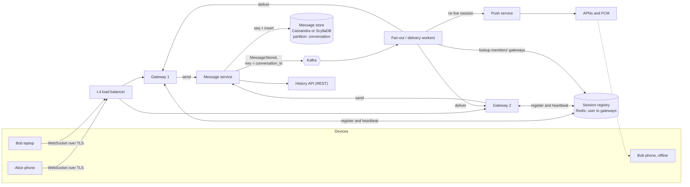
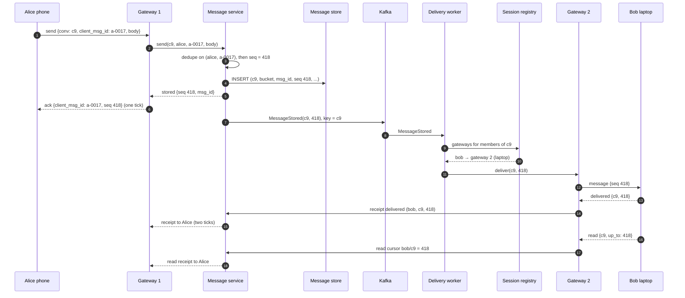
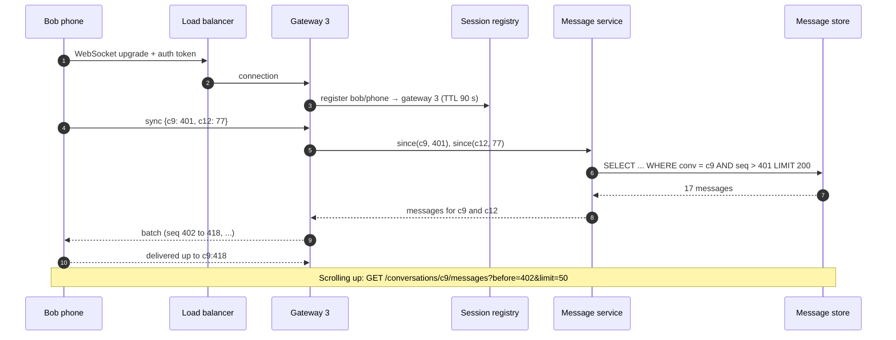

# Case Study - Chat System

> [!summary] TL;DR
> A chat system delivers messages between users in real time over long-lived connections, stores them so they can be read later on any device, and shows extras such as delivery receipts, typing indicators and online status. The core pieces are stateful connection servers (gateways), a registry that says which gateway each user is connected to, a message store partitioned by conversation, and push notifications for offline users.

> [!abstract] Core idea
> - Each device keeps one WebSocket open to a **gateway**; a **session registry** (user → gateways) tells the system where to deliver.
> - The server gives every message a **sequence number per conversation**, so all members see the same order.
> - The sending device attaches a **client message ID**; a resend after a lost acknowledgement is recognised and not stored twice.
> - Each device remembers the last sequence it has seen (a **sync cursor**) and asks for everything after it when it reconnects.
> - Small groups copy each message to every member's gateway (write fan-out); huge channels let members fetch on read.

## 1. Why it exists - requirements

Polling an HTTP endpoint every 2 seconds for new messages wastes almost every request: with 20 M connected users that is 10 M requests per second that mostly return nothing, and messages still arrive up to 2 seconds late. A chat system keeps a connection open so the server can push a message the moment it is stored. See [[Real-time APIs - WebSocket, SSE and Long Polling]] for the protocol choice.

**Functional requirements**
- One-to-one chats and group chats (up to, say, 1,000 members).
- Delivery and read receipts: sent ✓, delivered ✓✓, read.
- Typing indicators and online or last-seen presence.
- Offline users get a push notification and receive the message when they reconnect.
- Multi-device: phone, laptop and tablet all show the same history.
- Message history, scrollable back to the first message.

**Non-functional requirements**
- Delivery latency under about 200 ms between two online users in the same region (a target for this design).
- No message is lost once the sender sees "sent".
- Order inside a conversation is the same for every member and device.
- High availability: a gateway crash only forces its clients to reconnect.

**Out of scope:** voice and video calls, message search, media transcoding (media goes to object storage and the message carries a URL).

## 2. Mental model

Think of a **post office with branch counters**. Every user stands at one counter (a gateway). The central post office (the message service) stamps each letter with the next number for that conversation, files a copy in the archive (the message store), then looks up in a directory (the session registry) which counters the recipients are standing at and sends the letter there. If a recipient is not standing at any counter, the post office sends a postcard (a push notification) telling them to come and collect.

Terms used below:
- **Gateway:** a server holding many WebSocket connections. It is *stateful*: it knows which sockets belong to which users.
- **Session registry:** a fast map from user ID to the gateways and device IDs where that user is connected.
- **Fan-out:** copying one message to every recipient device.
- **Ack (acknowledgement):** a small message saying "I have it". The server acks the sender after storing; devices ack the server after receiving.

## 3. How it works - high-level design



**Send path.** Alice's phone sends a `send` event to its gateway. The message service assigns the next sequence number for the conversation, writes the message, and only then acks Alice ("sent"). It publishes `MessageStored` to Kafka keyed by `conversation_id`, so all events for one conversation stay in order in one partition (see [[Message Ordering and Partition Keys]]). Delivery workers look up each member's live gateways and forward the message; members with no live session get a push notification.



**Read and sync path.** When Bob's phone reconnects after being offline, it sends its sync cursor (the last sequence it acknowledged) for each conversation it knows about and receives everything after it. Scrolling back uses the REST history API.



## 4. Worked example - estimates, API and data model

### Whiteboard version

```text
device ==WS==> [Gateway] --send--> [Message svc: dedupe, seq++] --> [Cassandra: (conv, bucket) | msg_id]
                   ^                         |
                   |                     [Kafka key=conv] --> [Delivery workers] --registry lookup--> gateways
             [Registry: user -> gw]                                   \--offline--> [Push: APNs/FCM]
reconnect: sync {conv: last_seq} --> since(conv, last_seq)
```

Three numbers to say aloud: about 23k messages per second on average and 100k at peak, about 200 GB per day of message data, and about 100 gateways for 20 M concurrent connections.

### Estimates

All inputs are **estimates** for this exercise.

| Quantity | Arithmetic | Result |
| --- | --- | --- |
| Daily active users | given | 50 M |
| Messages per day | 50 M × 40 messages/user/day | 2 B messages/day |
| Average send rate | 2 × 10⁹ ÷ 86,400 s | ≈ 23,000 messages/s |
| Peak send rate | ≈ 4× average (evening peak, events) | ≈ 100,000 messages/s |
| Deliveries | average group size counted per message, say 3 recipient devices | ≈ 70,000 deliveries/s average, 300k/s peak |
| Storage per day | 2 B × 100 B per message (text + metadata) | ≈ 200 GB/day, ≈ 600 GB/day with 3 replicas |
| Storage per year | 200 GB × 365 | ≈ 73 TB/year before replication |
| Concurrent connections | 40% of DAU online at peak | ≈ 20 M WebSockets |
| Gateways | 20 M ÷ 200k connections per gateway (a conservative planning figure) | ≈ 100 gateways, plus headroom for one zone failing |
| Heartbeat traffic | 20 M connections ÷ 30 s interval | ≈ 670k tiny frames/s, handled inside gateways |

The connection count, not the message rate, sizes the gateway fleet. A single well-tuned server can hold millions of idle TCP connections (WhatsApp reported over 2 million on one server in 2012), but planning for far fewer per box keeps memory for TLS buffers and makes a gateway's failure less disruptive: fewer clients reconnect at once.

### API

WebSocket events (JSON shown for readability; production systems often use a binary format such as Protocol Buffers):

```json
{"type": "send", "conv": "c9", "client_msg_id": "a-0017", "body": "running late", "sent_at_device": "2026-11-04T18:02:11Z"}
{"type": "ack", "client_msg_id": "a-0017", "conv": "c9", "seq": 418, "msg_id": "1849209933341184000"}
{"type": "message", "conv": "c9", "seq": 418, "msg_id": "1849209933341184000", "from": "alice", "body": "running late"}
{"type": "delivered", "conv": "c9", "seq": 418}
{"type": "read", "conv": "c9", "up_to": 418}
{"type": "typing", "conv": "c9", "state": "start"}
{"type": "sync", "cursors": {"c9": 401, "c12": 77}}
```

REST for history and conversation management:

```http
GET /v1/conversations/c9/messages?before=402&limit=50
200 OK
{"messages": [{"seq": 401, "...": "..."}, {"seq": 400, "...": "..."}], "next_before": 352}

POST /v1/conversations        {"members": ["alice", "bob", "chen"], "title": "Trip"}
```

- `client_msg_id` is generated on the device (a UUID or a device-local counter) and reused on every resend of the same message.
- `typing` events are fire-and-forget: they are never stored and are dropped under load.
- Receipts are cursors (`up_to`), not one event per message, so reading 50 messages costs one update.

### Data model

Messages are written once and read by conversation and time range, which fits a wide-column store (see [[Wide-Column Stores and Cassandra]]). Discord used this layout in Cassandra and later moved it to ScyllaDB.

```sql
-- CQL (Cassandra / ScyllaDB). Partition = one conversation for one 10-day bucket,
-- so a busy conversation's partition never grows without bound.
CREATE TABLE messages (
    conversation_id bigint,
    bucket          int,      -- days since epoch / 10, derived from msg_id's timestamp
    msg_id          bigint,   -- time-sortable 64-bit ID (Snowflake-style)
    seq             bigint,   -- per-conversation sequence, the display order
    sender_id       bigint,
    client_msg_id   text,
    body            blob,
    PRIMARY KEY ((conversation_id, bucket), msg_id)
) WITH CLUSTERING ORDER BY (msg_id DESC);
```

Small relational tables hold membership and cursors (PostgreSQL 17):

```sql
CREATE TABLE conversation_members (
    conversation_id bigint NOT NULL,
    user_id         bigint NOT NULL,
    role            text   NOT NULL DEFAULT 'member',
    joined_at       timestamptz NOT NULL DEFAULT now(),
    PRIMARY KEY (conversation_id, user_id)
);
CREATE INDEX ON conversation_members (user_id);  -- "my conversations"

-- One row per device per conversation: what that device has received and read.
CREATE TABLE device_cursors (
    user_id         bigint NOT NULL,
    device_id       text   NOT NULL,
    conversation_id bigint NOT NULL,
    delivered_seq   bigint NOT NULL DEFAULT 0,
    read_seq        bigint NOT NULL DEFAULT 0,
    PRIMARY KEY (user_id, device_id, conversation_id)
);
```

The session registry is in Redis: `sess:{user_id}` is a hash of `device_id → gateway_id`, refreshed by heartbeats, with a 90-second expiry so a crashed gateway's entries disappear on their own.

### Ordering and idempotent send in Go

This models the message service's write path for one shard: a per-conversation counter gives a gapless order, and `(sender, client_msg_id)` makes resends harmless. In production the counter lives with the conversation's owner shard and the dedupe key in the store; the logic is the same. It compiles and passes `go vet` and `go test -race` on Go 1.24, with an injected clock.

```go
// Package chat models the message service's write path for one shard:
// a per-conversation sequence number gives a total order inside each
// conversation, and client_msg_id makes a resend after a lost ack harmless.
package chat

import (
	"sync"
	"time"
)

type Message struct {
	ConversationID string
	Seq            int64 // 1, 2, 3 ... per conversation, assigned by the server
	SenderID       string
	ClientMsgID    string // generated by the sending device, reused on resend
	Body           string
	SentAt         time.Time
}

type dedupKey struct{ conv, sender, clientMsgID string }

type Service struct {
	mu    sync.Mutex
	now   func() time.Time
	next  map[string]int64     // conversation -> last assigned seq
	log   map[string][]Message // conversation -> messages in seq order
	dedup map[dedupKey]Message // retries return the first result
}

func New(now func() time.Time) *Service {
	return &Service{now: now, next: map[string]int64{}, log: map[string][]Message{}, dedup: map[dedupKey]Message{}}
}

// Send stores a message once. A resend with the same (sender, clientMsgID)
// returns the original message and dup=true instead of storing a copy.
func (s *Service) Send(conv, sender, clientMsgID, body string) (m Message, dup bool) {
	s.mu.Lock()
	defer s.mu.Unlock()
	k := dedupKey{conv, sender, clientMsgID}
	if prev, ok := s.dedup[k]; ok {
		return prev, true
	}
	s.next[conv]++
	m = Message{ConversationID: conv, Seq: s.next[conv], SenderID: sender,
		ClientMsgID: clientMsgID, Body: body, SentAt: s.now()}
	s.log[conv] = append(s.log[conv], m)
	s.dedup[k] = m
	return m, false
}

// Since returns messages with Seq > after: what a device that has acked
// up to `after` must still receive (its sync cursor).
func (s *Service) Since(conv string, after int64, limit int) []Message {
	s.mu.Lock()
	defer s.mu.Unlock()
	msgs := s.log[conv]
	// Seq n lives at index n-1, so the slice can be cut without a search.
	if after >= int64(len(msgs)) {
		return nil
	}
	out := msgs[after:]
	if len(out) > limit {
		out = out[:limit]
	}
	return append([]Message(nil), out...)
}
```

```go
package chat

import (
	"fmt"
	"sync"
	"testing"
	"time"
)

func fixedClock() func() time.Time {
	t0 := time.Date(2026, 11, 4, 10, 0, 0, 0, time.UTC)
	return func() time.Time { return t0 }
}

func TestResendAfterLostAckIsDeduplicated(t *testing.T) {
	s := New(fixedClock())
	m1, dup1 := s.Send("c1", "alice", "dev1-0001", "hi")
	m2, dup2 := s.Send("c1", "alice", "dev1-0001", "hi") // ack was lost, client retries
	if dup1 || !dup2 || m1.Seq != m2.Seq {
		t.Fatalf("dup1=%v dup2=%v seq %d vs %d", dup1, dup2, m1.Seq, m2.Seq)
	}
	if got := s.Since("c1", 0, 10); len(got) != 1 {
		t.Fatalf("stored %d messages, want 1", len(got))
	}
}

func TestConcurrentSendersGetGaplessOrder(t *testing.T) {
	s := New(fixedClock())
	var wg sync.WaitGroup
	for u := 0; u < 8; u++ {
		wg.Add(1)
		go func(u int) {
			defer wg.Done()
			for i := 0; i < 100; i++ {
				s.Send("group", fmt.Sprint("user", u), fmt.Sprint(i), "x")
			}
		}(u)
	}
	wg.Wait()
	all := s.Since("group", 0, 10_000)
	if len(all) != 800 {
		t.Fatalf("got %d messages, want 800", len(all))
	}
	for i, m := range all {
		if m.Seq != int64(i+1) {
			t.Fatalf("position %d has seq %d: order has a gap", i, m.Seq)
		}
	}
}

func TestSyncCursor(t *testing.T) {
	s := New(fixedClock())
	for i := 0; i < 5; i++ {
		s.Send("c1", "bob", fmt.Sprint(i), "m")
	}
	got := s.Since("c1", 3, 10) // phone acked up to seq 3 before going offline
	if len(got) != 2 || got[0].Seq != 4 || got[1].Seq != 5 {
		t.Fatalf("got %+v", got)
	}
	if s.Since("c1", 5, 10) != nil {
		t.Fatal("device that is up to date should get nothing")
	}
}
```

The gapless sequence is what lets a device detect a missed message: if it holds 401 and receives 403, it asks for `since(c9, 401)` before showing 403.

## 5. Variants and comparison

| Choice | How it works | Use when | Cost |
| --- | --- | --- | --- |
| Write fan-out to members | Each message is forwarded to every member's live gateway, and an unread count per member is updated | 1:1 and small groups (up to hundreds of members) | Work per message grows with group size |
| Read fan-out (channel pull) | The message is stored once; members' clients fetch new messages for the channels they have open | Large channels and broadcast rooms (thousands to millions of members) | No per-member unread state for free; clients poll or subscribe per open channel |
| Per-gateway pub/sub | Each gateway subscribes to topics for the conversations its users are in (Redis Pub/Sub or NATS); the message service publishes once per conversation | Many gateways, conversations whose members are spread widely | Subscription churn as users connect; at-most-once, so sync cursors repair gaps |
| Server sequence per conversation | Owner shard of the conversation increments a counter | You need gapless, identical order on every device | Writes for one conversation go through one owner |
| Time-sortable ID only (Snowflake) | Order by `msg_id`; no shared counter | Very hot channels where a single counter is a bottleneck | Two messages within the same millisecond from different servers can order differently from the send order; gaps cannot be detected |
| Server-readable messages | TLS to the server, plaintext stored and indexed | Workplace chat with search, compliance export, moderation | The operator can read messages |
| End-to-end encryption | Devices encrypt for each recipient device (Signal protocol); the server stores ciphertext | Consumer privacy | No server-side search, no content moderation, harder multi-device history |

## 6. Trade-offs and when not to use

- **Stateful gateways complicate deploys.** Restarting a gateway drops up to 200k connections, which all reconnect elsewhere. Drain gateways slowly and spread restarts; see [[Scaling WebSockets]].
- **Presence is expensive.** Telling every contact when someone goes online is a fan-out per status change. Many products only show presence for open conversations or fetch it lazily.
- **Exactly-once delivery is not achievable over the network**, only effectively-once: at-least-once delivery plus dedupe by `client_msg_id` and `seq` on the receiver. See [[Delivery Semantics and Exactly-Once]].
- **If messages need not be real time** (support tickets, comments), a REST API with polling or [[Case Study - Notification System]] style push is far simpler than running a WebSocket fleet.
- **A single sequence per conversation** serialises writes for that conversation; that is fine for a group of 1,000 people typing, but a million-member broadcast channel needs time-sortable IDs and read fan-out instead.

## 7. In production

- **Real systems:**
	- Discord stores messages partitioned by channel and a time bucket, ordered by Snowflake IDs, first in Cassandra and, after a migration completed in 2022 and described in a 2023 post, in ScyllaDB.
	- WhatsApp and Signal use the Signal protocol for end-to-end encryption; for groups, WhatsApp uses Sender Keys so a sender encrypts a message once for the group rather than once per member.
- **Failure modes → fixes:**
	- Lost ack → client resends with the same `client_msg_id`; the server returns the original `seq` (tested above).
	- Gateway crash → registry entries expire after the heartbeat TTL; clients reconnect with jittered backoff and sync from their cursors (see [[Timeouts, Retries and Backoff]]).
	- Reconnect storm after a deploy or zone failure → jittered reconnect delays, admission control on gateways, and slow rolling restarts.
	- Hot group (one huge active chat) → one Kafka partition and one storage partition take its load; move huge rooms to read fan-out and bucket their partitions by time. See [[Hot Keys and Hot Partitions]].
	- Push token invalid (app uninstalled) → APNs returns HTTP 410 and FCM returns `UNREGISTERED`; delete the token.
- **What to monitor:**
	- Send-to-deliver latency p50/p99, split by online and offline recipients.
	- Connections per gateway, connect rate and reconnect rate.
	- Kafka consumer lag for delivery workers.
	- Ratio of deduplicated sends (a spike means acks are being lost).
	- Push provider error rates.

## 8. Deep dive

**Where the sequence number comes from.** A single global counter would be a bottleneck, so the counter is per conversation and owned by one place: the message service instance that owns the conversation's shard (routed by `conversation_id` with [[Consistent Hashing]]), or an atomic increment in a store such as Redis `INCR conv_seq:{c9}`. If the counter lives outside the message store, write it and the message in a way that cannot leave a gap: take the number, write the message, and if the write fails, retry with the same number rather than taking a new one.

**Group fan-out cost.** For a 500-member group with 20% online, each message is 100 gateway deliveries plus 400 unread-count updates and possibly 400 push notifications. Push notifications for busy groups are usually collapsed ("12 new messages in Trip") and rate-limited per user. Typing indicators in big groups are sampled or switched off.

**Presence.** Each device sends a heartbeat every 30 seconds; the registry key expires after about 90 seconds without one, at which point the user is offline and `last_seen` is written. Broadcasting every status change to every contact is the expensive part: a user with 500 contacts going online creates 500 events. Mitigations: only push presence to users who currently have a conversation with that person open, batch changes every few seconds, and let clients fetch presence on demand.

**Multi-device.** Each device has its own row in `device_cursors` and its own entries in the registry. A message is delivered to every live device of each member, and to the sender's other devices too, so the laptop shows what the phone sent. With end-to-end encryption, each device has its own key pair, so the sender's device encrypts once per recipient device (or uses a group sender key), and a new device cannot read old history unless an existing device transfers it.

**What end-to-end encryption removes from the server.** The server still routes, stores ciphertext, counts, and sends push notifications, but it cannot search messages, show content previews in push payloads, run content moderation or generate link previews. Those move to the clients.

**Large channels.** For a channel with 100k members, write fan-out would cost 100k deliveries per message. Instead, store the message once, notify only gateways whose users have the channel open (per-gateway subscriptions), and let other members see an unread badge computed from `latest_seq - read_seq` when they next look.

## 9. Interview questions

> [!question]- How do you guarantee that every member sees messages in the same order?
> Assign order on the server, not the client: a per-conversation sequence number from the conversation's owner shard. Devices display by `seq`, and a gap (holding 401, receiving 403) triggers a sync for the missing range.

> [!question]- The sender's network drops right after sending. How do you avoid a duplicate message?
> The device attaches a `client_msg_id` and resends with the same ID until it gets an ack. The server dedupes on `(sender, client_msg_id)` and returns the original `seq`. This gives effectively-once storage over an at-least-once network.

> [!question]- How does the system know which server to send Bob's message to?
> A session registry, usually Redis, maps `user → {device: gateway}`. Gateways write entries on connect and refresh them with heartbeats; entries expire on their own if a gateway dies.

> [!question]- Trap: "Use a database row lock per message to ensure exactly-once delivery." Is that right?
> No. The network can always lose the ack after delivery, so the sender cannot tell "not delivered" from "delivered but ack lost". Use at-least-once delivery with dedupe by `client_msg_id` and `seq` on the receiving side; locks do not change that.

> [!question]- How does an offline phone catch up?
> It stores the last delivered `seq` per conversation. On reconnect it sends `sync {conv: last_seq}` and receives everything after. While offline, the push service sends APNs or FCM notifications so the user knows to open the app.

> [!question]- Write fan-out or read fan-out for groups?
> Write fan-out for small groups: deliver to each member's gateway and update unread counts. Read fan-out for large channels: store once, deliver only to members viewing the channel, compute unread from cursors.

> [!question]- What breaks when you deploy a new gateway version?
> Every connection on a restarted gateway drops and reconnects. Drain gradually, add jitter to client reconnects, cap accepted connections per second, and keep enough spare capacity to absorb a whole zone of gateways.

## 10. Cheat sheet

A 45-minute script:

- **0-5 min, requirements:** 1:1 and groups, receipts, typing, presence, offline push, multi-device, history. Under 200 ms delivery online, no loss after "sent", same order for everyone.
- **5-10 min, estimates:** 50 M DAU × 40 = 2 B messages/day ≈ 23k/s, ≈ 100k/s peak; 100 B each → 200 GB/day; 20 M concurrent sockets ÷ 200k ≈ 100 gateways.
- **10-15 min, API and data:** WebSocket `send{client_msg_id}`, `ack{seq}`, `delivered`, `read{up_to}`, `typing`, `sync{cursors}`; REST `GET /conversations/{id}/messages?before=`. Messages in Cassandra keyed `(conversation_id, bucket)` clustered by `msg_id`; device cursors per device.
- **15-25 min, high-level design:** devices → L4 LB → gateways ↔ registry; message service (dedupe, seq, store, ack) → Kafka keyed by conversation → delivery workers → gateways or push.
- **25-40 min, deep dives:** per-conversation sequence and gap detection; idempotent send; small-group write fan-out vs large-channel read fan-out; presence heartbeats with TTL and fan-out cost; multi-device sync cursors; what E2E encryption removes.
- **40-45 min, wrap-up:** bottlenecks are connections per gateway, hot groups, reconnect storms. Monitor send-to-deliver p99, reconnect rate, consumer lag, dedupe ratio.

## Links

- **Before this:** [[Real-time APIs - WebSocket, SSE and Long Polling]], [[Scaling WebSockets]], [[Wide-Column Stores and Cassandra]], [[Unique ID Generation]]
- **Next:** [[Case Study - Ticket Booking]], [[Case Study - Notification System]]
- **Compare with:** [[Case Study - News Feed]] (fan-out of posts rather than messages), [[Pub-Sub Message Queue]] (class-level design of topics and subscribers), [[Notification Service]] (LLD twin for the push path), [[Kafka and Event Streaming]]
