# Case Study - Collaborative Document Editor

> [!summary] TL;DR
> A collaborative editor (think Google Docs) lets many people type in the same document at once and see each other's changes within a fraction of a second, with no one's typing lost.
>
> The hard part is the **merge**: two people edit the same sentence at the same moment, from different positions in the history, and every screen must still end up identical.
>
> The design is a WebSocket session per document, an **operation log** that is the source of truth, a merge algorithm (**OT** or a **CRDT**), and periodic **snapshots** so opening a document never replays millions of edits.

> [!abstract] Core idea
> - Clients send small **operations** ("insert 'x' at position 5"), never the whole document; the server stores them in an append-only log per document.
> - All clients of one document connect to the **same document server** (sticky routing), which gives edits one global order. This is the simplest way to get convergence.
> - **OT** rewrites an operation so it still means the same thing after other operations landed first. A **CRDT** gives every character a unique ID so operations commute and need no rewriting.
> - A **snapshot** every N operations plus the log tail is how a document opens fast; the log is also the version history.
> - **Presence** (cursors, "Asha is typing") is ephemeral: fast, lossy, never persisted.

## Start here: the basics 🟢

> [!info] How to read this note (pick your level)
> - 🟢 **New to this?** Read "From zero" below, then sections 1, 2 and the cheat sheet (11). Stop there, that is a full first pass.
> - 🟡 **Know the basics?** Add sections 3 (how it works), 4 (worked example), 6 (variants) and 7 (trade-offs).
> - 🔴 **Interview / SDE-3 prep?** Add 5 (deep dives), 8, 9 and 10. Headings are tagged 🟢🟡🔴 so you always know where you are.

> [!note] Before this note
> - [[CRDTs and Conflict Resolution]]: some data types can merge changes from many copies in any order and still agree.
> - [[Scaling WebSockets]]: keeping many always-open connections spread across servers.
> - [[Real-time APIs - WebSocket, SSE and Long Polling]]: a WebSocket lets the server push each edit to the browser at once.
> - [[Clocks and Ordering]]: machines cannot trust clocks to order events, so systems use counters or one orderer instead.

**From zero, in 60 seconds** 🟢

Google Docs lets many people type in the same document at the same time.
Each person's screen keeps its own copy, so typing feels instant.
Every keystroke becomes a tiny change message, called an **operation** (for example "insert 'a' at spot 5").
Those messages go to a server, which puts them in one agreed order and sends them to everyone.

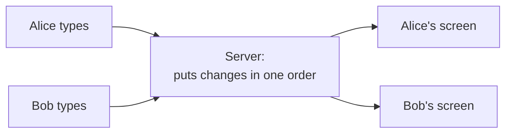

The hard part: if Alice and Bob type at the same spot at the same moment, "spot 5" means different things on each screen.
Two known fixes exist. **OT** rewrites the change so it still lands in the right place. A **CRDT** gives every letter its own ID, so positions never get confused.

So the rest of this note is just these 3 questions:
1. How do two changes made at the same moment end up the same on every screen?
2. Who decides the order, and what if that server dies?
3. How does a document with millions of changes still open fast?

**The problem in one story.**
You and a friend open the same shopping list in Google Docs.
You add "milk" at the top while your friend adds "eggs" at the bottom, in the same second.
Both screens must end up showing both items, in the same order, with nothing lost.
Making that work for many people typing at once is the collaborative editor problem.

**Words you need first**

| Word | Plain meaning | Tiny example |
| --- | --- | --- |
| Operation (op) | A small description of one edit | "insert 'x' at position 5" |
| Concurrent edits | Edits made at the same time without seeing each other | Both type in line 3 at once |
| Convergence | Everyone ends up with the identical document | Both screens show `hcats` |
| Operation log | An append-only list of every op, in order | Ops 1, 2, ..., 1207 |
| Snapshot | A saved full copy of the document at some op number | Full text as of op 1000 |
| OT | Operational transformation: adjust an op's position for ops that landed first | "insert at 3" becomes "insert at 4" |
| CRDT | A data type whose ops merge in any order to the same result | Each character has its own ID |
| WebSocket | A connection that stays open so the server can push edits | Browser keeps one socket per document |

| Revision | The server's count of ops applied so far | the document is at revision 1204 |
| Sticky routing | Sending every user of one document to the same server | all of doc 42 goes to server 7 |
| Lease | A time-limited claim, like "I own doc 42 for 15 s", that must be renewed | server 7 renews every 5 s |
| Tombstone | A marker left where a character was deleted, kept until cleanup | deleted `B` still has a hidden entry |

**Picture it**

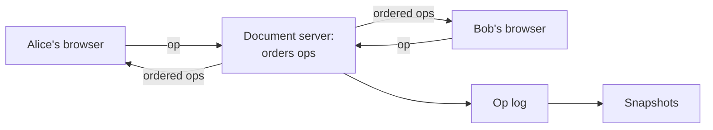

**Analogy.** Cooks with photocopies of one recipe card send small instructions to a single clerk, who numbers them and sends the list back (section 2 expands this).
Where it breaks: an instruction like "add salt after word 4" goes wrong if someone inserted a word earlier; fixing that is what OT or CRDTs do.

**How the rest of this note builds up**

- First, requirements (section 1) and the mental model (section 2).
- Then the core conflict, OT vs CRDT, and the overall architecture (section 3), then estimates, API and data model (section 4).
- Then the deep dives: safe merging, one owner per document, snapshots, presence and offline editing (section 5).
- Finally variants, trade-offs, production concerns and the SDE-3 scaling extras (sections 6-9).

> [!tip] Remember
> Send small ops, give them one order per document, merge with OT or a CRDT, and snapshot so documents open fast.

## 1. Why it exists - requirements 🟢

Think of two people editing a shared paper notebook, each with their own copy, and phoning each other when they change a line.

If both change line 3 at the same time, whose version wins?

Early tools solved this with **locking** ("only one editor at a time") or **last save wins**, and both feel broken: locking blocks your colleague, and last save wins silently deletes work.

Real-time collaboration fixes this: everyone types freely, and the system merges every keystroke. The design problem is how to merge when each person's screen has already moved on before the other's edit arrives.

**Functional requirements**
- Create, open, rename and delete documents; share with users and links (viewer, commenter, editor).
- Many editors in one document, seeing each other's edits live (target: under 200 ms between regions).
- Show presence: who is here, their cursor and selection.
- Rich text: headings, bold, lists, comments, suggestions.
- Offline editing on a laptop or phone, merged when the connection returns.
- Version history: see and restore earlier versions.

**Non-functional requirements**
- **Convergence:** once all edits are delivered, every client shows exactly the same document. This is the correctness property.
- **Intention preservation:** if you typed "world" after "hello", it stays after "hello" even if someone else inserted text before it.
- **Durability:** an acknowledged edit is never lost, even if a server dies a second later.
- **Low latency:** your own keystrokes appear instantly (local first); remote edits arrive under 200 ms.
- **Availability:** a server crash costs a reconnect, not a document.

### Real-life example: a shared trip plan 🟢

Four friends plan a Goa trip in one Google Doc. Asha types the hotel name while Ravi fixes the dates two lines above, at the same moment.
Each sees their own typing instantly, and a coloured cursor shows where the other is.
A second later both screens show both changes, and the hotel name did not get scrambled by Ravi's edit above it.
Later, "Version history" lets them see who changed what. That is everything this design must deliver.

**Out of scope:** spreadsheet formulas, the rich-text rendering engine, full-text search across documents (a separate index fed by events).

> [!tip] Remember
> The invariant is convergence plus no lost typing. Everything else (latency, presence, history) is built around it.

## 2. Mental model 🟢

Imagine a **shared recipe card** that lives in a kitchen.

Instead of passing the card around, every cook has a photocopy and writes small instructions on a **ledger** ("add salt after word 4").

A single clerk (the document server) numbers each instruction in the order they reach the clerk and hands back the numbered ledger.

Each cook replays the ledger on their own copy and gets the same card.

Where the analogy breaks: cooks do not wait for the clerk before writing on their own copy. They apply their change at once and fix it up when the clerk's order arrives. That fix-up is the whole difficulty.

Key terms (each is explained in detail in section 3):

- **Operation (op):** one small change such as `insert(pos, text)` or `delete(pos, len)`.
- **Revision:** the server's count of ops applied so far (revision 0 is the empty document).
- **OT (operational transformation):** rewrites an op so it is correct against ops that happened concurrently.
- **CRDT:** a data structure whose merge is automatic; every character has a unique ID.
- **Snapshot:** the full document at some revision, stored so we need not replay from the start.
- **Presence / awareness:** cursors and selections; temporary data.

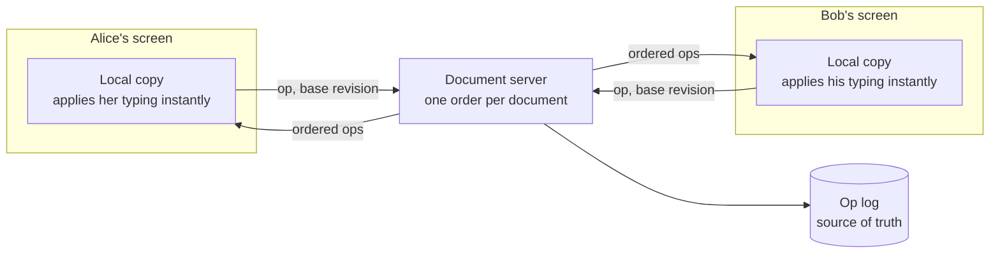

## Common beginner mistakes 🟢

- **Sending the whole document on every keystroke** → huge traffic and the last save overwrites others → send tiny ops like "insert 'x' at 5".
- **Applying a remote op at its original position** → positions have shifted, so text lands in the wrong place and screens differ → transform it (OT) or use character IDs (CRDT).
- **Making the user wait for the server before showing a keystroke** → typing feels laggy → apply locally at once and fix up when the server's order arrives.
- **Saving cursor positions in the op log** → the log fills with throwaway data → treat presence as temporary, keep it in memory or Redis with a short expiry.
- **Opening a document by replaying every op since day one** → old documents take seconds to open → load the latest snapshot and replay only newer ops.

## 3. How it works - high-level design 🟡

> 🟢 → 🟡 **You now know** the goal: everyone types at once and every screen ends up the same. **Next we open the box**: why positions break, the two known fixes (OT and CRDTs), and how the servers are arranged.

### The conflict in one picture

**In plain words:** Alice and Bob both start from the text `cat`. Alice inserts `s` at the end (`cats`). At the same moment Bob inserts `h` at the start (`hcat`).

Each applies their own edit at once. If Alice simply applies Bob's "insert h at position 0" it works.

But if Bob receives Alice's "insert s at position 3", position 3 in `hcat` is now between `a` and `t`, not the end, and he gets `hcast`.

Positions shift when other people edit, and that is the entire problem.

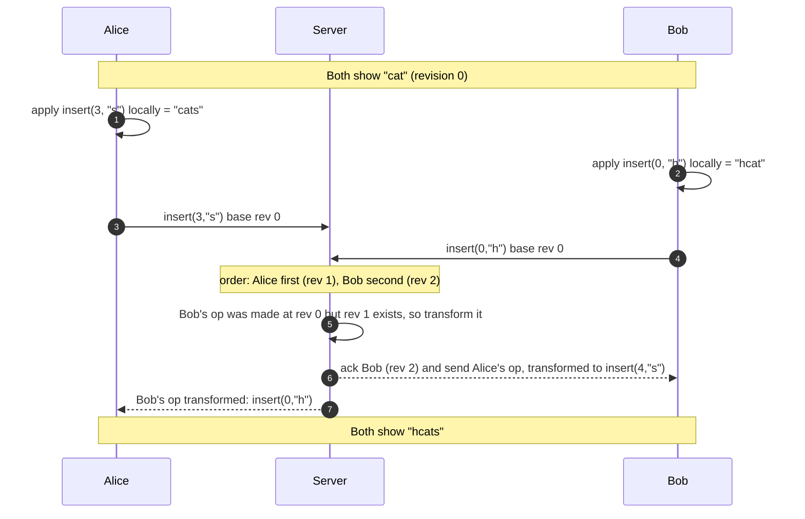

**Why it matters:** without the transform step, two screens diverge silently and nobody notices until much later.

### Option A: Operational transformation (OT)

**In plain words:** OT keeps ops as position-based edits and, when two ops were made against the same revision, **transforms** one so it still means the same thing after the other. In the example, Bob's `insert(0,"h")` is unaffected by Alice's insert at 3, but Alice's `insert(3,"s")` becomes `insert(4,"s")` once Bob's insert at 0 is known.

A single central server makes OT manageable: the server decides the order (this is the Jupiter model, a 1995 design from Xerox where one server orders everything and each client only syncs with it), each client has at most one op in flight, and the client only needs to transform against the server's ops. Google Docs publicly describes using OT.

Steps for one keystroke, client-server OT:
1. The client applies the keystroke locally and adds it to a **pending** list.
2. It sends the first pending op with the revision it was based on.
3. The server transforms the op against every op committed after that revision, appends it to the log, and increments the revision.
4. The server acknowledges the sender and broadcasts the transformed op to all others.
5. Each client transforms the incoming op against its own pending ops, then applies it.

| Pros | Cons |
| --- | --- |
| Compact ops, plain-text positions, small memory | Transform functions are hard to get right; many published algorithms had bugs |
| Fits a central-server architecture well | Needs a central server to order ops; peer-to-peer and offline are painful |
| History is a simple op list | Rich text (trees, tables) multiplies the number of transform cases |

### Option B: CRDTs

**Step by step:**
1. The text `cat` is stored as three letters with IDs: c=A1, a=A2, t=A3.
2. Alice adds `s` "after A3". It gets its own ID, say A4.
3. Bob, at the same time, adds `h` "at the very start". It gets ID B1.
4. Each op names a neighbour by ID, not a number, so it does not matter which arrives first. Both screens show `hcats`.
5. A deleted letter is only hidden (a tombstone), so later ops that point at it still find their place.

**In plain words:** a **CRDT** (see [[CRDTs and Conflict Resolution]]) removes position shifting by giving every character a unique ID, such as `(client id, counter)`, and describing an insert as "put this character after the character with ID X".

IDs never shift, so ops commute: they can arrive in any order, be duplicated, and still produce the same text.

Libraries such as **Yjs** (using the YATA algorithm, one specific rule set for ordering inserted characters) and **Automerge** implement this.

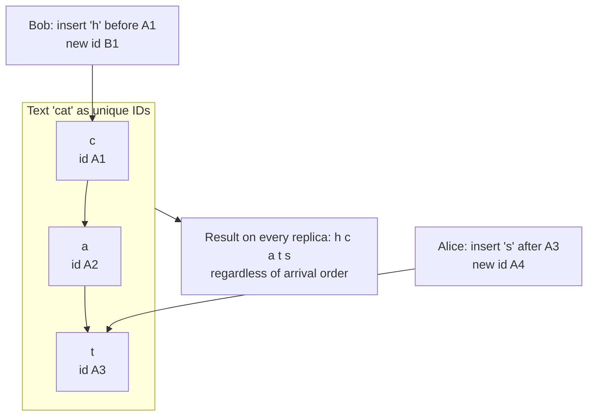

If both users insert at the same spot (both after A3), the CRDT breaks the tie with a fixed rule, for example by comparing client IDs, so every replica picks the same order.

| Pros | Cons |
| --- | --- |
| Peer-to-peer, offline-first and multi-region work naturally | Metadata per character: the document is larger in memory |
| No transform functions; merge is mathematically proven | Deleted characters leave **tombstones** (markers) until garbage collected (cleaned up once nobody needs them) |
| Server can be a dumb relay plus storage | Harder to enforce rules (permissions per paragraph) on a free-form merge |

> [!warning] Common mistake
> "CRDTs mean no server is needed." You still need a server for persistence, access control, history and fan-out. CRDTs remove the need for a server to **order** edits, not the need for a server.

### Choosing OT, CRDT or a server-authoritative hybrid

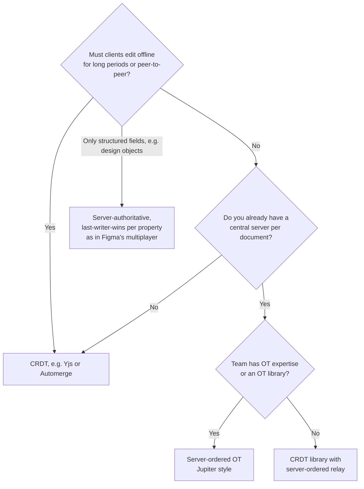

The matching decision guide for the consistency side is [[Choosing Consistency, Replication and Partitioning - Decision Guide]].

### Overall architecture

**In plain words:** browsers talk to one server per document over an open line; that server writes every change to a log and sometimes saves a full copy.

**Step by step (plain):**
1. Asha opens doc 42. Her browser opens a WebSocket.
2. The load balancer looks at "doc 42" and always sends it to the same server, say server 7.
3. Ravi opens doc 42 too and also lands on server 7. Now one server sees both of their edits.
4. Server 7 numbers each op, saves it to the op log, then tells everyone.
5. Side jobs (search, snapshots, emails) read a copy of the ops from Kafka later, so they never slow typing.

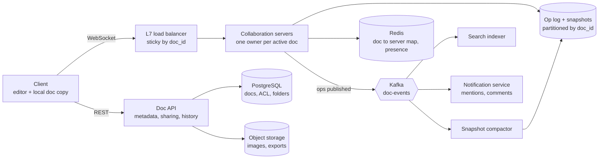

1. The client opens a WebSocket to the load balancer (an L7 one, which reads the request URL, so it can route by document), which routes by `doc_id` so everyone editing a document lands on the same collaboration server (the **document owner**).
2. That server holds the live document in memory, gives ops a total order, and appends each one to the op log before acknowledging.
3. The doc-to-server map lives in Redis so a new connection finds the owner; if the owner dies, another server takes over by loading the latest snapshot plus the log tail.
4. Non-critical consumers (search index, notifications, snapshots) read events from Kafka; they never slow typing.
5. Metadata (title, folder, sharing rules) is ordinary relational data behind a REST API.

> [!tip] Remember
> One owner per live document gives you one order for free. The rest of the design is making that owner durable and replaceable.

## 4. Worked example - estimates, API and data model 🟡

### Whiteboard version

- Scale: 100 M documents, 10 M daily active users, 2 M concurrent editors at peak (estimates).
- Op rate: a typist makes about 5 ops/s while typing; 2 M editors at 30% typing gives about 3 M ops/s peak (estimate).
- Core design: sticky WebSocket to a per-document owner, ordered op log, OT or CRDT merge, snapshots every 500 ops, ephemeral presence in Redis.
- Hardest parts: merge correctness, owner failover, opening a huge document fast.

### Estimates

**In plain words:** rough sums: how many people type at once and how many tiny changes per second that makes.

Labelled as estimates; state your assumptions aloud in the interview.

| Quantity | Assumption | Result |
| --- | --- | --- |
| Daily active users | given | 10 M |
| Concurrent editors at peak | 20% of DAU online at once | 2 M |
| Average ops per second while typing | about 5 (keystrokes batched at 200 ms) | 5 |
| Typing fraction of connected time | 30% | 0.3 |
| Peak ops/s | 2 M x 0.3 x 5 | about 3 M ops/s |
| Op size | small JSON or binary | about 100 bytes |
| Peak inbound bandwidth | 3 M x 100 B | about 300 MB/s |
| Typical collaborators per document | 1 to 5, rarely over 100 | fan-out is small |
| Outbound bandwidth | each op goes to about 3 other collaborators on average (assumed): 3 M x 3 x 100 B | about 0.9 GB/s (cheap per server: about 9 MB/s each across 100 servers) |
| Op log growth per day | 3 M ops/s is peak; assume the daily average is 10% of peak, so 0.3 M ops/s x 86,400 s x 100 B | about 2.6 TB/day (about 950 TB/year before compression) |
| Collaboration servers | 20,000 concurrent editors per server (WebSocket plus merge in memory) | about 100 servers at peak |

Takeaways: the bottleneck is connections and per-document ordering, not raw bandwidth; fan-out per document is tiny (mostly 1 to 5), which is why one owner per document works.

### API

**In plain words:** normal web calls for opening and sharing documents, and an always-open line for the live typing.

Documents and sharing are plain REST; editing is a WebSocket protocol.

| Call | Purpose |
| --- | --- |
| `POST /v1/docs` | create a document, returns `doc_id` |
| `GET /v1/docs/{id}` | metadata and current role of the caller |
| `PUT /v1/docs/{id}/acl` | share with a user or link |
| `GET /v1/docs/{id}/history?cursor=` | list versions for the history panel |
| `POST /v1/docs/{id}/restore` | restore a version (creates a new revision) |
| `WS /v1/docs/{id}/session` | live editing |

WebSocket messages (JSON for clarity; production uses a binary format):

```json
{ "type": "op", "client_id": "c9", "client_seq": 41, "base_rev": 1204,
  "ops": [{ "insert": { "pos": 17, "text": "world" } }] }
{ "type": "ack", "client_seq": 41, "rev": 1207 }
{ "type": "remote_op", "rev": 1206, "author": "u7", "ops": [{ "delete": { "pos": 3, "len": 2 } }] }
{ "type": "presence", "user": "u7", "cursor": 17, "selection": [17, 22] }
```

`client_seq` makes the op **idempotent**: if the WebSocket drops before the ack, the client resends the same `client_seq` and the server recognises it and returns the existing ack rather than applying the op twice (see [[Idempotency and Idempotency Keys]]).

### Data model

**In plain words:** three kinds of storage: the list of every change, saved full copies, and short-lived cursor positions.

| Store | Table / key | Fields | Why this store |
| --- | --- | --- | --- |
| PostgreSQL | `docs` | `doc_id`, `owner`, `title`, `folder_id`, `latest_rev`, `created_at` | relational metadata, joins on sharing |
| PostgreSQL | `acl` (access control list: who may view, comment or edit) | `(doc_id, principal)`, `role` | permission checks on every connect |
| Op log (partitioned by `doc_id`, e.g. Cassandra or a sharded SQL table) | `ops` | `(doc_id, rev)` primary key, `author`, `client_id`, `client_seq`, `payload`, `ts` | append-only, read as a range per document |
| Op log store | `snapshots` | `(doc_id, rev)`, `blob` | fast open |
| Redis | `doc:{id}:owner` | server id with TTL lease | find the owner |
| Redis | `presence:{id}` | hash of user to cursor, TTL 30 s | ephemeral |

The primary key `(doc_id, rev)` is also the **idempotency and ordering guard**: two writers cannot both claim revision 1207 for the same document.

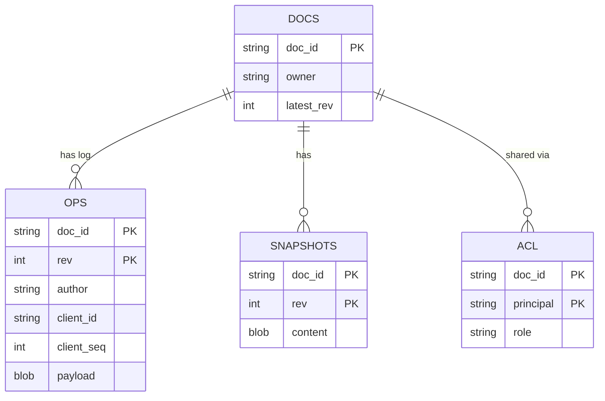

**Opening a document: step by step**
1. The client calls `GET /v1/docs/{id}`; the API checks the ACL.
2. The client opens the WebSocket; the load balancer routes to the owner server.
3. The server finds the latest snapshot (say at revision 1000) and the log tail (revisions 1001 to 1204).
4. It sends the snapshot and the tail; the client replays the tail and is at revision 1204.
5. The server streams every new op from then on.

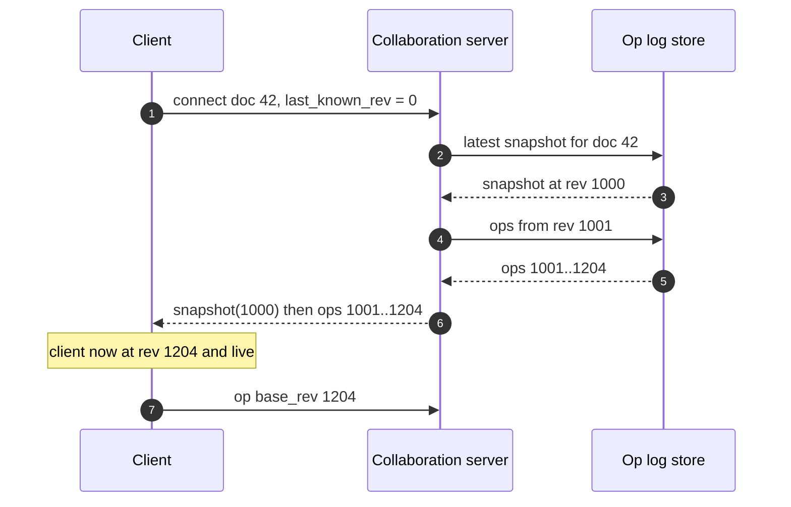

## 5. Deep dives 🔴

> 🟡 → 🔴 **You now know** the architecture, the API, the data model and how a document opens. **Next is the advanced part**: exactly how concurrent edits are merged, what happens when the owner server dies, snapshots, cursors and offline editing.

### Deep dive 1: merging concurrent edits safely

**In plain words:** the server never trusts a client's position blindly. It stamps each op with a revision, and the client says which revision it was based on. If other ops landed in between, the server must adjust the op.

**Example with numbers.** Document is `ABCDE` at revision 10.
- Alice (base rev 10): `delete(1, 2)` removes `BC`.
- Bob (base rev 10): `insert(3, "X")` puts X between C and D.
- The server accepts Alice first (rev 11), then transforms Bob's op against it: Bob's position 3 was after `BC`, which are now gone, so it becomes position 1: `insert(1, "X")`.
- Result everywhere: `AXDE`. Without the transform Bob's op would land at position 3 of `ADE` and give `ADEX`, which is wrong.

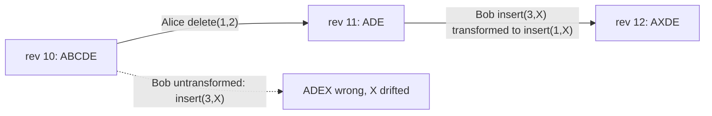

**What if two inserts hit the same position?** A fixed tie-break (for example, lower client ID goes first) must apply on every client and the server. Missing tie-breaks are the classic OT bug that causes permanent divergence.

**Why it matters:** this is the part interviewers push on. Say clearly: the server orders, the client transforms against its pending ops, and the tie-break rule is deterministic.

### Deep dive 2: one owner per document, and failover

**In plain words:** sticky routing means one process orders the edits of one document. If it dies, a new one must take over without losing or reordering anything.

The owner holds a **lease** in Redis (`SET doc:42:owner srv-7 NX EX 15`: set only if nobody holds it, expire in 15 s; renewed every 5 s).

Writes to the op log carry the primary key `(doc_id, rev)`, so even if two servers briefly think they own the document, only one can write revision 1207; the other gets a duplicate-key error and steps down.

This is a **fencing** guard: see [[Distributed Locks and Fencing Tokens]] for why a lease alone is not safe, and [[Leader Election]] for the general pattern.

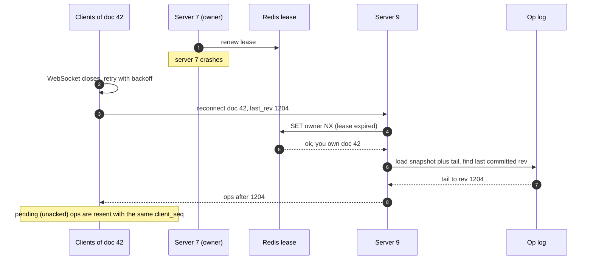

Pending ops that the dead server never acknowledged are resent by the client; the `client_seq` check makes the resend safe. Ops that were already in the log are recognised and simply acknowledged.

**What if the owner is slow, not dead?** The lease expires, a new owner appears, the old one wakes up and tries to write revision 1207: it fails on the primary key and disconnects its clients. Writes are the source of truth, not the lease.

### Deep dive 3: snapshots, compaction and version history

**In plain words:** replaying 5 million ops to open an old document would take seconds. A **snapshot** is a saved copy of the document at a revision; opening loads the latest snapshot and replays only newer ops.

Rules of thumb:
- Take a snapshot every N ops (for example 500) or every 2 minutes of activity, whichever comes first.
- The compactor (a Kafka consumer) reads the log, builds the document at revision R and stores `snapshots(doc_id, R)`.
- Keep older snapshots at a coarser grain (hourly, daily) for **version history**; restoring a version is a new revision that sets the content, not a rewind of the log.
- For CRDTs, compaction also **garbage collects tombstones** once every replica has acknowledged the deletion; until then deleted text still costs memory.

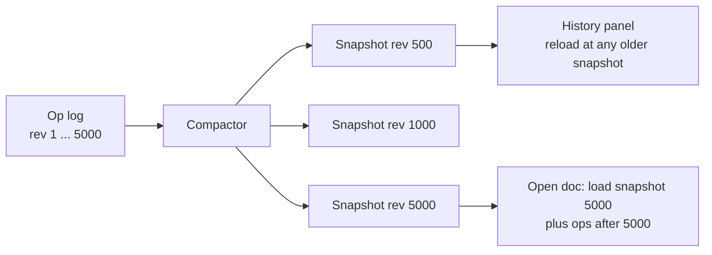

### Deep dive 4: presence and cursors

**In plain words:** knowing where Bob's cursor is matters for the feel of collaboration but not for correctness. If a cursor update is lost, the next one fixes it. So presence skips the durable path completely.

- Cursor and selection messages go over the same WebSocket but are **not** written to the op log.
- They are throttled (about 10 per second per user) and sent only to others in the same document.
- The latest position per user is held in Redis with a short TTL, so a crashed client's cursor disappears on its own.
- Cursors must also be transformed when ops arrive: if Bob's cursor is at position 17 and Alice inserts 5 characters before it, Bob's cursor moves to 22. CRDT libraries expose positions as relative IDs, which makes this automatic.

### Deep dive 5: offline editing

**In plain words:** offline means a client collects many pending ops for minutes or hours and then sends them all. With central OT this is a long chain of transforms against a long server history; with CRDTs the client simply sends its changes since a known state and the merge needs no transform.

1. The client stores pending ops in local storage (IndexedDB).
2. On reconnect it sends `last_known_rev` and its pending ops.
3. The server (OT) transforms them against the whole gap, or (CRDT) merges the state difference.
4. The client receives everything it missed and rebases (re-applies its own pending edits on top of the new server state).

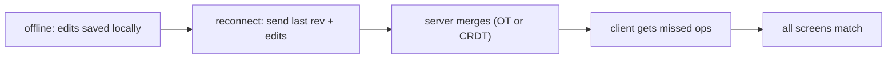

> [!warning] Common mistake
> Treating offline edits as "last save wins" per document. That wipes everyone else's work done during those minutes. Merge at the operation level.

## 6. Variants and comparison 🟡

| Approach | Ordering | Offline | Server role | Used by (public information) |
| --- | --- | --- | --- | --- |
| Server-ordered OT | server total order | limited | central, authoritative | Google Docs (per Google blog) |
| CRDT with server relay | none needed | strong | persistence, auth, relay | Yjs and Automerge based apps |
| Peer-to-peer CRDT | none | strong | optional signalling | local-first apps |
| Server-authoritative LWW (last writer wins) per property | server | limited | authoritative | Figma multiplayer (design objects, not text) |
| Locking (one editor) | lock | none | lock manager | older document systems, file check-out |
| Last save wins | none | n/a | none | naive file sync; loses edits |

### Things people confuse this with 🟡

| System | What it syncs | How it differs |
| --- | --- | --- |
| [[Case Study - File Storage and Sync]] (Dropbox) | Whole files | Conflicts become "conflicted copy" files; no live merge of keystrokes |
| [[Case Study - Chat System]] | New messages appended to a list | Nobody edits the middle of someone else's message, so no position shifting |
| Git | Code files | Merges happen later and by hand when lines clash; not live |

## 7. Trade-offs and when not to use 🟡

- **OT versus CRDT:** OT keeps documents small and is mature for central servers, but transform code is subtle; CRDTs are simpler to reason about and give offline, but cost memory per character and need tombstone cleanup. Choose OT when you already need a central server and plain text; choose CRDTs for offline-first or peer-to-peer.
- **Sticky owner versus stateless servers:** sticky routing gives ordering cheaply but makes failover a real design item. Stateless servers with a shared lock per op would add latency on every keystroke.
- **Operation size versus batching:** batching keystrokes every 200 ms cuts traffic 5 to 10 times but adds a small delay for remote viewers.
- **Hot documents:** a company all-hands doc with 5,000 readers and 20 editors has high fan-out. Treat viewers differently: editors on the owner server, viewers on read-only fan-out nodes fed from the same stream.
- **Not worth it:** for forms or settings pages with rare concurrent edits, use optimistic locking with a version column ([[Locking - Optimistic vs Pessimistic]]) and show a conflict dialog.

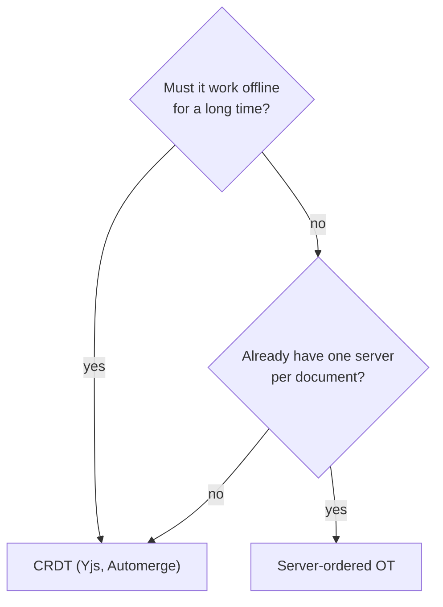

## 8. In production 🔴

- **Failure modes and fixes**
  - Owner crash: clients reconnect with backoff and jitter; new owner loads snapshot plus tail; resent ops are deduplicated by `client_seq`.
  - Reconnect storm after a deploy: gradual rollout, connection draining, jittered retry; see [[Scaling WebSockets]].
  - Poison document (an op that crashes the merge code): quarantine that `doc_id`, fall back to the last good snapshot, keep other documents running.
  - Divergence bug (two clients differ): detect with a periodic **checksum** (a short number computed from the whole text; equal text gives an equal checksum) of the document sent by clients; on mismatch the client reloads from the server snapshot.
  - Huge document: cap op size and document size; load in chunks (paragraph-level lazy loading).
- **What to monitor:** WebSocket connections per server, op ack latency p99, op-to-remote-delivery latency, owner failovers per hour, checksum mismatches, snapshot lag (ops since last snapshot), op log write errors.
- **Security:** check the ACL on connect and on every op (a viewer's op is rejected), expire access when a share is revoked by closing the socket, rate-limit ops per connection, and validate op size and structure.
- **Privacy and compliance:** deleting a document must delete log and snapshots; version history must honour retention rules.

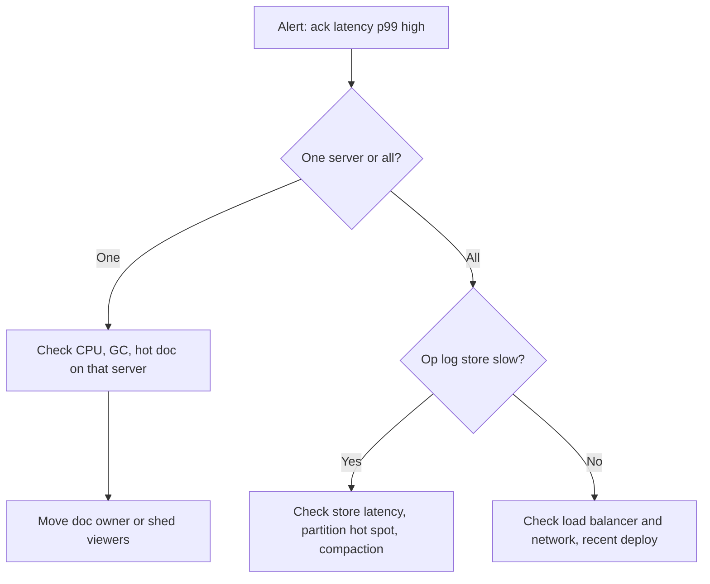

## 9. Deep dive extras: scaling the design 🔴

**To 10x traffic.** Add collaboration servers behind the sticky load balancer (shard owners by `hash(doc_id)` with consistent hashing, see [[Consistent Hashing]]); partition the op log by `doc_id`; scale Redis presence by cluster. Because documents rarely have many editors, the system scales almost linearly with the number of documents.

**To multi-region.** Give each document a **home region** (where most editors are); remote editors connect to a nearby edge (a server close to the user) but ops are forwarded to the home owner, costing one cross-region round trip (about 100 to 150 ms) for remote collaborators. CRDT-based designs can instead accept writes in every region and merge asynchronously. See [[Multi-Region Architecture]].

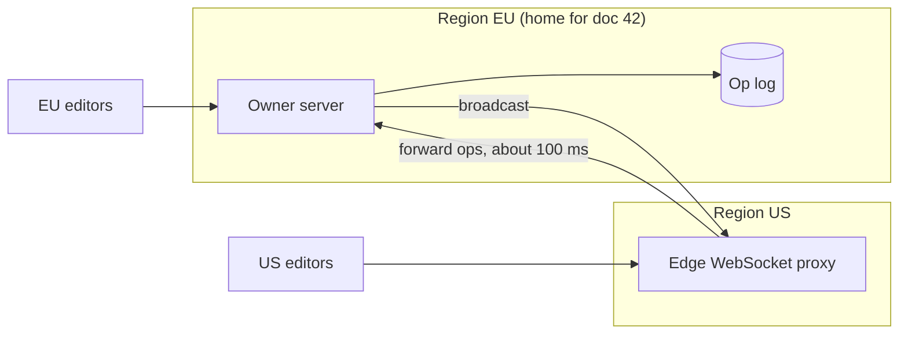

## 10. Interview questions 🔴

> [!question]- Why not just lock the document while someone edits?
> Locking serialises users, so a second person waits or is blocked, which defeats real-time collaboration. It also leaves stale locks when a user closes the laptop. Operation-level merging lets everyone type at once.

> [!question]- Explain OT with an example where positions shift.
> Document `ABCDE`, Alice deletes `BC` (positions 1 to 2), Bob concurrently inserts `X` at position 3. After the server applies Alice's op, Bob's insert must move to position 1 so X lands between A and D. Result `AXDE`. Without the transform it would be `ADEX`.

> [!question]- OT or CRDT, which do you pick and why?
> With a central server and mostly online users, server-ordered OT is compact and mature. If offline editing, peer-to-peer or multi-region writes matter, a CRDT such as Yjs avoids ordering and transforms at the cost of per-character metadata. Either way the server still persists, authorises and fans out.

> [!question]- Trap: "CRDTs need no server." True?
> No. CRDTs remove the need for a server to order edits. You still need a server for durable storage, permissions, version history, search and notifications, and for clients that are not online at the same time.

> [!question]- The collaboration server crashes mid-edit. What does the user see and what happens?
> The WebSocket drops; the client keeps typing locally, reconnects with jittered backoff, and a new owner loads the latest snapshot plus log tail. The client resends unacknowledged ops with their `client_seq`; ops already in the log are acknowledged without being applied twice.

> [!question]- How do you stop a slow old owner from corrupting the log after a new owner takes over?
> The op log's primary key `(doc_id, rev)` rejects a second write of the same revision, so the old owner's write fails and it disconnects. The lease only decides who normally owns the document; the write path is the real guard (a fencing check).

> [!question]- How do you open a document with 5 million ops quickly?
> Periodic snapshots (for example every 500 ops) plus replay of the log tail. The compactor runs asynchronously from Kafka, and older snapshots are retained at coarser intervals for version history.

> [!question]- A document is being edited by 5,000 people. What changes?
> Fan-out is no longer tiny. Keep the few real editors on the owner, move viewers to read-only fan-out nodes fed from the op stream, throttle presence, and cap cursor broadcasts to nearby viewers.

## Self-check 🟢🟡

> [!question]- Easy: what is an operation (op)?
> A tiny description of one edit, like "insert 'x' at position 5".

> [!question]- Easy: why does your own typing appear instantly?
> The browser applies it to its local copy first, before the server answers.

> [!question]- Easy: why keep snapshots?
> So opening a document loads one saved copy and replays only recent ops, not millions.

> [!question]- Medium: `ABCDE`, Alice deletes `BC`, Bob inserts `X` at 3 at the same time. Final text?
> `AXDE`: Bob's insert is transformed to position 1 after Alice's delete is applied.

> [!question]- Medium: how does a CRDT avoid position shifting?
> Each character has a unique ID, and inserts say "after character ID X", which never changes.

> [!question]- Medium: two servers both think they own doc 42. What stops corruption?
> The op log's key `(doc_id, rev)` lets only one write revision 1207; the other gets an error and steps down.

## 11. Cheat sheet 🟢

A 45-minute script:

- **0 to 5 min, requirements:** live co-editing, presence, offline, history, sharing. Invariants: convergence, intention preserved, no lost acknowledged edit.
- **5 to 10 min, estimates:** 2 M concurrent editors, about 3 M ops/s peak, about 100 servers at 20,000 editors each; fan-out per document is 1 to 5.
- **10 to 15 min, API and data:** REST for metadata and ACL; WebSocket with `op`, `ack`, `remote_op`, `presence`; op log keyed `(doc_id, rev)`; snapshots; Redis for owner and presence.
- **15 to 25 min, diagram:** sticky L7 LB, per-document owner, op log, snapshots, Kafka consumers for search and notifications.
- **25 to 40 min, deep dives:** OT worked example, CRDT alternative, owner failover with fencing, snapshots, presence, offline.
- **40 to 45 min, wrap-up:** monitoring (ack latency, failovers, checksums), multi-region home-region model, hot-document handling.

## Links

- **Before this:** [[CRDTs and Conflict Resolution]], [[Scaling WebSockets]], [[Real-time APIs - WebSocket, SSE and Long Polling]], [[Clocks and Ordering]]
- **Related case studies:** [[Case Study - Chat System]], [[Case Study - File Storage and Sync]]
- **Decision guides:** [[Choosing Consistency, Replication and Partitioning - Decision Guide]], [[Choosing an API and Communication Style - Decision Guide]], [[Choosing a Database - Decision Guide]], [[Choosing a Caching Strategy - Decision Guide]]
- **Patterns used:** [[Leader Election]], [[Distributed Locks and Fencing Tokens]], [[Event Sourcing]], [[Idempotency and Idempotency Keys]], [[Consistent Hashing]], [[Multi-Region Architecture]], [[Locking - Optimistic vs Pessimistic]]
- **Method:** [[HLD Round - Complete Step-by-Step Guide]]

### Watch on YouTube

- [✅ System Design 10: Design Real-time Collaborative Text Editor like Google Docs / Notion / HLD / LLD](https://www.youtube.com/watch?v=-eMtcFqj8vI) · InterviewWithBunny · 66 min · 22,823 views
- [Build Google Docs / A Real-World LLD Project / Document Editor LLD /](https://www.youtube.com/watch?v=MT9qZFGQXOU) · Coder Army · 45 min · 142,026 views
