# Case Study - Digital Wallet and Ledger

> [!summary] TL;DR
> A digital wallet (Paytm, PhonePe, PayPal balance, Cash App) lets people hold money inside the system and move it instantly between users and merchants.
>
> The design is a **double-entry ledger** of immutable entries, a derived **balance** per wallet, **idempotent transfers**, and a plan for moving money between wallets that live on different database shards without ever creating or destroying a rupee.

> [!abstract] Core idea
> - Money is never "updated". Every movement is a **transaction** made of balanced ledger entries (total debits equal total credits), written once and never changed.
> - The wallet balance is a cache of the ledger, kept in the same database transaction as the entries so they cannot disagree.
> - Every request carries an **idempotency key**, so a retry after a timeout does not move money twice.
> - Same-shard transfers use one local ACID transaction. Cross-shard transfers use a **saga with holds** (reserve, then commit or release), not distributed locks.
> - A **reconciliation** job continuously proves that the sum of all balances equals the sum of the ledger, and that the wallet matches the bank.

## Start here: the basics

**The problem in one story.**
You have ₹1,000 in a wallet app and send ₹300 to a friend.
The network drops and you tap "Send" again. You must still pay only ₹300.
If the server crashes halfway, the money must not vanish from you without reaching your friend.
A wallet's job is to make "pay twice" and "money disappears" impossible, even with retries and crashes.

**Words you need first**

| Word | Plain meaning | Tiny example |
| --- | --- | --- |
| Ledger | An append-only record of every money movement | "₹300 from Asha to Ravi, txn 91" |
| Double entry | Every movement is written as a debit and an equal credit | −300 Asha, +300 Ravi |
| Balance | The current total in a wallet, derived from the ledger | Asha: ₹700 |
| Transaction (DB) | A group of writes that all succeed or all fail | Debit and credit saved together |
| Idempotency key | A unique ID per request so a retry is recognised | `key = "pay-abc123"` sent twice, applied once |
| Shard | One slice of the data on its own database | Wallets A-M on shard 1 |
| Saga | A multi-step operation with an undo for each step | Hold money, credit, then capture or release |
| Reconciliation | Checking two records agree, and flagging if not | Sum of balances = sum of ledger |

**Picture it**

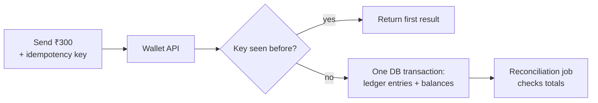

**Analogy.** A shopkeeper's ink cash book: every movement is a "from" line and a "to" line, never erased; mistakes get a new correcting line (section 2 expands this).
Where it breaks: one cash book sits in one shop; a large wallet splits its book across many shards, so one transfer can touch two books.

**How the rest of this note builds up**

- First, requirements (section 1) and the mental model (section 2).
- Then the high-level design and estimation (section 3), and the API, data model and one transfer step by step (section 4).
- Then variants and trade-offs (sections 5-6) and production notes (section 7).
- Finally the SDE-3 deep dive: idempotency, cross-shard sagas with holds, hot wallets, reconciliation, scaling and failure handling (section 8).

> [!tip] Remember
> Never update money in place: write balanced, immutable ledger entries with an idempotency key, in one transaction with the balance.

## 1. Why it exists - requirements

You hold ₹1,000 in a wallet app.

You send ₹300 to a friend. Your phone shows a spinner, the network drops, and you tap "Send" again.

If the system simply does `balance = balance - 300` on every request, you just paid ₹600. Or the server subtracts from you, crashes, and never adds to your friend: ₹300 vanished.

A wallet exists to make these two failures impossible: **no double spend and no lost money**.

**Functional requirements**
- Create a wallet for a user or merchant, with a currency.
- **Top-up**: add money from a bank account, card or UPI through a PSP (see [[Case Study - Payment System]]).
- **Transfer** between two wallets (peer to peer, or customer to merchant).
- **Withdraw** to a bank account.
- **Balance and history**: current balance and a paginated list of transactions.
- **Holds**: reserve an amount for a pending purchase, then capture or release it.
- **Refunds and reversals**.
- Limits and compliance: per-day limits, KYC tiers, fraud holds (mention, do not design).

**Non-functional requirements**
- **Correctness above all.** Balances never negative (unless the product allows overdraft), money is conserved, every movement is traceable.
- **Exactly-once effect** for each transfer, built from at-least-once delivery plus idempotency (see [[Delivery Semantics and Exactly-Once]]).
- **Strong consistency** for balances and ledger; eventual consistency is fine for notifications, search and analytics.
- **Latency:** p99 under 500 ms for a transfer (an estimate of a typical target).
- **Availability:** about 99.95% for transfers (an estimate); failing safely beats guessing.
- **Auditability:** any balance can be explained from the entries, for years.
- **Scale:** tens of millions of wallets and thousands of transfers per second at peak (see estimates).

> [!tip] Remember
> The first sentence in the interview: "money must be conserved, so I model it as immutable double-entry ledger entries, and every write is idempotent."

## 2. Mental model

Think of the paper cash book at a small shop.

Every time money moves, the owner writes one line in the "from" column and one in the "to" column, in ink, never erasing. The total in the left column always equals the total in the right column.

If a mistake happens, the owner does not scratch it out; they write a new correcting line.

The balance on the shelf (the "wallet balance") is a handy running total that the owner updates at the same moment as writing the line.

Mapped to the system:
- **Ink, never erase** = append-only ledger entries; corrections are reversing entries.
- **Two columns that match** = every transaction's debits equal its credits.
- **Running total on the shelf** = the wallet `balance` column, updated in the same database transaction.
- **A receipt number** = the idempotency key, so writing the same sale twice is impossible.
- **Month-end audit** = reconciliation against the ledger and the bank statement.

Where the analogy breaks: a shop has one cash book. A large wallet spreads its books across many database shards, so "move money from page 3 to page 91" needs a careful protocol.

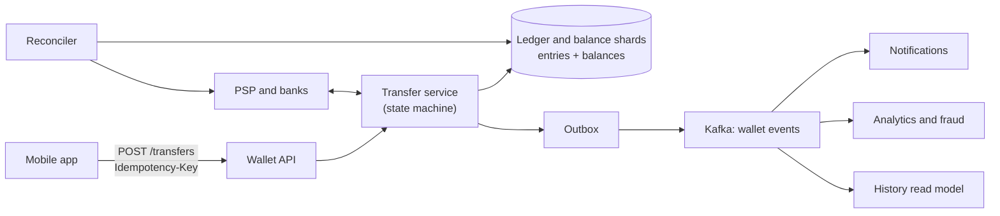

## 3. How it works - high-level design

1. **Request.** The app calls `POST /v1/transfers` with `from_wallet`, `to_wallet`, `amount_minor`, `currency` and an `Idempotency-Key` header created once per user action.
2. **Claim the key.** The API inserts the key into an `idempotency_keys` table with a unique constraint (atomic `INSERT ... ON CONFLICT DO NOTHING`). If the key already exists, it returns the stored result, or "in progress".
3. **Validate.** Check both wallets exist and are active, currencies match, amount is positive, the daily limit is not exceeded, and fraud rules pass.
4. **Move the money.**
   - **Same shard:** one local transaction debits `from`, credits `to`, appends two ledger entries and an outbox row. It commits or rolls back as a unit.
   - **Different shards:** run a saga with a hold (see deep dive 2).
5. **Respond.** Return `201` with the transfer id, or `202` if the saga is still running.
6. **Publish events.** An outbox relay (see [[Transactional Outbox and CDC]]) sends `transfer.completed` to Kafka so notifications, history and fraud systems update asynchronously.
7. **Reconcile.** Background jobs repair stuck sagas and check invariants.

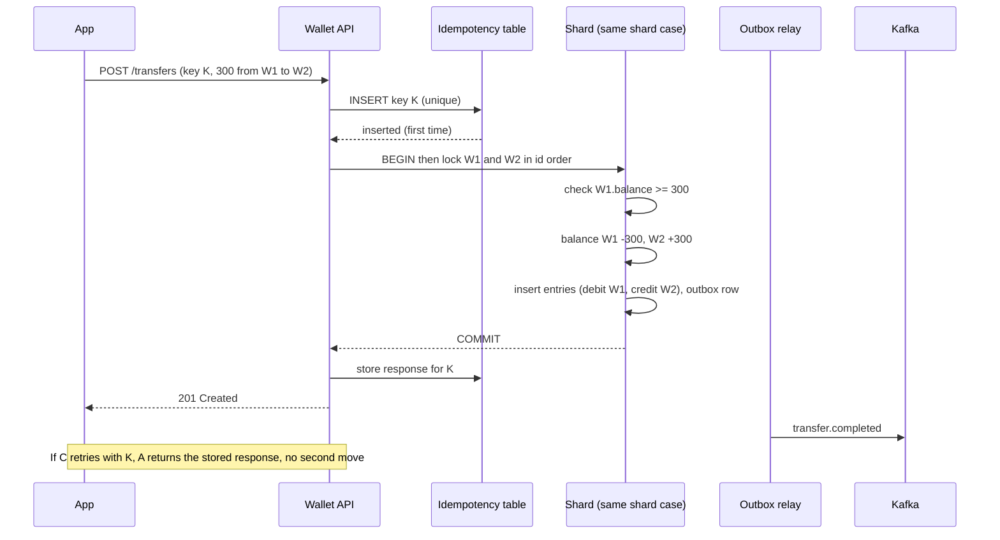

### Whiteboard version

```text
POST /transfers {from,to,amount,Idempotency-Key}
  1. INSERT idempotency_keys(K) ON CONFLICT DO NOTHING   -> not first? return stored result
  2. same shard:  BEGIN
                    SELECT balances WHERE id IN (from,to) ORDER BY id FOR UPDATE   -- no deadlock
                    check from.balance >= amount
                    UPDATE balance from -= amount ; to += amount
                    INSERT ledger_entries (debit from) (credit to)  same txn_id
                    INSERT outbox(transfer.completed)
                  COMMIT
  3. cross shard: saga = HOLD on source -> CREDIT on dest -> CAPTURE hold
                  failure at any step -> compensate (release hold / reverse credit)
Balance = sum(entries) ; balances table is a same-transaction cache
Reconcile: sum(all balances) == sum(credits)-sum(debits) ; ledger vs bank statement
Estimate: 20M transfers/day ~ 230/s avg ~ 2,300/s peak ~ 16K row writes/s
```

### Estimation (all inputs are labelled estimates)

| Quantity | Arithmetic | Result |
| --- | --- | --- |
| Wallets (estimate) | given | 50,000,000 |
| Transfers per day (estimate) | given | 20,000,000 |
| Average TPS | 20,000,000 / 86,400 s | ≈ 231 /s |
| Peak TPS (estimate 10× during evening and festival) | 231 × 10 | ≈ 2,310 /s |
| Rows written per transfer | 1 key + 2 entries + 2 balances + 1 transfer + 1 outbox | ≈ 7 rows |
| Peak row writes | 2,310 × 7 | ≈ 16,200 rows/s |
| Ledger size per transfer (estimate 1 KB for entries, indexes, outbox) | 20,000,000 × 1 KB | ≈ 20 GB/day ≈ 7.3 TB/year |
| One PostgreSQL primary, simple transactional writes (estimate) | rule of thumb | a few thousand transactions/s |
| Shards needed with 3× headroom (estimate) | 2,310 TPS × 3 / ~1,000 TPS per shard | ≈ 7, round up to 8 or 16 |

Conclusions:
- Peak is a few thousand transactions per second. This is not the "1 million TPS" of some textbook variants. Sharding is needed, but only to a handful of database primaries, not thousands.
- The storage grows by terabytes a year, so old entries are partitioned by month and archived while balances and recent history stay hot.
- If asked for 1 million TPS: with about 1,000 TPS per node that is about 1,000 nodes, so the design becomes shard-by-wallet with a mostly in-shard workload and sagas for the rest.

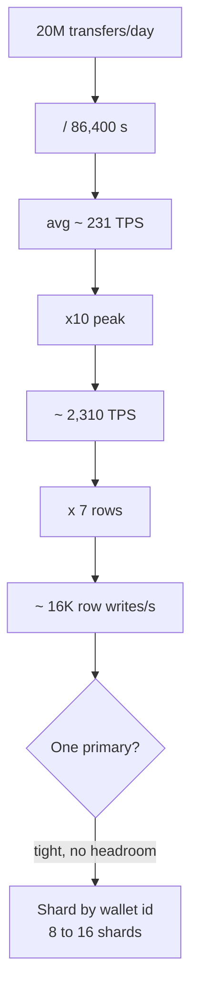

## 4. Worked example - API, data model and one transfer

### API

```http
POST /v1/transfers
Idempotency-Key: 3b2f9a5c-71d4-4a0f-8a65-9c0c2b6a1f11
Content-Type: application/json

{"from_wallet": "w_1001", "to_wallet": "w_2002", "amount_minor": 30000, "currency": "INR", "note": "dinner"}

201 Created
{"id": "tr_77", "status": "completed", "amount_minor": 30000}

202 Accepted      (cross-shard saga still running; client polls)
{"id": "tr_77", "status": "pending"}

409 Conflict      (same key reused with a different body)
422 Unprocessable (insufficient funds, limit exceeded, wallet frozen)
```

- `GET /v1/wallets/{id}` returns balance and held amount.
- `GET /v1/wallets/{id}/transactions?cursor=...` returns history (keyset pagination; see [[Pagination, Filtering and Sorting]]).
- `POST /v1/holds`, `POST /v1/holds/{id}/capture`, `POST /v1/holds/{id}/release` for merchant checkouts.
- `POST /v1/topups` and `POST /v1/withdrawals`, each with its own idempotency key.

Rules: amounts are **integers in minor units** (paise) plus a currency code; never floating point. Every write endpoint requires an idempotency key (see [[Idempotency and Idempotency Keys]]).

### Data model

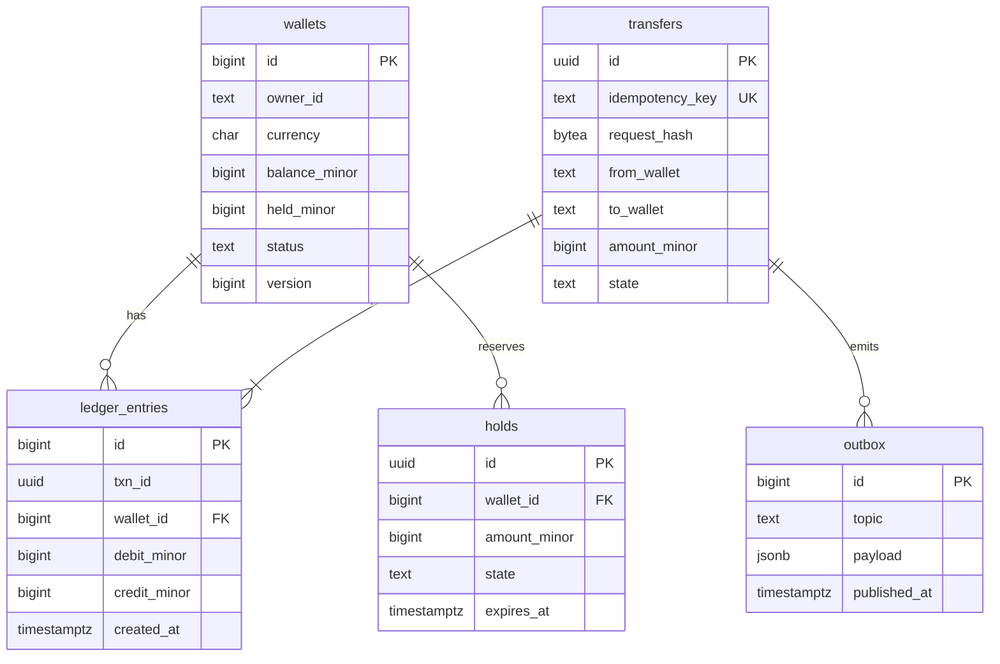

```sql
CREATE TABLE wallets (
    id             bigint PRIMARY KEY,
    owner_id       text    NOT NULL,
    currency       char(3) NOT NULL,
    balance_minor  bigint  NOT NULL DEFAULT 0,
    held_minor     bigint  NOT NULL DEFAULT 0,
    status         text    NOT NULL DEFAULT 'active',
    version        bigint  NOT NULL DEFAULT 0,       -- optional, for optimistic updates
    CHECK (balance_minor - held_minor >= 0)        -- the database refuses overdrafts
);

CREATE TABLE ledger_entries (
    id           bigint GENERATED ALWAYS AS IDENTITY PRIMARY KEY,
    txn_id       uuid   NOT NULL,
    wallet_id    bigint NOT NULL,
    debit_minor  bigint NOT NULL DEFAULT 0 CHECK (debit_minor >= 0),
    credit_minor bigint NOT NULL DEFAULT 0 CHECK (credit_minor >= 0),
    created_at   timestamptz NOT NULL DEFAULT now(),
    CHECK ((debit_minor = 0) <> (credit_minor = 0))
);
REVOKE UPDATE, DELETE ON ledger_entries FROM wallet_app;   -- append-only
```

The `CHECK` on `balance_minor - held_minor` is a safety net: even a buggy service cannot overdraw a wallet, because the database aborts the update.

> [!warning] Common mistake
> Storing only `balance` and no ledger entries. You lose the audit trail, you cannot explain a balance, you cannot rebuild it after a bug, and you cannot reconcile. Keep both: entries as truth, balance as a same-transaction cache.

### A same-shard transfer, step by step

Wallet W1 has ₹1,000, W2 has ₹200. Transfer ₹300 from W1 to W2 on one shard.

1. Insert idempotency key K (first time, so proceed).
2. `BEGIN`.
3. Lock both wallet rows in ascending id order (at the default Read Committed level in PostgreSQL this is enough, because the balance is re-read after the lock is granted; do not check the balance before locking) with `SELECT ... FOR UPDATE`.

   Ordered locking prevents two opposite transfers (W1 to W2 and W2 to W1) deadlocking (see [[Locking - Optimistic vs Pessimistic]]).
4. Check `W1.balance - W1.held >= 300`. Yes (1,000).
5. `UPDATE wallets SET balance_minor = balance_minor - 30000 WHERE id = W1`, and `+ 30000` on W2.
6. Insert entries: debit W1 30000, credit W2 30000, same `txn_id`.
7. Insert the outbox row.
8. `COMMIT`. Balances are now 700 and 500, and `sum(debits) = sum(credits)`.

Failure examples:
- **Crash before COMMIT:** the database rolls back. Nothing changed. The client retries with K and succeeds.
- **Crash after COMMIT, before the response:** the client retries with K. The idempotency record shows `completed`, so the stored response is returned. No second debit.
- **Insufficient funds:** step 4 fails, the transaction rolls back, the API returns 422 and stores that result under K.

### Double entries for the main flows

| Event | Debit | Credit |
| --- | --- | --- |
| Top-up ₹500 from bank | `psp_clearing` 500 | `wallet:W1` 500 |
| Transfer ₹300 W1 to W2 | `wallet:W1` 300 | `wallet:W2` 300 |
| Merchant payment ₹200 with 2% fee | `wallet:W1` 200 | `wallet:M1` 196 and `platform_fees` 4 |
| Withdrawal ₹100 to bank | `wallet:W1` 100 | `psp_clearing` 100 |
| Refund of the merchant payment | `wallet:M1` 196 and `platform_fees` 4 | `wallet:W1` 200 |

Note the convention: here a wallet's balance is a liability to the user, so crediting a user wallet increases what the system owes them.

For a wallet, balance = credits minus debits; for the asset account `psp_clearing` (bank money we hold a claim on) a debit increases it.

Whichever convention you pick, state it once and keep every row consistent. The key invariant never changes: per `txn_id`, debits equal credits.

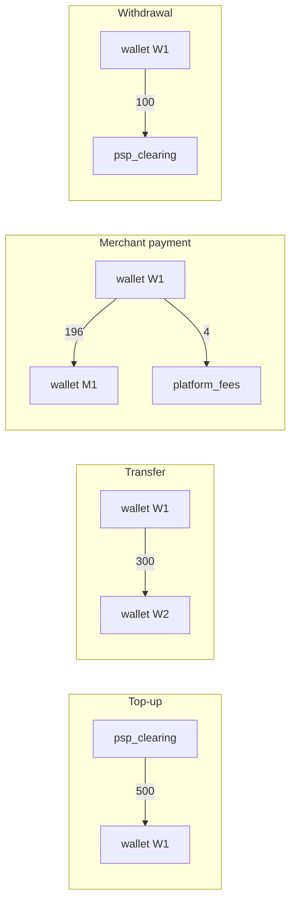

## 5. Variants and comparison

| Decision | Alternatives | Pick here | Why | Guide |
| --- | --- | --- | --- | --- |
| Source of truth | mutable `balance` only, **ledger entries plus cached balance**, pure event sourcing | ledger entries plus cached balance in one transaction | audit trail with fast reads; pure event sourcing adds replay complexity | [[Choosing a Database - Decision Guide]] |
| Database | in-memory store (Redis) with persistence, **sharded relational DB**, distributed SQL, NoSQL | sharded relational (PostgreSQL or MySQL), or distributed SQL if multi-region | ACID, constraints and row locks give the invariants for free | [[Choosing a Database - Decision Guide]] |
| Cross-shard method | **2PC**, **TC/C** (try-confirm-cancel), **saga**, avoid by placement | saga with holds, plus placement to keep most transfers in-shard | no global locks, each step is a local transaction | [[Choosing Consistency, Replication and Partitioning - Decision Guide]] |
| Concurrency | pessimistic row lock, optimistic version column, single-writer per wallet | pessimistic lock in id order for transfers; optimistic for low-contention updates | contention on a wallet is low except hot accounts | [[Locking - Optimistic vs Pessimistic]] |
| Event delivery | direct publish, outbox plus Kafka | outbox plus Kafka | never lose or invent an event | [[Kafka vs RabbitMQ vs SQS - Choosing a Message Broker]] |
| Balance reads | always from DB, cached in Redis, from a read replica | primary for authoritative checks, cache or replica for display | display can be a moment stale; checks cannot | [[Choosing a Caching Strategy - Decision Guide]] |
| Shard key | wallet id, user id, region | wallet id (hash) | even spread; a user's own wallet stays on one shard | [[Partitioning and Sharding]] |

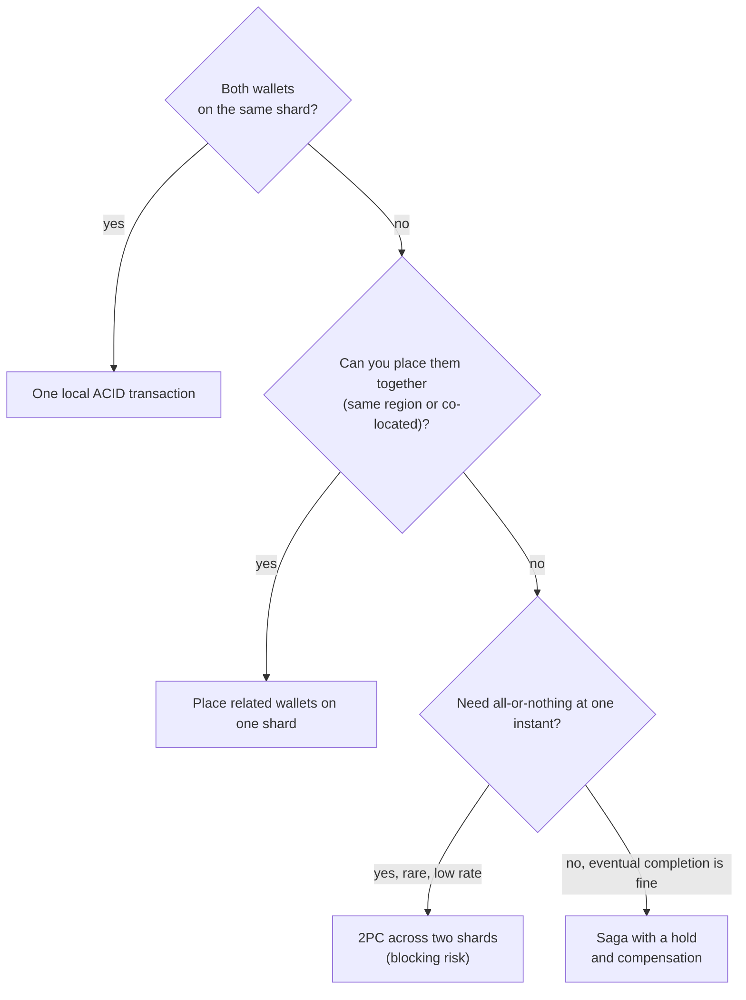

## 6. Trade-offs and when not to use

- **Ledger plus cached balance** costs two writes per movement but gives audit and fast reads. A pure derived balance (sum entries) has no duplicate truth but is slow without snapshots.
- **Saga over 2PC** keeps services available and avoids long locks, but money is briefly in an intermediate state (held), and compensation logic must be correct. 2PC gives atomicity but blocks if the coordinator dies mid-way (see [[Two-Phase Commit]]).
- **Pessimistic locks** are simple and safe for wallets, but they serialize transfers on a hot account.
- **Strong consistency** in the write path costs latency across regions; an active-active multi-region wallet needs distributed SQL or home-region ownership.
- **When not to build this:** a loyalty points counter or "reward coins" can use simpler counters with periodic reconciliation. If real money is held and regulated, use this design (and a licensed partner bank).

> [!tip] Remember
> Say the trade-off aloud: "I accept an intermediate hold state and compensation logic, to avoid cross-shard locks and keep availability."

## 7. In production

- **Square's Books.** Square describes "Books", an immutable double-entry accounting database service, as the ledger beneath its payments. The public lesson: entries are immutable, balances are derived, and the ledger is its own service with strict invariants.
- **Stripe idempotency.** Stripe documents idempotency keys on every POST and prunes keys after at least 24 hours. Wallet APIs copy the pattern, scoping keys by caller.
- **Typical metrics:** transfer success rate by failure reason, p99 latency, count of sagas pending longer than a threshold, outbox lag, idempotency conflicts (409), reconciliation mismatches (alert on any).
- **Alerts that matter:** a non-zero global invariant (sum of balances differs from the ledger), a wallet with a negative available balance, holds older than their expiry, and bank statement mismatches.
- **Operations:** monthly partitions on `ledger_entries`, archive old months to object storage, keep an audit export. Backups with point-in-time recovery (see [[Backup, PITR and Disaster Recovery]]); a restore drill is part of the compliance story.
- **Money moves, so test it:** property tests that random sequences of transfers never change the total, and chaos tests that kill services mid-saga.

## 8. Deep dive

### Deep dive 1: idempotency and exactly-once effect

**In plain words.** The network can deliver a request twice, so the system must make "do it twice" have the same effect as "do it once". The client creates a unique key per user action and sends it on every retry.

**Picture it.**

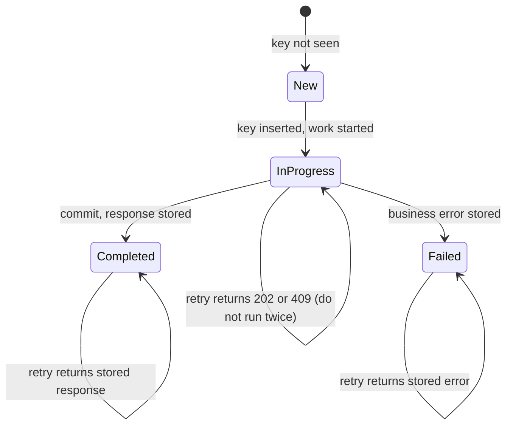

**Example.** Two retries with key K arrive at two API servers at the same instant.
1. Server A runs `INSERT ... ON CONFLICT DO NOTHING RETURNING id` and gets a row. It owns the work.
2. Server B runs the same statement and gets no row (conflict). It reads the key's state: `in_progress`, so it replies 202 or 409 "in progress".
3. A finishes, stores the response, state `completed`. A later retry returns that response.

Important details:
- **Same key, different body** is a client bug. Store a hash of the request and answer 409 on mismatch.
- **Where to store:** in the same database and the same transaction as the money movement when possible, so "key recorded" and "money moved" commit together.
- **Retention:** at least as long as clients may retry (Stripe's 24-hour minimum is a reference point).
- **Natural dedupe** also helps: a unique `(source_system, external_txn_id)` on top-ups from the PSP.

Why it matters: without a stored key, "retry on timeout" (a good practice) becomes "double charge" (a catastrophe). See [[Idempotency and Idempotency Keys]].

### Deep dive 2: cross-shard transfers with a saga and holds

**In plain words.** If W1 lives on shard A and W2 on shard B, a single database transaction cannot cover both. Instead, split the transfer into steps, each local to one shard, with an undo for every step.

**Picture it.**

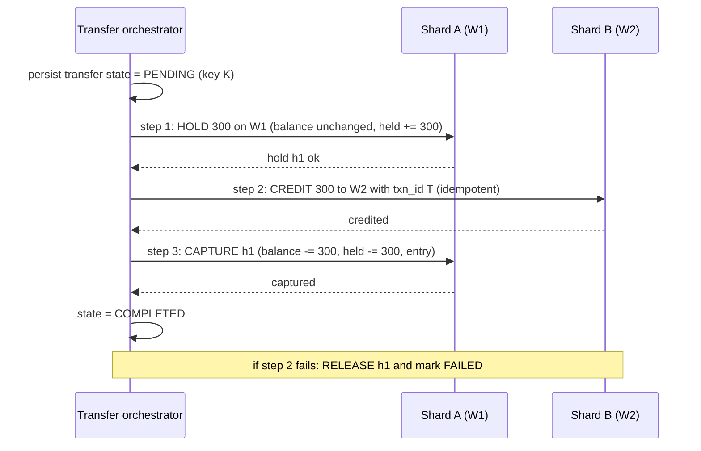

**Step by step.**
1. Persist the transfer as `PENDING` with its idempotency key before any step. A crashed orchestrator resumes from this record.
2. **Hold** on the source: increase `held_minor` by 300 if `balance - held >= 300`. This reserves the money so nobody else can spend it. Write a `holds` row and a ledger-level note.
3. **Credit** the destination with a transaction id `T`. Because it is keyed by `T`, retries do nothing the second time.
4. **Capture** the hold: decrease both `balance_minor` and `held_minor` by 300 and append the debit entry.
5. Mark `COMPLETED` and emit an event via the outbox.
6. If step 3 fails permanently (destination closed): **release** the hold. If step 4 fails after the credit succeeded: retry capture forever, since the credit has already happened, or reverse the credit as a last resort.

Compare with the alternatives:

| Method | How it works | Pros | Cons |
| --- | --- | --- | --- |
| Single local transaction | both wallets on one shard | simplest, atomic | only works when co-located |
| 2PC | coordinator asks both shards to prepare, then commit | atomic at the commit point | blocks if the coordinator dies; locks held across a network round trip |
| TC/C (try-confirm-cancel) | reserve on both, then confirm or cancel | no long locks, parallel | needs explicit try, confirm and cancel APIs per resource |
| Saga with holds | local steps plus compensation, held money | available, scales | intermediate states visible; compensations must be idempotent |

**Watch out.** Between the credit (step 3) and the capture (step 4) the same money is visible on both shards, so the global invariant check and the per-`txn_id` debits-equal-credits check must either skip transfers still `PENDING` or treat the hold as the debit side.

The hold must not expire while the transfer is `PENDING` (set `expires_at` well past the saga timeout), otherwise the capture can fail after the destination already spent the credit.

Because one `txn_id` now spans two shards, the per-transaction check runs as a cross-shard reconciliation job, not a single SQL query.

**Why it matters.** The hold turns "debit then credit" (where a crash loses money) into "reserve, credit, capture", where every crash point has a defined recovery. See [[Saga Pattern]] and [[Two-Phase Commit]].

> [!warning] Common mistake
> Debiting the source first and "hoping" the credit will succeed. If the credit fails or the process crashes, the money is gone from W1 and not in W2. Always reserve first, and make every step idempotent and resumable.

### Deep dive 3: hot wallets and balance contention

**In plain words.** A merchant like a popular food chain receives thousands of payments a second into one wallet. If every payment locks that wallet's row to update its balance, they queue up one by one.

**Picture it.**

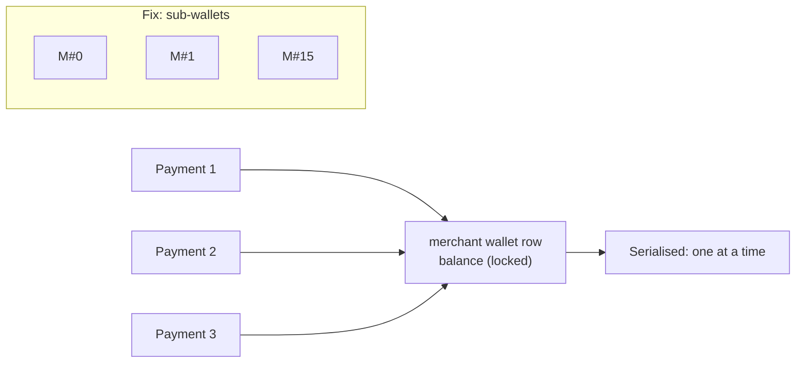

Options:
1. **Append-only credits.** For merchant receivable wallets, only insert credit entries on the hot path and compute the balance asynchronously. Receiving money never needs to read a balance, so no row lock.
2. **Sub-wallets.** Split the merchant into N sub-wallets (`M#0` to `M#15`), choose one by hashing the payment id, and sum them for reads. Settlement sweeps them into the main balance.
3. **Batching.** Buffer credits for 100 ms and post one aggregated entry per batch, keeping the detail rows for audit.
4. **Move the hot wallet** to its own shard so it does not slow others (see [[Hot Keys and Hot Partitions]]).

Debits (spending) still need an exact balance check. That is why user wallets keep the locked balance model and merchant wallets, which mostly receive, use the append-only model.

### Deep dive 4: reconciliation and invariants

**In plain words.** Bugs, bad deploys and manual fixes will eventually break something. Reconciliation is the automatic proof that they did not.

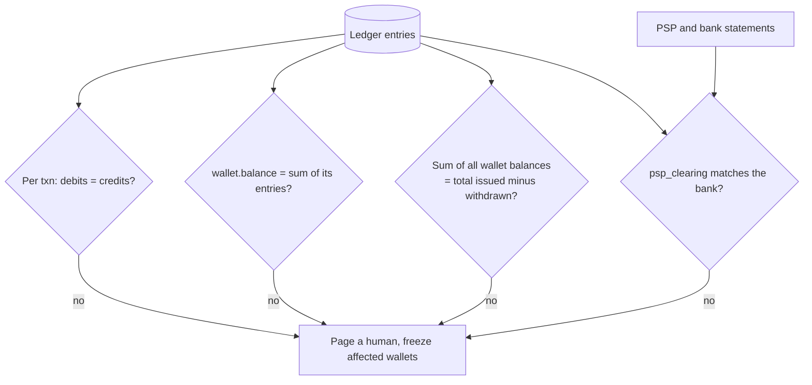

Checks:
1. **Per transaction:** `SUM(debit) = SUM(credit)` for each `txn_id`. A failure means a bug in the write code.
2. **Per wallet:** `balance_minor` equals the sum of its entries (credits minus debits, by your sign convention). A failure means a bug or manual database edit; the fix is a corrective entry, never an `UPDATE` of history.
3. **Global:** the sum of all user balances equals money in from the outside minus money out to the outside.
4. **External:** the clearing account matches the bank and PSP settlement files daily (see [[Case Study - Payment System]]).
5. **Stuck sagas and holds:** anything `PENDING` beyond a threshold is retried or compensated; expired holds are released.

### Scaling and bottlenecks

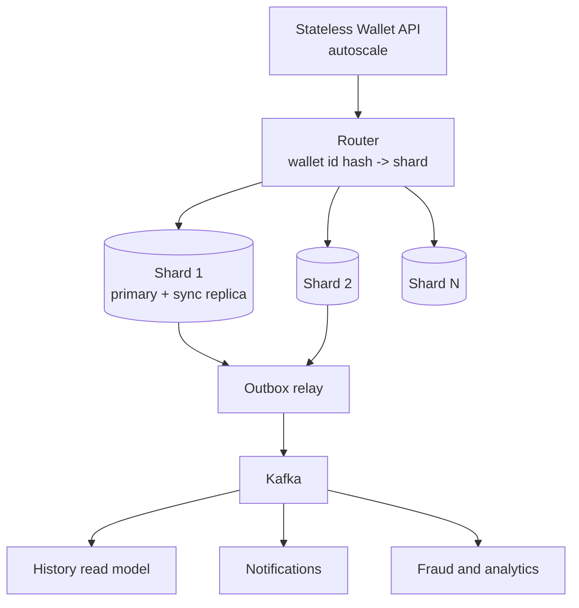

- **Bottleneck 1: database write throughput.** Shard by wallet id, 8 to 16 shards for the estimate above, each with a synchronous replica for durability.
- **Bottleneck 2: hot wallets.** Deep dive 3.
- **Bottleneck 3: history queries.** Move history to a read model fed by events, keyset-paginated, separate from the write path (see [[CQRS]]).
- **Bottleneck 4: resharding.** Use many logical shards mapped onto fewer physical hosts (for example 256 logical, 16 physical), so rebalancing means moving a logical shard, not rehashing everything (see [[Consistent Hashing]]).

### Failure handling

| Failure | Effect | Handling |
| --- | --- | --- |
| API crashes before commit | nothing changed | client retries with the same key |
| API crashes after commit, before reply | money moved, client unsure | retry returns the stored response |
| Orchestrator crashes mid-saga | transfer stuck `PENDING` | recovery job resumes from persisted state; steps are idempotent |
| Shard primary fails | writes to that shard pause | promote the synchronous replica (no loss), others unaffected; see [[High Availability and Failover]] |
| Kafka or outbox relay down | events delayed | rows wait in the outbox; relay catches up, consumers dedupe by event id |
| PSP times out on a top-up | outcome unknown | do not credit yet; webhook or lookup decides (see [[Case Study - Payment System]]) |
| Bug posts wrong entry | invariant check fails | reversing entry plus incident review, never an `UPDATE` |

## 9. Interview questions

> [!question]- Why a double-entry ledger instead of just a balance column?
> Entries are immutable, so every balance is explainable and rebuildable, and "debits equal credits" catches bugs immediately. A mutable balance loses history and is easy to corrupt through lost updates. In practice we keep both: entries as truth, balance as a cache updated in the same transaction.

> [!question]- The user taps Send twice. How do you prevent a double transfer?
> A client-generated idempotency key per action. The server claims the key atomically (unique constraint) before moving money and stores the response. The second request finds the key and returns the stored result. A key reused with a different body is rejected with 409.

> [!question]- (Trap) Two wallets are on different shards. Why not just do two UPDATEs and hope?
> A crash between them destroys or duplicates money, and there is no atomicity. Use a saga with a hold: reserve on the source, credit the destination idempotently, capture the hold, and compensate (release) on failure. Or co-locate related wallets so most transfers are single-shard.

> [!question]- Two transfers W1 to W2 and W2 to W1 run at the same moment. What goes wrong and how do you prevent it?
> Each locks its source first and then waits for the other's row, which is a deadlock. Lock rows in a consistent global order (ascending wallet id) so one transaction always waits instead of cycling. Also retry on deadlock errors.

> [!question]- How would you handle a merchant wallet that receives 5,000 payments per second?
> The single row becomes a lock bottleneck. Make credits append-only and compute the balance asynchronously, or split the merchant wallet into sub-wallets and sum them on read, or batch credits. Spending from such a wallet still needs an exact balance, so settle the sub-wallets into a main balance first.

> [!question]- How do you know the system has not lost money?
> Automated reconciliation: per-transaction debits equal credits, each wallet balance equals the sum of its entries, the global sum equals money in minus money out, and the clearing account matches the bank and PSP statements. Any mismatch pages a human and freezes the affected wallets.

> [!question]- Would you choose Redis for balances?
> Not as the source of truth for real money: persistence and multi-key atomicity guarantees are weaker than a relational database with constraints. Redis can cache balances for display or hold counters for rate limits. The authoritative write path is a transactional database (see [[Choosing a Database - Decision Guide]]).

> [!question]- The interviewer says 1 million transfers per second. What changes?
> About 1,000 TPS per shard means on the order of 1,000 shards, so I maximise same-shard transfers by placement, move cross-shard transfers to sagas, make merchant credits append-only, use a read model for history, and use a router with logical shards for resharding. Correctness rules, idempotency and reconciliation stay identical.

## 10. Cheat sheet

- Immutable double-entry ledger; balance is a same-transaction cache; corrections are reversing entries.
- Every write has an idempotency key; claim it atomically; store the response; 409 on body mismatch.
- Same shard: one ACID transaction, lock rows in id order. Cross shard: saga with holds (hold, credit, capture; release on failure).
- Integers in minor units plus currency; `CHECK (balance - held >= 0)`.
- Outbox plus Kafka for events; consumers dedupe by event id.
- Hot merchant wallets: append-only credits, sub-wallets or batching.
- Estimates: 20M transfers/day ≈ 231 TPS avg, ≈ 2,300 peak, ≈ 16K row writes/s, so 8 to 16 shards.
- Reconcile continuously: per txn, per wallet, global and against the bank.

> [!tip] Remember
> What interviewers look for: conservation of money, idempotency, how you handle a crash at each step, and why you chose a saga over 2PC. Follow-ups: multi-currency and FX, overdraft limits, fraud holds, regulatory KYC tiers, how to migrate to a new schema, and how to rebuild balances from the ledger.

## Links

- **Before this:** [[Case Study - Payment System]], [[Idempotency and Idempotency Keys]], [[Transactions and ACID]], [[Saga Pattern]], [[Transactional Outbox and CDC]]
- **Next:** [[Case Study - Stock Exchange]], [[Event Sourcing]], [[Two-Phase Commit]]
- **Compare with:** [[Digital Wallet and Ledger]] (class-level ledger in Go), [[Case Study - Ticket Booking]], [[Case Study - Flash Sale and E-commerce Checkout]]
- **Decision guides:** [[Choosing a Database - Decision Guide]], [[Choosing Consistency, Replication and Partitioning - Decision Guide]], [[Kafka vs RabbitMQ vs SQS - Choosing a Message Broker]], [[Choosing a Caching Strategy - Decision Guide]]

### Watch on YouTube

- [Digital Wallet Ledger Architecture  Building Scalable, Consistent, and Fraud Resistant Payment Syste](https://www.youtube.com/watch?v=37tEgwLcUrQ) · SystemDesignPrep · 7 min · 785 views
- [Digital Wallet System Design / Distributed transactions / SAGA pattern](https://www.youtube.com/watch?v=8ByEyCd-MEM) · System Design Pal · 13 min · 5,302 views
