# Case Study - Distributed Cache

> [!summary] TL;DR
> A distributed cache is a cluster of memory-only servers that holds the answers your database would otherwise have to compute again. You design it so that any key lands on one predictable server, one server dying loses only a small slice of the data, and the whole fleet can grow without throwing away the cache. The design is about **partitioning (consistent hashing or hash slots), replication, eviction, and what happens when nodes fail or a key becomes hot**.

> [!abstract] Core idea
> - Split the key space across many nodes with **consistent hashing** (or Redis-style fixed hash slots) so that adding or removing a node moves only about `1/N` of the keys.
> - Each node is a hash map in RAM plus an **eviction policy** (LRU or LFU) and per-key **TTL**. Memory is the scarce resource, so something must decide what to throw away.
> - Replicate each shard asynchronously to a replica so that a node crash is a failover, not a cold-cache stampede on the database.
> - Clients are either **smart** (they know the node map, like Redis Cluster clients) or go through a **proxy** (like twemproxy or mcrouter).
> - The cache is not the source of truth. Design every failure mode (node down, hot key, stampede, stale data) around protecting the database behind it.

## Start here: the basics 🟢

> [!info] How to read this note (pick your level)
> - 🟢 **New to this?** Read "From zero" below, then sections 1, 2 and the cheat sheet (10). Stop there, that is a full first pass.
> - 🟡 **Know the basics?** Add sections 3 (how it works), 4 (worked example), 5 (variants) and 6 (trade-offs).
> - 🔴 **Interview / SDE-3 prep?** Add 7, 8 and 9. Headings are tagged 🟢🟡🔴 so you always know where you are.

**From zero, in 60 seconds** 🟢

A **cache** is a fast memory store that keeps answers you asked for recently.
Reading from memory takes well under a millisecond. Reading from a database can take ten or more.
One cache machine runs out of memory and becomes a single point of failure.
So you spread the data over many machines. A simple rule, called **hashing**, turns each key's name into "which machine owns it".

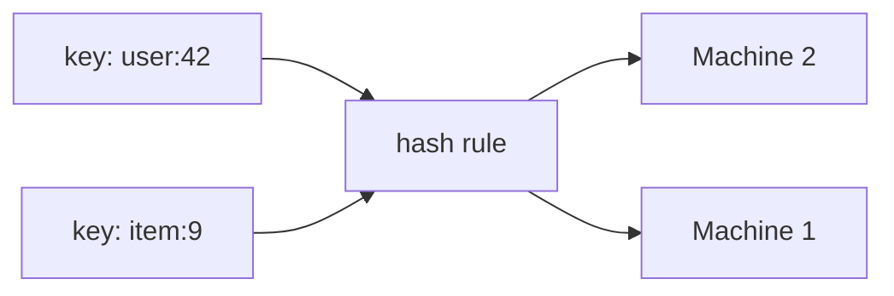

Each machine also has a backup copy on another machine, so a crash does not lose everything.
The database always stays the real truth. The cache can forget anything at any time.

So the rest of this note is just these 3 questions:
1. How does every app server agree which machine holds a key?
2. What happens when a machine dies or a new one is added?
3. What goes wrong when one key gets very popular or expires under heavy traffic?

**The problem in one story.**
Your app shows a product page.
Each time, it asks the database for the price, name and photos.
The database is slow and gets tired when a million people ask at once.
So you keep recent answers in fast memory, spread over many machines, and ask the database only when memory does not know.

**Words you need first**

| Word | Plain meaning | Tiny example |
| --- | --- | --- |
| Cache | A fast copy of data kept close by | Keeping `user:42` in RAM instead of re-querying SQL |
| Key / value | A name and the data stored under it | `price:sku9` -> `499` |
| Node | One server in the cluster | `cache-03` |
| Hash | A function turning a key into a number | `hash("user:42") = 9183` |
| Shard / partition | The slice of keys one node owns | Keys whose hash falls in slot 0-5460 |
| Replica | A backup copy of a node's data on another node | `cache-03b` mirrors `cache-03` |
| TTL | How long an entry lives before it expires | Keep the price for 300 s |
| Eviction | Throwing out entries when memory is full | LRU drops the least recently used key |

**Picture it**

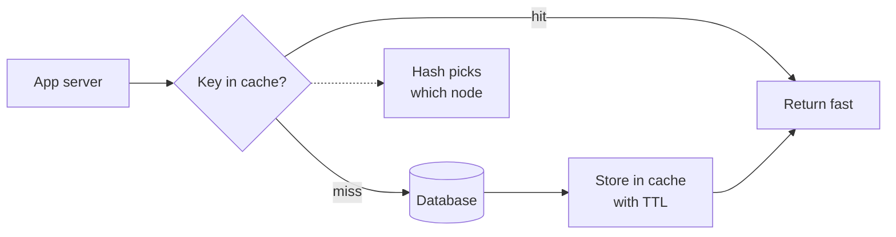

**Analogy.** A cache cluster is like many small notebooks on your desk, each holding answers for names starting with certain letters, so you rarely walk to the library (database).
Where it breaks: a notebook never loses pages on its own, while a cache node can crash or evict data at any time, so the library must always remain the truth.

**How the rest of this note builds up**

- First, why one cache box is not enough (section 1) and a mental model of keys landing on nodes (section 2).
- Then the high-level design: consistent hashing, replication and clients (section 3), with sizing and API (section 4).
- Then variants and trade-offs, Redis Cluster vs Memcached and friends (sections 5-6).
- Finally the SDE-3 deep dive: production lessons, hot keys, stampedes, leases and failover (sections 7-8).

> [!tip] Remember
> A distributed cache is fast, forgetful memory spread over many nodes; the database stays the source of truth.

## 1. Why it exists - requirements 🟢

A single Redis or Memcached server can hold maybe tens of gigabytes and serve on the order of 100,000 simple operations per second (an assumption, not a promise; it depends on value size and CPU).

A big product needs terabytes and millions of operations per second. You cannot buy a bigger box forever, so you spread the cache over many machines and make them look like one.

**Everyday picture.** A library has one librarian with one desk. When 10,000 people arrive, you open 50 desks, each responsible for a range of the alphabet. A person must know which desk to walk to. That is partitioning. If a desk closes, only its alphabet range is disrupted. That is why you use consistent hashing and not "key mod number-of-desks".

**Functional requirements**
- `GET key`, `SET key value [TTL]`, `DELETE key`. Optionally `INCR`, `MGET` (batch reads) and compare-and-set.
- Every entry may have a time-to-live (TTL).
- Values are opaque blobs up to a limit (assume 1 MB hard limit, 1 KB typical).
- Clients in many languages and many services share the cache.

**Non-functional requirements**
- **Latency:** p99 under 5 ms from the client including the network hop, p50 under 1 ms (targets, estimates).
- **Throughput:** 1 million reads per second and 100,000 writes per second at peak (interview assumption).
- **Capacity:** about 1.5 billion keys, around 1.7 TB in RAM.
- **Availability:** 99.99%. A single node failure must not cause an outage or a database meltdown.
- **Scalability:** add and remove nodes online without a mass cache flush.
- **Consistency:** eventual. A stale read for a few seconds after a database write is acceptable; stale for hours is not.

**Out of scope for this note:** persistence and durability as a database (the cache can lose data), multi-key transactions, and secondary indexes.

> [!tip] Remember
> The first question to ask in an interview: "Is this a cache (can lose data) or a datastore (cannot)?" The answer decides replication, persistence and consistency. This note designs a cache.

## 2. Mental model 🟢

Think of the cluster as a **hotel with numbered rooms and a front desk**.

- Each key has a room number computed from its name (the hash).
- The room number tells you which floor (node) to go to.
- Nobody has to ask the front desk each time if you carry the floor map, which is exactly a smart client with a cached node map.

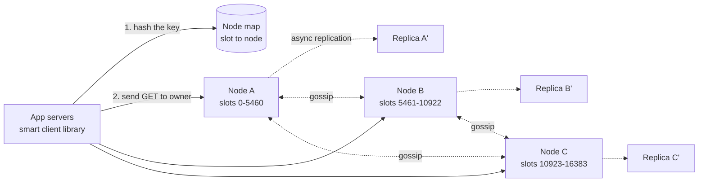

Three ideas carry the whole design:
1. **Partitioning:** one function maps key to node, identically on every client.
2. **Replication:** a copy of each shard on another machine so a crash is a promotion, not an outage.
3. **Eviction:** memory is finite, so the cache forgets the least useful entries on purpose.

> [!tip] Remember
> A cache is a bet that "the future looks like the recent past". Everything else (hashing, replication, eviction) exists to make that bet cheap and safe.

## 3. How it works - high-level design 🟡

### Cluster layout and request flow

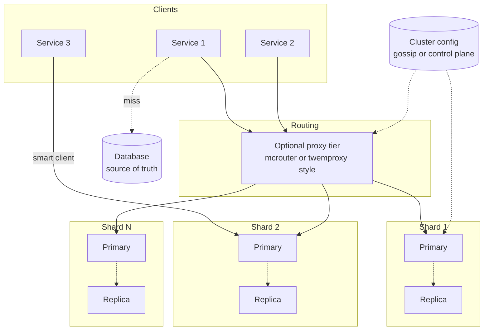

### Step-by-step: a read that hits and a read that misses

**In plain words:** first check the cache. If it has the answer, done. If not, read the database and save a copy in the cache for next time.

1. The client takes the key `user:42:profile` and computes the hash (CRC16 in Redis Cluster, a ring hash in Memcached clients).
2. It looks up which node owns that hash in its local map.
3. It sends `GET` straight to that node. One network round trip.
4. The node does a hash-table lookup, checks the TTL, and updates the LRU or LFU metadata.
5. **Hit:** returns the value. **Miss:** the client reads the database, then `SET`s the cache with a TTL (this is the cache-aside pattern in [[Caching Patterns]]).

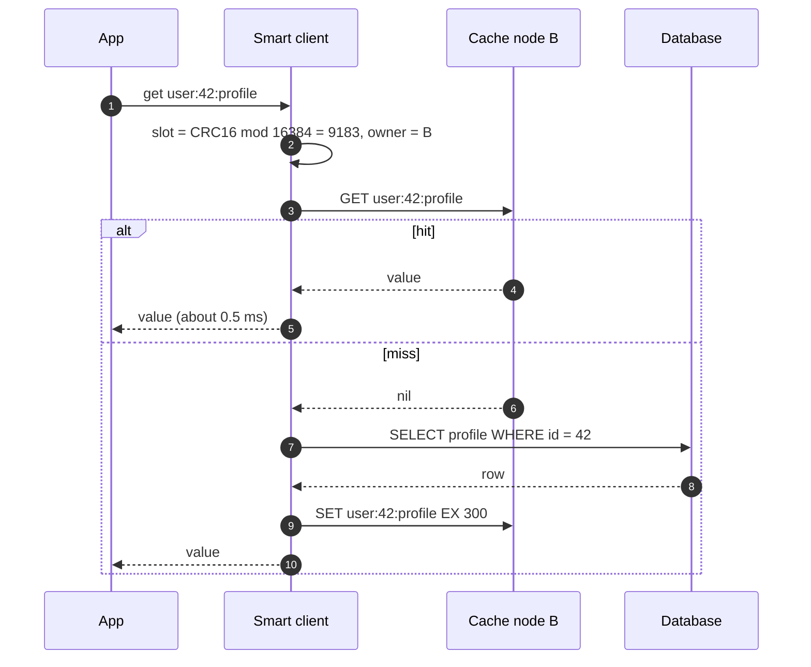

### Partitioning: three ways to decide the owner

**In plain words:** three different rules for "which machine owns this key", and how many keys each rule moves when you add a machine.

| Approach | How the owner is found | Resize cost | Used by |
| --- | --- | --- | --- |
| `hash(key) mod N` | N is the node count | Changing N from N to N+1 remaps about `N/(N+1)` of keys (almost all), so the cache goes nearly cold | Toy designs only |
| Consistent hashing ring with virtual nodes | Nodes sit on a ring; a key belongs to the next node clockwise | Only about `1/N` of keys move | Memcached clients (ketama style), Dynamo, Cassandra |
| Fixed hash slots | Key goes to one of 16,384 slots; slots are assigned to nodes | Move whole slots between nodes; only those keys move | Redis Cluster |

Decision guide: [[Choosing Consistency, Replication and Partitioning - Decision Guide]]. Background theory: [[Consistent Hashing]].

## 4. Worked example - estimates, API and data model 🟡

### Whiteboard version

```text
Reads 1M/s peak, writes 100k/s peak, 1.5B keys, 1 KB avg value
RAM:   1.5e9 x 1.1 KB (value + ~100 B overhead) = 1.65 TB
Node:  64 GB box, ~50 GB usable for data -> 1.65 TB / 50 GB = 33 primaries
HA:    + 1 replica each -> 66 nodes
Ops:   1.1M ops/s / 33 primaries = 33k ops/s per primary (well under ~100k)
Net:   (1M reads + 100k writes) x 1 KB = 1.1 GB/s total = ~8.8 Gbps; ~33 MB/s per primary

[client] -hash-> [slot map] -> [primary] --async--> [replica]
miss -> [DB] -> SET with TTL (jittered)
```

### Estimates (every input is an assumption, so every result is an estimate)

**In plain words:** rough sums: how much memory you need and how many machines that means.

| Quantity | Arithmetic | Result |
| --- | --- | --- |
| Keys | given | 1.5 billion |
| Bytes per entry | 1 KB value plus about 100 B for key, pointers, TTL, LRU bits | about 1.1 KB |
| Total data | 1.5 × 10^9 × 1.1 KB | about 1.65 TB |
| Usable RAM per node | 64 GB machine, leave headroom for the OS, fragmentation, and fork copy-on-write | about 50 GB |
| Primaries needed (memory bound) | 1.65 TB / 50 GB | 33 |
| With one replica each | 33 × 2 | 66 nodes |
| Throughput per primary | 1.1M ops/s / 33 | about 33k ops/s, comfortable |
| Network total | (1M + 0.1M) × 1 KB = 1.1 GB/s (replication traffic to replicas adds about 0.1 GB/s more) | about 8.8 Gbps across the fleet, about 33 MB/s per primary |

**What the numbers decide.** The fleet is **memory bound, not CPU bound**. We add nodes for capacity, and throughput comes for free. If the numbers were reversed (small data, huge request rate), you would add replicas for read throughput instead of shards.

### API

**In plain words:** basically get, set with an expiry time, and delete.

The cache's client API is tiny. The server speaks a text or binary protocol (RESP for Redis, the memcached protocol for Memcached).

| Operation | Behaviour | Notes |
| --- | --- | --- |
| `GET key` | Value or nil | Updates recency metadata |
| `MGET k1 k2 ...` | Batch read | Client groups keys by owner node and sends one request per node in parallel |
| `SET key value EX ttl` | Write with TTL | Always set a TTL; never cache forever |
| `DEL key` | Remove | Used for invalidation on write |
| `INCR key` | Atomic counter | Single node owns it, so it is atomic |
| `CAS key token value` | Set only if unchanged | Memcached `cas`, Redis `WATCH` or Lua |

Multi-key commands in Redis Cluster only work when all keys live in the same slot. Use **hash tags**: `{user:42}:profile` and `{user:42}:settings` hash only the text inside the braces, so they share a slot.

### Data model on a node

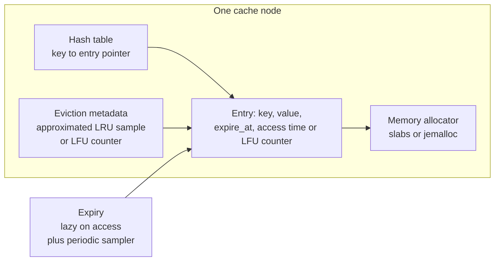

- **Entry:** key, value bytes, absolute expiry time, and bits for the eviction policy.
- **Memcached** groups memory into **slab classes** (fixed chunk sizes such as 96 B, 120 B, 152 B) so allocation is fast and fragmentation is bounded, at the cost of some wasted space inside each chunk.
- **Redis** uses a general allocator (jemalloc) and approximated LRU: it samples a handful of random keys and evicts the oldest, which avoids keeping a full linked list.

### One request traced through a failover

**In plain words:** a machine crashes; for a few seconds its keys fail, then its backup takes over and things work again.

1. Node B (slots 5461-10922) crashes at 10:00:00.
2. Other nodes stop hearing B's gossip pings. After a timeout (Redis `cluster-node-timeout`, often 15 s by default; an assumed setting), a majority of primaries mark B as failed.
3. B's replica B' is promoted to primary and takes ownership of the same slots.
4. Clients get `MOVED` errors or refresh their map and start talking to B'.
5. Writes made to B in the last milliseconds and not yet replicated are lost. That is acceptable for a cache. The database still has the truth.
6. Cache misses for those lost keys go to the database. Because only the lost writes (not the whole slice) are missing, the database sees a small bump, not a flood.

## 5. Variants and comparison 🟡

### Where does the routing logic live?

**In plain words:** someone must know which machine owns a key: the app's library, a middle proxy, or the cache servers themselves.

| Model | How it works | Strengths | Weaknesses |
| --- | --- | --- | --- |
| Client-side sharding (Memcached clients) | Library holds the node list and ring | No extra hop, no proxy to run | Every language needs the library; changing the node list means redeploying or pushing config; nodes do not coordinate |
| Smart client plus cluster-aware nodes (Redis Cluster) | Client caches the slot map; nodes answer `MOVED` | One hop, nodes self-heal using gossip | Clients must understand the cluster protocol; multi-key ops limited to one slot |
| Proxy tier (twemproxy, mcrouter, Envoy) | Clients talk to a proxy that shards | Thin clients, central place for routing policy, pooling, and failover | Extra network hop (about 0.1-0.5 ms, an estimate); proxy becomes a fleet to scale |

### Which engine?

**In plain words:** Memcached is a plain, very fast key-value store; Redis adds data types, backups and a built-in cluster.

| Dimension | Memcached | Redis (Cluster) |
| --- | --- | --- |
| Data types | Strings only | Strings, hashes, lists, sets, sorted sets, streams |
| Threading | Multi-threaded | Mostly single-threaded command execution per node (I/O threads optional) |
| Persistence | None | Optional (RDB snapshots, AOF) |
| Replication | None built in | Built in |
| Clustering | Client-side ring | Server-side with hash slots and gossip |
| Memory efficiency for plain small values | Very good (slabs) | Good; per-key overhead is higher |
| Best fit | Pure, huge, simple read cache | Cache plus counters, leaderboards, sets, locks |

Decision guide: [[Choosing a Caching Strategy - Decision Guide]]. Server-side details: [[Redis Replication, Sentinel and Cluster]].

### Eviction policy

**In plain words:** when memory is full, the cache must throw something out. These are the rules for choosing what.

| Policy | Evicts | Good for | Weakness |
| --- | --- | --- | --- |
| LRU | Least recently used | Most workloads with recency | A one-time big scan flushes the hot set |
| LFU | Least frequently used | Stable popularity (some items always hot) | Slow to forget items that were hot and are now cold |
| TTL-only (volatile-ttl) | Soonest to expire | Data with natural lifetimes | Ignores access pattern |
| Random | A random key | Cheap, surprisingly competitive | No intelligence |

Details: [[Cache Eviction Policies - LRU, LFU, TTL]].

### Write strategy

**In plain words:** when data changes, do you update the cache, the database, or both, and in which order?

| Strategy | Flow | Consistency | Risk |
| --- | --- | --- | --- |
| Cache-aside (lazy loading) | App reads cache, on miss loads DB and fills | Stale until TTL or invalidation | Stampede on a cold or expired key |
| Read-through | Cache library loads from the DB on a miss | Same as cache-aside | The cache layer needs DB knowledge |
| Write-through | Write goes to cache and DB together | Stronger | Slower writes; cache full of rarely read data |
| Write-behind | Write cache, flush to DB later | Fast writes | Data loss if the cache node dies; avoid unless you accept it |

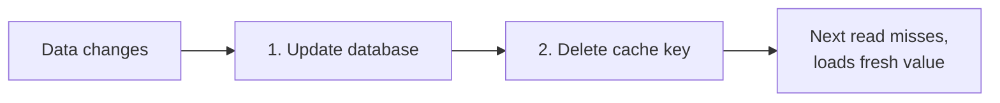

## 6. Trade-offs and when not to use 🟡

- **Consistent hashing over modulo because** a node change moves only about `1/N` of keys. Price: you need virtual nodes to even out load, and the ring or slot map must be distributed to all clients.
- **Asynchronous replication over synchronous because** cache writes must stay sub-millisecond. Price: a crash can lose the last few writes, so the cache is never the source of truth.
- **Smart client over a proxy because** it saves one hop. Price: client libraries in every language must be kept compatible. A proxy tier is the better choice when you have many languages or need central policy.
- **Eviction over bigger memory because** RAM is expensive. Price: some misses are inevitable; budget the database for a 5-10% miss rate (an assumption).
- **Short TTL over explicit invalidation because** it is simple and self-healing. Price: staleness equal to the TTL. Use both: invalidate on write and keep a TTL as a safety net.
- **When not to use a cache:** the data changes on every read, the hit rate is below about 50% (an estimate; the cache then adds cost and latency for little gain), the database is already fast enough, or every read must be strongly consistent.

> [!warning] Common mistake
> Treating the cache as a database. If the application breaks when the cache is empty, you have built a distributed datastore with the guarantees of a cache. Always test a "cold cache" scenario before launch.

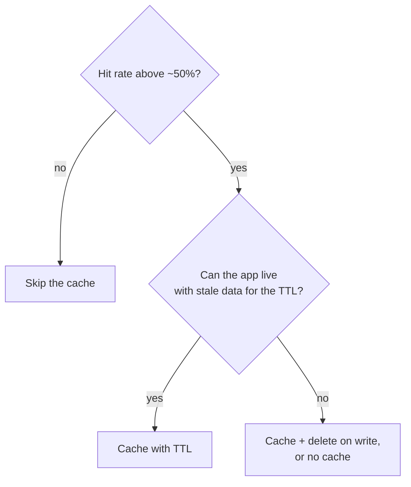

## 7. In production 🔴

- **Facebook (public paper):** *Scaling Memcache at Facebook* describes memcached clusters in each region, a proxy called mcrouter that does routing and connection pooling, and **leases** to prevent stale sets and thundering herds. A **gutter pool** of spare servers takes traffic when a primary memcached server fails so the database is shielded. Invalidations were sent by tailing the database commit log (the paper calls the daemon McSqueal).
- **Redis Cluster (documented):** 16,384 hash slots, nodes exchange state through a gossip cluster bus, clients follow `MOVED` and `ASK` redirections, and a replica is promoted when a majority of primaries agree the primary has failed.
- **Memcached (documented):** servers do not know about each other; sharding is done by the client, and memory uses slab classes with a per-class LRU.
- **Twitter's twemproxy (documented):** a lightweight proxy that shards across many memcached or Redis servers and reduces connection counts.
- **Failure modes and fixes:**
	- *Node loss:* a replica takes over; clients refresh the map. Without replicas, a gutter pool or a short-TTL fallback keeps the database alive.
	- *Hot key:* one key takes most traffic. Add a local in-process cache with a 1-5 second TTL, or replicate the key under `key#1..key#k` names and read a random copy.
	- *Stampede:* a popular key expires and 5,000 requests hit the database at once. Use a lease or single-flight lock and serve stale data while one caller refreshes.
	- *Avalanche:* many keys expire together. Add random jitter to TTLs.
	- *Penetration:* requests for keys that do not exist bypass the cache. Cache negative results briefly and put a Bloom filter in front ([[Bloom Filters and Probabilistic Data Structures]]).
	- *Big keys:* a 50 MB value blocks the single thread of a Redis node for milliseconds. Cap value size and split large objects.
- **What to monitor (targets are estimates):** hit ratio above 90%, p99 latency per node, evictions per second (a rising number means memory is too small), memory fragmentation ratio, replication lag, connections per node, keys per slot, and the top keys by traffic. See [[Cache Failure Modes - Stampede, Avalanche, Penetration, Hot and Big Keys]] and [[Hot Keys and Hot Partitions]].

## 8. Deep dive 🔴

### 8.1 Consistent hashing with virtual nodes, step by step

**In plain words.** Imagine the hash space as a clock face from 0 to 2^32. You place each server at several random spots on the clock. A key is hashed to a spot and belongs to the first server clockwise from it. When a server leaves, only the keys it owned move to the next server clockwise.

**Why virtual nodes.** With one point per server, positions are uneven and one server may own a huge arc. With 100-200 points (virtual nodes) per server, the arcs average out, and a failed server's load spreads over all the others instead of dumping onto one neighbour.

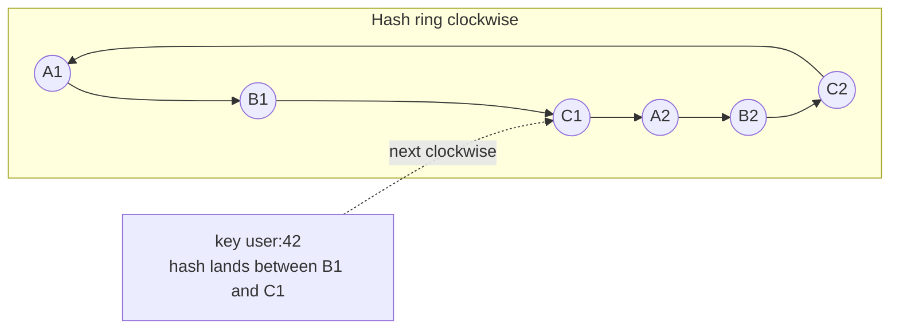

1. Hash each server name with a suffix many times (`A#0`, `A#1`, ...) and place the points on the ring.
2. Sort the points. Store them in an array.
3. To find the owner of a key, hash it and binary-search for the first point at or after the hash, wrapping around at the end.
4. Adding server D inserts its points; each takes keys only from the one point clockwise of it.
5. Removing a server deletes its points; its keys fall to the next points clockwise.

**Example with numbers.** With 10 nodes, adding the 11th moves about `1/11 ≈ 9%` of keys. With `mod N`, going from 10 to 11 nodes remaps about `10/11 ≈ 91%`, and the database absorbs almost all traffic for minutes.

**Redis slots instead of a ring.** Redis Cluster fixes 16,384 slots. `slot = CRC16(key) mod 16384`. Rebalancing means migrating slots from one node to another, key by key, while both nodes serve requests. During migration a request may get an `ASK` redirect for a key that has already moved.

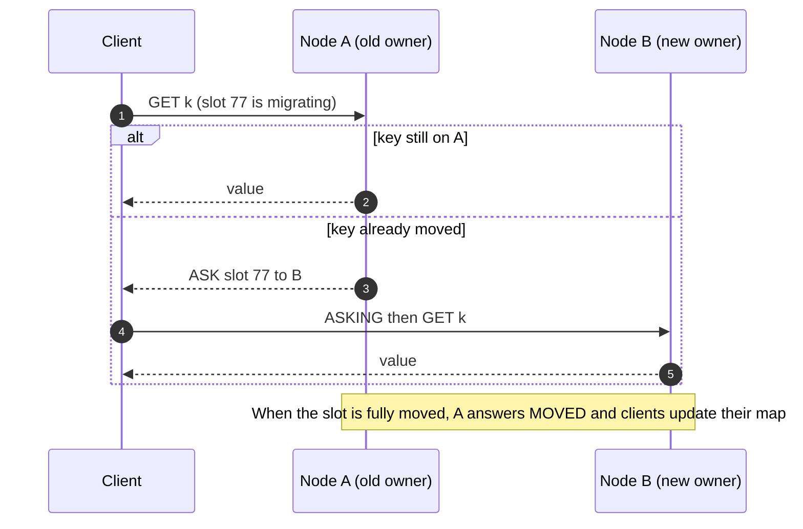

### 8.2 Hot keys and hot partitions

**In plain words:** one super popular key sends all its traffic to one machine. The fix is to keep extra copies of that key in more places.

A celebrity profile or a flash-sale product can send 200,000 reads per second to one key. Consistent hashing sends all of them to one node, which saturates its CPU or NIC while the other 32 nodes idle.

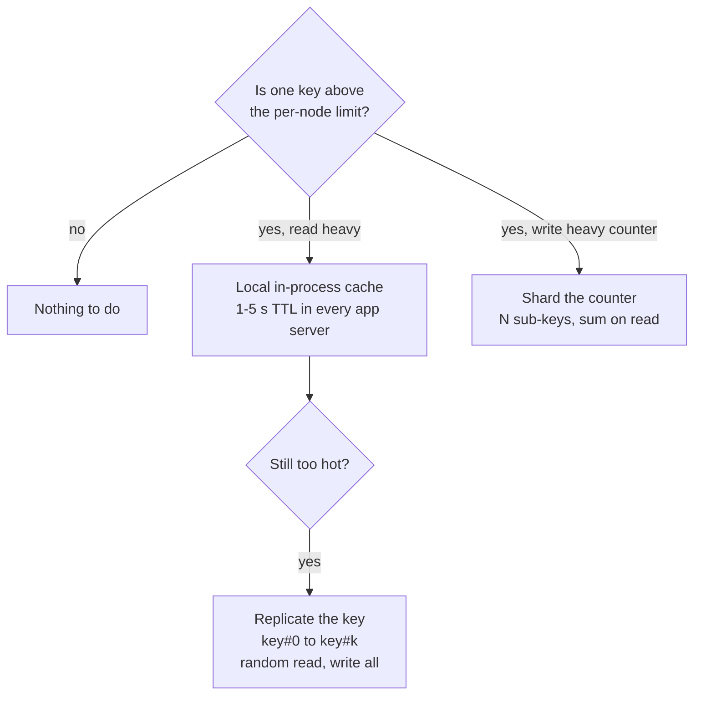

Options and when to pick each:
- **Local cache in the app (L1):** easiest and effective for read-only data. Cost: stale for the TTL and memory on every server.
- **Key replication with a suffix:** spreads load across several nodes. Cost: writes must update all copies; reads may see slightly different values.
- **Read replicas:** let clients read from replicas for a hot shard. Cost: replication lag.
- **Detect automatically:** sample request keys at the proxy or client and promote the hottest few to the L1 tier.

See [[Hot Keys and Hot Partitions]].

### 8.3 Stampede protection with leases

**In plain words:** when a popular key expires, thousands of requests rush to the database at once. A lease lets only one of them refill it; the rest wait a moment.

When a hot key expires, thousands of callers miss at once. Facebook's paper describes a **lease**:

1. On a miss the cache hands one caller a token that allows it to fill the key.
2. Other callers wait a few milliseconds or receive slightly stale data.
3. If a delete arrives while the lease is open, the token is invalidated so the late writer cannot store a stale value.

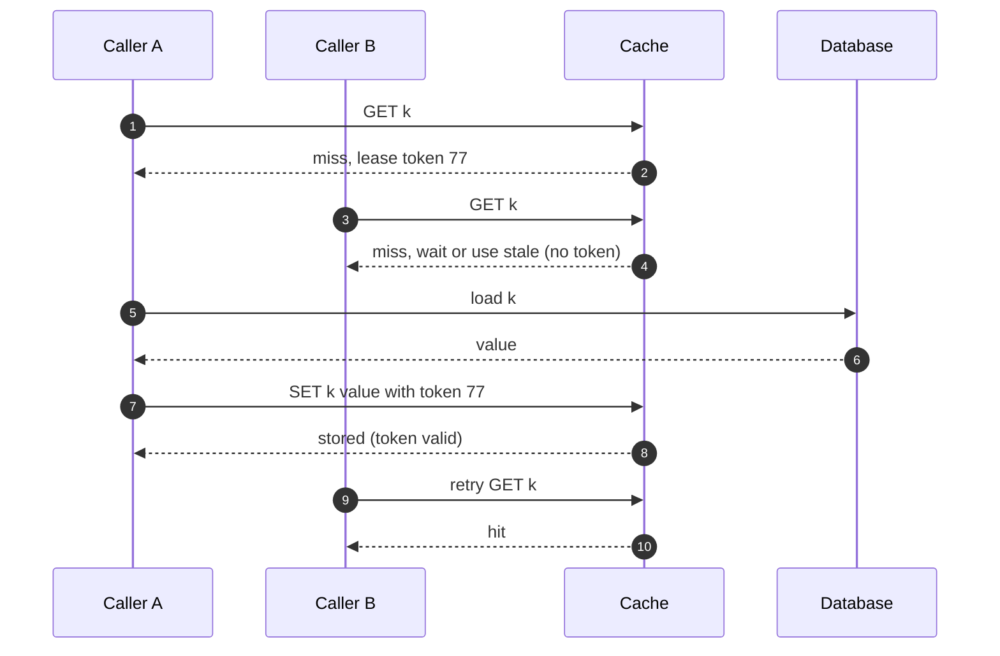

Cheaper alternatives in the app: **single-flight** (one in-process call per key, others wait for its result), **early refresh** (refresh at 80% of the TTL in the background), and **stale-while-revalidate**.

### 8.4 Keeping the cache and the database consistent

**In plain words:** change the database first, then delete the cached copy, so the next reader fetches the fresh value.

There is no free consistency. The common safe sequence for updates is: **write the database first, then delete the cache key** (not update it). Deleting avoids the race where two writers set the cache in the wrong order.

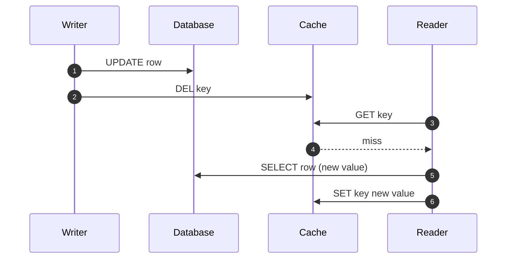

A small race remains: a reader that loaded the old value just before the update can store it just after the delete. Remedies: a short TTL, a lease, or invalidation driven by the database's change stream (CDC), which is how Facebook's design invalidated keys. See [[Cache Invalidation, TTL and Consistency]] and [[Transactional Outbox and CDC]].

### 8.5 Failure detection and failover

**In plain words:** machines check on each other; when one stops answering, its backup is promoted to take its place.

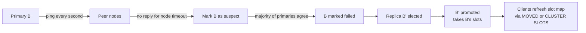

- A node is marked failed only when **a majority** of primaries agree, which prevents one node with a flaky network from triggering a wrong failover.
- If a whole shard (primary and replica) is lost, some slots have no owner. With the default `cluster-require-full-coverage yes`, the **whole cluster** stops accepting queries until all slots are covered again. For a cache you may set it to `no`, keep serving the other slots, and treat the lost range as always-miss.
- Theory: [[Failure Detection, Gossip and Membership]], [[Redis Replication, Sentinel and Cluster]].

### 8.6 Resharding without a cold cache

**In plain words:** when you add a machine, move keys over slowly while both machines serve, so the cache never starts empty.

1. Add the new node to the cluster. It owns no slots yet, so it takes no traffic.
2. Pick slots to move (about `16384/(N+1)` in total).
3. For each slot, migrate keys in small batches while both nodes serve requests.
4. Rate-limit migration so it does not steal CPU from live traffic.
5. After the last key moves, flip ownership; clients learn through `MOVED`.
6. Warm the new node's hot keys by letting normal misses fill it, or by pre-copying from a replica.

> [!tip] Remember
> Fixed slots turn "rebalance the cluster" into "move these few hundred labelled boxes", which is easier to plan, throttle, and resume than moving arbitrary key ranges.

## 9. Interview questions 🔴

> [!question]- Why consistent hashing and not `hash(key) mod N`?
> With modulo, going from N to N+1 nodes remaps about `N/(N+1)` of the keys, which empties the cache and sends the whole read load to the database. Consistent hashing moves about `1/N` of the keys on a node change. Virtual nodes even out the load and spread a failed node's share across all survivors.

> [!question]- A node dies. What happens to the database?
> If each primary has a replica, the replica is promoted within seconds and the database sees only a small bump for the unreplicated writes. Without replicas, `1/N` of keys vanish at once, and the database sees a spike for that slice. Protect it with a gutter pool, request coalescing, rate limits and load shedding ([[Load Shedding and Graceful Degradation]]).

> [!question]- Trap: one product page gets 200k requests per second and one node melts. What now?
> That is a hot key, and adding nodes will not help because the key still hashes to one node. Add a local in-process cache with a short TTL, or replicate the key under several names and read a random copy, or serve it from read replicas. For counters, shard the counter.

> [!question]- Cache-aside or write-through for a user profile cache?
> Cache-aside with delete-on-write and a TTL. Reads dominate, the profile can be a few seconds stale, and write-through would fill the cache with profiles nobody reads. Use write-through only when reads must see the latest value right after a write and you accept slower writes.

> [!question]- How do you prevent a stampede when a hot key expires?
> Use a lease or single-flight so one caller refills the key. Serve stale data for a few seconds meanwhile. Add jitter to TTLs so keys set together do not expire together. Refresh popular keys early in the background.

> [!question]- Redis Cluster or Memcached for a pure read cache of 10 TB?
> If values are plain blobs and you want maximum memory efficiency and multi-threaded throughput, Memcached with client-side sharding or a proxy is a good fit. If you also need counters, sets or built-in replication and failover, Redis Cluster. Say the trade-off aloud and name what you would measure (hit rate, memory per entry, p99).

> [!question]- How do you resize the cluster from 33 to 40 nodes safely?
> Add nodes empty, move slots in rate-limited batches, let clients follow redirects, and watch hit ratio and database load. Do it off-peak. With a ring, add virtual nodes gradually so that only about `7/40` of keys move.

> [!question]- Would you ever make the cache strongly consistent with the database?
> Rarely. It needs distributed transactions or synchronous invalidation, which costs latency and availability. Prefer short TTLs plus invalidation from the change stream, and bypass the cache for the few reads that must be exact (for example a balance check inside a payment).

## 10. Cheat sheet 🟢

A 45-minute script:

- **0-5 min, requirements:** get/set/delete with TTL; 1M reads/s, 100k writes/s, 1.5B keys, eventual consistency, 99.99% available. Ask: cache or datastore?
- **5-10 min, estimates:** 1.5B × 1.1 KB ≈ 1.65 TB → 33 primaries at 50 GB, 66 with replicas; memory-bound, not CPU-bound.
- **10-15 min, API and data:** `GET/SET EX/DEL/MGET`; entry = key, value, expiry, eviction bits; hash tags for multi-key ops.
- **15-25 min, design:** smart client or proxy → consistent hashing or 16,384 slots → primary plus async replica per shard → gossip for failure detection.
- **25-40 min, deep dives:** virtual nodes and resharding; hot keys (L1 cache, key replication); stampede (lease, single-flight, jitter); invalidation (write DB then delete key).
- **40-45 min, wrap-up:** monitor hit ratio, evictions, replication lag, top keys; cold-cache drill; cost of memory vs database load.

| Question | Quick answer |
| --- | --- |
| Why not mod N? | Remaps almost all keys on resize |
| What does a replica protect? | Availability and warm data after a crash |
| Hot key fix? | L1 cache, replicate under suffixes, read replicas |
| Stale data fix? | Delete on write, TTL, CDC invalidation |
| Evict how? | Approximated LRU or LFU, set `maxmemory` |

## Links

- **Before this:** [[System Design Interview Framework]], [[Back-of-the-Envelope Estimation]], [[Consistent Hashing]], [[Caching Patterns]]
- **Decision guides:** [[Choosing a Caching Strategy - Decision Guide]], [[Choosing Consistency, Replication and Partitioning - Decision Guide]]
- **Redis and caching:** [[Redis Replication, Sentinel and Cluster]], [[Cache Eviction Policies - LRU, LFU, TTL]], [[Cache Failure Modes - Stampede, Avalanche, Penetration, Hot and Big Keys]], [[Cache Invalidation, TTL and Consistency]], [[Redis in Production - Memory, Latency, Security]]
- **Related designs:** [[Case Study - Key-Value Store]], [[Case Study - URL Shortener]], [[Case Study - News Feed]]
- **Distributed systems:** [[Failure Detection, Gossip and Membership]], [[Hot Keys and Hot Partitions]], [[Load Shedding and Graceful Degradation]], [[Bloom Filters and Probabilistic Data Structures]], [[Transactional Outbox and CDC]]

### Watch on YouTube

- [What are Distributed CACHES and how do they manage DATA CONSISTENCY?](https://www.youtube.com/watch?v=U3RkDLtS7uY) · Gaurav Sen · 13 min · 1,056,898 views
- [System Design Interview - Distributed Cache](https://www.youtube.com/watch?v=iuqZvajTOyA) · System Design Interview · 34 min · 441,885 views
