# Case Study - Distributed Counter (Likes and Views)

> [!summary] TL;DR
> A **distributed counter** shows numbers like "1.2M likes" and "48M views" under billions of posts. The hard part is not adding one; it is that one viral post receives tens of thousands of increments per second on a single key, and every increment must be safe to retry. The design splits the job: exact **likes** come from a deduplicated "who liked what" table and a **sharded counter** per hot post; **views** are approximate, batched through a stream, and unique viewers use a **HyperLogLog**.

> [!abstract] Core idea
> - A counter is a *derived number*. The source of truth is the set of like events (one row per user and post); the count is a cached sum that can always be rebuilt.
> - One hot key cannot take 50,000 writes per second. Spread it over `N` sub-counters (**sharded counter**), batch increments in memory, and add the shards up on read.
> - Likes are idempotent state ("user U likes post P" is either true or not); views are a high-volume stream. Treat them with different tools.
> - "Exactly once" is built from at-least-once delivery plus an idempotent write, such as saving the counter delta and the Kafka offset in the same transaction.
> - Users do not need the exact current number. They need their own like to show up instantly and the total to look sane and never go backwards.

## Start here: the basics 🟢

> [!info] How to read this note (pick your level)
> - 🟢 **New to this?** Read "From zero" below, then sections 1, 2 and the cheat sheet (10). Stop there, that is a full first pass.
> - 🟡 **Know the basics?** Add sections 3 (how it works), 4 (worked example), 5 (variants) and 6 (trade-offs).
> - 🔴 **Interview / SDE-3 prep?** Add 7, 8 and 9. Headings are tagged 🟢🟡🔴 so you always know where you are.

> [!note] Before this note
> - [[System Design Interview Framework]]: the order to work in: requirements, estimates, API, data, design, deep dives.
> - [[Back-of-the-Envelope Estimation]]: turning "500 million likes a day" into likes per second.
> - [[Redis Data Structures and When to Use Each]]: Redis keeps numbers, sets and sketches in memory, with commands like `INCR`.
> - [[Hot Keys and Hot Partitions]]: when one key gets most of the traffic, the one machine holding it becomes the limit.

**From zero, in 60 seconds** 🟢

A like count looks like one simple number under a post.
But a famous post can get 50,000 likes in one second.
If every like changes the same database row, they wait in line, one by one. That row becomes a **hot key**: one spot getting far too much traffic.
The fix: write each like as a small event into a queue, and let a helper add them up every second.

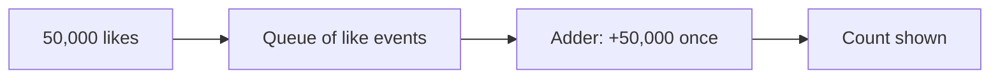

For very hot posts, the count is split into many small counters, and the total is their sum. This is a **sharded counter**.
Views are even more common, so they are counted roughly, with a tiny memory trick.

So the rest of this note is just these 3 questions:
1. How do you stop everyone fighting over one number?
2. How do you make sure a retried like is not counted twice?
3. When is a rough count good enough?

**The problem in one story.**
A celebrity posts a photo.
In one second, 50,000 people tap the heart.
If all of them try to change the same number in the same database row, they wait in line and the app slows down.
A distributed counter lets many places count at once and adds them up later.

**Words you need first**

| Word | Plain meaning | Tiny example |
| --- | --- | --- |
| Counter | A number that only goes up or down by small steps | Likes on post 7 = 1,204 |
| Row lock | The database letting only one writer change a row at a time | Two `UPDATE likes+1` wait for each other |
| Hot key | One item getting far more traffic than others | A viral post |
| Shard | One of several pieces a value is split into | Likes stored as 8 sub-counters |
| Event / delta | A small message saying what changed | `{post:7, +1}` |
| Idempotent | Doing it twice has the same effect as once | Retrying a like does not count it twice |
| Eventual consistency | All copies agree after a short delay | Count shows 1,200 now, 1,204 a second later |

| Kafka offset | The position of an event in a Kafka partition, used to resume reading | "applied up to event 1,999" |
| Aggregator | A worker that adds up many small changes and writes one total | 3,100 likes in one second → one `+3,100` |
| Reconciler | A background job that recounts from the facts and fixes the counter | recount says 1,204,311, counter says 1,205,102 |
| HyperLogLog | A tiny sketch that estimates "how many different people" | 12 KB counts millions of viewers, about 1% off |

**Picture it**

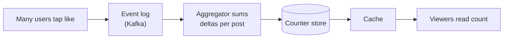

**Analogy.** Like ticket booths at a stadium: each booth tallies its own clipboard, and someone adds them up for the scoreboard every few seconds.
Where it breaks: real booths never double-count a fan, but network retries can, so the system needs dedup (idempotency) to stay honest.

**How the rest of this note builds up**

- First, why `likes = likes + 1` fails at scale (section 1) and the scoreboard mental model (section 2).
- Then the high-level design: event log, aggregation, sharded counters and caching (section 3), with estimates and data model (section 4).
- Then variants and trade-offs: exact vs approximate counts (sections 5-6).
- Finally the SDE-3 deep dive: production systems, hot partitions, dedup and multi-region CRDT counters (sections 7-8).

> [!tip] Remember
> Count in many places, add up later; never make everyone fight over one row.

## 1. Why it exists - requirements 🟢

Open any social app. Under each post you see a heart with a number, and a view count. It looks trivial, so teams build it as `UPDATE posts SET likes = likes + 1 WHERE id = ?`. That works at ten likes per second.

It breaks on the day a celebrity posts and 50,000 people tap the heart in one second:

- every update fights for the same row lock,
- the database queues them and latency climbs,
- and the whole feed slows down because every post card reads from the same table.

> [!tip] Remember
> A counter is easy until one key is hot. All the design is about making one hot number cheap to write and cheap to read.

**Functional requirements**
- Like and unlike a post (a user can like a post at most once; unlike removes it).
- Show the like count, view count and (optionally) unique viewers on a post.
- Show "did I like this?" for the current user, instantly.
- Batch read: counts for 20 posts on one feed page in a single call.
- List who liked a post (paginated, rarely used).
- Views: count a view when a post is shown for a meaningful time, not when a bot refreshes.

**Non-functional requirements**
- Write availability: tapping like never fails with an error page; it may be delayed.
- Read p99 under 50 ms for counts (a target for this design).
- Likes: count converges to the exact value within seconds; the user's own action is visible immediately.
- Views: approximate is fine (within about 1-2 percent), but never silently wildly wrong.
- Counts never decrease on refresh for the same viewer (monotonic reads).
- Handle one post receiving 50,000 likes per second (hot key) without hurting other posts.
- Survive retries, duplicate events and node loss without double counting.

### Real-life example: a cricket highlight on YouTube 🟢

A big cricket highlight goes up on YouTube and millions watch it in the first hour.
The view count under it climbs in jumps, not one by one, and it may even pause for a while; that is batching and checking at work.
Your own like shows up the moment you tap it, even before the big total catches up.
Nobody minds if the views say 4.8 million instead of 4,812,337, which is why views can be counted roughly.

**Out of scope for now:** comments, notifications on like, and ranking by likes (see [[Case Study - Leaderboard and Top-K]] for ranking).

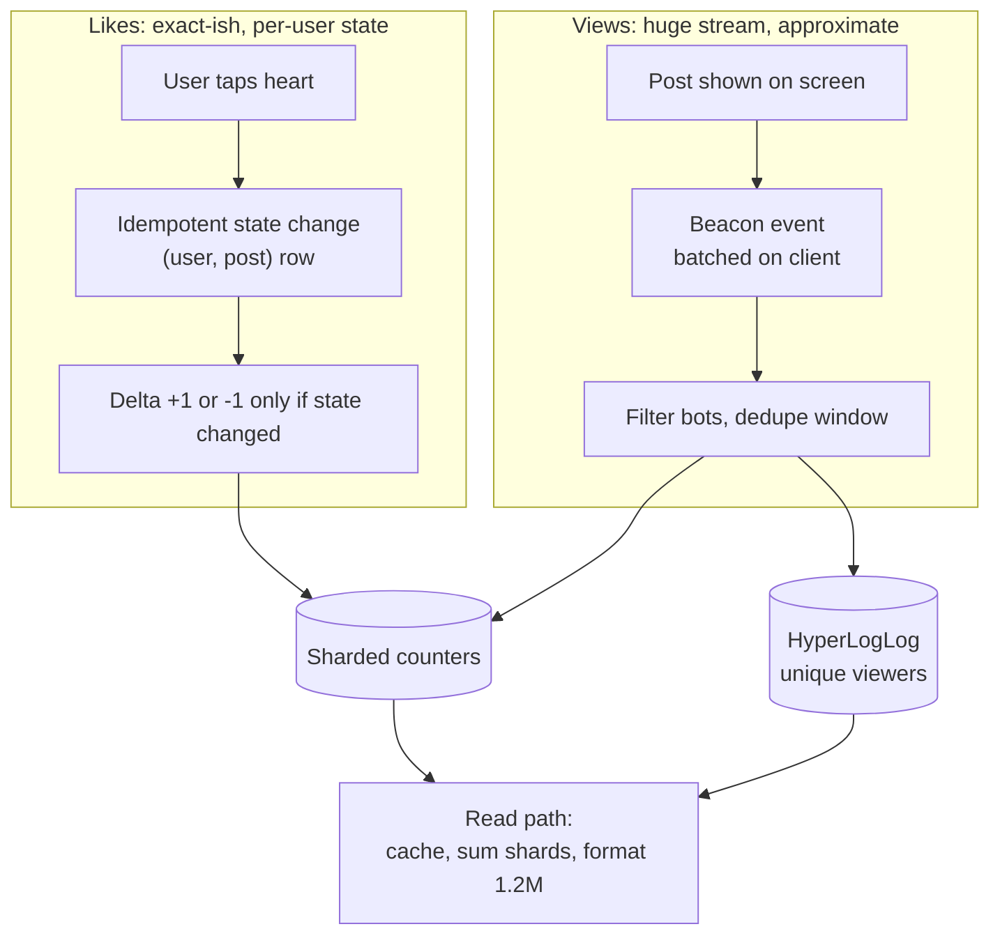

## 2. Mental model 🟢

Think of a **stadium scoreboard with ticket booths**. Every fan who enters buys a ticket at one of many booths. Each booth keeps its own tally on a clipboard. Nobody asks a single clerk to write on one shared sheet, because 50,000 people would queue.

The scoreboard operator walks round every few seconds, adds up the clipboards and updates the big display. The display is slightly behind, but nobody minds, and the total is always the sum of real tallies.

Where the analogy breaks: real clipboards never lose paper, but servers crash. So each booth also writes a durable ticket stub (the like event) that lets us recount from scratch.

Terms:
- **Hot key:** one key receiving far more traffic than others, so one node becomes the bottleneck. See [[Hot Keys and Hot Partitions]].
- **Sharded counter:** one logical counter stored as `N` sub-counters; a write picks one, a read sums all.
- **Write coalescing (batching):** adding 500 increments in memory and writing `+500` once.
- **HyperLogLog (HLL):** a fixed-size probabilistic sketch that counts *distinct* items. Redis uses at most 12 KB for about 0.81% standard error.
- **Idempotent:** doing the operation twice leaves the same result as doing it once.
- **Reconciliation:** a background recount that compares the fast counter with the source of truth and fixes drift.

> [!tip] Remember
> Store the facts (events and per-user state). Keep the count as a fast, rebuildable summary.

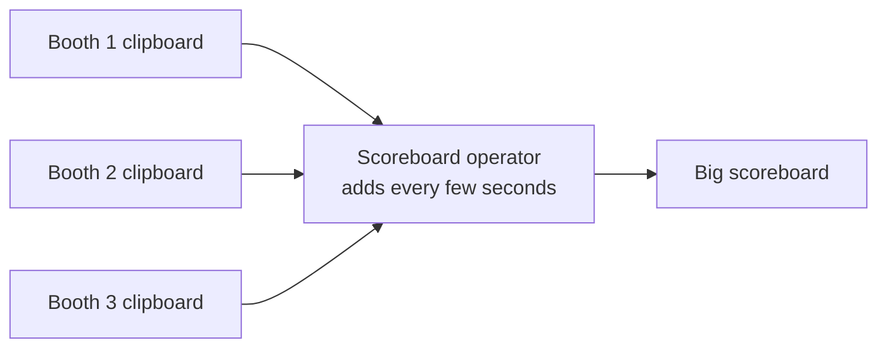

## Common beginner mistakes 🟢

- **`UPDATE posts SET likes = likes + 1` for every tap** → on a viral post every update waits for the same row lock → write the like fact, then add up deltas in batches.
- **Counting raw taps** → a double tap or retry adds two likes → count only real state changes (a new row in the likes table).
- **Trusting "exactly once" from the queue alone** → a crash between "add to counter" and "save offset" re-applies a batch → save the delta and the offset in one transaction.
- **Sharding every counter** → a post with 40 likes would need 16 reads to show its count → shard only posts measured as hot.
- **Counting unique viewers with a full set per post** → 5 million IDs is about 40 MB for one post → use a HyperLogLog (12 KB, about 1% error).

## 3. How it works - high-level design 🟡

> 🟢 → 🟡 **You now know** why one shared number breaks on a viral post and that the count is a summary of stored facts. **Next we open the box**: why the database row is the bottleneck, and how likes flow through a queue and an adder into sharded counters.

### Why not just `count + 1` in the database

**Step by step:**
1. Post 7 has a `likes` column. Tap 1 runs `likes = likes + 1` and locks the row for about 1 ms.
2. Tap 2 arrives in that same millisecond. It must wait for tap 1 to finish.
3. So one row handles roughly 1,000 taps a second, one after another.
4. A celebrity post gets 20,000 taps a second. 19,000 a second join the queue.
5. Waiting taps hold database connections, so other posts' queries wait too, and the whole app slows.

**In plain words.** A relational row is protected by a lock while it is being changed. Two updates to the same row run one after another. If each takes 1 ms, one row can take at most about 1,000 updates per second, and in practice less because of commit and replication cost.

**Picture it.**

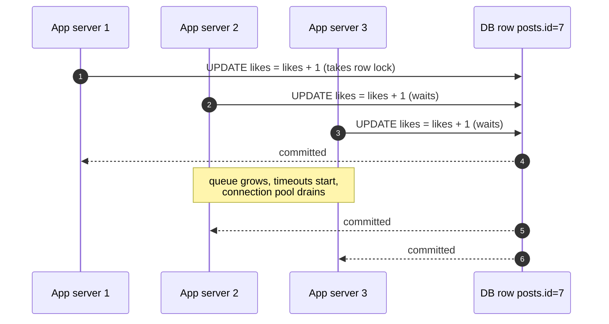

**Example.** A post gets 20,000 taps per second. At roughly 1,000 serialized updates per second (an estimate), 19,000 per second pile up. After 10 seconds there are 190,000 waiting statements, and every other query that needs a connection also waits.

**Why it matters.** Hot-row contention does not slow only the hot post. It exhausts the shared connection pool and takes the whole database with it.

### The architecture

**In plain words:** likes become events in a queue; a helper sums them per post every second and writes one update; readers see a cached total.

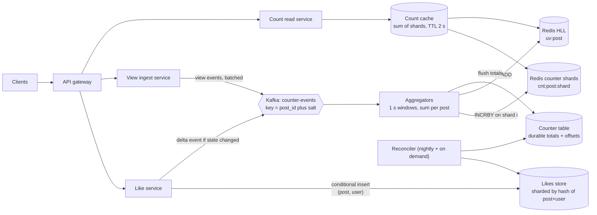

Read the diagram left to right:
1. The **like service** writes the durable fact first, a row meaning "user U likes post P". The write is conditional, so a repeated tap changes nothing.
2. Only when the state really changed does it emit a delta (`+1` for a new like, `-1` for an unlike) to Kafka.
3. **Aggregators** read the stream, add up deltas per post for about one second, and write one combined update to a counter shard.
4. **Readers** sum the shards (and cache the sum for a second or two).
5. A **reconciler** recounts from the likes store and repairs any drift.

> [!tip] Remember
> Fact first, delta second, count last. If the last step is lost, the first step lets you rebuild it.

## 4. Worked example - estimates, API and data model 🟡

### Whiteboard version

```text
tap -> Like svc: INSERT (post,user) IF NOT EXISTS  -> changed? -> Kafka delta(+1)
Kafka(key=post[+salt]) -> aggregator: sum 1s -> INCRBY cnt:{post}:{rand shard}
read: MGET shards -> sum -> cache 2s -> "1.2M"
views: beacon -> filter -> same pipe; unique viewers = PFADD uv:{post}
nightly: recount likes table vs counter, fix drift
```

Say aloud: 6k likes/s average, 17k/s peak overall; 46k views/s average, about 140k/s peak; one viral post can take 50k/s alone, so the shard count for hot posts is 16 or more.

### Estimates

**In plain words:** rough sums: likes and views per second, and how much batching cuts the writes.

All inputs are **estimates** for this exercise. Check each against real data in a real design.

| Quantity | Arithmetic | Result |
| --- | --- | --- |
| Daily active users | given | 100 M |
| Likes per day | 100 M x 5 likes | 500 M/day |
| Like write rate | 500 M / 86,400 s | about 5.8k/s average, about 17k/s at a 3x peak |
| Views per day | 100 M x 40 posts seen | 4 B/day |
| View rate | 4 B / 86,400 s | about 46k/s average, about 140k/s at a 3x peak |
| Count reads | every shown post reads its counts, same as views | about 46k/s average, 140k/s peak (served from cache) |
| Likes storage | 500 M/day x 16 B (two 8-byte ids) | 8 GB/day raw, about 2.9 TB/year raw; about 3x with indexes and replication |
| Counter totals | 1 B posts x 8 B | 8 GB, fits in memory across a few nodes |
| HLL memory | 10 M hot posts x 12 KB (dense upper bound) | about 120 GB; small posts use the sparse form, far less |
| Event bandwidth | 140k/s x 100 B | about 14 MB/s into Kafka, easy |
| Kafka partitions | 140k/s / about 10k/s per partition (estimate) | about 14, round up to 32 for headroom |
| Hot post | one live event, 50k likes/s | one Redis key tops out near its single-thread limit (order of 100k ops/s, an estimate); 16 shards leave about 3k/s each |

The totals are small. Counting is not a storage problem; it is a concurrency and hot-key problem.

### API

**In plain words:** one call to like or unlike, and one to read the counts.

```http
PUT    /v1/posts/{post_id}/like        -> 204   (idempotent; repeating is harmless)
DELETE /v1/posts/{post_id}/like        -> 204   (idempotent)
GET    /v1/posts/counts?ids=p1,p2,p3   -> {"p1": {"likes": 1200431, "views": 48200311, "liked_by_me": true}, ...}
GET    /v1/posts/{post_id}/likers?cursor=abc&limit=50
POST   /v1/views                       -> 202   body: {"events":[{"post_id":"p1","t":1762700000,"dwell_ms":1800}, ...]}
```

Notes:
- `PUT` and `DELETE` are idempotent by definition, so retries are safe without a client-sent key. See [[Idempotency and Idempotency Keys]].
- Counts are a **batch** endpoint: one call per feed page, not 20 calls.
- Views are posted in a batch by the client and acknowledged with 202. The server must not make the user wait for counting.
- `liked_by_me` is read from the likes store (or a per-user cache), never derived from the count.
- The `likers` list is a scatter-gather (ask every shard, then merge the answers) across likes shards, because `likes` is sharded by `hash(post_id, user_id)` to spread a viral post. That is acceptable for a rarely used call; if it matters, keep a separate `post_likers` table keyed by `post_id` (bucketed for hot posts).

### Data model

**In plain words:** one table remembers who liked what (the facts); another holds the running totals (the fast summary).

```sql
-- Likes: the durable fact. Sharded by hash(post_id, user_id) so one viral post spreads across shards.
CREATE TABLE likes (
    post_id    bigint      NOT NULL,
    user_id    bigint      NOT NULL,
    created_at timestamptz NOT NULL,
    PRIMARY KEY (post_id, user_id)          -- the primary key IS the dedupe
);

-- Reverse index, so "did user U like posts p1..p20?" is one shard read.
CREATE TABLE user_likes (
    user_id    bigint NOT NULL,
    post_id    bigint NOT NULL,
    PRIMARY KEY (user_id, post_id)
);

-- Durable counter totals, written in batches by aggregators.
CREATE TABLE post_counters (
    post_id    bigint  NOT NULL,
    kind       text    NOT NULL,            -- 'likes' | 'views'
    total      bigint  NOT NULL DEFAULT 0,
    PRIMARY KEY (post_id, kind)
);

-- One row per Kafka partition: how far this aggregator has applied. Written in the SAME transaction as the totals.
CREATE TABLE counter_offsets (
    topic      text   NOT NULL,
    partition  int    NOT NULL,
    next_offset bigint NOT NULL,
    PRIMARY KEY (topic, partition)
);
```

Redis keys:

| Key | Type | Meaning |
| --- | --- | --- |
| `cnt:{post}:likes:3` | string integer | shard 3 of the likes counter; sum all shards for the total |
| `cnt:{post}:views:7` | string integer | shard 7 of the views counter |
| `uv:{post}` | HyperLogLog | distinct viewers, `PFADD` / `PFCOUNT` |
| `shards:{post}` | small integer | how many shards this post currently uses (default 1) |
| `seen:{post}:{user}` | string with short TTL | "this user already viewed in this window" dedupe marker |

The `{post}` hash tag (Redis hashes only the part inside `{}`, so these keys land together) keeps all shards of a post in the same Redis Cluster slot for easy `MGET`; the trade-off is that a hot post then lives on one node, so for very hot posts omit the tag and let shards spread across nodes (see deep dive 8.1).

### One like traced

**In plain words:** follow a single tap from the phone, through the queue and the adder, to the number everyone sees.

1. User 42 taps the heart on post 7. The app updates the heart immediately (optimistic UI: show the result before the server confirms it) and sends `PUT /v1/posts/7/like`.
2. The like service runs `INSERT INTO likes ... ON CONFLICT DO NOTHING` and checks the affected row count.
3. Row count 1 means a new like: emit `{post:7, delta:+1, event_id}` to Kafka. Row count 0 means a duplicate tap: emit nothing.
4. An aggregator collects deltas for post 7 for one second: `+3,100`. It runs `INCRBY cnt:7:likes:5 3100` on a random shard.
5. A reader asks for counts. The read service sums the 16 shards of post 7, formats `1.2M`, and caches it for 2 seconds.

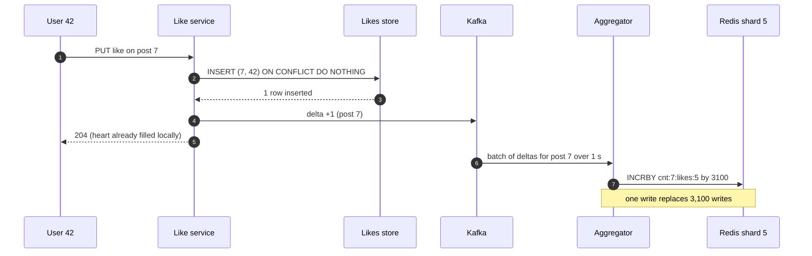

> [!tip] Remember
> The client sees success when the fact is stored. The count catches up a second later. That gap is invisible, and it is what buys the throughput.

## 5. Variants and comparison 🟡

### Choosing a counting technique

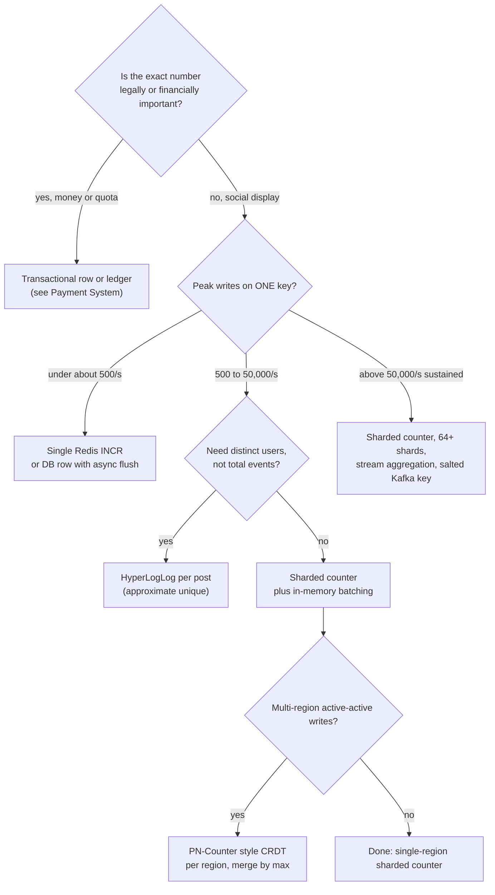

| Approach | How it works | Use when | Cost / failure mode |
| --- | --- | --- | --- |
| `UPDATE count = count + 1` | Row lock per increment | Under about 100 writes/s per row | Hot row blocks the pool; lock waits |
| Redis `INCR` on one key | Single-threaded atomic add | Up to a few thousand writes/s per key | One key lives on one node; node loss loses recent increments unless rebuilt |
| Sharded counter | `N` sub-keys; random shard per write; sum on read | Hot keys; the standard fix | Read cost grows with `N`; shard count must be tuned |
| In-memory batching in the app | Add locally, flush every 100 ms to 1 s | Reduces write rate by 100x or more | Lose the unflushed batch on crash (bounded loss, then reconcile) |
| Stream aggregation (Kafka + aggregator) | Durable event log; windowed sums | High volume plus replay and audit | Seconds of lag; more moving parts |
| Cassandra counter column (a special column type Cassandra can add to without reading first) | Native `UPDATE ... SET c = c + 1` | Wide-column stack, tolerates drift | Not idempotent; a retried update can over-count (documented) |
| DynamoDB atomic counter / write sharding | `ADD` on an item; shard the key | AWS-native; sharding by suffix | Per-partition limit; a retried `ADD` also double-counts |
| Firestore distributed counter | Many shard documents; sum on read | Firestore app | Documented as the standard pattern because one document sustains only about 1 write/s |
| PN-Counter CRDT (a counter type that many copies can update separately and merge without conflicts) | Each replica keeps its own `P` and `N` vectors; merge = per-replica max | Multi-region writes with no coordination | Memory per replica; no "bounded" counters |
| HyperLogLog | Hash, bucket by prefix, keep max leading zeros | Unique viewers | About 0.81% error; cannot remove an item; cannot list members |
| Count-Min Sketch | Grid of counters, min of rows | Frequencies for millions of keys | Over-counts; not for a single known post |

Real systems:

- Facebook's TAO paper (2013) describes keeping an **association count** next to each edge list, such as likes on an object, so a count read does not scan the list.
- Google documents the Firestore **distributed counter** pattern as the official answer to its per-document write limit.
- AWS documents **write sharding** for DynamoDB hot partition keys.

These are public, documented patterns, not guesses about private designs.

See [[Choosing a Database - Decision Guide]] for where to keep the likes fact, [[Choosing a Caching Strategy - Decision Guide]] for the count cache, [[Kafka vs RabbitMQ vs SQS - Choosing a Message Broker]] for the event pipe, and [[Choosing Consistency, Replication and Partitioning - Decision Guide]] for the convergence promise.

### Things people confuse this with 🟡

| System | What it counts | How it differs |
| --- | --- | --- |
| [[Case Study - Ad Click Aggregation]] | Clicks that someone pays for | Must be exact for billing, so it adds a nightly batch recount and stricter dedupe |
| [[Case Study - Leaderboard and Top-K]] | Scores, then ranks them | Needs ordering ("who is in the top 10?"), not just a total per item |
| Inventory or seat count | Items left to sell | A cap must never be crossed, so it needs locks or transactions, not lagging sums |

## 6. Trade-offs and when not to use 🟡

- **Freshness vs cost.** A one-second aggregation window cuts writes by orders of magnitude. The price is a total that lags by about a second. Do not use this pattern when the exact current total triggers an action (inventory, a seat count, a rate limit).
- **Sharded counters trade write speed for read cost.** 16 shards means 16 reads per count read. Cache the sum for 1-2 seconds and only shard posts that are actually hot.
- **At-least-once plus a retry is the default.** Without dedupe or transactional offsets, a counter drifts upward after every restart. Never apply a delta twice without a guard.
- **Approximate is a feature for views.** Insisting on exact view counts costs much more (full dedupe state per viewer per post) for no user benefit.
- **Do not store a likes list inside the post row.** The row grows without bound and one hot post makes one hot row.
- **Do not use this design for money.** Balances need transactions and a ledger. See [[Case Study - Payment System]].

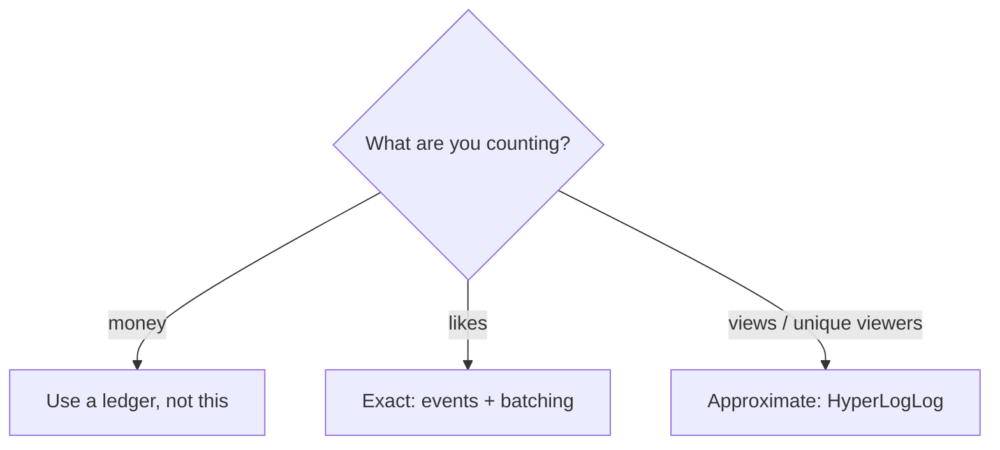

## 7. In production 🔴

> 🟡 → 🔴 **You now know** the pipeline, the API, the tables and one like traced end to end. **Next is the advanced part**: what breaks in production, sharded counters that grow on demand, exactly-once effect, approximate views, reconciliation, and counting across regions.

- **Failure modes and fixes:**
	- Hot post saturates one Redis node. Fix: automatic shard promotion (section 8.1) and salted Kafka keys.
	- Aggregator crashes after incrementing Redis but before committing the Kafka offset. On restart the batch is re-applied and the count drifts up. Fix: durable totals and offsets in one transaction (section 8.2), plus nightly reconciliation.
	- Redis node lost. Fix: counters are rebuilt from the durable totals table plus replay from the last saved offset; until then, serve the last cached value.
	- Count appears to go backwards on refresh because two cache nodes hold different sums. Fix: clients keep the larger of the old and new count for a post for that session; server returns a `version` or `as_of` stamp.
	- Unlike arrives before like (events reordered). Fix: deltas are derived from real state changes in the likes store, so the sequence is consistent per `(post,user)`; clamp the displayed total at zero.
	- Bot farms inflate views. Fix: filter by session, dwell time (how long the post stayed on screen), rate per account and IP reputation (whether an address is known for abuse) before counting; count only after validation.
	- Backlog after an outage: aggregators fall minutes behind. Fix: autoscale consumers per partition, keep the pipeline idempotent, and show slightly stale counts.
- **What to monitor:**
	- Consumer lag of the counter topic (seconds behind).
	- Per-post write rate, top-N hot posts and their shard counts.
	- Drift: reconciler's `|counter - recount|` for a sample, as absolute and percent.
	- Redis memory, ops/s, p99 latency, and slow log.
	- Dedupe hit rate (share of like taps that were duplicates) and bot-filter rejection rate.
- **Operational rules of thumb:**
	- Run the reconciler on a sample every hour and on all posts nightly; alert if drift for any post exceeds a threshold such as 0.5%.
	- Keep an admin tool to force a recount for one post.

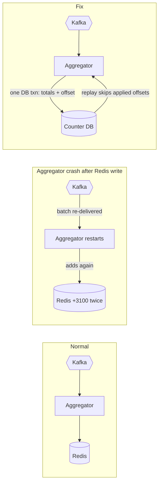

## 8. Deep dive 🔴

### 8.1 Hot keys: sharded counters that grow on demand

**In plain words.** One counter key lives on one machine. If everybody writes to it, that machine is the limit. Break the key into `N` smaller keys on different machines, write to a random one, and add them when reading.

**Picture it.**

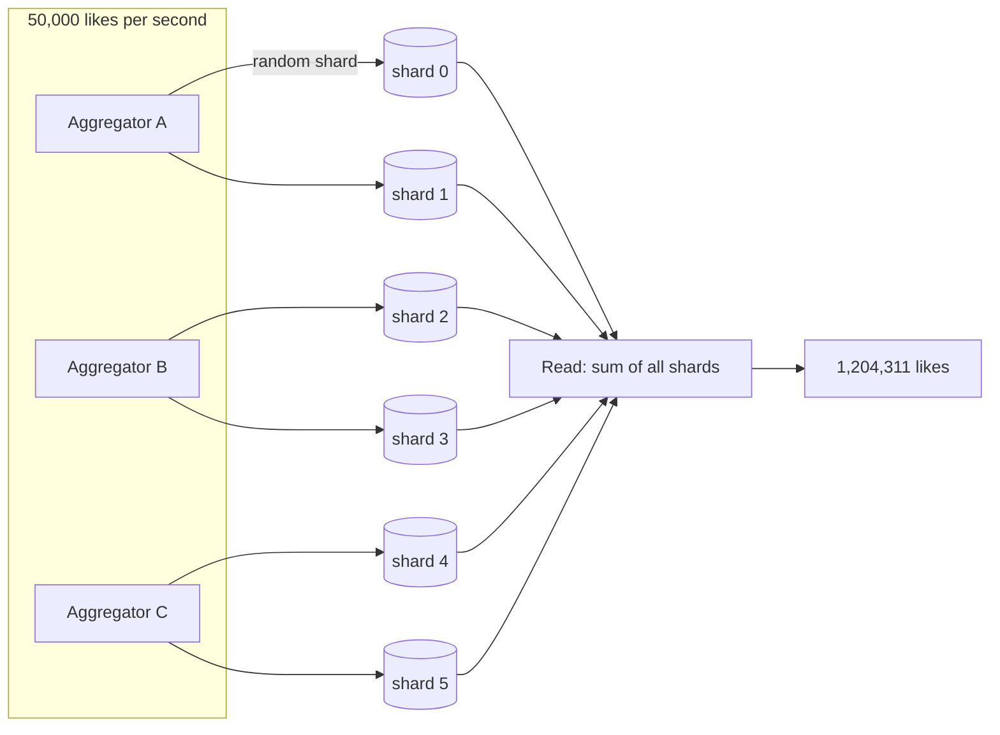

**Example.** A post takes 50,000 likes/s. Aggregators coalesce to about 1 write per second per aggregator per post, so with 40 aggregators that is about 40 writes/s total, even before sharding. Sharding matters for the layer that has no batching (for example, direct Redis counters on every app server): with 16 shards each shard sees about 3,100 writes/s instead of 50,000.

**Choosing the shard count.**
1. Start every post at `N = 1` (one key). Most posts get a few likes ever.
2. Measure per-post rate in the aggregator with a small sliding counter (or a Count-Min Sketch to find the top few hundred keys, see [[Bloom Filters and Probabilistic Data Structures]]).
3. When a post exceeds a threshold, say 500 writes/s for 10 seconds, raise `shards:{post}` to 8, then 16, then 64.
4. Never lower `N` while writes are in flight; first fold the extra shards into shard 0, then reduce.
5. Readers `MGET` all `N` shard keys; `N` is stored next to the post and cached.

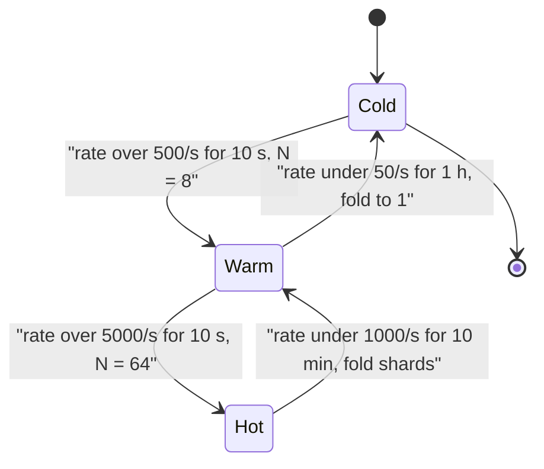

> [!warning] Common mistake
> Sharding every counter "just in case". A post with 40 likes does not need 16 keys, and reads of 16 keys cost 16 times more. Shard only what is measured as hot.

**What happens if** a shard's node dies? Only `1/N` of the count is temporarily missing. Readers see a smaller total than the truth until the shard is restored from its durable total and replay. This is a much smaller blast radius than losing the whole key.

**Why it matters.** Sharding turns one impossible hot spot into many ordinary ones, at a price you pay only for the posts that need it.

The same hot-partition problem exists at the Kafka layer: keying by `post_id` sends all of a viral post's events to one partition.

Fix with a **salted key** `post_id + (event_id mod 8)` for posts flagged hot, so deltas for one post spread over 8 partitions; aggregators still sum per post because addition is commutative. See [[Message Ordering and Partition Keys]] (ordering is not needed for sums).

### 8.2 Exactly-once effect: delta and offset in one transaction

**In plain words.** The pipe delivers each event at least once, so some are delivered twice after a crash. The counter must still go up only once per real like. The trick is to make "apply the delta" and "remember I applied it" a single atomic step.

**Picture it.**

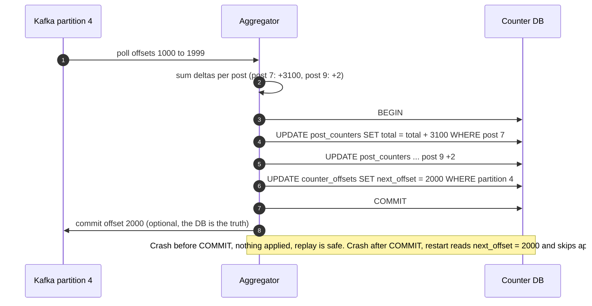

**Example.** The aggregator applies offsets 1000-1999 and crashes before telling Kafka. On restart it asks the DB for `next_offset` (2000), seeks Kafka there, and continues. The 1,000 events are not applied twice.

**Numbered rules.**
1. The aggregator's source of "where am I" is the DB row, not Kafka's committed offset.
2. A batch's counter updates and its offset update commit together, or not at all.
3. The aggregator is single-writer per partition (a Kafka consumer group gives each partition to one reader at a time; use fencing if a zombie consumer can wake up, see [[Idempotency and Idempotency Keys]]).
4. Redis is updated *after* the commit from the same batch result. If Redis is lost, rebuild it from `post_counters`.

If the counter store is Redis only (no DB), keep the last applied offset in Redis and update both with one Lua script or `MULTI/EXEC` (Redis's way to run several commands as one unit) so they stay together.

> [!warning] Common mistake
> Calling the Kafka offset commit and the counter write "exactly once" because both usually succeed. Two separate systems cannot be updated atomically; one of them must record the other's progress.

**Why it matters.** A counter that drifts up by 0.1 percent every deploy is wrong by a visible amount within weeks.

### 8.3 Views and unique viewers: approximate on purpose

**In plain words.** A view is "someone saw this post". It happens 46,000 times a second and nobody audits it. Counting uniques ("how many different people?") needs memory to remember each person, unless you accept a small error and use a sketch.

**Picture it.**

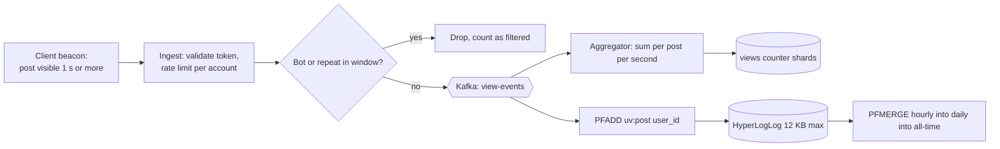

**Example.** Post 7 has 5 M distinct viewers. A set of 5 M user ids at 8 bytes is about 40 MB for one post; a HyperLogLog is 12 KB. For 10 M such posts the set would take about 400 TB (an estimate, upper bound), the HLL about 120 GB.

**How the sketch works, short.**
1. Hash the user id to 64 bits. Use the first 14 bits to choose one of 16,384 registers.
2. In the remaining bits, count the leading zeros, plus one.
3. Each register stores the maximum count seen. Rare long zero runs only happen when many distinct items were hashed, so the average of registers estimates the distinct count.
4. `PFMERGE` takes the per-register maximum, which is why sketches from different hours or regions combine exactly.

Facts to quote: Redis HLL uses up to 12 KB per key, has a standard error of 0.81 percent, and cannot delete an item or list members.

**Dedupe window.** Counting every beacon (a small "I was shown" message the app sends) would count a refresh as a new view. Keep a short-lived marker `seen:{post}:{user}` with `SET NX EX 3600`. If the set succeeds, count it; if not, drop it. This marker is per viewer per post, which is large; for non-hot posts use a Bloom filter per hour instead (see [[Bloom Filters and Probabilistic Data Structures]]), accepting a small false-positive rate (a few real views dropped).

**What happens if** a deploy bug sends every beacon twice? Views double for an hour. This is why views come from a stream: replay the corrected pipeline from Kafka for that window and overwrite.

**Why it matters.** Views are the highest-volume number in the system. Making them approximate and batched turns the largest cost center into a small one.

### 8.4 Correctness: reads, drift and reconciliation

**In plain words.** However careful the pipeline is, counts drift: bugs, manual data fixes, replays. A background job recounts from the facts and corrects the number.

**Picture it.**

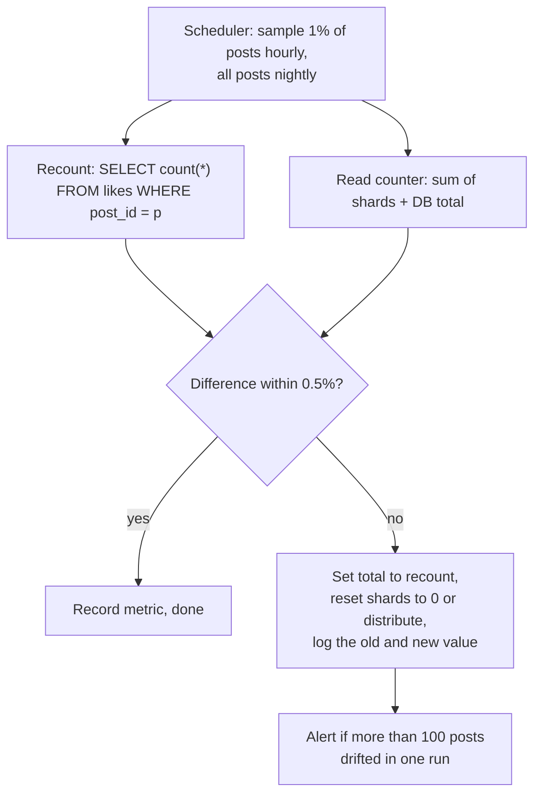

**Example.** Recount of post 7 gives 1,204,311; the counter says 1,205,102. Difference is 791, which is 0.07 percent, within tolerance, and gets corrected silently. A drift of 5 percent across many posts means a pipeline bug, so alert.

**Counting a very hot post.** `SELECT count(*)` over a post with 30 M likes is slow. Keep periodic **snapshots** (`total_as_of_offset`) and count only likes after the snapshot. Recount becomes "snapshot + count since".

**Read consistency promises (say these in the interview).**
- *Read-your-writes* for the actor: the client shows the new heart and adds `+1` locally until the server count includes it.
- *Monotonic reads* for the viewer: the client never shows a smaller count than it already showed for that post in the session.
- *Eventual convergence* for everyone else: within seconds under normal load, minutes under a backlog.

**Unlike and negative numbers.** Deltas come from actual state changes in the likes table, never from raw taps. A like followed by an unlike nets to zero in the table and in the counter. If the aggregator ever shows a negative total, clamp the display at zero and let the reconciler fix it.

**Why it matters.** Without reconciliation you cannot prove the count is right; you can only hope. With it, you can state the error budget.

### 8.5 Multi-region and CRDT counters

**In plain words:** each region keeps its own count and they swap numbers; the total is the sum of every region's own count, so nothing is lost.

If users in the US and EU both like the same post and each region writes locally, the regions need a merge rule that needs no coordination. A **PN-Counter** (see [[CRDTs and Conflict Resolution]]) works like this:

- Each region keeps two numbers, `P` (likes added) and `N` (likes removed).
- The total is `sum(P) - sum(N)`.
- Merging two copies takes the larger value per region per field.

Because every replica only ever increases its own entries, replays and out-of-order merges are harmless.

Where it fits: a global product with active-active regions. Where it does not: single-region systems (extra complexity), or counters with limits such as "only 100 seats" (a CRDT cannot enforce a cap without coordination).

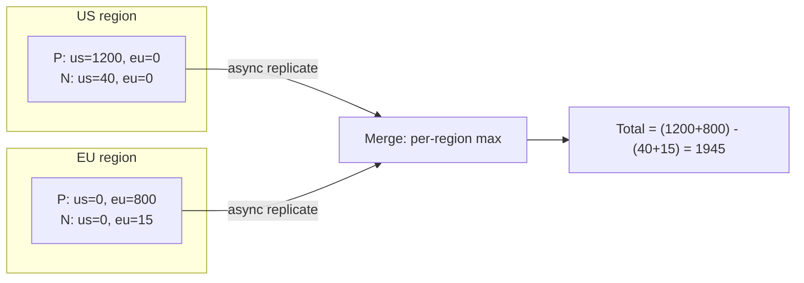

> [!tip] Remember
> The hard parts are the hot key, the replay, and the proof of correctness. Each has a named answer: sharded counter, transactional offset, reconciler.

## 9. Interview questions 🔴

> [!question]- A celebrity post gets 50,000 likes per second. Why does `UPDATE likes = likes + 1` fail and what do you do?
> All updates serialize on one row lock, and waiting statements drain the connection pool for every other query. Store the like as a row keyed by `(post_id, user_id)`, emit a delta only on a real change, aggregate for about a second in a stream consumer, and write the sum to one of `N` Redis shards chosen at random. Readers sum the shards and cache the result for 1-2 seconds.

> [!question]- How do you stop a user from liking the same post twice?
> Make the like a unique row: primary key `(post_id, user_id)` with `INSERT ... ON CONFLICT DO NOTHING`. Only a successful insert produces a `+1` delta. A repeated tap, retry or double-click inserts nothing and emits nothing.

> [!question]- Likes should be exact, views can be approximate. Why different designs?
> A like is per-user state with a natural unique key and a visible "did I like this" bit, so exact dedupe is cheap. Views are 8 times more frequent, nobody sees individual viewers, and exact unique dedupe would need memory per viewer per post. Sketches (HyperLogLog) and a short dedupe window give about 1 percent error for a tiny fraction of the cost.

> [!question]- Your aggregator crashes and Kafka redelivers. How do you avoid double counting?
> Treat the database as the source of progress: update the counter totals and the partition's `next_offset` in one transaction, and on restart seek to `next_offset`. Two separate systems cannot commit atomically, so one must record the other's position.

> [!question]- How do you keep counts from going backwards when a user refreshes?
> Different cache nodes can hold slightly different sums. Return an `as_of` version with each count and let the client keep the max it has seen for that post in the session. For the actor's own like, add a local `+1` until the server count catches up.

> [!question]- Trap: "Use a Redis `INCR` per like and call it done." What is missing?
> Three things: (1) one key is still one node, so a viral post saturates it, so you need shards or batching; (2) Redis alone is not durable or dedupe-aware, so a restart loses counts and a retry double-counts; (3) no proof of correctness, so you need a durable fact table and a reconciler.

> [!question]- How would you count unique viewers for 10 million posts?
> Use a HyperLogLog per post: 12 KB maximum (dense), about 0.81 percent error, `PFADD` per validated view, `PFCOUNT` to read, `PFMERGE` to roll hourly sketches into daily and all-time. A plain set would need tens of megabytes per popular post.

> [!question]- What changes if you must support active-active writes in two regions?
> Use a conflict-free counter (PN-Counter): each region increments its own slot, replicas merge by taking the max per slot, so no cross-region coordination is needed. The per-user like fact must also converge (last-writer-wins on `(post,user)` with a timestamp, or a CRDT set), and the count is eventually consistent across regions.

## Self-check 🟢🟡

> [!question]- Easy: what is the source of truth for likes, the counter or the likes table?
> The likes table (one row per user and post); the counter is a rebuildable summary.

> [!question]- Easy: what is a hot key?
> One key getting far more traffic than others, like a celebrity's post.

> [!question]- Easy: why can view counts be approximate?
> Nobody pays or acts on the exact number, and exact unique counts would cost far more memory.

> [!question]- Medium: a post gets 50,000 likes a second. How do you spread the writes?
> Batch deltas in aggregators for about a second, and split the counter into 16 or more shard keys; sum them on read.

> [!question]- Medium: the aggregator crashes after updating counters but before committing its Kafka offset. How do you avoid double counting?
> Store the counter update and the next offset in the same database transaction, and resume from that stored offset.

> [!question]- Medium: a user double-taps like. Why is the count still right?
> The insert into `likes` hits the existing row and changes nothing, so no `+1` delta is emitted.

## 10. Cheat sheet 🟢

A 45-minute script:

- **0-5 min, requirements:** like/unlike once per user, like and view counts, "liked by me", batch reads, unique viewers. Likes eventually exact, views approximate, never lose a tap, handle one post at 50k/s.
- **5-10 min, estimates:** 500 M likes/day = 5.8k/s (17k/s peak); 4 B views/day = 46k/s (140k/s peak); likes storage 8 GB/day; HLL 12 KB per hot post; hot post 50k/s.
- **10-15 min, API and data:** idempotent `PUT/DELETE like`; batch `GET counts`; views `POST` batch; `likes (post_id, user_id)`, `user_likes`, `post_counters`, `counter_offsets`; Redis shard keys and `uv:{post}`.
- **15-25 min, high-level design:** like service writes the fact, emits delta only on change, Kafka, aggregator (1 s window), Redis sharded counters, count cache, reconciler.
- **25-40 min, deep dives:** sharded counters with promotion; delta plus offset in one transaction; views with HLL and dedupe window; reconciliation and read guarantees; optional PN-Counter for multi-region.
- **40-45 min, wrap-up:** monitor consumer lag, drift, hot-post list; rebuild from facts; what you would simplify for a smaller product (single Redis `INCR` plus nightly recount).

| Need | Pick |
| --- | --- |
| Hot key writes | Sharded counter plus in-memory batching |
| Safe retries | Unique row for the fact; delta only on state change |
| Exactly-once effect | Delta and offset in one transaction |
| Unique viewers | HyperLogLog (0.81% error, 12 KB) |
| Multi-region | PN-Counter CRDT |
| Proof it is right | Reconciler recounting from the fact table |

## Links

- **Before this:** [[System Design Interview Framework]], [[Back-of-the-Envelope Estimation]], [[Redis Data Structures and When to Use Each]], [[Hot Keys and Hot Partitions]]
- **Building blocks:** [[Bloom Filters and Probabilistic Data Structures]], [[Stream Processing Basics]], [[Kafka and Event Streaming]], [[Message Ordering and Partition Keys]], [[Idempotency and Idempotency Keys]], [[Partitioning and Sharding]], [[CRDTs and Conflict Resolution]], [[Wide-Column Stores and Cassandra]]
- **Decision guides:** [[Choosing a Database - Decision Guide]], [[Choosing a Caching Strategy - Decision Guide]], [[Kafka vs RabbitMQ vs SQS - Choosing a Message Broker]], [[Choosing Consistency, Replication and Partitioning - Decision Guide]]
- **Compare with:** [[Case Study - Leaderboard and Top-K]], [[Case Study - News Feed]], [[Case Study - Payment System]]

### Watch on YouTube

- [Twitter Likes Count Design / Youtube Views Count Design / Near Realtime Counter System Design](https://www.youtube.com/watch?v=0V-Ns9vovzE) · Think Software · 16 min · 27,847 views
- [How Facebook & YouTube Handle BILLIONS of Likes & Views!](https://www.youtube.com/watch?v=LGOnP9Udffo) · ByteMonk · 8 min · 138,418 views
