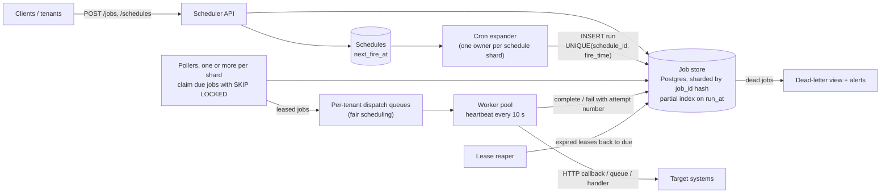
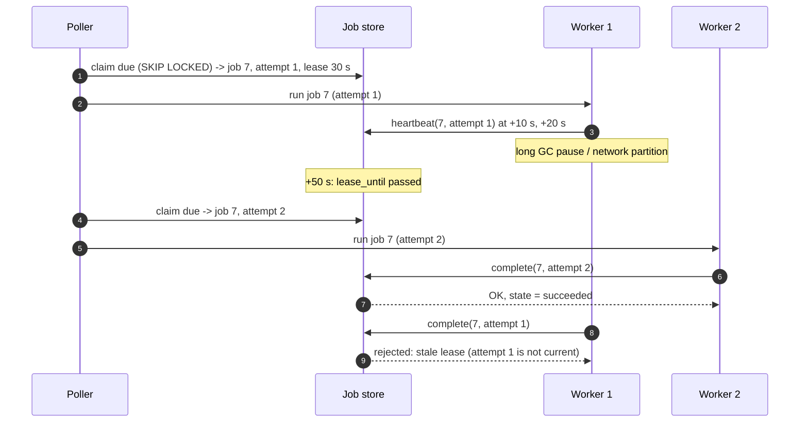
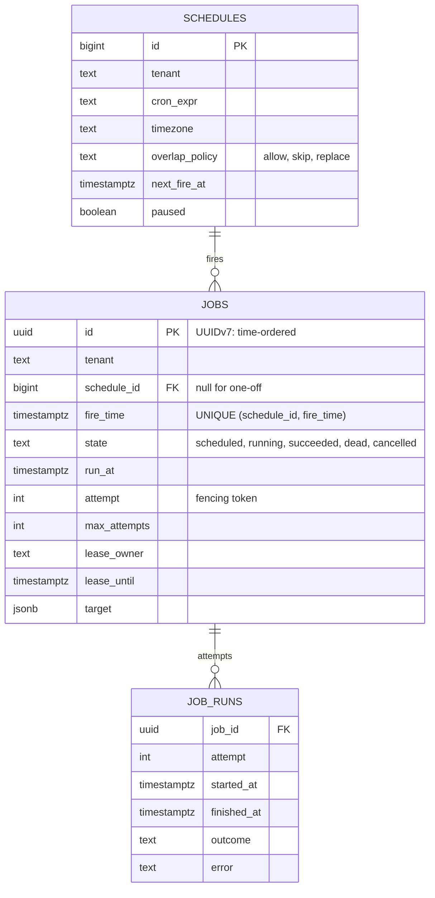
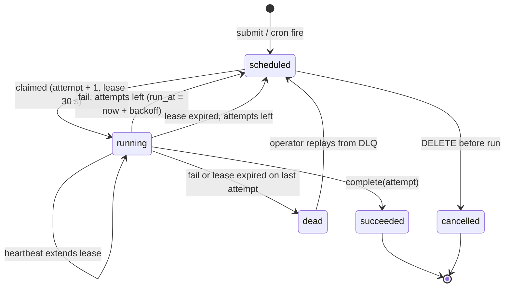

# Case Study - Distributed Job Scheduler

> [!summary] TL;DR
> Design a service that runs millions of jobs at a chosen time ("send this reminder at 09:00", "run this report every hour") across many machines, without losing a job and without two workers running the same attempt. Jobs live in a durable store indexed by due time; pollers claim due jobs with **leases**; workers heartbeat, and a lease that expires means the worker is presumed dead and the job runs again.

> [!abstract] Core idea
> - The job table is the source of truth; queues and timers in memory are only accelerators.
> - A worker does not "take" a job, it **leases** it for, say, 30 seconds and keeps extending the lease with heartbeats.
> - A lease that expires is re-leased with a higher attempt number. The attempt number is a **fencing token**: a zombie worker with an old number cannot mark the job done.
> - Execution is therefore **at least once**. The job's effect must be idempotent.
> - Recurring (cron) schedules create one run per fire time, deduplicated by a unique key `(schedule_id, fire_time)`.

## 1. Why it exists - requirements

A single-server cron runs jobs until the server reboots during the 02:00 run, or until you add a second replica and every job runs twice. A product team now wants 10 million user reminders a day, each at its own time, plus thousands of hourly and nightly reports. The scheduler must be a service of its own. The single-service mechanics (cron syntax, Kubernetes CronJob, `SKIP LOCKED` polling) are in [[Scheduled Jobs - Cron to Durable Schedulers]]; this note designs the distributed, multi-tenant version.

**Functional requirements**
- Submit a one-off job with a `run_at` time and a payload (HTTP callback, queue message or registered handler).
- Create recurring schedules from a cron expression with a time zone.
- Cancel or reschedule a job before it runs; pause a schedule.
- Retries with backoff, a maximum number of attempts, and a dead-letter state.
- Query job status and run history.

**Non-functional requirements**
- **Durability:** an accepted job is never lost (it is committed before the API returns 201).
- **Timeliness:** a job starts within 2 s of `run_at` at p99 under normal load.
- **No concurrent duplicates:** two workers never run the same attempt at once. Execution is at least once, so a crash can cause a re-run.
- Scale: about 100 M pending jobs and 50 M executions a day, with a burst at the top of every minute and hour.
- Multi-tenant fairness: one tenant scheduling a million jobs for 09:00 cannot starve others.

**Glossary.** A **job** is one unit of work with a due time. A **schedule** is a recurring rule that creates a job per fire time. A **lease** is a time-limited claim on a job by one worker. A **heartbeat** extends a lease. A **fencing token** is a number that increases each time a job is re-leased; the store rejects updates carrying an old number. **DLQ / dead** is the state for jobs that exhausted their attempts.

## 2. Mental model

Picture a hotel wake-up-call desk. Every request is written on a card and filed in a box sorted by time (the durable store). A few clerks (pollers) keep pulling cards that are due and hand them to callers (workers). A caller signs the card with the time they took it and must re-sign every 10 seconds while still on the phone. If a card has not been re-signed for 30 seconds, the desk assumes the caller fainted and gives the card, with a new attempt number, to someone else. When the first caller wakes up and tries to stamp "done" with the old number, the desk refuses.

## 3. How it works - high-level design



1. **Submit.** The API validates the request, inserts the job row with `state = 'scheduled'` and an `Idempotency-Key`, and returns 201 only after the commit.
2. **Find due work.** Each job-store shard has pollers that run the claim query every 200-500 ms: oldest `run_at <= now()`, `FOR UPDATE SKIP LOCKED`, limit 100. `SKIP LOCKED` lets several pollers on one shard work without blocking each other.
3. **Lease.** The same statement sets `state = 'running'`, `attempt = attempt + 1`, `lease_owner`, `lease_until = now() + 30 s`.
4. **Dispatch fairly.** Leased jobs go to per-tenant queues; workers pull round-robin across tenants, so a tenant's 1 M jobs at 09:00 do not block a small tenant's 10.
5. **Execute.** The worker calls the target with the job ID and attempt as an idempotency key, heartbeating every 10 s for long jobs.
6. **Finish.** `complete(job, attempt)` succeeds only if the row still shows that attempt. Failure schedules a retry with exponential backoff and jitter, or moves the job to `dead` after `max_attempts`.
7. **Recover.** A worker that dies stops heartbeating; after `lease_until` the job is due again and the next claim gives it attempt + 1.



The target system still saw two calls (one from each worker). That is why the call carries `job_id:attempt` or just `job_id` as an idempotency key, and why the target must deduplicate (see [[Idempotency and Idempotency Keys]]).

## 4. Worked example - estimates, API and data model

### Whiteboard version

```text
API -> jobs table (state, run_at, attempt, lease_until)   [sharded by hash(job_id)]
       partial index (run_at) WHERE state='scheduled'

Poller loop per shard (every ~250 ms):
  UPDATE ... FROM (SELECT ... WHERE run_at<=now() ORDER BY run_at
                   LIMIT 100 FOR UPDATE SKIP LOCKED)
  SET running, attempt+1, lease_until=now()+30s RETURNING id, attempt
Worker: heartbeat 10 s; complete/fail WHERE attempt=$token
Reaper: running AND lease_until<now() -> due again (attempt+1 on next claim)
Cron: schedules.next_fire_at -> INSERT job ON CONFLICT (schedule_id, fire_time) DO NOTHING
Numbers: 50M runs/day = 579/s avg; top-of-minute burst ~14k in 1 s.
```

### Estimates

All inputs are estimates.

| Quantity | Assumption | Arithmetic | Result |
| --- | --- | --- | --- |
| Executions per day | estimate | | 50,000,000 |
| Average rate | | 50,000,000 ÷ 86,400 s | **~579 jobs/s** |
| Per-minute volume | | 50,000,000 ÷ 1,440 min | ~34,700 jobs/min |
| Top-of-minute burst | 40% of a minute's jobs are due at second :00 (cron habits) | 34,700 × 0.4 | **~13,900 jobs due in 1 s** |
| Pending jobs | estimate | | 100,000,000 |
| Job row size | ~500 B with payload reference and indexes | 100 M × 500 B | **~50 GB** (several shards for write rate and maintenance, not size) |
| Run history | 200 B per attempt row | 50 M × 200 B = 10 GB/day; × 30 days | ~300 GB, partitioned by day, old partitions dropped |
| Lease writes | each run: claim + 1 heartbeat + complete ≈ 3 writes | 579/s × 3 | ~1,700 writes/s average, ~42,000/s in the burst second |

The burst, not the average, sizes the system. Two fixes: spread the burst (the API can add up to a few seconds of jitter to cron jobs whose owners opt in), and claim **ahead**: pollers lease jobs due in the next few seconds into an in-memory timing wheel on the worker side, which fires them on time (see the deep dive).

### API

```http
POST /v1/jobs
Idempotency-Key: 2b9f...
{"run_at": "2026-11-04T09:00:00Z", "target": {"type": "http", "url": "https://billing.internal/hooks/remind", "timeout_ms": 5000},
 "payload": {"user_id": 812}, "max_attempts": 5, "tenant": "reminders"}
201 {"job_id": "j_01JBZ...", "state": "scheduled"}

POST /v1/schedules
{"cron": "0 2 * * *", "timezone": "Asia/Kolkata", "target": {...}, "overlap": "skip", "catch_up": "latest_only"}
201 {"schedule_id": "s_44", "next_fire_at": "2026-11-04T20:30:00Z"}

DELETE /v1/jobs/{id}            -> 200 if still scheduled, 409 if running or finished
GET    /v1/jobs/{id}            -> {"state": "running", "attempt": 2, "last_error": "timeout"}
GET    /v1/schedules/{id}/runs  -> paginated run history
```

`next_fire_at` for `0 2 * * *` in `Asia/Kolkata` (UTC+05:30) is 20:30 UTC the previous day. The service stores and compares times in UTC and evaluates cron in the schedule's own time zone, which is the only correct place to handle daylight-saving gaps and repeats for zones that have them.

### Data model



The claim, the fenced completion and the indexes, in PostgreSQL 17:

```sql
CREATE INDEX jobs_due ON jobs (run_at) WHERE state = 'scheduled';
CREATE INDEX jobs_lease ON jobs (lease_until) WHERE state = 'running';
CREATE UNIQUE INDEX jobs_schedule_fire ON jobs (schedule_id, fire_time) WHERE schedule_id IS NOT NULL;

-- Poller: lease up to 100 due jobs. Concurrent pollers skip rows another poller has locked.
UPDATE jobs j
SET state = 'running', attempt = j.attempt + 1, lease_owner = $1,
    lease_until = now() + interval '30 seconds'
FROM (
    SELECT id FROM jobs
    WHERE state = 'scheduled' AND run_at <= now()
    ORDER BY run_at
    LIMIT 100
    FOR UPDATE SKIP LOCKED
) due
WHERE j.id = due.id
RETURNING j.id, j.attempt, j.target;

-- Worker: heartbeat and complete are fenced by the attempt number.
UPDATE jobs SET lease_until = now() + interval '30 seconds'
WHERE id = $1 AND attempt = $2 AND state = 'running';
UPDATE jobs SET state = 'succeeded', lease_owner = NULL
WHERE id = $1 AND attempt = $2 AND state = 'running';   -- 0 rows: stale lease

-- Reaper: expired leases become due again (or dead on the last attempt).
UPDATE jobs SET state = CASE WHEN attempt >= max_attempts THEN 'dead' ELSE 'scheduled' END,
                run_at = now(), lease_owner = NULL
WHERE state = 'running' AND lease_until < now();

-- Cron expander: idempotent across replicas and restarts.
INSERT INTO jobs (id, tenant, schedule_id, fire_time, state, run_at, attempt, max_attempts, target)
VALUES ($1, $2, $3, $4, 'scheduled', $4, 0, $5, $6)
ON CONFLICT (schedule_id, fire_time) WHERE schedule_id IS NOT NULL DO NOTHING;
```

Representative output (PostgreSQL 17) of `EXPLAIN` for the inner claim query on a shard with 25 M scheduled rows, showing the partial index serving the `ORDER BY ... LIMIT` without a sort:

```text
Limit  (cost=0.56..9.21 rows=100 width=22)
  ->  LockRows  (cost=0.56..2163812.40 rows=25012433 width=22)
        ->  Index Scan using jobs_due on jobs  (cost=0.56..1913688.07 rows=25012433 width=22)
              Index Cond: (run_at <= now())
```

### Job lifecycle



### Go: a lease-based job store with fencing

The in-memory `Store` models the job table: each method corresponds to one atomic SQL statement above. The clock is injected, so tests can expire leases and wait out backoffs instantly.

```go
package sched

import (
	"errors"
	"sort"
	"sync"
	"time"
)

// State is a job's lifecycle state.
type State string

const (
	Scheduled State = "scheduled"
	Running   State = "running"
	Succeeded State = "succeeded"
	Dead      State = "dead"
)

// Job is one execution request. Attempt doubles as the fencing token:
// only the worker holding the current attempt may finish the job.
type Job struct {
	ID          string
	RunAt       time.Time
	State       State
	Attempt     int
	MaxAttempts int
	LeaseOwner  string
	LeaseUntil  time.Time
	LastError   string
}

// Lease is what a worker gets back from Claim.
type Lease struct {
	JobID   string
	Attempt int
}

var ErrStaleLease = errors.New("sched: lease lost (job re-leased to another worker)")

// Store is an in-memory model of the jobs table. Each method is one
// atomic statement in the SQL version (see the note).
type Store struct {
	mu      sync.Mutex
	now     func() time.Time
	lease   time.Duration
	backoff func(attempt int) time.Duration
	jobs    map[string]*Job
}

func NewStore(now func() time.Time, lease time.Duration, backoff func(int) time.Duration) *Store {
	return &Store{now: now, lease: lease, backoff: backoff, jobs: map[string]*Job{}}
}

// Add inserts a job; adding an existing ID is a no-op (idempotent submit).
func (s *Store) Add(id string, runAt time.Time, maxAttempts int) bool {
	s.mu.Lock()
	defer s.mu.Unlock()
	if _, ok := s.jobs[id]; ok {
		return false
	}
	s.jobs[id] = &Job{ID: id, RunAt: runAt, State: Scheduled, MaxAttempts: maxAttempts}
	return true
}

// Claim leases up to n due jobs, oldest run_at first. A running job whose
// lease expired counts as due again: its worker is presumed dead.
func (s *Store) Claim(worker string, n int) []Lease {
	s.mu.Lock()
	defer s.mu.Unlock()
	now := s.now()
	var due []*Job
	for _, j := range s.jobs {
		switch {
		case j.State == Scheduled && !j.RunAt.After(now):
			due = append(due, j)
		case j.State == Running && now.After(j.LeaseUntil):
			due = append(due, j)
		}
	}
	sort.Slice(due, func(a, b int) bool {
		if due[a].RunAt.Equal(due[b].RunAt) {
			return due[a].ID < due[b].ID
		}
		return due[a].RunAt.Before(due[b].RunAt)
	})
	var out []Lease
	for _, j := range due {
		if len(out) == n {
			break
		}
		if j.Attempt >= j.MaxAttempts { // expired lease on the last attempt
			j.State, j.LeaseOwner = Dead, ""
			j.LastError = "lease expired on final attempt"
			continue
		}
		j.Attempt++
		j.State = Running
		j.LeaseOwner = worker
		j.LeaseUntil = now.Add(s.lease)
		out = append(out, Lease{JobID: j.ID, Attempt: j.Attempt})
	}
	return out
}

func (s *Store) current(l Lease) (*Job, error) {
	j, ok := s.jobs[l.JobID]
	if !ok || j.State != Running || j.Attempt != l.Attempt {
		return nil, ErrStaleLease
	}
	return j, nil
}

// Heartbeat extends the lease of a long-running job.
func (s *Store) Heartbeat(l Lease) error {
	s.mu.Lock()
	defer s.mu.Unlock()
	j, err := s.current(l)
	if err != nil {
		return err
	}
	j.LeaseUntil = s.now().Add(s.lease)
	return nil
}

// Complete marks success. A worker whose lease was taken over gets
// ErrStaleLease and must not report success.
func (s *Store) Complete(l Lease) error {
	s.mu.Lock()
	defer s.mu.Unlock()
	j, err := s.current(l)
	if err != nil {
		return err
	}
	j.State, j.LeaseOwner = Succeeded, ""
	return nil
}

// Fail schedules a retry with backoff, or moves the job to Dead
// (the dead-letter state) after MaxAttempts.
func (s *Store) Fail(l Lease, reason string) error {
	s.mu.Lock()
	defer s.mu.Unlock()
	j, err := s.current(l)
	if err != nil {
		return err
	}
	j.LastError, j.LeaseOwner = reason, ""
	if j.Attempt >= j.MaxAttempts {
		j.State = Dead
		return nil
	}
	j.State = Scheduled
	j.RunAt = s.now().Add(s.backoff(j.Attempt))
	return nil
}

// Get returns a copy of a job for inspection.
func (s *Store) Get(id string) (Job, bool) {
	s.mu.Lock()
	defer s.mu.Unlock()
	j, ok := s.jobs[id]
	if !ok {
		return Job{}, false
	}
	return *j, true
}

// ExpBackoff returns base * 2^(attempt-1), capped at max.
func ExpBackoff(base, max time.Duration) func(int) time.Duration {
	return func(attempt int) time.Duration {
		d := base
		for i := 1; i < attempt && d < max; i++ {
			d *= 2
		}
		if d > max {
			d = max
		}
		return d
	}
}
```

Tests (`go vet` clean, `go test -race` passes on Go 1.24.4):

```go
package sched

import (
	"errors"
	"fmt"
	"sync"
	"testing"
	"time"
)

type fakeClock struct {
	mu sync.Mutex
	t  time.Time
}

func (c *fakeClock) Now() time.Time { c.mu.Lock(); defer c.mu.Unlock(); return c.t }
func (c *fakeClock) Advance(d time.Duration) {
	c.mu.Lock()
	defer c.mu.Unlock()
	c.t = c.t.Add(d)
}

func newTestStore() (*Store, *fakeClock) {
	c := &fakeClock{t: time.Date(2026, 11, 4, 9, 0, 0, 0, time.UTC)}
	return NewStore(c.Now, 30*time.Second, ExpBackoff(10*time.Second, 5*time.Minute)), c
}

func TestOnlyDueJobsAreClaimedInRunAtOrder(t *testing.T) {
	s, c := newTestStore()
	s.Add("later", c.Now().Add(time.Minute), 3)
	s.Add("b", c.Now(), 3)
	s.Add("a", c.Now().Add(-time.Second), 3)
	if s.Add("a", c.Now(), 3) {
		t.Fatal("duplicate Add must be a no-op")
	}
	got := s.Claim("w1", 10)
	if len(got) != 2 || got[0].JobID != "a" || got[1].JobID != "b" {
		t.Fatalf("got %+v", got)
	}
	if more := s.Claim("w2", 10); len(more) != 0 {
		t.Fatalf("running jobs must not be claimed twice: %+v", more)
	}
}

func TestExpiredLeaseIsReclaimedAndOldWorkerIsFenced(t *testing.T) {
	s, c := newTestStore()
	s.Add("j", c.Now(), 3)
	l1 := s.Claim("w1", 1)[0]

	c.Advance(20 * time.Second)
	if err := s.Heartbeat(l1); err != nil { // lease now ends at +50 s
		t.Fatal(err)
	}
	c.Advance(25 * time.Second) // +45 s: still leased thanks to the heartbeat
	if got := s.Claim("w2", 1); len(got) != 0 {
		t.Fatalf("heartbeat should keep the lease: %+v", got)
	}

	c.Advance(10 * time.Second) // +55 s: w1 went silent, lease expired
	l2 := s.Claim("w2", 1)[0]
	if l2.Attempt != 2 {
		t.Fatalf("want attempt 2, got %d", l2.Attempt)
	}
	if err := s.Complete(l1); !errors.Is(err, ErrStaleLease) {
		t.Fatalf("zombie worker must be fenced, got %v", err)
	}
	if err := s.Complete(l2); err != nil {
		t.Fatal(err)
	}
	if j, _ := s.Get("j"); j.State != Succeeded {
		t.Fatalf("state %s", j.State)
	}
}

func TestRetriesBackOffThenDeadLetter(t *testing.T) {
	s, c := newTestStore()
	s.Add("j", c.Now(), 3)

	l := s.Claim("w", 1)[0]
	_ = s.Fail(l, "timeout")
	if j, _ := s.Get("j"); j.State != Scheduled || !j.RunAt.Equal(c.Now().Add(10*time.Second)) {
		t.Fatalf("first retry: %+v", j)
	}
	if got := s.Claim("w", 1); len(got) != 0 {
		t.Fatal("retry must wait for its backoff")
	}
	c.Advance(10 * time.Second)
	l = s.Claim("w", 1)[0]
	_ = s.Fail(l, "timeout")
	if j, _ := s.Get("j"); !j.RunAt.Equal(c.Now().Add(20 * time.Second)) {
		t.Fatalf("second retry should wait 20 s: %+v", j)
	}
	c.Advance(20 * time.Second)
	l = s.Claim("w", 1)[0]
	_ = s.Fail(l, "500 from payee")
	if j, _ := s.Get("j"); j.State != Dead || j.LastError != "500 from payee" {
		t.Fatalf("want dead after 3 attempts: %+v", j)
	}
}

func TestLeaseExpiryOnLastAttemptDeadLetters(t *testing.T) {
	s, c := newTestStore()
	s.Add("j", c.Now(), 1)
	s.Claim("w1", 1)
	c.Advance(31 * time.Second)
	if got := s.Claim("w2", 1); len(got) != 0 {
		t.Fatalf("no attempts left: %+v", got)
	}
	if j, _ := s.Get("j"); j.State != Dead {
		t.Fatalf("state %s", j.State)
	}
}

func TestBackoffIsCapped(t *testing.T) {
	b := ExpBackoff(10*time.Second, 5*time.Minute)
	for attempt, want := range map[int]time.Duration{1: 10 * time.Second, 2: 20 * time.Second, 5: 160 * time.Second, 6: 5 * time.Minute, 30: 5 * time.Minute} {
		if got := b(attempt); got != want {
			t.Fatalf("attempt %d: got %v want %v", attempt, got, want)
		}
	}
}

func TestConcurrentWorkersNeverShareAJob(t *testing.T) {
	s, c := newTestStore()
	for i := 0; i < 1000; i++ {
		s.Add(fmt.Sprintf("job-%04d", i), c.Now(), 3)
	}
	var mu sync.Mutex
	seen := map[string]string{}
	var wg sync.WaitGroup
	for w := 0; w < 8; w++ {
		wg.Add(1)
		go func(worker string) {
			defer wg.Done()
			for {
				leases := s.Claim(worker, 7)
				if len(leases) == 0 {
					return
				}
				for _, l := range leases {
					mu.Lock()
					if prev, dup := seen[l.JobID]; dup {
						t.Errorf("%s claimed by %s and %s", l.JobID, prev, worker)
					}
					seen[l.JobID] = worker
					mu.Unlock()
					if err := s.Complete(l); err != nil {
						t.Error(err)
					}
				}
			}
		}(fmt.Sprintf("w%d", w))
	}
	wg.Wait()
	if len(seen) != 1000 {
		t.Fatalf("ran %d jobs, want 1000", len(seen))
	}
}
```

`TestExpiredLeaseIsReclaimedAndOldWorkerIsFenced` is the sequence diagram above as a test: the heartbeat keeps the lease alive, silence lets it expire, attempt 2 goes to another worker, and the zombie's `Complete` gets `ErrStaleLease`.

## 5. Variants

| Approach | How due jobs are found | Good for | Limits |
| --- | --- | --- | --- |
| Postgres table + `SKIP LOCKED` (this design) | partial index on `run_at`, polling | up to tens of thousands of claims/s per cluster with sharding; transactional enqueue with business data | polling latency; vacuum pressure from frequent updates |
| Redis sorted set (`ZADD jobs <run_at> <id>`, claim with a Lua script doing `ZRANGEBYSCORE` + `ZREM`) | score = due time | very high rates, sub-second precision | durability depends on AOF settings; needs a separate lease structure |
| Time-bucketed wide-column store (Cassandra-style, partition = `(shard, minute)`) | read the partition for the current minute | hundreds of millions of jobs, write-heavy | no secondary queries; late or rescheduled jobs need care |
| Delay queue (SQS delay up to 15 min; RabbitMQ delayed messages) | broker holds the message until due | short delays | SQS cannot delay beyond 15 minutes; no cancel by ID |
| Hierarchical timing wheel in memory | O(1) insert and tick per timer | millions of near-term timers on one node | memory only; must be refilled from the durable store |
| Workflow engine (Temporal timers) | durable timers inside workflows | multi-step processes with waits | heavier platform (see [[Workflow Engines and Durable Execution]]) |
| Kubernetes CronJob | controller creates a Job per fire time | a handful of infra tasks | not built for millions of user jobs |

## 6. Trade-offs

- **Polling vs push.** Polling every 250 ms adds up to 250 ms of delay and constant queries, but it is simple and self-healing. A timing wheel loaded a few seconds ahead gives precise firing while the database stays the source of truth.
- **Lease length.** A short lease (10 s) detects dead workers fast but needs frequent heartbeats and risks re-running a job paused by GC; a long lease (5 min) means a crash delays the retry by up to 5 minutes. Pick a lease of about 3 heartbeat intervals and make long jobs heartbeat.
- **At-least-once vs at-most-once.** Marking a job done *before* running it gives at-most-once (a crash loses it). Marking it after gives at-least-once (a crash repeats it). Almost every business job prefers a repeat plus idempotency (see [[Delivery Semantics and Exactly-Once]]).
- **Shard by job ID vs by due time.** Hash of job ID spreads writes evenly; sharding by due time makes "what is due now" a single-shard read but puts the whole top-of-hour burst on one shard. This design hashes by ID and has every shard poll its own slice.
- **When a simpler design wins:** if you have one service with a few thousand jobs a day, a jobs table in its own Postgres with `SKIP LOCKED` workers (River, or a 50-line loop) is the whole scheduler. A separate platform pays off once many teams share it.

## 7. In production

- **Real systems.** Postgres-backed queues with periodic jobs (River for Go, GoodJob and Solid Queue for Ruby), Redis-backed schedulers (asynq for Go, Sidekiq Enterprise periodic jobs for Ruby), Quartz in clustered JDBC mode, Kubernetes CronJob, Amazon EventBridge Scheduler, and Temporal for durable timers all implement parts of this design.
- **Failure: the target is down for an hour.** Retries with exponential backoff and jitter, capped at a few minutes, plus a per-target circuit breaker so 50,000 jobs do not hammer a dead endpoint (see [[Timeouts, Retries and Backoff]]).
- **Failure: a poison job** crashes the worker every time. The attempt count rises on each lease expiry and the job reaches `dead` after `max_attempts` (see [[Dead Letter Queues and Poison Messages]]).
- **Failure: clock skew between workers.** Lease expiry is computed with the database's `now()`, never with worker clocks, so skew between workers cannot shorten someone else's lease.
- **Failure: the scheduler was down for 20 minutes.** On restart, all overdue jobs are due at once. Claim in `run_at` order with per-tenant limits; for cron schedules apply each schedule's catch-up policy (`latest_only` skips missed fires instead of running 20 copies).
- **What to monitor:** due-but-unclaimed count and age of the oldest due job (the key lag signal); start delay (`started_at - run_at`) p99; success, retry and dead rates per tenant; lease expiries (crashing or slow workers); heartbeat failures; table bloat and autovacuum lag on the jobs table; a dead-man's switch alert for critical schedules that did not run.

## 8. Deep dive

**Why the attempt number is a fencing token.** A lease is based on time, and a process cannot know it has been paused. After a 40-second GC pause, worker 1 still believes it holds the job. Every write it makes is therefore guarded by `attempt = $token`. When the job is re-leased, the attempt increments, so the old holder's writes match zero rows. This is the fencing pattern from [[Distributed Locks and Fencing Tokens]] applied to jobs. It protects the job store, but it does not stop worker 1's HTTP call to the target that is already in flight. That is why the target also needs an idempotency key.

**Cron at scale.** Evaluating 1 M cron expressions every minute is wasteful. Store `next_fire_at` per schedule and index it; an expander claims schedules whose `next_fire_at <= now() + lookahead`, inserts the job row for that fire time with `ON CONFLICT DO NOTHING`, and advances `next_fire_at` in the same transaction. If two expanders race, or one crashes after inserting, the unique key `(schedule_id, fire_time)` ensures one run per fire time. Overlap policies (`skip` if the previous run is still running, `replace` to cancel it) are checked at insert time.

**Timing wheels for precise firing.** A timing wheel is a circular array of slots, each holding the timers that expire in that tick, so insert and expiry are O(1). Hierarchical wheels (seconds, minutes, hours) cover long ranges with few slots. Here the wheel only holds jobs leased a few seconds ahead from the durable store: if the node dies, those leases expire and the jobs are claimed again elsewhere, so nothing is lost.

**Fairness and the 09:00 problem.** One tenant submitting 1 M jobs for exactly 09:00 would occupy every poller for over a minute. The claim query is per tenant with a weighted round-robin across tenants that have due jobs, and each tenant has a concurrency limit. Jobs over the limit stay `scheduled` and start late, which shows up in that tenant's lag metric only.

**Exactly-once effects.** "Exactly once" execution is not achievable across a network boundary, but exactly-once *effect* is: the target stores `job_id` in a unique column or an idempotency table in the same transaction as its side effect, and the scheduler can safely retry forever. For jobs that write to the same Postgres as the scheduler, completing the job and doing the work in one transaction gives a true exactly-once effect.

## 9. Interview questions

> [!question]- How do you stop two workers from running the same job?
> They never claim the same row: the claim uses `FOR UPDATE SKIP LOCKED` and flips the state in the same statement. After a crash, a job can run again, but only after its lease expires, and with a higher attempt number that fences off the old worker's writes.

> [!question]- Trap: "Use a distributed lock in Redis around each job and the problem is solved." Is it?
> No. A lock with a TTL has the same pause problem as a lease: the holder can stall past the TTL while a second worker runs the job. You still need a fencing token checked by the store, and an idempotent target. A lock adds a dependency without removing either requirement.

> [!question]- What happens to a job whose worker is killed mid-run?
> No more heartbeats, so `lease_until` passes. The reaper (or the next claim) makes it due again with `attempt + 1`. If that was the last attempt, it goes to `dead` and alerts. The target may have seen the first call, so it must deduplicate.

> [!question]- How do you handle the top-of-the-hour burst?
> Size for the burst, not the average (~14,000 due in one second here). Claim ahead into an in-memory timing wheel so firing does not depend on query latency, offer opt-in jitter for cron jobs, shard the job store so each shard polls its own slice, and apply per-tenant limits.

> [!question]- How do recurring schedules avoid duplicate runs when the scheduler has three replicas?
> Each fire creates a job row keyed by `(schedule_id, fire_time)` with a unique index. Whichever replica inserts first wins; others hit `ON CONFLICT DO NOTHING`. Advancing `next_fire_at` happens in the same transaction.

> [!question]- Why not just use SQS delay queues?
> SQS delays are capped at 15 minutes and you cannot cancel or reschedule a message by job ID. They work as the last hop for near-term jobs; the long-term store still has to be a database.

> [!question]- Where should the lease expiry time come from?
> From one clock: the database's `now()`. Worker clocks can drift; if each worker computed expiry locally, a fast clock could steal a lease that is still valid.

## 10. Cheat sheet

- Durable job table is the truth; queues, wheels and caches are accelerators.
- Claim: `UPDATE … FROM (SELECT … ORDER BY run_at LIMIT n FOR UPDATE SKIP LOCKED)`, partial index `WHERE state='scheduled'`.
- Lease 30 s, heartbeat 10 s, expiry by DB clock; reaper returns expired leases.
- Attempt number = fencing token on heartbeat, complete and fail.
- At-least-once execution + idempotent target = exactly-once effect.
- Retries: exponential backoff with cap and jitter, `max_attempts`, then `dead`.
- Cron: `next_fire_at` index, `UNIQUE(schedule_id, fire_time)`, catch-up and overlap policies.
- Size for the top-of-minute burst; per-tenant fairness.

## Links

- **Before this:** [[Scheduled Jobs - Cron to Durable Schedulers]], [[Background Jobs and Worker Pools]], [[System Design Interview Framework]]
- **Building blocks:** [[Partitioning and Sharding]], [[Replication]], [[Distributed Locks and Fencing Tokens]], [[Leader Election]], [[Timeouts, Retries and Backoff]], [[Dead Letter Queues and Poison Messages]], [[Transactional Outbox and CDC]], [[Kafka and Event Streaming]], [[Unique ID Generation]]
- **Next:** [[Case Study - Metrics and Logging Platform]] (how you would watch this scheduler), [[Workflow Engines and Durable Execution]]
- **Compare with:** [[Task Scheduler (delayed and recurring jobs)]] (class-level LLD twin), [[Case Study - Ride Sharing and Proximity]] (same lease-with-expiry idea for driver offers), [[Saga Pattern]]
