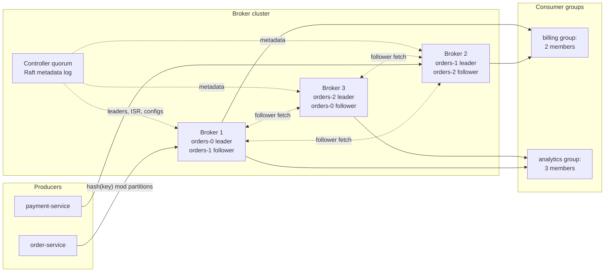
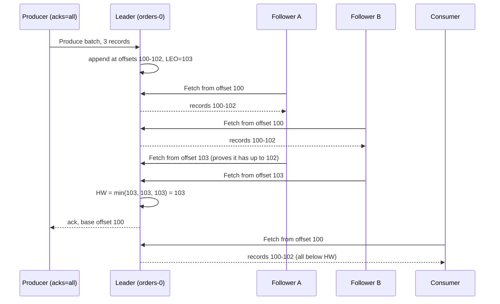
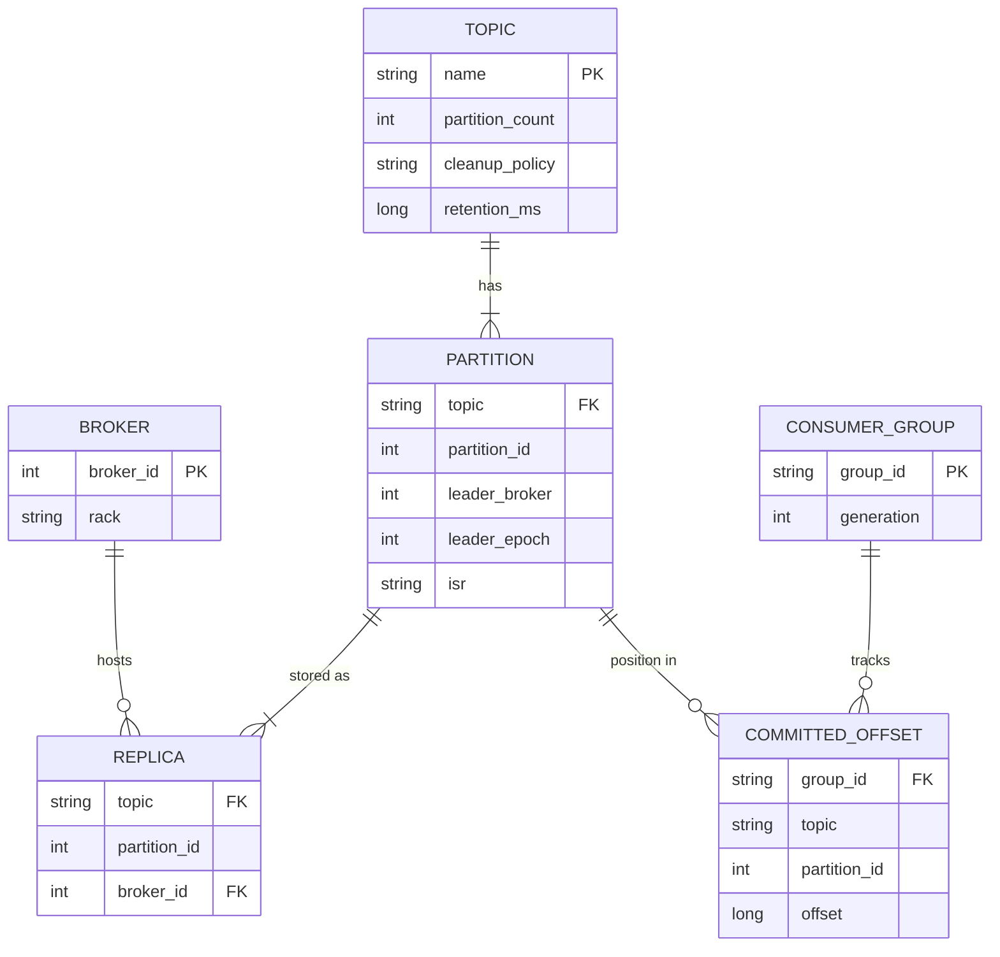
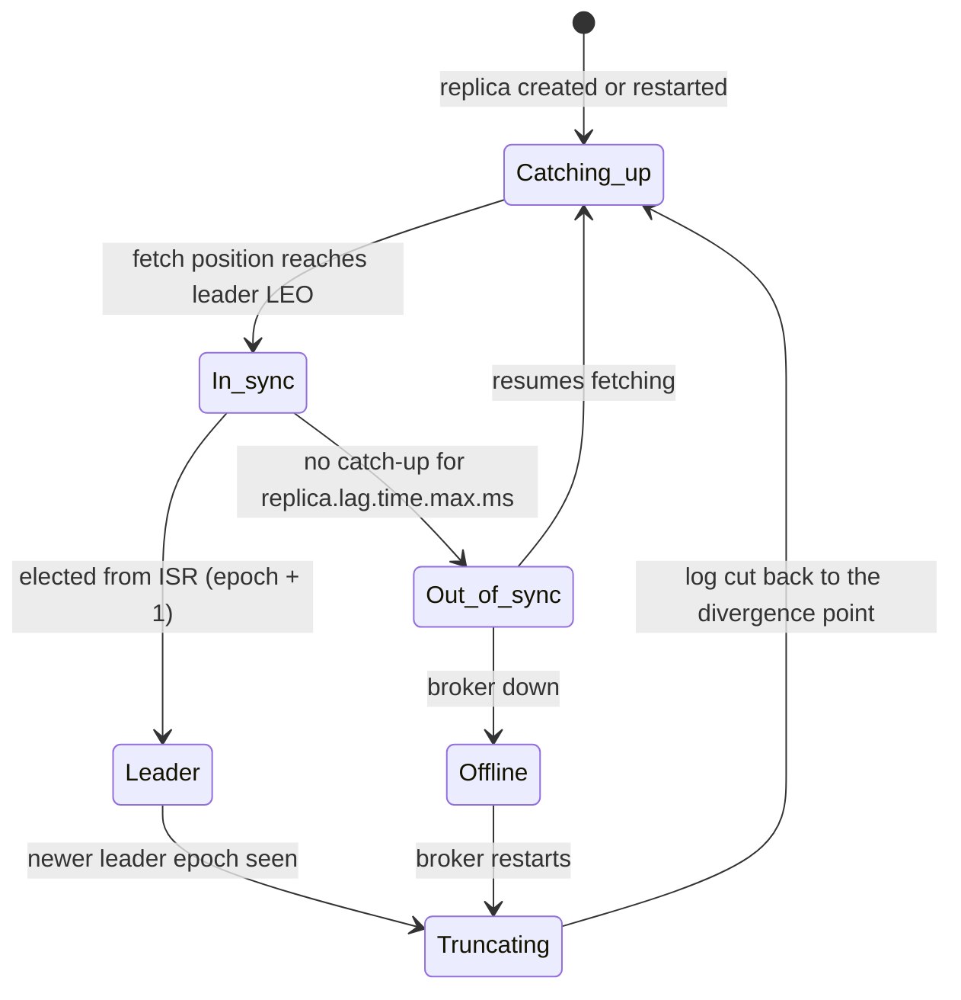

# Case Study - Distributed Message Queue

> [!summary] TL;DR
> Design a Kafka-like message system: producers append messages to a topic, the system stores them durably on several machines, and many consumer groups read them at their own pace. The core is a partitioned, replicated, append-only log where a message is just an entry at a numbered position, called an offset.

> [!abstract] Core idea
> - A topic is split into partitions; each partition is an append-only log on disk with consecutive offsets. Order is guaranteed only inside one partition.
> - Each partition has one leader and several followers. A write is committed once every in-sync replica (ISR) has it; consumers only see committed messages.
> - The log is stored as segment files named by their first offset, each with a sparse offset index, so a read is two binary searches and a short scan.
> - Consumers keep their own position (an offset) and commit it to the broker; the broker never deletes a message because it was read. Retention deletes whole old segments.
> - Classic mistake: designing a queue that deletes each message on acknowledgement. That serves one consumer group, makes replay impossible and turns every ack into a random write.

## 1. Why it exists - requirements

Services need to hand events to each other without being online at the same moment. Example: an order service emits 50,000 events per second at peak; billing, search indexing, analytics and email each need every event; analytics is down for an hour of maintenance and must catch up afterwards without losing anything.

A classic work queue (one message, one consumer, deleted on ack) cannot give four independent readers the same stream or let one of them rewind. A **distributed log** can.

**Terms used below:**
- **Topic:** a named stream of messages, such as `orders`.
- **Partition:** one ordered, append-only shard of a topic.
- **Offset:** the position of a message in its partition: 0, 1, 2, and so on.
- **Broker:** a server that stores partitions and serves reads and writes.
- **Consumer group:** a set of consumers that share the work of reading a topic; each partition goes to exactly one member.
- **LEO (log end offset):** the next offset a replica will write.
- **ISR (in-sync replicas):** the replicas that are caught up with the leader.
- **High watermark (HW):** the offset below which every ISR member has the data; consumers read only below it.

**Functional requirements:**
- Produce messages to a topic, optionally with a key; messages with the same key keep their order.
- Consume from any offset; many independent consumer groups per topic.
- Retain messages for a configured time or size, or keep only the latest message per key (compaction).

**Non-functional requirements:**
- Durability: an acknowledged message survives the loss of any one broker (replication factor 3, `acks=all`, `min.insync.replicas=2`). Surviving two losses is not guaranteed, because an acknowledged write may exist on only two replicas.
- Throughput: 1 million messages per second ingress, 1 KB average message (estimate for the exercise).
- Latency: produce-to-consume p99 in tens of milliseconds within one region.
- Horizontal scale: add brokers and partitions without downtime.

## 2. Mental model

A partition is a **ship's logbook**. Entries are only ever added at the bottom and numbered in order; nothing is edited in place. Readers keep a bookmark (their offset); one reader can be on page 10 while another is on page 900, and neither affects the other. When the logbook gets thick, the oldest volumes are archived or thrown away as whole volumes (segments), never one line at a time. Three officers keep identical copies (replicas); an entry counts as written once every officer who is keeping up has copied it.

The design moves work to the clients: the producer chooses the partition, the consumer tracks its position, and the broker becomes a fast, mostly sequential file server.

## 3. How it works - high-level design



**Write path:**
1. The producer fetches cluster metadata (which broker leads which partition) and caches it.
2. It picks a partition: `hash(key) mod partition_count` for keyed messages, or a batch-friendly "sticky" choice for unkeyed ones; see [[Message Ordering and Partition Keys]].
3. It batches messages per partition (for example up to 16 KB or 5 ms) and sends one request per leader broker.
4. The leader appends the batch to the active segment of the partition log and returns once the requested durability (`acks`) is met.

**Replication:**
5. Followers send fetch requests to the leader, exactly like consumers, and append what they receive. A follower's fetch position tells the leader how far it has caught up.
6. The leader advances the high watermark to the minimum LEO across the ISR. A follower that falls behind for longer than `replica.lag.time.max.ms` (30 s by default) is dropped from the ISR.

**Read path:**
7. A consumer group's coordinator broker assigns partitions to members.
8. Each consumer fetches from its partitions starting at its committed offset; the broker answers with data below the high watermark, often sent from the OS page cache straight to the socket (zero-copy `sendfile` on plain-text connections).
9. The consumer periodically commits its offset to an internal compacted topic (`__consumer_offsets`).

**Metadata:** the controller quorum stores topics, partition leaders, ISR lists and leader epochs in its own Raft-replicated log (KRaft). Since Kafka 4.0, ZooKeeper is no longer supported. See [[Consensus - Raft and Paxos]].



The follower's next fetch is its acknowledgement: asking for offset 103 means "I have everything before 103".

## 4. Worked example - estimates, API and data model

### Whiteboard version

```text
topic "orders" = partitions 0..N-1, key -> hash mod N
partition = leader + followers (RF=3), ISR = caught-up replicas
log = [seg 0][seg 1M][seg 2M (active)]   file name = base offset
       each seg: .log (records) + .index (offset -> byte pos, every 4 KB)
write: append to active seg -> followers fetch -> HW = min LEO(ISR) -> ack
read : binary search segs -> binary search index -> scan -> return < HW
consumer: keeps offset, commits to __consumer_offsets
retention: delete whole oldest segments; compaction keeps last value per key
```

### Estimates

All inputs are **estimates** for the exercise.

| Input | Value |
| --- | --- |
| Ingress | 1,000,000 msg/s, 1 KB each |
| Replication factor (RF) | 3 |
| Retention | 7 days |
| Consumer groups reading everything | 3 |
| Usable disk per broker | 12 TB |
| Sustainable write throughput per broker | 300 MB/s (disk plus replication traffic) |

- **Ingress bytes:** 1,000,000 × 1 KB = 1 GB/s.
- **Disk writes across the cluster:** 1 GB/s × RF 3 = 3 GB/s.
- **Replication traffic:** each byte is copied to 2 followers: 2 GB/s between brokers.
- **Consumer egress:** 3 groups × 1 GB/s = 3 GB/s, mostly served from page cache if consumers keep up.
- **Retained data:** 1 GB/s × 604,800 s (7 days) = 604.8 TB; × 3 replicas ≈ **1.81 PB**.
- **Brokers for storage:** 1.81 PB / 12 TB ≈ 151 brokers. **Brokers for write throughput:** 3 GB/s / 300 MB/s = 10 brokers. Storage dominates by 15×, which is why tiered storage (old segments in object storage) exists; with only 1 day local, local data is 1.81 PB / 7 ≈ 259 TB → about 22 brokers.
- **Partitions:** if one consumer instance handles 10 MB/s (estimate), the topic needs at least 1 GB/s / 10 MB/s = 100 partitions to keep up. Choose 200 to leave headroom for growth, because changing the partition count later breaks key-to-partition mapping.
- **Segments:** with 1 GiB segments, each partition receives 1 GB/s / 200 = 5 MB/s, so it rolls a segment about every 1,074 MB / 5 MB/s ≈ 215 s, about 2,800 segments per partition over 7 days.

### API

| Call | Request | Response |
| --- | --- | --- |
| `Produce` | topic, partition, record batch, `acks` (0, 1, all), producer ID and sequence | base offset per partition, or a retriable error |
| `Fetch` | (topic, partition, offset) list, `max_bytes`, `max_wait_ms`, isolation level | records, high watermark, log start offset |
| `ListOffsets` | topic, partition, timestamp or earliest/latest | offset |
| `OffsetCommit` / `OffsetFetch` | group, (topic, partition, offset) | ok / committed offset |
| `JoinGroup`, `SyncGroup`, `Heartbeat` (or the KIP-848 `ConsumerGroupHeartbeat`) | group membership | partition assignment |
| `Metadata` | topics | partition leaders and replicas |

`Fetch` uses long polling: with `max_wait_ms`, an empty partition holds the request open until data arrives, so idle consumers do not spin.

### Data model

Messages live in log files, not in a database. The control plane stores small metadata records:



On disk, one partition directory looks like this (file names are the base offset, zero-padded to 20 digits):

```text
orders-0/
  00000000000000000000.log        records 0 .. 1,048,575
  00000000000000000000.index      sparse: offset -> byte position
  00000000000000000000.timeindex  sparse: timestamp -> offset
  00000000000001048576.log        active segment
  00000000000001048576.index
  00000000000001048576.timeindex
  leader-epoch-checkpoint
```

### The partition log in Go

An in-memory model of one partition: segments named by base offset, a sparse index entry every `IndexInterval` bytes, a lookup that mirrors the broker's, time-based retention that drops whole closed segments, and the high-watermark rule. The clock is injected so the retention test does not sleep.

```go
// Package mqlog is an in-memory model of a Kafka-style partition log:
// segments named by base offset, a sparse offset index, and time-based retention.
package mqlog

import (
	"encoding/binary"
	"errors"
	"sort"
	"time"
)

var ErrOffsetOutOfRange = errors.New("offset out of range")

const headerSize = 12 // 8-byte offset + 4-byte length

type indexEntry struct {
	rel uint32 // offset - segment base
	pos uint32 // byte position inside the segment
}

type segment struct {
	base       int64
	data       []byte // the ".log" file: [offset][len][payload]...
	index      []indexEntry
	sinceIndex int // bytes appended since the last index entry
	lastWrite  time.Time
}

// Log is one partition.
type Log struct {
	MaxSegmentBytes int // roll to a new segment past this size
	IndexInterval   int // add an index entry every this many bytes
	Now             func() time.Time

	segs []*segment
	next int64 // log end offset (LEO)
}

// Append writes one record and returns its offset.
func (l *Log) Append(payload []byte) int64 {
	active := l.active()
	if active == nil || len(active.data) >= l.MaxSegmentBytes {
		active = &segment{base: l.next}
		l.segs = append(l.segs, active)
	}
	off := l.next
	pos := len(active.data)
	if len(active.index) == 0 || active.sinceIndex >= l.IndexInterval {
		active.index = append(active.index, indexEntry{uint32(off - active.base), uint32(pos)})
		active.sinceIndex = 0
	}
	var hdr [headerSize]byte
	binary.BigEndian.PutUint64(hdr[0:8], uint64(off))
	binary.BigEndian.PutUint32(hdr[8:12], uint32(len(payload)))
	active.data = append(active.data, hdr[:]...)
	active.data = append(active.data, payload...)
	active.sinceIndex += headerSize + len(payload)
	active.lastWrite = l.Now()
	l.next++
	return off
}

// Read finds a record the way a broker does: binary search the segment list,
// binary search the sparse index, then scan forward a few records.
func (l *Log) Read(offset int64) ([]byte, error) {
	if len(l.segs) == 0 || offset < l.segs[0].base || offset >= l.next {
		return nil, ErrOffsetOutOfRange
	}
	// last segment whose base <= offset
	si := sort.Search(len(l.segs), func(i int) bool { return l.segs[i].base > offset }) - 1
	s := l.segs[si]
	rel := uint32(offset - s.base)
	// last index entry whose rel <= wanted rel
	ii := sort.Search(len(s.index), func(i int) bool { return s.index[i].rel > rel }) - 1
	pos := int(s.index[ii].pos)
	for pos < len(s.data) {
		off := int64(binary.BigEndian.Uint64(s.data[pos : pos+8]))
		n := int(binary.BigEndian.Uint32(s.data[pos+8 : pos+12]))
		if off == offset {
			return s.data[pos+headerSize : pos+headerSize+n], nil
		}
		pos += headerSize + n
	}
	return nil, ErrOffsetOutOfRange
}

// EnforceRetention deletes whole closed segments whose newest record is older
// than retention. The active segment is never deleted.
func (l *Log) EnforceRetention(retention time.Duration) (deleted int) {
	cutoff := l.Now().Add(-retention)
	for len(l.segs) > 1 && l.segs[0].lastWrite.Before(cutoff) {
		l.segs = l.segs[1:]
		deleted++
	}
	return deleted
}

// StartOffset is the oldest readable offset.
func (l *Log) StartOffset() int64 {
	if len(l.segs) == 0 {
		return l.next
	}
	return l.segs[0].base
}

// EndOffset is the log end offset: the next offset to be written.
func (l *Log) EndOffset() int64 { return l.next }

// Segments returns the base offset of every segment, oldest first.
func (l *Log) Segments() []int64 {
	out := make([]int64, len(l.segs))
	for i, s := range l.segs {
		out[i] = s.base
	}
	return out
}

func (l *Log) active() *segment {
	if len(l.segs) == 0 {
		return nil
	}
	return l.segs[len(l.segs)-1]
}

// HighWatermark is the smallest log end offset among the in-sync replicas
// (leader included). Consumers may read only below it.
func HighWatermark(isrLEOs []int64) int64 {
	hw := isrLEOs[0]
	for _, leo := range isrLEOs[1:] {
		hw = min(hw, leo)
	}
	return hw
}
```

```go
package mqlog

import (
	"errors"
	"fmt"
	"slices"
	"testing"
	"time"
)

type fakeClock struct{ t time.Time }

func (c *fakeClock) Now() time.Time          { return c.t }
func (c *fakeClock) Advance(d time.Duration) { c.t = c.t.Add(d) }

func newLog(c *fakeClock) *Log {
	// 100-byte records (12 header + 88 payload); 1,000-byte segments; index every 300 bytes.
	return &Log{MaxSegmentBytes: 1000, IndexInterval: 300, Now: c.Now}
}

func payload(i int) []byte { return fmt.Appendf(nil, "%088d", i) }

func TestAppendRollsSegmentsAndReadsBack(t *testing.T) {
	c := &fakeClock{t: time.Date(2026, 11, 4, 0, 0, 0, 0, time.UTC)}
	l := newLog(c)
	for i := range 25 {
		if off := l.Append(payload(i)); off != int64(i) {
			t.Fatalf("offset %d, want %d", off, i)
		}
	}
	// 10 records fill a 1,000-byte segment, so segments start at 0, 10, 20.
	if got := l.Segments(); !slices.Equal(got, []int64{0, 10, 20}) {
		t.Fatalf("segments %v", got)
	}
	// Index entries at rel 0, 3, 6, 9 (every 300 bytes = 3 records).
	if got := len(l.segs[0].index); got != 4 {
		t.Fatalf("index entries %d, want 4", got)
	}
	for i := range 25 {
		got, err := l.Read(int64(i))
		if err != nil || string(got) != string(payload(i)) {
			t.Fatalf("read %d: %q %v", i, got, err)
		}
	}
	if _, err := l.Read(25); !errors.Is(err, ErrOffsetOutOfRange) {
		t.Fatalf("read past end: %v", err)
	}
}

func TestRetentionDeletesWholeClosedSegments(t *testing.T) {
	c := &fakeClock{t: time.Date(2026, 11, 4, 0, 0, 0, 0, time.UTC)}
	l := newLog(c)
	for i := range 20 { // segments 0 and 10, written at t0
		l.Append(payload(i))
	}
	c.Advance(8 * 24 * time.Hour)
	for i := 20; i < 25; i++ { // active segment 20, written at t0+8d
		l.Append(payload(i))
	}
	if n := l.EnforceRetention(7 * 24 * time.Hour); n != 2 {
		t.Fatalf("deleted %d segments, want 2", n)
	}
	if l.StartOffset() != 20 || l.EndOffset() != 25 {
		t.Fatalf("start %d end %d", l.StartOffset(), l.EndOffset())
	}
	if _, err := l.Read(5); !errors.Is(err, ErrOffsetOutOfRange) {
		t.Fatalf("deleted offset still readable: %v", err)
	}
	// Offsets never get reused: the next append is 25, not 0.
	if off := l.Append(payload(25)); off != 25 {
		t.Fatalf("next offset %d", off)
	}
}

func TestActiveSegmentNeverDeleted(t *testing.T) {
	c := &fakeClock{t: time.Date(2026, 11, 4, 0, 0, 0, 0, time.UTC)}
	l := newLog(c)
	l.Append(payload(0))
	c.Advance(30 * 24 * time.Hour)
	if n := l.EnforceRetention(time.Hour); n != 0 {
		t.Fatalf("deleted active segment")
	}
}

func TestHighWatermark(t *testing.T) {
	// leader LEO 120, followers 118 and 115 -> consumers see offsets < 115
	if hw := HighWatermark([]int64{120, 118, 115}); hw != 115 {
		t.Fatalf("hw %d", hw)
	}
}
```

Output of `go test -race ./...` in the scratch module (Go 1.24.4):

```text
ok  	example.com/mqlog	1.132s
```

What the tests show:
- With 100-byte records and 1,000-byte segments, segments start at offsets 0, 10 and 20. The sparse index has entries for relative offsets 0, 3, 6 and 9 only, yet every offset is readable: a lookup lands on the nearest entry below and scans at most 2 records.
- Retention removes segments 0 and 10 as whole units; the log start offset jumps to 20 and reading offset 5 returns "out of range". The next append is still offset 25: offsets are never reused.
- The high watermark of LEOs 120, 118 and 115 is 115.

With the real defaults (1 GiB segment, an index entry every 4,096 bytes), one segment's index has at most 1,073,741,824 / 4,096 = 262,144 entries, and a lookup scans at most about 4 KB of records after the binary search.

## 5. Variants

| Design | How it works | Use when | Cost |
| --- | --- | --- | --- |
| Partitioned log (Kafka, Redpanda) | Append-only segments per partition, consumers track offsets | Event streaming, replay, many consumer groups, high throughput | Ordering only per partition; partition count is hard to change |
| Log with separated storage (Apache Pulsar with BookKeeper) | Stateless brokers, segments stored in a separate replicated storage layer | Many topics, fast rebalancing, multi-tenancy | Two systems to operate |
| Tiered storage | Recent segments on local disk, older segments in object storage | Long retention cheaply (Kafka KIP-405, production-ready in 3.9) | Slower reads of old data |
| Classic broker queue (RabbitMQ, SQS) | Per-message acknowledgement and deletion, broker tracks delivery | Task queues, per-message retry and DLQ, routing | No replay; throughput per queue lower |
| Redis Streams | Append-only stream in memory with consumer groups | Small volumes, already running Redis | Memory-bound retention; see [[Redis as a Queue - Lists, Streams and Pub-Sub]] |

For choosing between these as a user, see [[Queues vs Streams and Broker Comparison]]. This note is about building the first row.

## 6. Trade-offs

- **`acks` and `min.insync.replicas`.**
	- `acks=0`: fastest, messages can vanish silently.
	- `acks=1`: the leader alone has it; a leader crash before followers copy it loses the message.
	- `acks=all` with RF 3 and `min.insync.replicas=2`: a write succeeds only if at least 2 replicas have it, so one broker loss loses nothing. If the ISR shrinks to 1, writes fail instead of silently becoming single-copy. Since Kafka 3.0 the producer default is `acks=all`, but `min.insync.replicas` still defaults to 1 and must be raised per topic or broker.
- **fsync.** Kafka relies on replication rather than fsync per write for durability: data is written to the page cache and flushed by the OS. Losing a whole rack at once can therefore lose unflushed data on all replicas; rack-aware replica placement makes that unlikely. See [[Page Cache, File Systems and fsync]].
- **Partition count.** More partitions mean more parallelism, but each partition costs open files, memory for indexes and leader elections during failover. Increasing it later re-maps keys to different partitions, breaking per-key ordering for in-flight data.
- **Unclean leader election.** If every ISR member is dead, electing an out-of-sync replica restores availability but loses committed messages. Kafka's default is `unclean.leader.election.enable=false`: stay unavailable, keep data. See [[CAP and PACELC]].
- **When not to use a log:** a small job queue that needs per-message delays, priorities and retries is simpler on a classic queue or a database table; see [[Background Jobs and Worker Pools]].

## 7. In production

- **Real systems:** Apache Kafka (log segments, ISR, KRaft), Redpanda (Kafka API, Raft per partition, C++), Apache Pulsar (brokers plus BookKeeper), Amazon Kinesis Data Streams (shards with sequence numbers, 24-hour default retention).
- **Failure modes and fixes:**
	- *Leader broker dies:* the controller picks a new leader from the ISR and bumps the **leader epoch**. Producers and consumers refresh metadata and retry. Messages the old leader had but never committed are truncated on rejoin (see Deep dive).
	- *Slow follower:* it falls out of the ISR after 30 s (default), so `acks=all` writes stop waiting for it. Alert on ISR shrink, because the topic is now one failure closer to rejecting writes.
	- *Consumer lag grows:* consumers are slower than producers. Add consumers up to the partition count, fix slow processing, or add partitions with care. A consumer that falls behind the log start offset loses data to retention; alert well before that.
	- *Rebalance storms:* frequent membership changes stop consumption. Fixes: cooperative or KIP-848 incremental rebalancing, static membership, and longer session timeouts for slow restarts.
	- *Duplicate messages after producer retries:* the idempotent producer (default since Kafka 3.0) tags each batch with a producer ID and sequence number, and the leader rejects duplicates. End-to-end exactly-once needs transactions and idempotent consumers; see [[Delivery Semantics and Exactly-Once]].
	- *Poison message:* one record that always fails blocks its partition. Skip to a dead letter topic after N attempts; see [[Dead Letter Queues and Poison Messages]].
- **What to monitor:** under-replicated partitions, ISR shrink and expand rate, offline partitions, consumer lag per group and partition (in messages and in seconds), produce and fetch request latency p99, request queue time, disk usage against retention, controller elections.

## 8. Deep dive

### Replica states and the high watermark



**Why truncation is needed.** Suppose leader A (epoch 5) writes offsets 100–102, follower B copies only 100, and A crashes. B becomes leader with epoch 6 and accepts new writes at offsets 101 and up. When A returns, its offsets 101–102 conflict with B's. A asks B, "where did epoch 5 end in your log?" B replies "at offset 101", and A truncates everything from 101. Those messages were never below the high watermark, so no producer using `acks=all` received an acknowledgement for them. Before KIP-101 Kafka truncated to the high watermark instead, which could lose or diverge data in edge cases; leader epochs fixed that.

### Why it is fast

- **Sequential I/O only.** Appends go to the end of one file per partition; reads by caught-up consumers come from the page cache.
- **Batching end to end.** Producers compress whole batches; the broker stores the batch as is; consumers decompress. The broker never parses individual messages on the hot path.
- **Zero-copy.** For unencrypted connections the broker uses `sendfile` to move bytes from page cache to socket without copying into user space. TLS needs encryption in user space, so this optimisation does not apply there.
- **Sparse indexes.** An index entry every 4 KB is small enough to stay memory-mapped, so locating any offset costs two binary searches and one short scan, as in the Go code.

### Retention and compaction

- **Delete policy:** a background task removes whole closed segments when their newest record is older than `retention.ms` (7 days by default) or when the partition exceeds `retention.bytes`. Because deletion is per segment, data can live up to one segment's lifetime longer than the setting.
- **Compact policy:** the log cleaner rewrites old segments keeping only the latest record per key. A record with a null value (a tombstone) deletes the key and is itself removed after `delete.retention.ms` (24 hours by default). Compacted topics are a durable key-value changelog; `__consumer_offsets` is one, and so are CDC topics; see [[Transactional Outbox and CDC]].

### Consumer offsets and delivery semantics

- Commit **after** processing gives at-least-once: a crash between processing and committing re-delivers the batch.
- Commit **before** processing gives at-most-once: a crash after committing skips the batch.
- Exactly-once inside the log (read from topic A, write to topic B, commit offset) uses transactions: the output records and the offset commit are committed atomically, and downstream consumers use `isolation.level=read_committed`.

### Ordering and scaling limits

- Order holds per partition only. A consumer group has at most one active consumer per partition, so the partition count caps consumer parallelism.
- Hot keys put one partition on one broker; see [[Hot Keys and Hot Partitions]]. Spreading a hot key across partitions trades away its ordering.

## 9. Interview questions

> [!question]- Why a log instead of a queue that deletes messages on ack?
> A log lets any number of consumer groups read the same data independently, lets a consumer rewind and replay, and keeps disk access sequential. Deletion happens in bulk by segment. A delete-on-ack queue gives one reader, no replay and random I/O for every ack.

> [!question]- When exactly is a message "committed", and who can see it?
> When every replica in the current ISR has it, which moves the high watermark past it. Consumers can only fetch below the high watermark, so they never see a message that could be lost in a leader failover.

> [!question]- How does the broker find offset 7,340,511 fast?
> Binary search the sorted segment base offsets to pick the segment, binary search that segment's sparse index for the largest entry at or below the target, then scan forward through the log file from that byte position; with a 4 KB index interval the scan is at most about 4 KB.

> [!question]- Trap: "With acks=all, data is safe even if two of three brokers die." Is it?
> Only if `min.insync.replicas` is at least 2. With the default of 1, the ISR can shrink to the leader alone and `acks=all` then means one copy. With RF 3 and min ISR 2, one broker loss is safe; a write is rejected rather than accepted with too few copies.

> [!question]- A consumer group has 12 consumers and the topic has 8 partitions. What happens?
> 8 consumers each get one partition and 4 sit idle. To use more consumers you need more partitions, which changes key-to-partition mapping for new messages.

> [!question]- What happens to messages the old leader had but never replicated?
> When it rejoins as a follower, it asks the new leader where its last leader epoch ended and truncates everything after that point. Those messages were never acknowledged to `acks=all` producers, so nothing promised is lost.

> [!question]- How do you get exactly-once processing end to end?
> Idempotent producer to stop duplicate appends, transactions to commit output records and consumer offsets atomically, `read_committed` consumers, and idempotent writes for any side effect outside the log (a database upsert keyed by a message ID).

## 10. Cheat sheet

- Topic → partitions → append-only segments named by base offset, each with a sparse `.index` (every 4 KB) and `.timeindex`.
- Leader plus followers; followers fetch like consumers; HW = min LEO across the ISR; consumers read below HW.
- Durability: RF 3, `acks=all`, `min.insync.replicas=2`, no unclean election.
- Leader epochs let a returning replica truncate exactly its unacknowledged suffix.
- Consumers own their offsets, committed to compacted `__consumer_offsets`; commit after processing for at-least-once.
- Retention deletes whole segments; compaction keeps the last value per key; tiered storage moves old segments to object storage.
- Estimate: 1 GB/s × 7 days × RF 3 ≈ 1.8 PB, so storage, not throughput, sets the broker count.

## Links

- **Before this:** [[Kafka and Event Streaming]], [[Replication]], [[Partitioning and Sharding]], [[Storage Engines - B-tree vs LSM and WAL]]
- **Next:** [[Case Study - Ad Click Aggregation]], [[Stream Processing Basics]]
- **Compare with:** [[Pub-Sub Message Queue]] (the class-level LLD twin: topics, subscribers and offsets in one process), [[Queues vs Streams and Broker Comparison]], [[Case Study - Metrics and Logging Platform]] (another append-heavy store), [[Case Study - Distributed Job Scheduler]]
