# Case Study - Email Service

> [!summary] TL;DR
> Design the backend of a Gmail-style email service: it **receives** mail from the whole internet over SMTP, **stores** each user's mailbox forever, lets users **read, search and sync** it across devices, and **sends** mail out reliably without being marked as spam. The hard parts are the **untrusted inbound edge** (spam and forged senders), **retry-safe outbound delivery**, a **mailbox store that is huge and per-user**, and **per-user full-text search**.

> [!abstract] Core idea
> - Email is **store-and-forward**: no message is ever "lost in transit" if every hop writes to durable storage before it says "OK" to the previous hop.
> - Split a message into a tiny **metadata row** (who, when, labels, flags) and a big **blob** (headers, body, attachments). Metadata lives in a database sharded by user; blobs live in object storage, deduplicated by content hash.
> - The inbound path is a **pipeline of cheap rejections first**: connection reputation, then SPF/DKIM/DMARC, then spam scoring, then store.
> - Outbound mail is a **queue with retries, per-domain rate limits and a bounce handler**; reputation is a resource you can burn.
> - Each user has a **private search index**, updated asynchronously after delivery.

## Start here: the basics

**The problem in one story.**
You click send on an email to a friend at another company.
Seconds later it is in their inbox and their phone buzzes.
A year later they can still search for it.
All of that happens across servers that do not trust each other, while spammers try to sneak in.

**Words you need first**

| Word | Plain meaning | Tiny example |
| --- | --- | --- |
| SMTP | The protocol servers use to send mail to each other | Your server talks to `mx.gmail.com` on port 25 |
| MX record | A DNS entry naming a domain's mail server | `example.com MX mail.example.com` |
| IMAP / JMAP | Protocols a mail app uses to read a mailbox | Phone app listing your inbox |
| SPF / DKIM / DMARC | Checks that a sender is allowed to use a domain | A signature proving mail really came from `bank.com` |
| Spam filter | Code that scores how likely a message is junk | Score 9/10 -> Junk folder |
| Mailbox storage | Where each user's messages are kept | Messages for `ana@` on a shard |
| Push | Telling a device right away that mail arrived | Phone notification |

**Picture it**

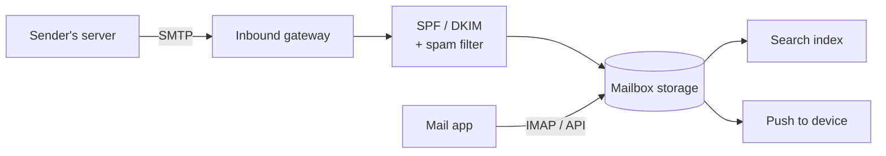

**Analogy.** A very paranoid post office: a guard checks the stamp, a sorter throws out junk, and good letters go into a private cabinet with a bell.
Where it breaks: a post office delivers one physical letter, while email copies messages freely, so storage dedup, retries and duplicate delivery are real design problems.

**How the rest of this note builds up**

- First, what an email service must do (section 1) and the post office model (section 2).
- Then the high-level design: inbound and outbound paths, storage and search (section 3), with estimates, API and data model (section 4).
- Then variants and trade-offs (sections 5-6).
- Finally the SDE-3 deep dive: production practice, deliverability, spam, storage, then scaling and failure handling (sections 7-9).

> [!tip] Remember
> Email is untrusted SMTP in, authentication and spam checks in the middle, durable mailboxes plus search and push out.

## 1. Why it exists - requirements

You write to a friend on another provider. Click send, and a few seconds later it shows up in their inbox, their phone buzzes, and a year later they can still find it by typing a word from the body.

Behind that: millions of servers that do not trust each other, a protocol from the 1980s, and an industry of spammers trying to abuse every step.

**Functional requirements**
- Send and receive mail with any other provider on the internet (SMTP interoperability).
- Read mail through web and mobile apps (and optionally IMAP for third-party clients).
- Organise with labels or folders, mark read, star, archive, delete; show messages grouped in **threads** (conversations).
- Attachments up to a size limit (for example 25 MB; larger files become a link).
- Full-text **search** over a user's whole mailbox with filters (`from:`, `has:attachment`, date).
- Spam and phishing filtering; drafts; contacts autocomplete.
- Near-real-time delivery to the user's open devices (push).

**Non-functional requirements**
- **Durability: never lose an accepted message.** Once we answer `250 OK` to a sending server, the mail must survive any single failure.
- **Availability:** inbound SMTP must be up (senders retry for days, but outages hurt trust); mailbox reads high availability.
- **Latency:** inbox list under about 200 ms; delivery to inbox within a few seconds p99; search under about 500 ms.
- **Security:** authenticate senders, stop forgery, encrypt in transit (STARTTLS), isolate attachments' malware risk.
- **Scale:** hundreds of millions of users, petabytes of data, mailboxes that grow forever.
- Out of scope: calendar, chat, enterprise admin, end-to-end encryption (PGP/S-MIME).

**Glossary.**
- **MTA** (mail transfer agent): a server that speaks SMTP to move mail between domains. **MUA**: the user's mail client.
- **MX record**: a DNS record naming the servers that accept mail for a domain.
- **Envelope vs header**: the envelope (`MAIL FROM`, `RCPT TO`) is what SMTP routes on; the header (`From:`, `To:`) is what the user sees. They can differ, which is why forgery is easy.
- **Bounce / DSN**: a delivery status notification mail saying "could not deliver".
- **Hard vs soft failure**: SMTP reply `5yz` is permanent (stop), `4yz` is temporary (retry).

> [!tip] Remember
> Email is "write it down, then say OK". Durability before acknowledgement is the rule at every hop.

## 2. Mental model

Think of the postal system with a very paranoid post office:

1. Letters arrive from strangers at the front desk (inbound SMTP).
2. A guard checks the return address against the sender's registered stamp (SPF, DKIM), and a sorter throws out obvious junk (spam filter).
3. Good letters are copied into the right person's private cabinet (mailbox storage) and a bell rings at their desk (push).

Going out, you hand a letter to a courier (outbound queue). The courier looks up the destination post office (MX lookup), tries to deliver, and if the destination says "come back later" the courier tries again with longer gaps. After a few days of failure the courier returns the letter with a note (bounce).

Where the analogy breaks: real post offices do not have people forging return addresses at 1,000 letters a second, and the courier does not have a **reputation score** that the destination quietly keeps and that decides whether your future letters are delivered at all.

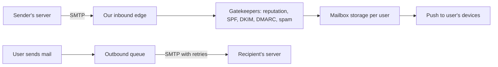

## 3. How it works - high-level design

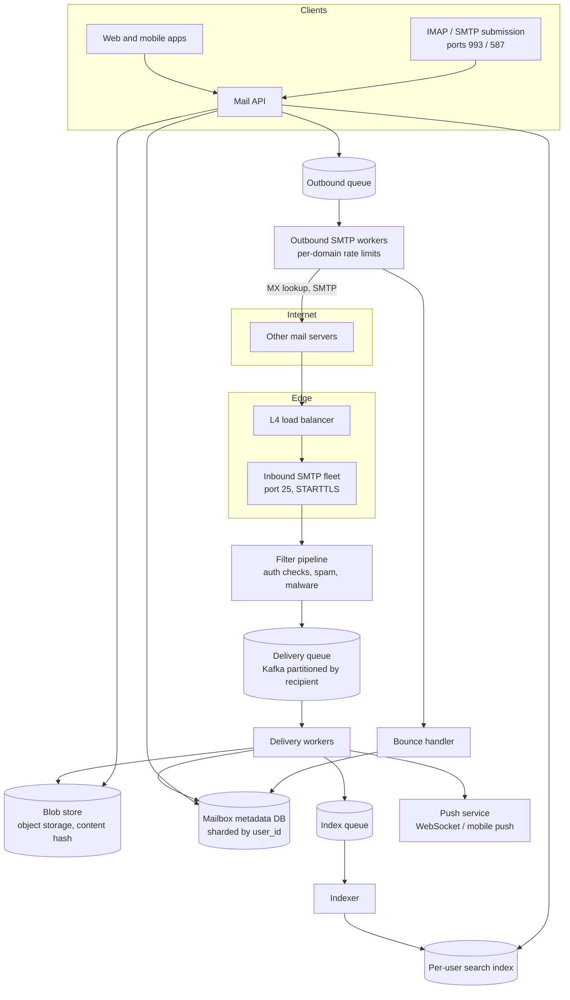

**Receiving a message, step by step**
1. A remote server looks up our domain's MX record in DNS and opens an SMTP connection to one of our inbound hosts through the load balancer.
2. The inbound host checks the connecting IP against reputation lists and rate limits. Bad IPs are refused before any data is read.
3. It reads `MAIL FROM`, `RCPT TO`, then the message data. It rejects unknown recipients immediately (`550`), which keeps backscatter low.
4. The filter pipeline runs SPF, DKIM and DMARC checks, spam scoring and malware scanning of attachments.
5. The accepted message is written **durably** to the delivery queue (replicated, one record per recipient), and only then does the host answer `250 OK`.
6. A delivery worker stores the body and attachments in the blob store, inserts a metadata row into the recipient's shard, and enqueues an index job.
7. The push service notifies the user's open devices. The inbox now shows the message.

**Sending a message, step by step**
1. The app calls `POST /v1/messages/send`. The API validates, saves a copy in **Sent** and returns `202 Accepted`.
2. One job per recipient domain goes to the outbound queue.
3. An outbound worker looks up MX records, opens SMTP with STARTTLS, signs the message with DKIM and sends it.
4. On `2xx` the job is done. On `4xx` it is retried later. On `5xx` it becomes a bounce delivered into the sender's mailbox.

> [!tip] Remember
> Two separate pipelines, inbound and outbound, joined only by the mailbox store. They scale and fail independently.

## 4. Worked example - estimates, API and data model

### Whiteboard version

```text
Inbound:  MX -> SMTP fleet -> [IP reputation -> SPF/DKIM/DMARC -> spam/malware]
            -> durable queue -> 250 OK -> worker: blob store + metadata row + index job + push
Outbound: send API -> Sent copy -> outbound queue (per recipient domain)
            -> MX lookup -> SMTP + DKIM sign -> 2xx done | 4xx retry w/ backoff | 5xx bounce
Mailbox:  metadata DB sharded by user_id (message rows, labels, thread_id)
          blobs in object storage keyed by sha256 (dedupe attachments)
Search:   per-user inverted index, built asynchronously after delivery
Numbers:  100M DAU, ~46k inbound msgs/s avg, ~140k peak, ~200 TB/day stored (estimates)
```

### Estimates

All inputs are **estimates** for a large provider; the point is the method.

| Quantity | Assumption | Arithmetic | Result |
| --- | --- | --- | --- |
| Daily active users | estimate | | 100,000,000 |
| Inbound messages offered per user per day | 40, incl. spam and promotions | 100M x 40 | 4 B / day |
| Inbound rate | | 4,000,000,000 / 86,400 s | **~46,000 msgs/s avg** |
| Peak inbound | 3x average | 46k x 3 | **~140,000 msgs/s** |
| Spam rejected at edge | ~50% (estimate) | 4 B x 0.5 | 2 B / day stored |
| Outbound | 10 sent per user per day | 100M x 10 = 1 B / day | ~11,600 msgs/s |
| Average message size | 100 KB including attachments (estimate) | 2 B x 100 KB | **~200 TB / day** of blobs |
| Yearly blob growth | | 200 TB x 365 | ~73 PB / year (before dedup and compression; counts inbound only, the Sent copy of 1 B outbound messages adds roughly 50% more under the same size assumption) |
| Metadata per message | ~1 KB (ids, labels, snippet, sizes) | 2 B x 1 KB | **~2 TB / day** |
| Mailbox list reads | each user opens inbox ~20 times/day | 100M x 20 / 86,400 | ~23,000 reads/s avg |

What the numbers tell us:
- Blobs are **100x bigger than metadata**. They need cheap, durable, horizontally scalable object storage (erasure coded, about 1.5x overhead instead of 3x copies). See [[File Uploads and Object Storage]].
- Metadata at 2 TB/day is a sharding problem, not a single-database problem. Shard by user.
- Reads are small compared to the write volume of the inbound edge, so the **inbound pipeline** is where the throughput challenge is.
- Dedup matters: one 5 MB deck sent to 1,000 colleagues is 1 blob, not 1,000.

### API

Clients speak REST/JSON; third-party clients speak IMAP and SMTP submission. Core REST surface:

| Method and path | Purpose | Notes |
| --- | --- | --- |
| `GET /v1/messages?label=INBOX&page_token=...&limit=50` | list messages (metadata only) | cursor pagination, newest first |
| `GET /v1/messages/{id}` | full message | body fetched from the blob store |
| `POST /v1/messages/send` | send | `Idempotency-Key` header; returns `202` |
| `POST /v1/drafts`, `PUT /v1/drafts/{id}` | save drafts | autosaved while typing |
| `POST /v1/messages/{id}/modify` | add or remove labels, mark read | body `{addLabels, removeLabels}` |
| `GET /v1/search?q=from:alice has:attachment invoice` | search | returns message ids with snippets |
| `GET /v1/history?startHistoryId=...` | sync changes since a checkpoint | used by apps and push |
| `GET /v1/attachments/{id}` | download | short-lived signed URL to object storage |

The `Idempotency-Key` on send matters: a mobile app on a bad network retries, and the user must not send the same email twice. See [[Idempotency and Idempotency Keys]].

### Data model

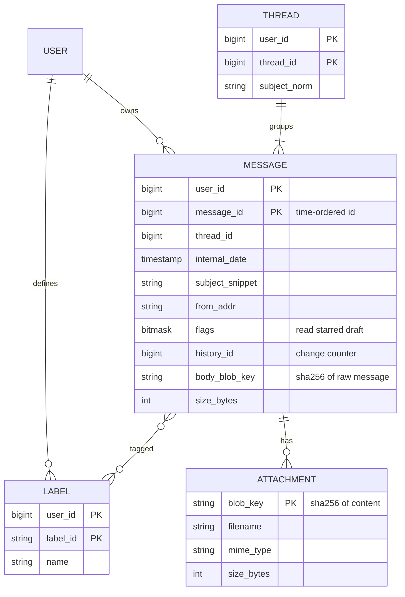

Design choices:
- **Primary key `(user_id, message_id)`.** All rows of one user sit together, so "list my inbox" is one partition scan and a shard holds whole mailboxes. A time-ordered `message_id` (see [[Unique ID Generation]]) gives newest-first listing without a sort.
- **Labels are a set on the message, not a folder.** Gmail-style labels let one message be in "Inbox" and "Receipts". A secondary table `(user_id, label_id, internal_date, message_id)` serves "list messages with label X". An IMAP folder is just a label.
- **Blobs are content-addressed** (`sha256` of the bytes). Writing the same attachment again is a no-op. A reference count, or a periodic garbage collection, deletes blobs nobody references.
- **`history_id`** is a per-user monotonic counter bumped by every change. It powers sync (deep dive 3).
- **Where to store metadata:** a sharded relational database (MySQL or Postgres with a shard map) or a wide-column store (Cassandra, Bigtable-style). The access pattern is "everything for one user, ordered by time", which fits both. See [[Choosing a Database - Decision Guide]].

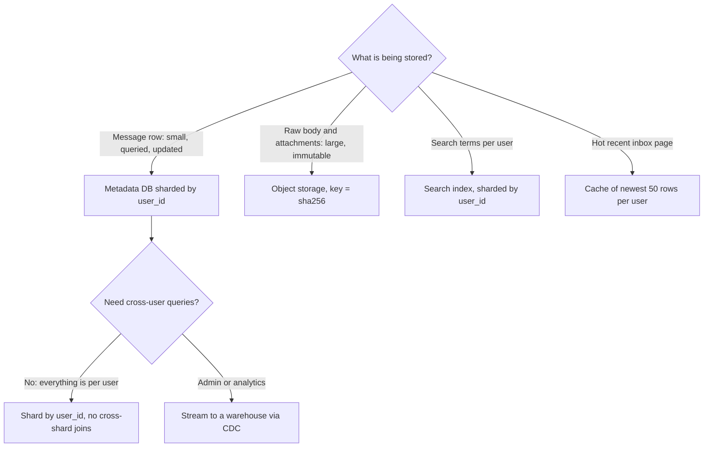

> [!tip] Remember
> One user's mailbox is the unit of everything: sharding, indexing, caching, quota and backup.

## 5. Variants and comparison

| Decision | Options | Choice here | Why |
| --- | --- | --- | --- |
| Metadata store | sharded MySQL/Postgres; Cassandra or Bigtable-style wide column; DynamoDB | sharded relational or wide column | queries are always per user; secondary label index is easy either way; relational gives transactions for label changes |
| Blob store | database BLOB column; filesystem per server; object storage | object storage with content hash | 100x larger than metadata, immutable, needs cheap erasure coding and dedup |
| Mailbox shape | folders (a message lives in one); labels (many per message) | labels | one row per message, cheaper moves, natural for "archive" |
| Delivery handoff | synchronous write to DB inside SMTP session; durable queue then workers | queue | absorbs spikes of 3x, lets workers be retried and isolates SMTP hosts from DB slowness |
| Queue tech | Kafka, SQS, RabbitMQ | Kafka partitioned by recipient hash | ordering per user, replay after a bad deploy, huge throughput. See [[Kafka vs RabbitMQ vs SQS - Choosing a Message Broker]] |
| Search | per-user index; one global index filtered by user | per-user (or user-prefixed shards) | privacy and locality; see [[Search Engines and Inverted Indexes]] |
| Client sync | polling; IMAP IDLE; push channel with history id | push plus history id | cheap, correct after offline periods |
| Spam | rules only; ML only; layered | layered, cheap checks first | spend CPU only on mail that survives cheap rejections |

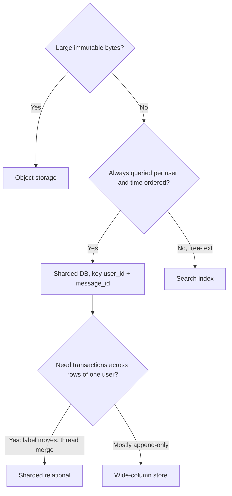

## 6. Trade-offs

- **Reject early vs accept then discard.** Refusing at SMTP time (`550`) is cheap and honest, but a false positive loses a real mail silently from the sender's view (they get a bounce, which is at least visible). Accepting then quarantining in Spam is safer for the user but costs storage and CPU. Real providers do both: hard-reject the obviously bad, quarantine the doubtful.
- **Durability vs latency at the SMTP edge.** Waiting for a replicated queue write before `250 OK` adds a few milliseconds per message. It is the price of "never lose accepted mail".
- **Dedup vs privacy and complexity.** Content-addressed blobs save huge space (forwarded attachments) but need reference counting and careful handling when a user deletes. Deduping only within a user's own data avoids cross-user leakage ("does anyone else have this file?" attacks).
- **Per-user index freshness.** Indexing asynchronously means a mail may be missing from search for a second or two. Acceptable. Indexing synchronously would couple delivery latency to index latency.
- **Strict DMARC enforcement.** Rejecting everything that fails DMARC stops phishing but also breaks mailing lists that rewrite messages. Providers use ARC headers and heuristics to soften it.
- **When a simpler design wins.** For a company with 5,000 mailboxes, run Postfix and Dovecot with Maildir on a replicated disk, or just buy hosted email. Building this architecture is only worth it at provider scale.

## 7. In production

- **Real examples.** The protocols are fixed by the RFCs listed above, so every provider looks the same from outside. In 2024 Google and Yahoo announced stricter sender requirements for bulk senders: SPF, DKIM, DMARC and a low spam-complaint rate (see Google's email sender guidelines). Open-source stacks like Postfix (MTA), Dovecot (IMAP) and Rspamd (spam scoring) show the same components at small scale.
- **Failure: a recipient domain is down.** Its mail piles up in our outbound queue. Handle with per-domain queues so one slow domain does not block others, exponential backoff, and a cap on queue age (for example give up after 3 to 5 days and bounce).
- **Failure: our IP gets blocklisted.** Mail to Gmail or Outlook is deferred or rejected. Fix: separate IP pools for transactional vs marketing mail, warm up new IPs gradually, monitor complaint rate, honour unsubscribe.
- **Failure: a spam wave hits.** Inbound rate jumps 10x. The edge sheds by reputation first (reject bad IPs with `421` "try later"), and the filter fleet autoscales. Legit senders retry, so deferring is safe; see [[Load Shedding and Graceful Degradation]].
- **Failure: a shard of mailbox metadata is down.** Inbound mail for those users still queues (queue is separate); reads for those users fail until failover. Replicas promote; the queue replays into the shard afterwards.
- **What to monitor.** Inbound accepted vs rejected per reason; queue depth and age per recipient domain; delivery latency p99 (SMTP accept to inbox row); bounce rate; spam-complaint rate; DKIM/SPF pass rate; search index lag; blob store error rate.

## 8. Deep dive

### Deep dive 1: the inbound pipeline and sender authentication

**In plain words.** Anyone on the internet can open a connection to your server and claim to be `ceo@yourbank.com`. SMTP has no built-in proof. Three add-on checks fill the gap, and you run the cheapest checks first.

- **SPF** (Sender Policy Framework): the domain owner publishes in DNS the list of IPs allowed to send for it. You check whether the connecting IP is in the list for the **envelope** sender domain.
- **DKIM** (DomainKeys Identified Mail): the sending server signs chosen headers and the body with a private key. The public key is in DNS. You verify the signature, proving the message was not changed and came from a server holding the key.
- **DMARC**: the domain owner publishes a policy ("if SPF and DKIM do not **align** with the visible From domain, then `none`, `quarantine` or `reject`"). It ties the checks to the domain the user actually sees.

**Picture it.**

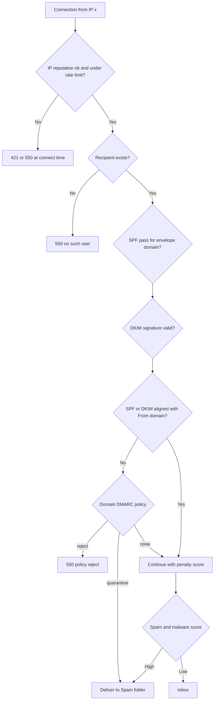

**Example.** A phisher sends from a VPS pretending to be `alerts@paypal.example`. Step 1: the IP is not in `paypal.example`'s SPF record, so SPF fails. Step 2: no DKIM signature from that domain. Step 3: the domain's DMARC policy says `reject`, so the connection is refused with `550` before the body is stored. The user never sees it.

**Cheap first.** Reputation and recipient checks use only the connection and envelope, so they run before reading the (large) data. SPF and DKIM need a few DNS lookups (cached). Spam ML and attachment scanning cost the most CPU and run only on survivors. Attachments are scanned in a sandbox and Office macros or executables are blocked or flagged.

**Greylisting.** An optional trick: answer `451 try again` to unknown senders. Real MTAs retry after minutes; most spam bots do not. It delays first mail from new senders, so use it sparingly.

**Why it matters.** Done wrong, you either deliver phishing (users lose money) or drop real mail (users lose trust). The layered order controls cost.

> [!warning] Common mistake
> Saying "we check the From header". The visible `From:` header is trivially forged. Authentication is about the envelope IP (SPF), a signature (DKIM) and the alignment between them and the From domain (DMARC).

### Deep dive 2: outbound delivery, retries and bounces

**In plain words.** Sending is not one network call. The recipient server may be slow, down, rate-limiting you, or temporarily rejecting you. You must keep the message safe, retry politely, and tell the user if it finally fails.

**Picture it.**

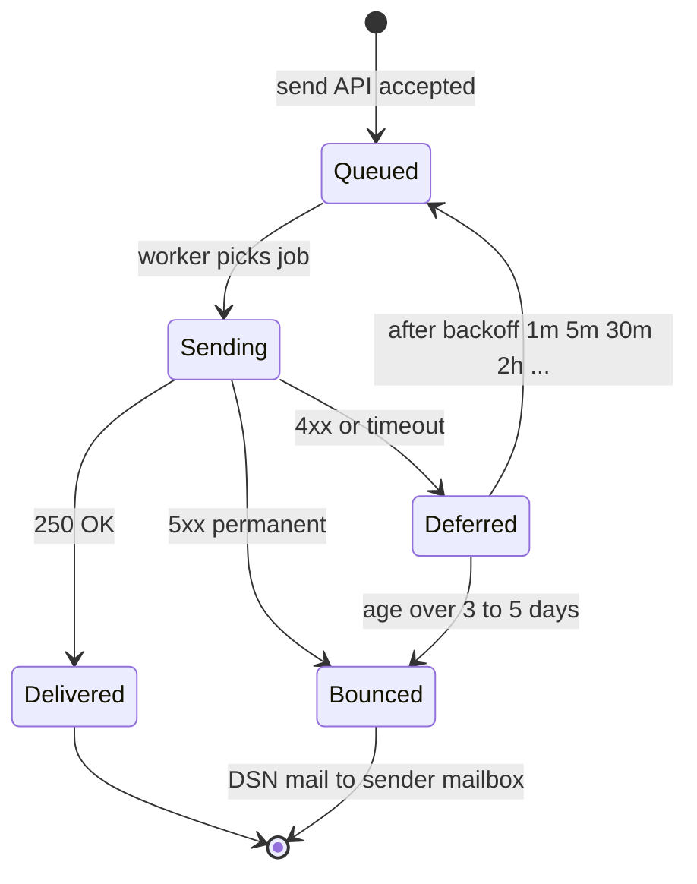

**Walkthrough.**
1. The API creates one **delivery job** per recipient domain (if a mail goes to 3 gmail addresses, send once with 3 `RCPT TO` lines).
2. A worker resolves the MX records, tries the lowest-preference host, then the next on connection failure.
3. It opens STARTTLS, signs with DKIM and sends. A global limiter and a **per-destination-domain limiter** protect both you and them (for example a few connections and a bounded messages-per-second per domain).
4. Reply `250` marks the job done. Reply `4yz` or timeout schedules a retry with exponential backoff and jitter (see [[Timeouts, Retries and Backoff]]). Reply `5yz` stops retries and creates a bounce.
5. The bounce is a **DSN** message from our system into the sender's mailbox: "could not deliver to bob@x.com: mailbox full/unknown user".

**Example.** The user mistypes the domain as `bob@no-such-domain.example`. DNS answers NXDOMAIN (the domain does not exist), which is a permanent failure. (If a domain exists but has no MX record, RFC 5321 says to fall back to its A/AAAA record as an implicit MX.) We bounce in a second. If instead `x.com`'s server returns `451 greylisted` we retry in 5 minutes and succeed on the second try.

**Reputation.** Sending IPs and DKIM domains build a reputation at the receiving providers based on bounce rate, spam complaints and volume spikes. Providers separate **transactional** mail (receipts, password resets) from **marketing** on different IP pools so a bad campaign cannot delay a password reset. New IPs are **warmed up**: volume ramps over weeks. Suppression lists stop sending to addresses that hard-bounced.

**Idempotency.** The send API stores the client's idempotency key with the job id. A retry of the request returns the same job. Inside the pipeline, jobs are at-least-once; duplicates at the recipient are rare because a worker marks a job done only after `250`, and the window of "got 250 but crashed before recording" is small and accepted (email has no dedupe guarantee end to end).

**Why it matters.** One bad rule here, for example no per-domain limit, and a slow recipient domain exhausts all your workers, delaying everyone's mail.

> [!warning] Common mistake
> Retrying hard bounces. A `550 user unknown` will never succeed, and hammering it raises your complaint and bounce rates, damaging reputation for all your users.

### Deep dive 3: mailbox storage, labels, threads and sync

**In plain words.** The mailbox must show the newest 50 messages instantly, let any message be filed under many labels, group replies into threads, and keep a phone and a laptop in agreement even after the phone was offline for a week.

**Threading.** Mail headers carry `Message-ID`, `In-Reply-To` and `References` (RFC 5322). When a message arrives, look up the `In-Reply-To` id in the user's mailbox; if found, reuse its `thread_id`. Otherwise fall back to normalised subject plus participants within a time window. Threads are a view built on top of messages, so merging two threads is a metadata update only.

**Sync with a change counter.** Each user has a `history_id` that increases on every change (new mail, label change, delete). The app remembers the last `history_id` it saw.

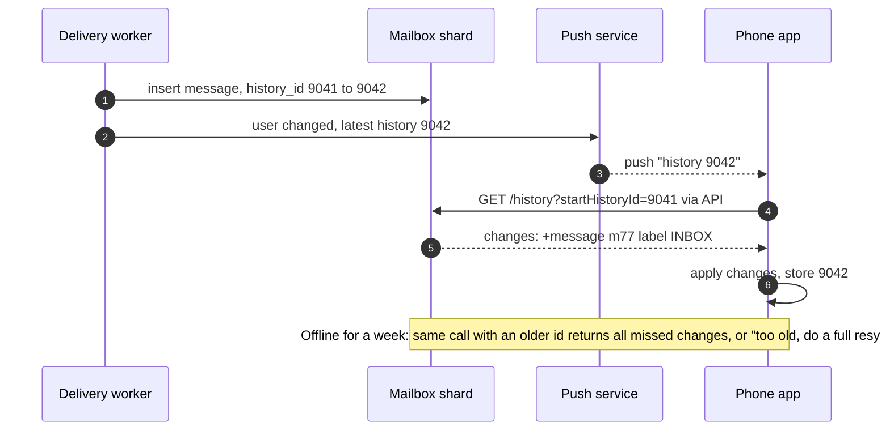

This is the same idea as IMAP's UID with `UIDVALIDITY` and CONDSTORE (RFC 7162) `MODSEQ`: a monotonic marker so a client asks "what changed since X". It avoids re-downloading the mailbox.

**Inbox page cache.** The newest 50 message rows per active user are cached (cache-aside, see [[Caching Patterns]]). A new message updates the cache entry. A search or old-page request goes to the shard.

**Quotas and deletion.** Each user has a byte quota counted from metadata sizes. Delete marks the row; a background job decrements blob references and the garbage collector removes unreferenced blobs after a grace period (to allow "undo" and legal hold).

**Hot users.** A mailing list subscriber or a shared inbox can get thousands of mails per minute. Per-user write rate limits and batching inserts keep a single shard from being hurt (see [[Hot Keys and Hot Partitions]]).

**Why it matters.** Without a change counter, apps either poll expensively or miss changes after offline periods.

### Deep dive 4: per-user full-text search

**In plain words.** To find "invoice from Alice last March", you cannot scan 20 years of mail. You build an **inverted index**: for each word, the list of messages containing it (see [[Search Engines and Inverted Indexes]]).

**Picture it.**

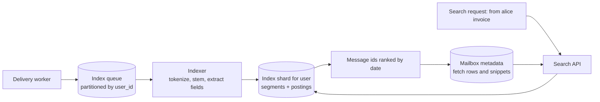

**Design points.**
- **Index per user (or per small group of users on a shard).** A query only touches its own user's index, so privacy is structural and a query is fast regardless of total system size. A shared global index would need a mandatory `user_id` filter on every query, and a bug in that filter leaks data.
- **Fields.** `from`, `to`, `subject`, `body`, `label`, `date`, `has_attachment`, `size`. Operators such as `from:` map to field queries; free text maps to body and subject.
- **Attachments.** Text is extracted (PDF, Office) and indexed asynchronously; OCR for images is optional and expensive.
- **Update path.** Delivery enqueues an index job keyed by `user_id`, so one user's updates stay ordered. The indexer writes to a small in-memory segment, flushed and merged in the background (an LSM-style approach, see [[Storage Engines - B-tree vs LSM and WAL]]). Label changes are small updates to the posting for that message.
- **Result order.** Date descending for mail (not TF-IDF relevance), with recency as the dominant factor.
- **Cost.** An index is often 20 to 50% of the text size (estimate); do not index spam folders or old, rarely searched mail as eagerly.

**Failure.** If indexer lag grows, search is stale but mail still arrives. The index is a **derived** store: it can always be rebuilt from the mailbox, so a lost index is an incident, not data loss.

> [!tip] Remember
> Source of truth: blobs and metadata. Everything else (search index, cache, counters) is derived and rebuildable.

## 9. Bottlenecks, scaling and failure handling

**Scaling plan**
1. **Inbound SMTP fleet:** stateless; add hosts behind an L4 load balancer. Multiple MX records with equal preference spread load across regions.
2. **Filters:** scale horizontally; cache DNS lookups for SPF and DKIM keys, since the same domains repeat.
3. **Queue:** partition by `hash(recipient_user_id)`; add partitions as volume grows.
4. **Metadata:** shard by `user_id` through a shard map (not raw `hash mod N`, so you can move a hot or large mailbox). See [[Partitioning and Sharding]].
5. **Blobs:** object storage scales on its own; use lifecycle rules to move old mail to cold tiers.
6. **Search:** add index shards; move large users to dedicated shards.
7. **Multi-region:** each user has a home region for writes and a replica in a second region; MX records point at the nearest region and mail is routed to the home region. See [[Multi-Region Architecture]].

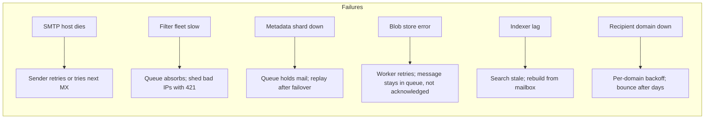

**What if inbound traffic grows 10x?** First the filter CPU, then queue partitions, then metadata shard write rate. Autoscale the filters, raise queue partitions, split hot shards. Edge shedding by reputation handles spam waves. Capacity plan from the estimate table: 1.4 M msgs/s peak is ten times the current peak, so every tier needs roughly ten times the capacity; each tier scales close to linearly because everything is keyed by user or recipient.

**Exactly-once delivery into the mailbox.** The delivery worker is at-least-once. The metadata insert uses a deterministic key: the delivery-queue record id (assigned once when the SMTP host accepted the message for that recipient) plus the recipient. A replay of the same queue record inserts the same row again and is ignored. Do not derive the key from content alone, or two genuinely separate identical messages would be merged into one. See [[Idempotency and Idempotency Keys]].

## 10. Interview questions

> [!question]- Why queue the message before answering 250 OK, instead of writing to the mailbox directly?
> Writing to the mailbox directly ties SMTP latency and availability to the metadata shard and the blob store. A replicated queue write is fast and durable, so the SMTP host can answer `250` safely, and workers handle storage with retries. The invariant to state: never answer `250` before the message is on durable storage.

> [!question]- Someone sends from `ceo@yourcompany.com` with a forged header. How do you stop it?
> Check SPF on the envelope sender IP, verify the DKIM signature, and apply the domain's DMARC policy, which requires alignment with the visible From domain. With a `reject` policy a forged message fails and is refused at SMTP time. Also tell the domain owner to publish SPF, DKIM keys and DMARC with a `reject` policy.

> [!question]- Trap: "Store each email as a row in one big SQL table." What breaks?
> Bodies and attachments make rows huge (hundreds of terabytes per day at scale), bloating the database, backups and caches. Split into a small metadata row and an immutable blob in object storage, and shard the metadata by `user_id` so one mailbox's rows are together.

> [!question]- How do you make sure a message is not delivered twice or lost when a worker crashes?
> Queue consumption is at-least-once, so the delivery step must be idempotent: a deterministic message key and an upsert. A crash after storing blobs but before committing the queue offset replays the job; the replay finds the same key and does nothing. Email as a whole has no end-to-end exactly-once guarantee, so dedup by `Message-ID` is a bonus, not a promise.

> [!question]- How do you build search for a mailbox with 20 years of mail?
> A per-user inverted index updated asynchronously from the delivery queue. Queries touch only the user's index, sorted by date. The index is derived data and can be rebuilt. Attachments are text-extracted asynchronously.

> [!question]- How do you keep a phone in sync after being offline for a week?
> A monotonic per-user `history_id`. The app asks for changes since its last id. If the id is too old (history garbage collected), the server returns a "resync" signal and the app does a full list sync.

> [!question]- Your outbound IPs get listed as spam. What do you do?
> Stop the damage (pause campaigns, move transactional mail to a clean pool), find the source (a compromised account, a bad marketing list), fix it, request delisting, warm up again. Prevent with rate limits per account, outbound spam scanning, suppression of bounced addresses and complaint-rate alerts.

## 11. What interviewers look for and follow-ups

- **Level signals.** SDE-2: SMTP/IMAP flow, metadata plus blob split, sharding by user. SDE-3: authentication (SPF/DKIM/DMARC), retry and bounce design, reputation, durability argument, derived-index rebuilds. Staff: multi-region mail routing, abuse economics, cost per mailbox, migration of billions of mailboxes.
- **Red flags.** Storing attachments in the database; no mention of spam or authentication; synchronous delivery from the SMTP session into the DB; retrying hard bounces forever; global search index without user isolation.
- **Follow-ups to prepare.** "Add undo send" (delay in the outbound queue by 10 to 30 s). "Support huge attachments" (upload to object storage, send a link; see [[Case Study - File Storage and Sync]]). "Snooze and scheduled send" (a delayed queue). "Confidential mode" (link with expiry, no forwarding). "Mailing lists" (fan-out expansion in a worker, VERP bounce addresses). "Delivery receipts" (not reliable; tracking pixels have privacy cost).
- **Decision guides to cite.** [[Choosing a Database - Decision Guide]], [[Choosing Storage for Files, Search and Analytics - Decision Guide]], [[Kafka vs RabbitMQ vs SQS - Choosing a Message Broker]], [[Choosing Consistency, Replication and Partitioning - Decision Guide]].

## 12. Cheat sheet

- Email = store-and-forward. Write durably, then `250 OK`.
- Inbound order: IP reputation, recipient check, SPF, DKIM, DMARC, spam and malware, store.
- Message = metadata row (sharded by `user_id`) + blob (object storage, sha256, dedup).
- Labels, not folders. Thread via `In-Reply-To` and `References`.
- Outbound: per-domain queues, backoff with jitter, `4xx` retry, `5xx` bounce, DKIM sign, separate IP pools, warm-up.
- Sync with a monotonic `history_id`; push only says "something changed".
- Search index per user, asynchronous, derived and rebuildable.
- Numbers (estimates): 100M DAU, about 46k inbound msgs/s avg, 140k peak, about 200 TB/day blobs, about 2 TB/day metadata.

## Links

- **Before this:** [[System Design Interview Framework]], [[Back-of-the-Envelope Estimation]], [[Kafka and Event Streaming]]
- **Building blocks:** [[Search Engines and Inverted Indexes]], [[File Uploads and Object Storage]], [[Partitioning and Sharding]], [[Caching Patterns]], [[Timeouts, Retries and Backoff]], [[Dead Letter Queues and Poison Messages]], [[Idempotency and Idempotency Keys]], [[Load Shedding and Graceful Degradation]], [[Multi-Region Architecture]], [[Unique ID Generation]], [[Storage Engines - B-tree vs LSM and WAL]], [[Hot Keys and Hot Partitions]]
- **Decision guides:** [[Choosing a Database - Decision Guide]], [[Choosing Storage for Files, Search and Analytics - Decision Guide]], [[Kafka vs RabbitMQ vs SQS - Choosing a Message Broker]], [[Choosing a Caching Strategy - Decision Guide]]
- **Compare with:** [[Case Study - Notification System]] (outbound fan-out), [[Case Study - File Storage and Sync]] (blobs and sync), [[Case Study - Chat System]] (per-user inbox and push)

### Watch on YouTube

- [System Design Interviews - Distributed Email Service](https://www.youtube.com/watch?v=PTfIiDZZ_5k) · baozi8 包子吧 · 10 min · 114 views
- [Notification Service System Design(Email, SMS, Push) #systemdesigninterview #highleveldesign #hld](https://www.youtube.com/watch?v=vMx9-ZQW2m8) · TechDecoded · 7 min · 662 views
