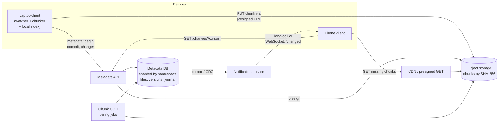
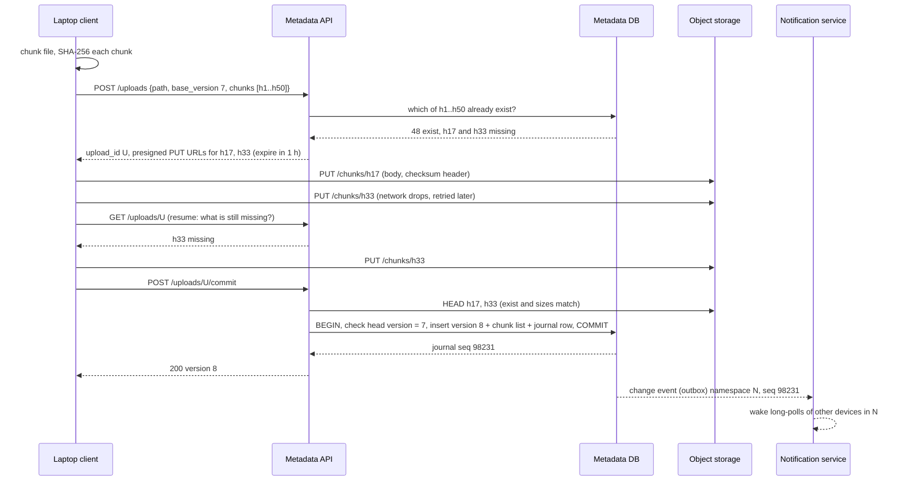
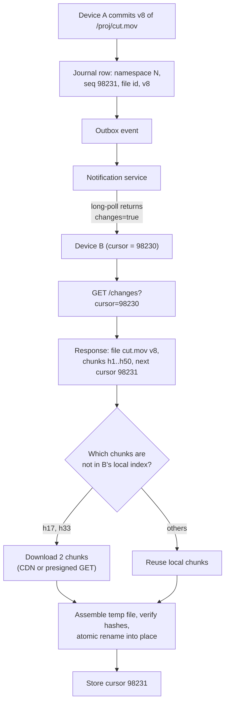
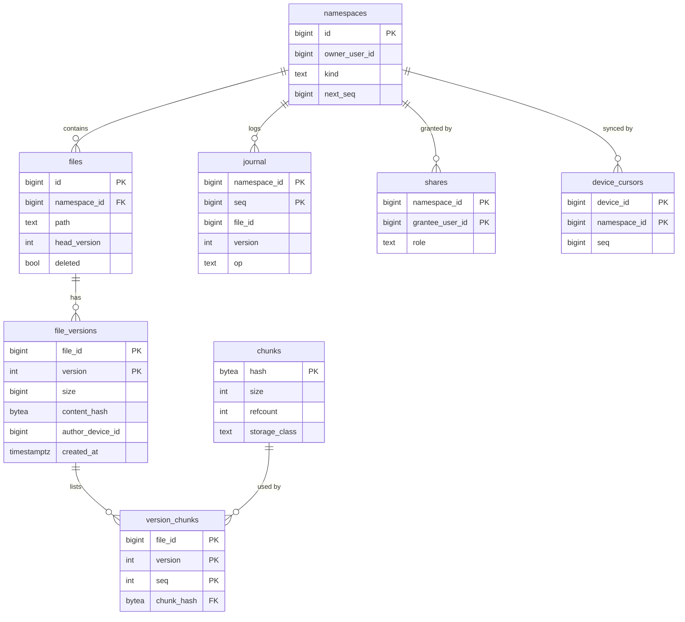

# Case Study - File Storage and Sync

> [!summary] TL;DR
> Design a Dropbox or Google Drive: users upload files of any size, see them on every device, share them and restore old versions. Files are cut into **chunks** (pieces of a few MiB) stored by their SHA-256 hash in **object storage** (a key-to-blob store such as S3), while a strongly consistent **metadata database** records which chunks make up which version of which file.

> [!abstract] Core idea
> - Split blobs from metadata: immutable chunks in object storage, mutable file trees in a sharded SQL database.
> - Address chunks by content hash, so identical data is stored and uploaded once (deduplication) and an edit uploads only the changed chunks.
> - Uploads go straight from the client to object storage through presigned URLs; the API server only handles small metadata calls and the final commit.
> - Sync is a per-namespace change journal plus a cursor per device; a long-poll or WebSocket tells devices when to pull.
> - Concurrent edits are detected with a base-version check at commit; the loser becomes a "conflicted copy" instead of silently overwriting.

## 1. Why it exists - requirements

A user edits a 200 MiB video project on a laptop, changing a few kilobytes in the middle. A naive design re-uploads all 200 MiB to one server, which writes it to local disk, and the user's phone downloads the whole thing again. At a few million active users this design fails on every axis: upload bandwidth, disk capacity on single servers, a lost upload at 99% that must restart from zero, and egress (outbound data transfer, billed by cloud providers per GB) for every device.

**Functional requirements**
- Upload and download files from a few bytes to many GiB; uploads resume after a network drop.
- Automatic sync of a folder across a user's devices (laptop, phone, web).
- Version history and restore; deleted files recoverable for a window (for example 30 days).
- Sharing files and folders with other users (view or edit), plus public links.
- Offline edits that sync later, with conflicts surfaced rather than lost.

**Non-functional requirements**
- **Durability first.** A committed file must never be lost (object storage designed for 11 nines of durability, per AWS).
- **Strongly consistent metadata.** After a commit, every device that asks sees the new version, and a commit never points at a missing chunk.
- **Sync latency** of a few seconds from commit on one device to the change appearing on another (a target, not a guarantee, when devices are online).
- **Bandwidth efficiency.** Upload only changed bytes; deduplicate identical chunks.
- **Cost control.** Storage and egress dominate the bill, not compute.

## 2. Mental model

Think of a library that stores every book as numbered loose pages in a giant warehouse, where each page is filed under a fingerprint of its text. The catalogue card for a book lists the fingerprints of its pages in order. When an author fixes a typo on page 37, the library files one new page and writes a new catalogue card that reuses every other page. Two authors who quote the same page share one physical copy. Readers keep a bookmark in the "new cards" log and only fetch the pages they do not already hold.

Mapped to the system:
- **Pages in the warehouse** = chunks in object storage, keyed by SHA-256.
- **Catalogue card** = a `file_versions` row plus its ordered chunk list in the metadata DB.
- **New-cards log** = the per-namespace change journal.
- **Bookmark** = each device's sync cursor.

## 3. How it works - high-level design



The pieces:
- **Client.** It watches the sync folder, cuts changed files into chunks, hashes them, and keeps a local index of `path → (version, chunk hashes)` so it knows what it already has.
- **Metadata API.** It is stateless. It authenticates, presigns URLs, and commits versions.
- **Metadata DB.** It is a relational database sharded by **namespace** (a user's root folder or a shared folder). One namespace lives on one shard, so a commit is a single-shard transaction ([[Partitioning and Sharding]]).
- **Object storage.** It holds immutable chunks. A chunk is never modified, only created and eventually garbage-collected.
- **Notification service.** It holds long-poll or WebSocket connections and tells devices "namespace N changed" ([[Real-time APIs - WebSocket, SSE and Long Polling]], [[Scaling WebSockets]]).
- **CDN.** It serves downloads of popular shared files close to users ([[CDN and Edge]]).

### Upload, step by step



Resumability falls out of the design: every chunk is a separate idempotent PUT to a content-addressed key, so a retry after a dropped connection just re-sends the missing chunks. The commit is the only step that changes what users see, and it is all-or-nothing.

### Sync, step by step



The device saves its cursor only after the files are on disk, so a crash mid-sync replays the same changes (at-least-once), and applying a version that is already present is a no-op.

### Whiteboard version

```text
[Client: watch -> chunk (4 MiB or CDC) -> SHA-256 -> local index]
      | metadata (small)                    | bytes (large, presigned)
      v                                     v
[Metadata API, stateless] --presign-->  [Object storage: chunks/<sha256>, immutable]
      |
[Metadata DB sharded by namespace: files, file_versions, version_chunks, chunks, journal]
      | outbox
[Notification svc: long-poll/WS "namespace changed"] --> other devices
      other device: GET /changes?cursor=c -> diff chunk lists -> fetch missing -> rename
Commit = single-shard txn, base_version check; conflict -> "conflicted copy"
Numbers: 100M users x 5 GB = 500 PB logical; ~460 commits/s avg; egress is the bill
```

## 4. Worked example - estimates, API and data model

### Estimates (inputs are labelled estimates)

| Quantity | Arithmetic | Result |
| --- | --- | --- |
| Registered users | estimate | 100 M |
| Daily active users | estimate, 10% | 10 M |
| Average stored per user | estimate | 5 GB |
| Logical storage | 100 M × 5 GB | 500 PB |
| Raw storage with erasure coding overhead (estimate 1.5×) | 500 PB × 1.5 | 750 PB |
| Commits per day | 10 M DAU × 4 changed files (estimate) | 40 M/day |
| Average commit rate | 40,000,000 / 86,400 s | ≈ 463 commits/s |
| Peak commit rate (3× average, estimate) | 463 × 3 | ≈ 1,400 commits/s |
| New bytes per commit after dedup (estimate) | 2 MB | |
| Ingress | 40 M × 2 MB = 80 TB/day; 80 TB / 86,400 s | ≈ 0.93 GB/s ≈ 7.4 Gbit/s |
| Egress to other devices (2 per user, estimate) | 2 × 80 TB | 160 TB/day ≈ 14.8 Gbit/s |
| Chunks stored at 4 MiB average | 500 PB / 4 MiB ≈ 5×10^17 B / 4.2×10^6 B | ≈ 1.2×10^11 chunks |
| Chunk index size (32 B hash + 40 B location and refcount, estimate) | 1.2×10^11 × 72 B | ≈ 8.6 TB |

Takeaways: the metadata and chunk index are terabytes and must be sharded; the blobs are hundreds of petabytes and belong in object storage; 1,400 commits/s is easy for a sharded SQL tier; egress at about 15 Gbit/s is the biggest recurring cost, which is why delta sync and dedup matter.

### API

```http
POST /v1/uploads
{"namespace_id": 9001, "path": "/proj/cut.mov", "base_version": 7,
 "size": 209715200, "chunks": ["h1", "h2", "...", "h50"]}
-> 201 {"upload_id": "U", "missing": {"h17": "https://obj.example/chunks/h17?X-Amz-Signature=...",
                                       "h33": "https://obj.example/chunks/h33?X-Amz-Signature=..."}}

GET  /v1/uploads/U                       -> {"missing": ["h33"]}          (resume)
POST /v1/uploads/U/commit                -> 200 {"version": 8} | 409 {"conflict": true, "head": 9}

GET  /v1/files/{file_id}?version=8       -> chunk list + presigned or CDN GET URLs
GET  /v1/changes?namespace=9001&cursor=98230&limit=500
     -> {"entries": [...], "cursor": "98231", "has_more": false}
GET  /v1/changes/longpoll?namespace=9001&cursor=98231&timeout=60
     -> {"changes": true}  (or false on timeout)
POST /v1/shares {"file_or_folder_id": 77, "grantee": "user:42", "role": "editor"}
```

Dropbox's public API has the same shape: `files/list_folder/continue` takes a cursor and `files/list_folder/longpoll` blocks until something changes. For a single huge object without dedup (for example a backup archive), use S3 multipart upload instead: parts of 5 MiB to 5 GiB (the last part may be smaller), at most 10,000 parts, then `CompleteMultipartUpload`. The browser-side details live in [[File Upload Architecture]].

### Data model



`chunks` is global (deduplication can span users) and is sharded by hash prefix; everything else is sharded by `namespace_id`. A shared folder is its own namespace, mounted into each member's tree, so a change in it is written once and every member follows the same journal.

The commit, as a single-shard transaction (PostgreSQL 17):

```sql
BEGIN;
SELECT head_version FROM files WHERE id = $1 FOR UPDATE;      -- expect base_version = 7
-- if head_version <> 7: ROLLBACK and return 409 (conflict)
INSERT INTO file_versions (file_id, version, size, content_hash, author_device_id)
VALUES ($1, 8, 209715200, $2, $3);
INSERT INTO version_chunks (file_id, version, seq, chunk_hash)
SELECT $1, 8, ord, h FROM unnest($4::bytea[]) WITH ORDINALITY AS t(h, ord);
UPDATE files SET head_version = 8 WHERE id = $1;
UPDATE namespaces SET next_seq = next_seq + 1 WHERE id = $5   -- row lock: serializes commits in N
RETURNING next_seq;                                            -- => 98231
INSERT INTO journal (namespace_id, seq, file_id, version, op)
VALUES ($5, 98231, $1, 8, 'modify');
INSERT INTO outbox (topic, key, payload) VALUES ('ns-changes', $5::text, $6);
COMMIT;
```

The journal `seq` comes from a counter row on `namespaces`, not from a PostgreSQL sequence. A sequence is non-transactional: two concurrent commits could take 98231 and 98232, the second could commit first, and a device that synced up to 98232 would never see 98231. The counter row is locked until commit, so sequence numbers become visible in order and without gaps.

The `refcount` increments on the global `chunks` table live on other shards, so they happen asynchronously (from the outbox) and garbage collection tolerates the lag; see the deep dive.

### Go: fixed-size vs content-defined chunking, measured

Fixed-size chunks are simple, but inserting one byte at the front shifts every boundary and every chunk hash changes. **Content-defined chunking** (CDC) picks boundaries where a rolling hash of the last few dozen bytes matches a pattern, so boundaries move with the content. The code below implements both (the CDC loop is a simplified FastCDC-style gear hash) and measures the bytes a client must re-upload after a one-byte insert.

```go
// Package chunk splits files into chunks addressed by SHA-256, with fixed-size
// and content-defined (gear hash, FastCDC-style) boundaries.
package chunk

import (
	"crypto/sha256"
	"encoding/hex"
)

type Chunk struct {
	Offset int
	Size   int
	Hash   string // hex SHA-256: the chunk's address in object storage
}

func makeChunk(data []byte, off, end int) Chunk {
	sum := sha256.Sum256(data[off:end])
	return Chunk{Offset: off, Size: end - off, Hash: hex.EncodeToString(sum[:])}
}

// Fixed cuts every size bytes (Dropbox-style 4 MiB blocks use this idea).
func Fixed(data []byte, size int) []Chunk {
	var out []Chunk
	for off := 0; off < len(data); off += size {
		out = append(out, makeChunk(data, off, min(off+size, len(data))))
	}
	return out
}

// gear is 256 pseudo-random 64-bit values, generated with splitmix64 so the
// table is the same on every device (boundaries must agree across clients).
var gear = func() [256]uint64 {
	var t [256]uint64
	x := uint64(0x9E3779B97F4A7C15)
	for i := range t {
		x += 0x9E3779B97F4A7C15
		z := x
		z = (z ^ (z >> 30)) * 0xBF58476D1CE4E5B9
		z = (z ^ (z >> 27)) * 0x94D049BB133111EB
		t[i] = z ^ (z >> 31)
	}
	return t
}()

// CDC cuts where the rolling gear hash has its top maskBits bits all zero,
// so boundaries depend on content, not on position. Average chunk size is
// about minSize + 2^maskBits (capped by maxSize).
func CDC(data []byte, minSize, maskBits, maxSize int) []Chunk {
	mask := ^uint64(0) << (64 - maskBits)
	var out []Chunk
	start := 0
	for start < len(data) {
		end := min(start+maxSize, len(data))
		cut := end
		var h uint64
		for i := start + minSize; i < end; i++ {
			h = (h << 1) + gear[data[i]]
			if h&mask == 0 {
				cut = i + 1
				break
			}
		}
		out = append(out, makeChunk(data, start, cut))
		start = cut
	}
	return out
}

// NewChunks returns the chunks of next whose hashes are not in prev: the
// only bytes a sync client must upload.
func NewChunks(prev, next []Chunk) (chunks []Chunk, bytes int) {
	have := make(map[string]bool, len(prev))
	for _, c := range prev {
		have[c.Hash] = true
	}
	for _, c := range next {
		if !have[c.Hash] {
			chunks = append(chunks, c)
			bytes += c.Size
		}
	}
	return chunks, bytes
}
```

```go
package chunk

import (
	"bytes"
	"math/rand/v2"
	"testing"
)

func testData(n int) []byte {
	r := rand.New(rand.NewPCG(1, 2))
	b := make([]byte, n)
	for i := range b {
		b[i] = byte(r.Uint32())
	}
	return b
}

func reassemble(data []byte, cs []Chunk) []byte {
	var buf bytes.Buffer
	for _, c := range cs {
		buf.Write(data[c.Offset : c.Offset+c.Size])
	}
	return buf.Bytes()
}

func TestChunksCoverFileExactly(t *testing.T) {
	data := testData(1 << 20)
	for name, cs := range map[string][]Chunk{
		"fixed": Fixed(data, 8192),
		"cdc":   CDC(data, 2048, 13, 65536),
	} {
		if !bytes.Equal(reassemble(data, cs), data) {
			t.Fatalf("%s: chunks do not reassemble the file", name)
		}
		for _, c := range cs[:len(cs)-1] {
			if name == "cdc" && (c.Size < 2048 || c.Size > 65536) {
				t.Fatalf("cdc chunk size %d out of bounds", c.Size)
			}
		}
	}
}

// Insert one byte at the front of a 1 MiB file and count re-uploaded bytes.
func TestInsertShiftsFixedButNotCDC(t *testing.T) {
	old := testData(1 << 20)
	edited := append([]byte{'X'}, old...)

	_, fixedBytes := NewChunks(Fixed(old, 8192), Fixed(edited, 8192))
	_, cdcBytes := NewChunks(CDC(old, 2048, 13, 65536), CDC(edited, 2048, 13, 65536))
	t.Logf("re-upload after 1-byte insert: fixed=%d bytes, cdc=%d bytes", fixedBytes, cdcBytes)

	if fixedBytes < len(edited)*9/10 {
		t.Fatalf("fixed chunking should re-upload almost everything, got %d", fixedBytes)
	}
	if cdcBytes > 64*1024 {
		t.Fatalf("cdc should re-upload about one chunk, got %d", cdcBytes)
	}
}

func TestIdenticalFilesDedupe(t *testing.T) {
	data := testData(256 * 1024)
	cs := CDC(data, 2048, 13, 65536)
	if n, b := NewChunks(cs, CDC(bytes.Clone(data), 2048, 13, 65536)); len(n) != 0 || b != 0 {
		t.Fatalf("identical file should upload nothing, got %d chunks", len(n))
	}
}
```

**Measured** with Go 1.24 (`go test -race -v`, deterministic random 1 MiB file, chunk sizes scaled down to about 10 KiB average, 2 KiB minimum plus 2^13, so the test runs fast):

```text
re-upload after 1-byte insert: fixed=1048577 bytes, cdc=2963 bytes
```

With fixed 8 KiB chunks the client re-uploads the whole 1 MiB file plus the inserted byte (every boundary shifted). With CDC it re-uploads one chunk of 2,963 bytes, because the boundaries after the edit realign with the content. In production the same parameters are scaled up (for example 1 MiB minimum, 4 MiB average, 16 MiB maximum, as an estimate of typical settings); the effect is the same.

## 5. Variants and comparison

| Option | How it works | Use when | Cost |
| --- | --- | --- | --- |
| Whole-file upload | One PUT per file version | Small files (under a few MiB), simple apps | Every edit re-sends the file; no resume |
| S3 multipart, one object per version | Parts ≥ 5 MiB (last may be smaller), ≤ 10,000 parts, complete call | Large, write-once files (backups, video masters) | No cross-file dedup; each edit is a new full object |
| Fixed-size content-addressed blocks | 4 MiB blocks keyed by SHA-256 (Dropbox's content hash is defined over 4 MiB blocks) | Appends and in-place edits; simple, fast hashing | An insert near the start changes every later block |
| Content-defined chunking (Rabin, gear/FastCDC) | Boundaries where a rolling hash matches a mask | Inserts and deletes inside files; backup tools | More CPU; variable chunk sizes complicate indexing |
| rsync-style delta | Rolling checksum finds matching blocks against the old version, sends literal bytes | Syncing against one known previous version | Needs the old version on both sides; no global dedup |

**Conflict handling options**

| Option | How it works | Use when | Cost |
| --- | --- | --- | --- |
| Last writer wins | Highest timestamp overwrites | Never for user files | Silent data loss |
| Base-version check + conflicted copy | Commit requires `base_version = head`; loser saved as "file (conflicted copy)" | Binary files, general sync (Dropbox does this) | The user merges manually |
| Version vectors | Each replica's counter detects concurrent edits even offline and peer-to-peer | Multi-master or peer sync | Metadata grows with the number of writers ([[Clocks and Ordering]]) |
| CRDT or operational transform | Merge edits at the operation level | Collaborative documents (Google Docs style) | Only for structured content ([[CRDTs and Conflict Resolution]]) |

## 6. Trade-offs and when not to use

- **Chunk size.** Small chunks give better dedup and smaller re-uploads, but more metadata rows and more PUT requests (object stores bill per request). Large chunks reduce overhead but waste bandwidth on small edits. A few MiB is the common middle ground.
- **Global vs per-user dedup.** Global dedup saves the most storage, but it reveals to an attacker whether some content already exists anywhere (an upload that "finishes instantly" leaks that fact). Per-namespace dedup, or requiring proof of possession before skipping an upload, closes that side channel at some storage cost.
- **Client-side encryption** with a per-user key blocks server-side dedup across users and server-side previews and search. Choose it when privacy outranks those features.
- **Strong metadata vs eventual blobs.** Object storage writes complete before the commit, and S3 has had strong read-after-write consistency since December 2020, so the "commit points at missing chunk" class of bugs is avoided by ordering (upload, verify with HEAD, then commit), not by distributed transactions.
- **When not to build this.** For "users attach a file to a ticket", use direct-to-S3 presigned uploads and a single metadata row ([[File Upload Architecture]]). Chunking, journals and sync clients pay off only when files change and must appear on several devices.

## 7. In production

- **Real systems.**
	- Dropbox documents a content hash computed over 4 MiB blocks with SHA-256, and a cursor-plus-longpoll change API.
	- Backup tools such as restic and Borg use content-defined chunking for dedup.
	- S3 and other object stores provide multipart upload with the 5 MiB minimum part size and 10,000-part limit.
- **Failure modes and fixes.**
	- *Upload dies at 99%.* Chunks already uploaded remain; `GET /uploads/U` returns the missing set; the client resumes.
	- *Presigned URL expires mid-upload.* The client asks for fresh URLs for the remaining chunks. SigV4 presigned URLs can last at most 7 days; use short expiries (about an hour) and refresh them.
	- *Client lies about a hash.* Verify a sample, or have object storage check a `x-amz-checksum-sha256` header on PUT, so a chunk key always matches its bytes. Otherwise one user could poison a shared dedup chunk.
	- *Orphan chunks* from abandoned uploads are deleted by GC after a grace period.
	- *Reconnect storm after a notification-service deploy.* Millions of long-polls reconnect at once. Add jitter on the client and drain connections gradually.
	- *Hot namespace.* A company-wide shared folder with 50,000 members makes every change a 50,000-device fan-out. Notify per namespace, not per user, and let devices pull; coalesce bursts of changes ([[Hot Keys and Hot Partitions]]).
- **What to monitor.**
	- Commit latency and the conflict rate.
	- Upload resume rate and the age of abandoned uploads.
	- Sync lag: the time from commit to the last device's cursor passing it.
	- Long-poll connection counts per node.
	- Dedup ratio (logical bytes / physical bytes).
	- Egress per namespace, to find abuse such as public links being used as a free CDN.
	- GC backlog and chunk refcount drift.

## 8. Deep dive

### Garbage collection of chunks

A chunk can be deleted only when no version references it and no in-flight upload is about to. Two approaches:
- **Reference counts.** Increment when a version that uses the chunk commits; decrement when a version is purged (after the retention window). The counts live on a different shard from the version rows, so they are updated asynchronously and can drift after bugs or partial failures.
- **Mark and sweep.** Periodically scan all live version chunk lists (mark), then delete unmarked chunks older than a grace period (sweep). It is slow but self-correcting.

Production systems typically combine them: refcounts for fast reclamation, plus a periodic mark-and-sweep audit that fixes drift. The grace period (for example 7 days, an estimate) protects chunks uploaded by an upload that has not committed yet. Deleting a chunk is the only irreversible operation in the system, so it is the most conservative step.

### Storage tiering and cost

Most files are rarely read after a few weeks. A tiering job moves chunks that have not been read for a while to colder classes. In S3, Standard-IA has a 30-day minimum storage duration, and Glacier Flexible Retrieval has a 90-day minimum with retrieval delays from minutes to hours. Chunks shared by many versions or users should stay warm. Old versions beyond the retention policy are purged, which feeds GC. Egress is often the largest line item; serving shared files through a CDN and syncing only deltas are the main levers.

### Why commits are per-namespace serial

The journal sequence is per namespace. A device's cursor is a single integer, so "what changed since cursor c" is an index range scan on `(namespace_id, seq)`. Allocating `seq` from the locked `namespaces.next_seq` row inside the commit transaction serializes commits within one namespace. That costs nothing for a personal folder; for a giant team folder it becomes the throughput limit. The usual fix is to split very large shared folders into sub-namespaces, not to give up the total order that makes cursors simple.

### Moves, renames and deletes

A rename should not re-upload anything: it is a metadata-only journal entry (`op = 'move'`) on the same `file_id`. A delete is a tombstone in `files` plus a journal entry, so offline devices learn about it when they sync. A device that edited a file offline while another device deleted it sees a conflict on commit: the usual policy is to restore the file with the edit, because losing an edit is worse than resurrecting a file.

### Download path and large files

The client downloads chunks in parallel (for example 4 to 8 at a time) via presigned GETs or the CDN, verifies each hash, writes to a temp file, and atomically renames it into place. Because chunks are immutable and content-addressed, they cache perfectly: a CDN or a LAN peer can serve them without any invalidation logic.

## 9. Interview questions

> [!question]- Why store metadata and file contents in different systems?
> They have opposite needs. Metadata is small, mutable, queried and must be strongly consistent with transactions (a relational DB sharded by namespace). Contents are huge, immutable and only fetched by key (object storage, designed for 11 nines of durability and cheap per GB). Mixing them makes either the database enormous or the blob store transactional.

> [!question]- How does a resumable upload work in your design?
> The client sends the chunk hash list; the server replies with presigned PUT URLs for chunks it does not have. Each chunk is an independent idempotent PUT to its hash key, so after a drop the client asks which chunks are still missing and sends only those. The commit, done last, verifies the chunks exist and atomically creates the new version.

> [!question]- (Trap) Fixed 4 MiB blocks dedup well, so why would anyone use content-defined chunking?
> Fixed blocks only help when bytes stay at the same offsets (appends, in-place overwrites). Insert one byte near the start and every later boundary shifts, so every block hash changes. Measured here on 1 MiB: fixed chunks re-uploaded 1,048,577 bytes, CDC re-uploaded 2,963. CDC chooses boundaries from the content, so they realign right after the edit.

> [!question]- Two devices edit the same file offline. What happens on sync?
> Both commit with `base_version = 7`. The first succeeds and becomes version 8. The second fails the base-version check with 409, and the client saves its copy as "name (conflicted copy)" so nothing is lost. Last-writer-wins would silently drop one edit, which is unacceptable for user files.

> [!question]- How does device B learn that something changed, and what does it download?
> B holds a long-poll (or WebSocket) on its namespaces with its cursor. A commit writes a journal row and an outbox event that wakes the long-poll. B calls `GET /changes?cursor=`, gets the new version's chunk list, compares it with its local index, downloads only the missing chunks, assembles and renames the file, then stores the new cursor.

> [!question]- How do you delete chunks safely when dedup means many files share them?
> Never delete on the user's delete; purge versions after the retention window, then remove chunks with zero references and age past a grace period, so in-flight uploads are safe. Use refcounts for speed and a periodic mark-and-sweep to correct drift, because deleting a live chunk is unrecoverable.

> [!question]- What dominates the cost, and how do you reduce it?
> Storage (hundreds of PB) and egress (about 15 Gbit/s in the estimate above), not compute. Reduce storage with dedup, compression, erasure coding and tiering to infrequent-access or archive classes; reduce egress with delta sync, LAN sync between a user's devices, and CDN caching for shared files.

## 10. Cheat sheet

- Blobs in object storage (immutable chunks keyed by SHA-256), metadata in a SQL DB sharded by namespace.
- Upload flow: send hash list, receive presigned URLs for missing chunks, PUT chunks, commit with a base-version check.
- Content-defined chunking survives inserts; fixed blocks do not (measured: 1,048,577 vs 2,963 bytes re-uploaded).
- Sync uses a per-namespace journal plus a per-device cursor, with long-poll or WebSocket as a wake-up signal only.
- Conflicts become a "conflicted copy"; renames are metadata-only; deletes are tombstones.
- S3 multipart: parts of 5 MiB to 5 GiB (last smaller), ≤ 10,000 parts; presigned URLs ≤ 7 days.
- GC uses refcounts plus mark-and-sweep with a grace period; tier cold chunks; egress is the bill.

## Links

- **Before this:** [[File Upload Architecture]], [[Partitioning and Sharding]], [[Real-time APIs - WebSocket, SSE and Long Polling]], [[Case Study - Payment System]]
- **Next:** [[Case Study - Web Crawler]], [[Case Study - Video Streaming]], [[AWS 07 - S3]]
- **Compare with:** [[CRDTs and Conflict Resolution]] (merging instead of conflicted copies), [[File Uploads and Object Storage]] (Go upload handlers), [[CDN and Edge]]
