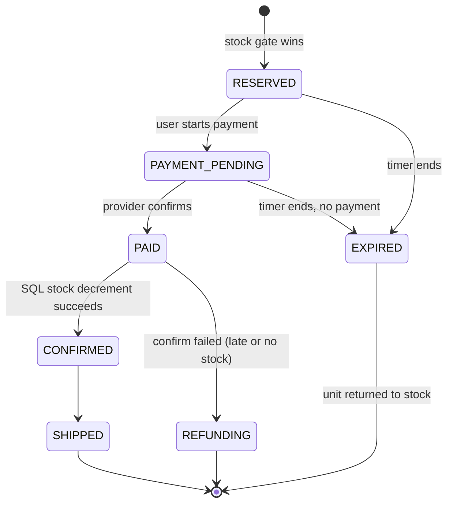
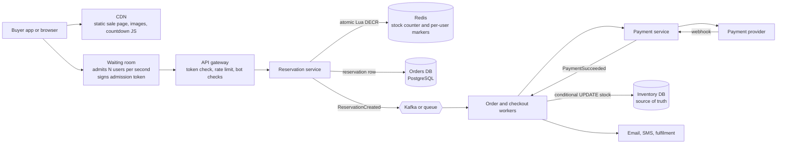
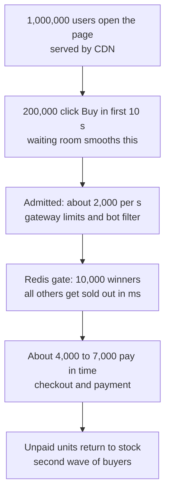
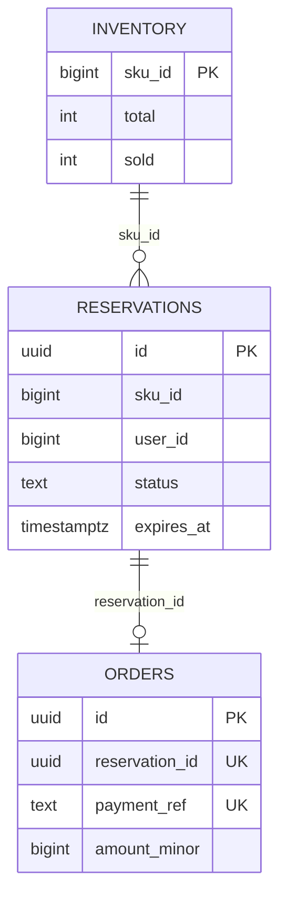
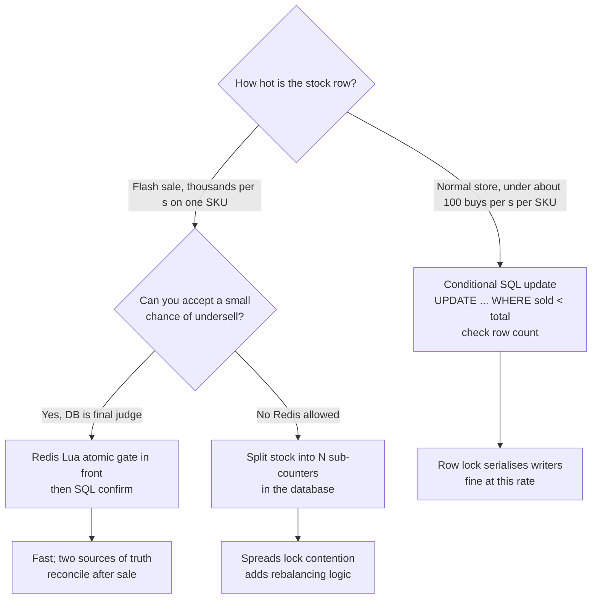
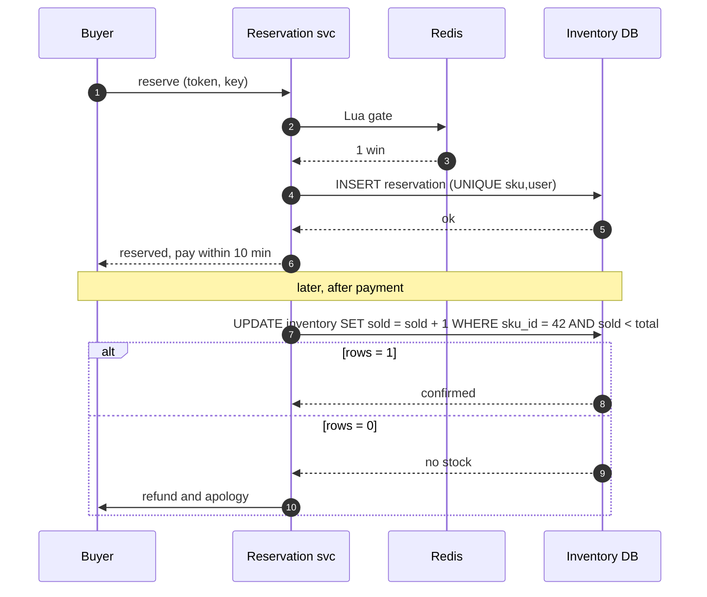
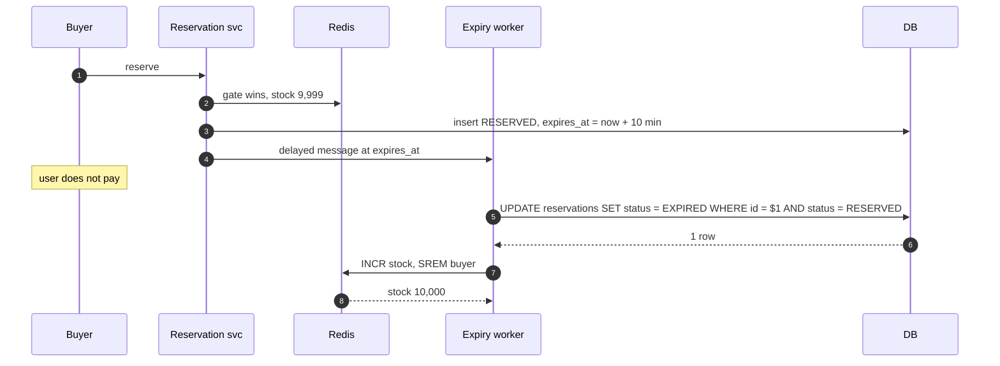
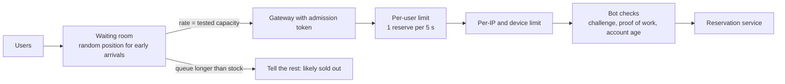
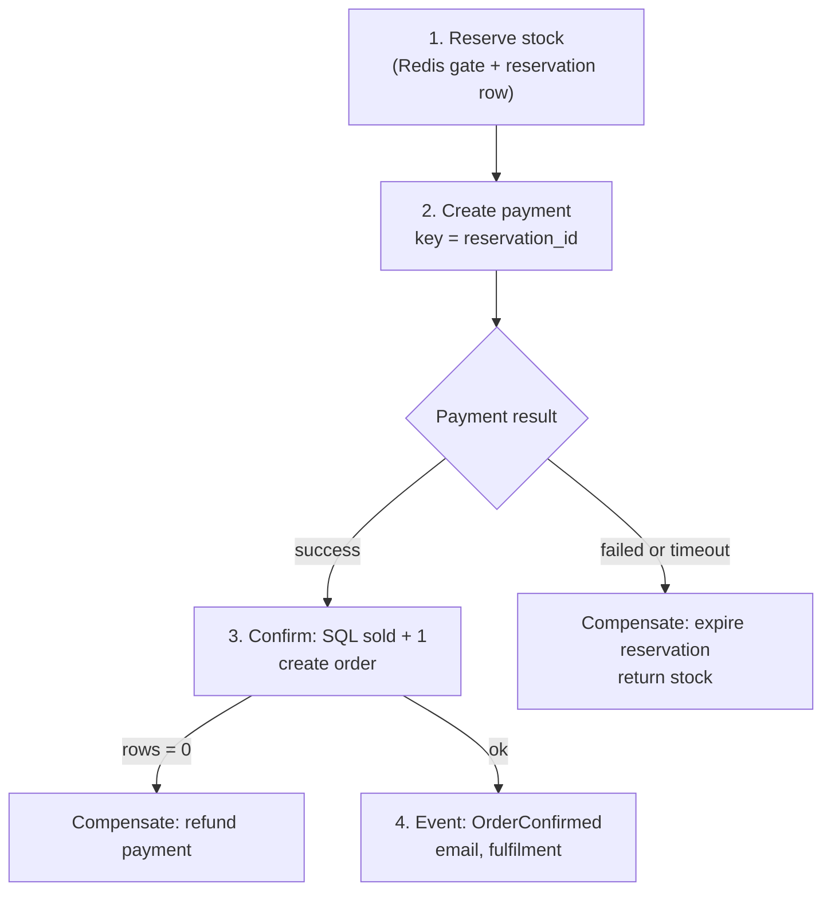
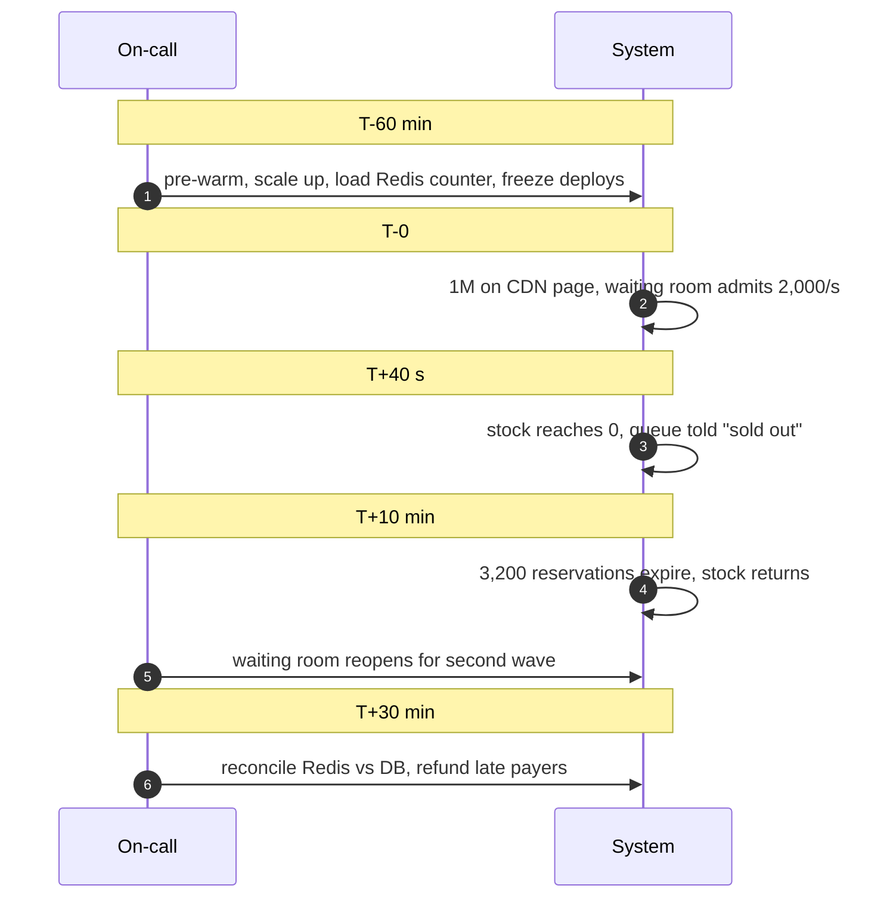

# Case Study - Flash Sale and E-commerce Checkout

> [!summary] TL;DR
> A **flash sale** sells a small, fixed stock (say 10,000 phones) to a huge crowd (say 1,000,000 people) that all arrive in the same minute. The design has to do three things at once: never sell more than the stock, never fall over under the spike, and stay fair. The recipe is a cheap front door that sheds most of the crowd, a fast atomic stock counter that decides winners, a short reservation that expires, and a slow, safe checkout behind a queue.

> [!abstract] Core idea
> - Most of the crowd cannot win. Filter them out **before** they touch the database: CDN, waiting room, per-user limits.
> - Stock decisions use one **atomic decrement** (Redis Lua or a conditional SQL update), never "read, check, write".
> - A winner gets a **reservation** with a timer. Pay in time and it becomes an order; do not pay and the stock returns.
> - Checkout is a **saga** (reserve, pay, confirm, or compensate), with idempotency keys on every step.
> - Redis is the fast gate; the SQL database is the final judge. Better to undersell briefly than to oversell.

## 1. Why it exists - requirements

### The problem in plain words

Picture a shop that puts 10,000 phones on sale at exactly 12:00 at a huge discount. At 11:59 a million people open the app. At 12:00 they all tap "Buy". For a few seconds the traffic is 100 times the normal level, and every request is fighting for the same product row.

Two things go wrong in a naive design. First, the database melts under load, because thousands of requests update the same stock row. Second, **overselling**: two requests both see "1 left", both succeed, and the shop owes 10,001 phones.

> [!tip] Remember
> A flash sale is a hot-key problem plus a correctness problem plus a crowd-control problem, all at the same minute.

### Functional requirements

- Show the sale page with a countdown, price and stock status.
- "Buy now" reserves one unit (limit per user, for example 1 or 2).
- Checkout: address, payment (card, UPI, wallet, cash on delivery).
- Confirm the order, send email or SMS, start fulfilment.
- If payment fails or times out, the unit goes back to stock.
- Normal e-commerce around it: catalog, search, cart, order history, cancellation.

### Non-functional requirements

- **No overselling.** The correctness rule. Everything else bends around it.
- **Survive the spike** without taking the normal store down with it.
- **Fairness.** Humans before bots; roughly first come, first served.
- **Low latency** for the "did I get it?" answer (under 1 to 2 seconds).
- **No double charge.** A retry or double tap must not create two orders.
- Availability of browsing matters more than availability of buying during the spike: it is acceptable to say "sold out" or "you are in a queue".

**Out of scope:** pricing engines, recommendation, warehouse routing, returns.

### How it differs from ticket booking

| | [[Case Study - Ticket Booking]] | Flash sale |
| --- | --- | --- |
| Inventory | Many distinct seats, each row cold | One or a few SKUs, one row extremely hot |
| Contention | Spread across seats | Concentrated on one counter |
| Buyer chooses | A specific seat | "Any unit of this SKU" |
| Main fix | Conditional update plus waiting room | Atomic counter in front of the database plus queueing |

> [!tip] Remember
> Same family as ticket booking, but the hot spot is one counter, so the counter must live somewhere very fast.

## 2. Mental model

### Analogy: a shop door with a bouncer and a tiny till

Think of a physical shop opening a sale. A bouncer lets in 50 people at a time (waiting room). Inside, a staff member hands out 10,000 numbered tokens and stops when the box is empty (atomic counter). A token holder walks to the till and pays within 10 minutes (checkout with reservation). If they walk away, their token goes back in the box (expiry).

The analogy breaks down because a real box cannot be read by 100,000 people per second, and a real till has no network failures. In software the "box" must be a data structure designed for this load, and the till can lose a message half-way.

### Terms

- **SKU:** one sellable item type, for example "Phone X 128 GB black".
- **Reservation (hold):** a temporary claim on one or more units with an expiry.
- **Oversell:** confirming more orders than physical stock.
- **Undersell:** leaving stock unsold because reservations were stuck. Less harmful, but still lost revenue.
- **Waiting room:** a virtual queue that admits users at a controlled rate.
- **Admission token:** a signed, short-lived pass that the gateway checks.

### The order lifecycle



> [!tip] Remember
> Every purchase attempt is a small state machine with a timer, so stuck states heal themselves.

## 3. How it works - high-level design



### Step-by-step path of one purchase

1. **Static sale page.** The page, images and countdown are plain files on the CDN, so a million viewers never reach the origin. The page asks the server for the time once, then counts down in the browser.
2. **Waiting room.** At sale start, users get a random or first-come position and an admission token as capacity allows.
3. **Gateway.** Checks the token, applies per-user and per-IP limits, and rejects obvious bots.
4. **Reservation service.** Runs one Redis Lua script: "if the user has not bought and stock is above 0, decrement and mark the user". Returns win or lose in under a millisecond.
5. **Winner path.** Write a `RESERVED` row with an expiry and publish `ReservationCreated`. The user is told "you got one, pay in 10 minutes".
6. **Loser path.** Immediate "sold out" response. Nothing else is touched, so most of the crowd costs almost nothing.
7. **Checkout.** Payment runs with an idempotency key (the reservation ID). Success arrives via webhook.
8. **Confirm.** A conditional SQL update decrements the real inventory. If it fails, the payment is refunded.
9. **Expiry.** A timer (or delayed message) returns unpaid reservations to stock.

> [!tip] Remember
> Every layer exists to make the next layer's job smaller: CDN, then queue, then gate, then database.

### The load funnel



(All numbers here are illustrative estimates.)

## 4. Worked example - estimates, API and data model

### Whiteboard version

```text
[CDN page] -> [Waiting room: token] -> [Gateway: limit, bot] -> [Reservation svc]
        Redis Lua: if bought[user] == 0 and stock > 0 then stock--, bought[user] = 1
                 | win                             | lose -> "sold out"
          RESERVED row (expires_at) + event
                 v
          Checkout saga: pay (key = reservation_id) -> confirm (conditional SQL) or refund
          Timer: expired reservation -> stock++ (Redis) and release (SQL)
Say first: "Redis decides fast, SQL decides finally, and every step is idempotent."
```

### Estimates (labelled, teaching numbers)

| Quantity | Assumption | Result |
| --- | --- | --- |
| Interested users | 1,000,000 | page served by CDN |
| Stock | 10,000 units | the whole purchase budget |
| Arrival peak | 20% click in 10 s | about 20,000 requests/s |
| Admission rate | match tested capacity | 2,000 to 5,000/s at the gate |
| Redis gate | one counter, Lua script | one Redis node handles on the order of 50,000 to 100,000 simple ops/s (estimate; test your own) |
| Reservation inserts | only gate winners; 10,000 winners admitted at 2,000/s | a burst of up to about 2,000 inserts/s for about 5 s (10,000 / 2,000), manageable on one primary, or batch them |
| Orders reaching DB | at most stock plus retries | about 10,000 to 20,000 rows in minutes |
| Order/confirm write rate | 10,000 orders over 5 min | about 33/s, easy for one PostgreSQL primary |
| Reservation hold | 10 minutes | about 10,000 held rows at peak |

The key insight from the arithmetic: the database sees at most a short burst of about 2,000 inserts per second (winners only), then **tens of writes per second**, while the front sees tens of thousands of requests per second. Losers never reach the database. Design effort goes into the front.

### API

| Call | Purpose | Notes |
| --- | --- | --- |
| `GET /sales/{id}` | Page data | Cacheable, CDN |
| `POST /sales/{id}/queue` | Join waiting room | Returns position or token |
| `POST /sales/{id}/reserve` | Try to win a unit | Needs admission token; `Idempotency-Key` header |
| `POST /reservations/{id}/pay` | Start payment | Key = reservation ID |
| `GET /orders/{id}` | Status | Poll or push |
| `DELETE /reservations/{id}` | Release | Returns unit to stock |

`reserve` is idempotent per user: the second call returns the same reservation, never a second unit. See [[Idempotency and Idempotency Keys]].

### Data model

```sql
CREATE TABLE inventory (
  sku_id     BIGINT PRIMARY KEY,
  total      INT NOT NULL,
  sold       INT NOT NULL DEFAULT 0,       -- confirmed orders
  CHECK (sold >= 0 AND sold <= total)      -- last line of defence against oversell
);

CREATE TABLE reservations (
  id          UUID PRIMARY KEY,
  sku_id      BIGINT NOT NULL,
  user_id     BIGINT NOT NULL,
  status      TEXT NOT NULL,               -- RESERVED, PAYMENT_PENDING, PAID, CONFIRMED, EXPIRED, REFUNDED
  expires_at  TIMESTAMPTZ NOT NULL,
  UNIQUE (sku_id, user_id)                 -- one unit per user per sale
);

CREATE TABLE orders (
  id             UUID PRIMARY KEY,
  reservation_id UUID NOT NULL UNIQUE,     -- idempotent confirmation
  payment_ref    TEXT NOT NULL UNIQUE,
  amount_minor   BIGINT NOT NULL,
  created_at     TIMESTAMPTZ NOT NULL DEFAULT now()
);
```

Redis keys (all under one hash tag so a Lua script can touch them together):

| Key | Type | Meaning |
| --- | --- | --- |
| `sale:{sku42}:stock` | integer | remaining units |
| `sale:{sku42}:buyers` | set | users who already won |
| `sale:{sku42}:res:{id}` | string with TTL | optional marker for expiry tracking |



> [!tip] Remember
> The database CHECK constraint is your seatbelt: even if every other layer has a bug, the row cannot go over capacity.

## 5. Deep dives

### Deep dive 1: stopping overselling at high speed

#### In plain words

Overselling happens when "check stock" and "reduce stock" are two separate steps. Between them, another request sneaks in. The fix is to make check and reduce **one indivisible step**. Where that step runs decides your speed.

#### The broken version

```sql
SELECT stock FROM inventory WHERE sku_id = 42;           -- both see 1
UPDATE inventory SET stock = stock - 1 WHERE sku_id = 42; -- both succeed, stock = -1
```

#### Picture it: the options



#### Alternatives, choice and why

| Option | How | Pros | Cons | Use when |
| --- | --- | --- | --- | --- |
| Conditional SQL update | `UPDATE inventory SET sold = sold + 1 WHERE sku_id = $1 AND sold < total` | Simple; one source of truth | One hot row serialises all writers; latency grows with contention | Ordinary traffic |
| `SELECT ... FOR UPDATE` | Lock, read, write | Allows complex logic | Holds lock across round trips; deadlocks | Multi-item carts, low contention |
| Optimistic version column | Retry on version mismatch | No locks | Retry storm when many fight for one row | Rare conflicts only |
| Redis Lua decrement | One script: check and decrement | Sub-millisecond, atomic, tens of thousands per second | Memory store; failover can lose last writes | Flash sale gate |
| Sharded counters | 10 counters of 1,000 units each | Spreads writes | Unlucky shard says sold out while others have stock | When one counter is still too hot |
| Queue serialisation | One consumer per SKU applies requests in order | Simple correctness | Latency; throughput bound by one consumer | Very strict fairness |

**Choice.** Redis Lua gate in front, SQL conditional update behind. Redis decides who may proceed (fast), SQL decides who really gets the unit (correct). Matching guides: [[Choosing a Caching Strategy - Decision Guide]] and [[Choosing Consistency, Replication and Partitioning - Decision Guide]].

#### The Lua gate

```lua
-- KEYS[1] = stock, KEYS[2] = buyers set; ARGV[1] = user id
if redis.call('SISMEMBER', KEYS[2], ARGV[1]) == 1 then return 2 end  -- already won
local s = tonumber(redis.call('GET', KEYS[1]))
if s == nil or s <= 0 then return 0 end                               -- sold out
redis.call('DECR', KEYS[1])
redis.call('SADD', KEYS[2], ARGV[1])
return 1                                                              -- win
```

1. Redis runs a script as one uninterrupted unit, so no other command can run between the check and the decrement.
2. The script returns 1 (win), 0 (sold out) or 2 (already won), so retries are harmless.
3. Both keys use the same hash tag, such as `sale:{sku42}:...`, so Redis Cluster puts them on one slot.

#### Why the SQL check still matters



If Redis fails over and loses its last few writes, it may let slightly too many people win. The SQL update refuses the extra ones, and those buyers are refunded. That is rare, and it is an apology, not a lawsuit.

> [!warning] Common mistake
> Trusting Redis alone as the stock truth. Redis failover can lose recent writes. Use it as a gate and keep the database (with a CHECK constraint) as the judge.

> [!warning] Common mistake
> Doing "GET then DECR" as two Redis calls. That reintroduces the race. Use `DECR` alone (and check the result) or a Lua script.

> [!tip] Remember
> Fast gate, correct judge. Two layers, each doing the job it is good at.

### Deep dive 2: reservations, expiry and returning stock

#### In plain words

A winner has not paid yet. If we keep the unit locked forever for someone who walked away, we undersell. So a reservation carries a deadline, and a timer returns the unit when the deadline passes.

#### Picture it



#### Step-by-step

1. Reserve writes `expires_at` and schedules a delayed event (Kafka delayed topic, SQS delay, Redis sorted set or a scheduler table).
2. The expiry worker runs a conditional update: only a still-`RESERVED` row becomes `EXPIRED`.
3. If one row changed, return the unit to Redis (`INCR` and remove the buyer from the set).
4. If zero rows changed (the user paid in the meantime), do nothing. The condition protects against the race.
5. A reconciliation job every minute compares `total - sold - active reservations` with the Redis counter and repairs drift.

#### Alternatives

| Option | Pros | Cons |
| --- | --- | --- |
| Redis key with TTL per reservation, keyspace notifications | Simple | Notifications are not guaranteed delivery; can miss expiry |
| Delayed queue message | Reliable, scalable | Extra component |
| DB sweeper query (`WHERE expires_at < now()`) | Easy, durable | Polling cost, lag of a minute |
| Lazy expiry in the claim condition (as in tickets) | No job needed | Works for per-seat rows, awkward for a single counter |

**Choice.** Delayed message plus a reconciliation sweeper. The message is fast; the sweeper is the safety net. See [[Kafka vs RabbitMQ vs SQS - Choosing a Message Broker]] for delay support.

> [!tip] Remember
> Make expiry a conditional update, so a late timer and a late payment cannot both win.

### Deep dive 3: crowd control, fairness and bots

#### In plain words

If a million people hit "Buy" at the same second, the system cannot serve them all, and it should not try. Let in only as many as it can handle, and make the line feel fair.

#### Picture it



#### Layers and why

| Layer | Job | Alternative |
| --- | --- | --- |
| CDN | Absorb page and image traffic | Direct origin (will fall over) |
| Waiting room | Convert a spike into a steady stream | Plain rate limit (rejects, causes retry storms) |
| Token bucket per user | Stop one user from flooding | Per IP only (shared NAT punishes real users) |
| Bot defence | Keep scripts from taking the stock | Login-only sales, purchase history rules |
| Per-user purchase cap | Fairness (1 per account, verified phone) | None (resellers win) |

Rate limiting design is in [[Rate Limiting - Algorithms and Distributed Design]]; bot handling is in [[API Abuse and Bot Protection]]. Why a waiting room beats a plain 429: rejected users retry immediately, making the spike worse; a queue gives them a place to wait. See [[Load Shedding and Graceful Degradation]].

**Fairness choice.** Random lottery among those who arrive in the first 30 seconds, then first come first served. That removes the advantage of a faster connection or a bot hammering at 11:59:59.

> [!warning] Common mistake
> Rate limiting only by IP. Campus networks and mobile carriers share IPs, so real users get blocked while bots rotate addresses.

> [!tip] Remember
> A queue turns a stampede into a line; a 429 turns it into a retry storm.

### Deep dive 4: checkout as a saga with idempotency

#### In plain words

Checkout touches several systems: stock, payment, order, notification. No single transaction covers them all. We run a chain of small local steps; if a step fails, we run an undo for the earlier ones. That is a **saga**.

#### Picture it



#### Step-by-step

1. Payment creation uses the reservation ID as the idempotency key, so a double tap creates one payment.
2. The provider's webhook can arrive twice or late; confirmation looks up `orders.reservation_id` (UNIQUE) first and returns the existing order if there is one. See [[Receiving Webhooks Idempotently]].
3. If payment succeeds after expiry, confirm re-checks the status and stock; if the unit was given to someone else, refund automatically.
4. Order events leave through the outbox ([[Transactional Outbox and CDC]]), so an order row and its event cannot disagree.
5. An unknown payment result (provider timeout) keeps the reservation alive a little longer and triggers a status query plus reconciliation.

Saga theory is in [[Saga Pattern]]; payment details are in [[Case Study - Payment System]].

> [!tip] Remember
> Idempotency key at every step, compensation for every step, and a reconciliation job as the safety net.

## 6. Variants and comparison

| Variant | What changes | Good for | Watch out for |
| --- | --- | --- | --- |
| Lottery sale | Users register; winners drawn randomly | Extreme demand, fairness | Needs registration window and communication |
| Queue-and-allocate | Everyone queues; allocation in order | Strict fairness | Slower; queue state to persist |
| Instant reserve (this note) | First atomic winners | Typical flash sale | Needs the full gate stack |
| Cart-based sale | Many items per order | Big-bang sales (Black Friday) | Multi-SKU atomicity, deadlocks; sort SKU IDs |
| Pre-order | No stock check; fulfil later | Products made on demand | Disappointment risk, cash held |
| Payment-first | Charge, then allocate | Simple | Refund load for losers; bad UX |
| Reserve-first | Allocate, then pay | Standard | Expiry handling |

## 7. Trade-offs and when not to use

- **Oversell vs undersell.** Slight undersell is cheap (return stock, sell again); oversell means refunds and angry users. Bias toward undersell.
- **Hold time.** 10 minutes frees stock slowly; 3 minutes causes failed payments. UPI approvals and OTPs argue for 5 to 10 minutes.
- **Redis gate cost.** A second system and two sources of truth. For a small sale (under about 100 buys/s per SKU) a conditional SQL update is enough and simpler. Do not build the full stack for a modest launch.
- **Queue friction.** Users dislike waiting, but dislike an outage more.
- **Strong vs eventual stock display.** Showing "only 3 left" accurately costs reads on the hot counter. Cache it for 1 to 2 seconds and accept that it is approximate.
- **Single region vs multi-region.** Sale stock is a single-writer problem. Keep the gate in one region; serve static content globally.

## 8. In production

### Failure modes and fixes

| Failure | What happens | Fix |
| --- | --- | --- |
| Redis primary fails mid-sale | Counter may lose recent decrements | Fail over; SQL CHECK rejects extras; reconcile counter from DB |
| Gate succeeds, DB write fails | Winner has no reservation row | Retry with idempotency key; compensating `INCR` if retries fail |
| Reservation service crashes after Redis DECR | Unit stuck in "bought" set | Reconciliation compares set with rows and releases orphans |
| Webhook delayed | User paid, order pending | Poll provider status; reconcile |
| Duplicate request | Two units for one user | `buyers` set plus `UNIQUE(sku_id, user_id)` |
| Payment provider slow | Checkout backs up | Circuit breaker, queue checkout, show "processing" |
| Thundering herd after sale ends | Same crowd hits catalog | Cache, degrade recommendations, keep waiting-room message |
| Cache stampede on sale page | Origin overloaded at expiry | Pre-warm, jittered TTL, single-flight (see [[Cache Failure Modes - Stampede, Avalanche, Penetration, Hot and Big Keys]]) |

### Before the sale

- Load-test the gate path to a measured number; set the admission rate to roughly 70% of it.
- Pre-warm caches, connection pools and autoscaling (scale before the spike; autoscalers react too slowly).
- Pre-create the Redis counter from the inventory table and verify the match.
- Game-day a Redis failover and a payment provider outage.
- Feature flags: turn off recommendations, reviews and non-critical widgets during the sale ([[Load Shedding and Graceful Degradation]]).

### What to monitor

- Gate win rate, sold-out latency, admission rate and queue length.
- Redis stock versus SQL `total - sold - reserved` (drift alarm).
- Reservation to payment conversion; expired reservations.
- Payment success rate and p99 latency; refund count (late payments).
- Per-user and per-IP rejection counts (bot signal).

### A timeline of a sale



## 9. Interview questions

> [!question]- How do you prevent overselling under 20,000 requests per second on one SKU?
> Do the check and the decrement as one atomic operation, in a place built for speed: a Redis Lua script as a gate, with a conditional SQL update (and a CHECK constraint) as the final judge. Filter the crowd first with a CDN, waiting room and per-user limits so the gate and database see a small fraction of the traffic.

> [!question]- Why not just use `SELECT ... FOR UPDATE` on the inventory row?
> It works, but every request serialises on one row lock and holds it across round trips. Under thousands of requests per second the latency explodes and the connection pool fills. Fine for normal traffic, wrong for a flash sale.

> [!question]- Redis fails over and loses a few decrements. Do you oversell?
> No, as long as the database is the judge. The SQL update `WHERE sold < total` and the CHECK constraint reject the extra confirmations; those buyers are refunded. Redis only decides who may try.

> [!question]- A user pays after their reservation expired. What happens?
> Confirmation re-checks the reservation status and the stock. If the unit is gone, the order is not created and the payment is refunded automatically, with a message to the user. We never extend a reservation silently once another buyer might have taken the unit.

> [!question]- How do you stop bots and resellers?
> Layers: a waiting room with session-bound tokens, per-account limits and verified phone numbers, per-user (not only per-IP) rate limits, challenges for suspicious clients, and a per-account purchase cap enforced by `UNIQUE(sku_id, user_id)`.

> [!question]- The user double-taps "Pay". What prevents two charges?
> The payment request uses the reservation ID as an idempotency key, so the provider treats the second request as a repeat. Our `orders.reservation_id` is UNIQUE, so confirming twice returns the same order.

> [!question]- Trap: "We will scale the database horizontally, so overselling is solved."
> Scaling does not fix a race. Two writers on the same row still need an atomic conditional update. Sharding a single hot SKU does not spread it, because all writes target one key; you need a gate, sub-counters or a queue.

> [!question]- Would you use a queue to serialise purchase requests?
> Optionally. Putting reservation requests on a per-SKU queue with a single consumer gives strict fairness and trivial correctness, but throughput is bound by that consumer. A Redis atomic gate gives similar correctness at much higher speed; use a queue for the slow downstream work (orders, notifications).

## 10. Cheat sheet

A 45-minute script:

- **0-5 min, requirements:** sale page, reserve, pay, confirm, expiry. No oversell, survive the spike, fairness, no double charge. Say how it differs from ticket booking: one hot counter.
- **5-10 min, estimates:** 1 M users, 10 k units, 20 k req/s peak, 2 to 5 k/s admitted, about 33 DB writes/s.
- **10-15 min, API and data:** `reserve` with idempotency key; `inventory` with CHECK, `reservations` UNIQUE(sku,user), `orders` UNIQUE(reservation).
- **15-25 min, high-level design:** CDN, waiting room, gateway, Redis Lua gate, reservation service, saga workers, payment, SQL truth.
- **25-40 min, deep dives:** atomic gate with SQL as judge; reservation expiry as conditional update; fairness and bots; saga with idempotency and reconciliation.
- **40-45 min, wrap-up:** drift monitoring, pre-warming, Redis failover game day, degrade non-critical features, undersell over oversell.

### Interviewer follow-ups

- Multi-item carts: lock in a fixed SKU order, or reserve each SKU and compensate on failure.
- Many SKUs, one hot: shard the counter into sub-counters per region or per node.
- Multi-region: single-writer gate, global static content.
- Refund storms and reconciliation at scale.
- Fairness: lottery vs first-come.

## Links

- **Before this:** [[Locking - Optimistic vs Pessimistic]], [[Idempotency and Idempotency Keys]], [[Rate Limiting - Algorithms and Distributed Design]], [[Case Study - Ticket Booking]]
- **Next:** [[Case Study - Payment System]], [[Saga Pattern]], [[Transactional Outbox and CDC]]
- **Decision guides:** [[Choosing a Database - Decision Guide]], [[Choosing a Caching Strategy - Decision Guide]], [[Kafka vs RabbitMQ vs SQS - Choosing a Message Broker]], [[Choosing Consistency, Replication and Partitioning - Decision Guide]], [[Choosing an API and Communication Style - Decision Guide]], [[Choosing Load Balancers, Gateways and Service Mesh - Decision Guide]]
- **Related:** [[Hot Keys and Hot Partitions]], [[Load Shedding and Graceful Degradation]], [[API Abuse and Bot Protection]], [[Distributed Locks and Fencing Tokens]], [[Receiving Webhooks Idempotently]], [[System Design Interview Framework]]
