# Case Study - Hotel Reservation

> [!summary] TL;DR
> A hotel reservation system (Booking.com, Airbnb, a hotel chain's own site) lets guests search by place and dates, then book a **room type** for a range of nights.
>
> The key idea is that inventory is **a count per hotel, room type and date**, not a list of individual rooms, and a booking must reduce every night in the range **atomically** and never go below zero (or above a planned overbooking limit).
>
> Search is heavy and can be stale; booking is light and must be exact.

> [!abstract] Core idea
> - Guests book a **room type** ("Deluxe King, 12 to 15 March"), not room 304. The hotel assigns a physical room at check-in.
> - Inventory lives in a table keyed by `(hotel_id, room_type_id, date)` with `total_inventory` and `total_reserved`; a stay of 3 nights changes 3 rows in **one transaction**.
> - Overbooking is a business rule: allow `total_reserved` up to about 110% of inventory, because some guests cancel or do not show up.
> - Concurrency is handled by a conditional update, a row lock, or a version check, with a database **constraint** as the final guard.
> - Idempotency key = reservation ID, generated before the payment page, so double clicks and retries never double book.
> - Search is a separate, read-heavy path (cache and search index) that may be slightly stale.

## Start here: the basics 🟢

> [!info] How to read this note (pick your level)
> - 🟢 **New to this?** Read "From zero" below, then sections 1, 2 and the cheat sheet (11). Stop there, that is a full first pass.
> - 🟡 **Know the basics?** Add sections 3 (how it works), 4 (worked example), 6 (variants) and 7 (trade-offs).
> - 🔴 **Interview / SDE-3 prep?** Add 5 (deep dives), 8, 9 and 10. Headings are tagged 🟢🟡🔴 so you always know where you are.

> [!note] Before this note
> - [[Transactions and ACID]]: a transaction saves several changes all together or not at all.
> - [[Locking - Optimistic vs Pessimistic]]: two ways to stop two people changing the same row at once.
> - [[Isolation Levels and MVCC]]: how much one running transaction can see of another's unfinished work.
> - [[Idempotency and Idempotency Keys]]: a unique ID on a request makes a retry safe.

**From zero, in 60 seconds** 🟢

A hotel site must show free rooms and let you book one without giving the same room to two people.
The trick: do not track each room. Track a count per room type per night, like "Deluxe, 12 March: 6 of 10 taken".
This count is the **inventory**.
A 3-night stay must add one to all 3 nights together, or to none. Doing several changes as one all-or-nothing step is a **transaction**.

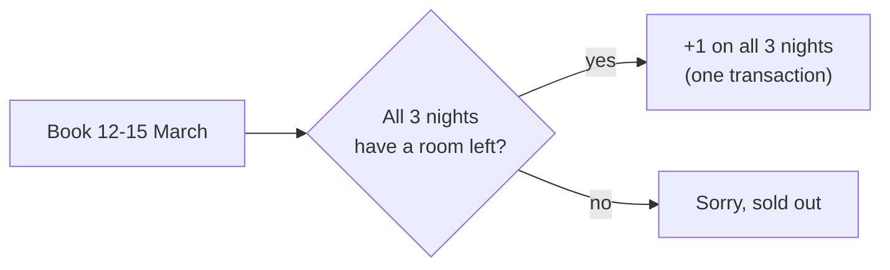

While you pay, the room is held for about 10 minutes. If you do not pay, the hold ends and the room is free again.

So the rest of this note is just these 3 questions:
1. How do two people booking at the same moment not get the same last room?
2. How do holds, payment and cancellations change the counts?
3. How does search stay fast when it gets 100 times more traffic than booking?

**The problem in one story.**
You want a Deluxe room in Goa for 12 to 15 March.
The hotel has 20 Deluxe rooms, and other people are booking the same dates right now.
The site must show you what is free, take your booking once, and never give away room 21.

**Words you need first**

| Word | Plain meaning | Tiny example |
| --- | --- | --- |
| Room type | A kind of room, not a specific room number | "Deluxe King" |
| Inventory | How many rooms of a type exist per night | 20 Deluxe on 12 March |
| Transaction | Several database changes that succeed or fail together | Update 3 nights or none |
| Row lock | Making others wait while you change a row | `SELECT ... FOR UPDATE` |
| Constraint | A rule the database refuses to break | `total_reserved <= limit` |
| Idempotency key | An ID that makes a retry do nothing new | Double click still makes one booking |
| Cache | Fast copy of data that may be slightly old | Search results from a minute ago |

| Hold (pending) | A short claim on a room while the guest pays | held for 10 minutes |
| Overbooking | Selling a few more rooms than exist, on purpose, because some guests cancel | 11 sold for 10 rooms |
| 409 Conflict | The HTTP reply meaning "this clashes with the current state" | "sorry, the room was just taken" |

**Picture it**

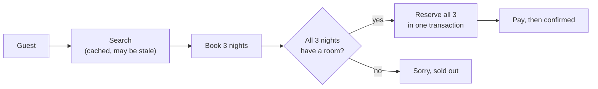

**Analogy.** A hotel keeps a paper calendar with "rooms left" written under each date, and a booking crosses off one room on every night of your stay at the same time.
Where it breaks: a paper calendar has one clerk, while the system has thousands of clerks writing at once and needs locks to stay correct.

**How the rest of this note builds up**

- First, requirements (section 1) and the mental model of counts per date (section 2).
- Then the high-level design and booking flow (section 3), plus estimates, API and data model (section 4).
- Then deep dives: no overselling, overbooking on purpose, holds and payment, search at scale, hot hotels, cancellations (section 5).
- Finally the SDE-3 view: variants, trade-offs, production, extras and interview questions (sections 6-11).

> [!tip] Remember
> Inventory is a count per room type per night; a booking changes every night of the stay together or not at all.

## 1. Why it exists - requirements 🟢

You run a small hotel with 10 Deluxe rooms. On Friday evening three guests try to book the last Deluxe room for the same weekend. If your code reads "1 room left" for all three and then saves, all three get a confirmation, and two people arrive at the front desk with nowhere to sleep. That is the overselling problem.

It is harder than a cinema seat because a booking spans **several nights**. A guest for 12 to 15 March needs the room on the nights of the 12th, 13th and 14th. If the 14th is full, the whole booking fails, and the earlier nights must not stay reduced.

### Real-life example: booking a Goa trip 🟢

You search a travel app like MakeMyTrip for a Goa hotel for 12 to 15 March. The list shows prices and "only 2 rooms left" in a fraction of a second.
You pick a Deluxe room; the app holds it while you pay by UPI.
If two people tap "Book" on the last Deluxe room at the same moment, one gets the room and the other sees "sold out, pick another".
If you cancel later, the room goes back on sale for all three nights at once.

**Functional requirements**
- Search hotels by destination, dates, guests; filter by price, rating, amenities; sort.
- View a hotel page with room types, photos, policies and live price.
- Book a room type for a date range, pay, receive a confirmation.
- Cancel within policy and refund; modify dates.
- Hotel staff (admin): add hotels and room types, set price and inventory per date, see reservations.

**Non-functional requirements**
- **No overselling beyond the intended overbooking limit.** The correctness property.
- Search p99 under 300 ms; slight staleness is fine because booking re-checks.
- High availability for search; booking may fail clearly rather than succeed wrongly.
- Reservation operations are **idempotent** (retries and double clicks are safe).
- Handle seasonal spikes (holidays, big events) and popular hotels with many simultaneous bookers.

**Out of scope:** payment provider internals (see [[Case Study - Payment System]]), pricing and revenue-management algorithms, channel managers and sync with hotel PMS systems (property management systems: the software the hotel front desk runs) (mention only as an extension).

> [!tip] Remember
> Two decisions matter most: inventory per room type per date, and atomic multi-night updates.

## 2. Mental model 🟢

Think of the hotel as a **wall calendar with one row per room type**. Each day cell shows "10 rooms, 6 sold".

To book a 3-night stay you put a tally mark in three cells at once; if any cell is already full you put none anywhere. A reservation is a **receipt** pinned to those cells.

If the guest does not pay within 10 minutes, the receipt falls off and the marks disappear.

Where the analogy breaks: with thousands of guests using the wall at once, two people may reach for the same cell at the same moment, so something has to make them take turns (a database lock) and the calendar has to survive a power cut (durability).

Terms:
- **Room type:** a category of identical rooms (Deluxe King, Standard Twin).
- **Inventory:** how many rooms of a type exist for a given date.
- **Reservation:** a claim on a room type for `[check_in, check_out)` (check-out day not included).
- **Overbooking:** selling more than inventory on purpose, within a limit.
- **Hold (pending):** a short-lived claim while the guest pays.

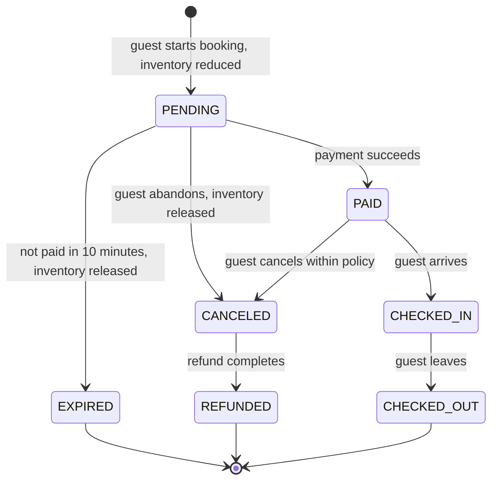

## Common beginner mistakes 🟢

- **Tracking each physical room in the booking path** → "any Deluxe free for 3 nights" becomes a slow search → keep a count per room type per night.
- **Updating each night in separate transactions** → night 1 and 2 are taken but night 3 fails, leaving a half booking → change all nights in one transaction.
- **Read the count, then write the count** → two guests both read 9 of 10 and both book the last room → use a conditional `UPDATE ... WHERE total_reserved + 1 <= limit`.
- **Calling the payment provider inside the database transaction** → rows stay locked for seconds → reserve, commit, then pay.
- **Checking availability only in the search cache** → the cache may be a minute old → re-check in the database at booking time.

## 3. How it works - high-level design 🟡

> 🟢 → 🟡 **You now know** the core idea: a count per room type per night, changed for every night together. **Next we open the box**: the inventory rows, the services around them, and one booking step by step.

### Inventory as a count per date

**Step by step:**
1. Hotel 77 has 10 Deluxe rooms. There is one row per night: 12 March (6 taken), 13 March (9 taken), 14 March (10 taken).
2. A guest wants 12 to 15 March, which means the nights of the 12th, 13th and 14th.
3. The system tries to add 1 to all three rows, each only if it stays at or below 10.
4. The 14th is already at 10, so that row is not changed. Only 2 of 3 rows changed.
5. Fewer rows than nights means "not available": the whole transaction rolls back and the guest sees "sold out".

**In plain words:** we do not store "room 101 is free". We store "Deluxe, 12 March: 10 rooms, 6 reserved". This is smaller (one row per type per date instead of one per room) and matches how guests book.

| hotel_id | room_type_id | date | total_inventory | total_reserved |
| --- | --- | --- | --- | --- |
| 77 | 3 | 2027-03-12 | 10 | 6 |
| 77 | 3 | 2027-03-13 | 10 | 9 |
| 77 | 3 | 2027-03-14 | 10 | 10 |

A booking for 12 to 15 March (nights 12, 13, 14) must increment `total_reserved` on all three rows. The 14th is full, so the booking fails and none are changed.

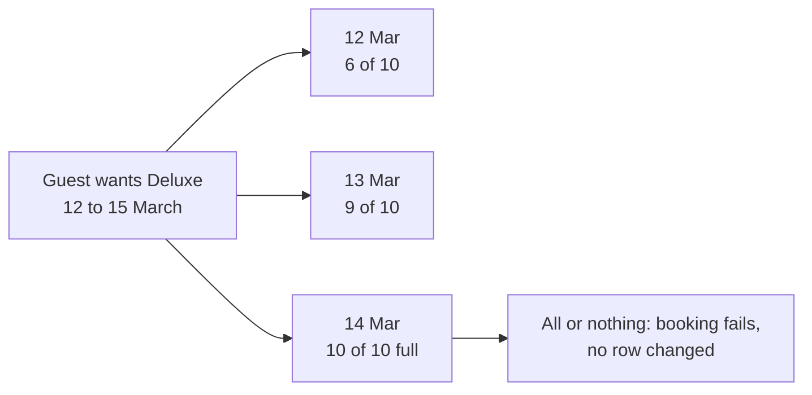

**Why it matters:** per-date rows make availability a range query and make atomic updates natural; per-room rows would make "any room of this type free for all 3 nights" an expensive search.

### High-level architecture

**In plain words:** search reads a fast copy of availability; booking goes to one main database that holds the real counts.

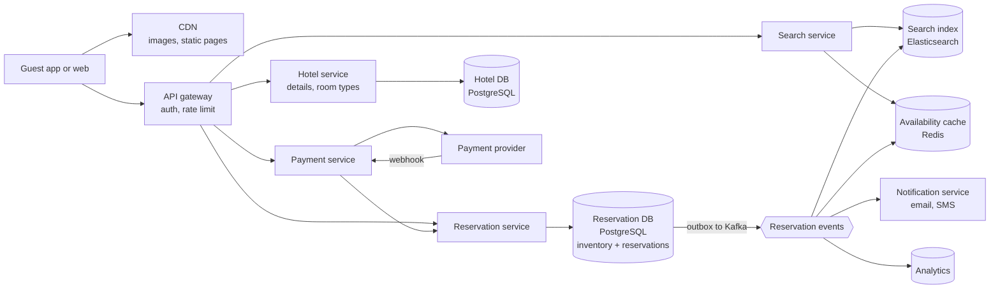

1. **Hotel service** holds mostly static data (hotels, room types, photos, policies). It is read-heavy, cacheable and rarely changes.
2. **Search service** answers "hotels in Goa, 12 to 15 March, 2 guests". It uses a search index for text, location and filters, and an availability cache so it does not hit the booking database for every result.
3. **Reservation service** owns the truth: the inventory table and reservations table, in one relational database so one transaction can update several rows.
4. **Payment service** creates a payment with the reservation ID as idempotency key and handles the webhook.
5. **Events** (outbox: a "to send" table written in the same transaction, [[Transactional Outbox and CDC]]) refresh caches and the search index and trigger notifications.

> [!tip] Remember
> Separate the two paths: search is big, read-heavy and may be stale; booking is small and exact.

### Booking flow, step by step

**Step by step (plain):**
1. The guest picks dates and room type. The server first hands out a reservation ID, say `R-501`.
2. The guest taps "Book". The server, in one transaction, adds 1 to each night and saves `R-501` as PENDING for 10 minutes.
3. The guest pays with `R-501` as the payment's idempotency key.
4. The payment provider calls back. The server flips `R-501` to PAID, only if it is still PENDING.
5. If the guest's tap is sent twice, the second `R-501` insert hits the primary key and returns the first result.

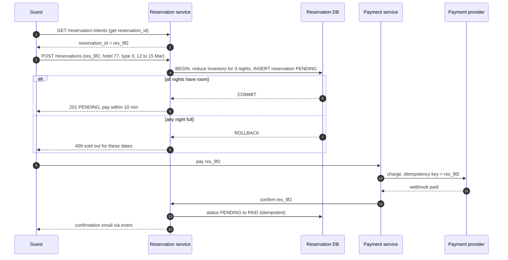

Why a separate step to obtain the `reservation_id` first? If the browser double-submits, or the network drops after the server processed the request, the client resends with the **same** ID, and the unique key on `reservation_id` makes the second insert fail harmlessly.

Without a pre-issued ID the server cannot tell a retry from a new attempt. See [[Idempotency and Idempotency Keys]].

## 4. Worked example - estimates, API and data model 🟡

### Whiteboard version

- Scale: 5 M rooms across 500,000 hotels worldwide (estimate), 1 M bookings per day, search about 100x bookings.
- Booking load is small: about 12 bookings/s average, about 120/s at peak (10x average). One PostgreSQL primary can handle it; search is the scaling problem.
- Core design: per-date inventory rows, atomic multi-row update, pre-issued reservation ID, overbooking limit, search on cache plus index.
- Hardest parts: concurrency on hot hotel-dates, hold expiry, keeping search consistent enough, cancellations.

### Estimates (labelled as estimates)

**In plain words:** rough sums: bookings per second, searches per second, and how many inventory rows exist.

| Quantity | Assumption | Result |
| --- | --- | --- |
| Bookings per day | given | 1 M |
| Booking QPS average | 1 M / 86,400 s | about 12 |
| Booking QPS peak | 10x average | about 120 |
| Search to booking ratio | 100 searches per booking | 100 M searches/day |
| Search QPS average | 100 M / 86,400 | about 1,200 |
| Search QPS peak | 10x | about 12,000 |
| Inventory rows | 500,000 hotels x 5 room types x 365 days x 2 years | about 1.8 billion rows |
| Row size | about 40 bytes | about 70 GB |
| Reservation rows | 1 M/day x 365 x 3 years x 200 bytes | about 220 GB |

Takeaways: the booking write path is modest; inventory is large but tiny per row and partitions neatly by `hotel_id`; search needs most of the capacity.

### API

**In plain words:** search for rooms, place a hold, confirm with payment, and cancel.

| Call | Purpose |
| --- | --- |
| `GET /v1/hotels?city=&checkin=&checkout=&guests=&page=` | search results (cache and index) |
| `GET /v1/hotels/{id}` | hotel details and room types |
| `GET /v1/hotels/{id}/availability?checkin=&checkout=` | live availability and price |
| `POST /v1/reservation-intents` | returns a `reservation_id` to use as idempotency key |
| `POST /v1/reservations` | create the PENDING reservation (body includes `reservation_id`) |
| `POST /v1/reservations/{id}/cancel` | cancel and trigger refund |
| `GET /v1/reservations/{id}` | status |
| `PUT /v1/admin/hotels/{id}/inventory` | hotel updates inventory or price for dates |

Cursor pagination for search results ([[Pagination, Filtering and Sorting]]).

### Data model

**In plain words:** tables for hotels, room types, the per-night inventory counts, and reservations.

```sql
CREATE TABLE room_type_inventory (
  hotel_id        BIGINT NOT NULL,
  room_type_id    BIGINT NOT NULL,
  date            DATE   NOT NULL,
  total_inventory INT    NOT NULL,   -- rooms that exist
  total_reserved  INT    NOT NULL DEFAULT 0,
  PRIMARY KEY (hotel_id, room_type_id, date),
  CHECK (total_reserved >= 0),
  CHECK (total_reserved <= total_inventory * 1.10)   -- 10 percent overbooking limit
);

CREATE TABLE reservation (
  reservation_id  UUID PRIMARY KEY,                  -- also the idempotency key
  hotel_id        BIGINT NOT NULL,
  room_type_id    BIGINT NOT NULL,
  guest_id        BIGINT NOT NULL,
  check_in        DATE NOT NULL,
  check_out       DATE NOT NULL,
  status          TEXT NOT NULL,                     -- PENDING, PAID, CANCELED, ...
  expires_at      TIMESTAMPTZ,                       -- for PENDING holds
  created_at      TIMESTAMPTZ NOT NULL DEFAULT now()
);
```

Two guards are visible: the `reservation_id` primary key stops a duplicate insert, and the `CHECK` constraint on `total_reserved` is the last line of defence against overselling even if application code has a bug.

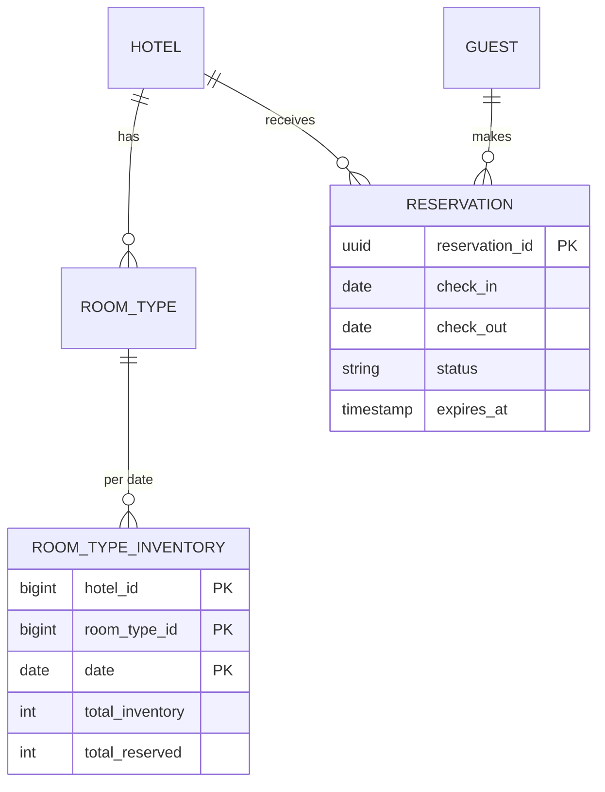

## 5. Deep dives 🔴

> 🟡 → 🔴 **You now know** the per-night rows, the services, the booking flow, the API and the tables. **Next is the advanced part**: the exact safe update and deadlocks, overbooking on purpose, holds and late payments, search at 100x the load, hot hotels and cancellations.

### Deep dive 1: booking without overselling

**In plain words:** the bug to avoid is "read the count, then write the count". Two bookers both read 9 of 10 and both write 10 (or both write 10 when the correct total is 11).

**Example.** Three guests, last room for the 14th. Guest A and B both read `total_reserved = 9`. Each computes 10 and writes. Count shows 10, but two rooms were sold from the last one.

There are four ways to make the check-and-write safe. Each has a place.

| Approach | How | Use when | Cost |
| --- | --- | --- | --- |
| Conditional update | `UPDATE ... SET total_reserved = total_reserved + 1 WHERE ... AND total_reserved + 1 <= limit`, check row count | Default; simple and fast | Hot rows serialise on the row lock |
| Pessimistic lock | `SELECT ... FOR UPDATE` on the date rows, decide in code, update | Decision needs application logic (pricing rules) | Holds locks across round trips; deadlocks if date order differs |
| Optimistic version | Add a `version` column; update `WHERE version = :read`; retry on 0 rows | Low contention | Retry storms on popular dates |
| DB constraint | `CHECK (total_reserved <= limit)` | Always, as a safety net | Failure surfaces as an error to handle |

**The default, step by step:**
1. Open a transaction.
2. Update all nights in one statement, in date order:

```sql
UPDATE room_type_inventory
SET total_reserved = total_reserved + 1
WHERE hotel_id = 77 AND room_type_id = 3
  AND date >= '2027-03-12' AND date < '2027-03-15'
  AND total_reserved + 1 <= total_inventory * 1.10;
```

3. Check the row count: it must equal the number of nights (3). If it is smaller, at least one night was full, so **roll back** and return 409.
4. Insert the reservation as PENDING with `expires_at = now() + 10 minutes`.
5. Commit.

Under PostgreSQL's READ COMMITTED level (the default: each statement sees data committed before it started), a conflicting update waits for the first transaction's row lock, then re-checks the `WHERE` clause against the new row version, so only the rows that still pass are updated ([[Isolation Levels and MVCC]]). That re-check is what makes a single conditional statement safe where "SELECT then UPDATE" is not.

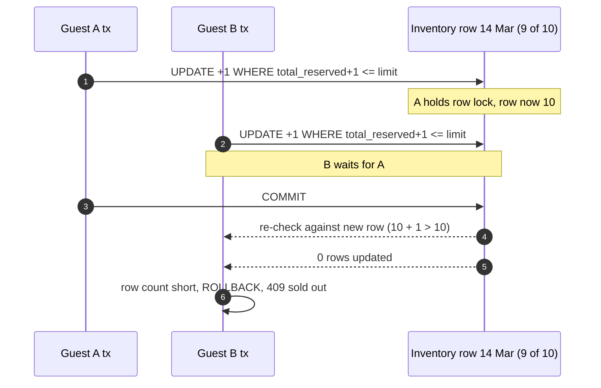

**What if one night passes and another fails?** The multi-row update covers all nights in one statement, but PostgreSQL still counts rows. Fewer than 3 rows means at least one failed, so the transaction rolls back and no night stays reduced.

**What about deadlocks?** Two transactions updating overlapping date ranges in different orders can deadlock. A single multi-row `UPDATE` does not guarantee the order in which rows are locked, so for safety first lock the rows in a fixed order with `SELECT ... WHERE ...

ORDER BY date FOR UPDATE`, then run the conditional update. Also retry on SQLSTATE (the database's five-character error code) 40P01 (deadlock detected) with backoff ([[Timeouts, Retries and Backoff]]).

### Deep dive 2: overbooking on purpose

**In plain words:** some guests cancel or never show up. Hotels sell slightly more rooms than exist, the way airlines sell more seats than the plane has. If everyone does arrive, the hotel "walks" a guest to a nearby hotel at its own cost.

- The limit is a **business parameter**, per hotel and sometimes per date. 110% above is an illustrative value, not a recommendation.
- Store it as `overbooking_factor` per hotel, enforce it in the update condition and the `CHECK` constraint.
- Report `total_reserved / total_inventory` per date to the hotel so staff can manage walk-ins and relocations.
- The right limit comes from historical no-show and cancellation rates; start low, raise by data.

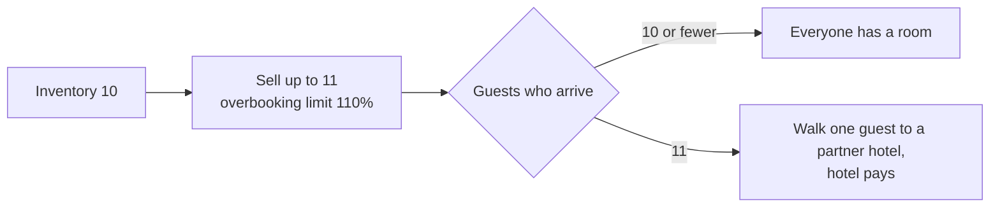

> [!warning] Common mistake
> Letting the app code enforce overbooking only. A bug, a second service, or a manual script can bypass it. The database `CHECK` constraint makes the limit non-bypassable.

### Deep dive 3: holds, payment and expiry

**In plain words:** between "reserve" and "paid" the guest needs time (3 to 10 minutes). The inventory is taken during that time, so unpaid reservations must release it.

Two designs:

| Design | How it works | Trade-off |
| --- | --- | --- |
| Reduce inventory at hold time (as above) | PENDING reservation holds inventory until paid or expired | Simple and safe; abandoned holds block rooms until they expire |
| Reduce inventory only at payment time | Check availability first, take inventory only after payment success | No blocked rooms; but guest can pay and then find the room gone and need a refund |

Most systems take inventory at hold time with a short expiry. Expiry steps:
1. A background job (or delayed message) finds `status = 'PENDING' AND expires_at < now()`.
2. In one transaction it sets the status to EXPIRED and decrements `total_reserved` for each night.
3. A late payment after expiry is detected on confirmation (status is not PENDING) and refunded automatically.

Confirmation must be **idempotent**: `UPDATE reservation SET status='PAID' WHERE reservation_id=? AND status='PENDING'`; if 0 rows, read the current status and return it. This makes webhook retries harmless.

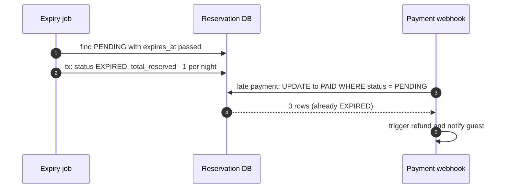

Link this as a saga: reserve, pay, confirm or compensate ([[Saga Pattern]]).

### Deep dive 4: search and availability at scale

**In plain words:** search must feel instant and handles 100x the load of booking, so it cannot query the booking database for each result.

Steps for a search:
1. Query the **search index** for hotels matching the city (or map area, see [[Geospatial Indexing]]), filters and ranking.
2. For the candidate hotels (say 200), look up availability for the requested dates in a **cache** (Redis), keyed by `hotel_id:room_type:date`, holding remaining rooms.
3. Remove sold-out hotels, attach live prices, return the page.

The cache is updated by reservation events and expires after about a minute; it can be stale, so the **booking step re-checks** against the database and returns 409 if the room is gone. A guest occasionally sees "just sold" after clicking; that is acceptable.

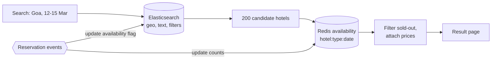

For a quick "is any room free all 3 nights" check, store per hotel-date remaining counts and compute the minimum across the date range.

Partition the reservation database by `hotel_id` ([[Partitioning and Sharding]]): all rows for one hotel are on one shard, so a multi-night update is a single-shard transaction. Never shard by date, because one booking would then touch several shards and need a distributed transaction.

### Deep dive 5: hot hotels and big events

**In plain words:** during a big event, many people try to book the same room type on the same night, so they all fight over one row.

During a festival or sports final, one hotel's popular room type gets thousands of simultaneous attempts on the same few rows.

- **Short transactions:** only the conditional update and the insert; no payment call inside.
- **Queue in front:** a per-hotel queue or a virtual waiting room admits a controlled rate, like in [[Case Study - Ticket Booking]].
- **Rate limits** per user and IP ([[Rate Limiting - Algorithms and Distributed Design]]) so bots cannot hoard.
- **Split a hot counter** is rarely needed here: a hotel has tens of rooms, not millions of tickets.
- **Read replicas** serve search and "my bookings"; the primary only serves booking writes.

### Deep dive 6: cancellations, modifications and refunds

**In plain words:** cancel means giving back one room on every night of the stay, in one step, then refunding.

- **Cancel:** in one transaction set status CANCELED and decrement `total_reserved` for every night; then start the refund via payment service and an outbox event.
- **Modify dates:** treat as release-old plus reserve-new in one transaction; if the new dates are not available, nothing changes.
- **Cancellation policy** (free until 48 hours before check-in, then a fee) lives in the hotel service and is evaluated at cancel time; store the policy that was shown at booking time on the reservation row so later policy changes do not alter past bookings.

## 6. Variants and comparison 🟡

| Model | Unit that is booked | Strength | Weakness | Typical use |
| --- | --- | --- | --- | --- |
| Room type per date count (this design) | Number of rooms of a type | Simple, fast, atomic update | Does not track which physical room | Chains, OTAs (online travel agencies such as Booking.com) |
| Individual room per date | One specific room | Exact room choice, simple conflicts | Many more rows; search across rooms | Small hotels, vacation rentals (one unit per listing) |
| Date range with exclusion constraint | One unit, a `daterange` | Database prevents overlap by itself | One unit only | Single-unit listings, meeting rooms |
| Hold in cache (Redis TTL) then DB | Count in Redis first | Very high throughput | Two sources of truth | Extreme spikes only |
| Seat-like model (ticket booking) | One seat per event | One row per seat | Different shape (single instant, not a range of nights) | [[Case Study - Ticket Booking]] |

For a vacation rental where each listing is one unit, a PostgreSQL range type with an exclusion constraint (a rule that no two rows may overlap) (`EXCLUDE USING gist (listing_id WITH =, stay WITH &&)`) lets the database refuse overlapping stays directly (the `=` on a bigint column needs the `btree_gist` extension: `CREATE EXTENSION btree_gist;`).

### Things people confuse this with 🟡

| System | What is booked | How it differs from hotel booking |
| --- | --- | --- |
| [[Case Study - Ticket Booking]] | One specific seat for one show | One item, one moment; no multi-night range |
| [[Case Study - Flash Sale and E-commerce Checkout]] | Any unit of one product | One extremely hot counter and a huge crowd at one second |
| Airline booking | Seats on a flight leg | Similar counts and overbooking, but trips can span several flights from different airlines |

## 7. Trade-offs and when not to use 🟡

- **Strong consistency for booking, eventual for search.** Choose this split deliberately ([[Choosing Consistency, Replication and Partitioning - Decision Guide]]); do not make search strongly consistent, it would cost heavily for no benefit.
- **One relational database for inventory.** Multi-row atomic updates are the reason; picking a store without multi-row transactions would force you to build them ([[Choosing a Database - Decision Guide]]).
- **Hold at reserve time versus at payment time.** Hold-first blocks rooms briefly; pay-first causes refunds. Hold-first is the common choice for hotels because the sale value is high.
- **Overbooking** increases revenue but creates a risk of walking guests; keep it configurable and monitored.
- **Cache staleness:** accept occasional "sold out after click" in exchange for fast search ([[Choosing a Caching Strategy - Decision Guide]]).
- **Not needed:** for a single small hotel with a few bookings per day, a single database with a unique constraint and simple locking is enough; skip caches and queues.

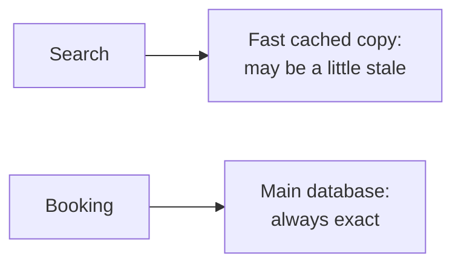

## 8. In production 🔴

- **Failure modes and fixes**
  - Duplicate booking from a double click or retry: pre-issued `reservation_id` as primary key; the second insert fails and returns the first result.
  - Payment succeeds after expiry: confirmation fails the status check; refund automatically and notify.
  - Payment outcome unknown (provider timeout): keep PENDING, query the provider or wait for the webhook, run a reconciliation job.
  - Inventory drift (counts disagree with reservations): nightly job recomputes `total_reserved` from PENDING and PAID reservations and alerts on differences.
  - Cache out of sync with the database: short TTL plus event updates; the booking step is the truth.
  - Deadlocks on overlapping date ranges: lock rows in ascending date order (`ORDER BY date FOR UPDATE`), retry with backoff.
- **What to monitor:** booking success and 409 rate per hotel, hold-to-paid conversion, expired holds, refund count from late payments, lock wait time and deadlocks, search latency p99, cache hit ratio, drift between cache and database, overbooking ratio per hotel-date.
- **Security and fraud:** rate limit searches and bookings, bot protection on popular dates ([[API Abuse and Bot Protection]]), signed webhooks from the payment provider, and PII (personally identifiable information: names, phones, ID numbers) protection for guest data.

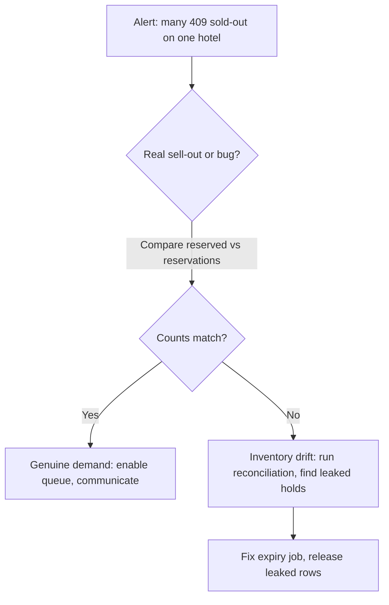

## 9. Deep dive extras 🔴

**Per-room assignment.** At check-in (or a few days before), the hotel assigns a physical room to each reservation. This is a small separate problem (a matching of reservations to free rooms), solved by the hotel's property system and not part of the high-volume path.

**Dynamic pricing.** Price may differ per date and change with demand. Store a `price` per `(hotel, room_type, date)` and show it in the intent; freeze the price on the reservation row so a later change does not alter the amount charged.

**Multi-region.** Keep each hotel's inventory in one home region (the region where it is located); other regions send booking writes there. Search can be served from regional replicas. This keeps the "one writer per hotel" rule that makes atomic updates simple ([[Multi-Region Architecture]]).

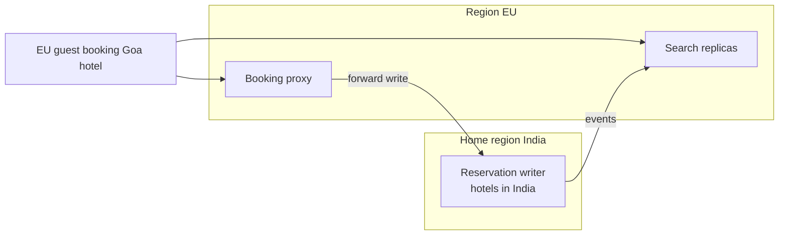

## 10. Interview questions 🔴

> [!question]- Why store inventory per room type per date instead of per room?
> Guests book a type, not a specific room, so a count per type per date is small and updates atomically. A stay of N nights updates N rows. Per-room rows make "is any room of this type free for all nights" a costly search.

> [!question]- How do you stop two guests booking the last room?
> One conditional update over all nights (`SET total_reserved = total_reserved + 1 WHERE total_reserved + 1 <= limit`), check that the row count equals the number of nights, otherwise roll back. A `CHECK` constraint stops bugs from bypassing it.

> [!question]- Trap: "I read availability, then update inside a transaction, so overselling is impossible." Right?
> No. At READ COMMITTED both transactions can read the same count before either writes. Use a conditional update with a row count check, `SELECT FOR UPDATE`, an optimistic version column or SERIALIZABLE with retries.

> [!question]- How do you support overbooking safely?
> Make the limit a configured factor per hotel, enforce it in the update condition and in a `CHECK` constraint, and report the ratio per date so staff can handle walk-ins. Choose the factor from historical cancellation and no-show data.

> [!question]- A guest double-clicks Pay. What prevents two reservations?
> The reservation ID is created first and used as the primary key and as the payment idempotency key. The second request hits the unique key and returns the first result, and the payment provider returns the same payment for the same key.

> [!question]- The payment succeeds after the 10-minute hold expired. What happens?
> Confirmation updates only `WHERE status = 'PENDING'`, finds 0 rows, so no booking is created; the system refunds the payment and tells the guest. A hold is never extended silently after the room may have been resold.

> [!question]- How do you keep search fast and correct enough?
> Search uses an index for location and filters plus an event-fed availability cache; it can be a minute stale. The booking step re-checks the database, so a stale search only causes an occasional "just sold out" message.

> [!question]- How would you shard this?
> By `hotel_id`. All inventory and reservations for one hotel live on one shard, so a multi-night booking is a single-shard transaction. Sharding by date would turn every stay into a distributed transaction.

## Self-check 🟢🟡

> [!question]- Easy: what does one inventory row describe?
> One room type at one hotel on one night: how many exist and how many are reserved.

> [!question]- Easy: a stay from 12 to 15 March uses which nights?
> The 12th, 13th and 14th; the check-out day is not included.

> [!question]- Easy: why hand out the reservation ID before the guest taps "Book"?
> So a retry or double click sends the same ID and cannot create a second booking.

> [!question]- Medium: the conditional update for 3 nights changes only 2 rows. What do you do?
> Roll back the whole transaction and return 409, because one night is full.

> [!question]- Medium: why may search show a room that turns out to be gone?
> Search reads a cache that can be about a minute old; the booking step re-checks the database.

> [!question]- Medium: how does a 10% overbooking limit stay safe from buggy code?
> It is enforced in the update condition and in a database `CHECK` constraint that nothing can bypass.

## 11. Cheat sheet 🟢

A 45-minute script:

- **0 to 5 min, requirements:** search, book a room type for a date range, pay, cancel, admin inventory. Invariant: no overselling beyond the overbooking limit.
- **5 to 10 min, estimates:** 1 M bookings/day (12/s, 120/s peak), search 100x (12,000/s peak), inventory about 1.8 B small rows.
- **10 to 15 min, API and data:** `reservation-intents`, `POST /reservations`; `room_type_inventory (hotel, type, date)` with a CHECK constraint; `reservation` with `reservation_id` primary key.
- **15 to 25 min, diagram:** gateway, hotel service, search (index and availability cache), reservation service with PostgreSQL, payment service, outbox events to cache, index and notifications.
- **25 to 40 min, deep dives:** atomic multi-night conditional update and why READ COMMITTED re-check helps; overbooking factor with CHECK; hold, expiry and late payment refund; search plus cache staleness; shard by hotel.
- **40 to 45 min, wrap-up:** monitor conversions, drift, deadlocks, overbooking ratio; multi-region home region per hotel; compare with [[Case Study - Ticket Booking]].

## Links

- **Before this:** [[Transactions and ACID]], [[Locking - Optimistic vs Pessimistic]], [[Isolation Levels and MVCC]], [[Idempotency and Idempotency Keys]]
- **Next:** [[Case Study - Payment System]], [[Case Study - Ticket Booking]]
- **Decision guides:** [[Choosing a Database - Decision Guide]], [[Choosing a Caching Strategy - Decision Guide]], [[Choosing Consistency, Replication and Partitioning - Decision Guide]], [[Choosing Storage for Files, Search and Analytics - Decision Guide]]
- **Patterns used:** [[Saga Pattern]], [[Transactional Outbox and CDC]], [[Partitioning and Sharding]], [[Geospatial Indexing]], [[Search Engines and Inverted Indexes]], [[Rate Limiting - Algorithms and Distributed Design]], [[Timeouts, Retries and Backoff]], [[Multi-Region Architecture]]
- **Class-level twin:** [[Hotel Booking]]
- **Method:** [[HLD Round - Complete Step-by-Step Guide]]

### Watch on YouTube

- [Hotel Reservation: System Design Interview (Stripe & Amazon Offers)](https://www.youtube.com/watch?v=m67Mjbx6DMY) · TechPrep · 13 min · 99,688 views
- [Design a Hotel Reservation System like Expedia & Kayak / System Design](https://www.youtube.com/watch?v=gGzXvlmbtSI) · Irtiza Hafiz · 31 min · 31,637 views
