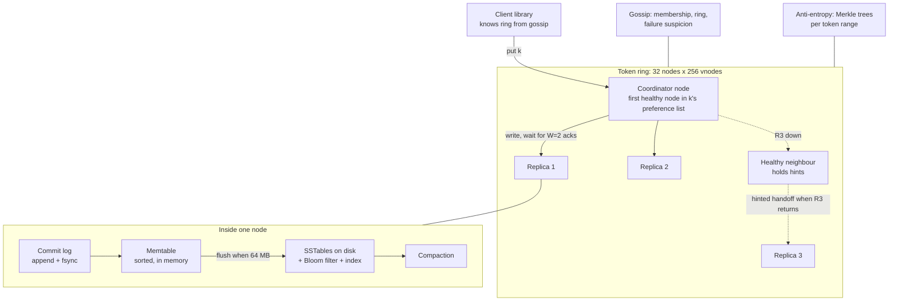
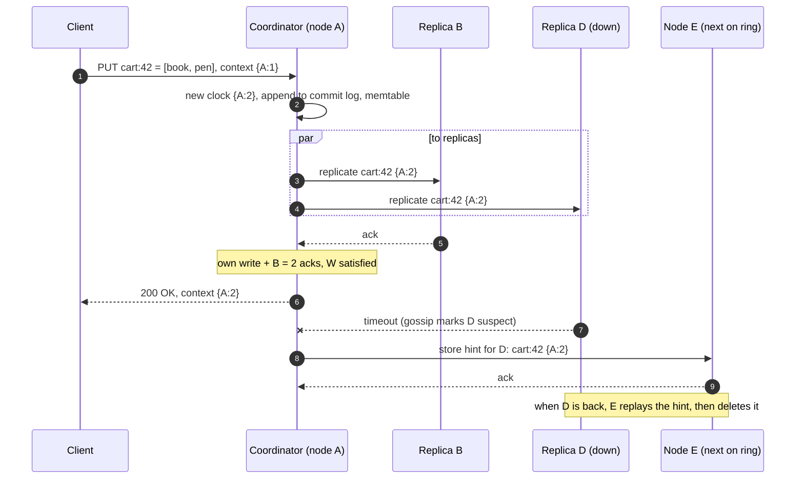
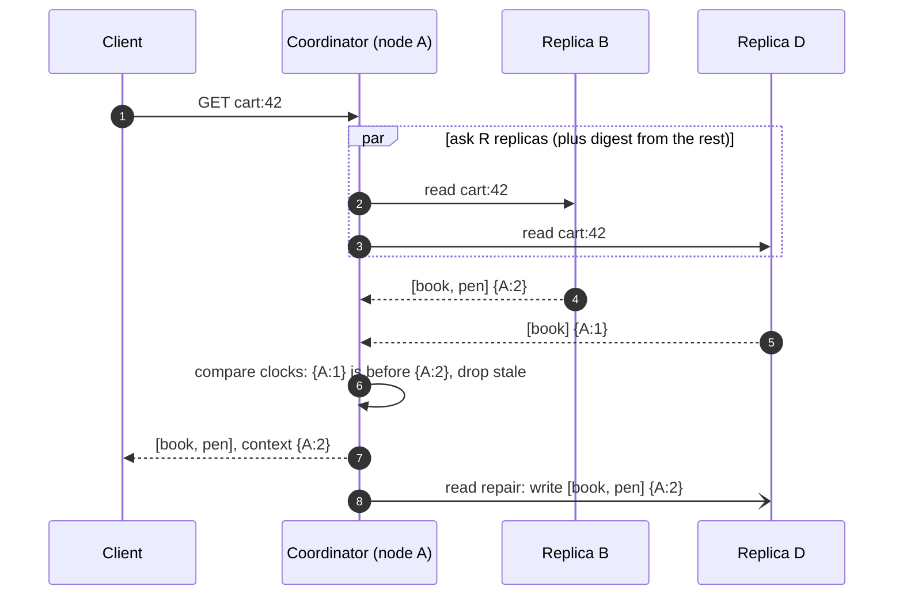

# Case Study - Key-Value Store

> [!summary] TL;DR
> Design a distributed key-value store: `put(key, value)` and `get(key)` over billions of keys on dozens of machines, which stays available when machines fail. This case study assembles known building blocks (consistent hashing, replication, quorums, an LSM storage engine, gossip) and spends its time on the decisions between them: which consistency you give up, how conflicts are resolved and how the cluster heals.

> [!abstract] Core idea
> - Partition keys over nodes with consistent hashing and virtual nodes; replicate each key to N nodes (usually 3).
> - A coordinator writes to all N replicas and waits for W acknowledgements; reads ask R replicas. `W + R > N` makes reads see the latest acknowledged write when no failures intervene.
> - The leaderless (Dynamo) design keeps accepting writes during failures and resolves conflicts later with vector clocks or last-write-wins. The leader-based design (Raft per partition) gives linearizable keys but pauses a partition during leader elections.
> - Healing happens in three layers: hinted handoff, read repair and Merkle-tree anti-entropy.
> - Each node stores data in an LSM tree: commit log, memtable, SSTables, compaction, Bloom filters.

## 1. Why it exists - requirements

A single Redis or PostgreSQL instance holds a few hundred GB and fails as a unit. A shopping cart, session store or user-profile cache that must take 100k operations per second, hold 10 TB and **never reject a write because one machine died** needs the data spread and copied across many machines.

**Functional requirements**
- `put(key, value)`, `get(key)`, `delete(key)`. Keys up to 256 B, values up to 100 KB (assumed limits).
- Optional per-key TTL.
- Tunable consistency per request (fast and possibly stale, or quorum).

**Non-functional requirements**
- **Scale:** 10 billion keys, average value 1 KB (interview assumptions).
- **Throughput:** 100k reads/s and 50k writes/s, growing 2x per year.
- **Latency:** p99 under 10 ms inside one region (a target).
- **Availability:** writes keep succeeding when any one node, or one availability zone, is down.
- **Durability:** an acknowledged write survives the loss of any single node.
- **Elasticity:** add nodes without downtime; data moves automatically.

**Out of scope**: secondary indexes, range scans across keys, multi-key transactions, cross-region replication (mentioned at the end).

## 2. Mental model

Picture a **library spread over many branch buildings**. Every book (key) has a catalogue number that says which three branches keep a copy (replication by consistent hashing). To lend a book you only need two of the three branches to agree (quorum). If one branch is closed, a neighbouring branch keeps a note "return this to branch C when it reopens" (hinted handoff). Every night, branches compare checklists to find copies that drifted apart (anti-entropy).

The core decision is the **CAP and PACELC choice** ([[CAP and PACELC]]): during a network partition, keep accepting writes on both sides and reconcile later (AP, Dynamo, Cassandra, Riak), or refuse writes on the minority side to keep one true value (CP, etcd, DynamoDB's per-partition Paxos, TiKV). Even without a partition, quorum size trades latency for consistency.

## 3. How it works - high-level design



**Placement.** Keys and nodes are hashed onto a ring ([[Consistent Hashing]]). The key's **preference list** is the next N distinct physical nodes clockwise, chosen from different racks or availability zones. Virtual nodes spread each node's load and its recovery traffic across the cluster.

**Write path (N=3, W=2) with one replica down.**



**Read path (R=2) with read repair.**



## 4. Worked example - estimates, API and data model

### Whiteboard version

```text
Data:     10B keys × (1 KB value + ~100 B key and metadata) ≈ 11 TB
RF=3:     ≈ 33 TB  -> + 50% headroom for compaction ≈ 50 TB
Node:     4 TB NVMe, keep ≤ 2 TB used  -> ~25 nodes; round to 32
Traffic:  100k reads/s + 50k writes/s  -> per node ≈ 6.3k replica reads, 4.7k replica writes
Quorum:   N=3, W=2, R=2  (W+R > N)

PUT /v1/kv/{key}  body + X-Context: <opaque clock>
GET /v1/kv/{key}  -> value(s) + X-Context

[client] -> [coordinator] -> [N=3 replicas on ring]
[each node: commit log -> memtable -> SSTables]
[gossip] [hinted handoff] [read repair] [Merkle anti-entropy]
```

### Estimates (inputs are assumptions; results are estimates)

| Quantity | Arithmetic | Result |
| --- | --- | --- |
| Raw data | 10 × 10^9 keys × 1.1 KB | ≈ 11 TB |
| Replicated | 11 TB × 3 | ≈ 33 TB |
| With compaction headroom | 33 TB × 1.5 (size-tiered compaction can temporarily need extra space) | ≈ 50 TB |
| Nodes by disk | 50 TB / 2 TB used per node | 25 nodes, round to 32 for even vnode spread and growth |
| Reads per node | 100,000 reads/s × R=2 / 32 nodes | ≈ 6,250 replica reads/s per node |
| Writes per node | 50,000 writes/s × N=3 / 32 nodes | ≈ 4,700 replica writes/s per node |
| Commit log bandwidth per node | 4,700/s × 1.1 KB | ≈ 5.2 MB/s, easy for NVMe |
| Re-replication after a node loss | 33 TB / 32 ≈ 1 TB on the lost node, re-copied by 31 peers | ≈ 33 GB per peer; at 50 MB/s throttled streaming per peer ≈ 11 minutes |

**What the numbers decide.** Disk, not CPU, sets the node count. Write rate per node is low enough for an LSM engine without special tuning. The re-replication estimate is why virtual nodes matter: without them, the whole 1 TB would be streamed into one replacement node from the few ring neighbours that share its ranges, so the replacement's own intake becomes the bottleneck: at the same 50 MB/s that is about 5.6 hours (1,000,000 MB / 50 MB/s = 20,000 s), during which those ranges run with one fewer replica.

### API

```http
GET /v1/kv/cart:42?consistency=quorum

HTTP/1.1 200 OK
X-Context: eyJBIjoyfQ
Content-Type: application/json

{"values": [{"value": "[book, pen]"}]}
```

```http
PUT /v1/kv/cart:42
X-Context: eyJBIjoyfQ
Content-Type: application/octet-stream

[book, pen, cup]
```

- `X-Context` is an opaque, encoded vector clock. The client returns the context of the version it read, which tells the store which versions this write supersedes.
- When the read finds **concurrent** versions, `values` holds all siblings; the client merges them and writes back with the combined context.
- `consistency` can be `one`, `quorum` or `all` per request. `DELETE` writes a **tombstone** (a marker with a clock), never a physical delete, so replicas that missed the delete cannot resurrect the value.

### Key schema (one record on disk)

| Field | Size | Purpose |
| --- | --- | --- |
| `key` | up to 256 B | Partition key; its hash picks the ring position |
| `clock` | ~10-50 B | Vector clock `{node: counter}` (or a single timestamp under last-write-wins) |
| `tombstone` | 1 B | Marks a delete; purged after a grace period (Cassandra's `gc_grace_seconds` defaults to 10 days) |
| `expires_at` | 8 B | Optional TTL |
| `value` | up to 100 KB | Opaque bytes |

### Code: vector clocks and sibling reconciliation

The coordinator and the client both need one operation: given several versions, drop those that another version dominates and return the rest. The test replays the classic shopping-cart case from the Dynamo paper.

```go
// Package kv shows how a Dynamo-style store decides which versions of a key
// are stale and which are concurrent siblings that the client must merge.
package kv

// VClock maps a replica (node) ID to the number of writes it coordinated.
type VClock map[string]uint64

// Order is the causal relation between two clocks.
type Order int

const (
	Equal      Order = iota
	Before           // a happened before b: a is stale
	After            // a happened after b: b is stale
	Concurrent       // neither saw the other: keep both as siblings
)

// Compare returns how a relates to b.
func Compare(a, b VClock) Order {
	aBigger, bBigger := false, false
	for node, av := range a {
		if bv := b[node]; av > bv {
			aBigger = true
		} else if av < bv {
			bBigger = true
		}
	}
	for node, bv := range b {
		if _, ok := a[node]; !ok && bv > 0 {
			bBigger = true
		}
	}
	switch {
	case aBigger && bBigger:
		return Concurrent
	case aBigger:
		return After
	case bBigger:
		return Before
	default:
		return Equal
	}
}

// Merge returns the element-wise maximum, used after a client resolves siblings.
func Merge(a, b VClock) VClock {
	out := VClock{}
	for n, v := range a {
		out[n] = v
	}
	for n, v := range b {
		if v > out[n] {
			out[n] = v
		}
	}
	return out
}

// Version is one stored value with its clock.
type Version struct {
	Value string
	Clock VClock
}

// Reconcile drops every version that another version dominates and returns the
// survivors. One survivor means the read is clean; more than one are siblings.
func Reconcile(vs []Version) []Version {
	var out []Version
	for i, v := range vs {
		dominated := false
		for j, w := range vs {
			if i == j {
				continue
			}
			o := Compare(v.Clock, w.Clock)
			if o == Before || (o == Equal && j < i) { // drop stale and exact duplicates
				dominated = true
				break
			}
		}
		if !dominated {
			out = append(out, v)
		}
	}
	return out
}

// QuorumOverlaps reports whether every read quorum must meet every write quorum.
func QuorumOverlaps(n, w, r int) bool { return w+r > n }
```

```go
package kv

import "testing"

func TestCompare(t *testing.T) {
	cases := []struct {
		a, b VClock
		want Order
	}{
		{VClock{"A": 1}, VClock{"A": 1}, Equal},
		{VClock{"A": 1}, VClock{"A": 2}, Before},
		{VClock{"A": 2, "B": 1}, VClock{"A": 1}, After},
		{VClock{"A": 2}, VClock{"A": 1, "B": 1}, Concurrent},
		{VClock{}, VClock{"C": 1}, Before},
	}
	for i, c := range cases {
		if got := Compare(c.a, c.b); got != c.want {
			t.Fatalf("case %d: got %v want %v", i, got, c.want)
		}
	}
}

// The cart example: two clients write through different coordinators after
// both read version {A:1}.
func TestReconcileKeepsSiblingsAndDropsStale(t *testing.T) {
	base := Version{"[book]", VClock{"A": 1}}
	viaB := Version{"[book, pen]", VClock{"A": 1, "B": 1}}
	viaC := Version{"[book, cup]", VClock{"A": 1, "C": 1}}
	got := Reconcile([]Version{base, viaB, viaC, viaB})
	if len(got) != 2 {
		t.Fatalf("want 2 siblings, got %v", got)
	}
	// Client merges the siblings and writes back via A.
	m := Merge(viaB.Clock, viaC.Clock)
	m["A"]++
	merged := Version{"[book, pen, cup]", m}
	got = Reconcile([]Version{viaB, merged, viaC})
	if len(got) != 1 || got[0].Value != "[book, pen, cup]" {
		t.Fatalf("merged write should dominate, got %v", got)
	}
}

func TestQuorumOverlaps(t *testing.T) {
	if !QuorumOverlaps(3, 2, 2) || QuorumOverlaps(3, 1, 1) || !QuorumOverlaps(3, 3, 1) {
		t.Fatal("quorum rule wrong")
	}
}
```

`go vet` and `go test -race` pass on Go 1.24.4 in a scratch module.

### One request traced

1. Alice's phone and laptop both read `cart:42 = [book]` with context `{A:1}`.
2. The phone adds a pen; its write lands on coordinator B (A is slow), giving `{A:1, B:1}`. The laptop adds a cup through coordinator C, giving `{A:1, C:1}`. Each write gets W=2 acks.
3. Alice opens the cart. The coordinator reads R=2 replicas and gets both versions. `Compare` says **Concurrent**, so the response carries two siblings.
4. The client merges them (set union: `[book, pen, cup]`) and writes back with the merged context `{A:1, B:1, C:1}`; coordinator A bumps it to `{A:2, B:1, C:1}`, which dominates both siblings. Later reads return one value.
5. With last-write-wins instead, the later timestamp would win and either the pen or the cup would silently disappear. That is the whole argument for vector clocks in a cart.

## 5. Variants and comparison

| Design | How it works | Use when | Cost |
| --- | --- | --- | --- |
| Leaderless, vector clocks (Dynamo paper, Riak) | Any replica accepts writes; siblings returned to the client | Writes must always succeed and the app can merge (carts, CRDT counters) | Clients must merge; clocks grow and need pruning |
| Leaderless, last-write-wins (Cassandra) | Each cell carries a client or coordinator timestamp; highest wins | Overwrites of whole values where losing a concurrent write is acceptable | Silent lost updates under concurrency; clock skew decides winners |
| Leader per partition, Raft or Paxos (etcd, TiKV, DynamoDB per partition) | One leader orders writes; a majority must persist each write | You need linearizable reads and compare-and-set | Minority side unavailable during partitions; leader elections pause writes for a short time |
| Single-node in-memory (Redis) with async replicas | One primary, replicas copy asynchronously | Caches and data that fits one machine's RAM | Failover can lose acknowledged writes; scale by sharding (Redis Cluster) |

**Quorum settings (N=3):**

| W | R | Behaviour |
| --- | --- | --- |
| 2 | 2 | Read-your-quorum-writes when no sloppy quorum is used; survives one slow or down replica for both reads and writes |
| 3 | 1 | Fast reads, but a single down replica blocks writes |
| 1 | 1 | Fastest and most available; reads may be stale (eventual consistency) |
| 1 | 3 | Fast writes; reads block if any replica is down |

## 6. Trade-offs and when not to use

- **Leaderless over leader-based because** the requirement is "never reject a write". The price is conflict handling: siblings, read repair and anti-entropy. If the requirement is "never lose a concurrent update to a bank balance", pick a leader-based CP design instead (or no KV store at all).
- **Sloppy quorum plus hinted handoff over strict quorum because** it keeps writes available when the preference list is unhealthy. The price: `W + R > N` no longer guarantees overlap, because W acks may come from stand-in nodes outside the preference list.
- **LSM over B-tree because** writes are frequent and sequential appends are cheap; the price is read and space amplification, controlled by Bloom filters and compaction ([[Storage Engines - B-tree vs LSM and WAL]]).
- **When not to build one:** if data fits on one PostgreSQL 17 or Redis primary with a replica, use that. If you need range scans, secondary indexes or transactions, a KV store is the wrong tool; use a relational or [[Distributed SQL]] database. Managed services (DynamoDB, Cassandra-compatible clouds) usually beat running your own cluster.

## 7. In production

- **Well-documented real systems:**
	- *Amazon Dynamo (2007 paper):* consistent hashing with virtual nodes, N/R/W quorums with a common configuration of (3, 2, 2), vector clocks with client-side reconciliation for the shopping cart, sloppy quorum and hinted handoff, Merkle trees for anti-entropy, gossip-based membership.
	- *Apache Cassandra:* Dynamo-style partitioning and replication with Bigtable-style storage (commit log, memtable, SSTables); per-request consistency levels (`ONE`, `QUORUM`, `LOCAL_QUORUM`, `ALL`); last-write-wins per cell; hinted handoff limited by `max_hint_window` (3 hours by default); `nodetool repair` for Merkle-tree anti-entropy.
	- *Amazon DynamoDB (2022 paper):* despite the name, not leaderless. Each partition is replicated across three availability zones and uses Multi-Paxos with a leader; strongly consistent reads go to the leader.
	- *etcd:* Raft-replicated, linearizable KV for small, critical data (Kubernetes state); its default storage quota is 2 GB with 8 GB as the suggested maximum, which shows this design is for metadata, not 10 TB.
- **Failure modes → fixes:**
	- *Node down for minutes* → hinted handoff replays on return. *Down for longer than the hint window* → hints are dropped; run repair (anti-entropy) on that node before trusting it.
	- *Deleted data comes back ("zombie" data)* → a replica missed the tombstone and the tombstone was purged before repair ran. Run repair more often than the tombstone grace period.
	- *Hot partition* → one key or token range gets most traffic; see [[Hot Keys and Hot Partitions]].
	- *Clock skew under last-write-wins* → a node with a fast clock wins every conflict. Run NTP with monitoring, or use vector clocks or a CRDT ([[CRDTs and Conflict Resolution]]).
	- *Compaction falling behind* → read latency rises with SSTable count, disk fills. Alert on pending compactions, keep disk below about 50% for size-tiered compaction.
- **SLOs and monitoring (targets):** p99 read and write latency per consistency level; unavailable-quorum error rate; hints pending; repair age per token range; SSTables per read; pending compactions; disk usage per node; gossip "down" events.

## 8. Deep dive

### 8.1 Healing: hints, read repair and Merkle trees

Three mechanisms cover different time scales.
1. **Hinted handoff (seconds to hours).** A stand-in node stores writes meant for a down replica and replays them when gossip reports it up again. It is fast but bounded by the hint window and lost if the stand-in dies.
2. **Read repair (on access).** When a read sees replicas disagree, the coordinator writes the winner back to stale replicas. It only fixes keys someone reads.
3. **Anti-entropy with Merkle trees (background).** Each replica builds a hash tree over a token range: leaves hash small key ranges, parents hash children. Two replicas compare roots; if they match, the range is identical. Otherwise they descend only into differing branches. For a range of 1 billion keys split into 2^15 leaves, a single differing key costs about 15 levels of hash comparisons plus streaming one leaf, instead of comparing a billion keys. This is the only mechanism that fixes cold, never-read keys.

### 8.2 Adding a node without downtime

A new node takes 256 virtual-node tokens. For each token it becomes the owner of a slice previously owned by its clockwise neighbour, so it streams that slice from the current replicas while they keep serving. During streaming, writes for those ranges go to both old and new owners ("pending ranges"), so nothing is missed. When streaming completes, the ring update is gossiped and old owners clean up the ranges they no longer own. Because vnodes are spread around the ring, all 32 existing nodes contribute about 1/33 of their data each, instead of one neighbour giving up half of its data.

### 8.3 What quorums do not give you

`W + R > N` is often quoted as "strong consistency". It is weaker:
- With **sloppy quorums**, the W acks may come from stand-ins, so a later read quorum may not overlap.
- A write that **failed** (fewer than W acks) may still be present on some replicas and appear in later reads.
- Two concurrent writes with last-write-wins both "succeed" and one silently vanishes.
- Quorum reads are not linearizable unless read repair finishes before the response: one reader can see a new value that reached only one replica, and a later reader can still get the old value from two others.

For compare-and-set or "exactly one owner" semantics, use consensus ([[Consensus - Raft and Paxos]]), as etcd and DynamoDB's conditional writes do.

## 9. Interview questions

> [!question]- Why N=3, W=2, R=2?
> Three replicas survive one failure with room for a second; W=2 and R=2 overlap in at least one replica (2 + 2 > 3), and both reads and writes still succeed with one replica down. It is the common default from the Dynamo paper and Cassandra's `QUORUM`.

> [!question]- Trap: "W + R > N, so this store is strongly consistent."
> Not in a Dynamo-style store. Sloppy quorums let W acks come from nodes outside the preference list, failed writes can linger on some replicas, and last-write-wins drops concurrent updates. You get linearizability only with consensus per key or partition.

> [!question]- Vector clocks or last-write-wins?
> Vector clocks when concurrent updates must not be lost and the client can merge them (carts, sets). Last-write-wins when values are replaced whole and losing a concurrent write is acceptable; it is simpler and needs no client merging, but depends on synchronized clocks.

> [!question]- A node was down for a day. What do you do when it returns?
> Hints only cover the hint window (3 hours by default in Cassandra), so it missed writes. Run anti-entropy repair on its ranges before serving reads at consistency `ONE`, or keep it out of the read path until repair finishes.

> [!question]- Why do deletes need tombstones?
> If a replica missed the delete and the others physically removed the key, read repair or anti-entropy would copy the old value back. A tombstone is a versioned "deleted" value that wins reconciliation; it can be purged only after every replica has seen it.

> [!question]- How does a node find a key on disk quickly in an LSM tree?
> Check the memtable, then SSTables from newest to oldest; each SSTable's Bloom filter skips files that cannot contain the key, and a sparse index gives the block offset. Compaction keeps the number of SSTables per read small.

> [!question]- How is this different from DynamoDB?
> The Dynamo paper describes a leaderless store with vector clocks. The DynamoDB service uses leader-based Multi-Paxos replication per partition across three availability zones, which is why it can offer strongly consistent reads and conditional writes.

## 10. Cheat sheet

A 45-minute interview script:
- **0-5 min, requirements:** get, put, delete, TTL; 10B keys, 1 KB values; 100k reads/s, 50k writes/s; always writable; p99 under 10 ms; ask "AP or CP?".
- **5-10 min, estimates:** 11 TB raw, 33 TB at RF=3, about 50 TB with headroom, 32 nodes; per-node load is modest; re-replication time drives the vnode choice.
- **10-15 min, API and data model:** `GET` and `PUT` with an opaque context; record = key, clock, tombstone, TTL, value.
- **15-25 min, high-level design:** consistent hashing with vnodes, preference list across zones, coordinator, N/W/R quorums, LSM storage, gossip.
- **25-40 min, deep dives:** conflict resolution (vector clocks vs last-write-wins, the cart example); healing (hints, read repair, Merkle trees); adding nodes; what quorums do not guarantee.
- **40-45 min, wrap-up:** monitoring (hints, repair age, compactions), tombstone and zombie data, multi-region with `LOCAL_QUORUM`, and when to choose a CP design instead.

## Links

- **Before this:** [[Consistent Hashing]], [[Replication]], [[Quorums and Leaderless Replication]], [[Partitioning and Sharding]], [[Storage Engines - B-tree vs LSM and WAL]]
- **Next:** [[Case Study - Search Autocomplete]], [[Case Study - Distributed Message Queue]], [[Multi-Region Architecture]]
- **Compare with:** [[In-memory KV Store with TTL and Transactions]] (the class-level LLD twin), [[Wide-Column Stores and Cassandra]], [[Consensus - Raft and Paxos]], [[CRDTs and Conflict Resolution]], [[Failure Detection, Gossip and Membership]], [[Bloom Filters and Probabilistic Data Structures]]
