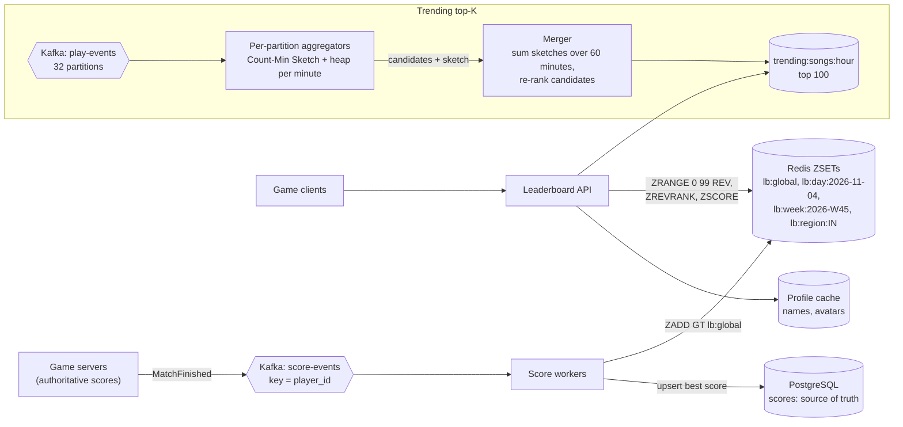
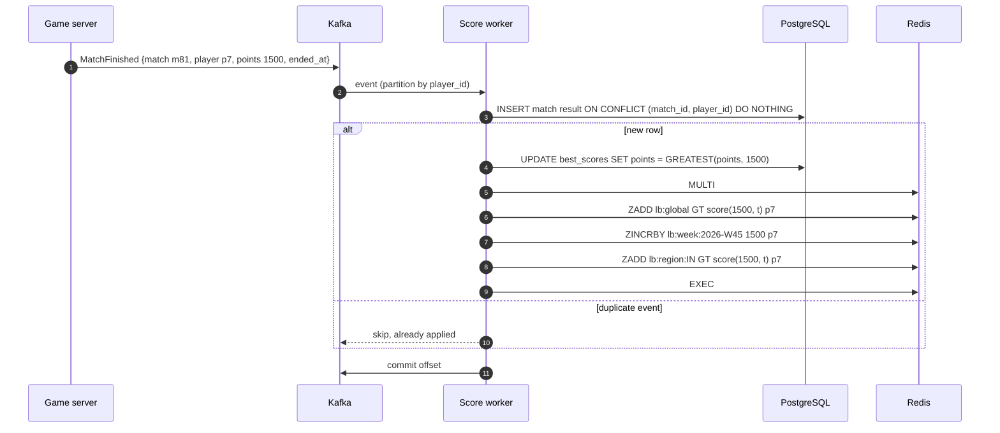
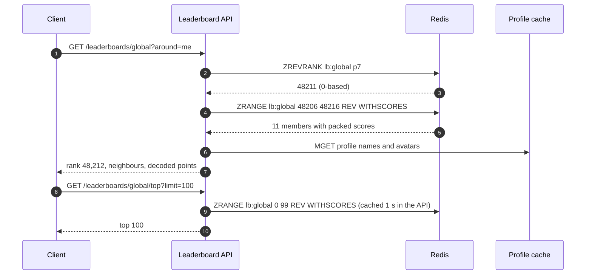

# Case Study - Leaderboard and Top-K

> [!summary] TL;DR
> A **leaderboard** ranks players by score and answers "who is in the top 100?" and "what is my rank?" in real time. **Top-K** (heavy hitters) finds the K most frequent items in a huge stream, such as the 100 most played songs in the last hour. Exact leaderboards use a sorted set (Redis ZSET); stream top-K uses a small sketch plus a heap because counting every item exactly would not fit in memory.

> [!abstract] Core idea
> - A Redis sorted set keeps members ordered by score; adding, updating and finding a rank each cost `O(log N)`.
> - Ties need a rule: pack "who got there first" into the score so equal points still rank consistently.
> - One sorted set holds tens of millions of players on one node; beyond that, shard and combine per-shard answers.
> - For streams with millions of distinct keys, a **Count-Min Sketch** (a small table of counters that never undercounts) plus a **min-heap of size K** finds the heavy hitters in fixed memory.
> - Time windows (daily, weekly, last hour) are separate keys or tumbling windows that are merged, never one ever-growing counter.

## 1. Why it exists - requirements

A game has 25 million players. After each match it must show the player's new global rank, and the home screen shows the top 100. The obvious SQL works on a small table:

```sql
SELECT count(*) + 1 AS rank FROM scores WHERE points > (SELECT points FROM scores WHERE player_id = $1);
```

On 25 million rows, even with an index on `points`, counting every player above a mid-table score reads millions of index entries, and it runs after every match. Rank is a **global order statistic**: it depends on every other row. A sorted structure that keeps subtree counts, such as the skip list inside a Redis sorted set, answers it in `O(log N)`.

The streaming variant is different: "top 100 songs in the last hour" over 50,000 plays per second across 10 million distinct songs. An exact hash map of counts per window would need memory for every distinct song, per window, per partition, and merging those maps is heavy. Approximate counting with a fixed-size sketch is good enough for "trending" lists.

**Functional requirements**
- Submit a score after a match (absolute best score, or increment).
- Top N (N up to 100) globally, by region and among friends.
- My rank, my score, and the players just above and below me.
- Daily, weekly and all-time boards; past seasons are archived.
- Trending top-K of items (songs, hashtags, products) over a sliding hour, refreshed every minute.

**Non-functional requirements**
- Rank visible within about 1 second of the match ending.
- Read p99 under 50 ms (a target for this design).
- Leaderboard is exact; trending top-K may be approximate (a small error in counts is acceptable, a missing true top item is not).
- Scores must not be forged: only the game server submits them.

## 2. Mental model

A leaderboard is a **ladder that re-sorts itself**: when your score changes, you slide to your new rung, and your rung number is your rank. A sorted set is that ladder with an index: it can tell you your rung without counting the rungs one by one.

Top-K over a stream is a **bouncer with a short guest list**. The bouncer cannot remember everyone who walked past, but keeps a rough tally in a small notebook (the sketch) and a list of the K most frequent guests (the heap). A newcomer whose tally beats the least frequent person on the list replaces them.

Terms:
- **Sorted set (ZSET):** a Redis type mapping members to scores, ordered by score, with rank queries.
- **Count-Min Sketch:** a `depth × width` grid of counters. Each key increments one counter per row; its estimate is the smallest of those counters. It can overcount (collisions) but never undercounts.
- **Heavy hitter:** an item whose frequency is above some share of the stream.
- **Tumbling window:** fixed, non-overlapping time buckets (for example each minute).

## 3. How it works - high-level design



**Leaderboard write path.** The game server, not the client, publishes the final score. A score worker writes the durable best score to PostgreSQL and updates every board the player belongs to. `ZADD key GT score member` updates only if the new score is greater, which implements "best score" boards atomically; `ZINCRBY` implements cumulative boards.



The `INSERT ... ON CONFLICT DO NOTHING` on `(match_id, player_id)` makes the worker idempotent, which matters for `ZINCRBY`: replaying an increment would double-count, while replaying `ZADD GT` would be harmless. One gap remains: if the worker crashes after the PostgreSQL commit but before `EXEC`, the replayed event is skipped as a duplicate and Redis never gets the update. Close it by also deduping inside Redis: run the board updates in one Lua script that first does `SET applied:{match_id}:{player_id} 1 NX EX 604800` and applies the writes only if that succeeded, and let the worker always call the script (PostgreSQL dedupe guards the durable copy, the Redis marker guards the boards).

**Leaderboard read path.**



## 4. Worked example - estimates, API and data model

### Whiteboard version

```text
game server -> Kafka(score-events) -> worker: dedupe(match_id) -> PG best score
                                            \-> Redis ZADD GT lb:global / ZINCRBY lb:week:W45
API: top = ZRANGE lb 0 99 REV ; my rank = ZREVRANK lb me ; around me = ZRANGE lb r-5 r+5 REV
trending: plays -> per-partition [CMS + heap(K)] per minute -> merger sums 60 minutes -> top 100
```

Numbers to say aloud: 10k score updates per second at peak, one ZSET of 25 M players is a couple of gigabytes, and a Count-Min Sketch with 0.1% error is about 2,700 × 5 counters.

### Estimates

All inputs are **estimates** for this exercise; Redis per-entry memory is an approximation, measure it with `MEMORY USAGE` on real data.

| Quantity | Arithmetic | Result |
| --- | --- | --- |
| Players on the board | given | 25 M |
| Matches | 25 M DAU × 10 matches/day | 250 M score events/day |
| Score write rate | 250 M ÷ 86,400 s | ≈ 2,900/s average, ≈ 10,000/s at a 3.5× peak |
| Redis writes | 10,000 events/s × 3 boards (global, weekly, region) | ≈ 30,000 ZSET writes/s at peak |
| Rank reads | 25 M × 20 views/day ÷ 86,400 s | ≈ 5,800/s average, ≈ 20,000/s peak |
| Cost per operation | `O(log N)`, log₂(25 M) ≈ 25 levels | microseconds per op inside Redis |
| ZSET memory | 25 M members × ≈ 100 B (member string, score, skip-list node, hash entry) | ≈ 2.5 GB per board |
| All boards | global + weekly + daily + 10 regions ≈ 13 full-size boards (upper bound) | ≈ 33 GB; regional boards are smaller in practice |
| Trending stream | 50,000 plays/s, 10 M distinct songs | exact counting needs ≈ 10 M counters per window |
| Sketch size | width ⌈e / 0.001⌉ = 2,719, depth ⌈ln(1/0.01)⌉ = 5 | 13,595 counters × 8 B ≈ 109 KB per sketch |
| Sketch error | ε × N = 0.001 × (50,000/s × 60 s) | overcount at most 3,000 plays per minute-window with 99% probability |

The top-100 query alone is cheap but extremely popular, so it is cached in the API for one second; rank queries are per player and go to Redis directly.

### API

```http
POST /internal/v1/scores                      (game servers only, mTLS)
{"match_id": "m81", "player_id": "p7", "points": 1500, "ended_at": "2026-11-04T19:20:05Z"}
202 Accepted

GET /v1/leaderboards/global/top?limit=100
GET /v1/leaderboards/global/me                -> {"rank": 48212, "points": 1500}
GET /v1/leaderboards/global?around=me&radius=5
GET /v1/leaderboards/week/2026-W45/top?limit=100
GET /v1/leaderboards/friends                  -> ranks among the caller's friends
GET /v1/trending/songs?window=1h              -> [{"song_id": "s1", "plays_estimate": 182000}, ...]
```

Clients never submit scores. The score endpoint is internal, authenticated with mTLS (see [[Service-to-Service Auth - API Keys, HMAC, mTLS]]).

### Data model

```sql
-- PostgreSQL 17: the source of truth. Redis can be rebuilt from it.
CREATE TABLE match_results (
    match_id   text   NOT NULL,
    player_id  bigint NOT NULL,
    points     integer NOT NULL CHECK (points >= 0),
    ended_at   timestamptz NOT NULL,
    PRIMARY KEY (match_id, player_id)          -- dedupes replayed events
);

CREATE TABLE best_scores (
    season     text   NOT NULL,
    player_id  bigint NOT NULL,
    points     integer NOT NULL,
    reached_at timestamptz NOT NULL,           -- tie-breaker: earlier wins
    PRIMARY KEY (season, player_id)
);
CREATE INDEX best_scores_rank ON best_scores (season, points DESC, reached_at);
```

Redis keys:

| Key | Type | Written by | Read as |
| --- | --- | --- | --- |
| `lb:global` | ZSET, packed score | `ZADD GT` | top, rank, around-me |
| `lb:week:2026-W45` | ZSET, points | `ZINCRBY`; `EXPIRE` 35 days | weekly board |
| `lb:day:2026-11-04` | ZSET, points | `ZINCRBY`; `EXPIRE` 8 days | daily board; weekly can also be built with `ZUNIONSTORE` over 7 days |
| `lb:region:IN` | ZSET, packed score | `ZADD GT` | regional board |
| `trending:songs:hour` | ZSET of 100 | merger, replaced each minute | trending list |

**Ties.** Redis orders equal scores by member name (lexicographically), which is arbitrary for players. To rank "first to reach it" higher, pack points and time into one score. A score is a float64, which holds every integer up to 2^53 exactly, so the packed value must stay below that.

### Go: packed scores and stream top-K

The package below has the score packing used by the workers and a Count-Min Sketch with a size-K min-heap for trending items. It compiles and passes `go vet` and `go test -race` on Go 1.24.

```go
// Package topk finds approximate heavy hitters in a stream with a
// Count-Min Sketch plus a size-k min-heap, using memory independent of
// the number of distinct keys.
package topk

import (
	"container/heap"
	"hash/fnv"
	"math"
	"sort"
)

// CountMin is a depth x width table of counters. Estimate never
// undercounts; it overcounts by at most e*N/width with probability
// at least 1 - e^-depth, where N is the total of all increments.
type CountMin struct {
	depth, width int
	rows         [][]uint64
}

func NewCountMin(epsilon, delta float64) *CountMin {
	w := int(math.Ceil(math.E / epsilon))
	d := int(math.Ceil(math.Log(1 / delta)))
	rows := make([][]uint64, d)
	for i := range rows {
		rows[i] = make([]uint64, w)
	}
	return &CountMin{depth: d, width: w, rows: rows}
}

// index uses double hashing: row i probes h1 + i*h2 (Kirsch-Mitzenmacher).
func (c *CountMin) index(key string, i int) int {
	h := fnv.New64a()
	h.Write([]byte(key))
	sum := h.Sum64()
	h1, h2 := sum&0xffffffff, sum>>32|1
	return int((h1 + uint64(i)*h2) % uint64(c.width))
}

// Add increments key by n and returns the new estimate.
func (c *CountMin) Add(key string, n uint64) uint64 {
	est := uint64(math.MaxUint64)
	for i := 0; i < c.depth; i++ {
		j := c.index(key, i)
		c.rows[i][j] += n
		est = min(est, c.rows[i][j])
	}
	return est
}

func (c *CountMin) Estimate(key string) uint64 {
	est := uint64(math.MaxUint64)
	for i := 0; i < c.depth; i++ {
		est = min(est, c.rows[i][c.index(key, i)])
	}
	return est
}

type Item struct {
	Key   string
	Count uint64
}

type minHeap []Item

func (h minHeap) Len() int           { return len(h) }
func (h minHeap) Less(i, j int) bool { return h[i].Count < h[j].Count }
func (h minHeap) Swap(i, j int)      { h[i], h[j] = h[j], h[i] }
func (h *minHeap) Push(x any)        { *h = append(*h, x.(Item)) }
func (h *minHeap) Pop() any {
	old := *h
	it := old[len(old)-1]
	*h = old[:len(old)-1]
	return it
}

// TopK keeps the k keys with the largest estimated counts seen so far.
type TopK struct {
	k    int
	cms  *CountMin
	heap minHeap
	pos  map[string]int // key -> index in heap, for O(k) membership updates
}

func NewTopK(k int, cms *CountMin) *TopK {
	return &TopK{k: k, cms: cms, pos: map[string]int{}}
}

func (t *TopK) Add(key string) {
	est := t.cms.Add(key, 1)
	if i, ok := t.pos[key]; ok {
		t.heap[i].Count = est
		heap.Fix(&t.heap, i)
		t.reindex()
		return
	}
	if len(t.heap) < t.k {
		heap.Push(&t.heap, Item{key, est})
		t.reindex()
		return
	}
	if est > t.heap[0].Count { // beats the current k-th largest
		delete(t.pos, t.heap[0].Key)
		t.heap[0] = Item{key, est}
		heap.Fix(&t.heap, 0)
		t.reindex()
	}
}

// reindex rebuilds key positions; O(k), fine for small k such as 10-1000.
func (t *TopK) reindex() {
	for i, it := range t.heap {
		t.pos[it.Key] = i
	}
}

// List returns the current top k, largest first.
func (t *TopK) List() []Item {
	out := append([]Item(nil), t.heap...)
	sort.Slice(out, func(i, j int) bool { return out[i].Count > out[j].Count })
	return out
}

// Score packs points and a tie-breaker into one float64 for a Redis ZSET,
// so that equal points rank the player who reached them first higher.
// points < 2^21 and secondsSinceSeasonStart < 2^32 keep the result below
// 2^53, where float64 still represents every integer exactly.
func Score(points uint32, secondsSinceSeasonStart uint32) float64 {
	const tieBits = 32
	return float64(uint64(points)<<tieBits | uint64(math.MaxUint32-secondsSinceSeasonStart))
}
```

```go
package topk

import (
	"fmt"
	"math/rand/v2"
	"testing"
)

func TestCountMinNeverUndercountsAndStaysWithinBound(t *testing.T) {
	cms := NewCountMin(0.001, 0.01) // width 2719, depth 5
	exact := map[string]uint64{}
	r := rand.New(rand.NewPCG(1, 2))
	const n = 200_000
	for i := 0; i < n; i++ {
		k := fmt.Sprint("song:", r.IntN(50_000))
		exact[k]++
		cms.Add(k, 1)
	}
	bound := uint64(0.001 * n) // epsilon * N = 200
	over := 0
	for k, want := range exact {
		got := cms.Estimate(k)
		if got < want {
			t.Fatalf("%s: estimate %d < true %d", k, got, want)
		}
		if got-want > bound {
			over++
		}
	}
	if over > len(exact)/100 { // allowed to exceed the bound for at most delta = 1% of keys
		t.Fatalf("%d of %d keys exceed the error bound", over, len(exact))
	}
}

func TestTopKFindsHeavyHitters(t *testing.T) {
	tk := NewTopK(3, NewCountMin(0.001, 0.01))
	r := rand.New(rand.NewPCG(3, 4))
	for i := 0; i < 100_000; i++ {
		switch x := r.IntN(100); {
		case x < 10:
			tk.Add("hot:a") // ~10%
		case x < 18:
			tk.Add("hot:b") // ~8%
		case x < 24:
			tk.Add("hot:c") // ~6%
		default:
			tk.Add(fmt.Sprint("tail:", r.IntN(20_000))) // ~76% spread thin
		}
	}
	got := tk.List()
	want := []string{"hot:a", "hot:b", "hot:c"}
	for i := range want {
		if got[i].Key != want[i] {
			t.Fatalf("top3 = %v, want %v", got, want)
		}
	}
}

func TestScoreBreaksTiesByEarliestTime(t *testing.T) {
	early, late := Score(1500, 60), Score(1500, 3600)
	if !(early > late) {
		t.Fatal("same points: the earlier player must rank higher")
	}
	if !(Score(1501, 3600) > Score(1500, 0)) {
		t.Fatal("more points must always win")
	}
	max := Score(1<<21-1, 0)
	if max >= 1<<53 {
		t.Fatalf("score %v exceeds 2^53", max)
	}
	if uint64(max) != (1<<21-1)<<32|0xffffffff {
		t.Fatal("score not exactly representable")
	}
}
```

Reading the packed score back: `points = uint64(score) >> 32`. With 200,000 plays across 50,000 song IDs, the sketch never undercounted, and fewer than 1% of keys exceeded the `εN = 200` bound, as the theory promises.

## 5. Variants and comparison

| Approach | How it works | Use when | Cost |
| --- | --- | --- | --- |
| SQL `ORDER BY points DESC LIMIT 100` + `count(*)` for rank | Index on points; count rows above | Small boards (up to around a million rows) or infrequent reads | Rank query reads all rows above the player |
| Redis ZSET, one key | Skip list + hash; `O(log N)` update and rank | Up to tens of millions of members per board | Memory roughly 100 B/member (estimate); one node's CPU and memory |
| Sharded ZSETs by player hash | `N` ZSETs; top-K = merge each shard's top K; rank = sum of `ZCOUNT(score, +inf)` over shards | Boards too big or too hot for one node | Every rank query touches all shards |
| Sharded by score range | Shard 0 holds scores 0–999, shard 1 holds 1000–1999, and so on; rank = members in higher shards + rank within own shard | Very large boards with stable score distribution | Players move between shards; skewed distributions make hot shards |
| Bucketed approximate rank | Histogram of players per score bucket; rank ≈ sum of higher buckets | Long tail ("you are in the top 12%") for hundreds of millions of players | Not exact |
| Count-Min Sketch + heap | Approximate counts in fixed memory, heap keeps candidates | Trending or heavy hitters over huge key spaces | Overcounts; cannot list items it never kept as candidates |
| Redis Stack `TOPK` (HeavyKeeper) | Server-side heavy-hitter structure (`TOPK.ADD`, `TOPK.LIST`) | You run Redis Stack and want top-K without custom code | Approximate; needs Redis Stack or Redis 8+, not available in Redis 7.x without the module |
| Exact batch job | Spark or SQL `GROUP BY ... ORDER BY count DESC LIMIT K` over the day | Reports, billing, reconciliation of the streaming answer | Hours of delay |

## 6. Trade-offs and when not to use

- **Do not shard before you need to.** One ZSET handles tens of millions of members and tens of thousands of operations per second; sharding turns a single `ZREVRANK` into a scatter-gather over every shard.
- **Redis is a derived copy.** Keep scores durable in PostgreSQL (or Kafka with compaction) so a lost Redis node is rebuilt, not mourned. Redis persistence (AOF) helps but is not the source of truth.
- **Increment boards need idempotent writers.** `ZINCRBY` applied twice double-counts; dedupe on `match_id` before applying. `ZADD GT` (best score) is naturally idempotent.
- **Sketches are wrong for money and for small cardinalities.** If there are only 10,000 distinct items, an exact hash map is small and exact. Use sketches when distinct keys are in the millions and approximate answers are acceptable.
- **Friends leaderboards are not slices of the global ZSET.** For 300 friends, fetch their scores with `ZMSCORE lb:global f1 f2 ...` and sort in the API; do not build a ZSET per user.

## 7. In production

- **Failure modes → fixes:**
	- Cheating with forged scores → only game servers submit scores; validate against match records; flag outliers; never trust client values.
	- Hot key: everyone reads `lb:global` top 100 → cache the top 100 in each API instance for one second; serve rank queries from Redis replicas (see [[Hot Keys and Hot Partitions]] and [[Redis Replication, Sentinel and Cluster]]).
	- Weekly reset at midnight Monday causes a write spike on a new empty key → time-bucketed keys (`lb:week:2026-W45`) mean no reset at all; the new key simply starts receiving writes, and old keys expire.
	- Lost Redis primary → replica promotion may lose the last second of writes; replay from Kafka offsets or rebuild from `best_scores`.
	- Duplicate events after a worker crash → `(match_id, player_id)` primary key dedupes the durable write, and a Redis `SET NX` marker in the same Lua script as the board writes dedupes the Redis side, so a crash between the two neither double-counts nor loses the update.
	- Trending list dominated by bots replaying one song → count unique listeners (dedupe per user per window) or weight by account trust before counting.
- **What to monitor:**
	- Score event lag from match end to Redis update.
	- Redis memory per board, ops/s, p99 command latency, and slow log entries for `ZUNIONSTORE`.
	- Drift between Redis and PostgreSQL on a sample of players.
	- For trending: sketch error estimate (εN) and overlap with the nightly exact batch top-K.

## 8. Deep dive

**Why a skip list can return a rank.** Each forward pointer in a Redis skip-list node stores a *span*: how many level-0 nodes it jumps over. Walking from the head to a member and adding the spans of the pointers taken gives the member's rank in `O(log N)` expected time, without visiting the members in between.

**Rank across shards.** With players hashed across `S` shards, a player's global rank is `1 + Σ ZCOUNT(shard_i, "(" + score, "+inf")` (the `(` makes the bound exclusive), one `O(log N)` call per shard, which is `S` round trips done in parallel. The global top 100 is the merge of each shard's top 100, because any global top-100 member is in its own shard's top 100.

**Merging stream top-K across partitions.** Count-Min Sketches with the same width, depth and hash functions merge by adding counters cell by cell, so per-partition sketches sum into a global one exactly as if one machine had seen every event. Heaps do not merge that way: an item that is 101st on every partition can be first globally. The fix is to send each partition's candidates (its top K, or a larger list such as top 3K) to the merger, query the merged sketch for each candidate, and take the global top K from that. A larger candidate list lowers, but does not remove, the chance of missing a true top item; the nightly exact batch job catches what slips through.

**Sliding windows.** Keep one sketch per minute (109 KB each in the example). The "last hour" sketch is the sum of the last 60; sliding forward subtracts the oldest minute's sketch (sketches are linear, so subtraction is exact) and adds the newest. This is a stream-processing job with tumbling windows; see [[Stream Processing Basics]] and [[Kafka and Event Streaming]]. A nightly exact batch job reconciles the approximate answer.

**Choosing ε and δ.** Width `⌈e/ε⌉` controls the size of the overcount (at most `εN`), and depth `⌈ln(1/δ)⌉` controls how often that bound may be exceeded (probability `δ`). Heavy hitters are items above some share `φ` of the stream; choose `ε` well below `φ` (for example `φ = 1%`, `ε = 0.1%`) so overcounting cannot push a tail item above the threshold.

**Precision of packed scores.** Redis stores sorted-set scores as IEEE 754 double-precision floats. With 21 bits of points and 32 bits of time, the packed integer stays below 2^53 and every value is exact. A design that packs 32-bit points and 32-bit time (64 bits) would silently lose the low bits, and ties would break incorrectly.

## 9. Interview questions

> [!question]- How do you get a player's rank among 25 million in real time?
> Keep scores in a Redis sorted set and call `ZREVRANK`. The skip list stores spans, so rank is `O(log N)`, about 25 levels for 25 M members. A SQL `count(*)` of higher scores reads every row above the player.

> [!question]- Two players have the same points. Who ranks higher, and how do you implement it?
> Decide the business rule (usually who reached it first), then pack it into the score: `points << 32 | (MaxUint32 − seconds)`. Keep the packed value below 2^53 so the float64 score stays exact.

> [!question]- Trap: "Just shard the leaderboard across 10 Redis nodes from day one." Good idea?
> Usually not. One ZSET handles tens of millions of members; sharding makes every rank query a scatter-gather over all shards. Shard only when memory or throughput of one node runs out, and prefer replicas for read scaling first.

> [!question]- How do you build daily and weekly boards without a reset job?
> Use time-bucketed keys (`lb:day:2026-11-04`, `lb:week:2026-W45`) with an `EXPIRE` after the archive window. Writers increment the current bucket; a weekly board can also be built with `ZUNIONSTORE` over the last seven daily keys.

> [!question]- How do you find the top 100 songs in the last hour from 50,000 plays per second?
> Per Kafka partition, keep a Count-Min Sketch and a top-K heap per minute. A merger sums the last 60 minutes of sketches, re-scores the union of partition candidates against the merged sketch, and publishes the top 100. A nightly exact job reconciles.

> [!question]- Why can't you merge per-partition heaps directly?
> An item can be just below the top K on every partition yet first overall. Send candidate lists from each partition and recount them in the merged sketch, which is exact to merge because counters add.

> [!question]- A worker replays score events after a crash. What goes wrong?
> `ZINCRBY` double-counts. Dedupe first: insert `(match_id, player_id)` with `ON CONFLICT DO NOTHING` and update Redis only for new rows. `ZADD GT` for best-score boards is already idempotent.

## 10. Cheat sheet

A 45-minute script:

- **0-5 min, requirements:** submit score, top 100, my rank and neighbours, friends, daily/weekly/all-time, trending top-K. Exact leaderboard, approximate trending, scores only from game servers.
- **5-10 min, estimates:** 250 M matches/day ≈ 2,900/s, 10k/s peak, ×3 boards = 30k ZSET writes/s; 25 M × ≈ 100 B ≈ 2.5 GB per board; sketch 2,719 × 5 counters ≈ 109 KB.
- **10-15 min, API and data:** internal `POST /scores`; `GET top`, `GET me`, `GET around=me`; PostgreSQL `match_results (match_id, player_id)` and `best_scores`; Redis `lb:global`, `lb:week:W45`, `lb:day:...`.
- **15-25 min, high-level design:** game server → Kafka → workers (dedupe, PostgreSQL, `ZADD GT` / `ZINCRBY`) → Redis; API → `ZRANGE REV`, `ZREVRANK`, profile multi-get; trending pipeline with per-partition sketches and a merger.
- **25-40 min, deep dives:** skip-list spans give `O(log N)` rank; tie-breaking by packed score under 2^53; sharding by hash vs score range and cross-shard rank with `ZCOUNT`; merging sketches vs heaps; minute windows summed into an hour.
- **40-45 min, wrap-up:** hot top-100 key cached in the API; rebuild Redis from PostgreSQL; monitor event lag, Redis memory and latency, Redis vs database drift, sketch vs batch overlap.

## Links

- **Before this:** [[Redis Data Structures and When to Use Each]], [[Heaps and Priority Queues]], [[Bloom Filters and Probabilistic Data Structures]], [[Back-of-the-Envelope Estimation]]
- **Next:** [[Case Study - Payment System]], [[Case Study - Ad Click Aggregation]]
- **Compare with:** [[Case Study - Search Autocomplete]] (top-K per prefix), [[Stream Processing Basics]], [[Hot Keys and Hot Partitions]], [[Partitioning and Sharding]]
