# Case Study - Live Comments and Reactions

> [!summary] TL;DR
> Design the comment stream and floating hearts under a live video watched by up to millions at once.
>
> The challenge is **fan-out**: one comment must reach every viewer within about a second, but you cannot literally send 50,000 comments per second to each of a million screens.
>
> The answer is a connection tier of gateways subscribed to per-stream channels, **sampling and batching** what each viewer sees, **aggregating** reactions into counts, and splitting a hot stream's channel across many shards.

> [!abstract] Core idea
> - Viewers hold a long-lived connection (SSE or WebSocket) to a **gateway**. Gateways subscribe to the streams their viewers watch.
> - A comment is validated, moderated, stored, then published **once** to a per-stream channel. Each gateway receives it once and writes it to its local viewers: **fan-out at the edge**, not at the origin.
> - A human can read maybe 5-10 comments a second. So at high rates the server **samples** and **batches**. Everyone does not need to see everything.
> - Reactions are not messages, they are **counters**. Aggregate per second, send totals, animate on the client.
> - Delivery is **best effort** for the live view (loss is fine). Durability is only needed for the stored copy used for replay.

## Start here: the basics 🟢

> [!info] How to read this note (pick your level)
> - 🟢 **New to this?** Read "From zero" below, then sections 1, 2 and the cheat sheet (11). Stop there, that is a full first pass.
> - 🟡 **Know the basics?** Add sections 3 (how it works), 4 (worked example) and 8 (trade-offs).
> - 🔴 **Interview / SDE-3 prep?** Add 5 (deep dives), 6, 7, 9 and 10. Headings are tagged 🟢🟡🔴 so you always know where you are.

**From zero, in 60 seconds** 🟢

During a live match, a million people watch and post comments at the same time.
Each viewer's app keeps an always-open line to a server, so new comments can be pushed to it instantly.
The servers that hold these open lines are called **gateways**. Each one holds tens of thousands of viewers.
A new comment is published once to a channel for that stream. Every gateway listening on that channel passes it to its own viewers. This copying out is **fan-out**.

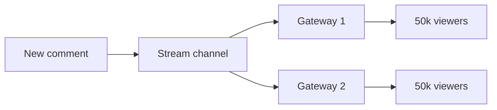

When comments pour in faster than anyone can read, the system shows only a sample.
Hearts are not sent one by one. They are counted, and the screen shows a total every second or so.

So the rest of this note is just these 3 questions:
1. How does one comment reach a million screens fast?
2. What do you do when there are far too many comments to show?
3. How do you keep huge streams and reconnect storms from breaking things?

**The problem in one story.**
A cricket match is streaming live to a million people.
Everyone can post comments and tap hearts.
Each comment should appear on other screens within about a second.
But if 50,000 comments arrive per second, nobody can read them all, and sending all of them to every phone would melt the servers.

**Words you need first**

| Word | Plain meaning | Tiny example |
| --- | --- | --- |
| Long-lived connection | A connection kept open so the server can push data | WebSocket or SSE |
| Gateway | Server holding many viewers' open connections | 100k viewers per gateway box |
| Fan-out | Copying one message to many receivers | 1 comment to 1M screens |
| Pub/sub channel | A named topic; publishers send, subscribers receive | `stream:123:comments` |
| Sampling | Showing only some items when there are too many | 10 comments per second per viewer |
| Batching | Sending many small items together in one message | 5 comments in one push |
| Counter | A number you add to instead of sending each event | `hearts = 81,204` |

**Picture it**

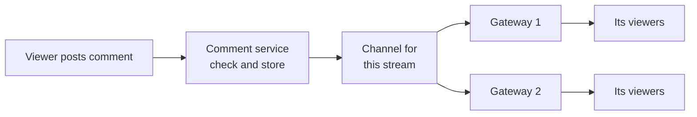

**Analogy.** A stadium announcer reads out a few fan messages over the speakers; the crowd hears a sample, not every message, and cheers are measured as noise level, not counted one by one.
Where it breaks: the announcer is one person, while the system has many gateways that each must get the message and push it to their own viewers.

**How the rest of this note builds up**

- First, requirements (section 1) and the mental model (section 2).
- Then the high-level design: one comment step by step and the connection tier (section 3), plus estimates, API and data model (section 4).
- Then deep dives: fan-out choices, sampling and batching, reactions as counters, and more (section 5).
- Finally the SDE-3 view: trade-offs, production examples and interview questions in the later sections.

> [!tip] Remember
> Publish each comment once per stream, let gateways fan it out locally, and sample, batch and count so no one is flooded.

## 1. Why it exists - requirements 🟢

Imagine a cricket final with 5 million people watching a live stream. People type "WHAT A SHOT!" and tap heart buttons. The comment section feels alive only if new comments appear within a second or two.

If it lags 30 seconds, the conversation is about something that has already happened. If it breaks, the stream still plays but the event feels dead.

This is the product that **live comments** solve, and the interesting part is that the audience size is huge and spiky, but each message is tiny.

Real-life picture: a stadium announcer. One person (a comment) speaks into one microphone; the sound reaches the whole stadium through many speakers (gateways). Nobody replays each fan's shout individually to each seat.

And if 10,000 fans shout at once, the announcer does not read them all aloud; the crowd noise is summarised ("the crowd goes wild"). That is sampling and aggregation.

**Functional requirements**
- Viewers see new comments on a live video in near real time.
- Viewers can post a comment (text, maybe an emoji), and send reactions (like, love, haha, wow, sad, angry).
- Reaction counts and a floating animation of reactions.
- A joining viewer sees the most recent comments (for example the last 50), then live updates.
- Moderation: block spam and abusive content, support per-stream rules (slow mode, followers only), hide or delete a comment.
- Comments are saved so they can be replayed with the recording afterwards.

**Non-functional requirements**
- **Latency:** a posted comment appears for other viewers within about 1-2 s at p95.
- **Scale:** up to millions of concurrent viewers on the biggest stream, and a very large number of streams with few viewers.
- **Availability over consistency:** it is fine if two viewers see slightly different subsets or slightly different order. It is not fine for the page to hang.
- **Graceful overload:** under a flood, degrade (sample, slow mode) rather than fall over.
- **Safety:** spam and abuse are filtered before broad fan-out.

**Glossary.** **Fan-out** is sending one item to many recipients. A **gateway** (or connection server) holds client connections. A **channel** (or topic) is a named pub/sub stream, here one per live video.

A **hot stream** is a stream with so many viewers or events that it overwhelms one node. **Sampling** means showing only a subset of messages. **Slow mode** limits how often one user can post.

> [!tip] Remember
> One comment is tiny. The problem is the number of recipients, and the fix is to fan out as late as possible, near the viewer.

## 2. Mental model 🟢

Think of a **radio network**. A studio (the comment service) produces one programme. It sends it once to many relay towers (gateways). Each tower broadcasts to the radios in its area (viewer connections). The studio does not know about individual radios. The towers do not need to know about each other. Adding listeners means adding towers.

Where the analogy breaks: radio is one way and the same for everyone. Here, viewers also send messages and each viewer's tower may thin out the programme (sampling) so a flood does not drown a phone.

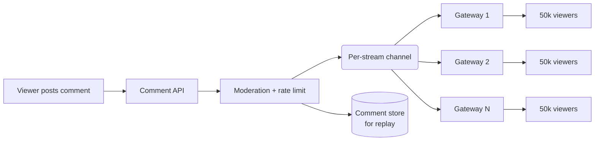

> [!tip] Remember
> Publish once to the channel, let each gateway fan out to its own connections.

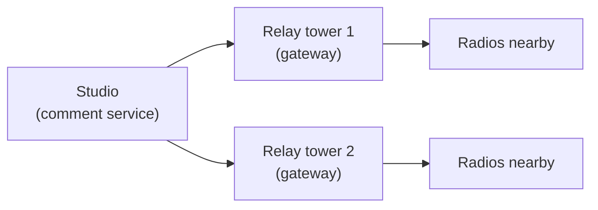

## 3. How it works - high-level design 🟡

### Step by step: one comment

**In plain words:** follow one comment from the phone that posts it, through the channel, out to every gateway and screen.

1. **Post.** The viewer sends `POST /streams/{id}/comments` (or sends a WebSocket frame). The request carries a client-generated id for deduplication.
2. **Gate.** The API authenticates the user, checks stream rules (comments on, slow mode, followers-only) and applies a per-user rate limit.
3. **Moderate.** A fast synchronous filter runs: banned words, link spam, duplicate text, user reputation. Heavy ML runs asynchronously and can retract later.
4. **Id and persist.** Give the comment a time-sortable id and append it to a durable log (Kafka) for storage and replay. Acknowledge the poster.
   - (Keying by `stream_id` keeps order per stream, but a 50,000 comments/s x ~200 B = ~10 MB/s stream is one hot partition; for the biggest streams key by `stream_id` plus a small salt, since replay sorts by `comment_id` anyway.)
5. **Publish.** Send the comment to the stream's **live channel** (Redis pub/sub or a similar broker, or the Kafka topic via a relay).
6. **Fan-out at the edge.** Every gateway that has viewers for this stream receives the message once. The gateway puts it into each local viewer's outgoing buffer.
7. **Batch and sample.** Every 200-500 ms the gateway flushes a batch of comments to each connection, capped at a rate the client can render (for example max 10 per second).
8. **Render.** The client appends comments, drops old ones and animates reactions.
9. **Late joiners.** A new viewer first fetches the "recent comments" from a cache (last 50-100 per stream), then subscribes for live updates.

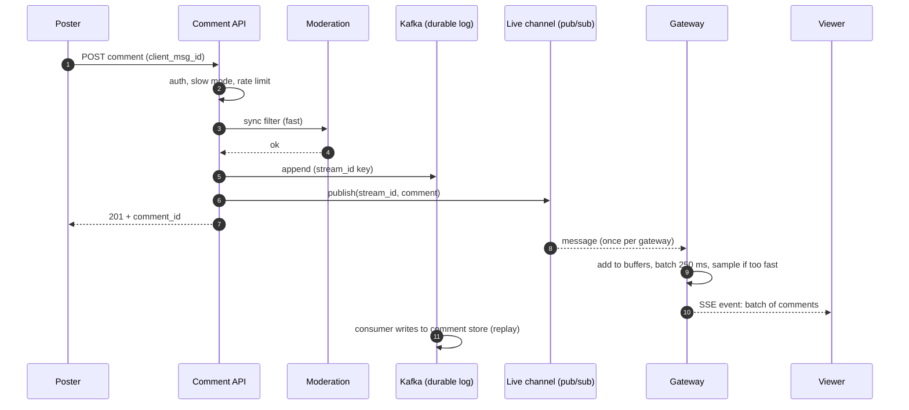

### Connection tier

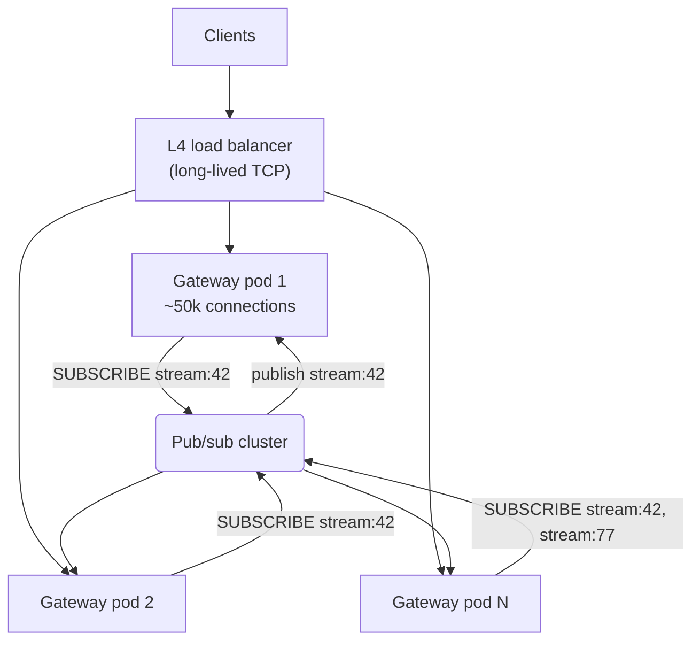

A gateway subscribes to a stream's channel **only while it has at least one local viewer**, and unsubscribes when the last one leaves. This keeps the number of subscriptions proportional to actual watching. Connection mechanics, heartbeats and reconnect storms are covered in [[Scaling WebSockets]].

> [!tip] Remember
> The origin publishes one message per stream. The number of deliveries equals the number of gateways, not the number of viewers.

## 4. Worked example - estimates, API and data model 🟡

### Whiteboard version

```text
Post: API -> rate limit -> sync moderation -> Kafka (key=stream_id) + publish to live channel
Gateway: holds SSE/WS connections, subscribes per stream, batch every 250 ms, sample to <=10 msgs/s/viewer
Reactions: client sends tap -> edge aggregator counts per (stream, emoji, 1 s) -> publish counts only
Join: GET recent 50 from Redis list -> subscribe -> resume with Last-Event-ID
Hot stream: split channel into K shards (stream:42#0..K-1), each gateway subscribes to its shard set
Replay: Kafka -> consumer -> Cassandra (stream_id, time_bucket, comment_id)
Numbers: 1M viewers, 50k comments/s in, ~10M deliveries/s out after sampling, ~1 GB/s egress (estimate)
```

### Estimates

**In plain words:** rough sums: viewers, open connections per gateway, and how many messages per second go out.

All numbers are estimates and assumptions.

| Quantity | Assumption | Arithmetic | Result |
| --- | --- | --- | --- |
| Biggest stream concurrency | 1,000,000 viewers | | 1 M connections |
| Comments posted, typical | 5 percent of viewers post once a minute | 1,000,000 x 5 percent / 60 s | ~**800 comments/s** |
| Comments posted, spike | burst after a wicket or goal (assumption) | | **~50,000 comments/s** for about 10 s |
| Naive fan-out | every comment to every viewer | 50,000 x 1,000,000 | **5 x 10^10 deliveries/s: impossible** |
| Sampled fan-out | each viewer sees max 10 comments/s | 1,000,000 x 10 | **10 x 10^6 = 10 M message-deliveries/s** |
| Batched writes | flush every 250 ms, 4 batches/s per viewer | 1,000,000 x 4 | **4 M socket writes/s** across the fleet |
| Egress | 10 comments x ~100 B + small header per second per viewer | 1,000,000 x ~1.1 KB | **~1.1 GB/s, about 9 Gbps** (CDN or edge may carry part) |
| Gateway count | 50,000 connections per pod (conservative; 100k+ is feasible with tuning) | 1,000,000 / 50,000 | **20 pods**, run 40 for headroom |
| Reaction taps | 10 percent of viewers tap once per second at peak | 100,000 taps/s | aggregated to ~6 emoji counts per second per stream |
| Storage | 1 M comments for the event x 200 B | | 200 MB per big event; trivial |
| Many small streams | 100,000 streams x 20 viewers | 2 M connections | same fleet, many tiny channels |

Two key messages. First: **fan-out multiplication is the cost**, so reduce recipients per message and messages per recipient. Second: **storage is tiny**, so do not spend the interview on the database.

### API

**In plain words:** post a comment, send a reaction, and an open line that streams new comments down.

```http
POST /v1/streams/{stream_id}/comments
Idempotency-Key: c_4fa1...        # client message id, dedupes retries
{"text": "What a shot!"}
201 {"comment_id": "01JC...", "created_at": "2026-11-09T12:00:01.120Z"}
429 {"error": "slow_mode", "retry_after_ms": 5000}

GET /v1/streams/{stream_id}/comments/recent?limit=50      # for joiners (cached)

GET /v1/streams/{stream_id}/live          # SSE: text/event-stream
  event: comments   id: 01JC...   data: [{"id":..., "user":..., "text":...}, ...]
  event: reactions  data: {"like": 3400, "love": 900, "wow": 120}
  event: viewers    data: {"count": 1034221}
# on reconnect the browser sends Last-Event-ID; server resends missed recent items

POST /v1/streams/{stream_id}/reactions    # or a WS frame
{"type": "love"}
204
```

**SSE or WebSocket?** Comments flow mostly one way to the viewer, so **SSE** (server-sent events) is simpler: plain HTTP, built-in reconnect and `Last-Event-ID`, works through proxies. Posting uses a normal `POST`. Use WebSocket if you want one bidirectional channel (very chatty reactions, interactive polls).

LinkedIn's engineering write-up on real-time likes on live video used SSE-style long-lived connections for the same reason. See [[Choosing an API and Communication Style - Decision Guide]].

### Data model

**In plain words:** comments are saved for replay later, but the live path does not wait for the database.

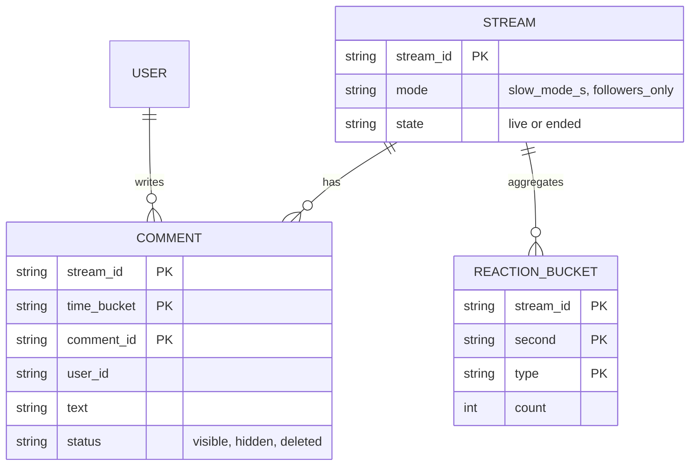

- **Live recent list:** a Redis list or capped stream per stream id (`LPUSH` then `LTRIM 0 99`), for joiners. Lost on failure? Then rebuild from Kafka. It is a cache.
- **Durable comments:** wide-column store (Cassandra or ScyllaDB) with partition key `(stream_id, time_bucket)` and clustering by `comment_id`, so "all comments of a stream in time order" is a sequential read and each partition stays bounded. See [[Wide-Column Stores and Cassandra]] and [[Choosing a Database - Decision Guide]].
- **Reactions:** do not store every tap. Store per-second aggregates and a running total per type.

> [!tip] Remember
> Live path in memory and pub/sub; durable path in a log and a time-bucketed store. Never put the live path through the database.

## 5. Deep dives 🔴

### 5.1 Fan-out: push, pull or hybrid

#### In plain words
When a comment arrives, who does the work of getting it to a million screens? You can push it to each viewer, let each viewer pull it, or do a smart mix. This is the same family of choices as in [[Fan-out on Write vs Fan-out on Read]]: copy at write time or collect at read time.

#### Picture it

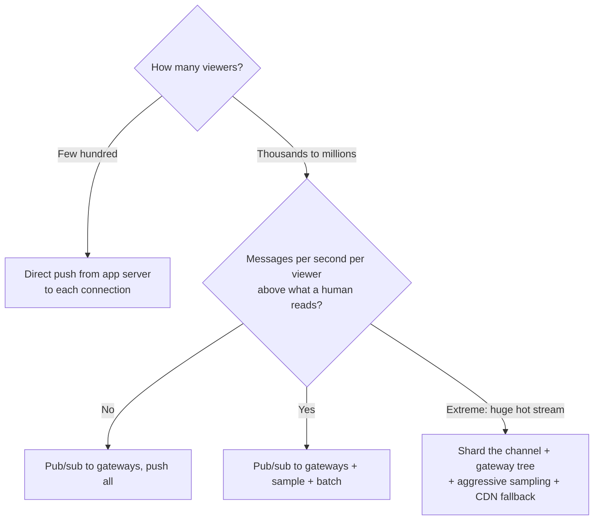

| Approach | How | Good | Bad | Use when |
| --- | --- | --- | --- | --- |
| Push to each viewer from origin | App server loops over viewers | Simple | Origin does O(viewers) work per comment; dies at scale | Tiny streams |
| Pub/sub to gateways, gateways push | One publish, each gateway fans out locally | Origin cost O(gateways); scales with fleet | Needs gateway subscription management | Default for live |
| Client polling (pull) | Client asks "anything new since X?" every 1-2 s | No long-lived connections; cacheable at CDN | Adds 1-2 s latency; request storm | Fallback for old clients, and the extreme-scale option |
| Hybrid | Push for small streams, CDN-cached polling for the very biggest | Cost control | Two code paths | The biggest broadcasts |

**Choice:** pub/sub to gateways with local fan-out, with sampling. **Why:** it keeps origin work proportional to the number of gateways (tens or hundreds), matches the data flow (one-to-many), and each gateway can protect itself.

Polling with CDN-cached "recent comments in the last 2 s" is a good **fallback and extreme-scale option**: the response is identical for all viewers, so a CDN serves 1 M requests with few origin hits. See [[CDN and Edge]].

#### Example
Stream with 1,000,000 viewers on 20 gateways. A comment is published once. The pub/sub cluster sends 20 messages (one per gateway). Each gateway writes to its ~50,000 local connections. Origin and pub/sub work: 20 deliveries, not 1,000,000.

#### Why it matters
This is the core insight of the problem. Weak answers say "loop over all viewers and send".

### 5.2 Sampling, batching and ranking (too many comments)

#### In plain words
At 50,000 comments per second no human can read. Sending them all wastes bandwidth and freezes phones. So the system decides what each viewer sees. Think of an airport board that shows the next 10 flights, not all 4,000 for the day.

#### Picture it

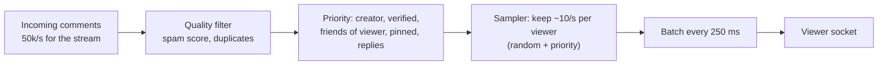

#### Steps
1. **Per-stream budget.** Decide the target display rate R per viewer (for example 10 per second). If the incoming rate is below R, send everything.
2. **If above R, sample.** The gateway keeps each comment with probability R / incoming_rate. Use the same random seed per batch so all viewers on a gateway see the same sample (cheaper) or a different sample per viewer (more variety, more CPU).
3. **Prioritise.** Always include comments from the broadcaster, moderators, pinned comments, and replies to the viewer's own comments. Sample only the rest.
4. **Batch.** Collect for 250 ms, then write one frame with a list. This cuts write syscalls by 10x versus one write per comment.
5. **Drop for slow clients.** Each connection has a small outgoing buffer (for example 64 messages). If it fills, drop the **oldest** and never block the gateway. Live comments are perishable.
6. **Show honest counts.** The "N comments" counter comes from a separate aggregate, not from what was displayed.

> [!warning] Common mistake
> Letting one slow phone back up the gateway's queue. The gateway then holds memory per slow client and eventually runs out. Always use bounded buffers and drop old live data. See [[Backpressure and Flow Control]].

#### Example
Incoming 5,000/s, target 10/s. Keep probability = 10 / 5,000 = 0.2 percent. A verified streamer's comment is always included. The viewer sees a steady, readable flow, while the stored log still holds all 5,000 per second for replay.

#### Why it matters
It turns an impossible 5 x 10^10 deliveries per second into a manageable 10 million, and keeps phones usable.

### 5.3 Reactions: counters, not messages

#### In plain words
A reaction is "one more heart". Nobody needs to know who sent each heart. So we count them and send the totals, like a stadium scoreboard that shows "heart: 340,212" instead of listing every fan.

#### Picture it

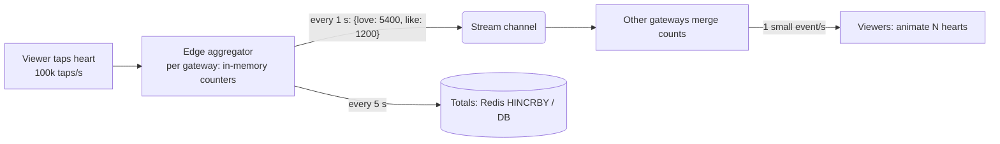

#### Steps
1. **Client-side debounce.** The client collects taps for up to 200 ms and sends `{"love": 3}`. A user holding the button sends one message per 200 ms, not one per tap.
2. **Gateway aggregation.** The receiving gateway adds to in-memory counters per `(stream, type)`.
3. **Flush each second.** It publishes `{"love": 5400}` for that second to the stream channel. That is one message per gateway per second.
4. **Merge and display.** Each gateway sums counts from all gateways for that second and sends the viewer **one** small event. The client spawns about `min(count, 30)` animated hearts, scaled down visually. Users do not need exactness.
5. **Persist totals** with an async increment every few seconds (`HINCRBY` in Redis, and periodically into the store). If a gateway crashes, you lose at most one second of counts. Acceptable.
6. **Dedup is not needed** for counts, but per-user rate limits (for example 5 taps per second) stop bots from inflating them.

#### Example
100,000 taps/s across 20 gateways. Each gateway flushes one aggregate per second: 20 messages per second into the channel, and 1 event per second to each viewer. Compare with 100,000 x 1,000,000 deliveries if each tap were a message.

#### Why it matters
This is the usual "aha" answer to "how do you handle 100k reactions per second?". Aggregation changes the problem from fan-out of events to a small counter broadcast. Counters at scale and hot keys are covered in [[Hot Keys and Hot Partitions]].

### 5.4 Hot streams: when one channel is too big

#### In plain words
Even with 20 gateways, one channel key carries all traffic for the biggest event. A single pub/sub node owns that key, and that node can become the bottleneck, the same way a single popular shard does in a database.

#### Picture it

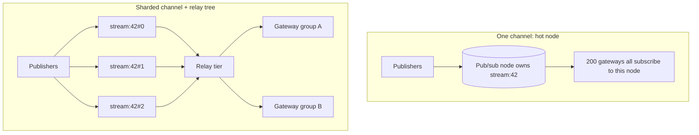

#### Steps
1. **Detect hotness.** Watch per-stream rate and subscriber count. Above a threshold (for example 20 gateways or 10k messages/s) mark the stream "hot".
2. **Shard the channel.** Publish to `stream:42#k` where `k = hash(comment_id) mod K`. Different shards live on different pub/sub nodes. Gateways subscribe to all K shards for that stream.
3. **Relay tree.** Instead of 200 gateways each subscribing to the pub/sub cluster, put a relay layer: pub/sub node -> a few relays -> 20 gateways each. Each level cuts fan-out by about 10-20x.
4. **Order is approximate.** Shards deliver independently, so two comments may swap. Sort by the time-sortable `comment_id` on the client, accept slight reordering.
5. **Sampling happens early.** For extreme streams sample **before** the publish step (at the API tier) to cap channel traffic.

**Alternatives** for the pub/sub layer:

| Option | Fit | Why / why not |
| --- | --- | --- |
| Redis Pub/Sub (sharded) | Good default | Very fast, in-memory, at-most-once (fine for perishable live data). Needs sharding for hot streams. |
| Kafka topic as live channel | Possible | Durable and replayable, but consumer per gateway per partition is heavy; latency higher. Great for the durable log, not the live path. |
| NATS or similar | Good | Lightweight subject-based pub/sub, easy fan-out. |
| Custom in-memory tree of relays | Best at extreme scale | More engineering. A common pattern at extreme scale (no specific company claimed here). |

**Choice:** Redis or NATS style pub/sub for the live path and Kafka for the durable path. **Why:** the live path wants lowest latency and tolerates loss; the durable path wants ordering per key and replay. See [[Kafka vs RabbitMQ vs SQS - Choosing a Message Broker]] and [[Redis as a Queue - Lists, Streams and Pub-Sub]].

#### Why it matters
Interviewers press here: "What is your hot key?" The answer is the stream channel, and you fix it by splitting and adding a relay tier.

### 5.5 Moderation and the late joiner

#### In plain words
Two small but important pieces. Moderation keeps spam and abuse from reaching a million people. The late joiner needs history without hammering the database.

#### Picture it

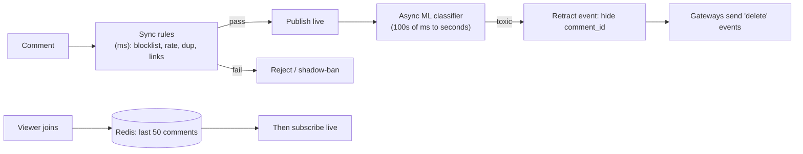

#### Steps for moderation
1. **Cheap synchronous checks** (blocklist, repeated text, link count, account age, per-user rate) run before publish.
2. **Async classifier** scores toxicity. If it fails, the system sends a `delete` event with the comment id. Gateways forward it and clients remove the comment. A short window of exposure is accepted.
3. **Stream controls:** slow mode (one comment per N seconds per user), followers-only, subscribers-only, and a moderator "hide" action that flows through the same delete event.
4. **Shadow ban:** the spammer sees their own comment while others do not, so they do not adapt.

#### Steps for late joiners
1. Client calls `GET /recent?limit=50` served from the Redis capped list (cached 1 s at the edge for huge streams).
2. Client connects to the SSE endpoint. The server starts sending from "now" and includes the id of the newest item.
3. The client merges by id: items from both sources are deduplicated by `comment_id`.
4. On reconnect after a drop, the browser sends `Last-Event-ID`; the gateway replays any items newer than that from its small in-memory ring buffer, or tells the client to refetch recent.

> [!tip] Remember
> Fast cheap checks before publish, smart slow checks after, with a retract event to fix mistakes.

## 6. Bottlenecks and scaling 🔴

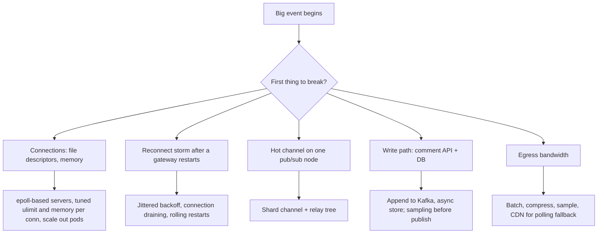

- **Connections:** memory per connection dominates (buffers, goroutine or thread stacks). Event-loop or goroutine-per-connection servers with small buffers hold tens to hundreds of thousands per node. The Mail.Ru write-up on a million WebSockets in Go shows the memory tuning needed. See [[Scaling WebSockets]].
- **Load balancing:** long-lived TCP needs an L4 balancer (least connections) and graceful draining on deploy. See [[Choosing Load Balancers, Gateways and Service Mesh - Decision Guide]].
- **Reconnect storms:** if a gateway dies, 50,000 clients reconnect at once. Clients use exponential backoff with jitter. The server caps new connections per second and sheds with a "retry in N seconds" signal.
- **Write path:** the API tier is stateless and scales horizontally. The slow part (database) is off the live path, behind Kafka. If the store lags, live comments still flow.
- **Cross-region:** put gateways near viewers (regional fleets), and replicate the stream channel across regions through a backbone relay. A comment from Mumbai should reach Delhi viewers without going through the US. Regional fan-out keeps latency low. See [[Multi-Region Architecture]].
- **Rate limits** at three levels: per user (slow mode), per IP or device (bots), per stream (global cap before publish). See [[Rate Limiting - Algorithms and Distributed Design]].

## 7. Failure handling 🔴

| Failure | Effect | Handling |
| --- | --- | --- |
| Gateway crash | 50k viewers disconnect | Client auto-reconnects with jitter to another gateway; resumes with `Last-Event-ID`; fetch recent to fill gap |
| Pub/sub node loss | Live messages lost for that shard | Fine for perishable data; failover or re-subscribe; use `recent` refetch on gap |
| Moderation service slow | Comments delayed | Timeout the sync filter at about 50 ms, fail open for trusted users and fail closed for new accounts; rely on async retract |
| Kafka or store down | Replay data lagging | Buffer in Kafka or the API; live path unaffected; backfill later |
| Overload | Too many events | Load shed in order: stop showing reaction animations beyond a cap, increase sampling, enable slow mode automatically, finally stop non-priority comments. See [[Load Shedding and Graceful Degradation]] |
| Duplicate post (retry) | Double comment | Client message id plus idempotency key dedupes |
| Region outage | Viewers in that region disconnect | DNS or anycast steers to the next region; reconnect storm limits apply |

**Delivery guarantee:** the live path is **at most once, best effort**. The durable log is **at least once with idempotent writes** (key `comment_id`). Say this out loud, it is a deliberate design choice.

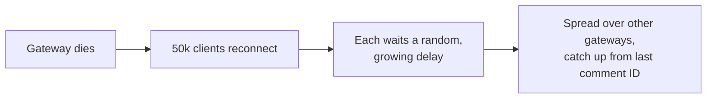

## 8. Trade-offs 🟡

| Decision | Option A | Option B | Pick and why |
| --- | --- | --- | --- |
| Transport | WebSocket | SSE | **SSE** for mostly one-way feed; WebSocket for interactive features. |
| Fan-out | Push to every viewer from origin | Pub/sub + gateway fan-out | **Gateway fan-out**: origin cost independent of viewer count. |
| Completeness | Every viewer sees every comment | Sampled | **Sampled** at high rates: humans cannot read more, and bandwidth explodes. |
| Reactions | Individual events | Aggregated counts | **Aggregated**: exactness is not needed. |
| Ordering | Strict global order | Approximate by time id | **Approximate**: global order costs a single bottleneck; nobody notices small swaps. |
| Live channel | Kafka | In-memory pub/sub | **In-memory pub/sub** live; Kafka for durable. |
| Moderation | All synchronous | Sync cheap + async smart | **Hybrid** with retract. |
| Overload | Reject comments | Degrade (sample, slow mode) | **Degrade gracefully.** |
| Extreme streams | Push only | CDN-cached polling fallback | **Offer both** for the largest broadcasts. |

## 9. In production 🔴

- **Real examples:** LinkedIn engineers described real-time likes and comments on live video using long-lived connections and a subscription layer, with the aim of delivering to many concurrent viewers per video (see sources).
  - Twitch chat is built on IRC and uses slow mode, follower-only mode and rate limits to keep rooms readable, which show the same sampling-and-throttling ideas.
  - Exact internal numbers of large platforms are not public, so the numbers in this note are estimates.
- **Metrics:** concurrent connections per gateway, message publish-to-deliver latency (p50, p95, p99), dropped-for-slow-client count, sampling ratio per stream, reconnect rate, pub/sub node CPU, egress Gbps, moderation retract rate.
- **Alerts:** publish-to-deliver p95 above 3 s, reconnect rate spike, gateway memory per connection rising, a stream with sampling ratio below 0.1 percent (tell product).
- **Deploys:** drain gateways gradually (stop accepting new, close with "go away" and a jittered reconnect delay). Never restart a whole fleet at once during an event. Freeze deploys during major events.
- **Load testing:** simulate a million idle connections plus a spike of 50,000 posts per second before any big event. Test the failure of a gateway at peak.

## 10. Interview questions 🔴

> [!question]- A comment is posted on a stream with 1 million viewers. How does it reach them?
> The API validates, moderates and appends it to a durable log, then publishes once to the stream's channel. Gateways subscribed to that channel receive it once each and write it to their local connections, batched and sampled. Origin work is proportional to the number of gateways, not viewers.

> [!question]- 50,000 comments per second arrive. Do you send them all to everyone?
> No. A viewer can read about 10 per second. Sample to a display budget, always include priority comments (creator, moderators, replies to the viewer), batch every few hundred milliseconds, and drop old messages for slow clients. All comments are still stored.

> [!question]- How do you handle 100,000 reaction taps per second?
> Treat reactions as counters. Debounce on the client, aggregate in memory on each gateway, publish per-second counts, and have viewers animate from the totals. Persist totals asynchronously. Losing one second of counts on a crash is acceptable.

> [!question]- SSE or WebSocket?
> SSE for a mostly server-to-client feed, since it is plain HTTP with automatic reconnect and resume. WebSocket when you need a busy bidirectional channel. Posting works fine as a regular POST either way.

> [!question]- What is the hot key and how do you fix it?
> The stream's channel. Shard it into K sub-channels and add a relay tier so each pub/sub node feeds a limited number of gateways. Sample at the API tier for the biggest streams. Accept approximate ordering.

> [!question]- What delivery guarantee does the live path give?
> At most once, best effort. A viewer who misses a comment is fine. The durable log gives at-least-once with idempotent writes by `comment_id`, which is what replay uses.

> [!question]- A gateway with 50,000 viewers crashes. What happens?
> Clients reconnect with exponential backoff and jitter to other gateways, send `Last-Event-ID` and fetch the recent list to fill gaps. The load balancer and gateways cap new connections per second to prevent a reconnect storm.

> [!question]- Follow-up: how do you stop spam and abuse?
> Rate limit per user and device, slow mode, cheap synchronous rules, async ML classification with a retract event, shadow bans, and account-age rules. Do it before the broad fan-out because after publishing, mistakes reach a million screens.

> [!question]- Follow-up: traffic grows 10 times. What changes?
> Add gateways horizontally, shard the hot channel more, add a relay tree and regional fleets, lower the sampling budget, and consider a CDN-cached polling mode for the largest stream. The durable path barely changes because comment storage volume is small.

## 11. Cheat sheet 🟢

- Gateways hold SSE/WebSocket connections; subscribe to stream channels only while they have viewers.
- Publish once per comment; each gateway fans out locally. Origin cost = number of gateways.
- Sample to about 10 messages per second per viewer; batch every 250 ms; bounded buffers, drop oldest.
- Reactions: client debounce, gateway aggregate per second, broadcast counts, async persist.
- Hot stream: shard channel `stream#k`, relay tree, sample early, approximate order by time id.
- Moderation: sync cheap, async smart, retract event; slow mode and rate limits.
- Late joiner: recent-N from Redis list then subscribe; `Last-Event-ID` for resume.
- Live path at most once; durable path via Kafka then wide-column store by `(stream_id, time_bucket)`.
- Degrade in order: sampling, slow mode, drop reaction animations, never fall over.

## 12. Links

- Decision guides: [[Choosing an API and Communication Style - Decision Guide]], [[Kafka vs RabbitMQ vs SQS - Choosing a Message Broker]], [[Choosing a Database - Decision Guide]], [[Choosing a Caching Strategy - Decision Guide]], [[Choosing Load Balancers, Gateways and Service Mesh - Decision Guide]]
- Concepts: [[Scaling WebSockets]], [[Fan-out on Write vs Fan-out on Read]], [[Real-time APIs - WebSocket, SSE and Long Polling]], [[Redis as a Queue - Lists, Streams and Pub-Sub]], [[Hot Keys and Hot Partitions]], [[Backpressure and Flow Control]], [[Load Shedding and Graceful Degradation]], [[Rate Limiting - Algorithms and Distributed Design]], [[CDN and Edge]]
- Related case studies: [[Case Study - Chat System]], [[Case Study - News Feed]], [[Case Study - Notification System]], [[Case Study - Video Streaming]]
- Framework: [[System Design Interview Framework]], [[HLD Round - Complete Step-by-Step Guide]]

## Links

### Watch on YouTube

- [System Design Interview: Design Live Comments w/ a Ex-Meta Staff Engineer](https://www.youtube.com/watch?v=LjLx0fCd1k8) · Hello Interview · 56 min · 145,886 views
- [Design FB Live Comments: Hello Interview Mock](https://www.youtube.com/watch?v=tgSe27eoBG0) · Hello Interview · 59 min · 132,414 views
