# Case Study - Maps and Navigation

> [!summary] TL;DR
> Design a Google Maps-style service: show a map you can pan and zoom, search for a place, compute a route, and give turn-by-turn navigation with a trustworthy **ETA** that reacts to live traffic.
>
> The three hard parts are **map tiles** (serve billions per day from a CDN), **routing** (shortest path on a graph of hundreds of millions of road segments in milliseconds) and **live traffic** (turn millions of GPS pings into per-road speeds).

> [!abstract] Core idea
> - The map is **pre-cut into square tiles** addressed by `zoom/x/y`. A tile never depends on the user, so it is perfectly cacheable at a CDN.
> - Routing runs on a **road graph** (intersections are nodes, road segments are edges with a travel time). Plain Dijkstra is too slow for continents, so use **preprocessing** (contraction hierarchies) and keep the graph in memory.
> - **ETA = sum of segment travel times**, and a segment's time comes from live traffic blended with historical speed for that time of week.
> - Traffic is a **streaming aggregation** of anonymised GPS probes, after **map matching** snaps noisy points onto roads.
> - Everything is partitioned by **geography**, because a route in Delhi never needs data from Lisbon.

## Start here: the basics 🟢

> [!info] How to read this note (pick your level)
> - 🟢 **New to this?** Read "From zero" below, then sections 1, 2 and the cheat sheet (12). Stop there, that is a full first pass.
> - 🟡 **Know the basics?** Add sections 3 (how it works), 4 (worked example), 5 (variants) and 6 (trade-offs).
> - 🔴 **Interview / SDE-3 prep?** Add 7, 8, 9, 10 and 11. Headings are tagged 🟢🟡🔴 so you always know where you are.

> [!note] Before this note
> - [[System Design Interview Framework]]: the order to work in: requirements, estimates, API, data, design, deep dives.
> - [[Back-of-the-Envelope Estimation]]: turning users and pings into requests per second and gigabytes.
> - [[Geospatial Indexing]]: splitting the earth into cells (geohash, H3) so "what is near me?" is a quick lookup.
> - [[Graphs and Graph Algorithms]]: points joined by weighted lines, and how Dijkstra finds the cheapest path.

**From zero, in 60 seconds** 🟢

A maps app does three separate jobs: draw the map, find a route, and guess the travel time.
Drawing: the world map is cut ahead of time into small square pictures called **tiles**. The app just downloads the squares it needs.
Routing: roads are stored as a **graph**: points (junctions) joined by lines (roads), each with a travel time. A shortest-path search finds the quickest way.
Travel time: phones on the road send their speed, so the app knows which roads are slow right now.

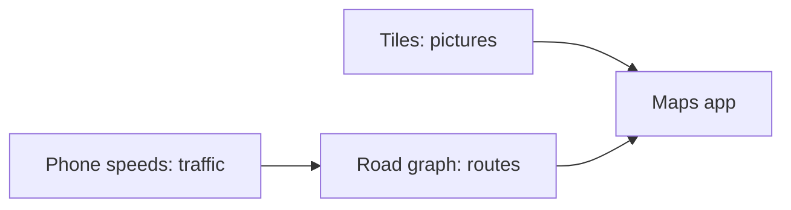

Tiles are the same for everyone, so they are cached close to users and come back very fast.

So the rest of this note is just these 3 questions:
1. How do you show any part of the world at any zoom, fast?
2. How do you find the best route on a graph with millions of roads, in under a second?
3. How do you turn phone pings into live traffic and an arrival time?

**The problem in one story.**
You open a maps app, drag around the city, search "nearest petrol pump", and ask for a route home.
The app draws the map instantly, finds the fastest road in under a second, and says "22 min".
When a road jams, the time changes and you may get a new route.

**Words you need first**

| Word | Plain meaning | Tiny example |
| --- | --- | --- |
| Tile | A small square picture or data piece of the map | Tile `14/11713/6849` |
| Zoom level | How close in you are; each level doubles detail | Zoom 0 = whole world in one tile |
| Graph | Points joined by lines | Intersections joined by roads |
| Edge weight | The cost of using one line | 40 seconds to drive this road |
| Shortest path (Dijkstra) | Algorithm to find the cheapest route in a graph | Home to office |
| GPS probe | A location ping from a phone or car | `(28.61, 77.20) at 09:01:05` |
| ETA | Estimated time of arrival | "Arrive 9:42" |
| CDN | Servers near users that hand out cached files | Tiles served from a city nearby |

| Map matching | Snapping noisy GPS points onto the road the car is really on | a point 20 m off lands on MG Road |
| Contraction hierarchy | A road graph pre-processed with shortcut roads so long routes search very few points | city street → highway → city street |
| Geocoding | Turning an address into coordinates (reverse: coordinates into an address) | "MG Road" → (12.97, 77.60) |

**Picture it**

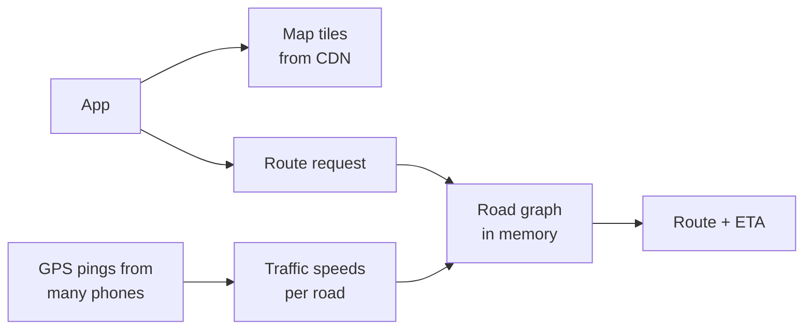

**Analogy.** A paper atlas cut into numbered pages (tiles), plus a friend who knows every road's usual speed and listens to the traffic radio (routing and live traffic).
Where it breaks: an atlas never changes, but real roads close, jams appear and the map data itself is rebuilt and versioned.

**How the rest of this note builds up**

- First, requirements (section 1) and the mental model (section 2).
- Then the high-level design (section 3), with tile math, estimates, API and data model (section 4).
- Then variants, trade-offs and production lessons (sections 5-7).
- Finally the SDE-3 deep dives: tile serving, routing on a huge graph, live traffic and ETA, search and offline maps, plus scaling and interview questions (sections 8-12).

> [!tip] Remember
> Pre-cut the map into cacheable tiles, route on an in-memory road graph, and turn GPS pings into road speeds for the ETA.

## 1. Why it exists - requirements 🟢

You open the app at a bus stop. In under a second you want the map around you drawn sharply. You type "airport", get suggestions, pick one, and see three routes with times.

You tap Start, the phone speaks "turn left in 200 metres", and when a road ahead jams, the app quietly reroutes you and tells you you will arrive 6 minutes later.

Underneath is a pile of data and algorithms that must be both enormous (the whole planet) and instant (milliseconds).

**Functional requirements**
- **Render the map:** pan and zoom with smooth, crisp map imagery at every zoom level (world to street).
- **Search and geocode:** turn "MG Road Bengaluru" or "coffee near me" into coordinates; **reverse geocode** coordinates into an address.
- **Route planning:** from A to B by car, bike, walk or transit, with alternatives and distance and duration.
- **Navigation:** turn-by-turn instructions while moving, detect off-route and **reroute**.
- **Live traffic:** colour roads by congestion; use it in ETA.
- **Offline maps:** download a region for use without data.

**Non-functional requirements**
- **Latency:** first tiles in under 300 ms; route computation under about 500 ms; reroute under about 1 s.
- **Availability:** the map must work even when traffic or search is down (degrade, do not fail).
- **Accuracy:** ETA error small (for example median within 10%); no routes through closed roads or wrong turn restrictions.
- **Scale:** hundreds of millions of users, planet-sized data, millions of simultaneous navigators.
- **Freshness:** base map updates in days; traffic in under a minute; incidents in minutes.
- **Battery and bandwidth** on the phone: send little, cache a lot.
- Out of scope: street-level imagery, satellite imagery pipelines, ads, transit schedule ingestion detail, business listings management.

### Real-life example: Google Maps on a Bengaluru commute 🟢

You open Google Maps at 8:45 am and ask for a route to the office. The map appears instantly because the squares for your area are already cached nearby.
It offers three routes, the fastest one in blue, and says "34 min".
Thousands of phones on Outer Ring Road are reporting crawling speeds, so that stretch turns red.
Halfway there, a jam forms ahead, and the app offers a new route that saves 6 minutes.

**Glossary.**
- **Tile**: a square piece of the map at one zoom level. **Zoom level z**: 0 is the whole world in one tile; each level doubles resolution in x and y.
- **Vector tile**: a tile that holds geometry (lines, polygons, labels) the phone draws itself. **Raster tile**: a pre-drawn image (PNG or JPEG).
- **Road graph**: nodes are intersections, edges are directed road segments with a travel cost.
- **Geocoding**: address text to coordinates. **Reverse geocoding**: the opposite.
- **Map matching**: snapping noisy GPS points onto the most likely road path.
- **ETA**: estimated time of arrival.
- **Probe**: an anonymous location sample from a moving device, used to infer traffic.

> [!tip] Remember
> Maps is three systems glued together: a **tile server** (static, cacheable), a **routing engine** (graph in RAM) and a **traffic pipeline** (streaming).

## 2. Mental model 🟢

Imagine a huge paper atlas. To show you a neighbourhood, a clerk does not redraw anything: they hand you the right pre-printed page (tile). Pages are numbered, so a copy shop on every street corner (CDN) can keep the popular ones.

To plan a trip, a navigator uses a separate **road diagram** with times written on each road, and finds the quickest path with a pencil. A traffic desk listens to radio reports from drivers and rewrites the times on the diagram every minute.

Where the analogy breaks: a paper atlas page has one scale; real tiles come at 20+ zoom levels and the phone mixes them while you pinch. And the navigator does not trace the whole country by hand: it uses a precomputed "highway of highways" so the long middle of a trip is a few jumps.

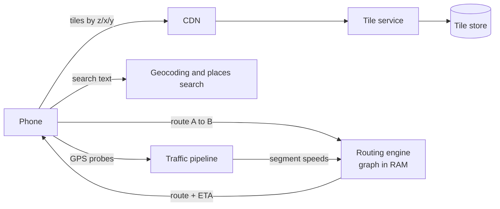

## Common beginner mistakes 🟢

- **Drawing the map per user on the server** → nothing can be cached and the servers melt → pre-cut identical tiles and serve them from a CDN.
- **Putting the user's blue dot or route inside the tile** → every tile becomes personal and uncacheable → draw personal things as an overlay on the phone.
- **Running plain Dijkstra on the whole country** → tens of millions of points explored per route → pre-process with contraction hierarchies.
- **Storing the road graph in a graph database and querying it live** → far too slow for 10,000 routes a second → load a compact graph into memory.
- **Using raw GPS points as road speeds** → points are 10-30 m off and land on the wrong road → map-match first, then take the median speed per road.

## 3. How it works - high-level design 🟡

> 🟢 → 🟡 **You now know** the three jobs: draw tiles, find routes, and turn phone pings into traffic. **Next we open the box**: the services behind each job, and step by step how the map is shown, a route is planned and a trip is navigated.

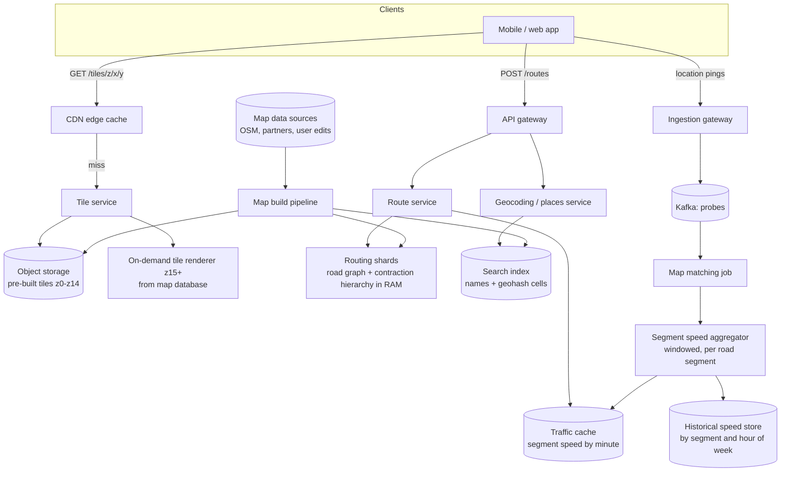

**Showing the map, step by step**
1. The app knows its viewport (the part of the map on screen: centre and zoom). It computes which `z/x/y` tiles cover the screen.
2. It requests each tile from the CDN. A hit returns in tens of milliseconds.
3. A miss goes to the tile service, which reads a pre-built tile from object storage (or renders it for deep zoom levels) and returns it with a long `Cache-Control` (a header telling the CDN and phone how long they may keep it).
4. The app draws the tiles, and overlays live traffic colours and its own blue dot.

**Planning a route, step by step**
1. The app sends origin, destination, travel mode and departure time.
2. The route service **snaps** each endpoint to the nearest road edge using a spatial index.
3. It sends the request to the routing shard that owns that region (or a stitching layer if the route crosses regions).
4. The shard runs a contraction-hierarchy query using current edge costs and returns the node path.
5. The service turns the path into maneuvers ("turn left onto MG Road"), adds distance and ETA, and returns up to three alternatives.

**Navigating, step by step**
1. The app streams position every second or so to itself (the matching is local), and every few seconds to the server as a probe.
2. It checks it is still on the route. If it deviates by more than a threshold for a few seconds, it asks for a **reroute** from the current position.
3. The server also pushes a new route when traffic ahead changes enough that a better route saves several minutes.

> [!tip] Remember
> Tiles are static and global. Routes are dynamic and per request. Traffic is the live input that connects them.

## 4. Worked example - estimates, API and data model 🟡

### Whiteboard version

```text
Tiles:    z/x/y addressing, 4^z tiles per level. Pre-build z0-z14 (about 358M tiles), render deeper on demand.
          CDN absorbs ~95% of requests. Vector tiles (small, rotatable) over raster.
Routing:  graph (node = intersection, edge = road segment with time). Contraction hierarchy:
          preprocess shortcuts offline, query in ~ms. Shard by region, graph in RAM.
Traffic:  GPS probes -> Kafka -> map matching -> per-segment speed (1 min windows) -> cache.
          Blend with historical speed by hour of week. ETA = sum of edge times.
Search:   text index + geohash cell filter; rank by distance and popularity.
Numbers:  ~350k tile req/s peak, ~1.2M probes/s peak, ~1 ms route query (estimates).
```

### Tile math

**In plain words:** each zoom level cuts the world into 4 times more squares than the last. A tile's name is just its zoom, column and row.

The world map is projected with **Web Mercator** (the standard way web maps flatten the round earth) onto a square, then cut into `2^z x 2^z` tiles at zoom `z`.

| Zoom | Tiles at this level (4^z) | Approx metres per pixel at the equator (256 px tiles) | Typical view |
| --- | --- | --- | --- |
| 0 | 1 | 156,543 | whole world |
| 10 | 1,048,576 | 153 | a city |
| 12 | 16,777,216 | 38 | neighbourhoods |
| 15 | 1,073,741,824 | 4.8 | streets |
| 18 | 68,719,476,736 | 0.6 | buildings |

The tile that contains a point is computed directly:

```text
n = 2^z
x = floor( (lon + 180) / 360 * n )
y = floor( (1 - asinh(tan(lat)) / pi) / 2 * n )
```

Example: Bengaluru at `lat 12.9716, lon 77.5946`, zoom 12. `n = 4096`. `x = floor(257.5946 / 360 * 4096) = floor(2930.85) = 2930`. `y = floor(1899.13) = 1899`. The tile URL is `/tiles/12/2930/1899`. No database lookup is needed to find a tile; the address is pure arithmetic, which is why caching is trivial.

### Estimates

**In plain words:** rough sums: how many tiles exist, how many requests per second, and how many phone pings per second.

All inputs are **estimates**.

| Quantity | Assumption | Arithmetic | Result |
| --- | --- | --- | --- |
| Daily active users | estimate | | 200,000,000 |
| Tile requests per user per day | ~50 (cache on device cuts it) | 200M x 50 | 10 B / day |
| Tile request rate | | 10 B / 86,400 | **~115,000/s avg, ~350,000/s peak** |
| CDN hit rate | ~95% | 350k x 0.05 | ~17,500/s reach the origin |
| Pre-built tiles z0 to z14 | sum of 4^z for z=0..14 | (4^15 - 1) / 3 | **~358 M tiles** (most ocean and empty, which are tiny) |
| Storage for those tiles | ~10 KB average vector tile (estimate) | 358M x 10 KB | ~3.6 TB; the same tiles in several styles or languages multiply it |
| Navigation sessions | 100 M per day, 30 min average | 100M x 1,800 s / 86,400 | ~2 M concurrent average, **~6 M peak** |
| GPS probes | 1 ping per 5 s per navigating device | 6M / 5 | **~1.2 M probes/s peak** |
| Probe size | ~50 B compact | 1.2M x 50 B | 60 MB/s ingress |
| Road graph size | ~500 M nodes, ~1 B edges (planet estimate; real counts depend on what is included) | 1B edges x ~20 B (estimate; real formats vary) | ~20 GB; plus a hierarchy about 2-3x; fits in RAM of a few big machines per region |
| Route requests | 100 M routes/day plus reroutes (say x3) | 300M / 86,400 | ~3,500/s avg, ~10,000/s peak |

Conclusions the numbers force:
- Tiles are a **bandwidth and CDN problem**, not a compute problem. Without a CDN, 350k req/s of 10 KB would be 3.5 GB/s from origin.
- The graph **fits in memory**, so routing is a CPU problem, solved by preprocessing, not by a distributed database.
- Probes at 1.2M/s need a stream platform and partitioning by geography.

### API

**In plain words:** get a tile, search a place, ask for a route, and send location pings.

| Method and path | Purpose | Notes |
| --- | --- | --- |
| `GET /tiles/{z}/{x}/{y}.mvt` | vector tile | `Cache-Control: public, max-age=...`; versioned path `/v123/...` for map updates |
| `POST /v1/routes` | route | body: `origin`, `destination`, `waypoints[]`, `mode`, `departure_time`, `alternatives=true`; returns `routes[]` with `polyline`, `distance_m`, `duration_s`, `steps[]` |
| `GET /v1/geocode?q=...&near=lat,lon` | search by text | ranked results with bounding boxes |
| `GET /v1/reverse?lat=..&lon=..` | address from point | |
| `GET /v1/autocomplete?q=...` | typeahead | see [[Case Study - Search Autocomplete]] |
| `POST /v1/probes` | batched location samples | `{device_hash, points:[{lat,lon,ts,speed,heading}]}` anonymised, rotating ids |
| `GET /v1/traffic/tiles/{z}/{x}/{y}` | traffic overlay | short TTL (30 to 60 s) |
| `POST /v1/reroute` | reroute from current position | includes the original route id for continuity |

### Data model

**In plain words:** tiles live as files; the road graph lives in memory; places live in a search index.

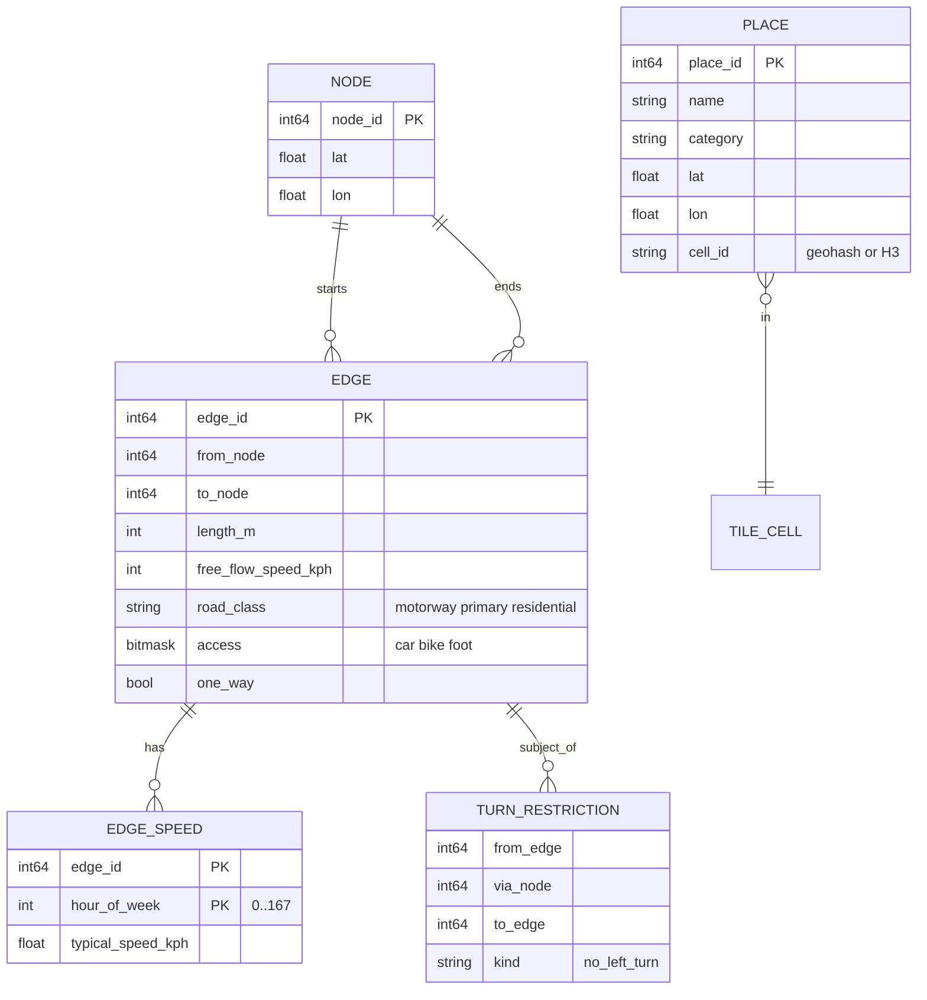

- **Road graph** is stored in a compact binary format built offline, loaded into memory by the routing shards. It is **not** served from a live database: queries are far too frequent and need pointer-chasing speed.
- **Live traffic** is a separate overlay: a map `edge_id -> current_speed` in a cache (for example Redis or an in-process snapshot refreshed each minute). The routing engine reads it when computing edge costs.
- **Historical speeds** (168 buckets per edge: 24 hours x 7 days) give a baseline and let the system predict the future ("leave at 8 am Monday"). See [[Time-Series and Columnar Storage]].
- **Places** (shops, landmarks) are documents in a search index, each tagged with a geohash or H3 cell (a short code for a small patch of the earth) for the "near me" filter. See [[Geospatial Indexing]].

> [!tip] Remember
> Static base map, in-memory routing graph, live traffic overlay: three layers of data, each with its own freshness.

## 5. Variants and comparison 🟡

| Decision | Options | Choice | Why |
| --- | --- | --- | --- |
| Tile format | raster PNG/JPEG; vector (protobuf, a compact binary format) | vector | much smaller, crisp at any zoom, rotatable, client styles (dark mode) without new tiles; cost: client GPU work |
| Tile generation | pre-render everything; render on demand; hybrid | hybrid: pre-build z0-z14, on-demand for deeper | counts explode at high zoom (4^18 is 68 B); most deep tiles are never requested |
| Tile addressing | `z/x/y`; quadkey; S2 cell id | `z/x/y` | simple, universal client libraries, cacheable URLs |
| Routing algorithm | Dijkstra; A*; contraction hierarchies; hub labels | contraction hierarchies | milliseconds on continental graphs after preprocessing; Dijkstra takes seconds |
| Traffic-aware routing | recompute hierarchy on each change; customisable CH; time-dependent costs | customisable approach: keep topology preprocessed, re-weight edges | live speeds change every minute; full re-contraction too slow |
| Graph storage | graph database; SQL; in-memory binary graph | in-memory binary | latency; graph is read-mostly and rebuilt offline |
| Geocoding index | SQL `LIKE`; Elasticsearch; custom trie + geo cells | search index with geo filter | typo tolerance, ranking, prefix queries |
| Traffic source | road sensors; partner feeds; crowd probes | crowd probes plus partners | coverage scales with users; sensors only cover major roads |
| ETA model | sum of edge speeds; plus learned correction | both | physics of the road graph plus ML for bias, turns, lights, weather |

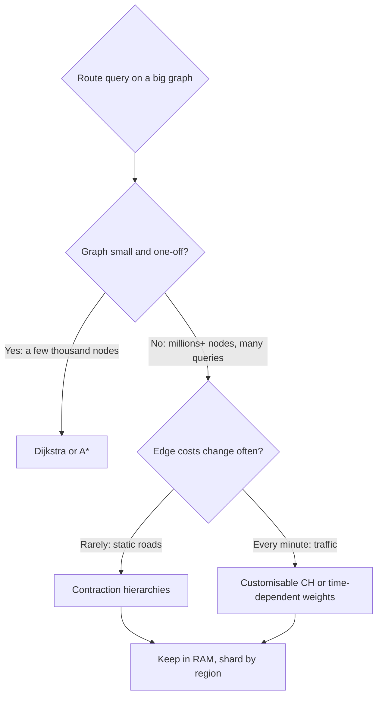

### Things people confuse this with 🟡

| System | What it does | How it differs from maps and navigation |
| --- | --- | --- |
| [[Case Study - Ride Sharing and Proximity]] | Finds nearby drivers and matches them to riders | Uses maps and ETAs, but its core is tracking moving cars and matching, not drawing or routing |
| [[Geospatial Indexing]] alone | Answers "what is within 2 km?" | Only nearness; no roads, turns or travel times |
| GPS | The phone working out its own position from satellites | Just gives a location; the maps system turns it into a map, a route and an ETA |

## 6. Trade-offs 🟡

- **Pre-build vs on-demand tiles.** Pre-building z0 to z14 (about 358 M tiles) costs storage and build time but makes the common zoom levels instant and cacheable. On-demand rendering at deeper zoom saves storage but adds origin load and cold-start latency, absorbed by the CDN after the first request.
- **Vector vs raster.** Vector tiles are typically several times smaller than raster (an estimate that depends on the style and zoom) and flexible, but need a capable client and a style spec. Raster is simplest and works anywhere (embedding, old devices).
- **Precompute vs flexibility.** Contraction hierarchies are fast because they bake in the topology and cost model. Every new constraint (avoid tolls, truck height, EV charging) either needs another preprocessed graph or falls back to a slower query. Providers keep a few preprocessed profiles (car, bike, foot) and use slower flexible search for exotic requests.
- **Fastest vs most predictable route.** The fastest route now may become slow by the time you reach the jam. Using predicted speeds (historical blend) at the time you will be on each segment, called **time-dependent routing**, costs more compute but gives better ETAs.
- **Freshness vs stability of traffic.** Updating speeds every few seconds reacts quickly but causes flicker and route oscillation. Smoothing windows of 1 to 2 minutes trade reaction speed for stability.
- **Privacy vs coverage.** Probes are essential for traffic but sensitive. Anonymise with rotating ids, drop the first and last minutes of a trip, aggregate per road and require a minimum number of devices before publishing a speed.
- **When simpler wins.** A delivery company with 500 vehicles in one city can run an open-source engine (OSRM or Valhalla, free routing servers) on one machine with OpenStreetMap data, use a hosted tile provider, and skip live probes.

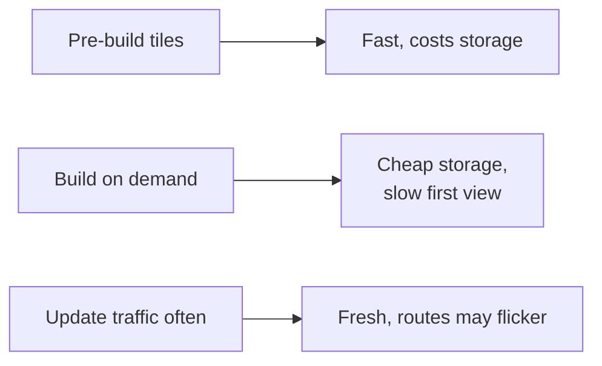

## 7. In production 🔴

> 🟡 → 🔴 **You now know** the three paths, the tile maths, the sizing, the API and the three data layers. **Next is the advanced part**: production failures, how tiles are served through the CDN, fast routing on a planet-sized graph, live traffic and ETA, search, offline maps and scaling.

- **Real examples.** OpenStreetMap (a free, volunteer-built world map) publishes the planet's road data.
  - OSRM and Valhalla are open-source routing engines whose documentation describes contraction hierarchies and tiled graphs.
  - Mapbox's public vector tile specification defines the tile format used by many providers.
  - DeepMind published that graph neural networks improved ETA accuracy in Google Maps (see the DeepMind blog source above).
  - Uber open-sourced the H3 cell index, widely used for grouping locations (see [[Case Study - Ride Sharing and Proximity]]).
- **Failure: a CDN region loses cache.** The origin sees a stampede. Fix: request coalescing at the CDN (one origin fetch per tile), origin shield tier (one extra CDN layer that all edge servers ask before the origin), and serving stale tiles while revalidating. See [[CDN and Edge]].
- **Failure: bad map data.** A wrongly one-way street or a missing bridge sends cars the wrong way. Fix: map builds are **versioned**, validated by automated checks (graph connectivity, reroute sanity on sample trips), canaried to a small share of traffic, and **rolled back** by repointing to the previous version.
- **Failure: traffic pipeline lag or outage.** Routing keeps working with historical speeds (graceful degradation). The route response includes a flag that live traffic was unavailable.
- **Failure: ETA drift.** Predicted vs actual arrival diverge in a city during rain or an event. Monitor error per city and hour; fall back to historical-only if the live model goes bad.
- **What to monitor.** Tile CDN hit rate and p99; origin QPS; route latency p50/p99 per region; reroute rate; ETA error (predicted vs actual) distribution; probe ingest lag; fraction of segments with fresh speed; map-matching failure rate; graph build validation results.

## 8. Deep dive 🔴

### Deep dive 1: tile serving and the CDN

**In plain words.** Cut the world into squares. Name each by zoom, column and row. Because the same square looks the same to everyone, store it once and let thousands of CDN servers keep copies.

**Picture it.**

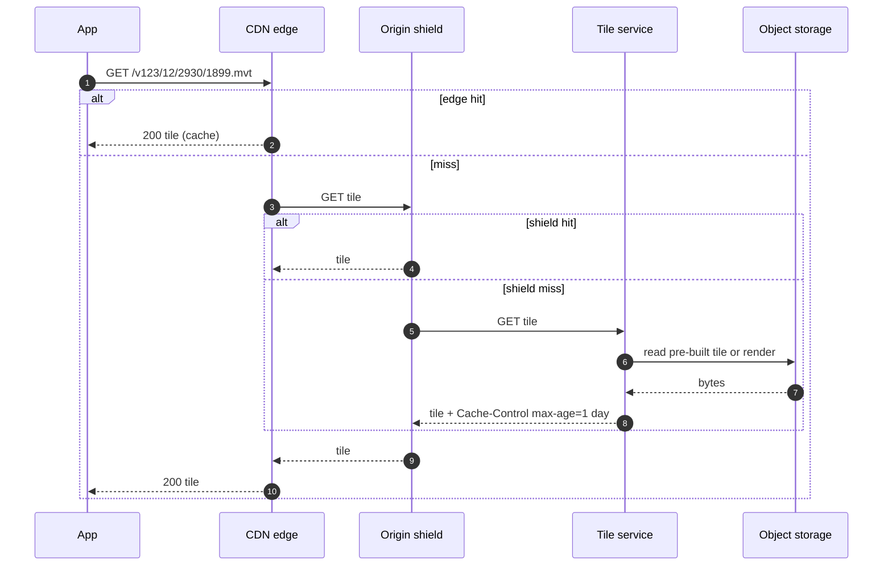

**Example.** A million people in Bengaluru open the app at 9 am. The same ~40 tiles for the city centre at zoom 12 to 15 are requested over and over. After the first miss per edge location, every later request is a hit. The origin sees thousands of requests, not hundreds of millions.

**Key techniques.**
- **Versioned URLs** (`/v123/...`) let tiles have a very long `max-age`. A new map build changes the version in the style JSON, so there is no purge storm.
- **Client caching.** The app keeps recent tiles on disk and **over-zooms** a parent tile while the child loads, so panning feels instant.
- **Prefetch** along the route during navigation so tunnels and dead zones are covered.
- **Hot vs cold.** Cities are hot and the poles are cold. Keep hot tiles in the CDN and memory; cold tiles come from object storage on demand.
- **Vector tile contents.** Each tile has layers (roads, water, buildings, labels), each feature simplified for that zoom (fewer points at low zoom). Tile size is capped by dropping minor features at low zoom.

**Why it matters.** A static, user-independent resource scales almost for free through caching; make everything you can look like that.

> [!warning] Common mistake
> Drawing a tile per user or per request (for example rendering the blue dot into the tile). Anything personal must be an overlay drawn on the client, otherwise the tiles stop being cacheable.

### Deep dive 2: routing on a huge road graph

**In plain words.** The road network is a graph. **Dijkstra's algorithm** finds the shortest path by expanding outward from the start, always taking the closest unvisited node (using a priority queue, see [[Heaps and Priority Queues]]). It is correct but explores almost everything within the distance, which is millions of nodes for a long trip.

**Faster ideas, in order.**
1. **Bidirectional Dijkstra:** search from both ends until the searches meet. Explores roughly half the area, about 2x faster.
2. **A\*:** guide the search with a heuristic such as straight-line distance divided by the maximum speed. Helps, but road networks have detours, so the heuristic is weak.
3. **Contraction hierarchies (CH):** a preprocessing step that ranks nodes by importance (a local street is less important than a highway junction) and adds **shortcut edges** that skip over unimportant nodes. A query then searches **upward** only in the hierarchy from both ends and meets at an important node.

**Picture it.**

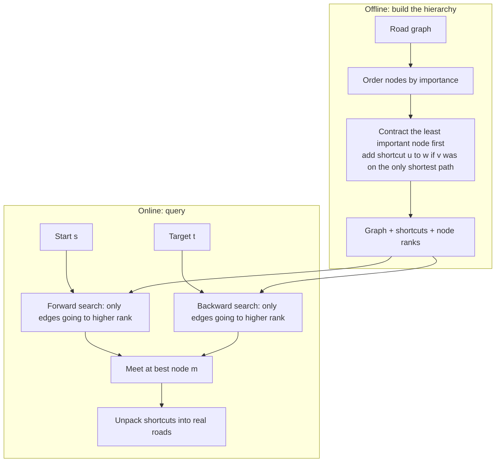

**Example.** Bengaluru to Mumbai by road. Dijkstra expands tens of millions of nodes.

With CH, the search climbs from a residential street to a main road to the highway network, a few hundred nodes, meets near the long highways in the middle, and unpacks shortcuts into the actual sequence of roads.

Published results for continental road networks (Geisberger et al.) show query times well under a millisecond to about a millisecond, thousands of times faster than plain Dijkstra, at the cost of an offline preprocessing step.

**Traffic and CH.** Classic CH bakes travel times into shortcuts. When live speeds change, you either recompute the shortcut weights (the **customisable** approach: topology order stays fixed, only weights are recomputed, which takes seconds) or search with time-dependent costs.

Real systems keep a baseline hierarchy for historical speeds and apply live corrections on the part of the route near the traveller, where traffic matters most.

**Sharding.** The planet does not need one process. Cut the graph into regions (by country or by a graph partitioning algorithm that minimises cut edges). A route inside a region is answered by one shard.

A cross-region route is stitched: route to border nodes on each side and combine with a small high-level graph of border-to-border times, precomputed. See [[Partitioning and Sharding]].

**Snapping and turn costs.** The start and end points are first snapped to the nearest road edge using a spatial index (geohash or R-tree, a tree of nested rectangles for fast "what is near this point"). Turn restrictions and turn costs (left across traffic is slower than right) are modelled by splitting nodes or using edge-based graphs, which increases graph size but gives realistic ETAs.

**Alternatives.** Offer two or three routes by finding paths that are different enough (a penalty or "via node" method), not just the second shortest, which would be the same road with a tiny detour.

**Why it matters.** The gap between seconds and a millisecond decides whether routing can serve 10,000 requests per second from a modest fleet.

> [!warning] Common mistake
> Suggesting a graph database or SQL recursive query for shortest path at this scale. Pointer-chasing over a 20 GB graph in RAM, with preprocessing, is the only way to hit millisecond latency. Mention Dijkstra, then explain why you need more.

### Deep dive 3: live traffic and ETA

**In plain words.** To know the current speed of a road, listen to the phones driving on it. Each phone sends noisy positions. You must work out which road each point belongs to, compute speeds, and average over many cars.

**Picture it.**

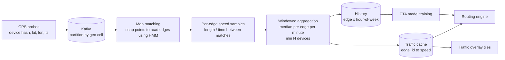

**Map matching.**

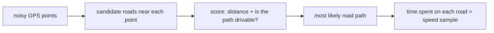

A GPS point can be 10 to 30 m off, and in an urban canyon (streets between tall buildings that bounce signals) far more. A point near a parallel service road could belong to either road. **Hidden Markov map matching** (Newson and Krumm) treats the true road as hidden state.

For each point it scores candidate edges by distance (emission probability) and scores transitions between consecutive points by how plausible the driving path is compared with the straight-line move. Finding the best sequence is the Viterbi algorithm.

Result: a path of edges, and the time spent on each.

**Aggregating.** For each edge, collect speed samples in a tumbling or sliding window of one minute.

Use the **median** (outliers such as a stopped delivery van do not dominate), publish only if at least N distinct devices contributed (privacy and accuracy), and smooth with the previous value.

Stream processing frameworks window by event time and tolerate late events (see [[Stream Processing Basics]]).

**Blending with history.** For an edge with no fresh probes, use `typical_speed[hour_of_week]`. With a few probes, blend: `speed = w * live + (1 - w) * typical`, where `w` grows with the sample count.

**ETA for a route.** Sum the edge times, but note when you will reach each edge: a 90-minute drive should use predicted speeds for the later edges, not the current ones. Add intersection and traffic-light delays.

A learned model then corrects the residual (rain, events, driver style). Graph neural network models over the road network have been used for this (see the DeepMind source).

**Worked numbers.** Edge of 800 m. Free-flow 50 km/h gives 57.6 s. Live median 20 km/h gives 144 s. A route of 30 such edges moves from about 29 minutes to about 72 minutes, which shows why live traffic changes the route choice, not just the displayed time.

**Incidents.** Crashes and road closures come from user reports, partner feeds and detection (many probes stop on a normally fast road). They set an edge's cost to very high or infinite, and routing avoids it within a minute.

**Privacy.** Use rotating device ids, drop the start and end segments of each trip near homes, do not store trips longer than needed, and publish only aggregates.

**Why it matters.** Traffic is what makes a navigation app feel smart and is also its heaviest data flow: 1.2 M probes per second at peak.

### Deep dive 4: search, geocoding and places

**In plain words.** "Pizza near me" needs two things: a text match and a distance filter. Split the planet into cells (geohash or H3). Each place document carries its cell. A query finds the user's cell and its neighbours, filters places in those cells, matches text, and ranks by distance, popularity and rating.

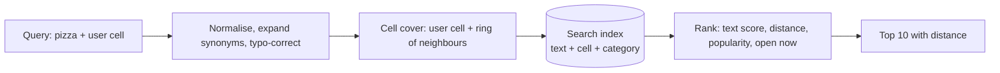

**Address geocoding** uses a hierarchy: country, region, city, street, house number. A parser splits the text into components, matches each against the hierarchy, and interpolates house numbers along the street segment when exact points are missing. **Reverse geocoding** finds the nearest edge or polygon containing the point.

**Autocomplete** serves prefixes quickly from a trie (a tree where each step adds one letter) or an edge-n-gram index (an index of every word's starting pieces), biased by the user's location (see [[Case Study - Search Autocomplete]]). Details of indexing are in [[Search Engines and Inverted Indexes]].

**Why it matters.** Local ranking, not global popularity, is what makes results feel right.

### Offline maps

**In plain words:** the app downloads the squares and a small road graph for one area, so it can work without internet.

The user picks a region. The app downloads the tiles for that bounding box up to a zoom cap, a compact routing graph for the region and a places index. Navigation then runs on the phone with historical speeds only.

Rough size estimate (not a published figure): vector tiles for one city up to about z15 are tens to a few hundred MB depending on detail; the routing graph for a large country is on the order of hundreds of MB.

Updates come as differential downloads keyed by map version.

> [!tip] Remember
> Heavy preprocessing offline, tiny work online. That pattern appears in tiles, routing and offline maps.

## 9. Bottlenecks, scaling and failure handling 🔴

**Scaling plan**
1. **Tiles:** more CDN, longer TTLs, origin shield, versioned URLs.
2. **Routing:** add shards per region; replicate hot regions (metro areas at rush hour); keep graph in RAM with memory-mapped files so restarts are quick.
3. **Probes:** partition Kafka by geo cell so one map-matching worker holds the state of its region; add partitions.
4. **Traffic cache:** shard by region; each shard holds only its edges' speeds.
5. **Search:** shard by region plus a global shard for countries and big cities.
6. **Build pipeline:** weekly or daily graph and tile builds; incremental updates for small edits.

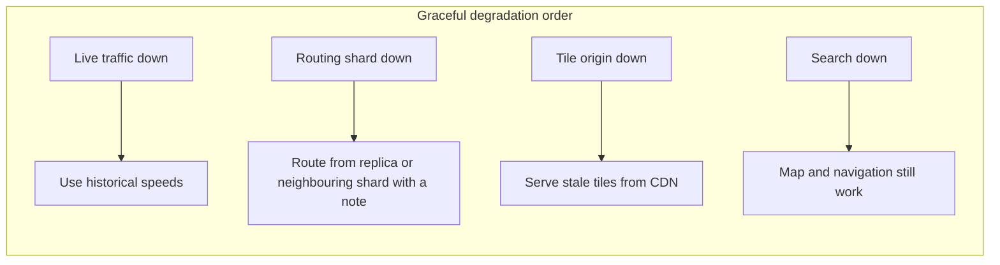

**What if usage grows 10x?** Tiles: the CDN scales almost linearly. Routing: add shards and replicas (CPU bound, stateless besides the graph). Probes: more partitions and workers. The first real wall is the **map-matching and aggregation** state per region; split big cities into sub-cells.

Watch cost: probe processing and CDN egress dominate the bill, so shrink tile bytes (simplify geometry) and sample probes.

**Rush hour.** Demand follows time zones: peaks move across the planet. Autoscale shards by region and time, pre-warm caches before morning peaks, and shed low priority work first (alternative routes, prefetch, traffic overlay tiles) before cutting core route computation. See [[Load Shedding and Graceful Degradation]].

**Consistency.** The map version must match between tiles, routing graph and search (otherwise you display a road that routing does not know). Deploy a build as a unit with a version id; clients and services switch together via a config pointer.

## 10. Interview questions 🔴

> [!question]- How do you serve the map to hundreds of millions of users cheaply?
> Pre-cut the map into `zoom/x/y` tiles that do not depend on the user, store them in object storage and put a CDN in front with versioned URLs and long `max-age`. Use vector tiles to cut bytes.
>
> With a 95% hit rate, the origin sees about 17k requests per second at a 350k peak. Anything personal (blue dot, route line) is drawn on the client.

> [!question]- Why not just run Dijkstra for each route request?
> It explores millions of nodes for a long trip, taking seconds, which cannot serve thousands of requests per second. Use preprocessing: contraction hierarchies add shortcut edges so a query searches only upward in a hierarchy and takes about a millisecond. Keep the graph in memory and shard by region.

> [!question]- How do you incorporate live traffic into routing?
> Probes from phones go through map matching to produce per-road-segment speeds in one-minute windows, blended with historical speeds by hour of week. The routing engine reads these as edge costs. Because contraction hierarchies bake in costs, use a customisable approach that keeps the node order and recomputes only weights, or time-dependent costs.

> [!question]- Trap: "Store the road graph in a graph database." What breaks?
> A general-purpose graph database generally cannot reach millisecond path queries over 1 billion edges at thousands of queries per second. A read-mostly graph that fits in RAM (about 20 GB) is better served from an in-memory binary structure built offline with a hierarchy. The database, if any, holds the source data for builds, not the serving path.

> [!question]- How do you calculate ETA, and why is it sometimes wrong?
> Sum of segment times plus intersection delays, using predicted speeds for the time you will reach each segment, then an ML correction.
>
> Errors come from new incidents, thin probe coverage on a road (falls back to history), unusual weather and events, and turn or traffic-light delays. Measure predicted vs actual per city and hour, and fall back to history when the live model degrades.

> [!question]- How would you handle a route that crosses regions handled by different shards?
> Precompute border nodes between regions and a small overlay graph of border-to-border travel times. Route from the origin to the border nodes in its region, across the overlay, and from the entry border node to the destination. This keeps each shard independent while giving a correct global path.

> [!question]- How do you detect that a user went off route and avoid rerouting spam?
> Compare map-matched position to the route polyline. Reroute only if the deviation exceeds a threshold for several seconds, and rate limit reroutes per session. For traffic-triggered reroutes, only suggest if the saving exceeds a threshold, for example more than 2 minutes, to prevent oscillation.

## 11. What interviewers look for and follow-ups 🔴

- **Level signals.** SDE-2: tiles with a CDN, Dijkstra, basic traffic idea. SDE-3: contraction hierarchies, map matching, traffic aggregation, versioned map builds, degradation. Staff: cross-region routing, customisable CH, ETA modelling and error budgets, privacy design, cost drivers and map data pipeline governance.
- **Red flags.** Computing routes with SQL; no CDN for tiles; no preprocessing step; ignoring turn restrictions or one-way streets; treating GPS as exact; ignoring privacy of probes.
- **Follow-ups to prepare.** "Add transit routing" (time-expanded or RAPTOR over schedules).
  - "Add EV routing with charging stops" (battery state in the search label).
  - "Avoid tolls and highways" (profile-specific graphs or penalty weights).
  - "Show nearby gas stations on the route" (spatial query along a polyline: buffer then cell cover).
  - "Multiple stops in best order" (travelling salesman heuristics over a distance matrix from the routing engine).
  - "Real-time ETA sharing" (a pub-sub channel per share link; see [[Scaling WebSockets]]).
- **Decision guides to cite.** [[Choosing Storage for Files, Search and Analytics - Decision Guide]], [[Choosing a Caching Strategy - Decision Guide]], [[Choosing a Database - Decision Guide]], [[Kafka vs RabbitMQ vs SQS - Choosing a Message Broker]], [[Choosing Compute, Scaling and Deployment - Decision Guide]].

## Self-check 🟢🟡

> [!question]- Easy: what is a map tile?
> A small square piece of the map at one zoom level, named `z/x/y`.

> [!question]- Easy: why can tiles be served by a CDN?
> They look the same for everyone, so one cached copy serves millions.

> [!question]- Easy: where does live traffic come from?
> Anonymous location pings (probes) from phones on the road.

> [!question]- Medium: how many tiles are there at zoom 10?
> 4^10, about 1 million.

> [!question]- Medium: why are contraction hierarchies so much faster than plain Dijkstra?
> Pre-computed shortcut edges let the search climb onto the highway network and explore a few hundred points instead of millions.

> [!question]- Medium: an 800 m road drops from 50 km/h to 20 km/h. How does its travel time change?
> From about 58 seconds to 144 seconds.

## 12. Cheat sheet 🟢

- Tile address: `z/x/y`, 4^z tiles per level, computed by arithmetic. Pre-build z0-z14 (about 358 M), render deeper on demand. Vector tiles, versioned URLs, CDN hit rate about 95%.
- Road graph: nodes are intersections, edges are directed segments with time. In RAM, sharded by region.
- Dijkstra then bidirectional then A\* then contraction hierarchies (milliseconds). Customisable CH or time-dependent costs for live traffic.
- Traffic: probes, Kafka, map matching (HMM and Viterbi), per-edge median per minute, blend with history by hour of week.
- ETA is the sum of edge times at predicted arrival, plus ML correction.
- Search: text index plus geohash or H3 cell filter, rank by distance and popularity.
- Degrade in this order: live traffic to historical speeds; search off but map and routing on; stale tiles from the CDN.
- Numbers (estimates): about 350k tile req/s peak, about 1.2 M probes/s peak, about 20 GB planet graph.

## Links

- **Before this:** [[System Design Interview Framework]], [[Back-of-the-Envelope Estimation]], [[Geospatial Indexing]], [[Graphs and Graph Algorithms]]
- **Building blocks:** [[Heaps and Priority Queues]], [[CDN and Edge]], [[Caching Patterns]], [[Partitioning and Sharding]], [[Kafka and Event Streaming]], [[Stream Processing Basics]], [[Time-Series and Columnar Storage]], [[Search Engines and Inverted Indexes]], [[Load Shedding and Graceful Degradation]], [[Scaling WebSockets]]
- **Decision guides:** [[Choosing Storage for Files, Search and Analytics - Decision Guide]], [[Choosing a Caching Strategy - Decision Guide]], [[Choosing a Database - Decision Guide]], [[Kafka vs RabbitMQ vs SQS - Choosing a Message Broker]], [[Choosing Compute, Scaling and Deployment - Decision Guide]]
- **Compare with:** [[Case Study - Ride Sharing and Proximity]] (location index and ETA), [[Case Study - Search Autocomplete]] (typeahead), [[Case Study - Video Streaming]] (CDN-heavy static content)

### Watch on YouTube

- [Design Navigation Systems like Google Maps, Uber & Doordash / System Design](https://www.youtube.com/watch?v=HC-3J8ycXFs) · Irtiza Hafiz · 13 min · 13,825 views
