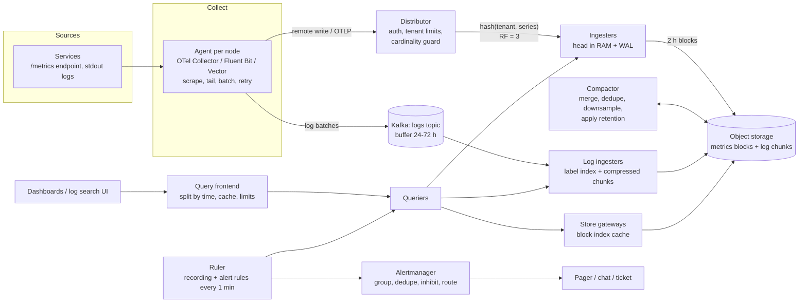
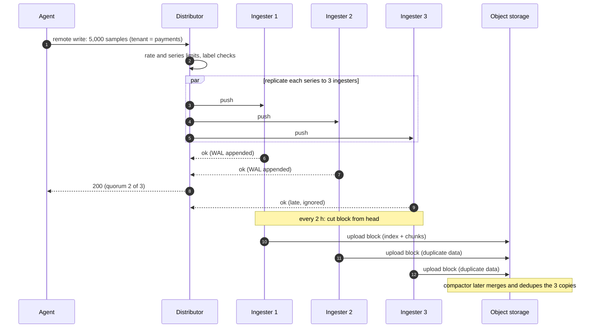
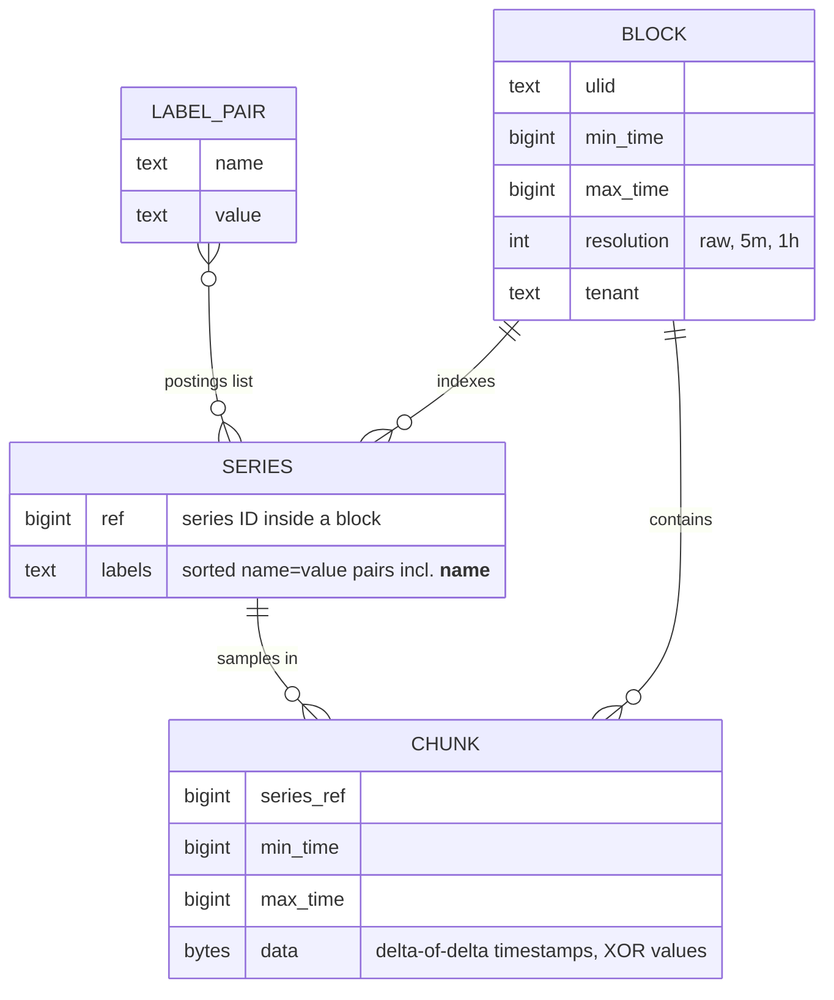
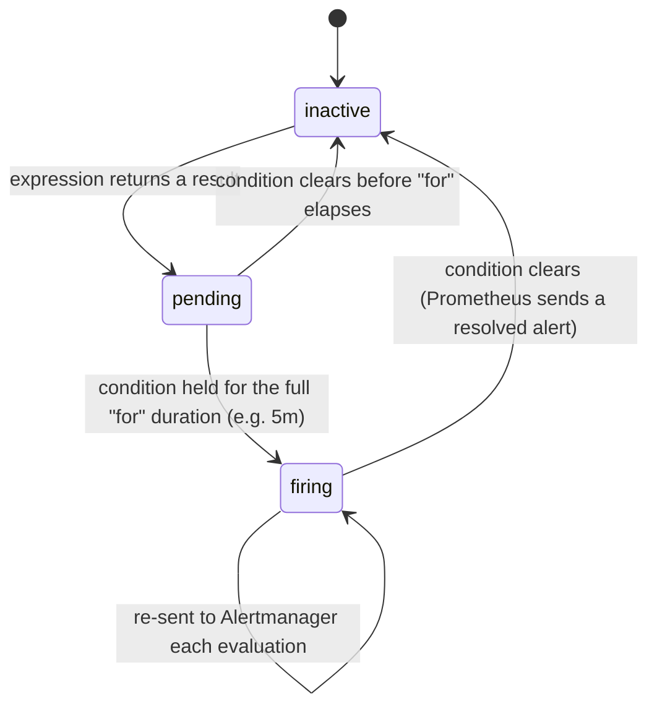

# Case Study - Metrics and Logging Platform

> [!summary] TL;DR
> Design a shared platform that collects metrics and logs from every service in a company, stores them cheaply for weeks, answers dashboard and search queries in seconds, and fires alerts. Metrics are small numbers on a schedule, so they go into a compressed **time-series database**; logs are big text, so the key decision is how much of them to **index**.

> [!abstract] Core idea
> - Metrics: each unique `name + labels` combination is a **series**. Cost grows with the number of series (cardinality), not with traffic.
> - Store recent samples in memory with a write-ahead log, then flush compressed, immutable blocks to object storage; compact and downsample them later.
> - Logs: either index every word (fast search, expensive) or index only a few labels and scan compressed chunks at query time (cheap, slower search).
> - Protect the platform from its tenants: per-tenant limits on series, ingest rate and query cost.
> - Alerting runs as queries on a timer, close to the data, and must keep working when other parts are degraded.

## 1. Why it exists - requirements

A company runs 5,000 services on 20,000 pods. Every team ships its own Prometheus and its own log stack, and on-call engineers jump between ten tools during an incident. Disks fill up, a single team's new `user_id` label takes down their Prometheus, and nobody can search logs older than three days. The company wants one platform.

**Functional requirements**
- Ingest metrics (counters, gauges, histograms) via Prometheus remote write and OTLP; ingest logs from files and stdout.
- Query metrics with PromQL for dashboards; search and filter logs by service, time range and text.
- Evaluate alert rules and route notifications (page, chat, ticket).
- Multi-tenancy: each team is a tenant with its own limits and access.
- Retention: metrics raw 15 days, downsampled for 13 months; logs searchable 30 days.

**Non-functional requirements**
- Ingest is available even when queries are slow; dropping data is a last resort and always counted.
- Dashboard query over the last 1 h: p99 under 2 s. Log search over 1 h of one service: under 5 s.
- Alert evaluation latency: rules evaluated every 1 minute (rule interval), notifications within a minute of a rule firing.
- Cost per GB stored and per million series is a first-class requirement.
- Out of scope: traces (see [[Distributed Tracing with OpenTelemetry]]), business analytics.

**Glossary.** A **sample** is one `(timestamp, value)`. A **series** is all samples with the same metric name and label set, for example `http_requests_total{service="checkout",code="500"}`. **Cardinality** is the number of distinct series. A **block** is an immutable file set covering a time range. **Downsampling** replaces raw samples with per-interval aggregates (min, max, sum, count). A **log stream** in label-indexed systems is all lines sharing a label set.

## 2. Mental model

Metrics are like electricity meters: every 15 seconds each meter reports one number, and the numbers barely change, so you can store them in about one byte each. The expensive part is the **number of meters**. Logs are like a diary from every machine: lots of free text. You either build a full index at the back of every diary (fast lookup, the index can be as large as the diary) or you just label each diary by owner and date and read the relevant pages when someone asks (cheap to store, slower to search).

## 3. How it works - high-level design



**Metrics write path.**
1. Agents scrape each pod's `/metrics` every 15 s (pull) or receive OTLP pushes, batch samples, and send them with retries.
2. The distributor authenticates the tenant, enforces ingest-rate and series limits, validates labels, and hashes each series (tenant + sorted labels) onto a ring of ingesters (see [[Consistent Hashing]]).
3. Each series goes to 3 ingesters; the write succeeds when 2 acknowledge (a quorum, see [[Quorums and Leaderless Replication]]).
4. Ingesters append to an in-memory **head** and a write-ahead log; every 2 hours they cut an immutable block (index + compressed chunks) and upload it to object storage.
5. The compactor merges the 3 replicas' blocks into one (deduplication), merges small blocks into larger ones, writes downsampled copies, and deletes data past retention. (Thanos's compactor downsamples; Grafana Mimir's compactor does not, so on Mimir long ranges rely on query splitting and caching instead.)

**Metrics read path.** The query frontend splits a 7-day query into per-day pieces, serves cached pieces, and queues the rest; queriers fetch the last few hours from ingesters and older data from store gateways, which read block indexes and only the needed chunks from object storage.

**Logs path.** Agents tail files, parse or attach labels (`service`, `env`, `level`, `pod`), and ship batches to Kafka, which absorbs bursts and lets indexers be restarted or replayed. Log ingesters group lines into streams by label set, compress them into chunks, index only the labels, and flush chunks to object storage.



## 4. Worked example - estimates, API and data model

### Whiteboard version

```text
[agents] --remote write--> [distributor: limits] --hash ring RF3--> [ingesters: head+WAL]
                                                             \--2h blocks--> [object store]
[agents] --logs--> [Kafka] --> [log ingesters: label index + chunks] --> [object store]
[compactor]: dedupe replicas, merge, downsample 5m/1h, retention
[query frontend] -> [queriers] -> ingesters (recent) + store gateways (old)
[ruler] every 1m -> [Alertmanager] -> pager
Numbers: 20M series, 1.33M samples/s, ~1.37 B/sample -> ~158 GB/day metrics
         2M log lines/s x 400 B = 800 MB/s -> ~69 TB/day raw logs
```

### Estimates

All inputs are estimates for a company of this size; the bytes per sample is from the Gorilla paper.

| Quantity | Assumption | Arithmetic | Result |
| --- | --- | --- | --- |
| Active series | 20,000 pods × ~1,000 series each | 20,000 × 1,000 | **20,000,000 series** |
| Sample rate | 15 s scrape interval | 20,000,000 ÷ 15 s | **~1,333,000 samples/s** |
| Compressed size | ~1.37 B/sample (Gorilla, documented) | 1,333,000/s × 1.37 B | ~1.83 MB/s |
| Metrics per day (one copy) | | 1.83 MB/s × 86,400 s | **~158 GB/day** |
| Raw retention | 15 days | 158 GB × 15 | ~2.4 TB in object storage after dedup |
| Ingester memory | ~4 KB per series in the head incl. index (estimate) × RF 3 | 20 M × 4 KB × 3 | ~240 GB RAM across the ingester fleet |
| Log volume | 2,000,000 lines/s × 400 B | 2 M × 400 B | **800 MB/s** |
| Logs per day, raw | | 800 MB/s × 86,400 s | **~69 TB/day** |
| Logs stored, compressed | ~10× compression for repetitive text (estimate) | 69 TB ÷ 10 × 30 days | ~207 TB in object storage for 30 days |

What the numbers decide:
- Metrics storage is small; **series count** drives RAM and query cost, so cardinality limits matter more than disk.
- Raw logs (69 TB/day) are about 440 times the compressed metrics volume (158 GB/day). Indexing every token of 69 TB/day roughly doubles the storage and needs a large indexing cluster; this is the main cost lever.
- Kafka at 800 MB/s with a 24-hour buffer holds ~69 TB per copy, or ~207 TB with Kafka replication factor 3, so the buffer is sized in hours to a few days, not weeks.

### The cardinality trap in one line

`http_requests_total` with labels `method` (5 values) × `route` (200) × `code` (10) × `pod` (500) is 5 × 200 × 10 × 500 = **5,000,000 series** for one metric. Adding `user_id` with 1 M users multiplies it by up to a million. That is why the distributor enforces per-tenant series limits and why IDs belong in logs and traces, not in metric labels.

### API

```http
POST /api/v1/push                      (Prometheus remote write: snappy-compressed protobuf)
X-Scope-OrgID: payments
-> 200; 429 when the tenant exceeds its ingestion rate (retryable);
   400 with "per-user series limit of 2,000,000 exceeded" for the series limit (Mimir uses 4xx-non-429 so clients do not retry)

GET /prometheus/api/v1/query_range?query=sum by (route) (rate(http_requests_total{service="checkout",code=~"5.."}[5m]))&start=...&end=...&step=30s

GET /loki/api/v1/query_range?query={service="checkout",env="prod"} |= "timeout" | json | latency_ms > 500&start=...&end=...&limit=1000
```

The LogQL query first selects streams by labels (index lookup), then scans only those streams' chunks for the word `timeout`, parses JSON, and filters by a field. Narrow labels make it fast; a query on `{env="prod"}` alone has to scan everything.

### Data model



A metrics query like `{service="checkout", code="500"}` intersects two **postings lists** (sorted lists of series IDs per label pair) to find matching series, then reads only their chunks for the time range. This is the same inverted-index idea as full-text search ([[Search Engines and Inverted Indexes]]), applied to labels instead of words.

### Alert lifecycle



Alertmanager then groups related alerts (one page for 40 pods failing the same check), suppresses lower-priority alerts while a higher one fires (inhibition), honours silences during maintenance, and routes by labels to the right team (see [[Alerting and On-Call]]).

### Go: series identity, cardinality guard and downsampling

Three pieces of the write and compaction path: building a canonical series key, a per-tenant cardinality limiter that drops only *new* series once the limit is hit (existing dashboards keep working), and a downsampler that keeps min, max, sum and count per bucket. `DeltaOfDeltas` shows why Gorilla timestamps compress so well. The clock is injected so tests control the limiter window.

```go
package metrics

import (
	"math"
	"sort"
	"strings"
	"sync"
	"time"
)

// SeriesKey builds the canonical identity of a series: metric name plus
// labels sorted by key. Every distinct key is one series in the TSDB.
func SeriesKey(name string, labels map[string]string) string {
	keys := make([]string, 0, len(labels))
	for k := range labels {
		keys = append(keys, k)
	}
	sort.Strings(keys)
	var b strings.Builder
	b.WriteString(name)
	b.WriteByte('{')
	for i, k := range keys {
		if i > 0 {
			b.WriteByte(',')
		}
		b.WriteString(k + "=" + labels[k])
	}
	b.WriteByte('}')
	return b.String()
}

// Limiter caps how many distinct series each tenant may create per window.
// Samples for series already seen in the window are always accepted, so
// a cardinality explosion drops only the new series, not existing ones.
type Limiter struct {
	mu        sync.Mutex
	now       func() time.Time
	window    time.Duration
	maxSeries int
	start     time.Time
	seen      map[string]map[string]struct{} // tenant -> series keys
	rejected  map[string]int
}

func NewLimiter(maxSeries int, window time.Duration, now func() time.Time) *Limiter {
	return &Limiter{now: now, window: window, maxSeries: maxSeries, start: now(),
		seen: map[string]map[string]struct{}{}, rejected: map[string]int{}}
}

// Allow reports whether a sample for this series is accepted.
func (l *Limiter) Allow(tenant, series string) bool {
	l.mu.Lock()
	defer l.mu.Unlock()
	if now := l.now(); now.Sub(l.start) >= l.window {
		l.start = now
		l.seen = map[string]map[string]struct{}{}
		l.rejected = map[string]int{}
	}
	set := l.seen[tenant]
	if set == nil {
		set = map[string]struct{}{}
		l.seen[tenant] = set
	}
	if _, ok := set[series]; ok {
		return true
	}
	if len(set) >= l.maxSeries {
		l.rejected[tenant]++
		return false
	}
	set[series] = struct{}{}
	return true
}

// Rejected returns how many samples of new series were dropped this window.
func (l *Limiter) Rejected(tenant string) int {
	l.mu.Lock()
	defer l.mu.Unlock()
	return l.rejected[tenant]
}

// Sample is one data point.
type Sample struct {
	T time.Time
	V float64
}

// Rollup is a downsampled bucket. Keeping min, max, sum and count (not
// just the average) lets later queries still answer max() and avg().
type Rollup struct {
	Start    time.Time
	Min, Max float64
	Sum      float64
	Count    int
}

func (r Rollup) Avg() float64 { return r.Sum / float64(r.Count) }

// Downsample groups samples (any order) into fixed buckets aligned to
// the Unix epoch, as compactors do for 5-minute and 1-hour resolutions.
func Downsample(samples []Sample, step time.Duration) []Rollup {
	byStart := map[int64]*Rollup{}
	for _, s := range samples {
		if math.IsNaN(s.V) {
			continue // Prometheus staleness markers are NaN; skip them
		}
		start := s.T.Truncate(step)
		r := byStart[start.UnixNano()]
		if r == nil {
			r = &Rollup{Start: start, Min: s.V, Max: s.V}
			byStart[start.UnixNano()] = r
		}
		r.Min = math.Min(r.Min, s.V)
		r.Max = math.Max(r.Max, s.V)
		r.Sum += s.V
		r.Count++
	}
	out := make([]Rollup, 0, len(byStart))
	for _, r := range byStart {
		out = append(out, *r)
	}
	sort.Slice(out, func(i, j int) bool { return out[i].Start.Before(out[j].Start) })
	return out
}

// DeltaOfDeltas returns the second differences of timestamps in seconds.
// With a fixed scrape interval almost all are 0, which Gorilla stores in
// a single bit per sample.
func DeltaOfDeltas(ts []time.Time) []int64 {
	if len(ts) < 3 {
		return nil
	}
	out := make([]int64, 0, len(ts)-2)
	prev := ts[1].Unix() - ts[0].Unix()
	for i := 2; i < len(ts); i++ {
		d := ts[i].Unix() - ts[i-1].Unix()
		out = append(out, d-prev)
		prev = d
	}
	return out
}
```

Tests (`go vet` clean, `go test -race` passes on Go 1.24.4):

```go
package metrics

import (
	"fmt"
	"math"
	"sync"
	"testing"
	"time"
)

func TestSeriesKeyIsOrderIndependent(t *testing.T) {
	a := SeriesKey("http_requests_total", map[string]string{"method": "GET", "code": "200"})
	b := SeriesKey("http_requests_total", map[string]string{"code": "200", "method": "GET"})
	if a != b || a != "http_requests_total{code=200,method=GET}" {
		t.Fatalf("%s vs %s", a, b)
	}
}

func TestLimiterDropsOnlyNewSeries(t *testing.T) {
	now := time.Date(2026, 11, 4, 9, 0, 0, 0, time.UTC)
	l := NewLimiter(3, time.Hour, func() time.Time { return now })
	for i := 0; i < 3; i++ {
		if !l.Allow("team-a", fmt.Sprintf("s%d", i)) {
			t.Fatalf("series %d should fit", i)
		}
	}
	// A deploy adds a user_id label: every request is a brand-new series.
	for i := 0; i < 100; i++ {
		if l.Allow("team-a", fmt.Sprintf("req{user_id=%d}", i)) {
			t.Fatal("new series over the limit must be rejected")
		}
	}
	if !l.Allow("team-a", "s1") {
		t.Fatal("existing series must keep flowing")
	}
	if !l.Allow("team-b", "s0") {
		t.Fatal("limits are per tenant")
	}
	if got := l.Rejected("team-a"); got != 100 {
		t.Fatalf("rejected %d", got)
	}
	now = now.Add(time.Hour) // new window
	if !l.Allow("team-a", "req{user_id=1}") || l.Rejected("team-a") != 0 {
		t.Fatal("window should reset")
	}
}

func TestLimiterConcurrent(t *testing.T) {
	now := time.Unix(0, 0)
	l := NewLimiter(50, time.Hour, func() time.Time { return now })
	var wg sync.WaitGroup
	var mu sync.Mutex
	accepted := map[string]bool{}
	for g := 0; g < 8; g++ {
		wg.Add(1)
		go func(g int) {
			defer wg.Done()
			for i := 0; i < 100; i++ {
				k := fmt.Sprintf("s%d-%d", g, i)
				if l.Allow("t", k) {
					mu.Lock()
					accepted[k] = true
					mu.Unlock()
				}
			}
		}(g)
	}
	wg.Wait()
	if len(accepted) != 50 || l.Rejected("t") != 750 {
		t.Fatalf("accepted %d rejected %d", len(accepted), l.Rejected("t"))
	}
}

func TestDownsampleFiveMinutes(t *testing.T) {
	t0 := time.Date(2026, 11, 4, 9, 0, 0, 0, time.UTC)
	var in []Sample
	// 15 s scrape for 10 minutes: values 0..39.
	for i := 0; i < 40; i++ {
		in = append(in, Sample{t0.Add(time.Duration(i) * 15 * time.Second), float64(i)})
	}
	in = append(in, Sample{t0.Add(time.Minute), math.NaN()}) // staleness marker
	in[0], in[39] = in[39], in[0]                            // out of order
	out := Downsample(in, 5*time.Minute)
	if len(out) != 2 {
		t.Fatalf("want 2 buckets, got %d", len(out))
	}
	first, second := out[0], out[1]
	if !first.Start.Equal(t0) || first.Count != 20 || first.Min != 0 || first.Max != 19 || first.Sum != 190 {
		t.Fatalf("first %+v", first)
	}
	if second.Count != 20 || second.Min != 20 || second.Max != 39 || second.Avg() != 29.5 {
		t.Fatalf("second %+v", second)
	}
}

func TestDeltaOfDeltasMostlyZero(t *testing.T) {
	t0 := time.Unix(1_700_000_000, 0)
	ts := []time.Time{t0, t0.Add(15 * time.Second), t0.Add(30 * time.Second),
		t0.Add(45 * time.Second), t0.Add(61 * time.Second), t0.Add(75 * time.Second)}
	got := DeltaOfDeltas(ts)
	want := []int64{0, 0, 1, -2}
	if fmt.Sprint(got) != fmt.Sprint(want) {
		t.Fatalf("got %v want %v", got, want)
	}
}
```

Keeping `sum` and `count` instead of a stored average matters: averaging two 5-minute averages with different sample counts gives the wrong hourly average, while `sum ÷ count` over merged buckets is always right.

## 5. Variants

| Decision | Option | How it works | Use when | Cost |
| --- | --- | --- | --- | --- |
| Metrics collection | Pull (Prometheus scrape) | collector scrapes `/metrics` on a schedule | services in a known inventory; "is the target up" comes for free | needs service discovery; short-lived jobs need a push gateway |
| | Push (OTLP, remote write) | apps or agents send samples | serverless, short-lived jobs, cross-network | must protect the backend from floods |
| Metrics store | Single Prometheus per cluster | local TSDB, 15-day default retention | one team, one cluster | no global view, no HA dedupe, limited retention |
| | Horizontally scalable TSDB (Mimir, Cortex, Thanos, VictoriaMetrics) | ring of ingesters, blocks in object storage | multi-tenant platform | many components to run |
| Log indexing | Full-text index (Elasticsearch / OpenSearch) | inverted index on every token | frequent ad-hoc text search, security investigations | indexing CPU, index size comparable to the data, shard management |
| | Label-only index (Loki) | index labels; grep compressed chunks at query time | most queries start from service + time | broad text searches are slow; label cardinality limits apply |
| | Columnar store (ClickHouse) | logs as rows in a sorted, compressed column table | structured logs with SQL analytics | schema design; very high-cardinality free text is less compact |
| Buffering | Kafka between agents and indexers | durable buffer, replay, many consumers | large scale, multiple sinks (SIEM, archive) | another cluster to run; adds seconds of latency |
| | Direct agent → backend | agents retry with a disk buffer | smaller scale | backend outages fill agent disks |

## 6. Trade-offs

- **Index everything vs index labels.** Full-text indexing makes "find this request ID across all services in 30 days" instant, at a cost of index storage and indexing CPU on 69 TB/day. Label-only indexing stores logs at close to their compressed size and pushes the cost to query time. Many companies use label-only for everything plus a full-text index for a small, high-value subset (security and audit logs).
- **Replication factor 3 on ingest vs storage cost.** RF 3 keeps writes and recent queries available through an ingester failure, but triples head memory and uploads three copies of every block until the compactor deduplicates them.
- **Drop vs block under overload.** Metrics and debug logs can be sampled or dropped under pressure; audit logs cannot. Route them through different pipelines with different backpressure policies (see [[Backpressure and Flow Control]]).
- **Raw vs downsampled.** Downsampled data makes year-long dashboards cheap but loses spikes shorter than the step, unless you keep `max` as well as `avg`, as the rollup above does.
- **When a simpler design wins:** one Prometheus pair per cluster plus Loki in single-binary mode covers a startup with a few hundred pods. Build the distributed platform only when retention, multi-tenancy or global queries require it.

## 7. In production

- **Real systems.** Prometheus (single-node TSDB), Grafana Mimir and Cortex (horizontally scaled, multi-tenant Prometheus-compatible), Thanos (sidecar + object storage + compactor), VictoriaMetrics, Grafana Loki, Elasticsearch/OpenSearch, ClickHouse for logs, and the OpenTelemetry Collector as the common agent. Facebook's Gorilla paper introduced the delta-of-delta and XOR scheme that Prometheus and many other TSDBs adapted.
- **Failure: cardinality explosion.** A deploy adds a label with unbounded values; series double in minutes and ingesters run out of memory. Fix: per-tenant and per-metric series limits at the distributor, a "top series by metric" dashboard, and relabelling rules that drop the label at the agent.
- **Failure: query of death.** Someone runs `rate(...)` over 90 days of a 5 M-series metric. Fix: the query frontend enforces limits on series touched, samples loaded and query length per tenant; long ranges use downsampled blocks.
- **Failure: alerting depends on the thing that is down.** If the platform is overloaded, alerts must still fire. Fix: rulers with priority over dashboard queries, a separate small "meta-monitoring" stack that watches the platform itself, and dead-man's-switch alerts that page when the alert pipeline goes silent.
- **Failure: log burst from a crash loop.** One service logs a stack trace 10,000 times a second. Fix: per-stream rate limits at the agent and ingester, dropped-line counters per tenant, Kafka buffer to absorb the rest.
- **What to monitor (the platform itself):** samples and log bytes ingested per tenant; samples rejected by reason (rate, series limit, out of order); active series per ingester; WAL replay time after restart; block upload lag; compactor backlog; query p99 by tenant; rule evaluation duration and missed evaluations; Alertmanager notification failures.

## 8. Deep dive

**Gorilla compression.** Timestamps are stored as the difference of differences. With a fixed 15 s scrape, consecutive deltas are 15, 15, 15, so the delta-of-delta is 0 and costs one bit; the Gorilla paper reports about 96% of timestamps compressed to a single bit. Values are XORed with the previous value: identical values produce 0 (one bit), and similar floats share sign, exponent and high mantissa bits, so only the middle "meaningful" bits are stored. The paper reports an average of about 1.37 bytes per sample instead of 16 bytes for a raw `(int64, float64)` pair, roughly a 12× saving.

**Head, WAL and blocks.** Prometheus keeps the most recent data in a mutable in-memory head, appends every sample to a write-ahead log so a crash can replay it, cuts chunks of about 120 samples per series, and every 2 hours persists the head as an immutable block with its own index. Blocks are later compacted into larger ones. Immutability is what makes object storage work: blocks are written once, cached aggressively, and deleted whole when retention passes, with no in-place updates.

**Downsampling tiers.** Thanos's compactor creates a 5-minute resolution copy of blocks older than 40 hours and a 1-hour resolution copy of blocks older than 10 days. A typical policy keeps raw data 15 days, 5-minute data 90 days and 1-hour data 13 months. Each downsampled point keeps count, sum, min, max and counter values so `rate()`, `avg`, `max` all stay correct.

**Why a hash ring with replication.** Series are spread over ingesters by hashing `(tenant, labels)`, so one tenant's series land on many ingesters and the load is even. Adding an ingester moves only about 1/N of series (consistent hashing). With RF 3 and a write quorum of 2, one ingester can crash or restart without losing writes; on restart it replays its WAL. Queries for recent data must ask all ingesters that may own a series and deduplicate the replicas.

**Logs: why label-only indexing scales.** The index size grows with the number of streams, not with the bytes logged, so 69 TB/day may need an index of only gigabytes. The price is query-time work: a search for a string reads and decompresses every chunk of the matching streams in the time range, parallelised across queriers. That is cheap for "checkout errors in the last hour" and expensive for "this UUID anywhere in 30 days", which is exactly the case to route to traces (look up by trace ID) or to a small full-text index.

## 9. Interview questions

> [!question]- What drives the cost of a metrics platform: request traffic or something else?
> The number of active series. Traffic only changes counter values, which compress to about a byte per sample; each new label value creates a new series with its own memory, index entries and chunks. So limits and dashboards watch series counts per tenant and per metric.

> [!question]- Trap: "Put `user_id` on the request metric so we can see per-user latency." Why is that wrong, and what do you do instead?
> It multiplies the series count by the number of users and will exhaust ingester memory. Per-user detail belongs in logs and traces (high cardinality is fine there); metrics keep low-cardinality labels such as route, method and status. Exemplars can link a histogram bucket to a sample trace ID.

> [!question]- How do you keep the platform available when one ingester dies?
> Each series is written to 3 ingesters and acknowledged on 2, so writes continue. The dead ingester replays its WAL on restart. Queries for recent data read from the surviving replicas and deduplicate. The compactor later dedupes the replicas' uploaded blocks.

> [!question]- Elasticsearch or Loki for logs?
> Depends on query patterns and budget. Elasticsearch indexes every token: fast arbitrary text search, but indexing CPU and index storage at 69 TB/day are large. Loki indexes only labels and scans compressed chunks: much cheaper storage, fast when queries start from service and time, slow for needle-in-haystack searches. A common mix is Loki for application logs and a full-text index for security and audit logs.

> [!question]- How do you stop one team's query from slowing everyone's dashboards?
> A query frontend that splits by time, caches results, queues per tenant and enforces per-query limits on series, samples and range; downsampled blocks for long ranges; separate query capacity (or priority) for the ruler so alerting is never starved by dashboards.

> [!question]- Why store min, max, sum and count when downsampling instead of the average?
> Averages of averages are wrong when buckets have different sample counts, and an average hides spikes. Sum and count let you recompute any average exactly when merging buckets; max preserves the spike that a latency alert cares about.

> [!question]- What happens to alerts if the metrics pipeline itself is broken?
> Rules see no data and stop firing, which looks like "all healthy". Guard against it with an always-firing watchdog alert that must keep arriving at the pager provider (a dead-man's switch) and a separate meta-monitoring stack for the platform.

## 10. Cheat sheet

- Series = name + sorted labels; cost tracks series count, not traffic.
- 20 M series @ 15 s = 1.33 M samples/s × ~1.37 B ≈ 158 GB/day per copy.
- Write path: agent → distributor (limits) → hash ring, RF 3, quorum 2 → head + WAL → 2 h blocks in object storage → compactor.
- Downsample with min/max/sum/count: 5 m after 40 h, 1 h after 10 d (Thanos defaults).
- Gorilla: delta-of-delta timestamps (~96% one bit), XOR values.
- Logs: full-text index (fast, expensive) vs label-only (cheap, scan at query time); Kafka buffer for bursts and replay.
- Per-tenant limits on ingest rate, series and query cost; drop only new series.
- Alerts: inactive → pending → firing with `for`; Alertmanager groups, inhibits, silences; dead-man's switch.

## Links

- **Before this:** [[Observability Fundamentals]], [[Metrics and Prometheus]], [[Structured Logging]], [[Time-Series and Columnar Storage]], [[System Design Interview Framework]]
- **Building blocks:** [[Consistent Hashing]], [[Replication]], [[Quorums and Leaderless Replication]], [[Partitioning and Sharding]], [[Kafka and Event Streaming]], [[Search Engines and Inverted Indexes]], [[Backpressure and Flow Control]], [[Caching Patterns]]
- **Next:** [[Alerting and On-Call]], [[SLIs, SLOs, SLAs and Error Budgets]], [[Case Study - Ad Click Aggregation]]
- **Compare with:** [[Logging Library]] (class-level LLD twin), [[Distributed Tracing with OpenTelemetry]], [[Case Study - Distributed Job Scheduler]] (a system this platform would watch)
