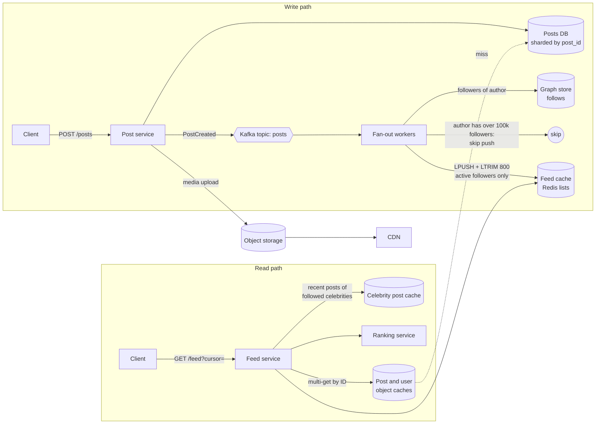
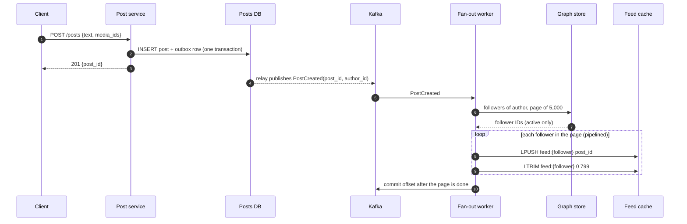
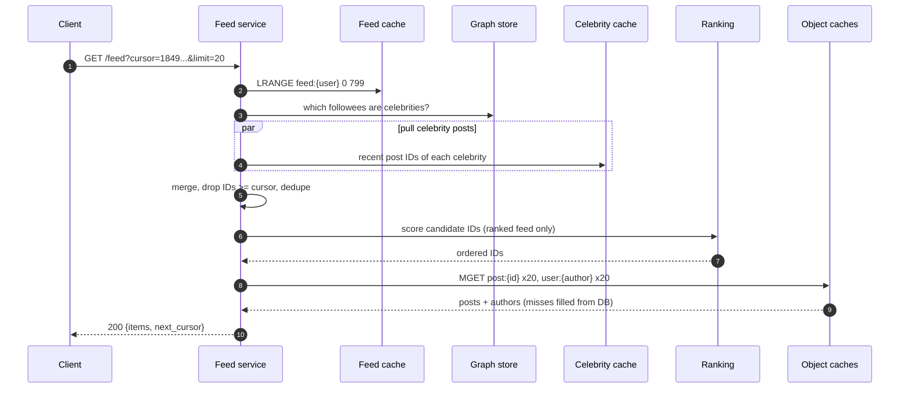
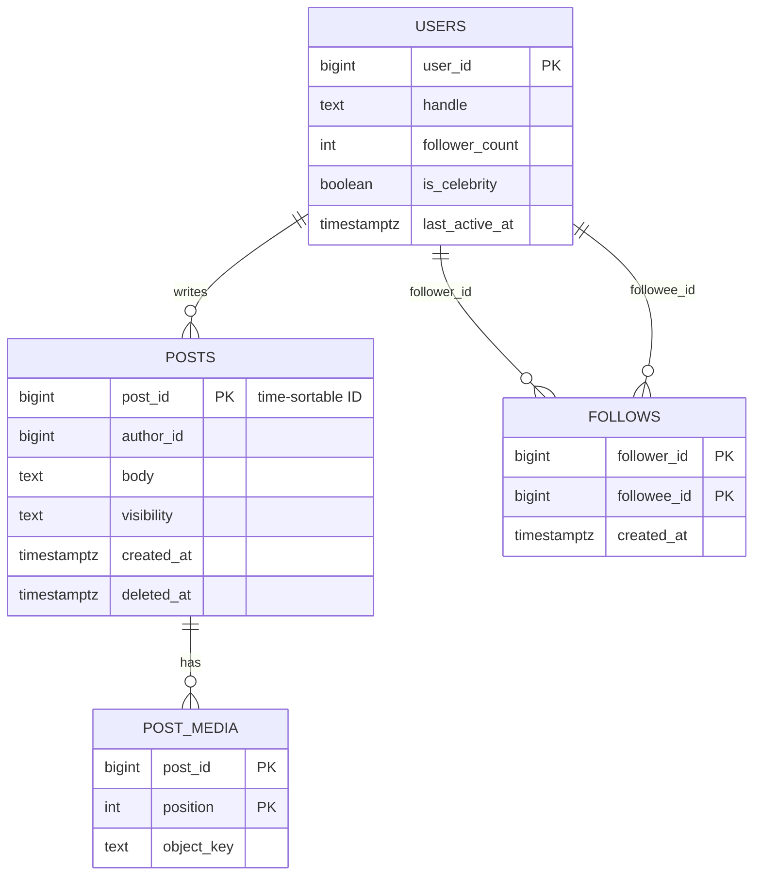

# Case Study - News Feed

> [!summary] TL;DR
> A news feed (also called a home timeline) is the list of recent posts from the accounts a user follows, shown newest-first or ranked. The core design choice is **when** to build each user's list: when a post is written (fan-out on write, also called push), when the feed is read (fan-out on read, also called pull), or a hybrid of the two.

> [!abstract] Core idea
> - Keep a small cached list of **post IDs** per user (about 800), not the posts themselves. Fill in post bodies at read time with one batched lookup.
> - Ordinary authors **push**: a background worker appends each new post ID to every follower's list.
> - Celebrities (authors with millions of followers) are **pulled**: their recent posts are merged in when a follower opens the feed.
> - Paginate with a cursor (the last post ID seen), never with an offset, so new posts never shift the next page.
> - The hard parts are the celebrity write storm, cache memory, and undoing a post (delete, block, privacy change) everywhere it was copied.

## 1. Why it exists - requirements

A user opens the app and expects to see the latest posts from the 200 accounts they follow within a few hundred milliseconds. The naive way is one query at read time:

```sql
SELECT p.*
FROM posts p
JOIN follows f ON f.followee_id = p.author_id
WHERE f.follower_id = $1
ORDER BY p.created_at DESC
LIMIT 20;
```

With 300 million daily users opening the feed 10 times a day, that is about 35,000 such queries per second on average, each touching 200 authors' recent posts spread across many database shards. The query cost grows with the number of followees, and the work is repeated on every open even though almost nothing changed. A feed system exists to do this work once, ahead of time, for most users.

**Functional requirements**
- Create a post (text, optional images or video).
- Follow and unfollow accounts.
- Home feed: posts from followees, either newest-first (chronological) or ranked by predicted interest.
- Infinite scroll: fetch the next page without duplicates or gaps.
- Media is served fast worldwide.

**Non-functional requirements**
- Feed read p99 under about 300 ms (a target for this design).
- A new post appears in followers' feeds within a few seconds. This is **eventual consistency**: different followers may see the post at slightly different times.
- High availability for reads: showing a slightly stale feed is better than an error.
- Reads far outnumber writes.

**Out of scope** for this note: search, direct messages ([[Case Study - Chat System]]), notifications about likes ([[Case Study - Notification System]]), ads.

## 2. Mental model

Think of each user as having a **mailbox**. When you post, a mail carrier walks your post's ID to every follower's mailbox. Opening the feed is just reading your own mailbox, which is fast.

This breaks for a celebrity with 50 million followers: the carrier would need 50 million deliveries for one post. So celebrities instead pin their posts on a **public notice board**, and every follower glances at the boards of the few celebrities they follow when they open their mailbox.

- **Fan-out** means copying one event to many recipients.
- **Fan-out on write (push):** copy at post time. Cheap reads, expensive writes.
- **Fan-out on read (pull):** gather at read time. Cheap writes, expensive reads.
- **Hydration:** turning a list of IDs into full posts (author name, text, media URLs, like counts) with batched lookups.

## 3. How it works - high-level design



The design has five main parts:

1. **Post service** stores the post with a time-sortable 64-bit ID (see [[Unique ID Generation]]), then publishes a `PostCreated` event. The event is published reliably with the pattern in [[Transactional Outbox and CDC]], so a post is never saved without its event.
2. **Fan-out workers** consume the event from Kafka (see [[Kafka and Event Streaming]]), page through the author's followers, and push the post ID into each follower's feed list. They skip authors above the celebrity threshold and followers who have not opened the app in 30 days.
3. **Feed cache** holds one Redis list per user of the newest 800 post IDs.
4. **Feed service** reads the list, merges in celebrity posts, optionally ranks, then hydrates the page.
5. **Object caches** for posts and users serve hydration with batched multi-get calls; this is the cache-aside pattern from [[Caching Patterns]].

**Write path, step by step:**



The client gets `201` before fan-out happens. Fan-out is at-least-once (a worker can crash after pushing but before committing its offset), so a follower's list can hold a post ID twice; the read path removes duplicates.

**Read path, step by step:**



## 4. Worked example - estimates, API and data model

### Whiteboard version

Five boxes and two arrows tell the whole story:

```text
[Post svc] --event--> [Kafka] --> [Fan-out workers] --push IDs--> [Feed cache: feed:{user} = 800 IDs]
                                         (skip celebrities, skip inactive)
[Feed svc] <-- LRANGE feed cache + pull celebrity posts --> merge --> rank --> MGET posts/users --> page
```

Say three numbers: 140k feed inserts per second, 35k feed reads per second, about 2.4 TB of feed cache. Then go deep on the celebrity problem.

### Estimates

All inputs are **estimates** chosen for this exercise; the arithmetic shows the units.

| Quantity | Arithmetic | Result |
| --- | --- | --- |
| Daily active users (DAU) | given | 300 M |
| Posts per day | 300 M users × 0.2 posts/user/day | 60 M posts/day |
| Post write rate | 60 M ÷ 86,400 s | ≈ 700 posts/s average, ≈ 2,100/s at a 3× peak |
| Average followers per author | given | 200 |
| Feed inserts (push) | 60 M posts/day × 200 followers ÷ 86,400 s | ≈ 139,000 inserts/s |
| Feed reads | 300 M × 10 opens/day ÷ 86,400 s | ≈ 34,700 reads/s average, ≈ 100k/s peak |
| Hydration lookups | 34,700 reads/s × 20 posts × 2 objects (post + author) | ≈ 1.4 M cache gets/s, batched into ≈ 70k MGET calls/s |
| Feed cache size | 300 M users × 800 IDs × ≈ 10 B per ID in a compact Redis list (an estimate: a listpack entry for a 64-bit integer is about 10 B; measure with `MEMORY USAGE`) | ≈ 2.4 TB, spread over many Redis nodes |
| Post metadata | 60 M/day × 1 KB | ≈ 60 GB/day, ≈ 22 TB/year |
| Media | 60 M × 10% with an image × 500 KB | ≈ 3 TB/day into object storage |

Two conclusions follow. First, the push path multiplies writes by 200, so it must be asynchronous and batched. Second, one celebrity post with 50 million followers alone equals 50 M inserts, which is 6 minutes of the whole system's average fan-out capacity (50 M ÷ 139k/s ≈ 360 s). That is why celebrities are pulled.

### API

```http
POST /v1/posts
Idempotency-Key: 2f1c9a0e-4b7d-4c1e-9f3a-8d2b6e5a7c10
Content-Type: application/json

{"text": "Shipping the new feed today", "media_ids": ["m_81723"]}

201 Created
{"post_id": "1849203948572811264", "created_at": "2026-11-04T09:12:44Z"}
```

```http
GET /v1/feed?limit=20&cursor=1849203948572811264

200 OK
{
  "items": [
    {"post_id": "1849203911112222720", "author": {"id": "u_42", "name": "Asha"},
     "text": "...", "media": [{"url": "https://cdn.example.com/m/81723.jpg"}],
     "like_count": 128, "liked_by_me": false}
  ],
  "next_cursor": "1849203800001110016"
}
```

- `cursor` is the ID of the last post on the previous page. Because post IDs are time-sortable, "older than the cursor" is a stable boundary, unlike `OFFSET`, which shifts when new posts arrive. See [[Pagination, Filtering and Sorting]].
- The `Idempotency-Key` header makes a retried `POST` safe; see [[Idempotency and Idempotency Keys]].
- `POST /v1/users/{id}/follow` and `DELETE /v1/users/{id}/follow` manage the graph.

### Data model



```sql
-- PostgreSQL 17. Posts are sharded by post_id; an author index serves profile pages
-- and the celebrity pull ("latest posts by author X").
CREATE TABLE posts (
    post_id     bigint PRIMARY KEY,
    author_id   bigint NOT NULL,
    body        text   NOT NULL,
    visibility  text   NOT NULL DEFAULT 'public',
    created_at  timestamptz NOT NULL DEFAULT now(),
    deleted_at  timestamptz
);
CREATE INDEX posts_author_recent ON posts (author_id, post_id DESC) WHERE deleted_at IS NULL;

-- The graph is read in both directions, so it is stored twice, each copy
-- partitioned by its first column (see Partitioning and Sharding).
CREATE TABLE follows      (follower_id bigint, followee_id bigint, created_at timestamptz NOT NULL DEFAULT now(),
                           PRIMARY KEY (follower_id, followee_id));
CREATE TABLE followers_of (followee_id bigint, follower_id bigint, created_at timestamptz NOT NULL DEFAULT now(),
                           PRIMARY KEY (followee_id, follower_id));
```

The feed itself is not a table. It is a Redis list per user, `feed:{user_id}`, holding post IDs newest-first and capped with `LTRIM feed:{user_id} 0 799`. If the list is lost (eviction, node failure), the feed service rebuilds it with a pull query over the user's followees, then writes it back. The cache is a derived copy, not a source of truth.

### The merge step in Go

The read path's key logic merges the pushed list with pulled celebrity posts, drops anything at or newer than the cursor, removes duplicates and cuts a page. It compiles and passes `go vet` and `go test -race` on Go 1.24.

```go
// Package feed merges a pushed (precomputed) home timeline with posts
// pulled from celebrity accounts at read time: the hybrid fan-out model.
package feed

import (
	"cmp"
	"slices"
)

// PostID is a time-sortable 64-bit ID (Snowflake-style): a larger ID is newer.
type PostID uint64

// Page returns up to limit post IDs older than cursor (cursor 0 means "newest"),
// newest first, with duplicates removed. pushed is the follower's cached feed;
// pulled holds the recent posts of each followed celebrity. All inputs may be
// in any order. next is the cursor for the following page (0 when exhausted).
func Page(pushed []PostID, pulled [][]PostID, cursor PostID, limit int) (page []PostID, next PostID) {
	seen := make(map[PostID]bool)
	var all []PostID
	add := func(ids []PostID) {
		for _, id := range ids {
			if (cursor == 0 || id < cursor) && !seen[id] {
				seen[id] = true
				all = append(all, id)
			}
		}
	}
	add(pushed)
	for _, p := range pulled {
		add(p)
	}
	slices.SortFunc(all, func(a, b PostID) int { return cmp.Compare(b, a) }) // newest first
	if len(all) > limit {
		return all[:limit], all[limit-1]
	}
	return all, 0
}
```

```go
package feed

import (
	"slices"
	"testing"
)

func TestPageMergesDedupesAndPaginates(t *testing.T) {
	pushed := []PostID{90, 70, 50, 30, 10}
	celebA := []PostID{95, 60, 50} // 50 also arrived via push (author was below the threshold earlier)
	celebB := []PostID{80, 20}

	p1, next := Page(pushed, [][]PostID{celebA, celebB}, 0, 4)
	if want := []PostID{95, 90, 80, 70}; !slices.Equal(p1, want) {
		t.Fatalf("page 1 = %v, want %v", p1, want)
	}
	p2, next := Page(pushed, [][]PostID{celebA, celebB}, next, 4)
	if want := []PostID{60, 50, 30, 20}; !slices.Equal(p2, want) {
		t.Fatalf("page 2 = %v, want %v", p2, want)
	}
	p3, next := Page(pushed, [][]PostID{celebA, celebB}, next, 4)
	if want := []PostID{10}; !slices.Equal(p3, want) || next != 0 {
		t.Fatalf("page 3 = %v next=%d, want %v next=0", p3, next, want)
	}
}

func TestNewPostDoesNotShiftNextPage(t *testing.T) {
	pushed := []PostID{50, 40, 30, 20}
	p1, next := Page(pushed, nil, 0, 2)      // [50 40]
	pushed = append([]PostID{60}, pushed...) // a new post lands between requests
	p2, _ := Page(pushed, nil, next, 2)
	if !slices.Equal(p1, []PostID{50, 40}) || !slices.Equal(p2, []PostID{30, 20}) {
		t.Fatalf("got %v then %v; a cursor must not repeat or skip posts", p1, p2)
	}
}
```

The second test is the reason for cursor pagination: a post that lands between two page requests does not push an already-seen post onto page 2.

## 5. Variants and comparison

| Strategy | How it works | Use when | Cost |
| --- | --- | --- | --- |
| Fan-out on write (push) | Worker appends each new post ID to every follower's cached list | Most authors have few followers; reads dominate | Write amplification = follower count; celebrity posts take minutes; cache memory for every user |
| Fan-out on read (pull) | At read time, fetch recent posts of every followee and merge | Few reads per write, or users follow few accounts; or a ranked feed recomputed anyway | Read cost grows with followee count; tail latency from many shards |
| Hybrid | Push for normal authors, pull for authors above a follower threshold, merged at read | Large social networks with a few huge accounts | Two code paths; the threshold needs tuning |
| Push to active users only | Fan-out skips followers inactive for 30+ days; their feed is rebuilt by pull on next login | Many dormant accounts | First open after a long absence is slow |
| Chronological | Sort by post ID | Simple, predictable, easy to cache | Engagement may be lower than a ranked feed |
| Ranked | Candidates → features → model score → re-rank for diversity | Engagement-driven products | A ranking service on the read path, feature stores, harder to cache and debug |

## 6. Trade-offs and when not to use

- **Push wastes work on readers who never read.** If most users open the app once a week, pushing every post to them costs more than computing their feed on demand. Skipping inactive followers is the usual fix.
- **Pull is simpler and fresher.** For a small product (thousands of users, few followees each), a single indexed query per read is cheaper than running Kafka, workers and a Redis fleet.
- **Eventual consistency is visible.** Your own post must appear in your own feed immediately; serve it from the write response or merge the author's own recent posts at read time (read-your-writes).
- **Copies are hard to take back.** A deleted post's ID sits in millions of lists. Rather than chasing every copy, filter at hydration time: a deleted or now-private post hydrates to nothing and is dropped.
- **Ranking makes caching harder.** A ranked page depends on time and on the viewer's recent behaviour, so the page itself is rarely cacheable; cache candidates and features instead.

## 7. In production

- **Real systems:**
	- Twitter described its home timeline in "Timelines at Scale" (2012): Redis lists of about 800 entries per user, filled by fan-out on write, with accounts that have very large follower counts handled at read time.
	- Facebook stores the social graph in TAO, a graph-aware cache in front of sharded MySQL, which serves the many small object and edge lookups that hydration needs.
- **Failure modes → fixes:**
	- Celebrity post causes a fan-out storm and lag for everyone → follower threshold, pull for celebrities, and a separate Kafka topic or worker pool for large fan-outs so they cannot block normal posts.
	- Fan-out lag grows after an incident → monitor consumer lag; scale workers by partition count; drop pushes to inactive users first (a form of [[Load Shedding and Graceful Degradation]]).
	- Feed cache node lost → rebuild lists lazily by pull on the next read; protect the database from a rebuild stampede with request coalescing (see [[Cache Failure Modes - Stampede, Avalanche, Penetration, Hot and Big Keys]]).
	- A viral post makes one `post:{id}` cache key hot → replicate hot keys or serve them from an in-process cache; see [[Hot Keys and Hot Partitions]].
	- Duplicates after worker retries → dedupe on read (the Go merge above) because pushes are at-least-once.
- **What to monitor:**
	- Fan-out consumer lag (seconds from post to last follower insert), split by author size.
	- Feed read p50/p99 and the share of reads that needed a rebuild.
	- Hydration cache hit rate and MGET batch size.
	- Feed cache memory per node and eviction count.

## 8. Deep dive

**Choosing the celebrity threshold.** Pushing a post costs one cache insert per follower, paid once, and the last follower sees the post only after all inserts finish. Pulling costs nothing at write time, but every feed open by every follower pays one extra lookup for that author. For most authors push is cheaper, because each follower opens the feed several times per post. Push stops being acceptable when the delay itself is too long: at a worker capacity of, say, 1 M inserts/s (an estimate), 50 M followers take 50 s for one post, and several such posts at once block everyone else's fan-out. Teams pick a threshold in the tens or hundreds of thousands of followers and tune it from fan-out lag metrics; the 100k in the diagram is an example, not a rule.

**Bounding read-time pulls.** A user who follows 300 celebrities would trigger 300 lookups per read. Keep a per-celebrity cache of the latest 100 post IDs (`celeb:{author_id}`), cap how many celebrities are pulled per read (for example the 50 most interacted with), and fetch them in one pipelined round trip.

**Ranking pipeline.**
1. *Candidate generation:* the ~800 pushed IDs plus celebrity pulls plus, optionally, recommended posts.
2. *Feature fetch:* author affinity, post age, engagement so far, media type.
3. *Scoring:* a model predicts the chance of engagement.
4. *Re-ranking:* enforce diversity (not five posts from one author in a row), freshness and policy filters.
Keep the chronological path as a fallback when the ranking service is slow, by setting a timeout on that call (see [[Timeouts, Retries and Backoff]]).

**Counters.** Like and view counts on hot posts are write-hot. Write increments to `N` sharded counters (`likes:{post}:{0..N-1}`) and sum them on read, or aggregate increments in a stream and write the total every few seconds. Exact counts are rarely needed on the feed.

**Propagating deletes, blocks and privacy changes.**
- Delete: mark `deleted_at`; hydration drops the post. Optionally run a background job to remove the ID from followers' lists.
- Unfollow: future posts stop arriving; filter existing IDs by checking "does the viewer still follow the author?" at hydration time, or tolerate them until they age out of the 800-entry window.
- Block: must take effect immediately, so it is always checked at read time.

**Sharding.** Feed lists shard by `user_id`; post objects by `post_id`; the follower graph by the first column of each copy. See [[Partitioning and Sharding]] and [[Consistent Hashing]]. Each Redis list key lives on one node, so a single user's read is one round trip.

## 9. Interview questions

> [!question]- Push or pull: which do you choose?
> Hybrid. Push post IDs to followers' cached lists for normal authors because reads outnumber writes. Pull for authors above a follower threshold because pushing 50 M copies takes minutes and starves other fan-out. Merge both at read time and dedupe.

> [!question]- Why store post IDs in the feed cache instead of full posts?
> An ID is 8 bytes; a post is about 1 KB. Storing IDs keeps 300 M feeds at about 2.4 TB instead of hundreds of terabytes, and edits or deletes need to change only one post object, not millions of copies.

> [!question]- Trap: why not paginate the feed with `LIMIT 20 OFFSET 40`?
> New posts arrive at the top between requests, so offsets shift and the user sees duplicates or misses posts. Use a cursor: "posts with ID lower than the last one I saw". Time-sortable IDs make that boundary stable.

> [!question]- A user deletes a post that was pushed to 2 million feeds. What happens?
> Mark it deleted in the posts store. Hydration drops it from every feed immediately, without touching the 2 million lists. A low-priority job can clean the IDs out later, or they age out of the 800-entry window.

> [!question]- How do you make sure users see their own new post immediately?
> Read-your-writes: merge the viewer's own last few posts into their feed at read time, or have the client insert the post from the `201` response. Do not wait for asynchronous fan-out.

> [!question]- Fan-out lag hits 10 minutes after a celebrity joins the push path. What do you do?
> Move that author to the pull set (lower their threshold), route large fan-outs to a separate topic and worker pool, skip inactive followers, and add workers up to the partition count. Watch lag split by author size.

> [!question]- How would you add ranking without hurting p99?
> Rank a bounded candidate set (about 800 IDs), fetch features in batch, set a tight timeout on the ranking call, and fall back to chronological order on timeout.

## 10. Cheat sheet

A 45-minute script:

- **0-5 min, requirements:** post, follow, home feed (chronological or ranked), infinite scroll, media. Reads dominate; seconds of staleness is fine; own posts appear immediately.
- **5-10 min, estimates:** 300 M DAU → 700 posts/s, ×200 followers → 139k feed inserts/s; 35k feed reads/s; 800 IDs × 10 B × 300 M ≈ 2.4 TB feed cache; media 3 TB/day.
- **10-15 min, API and data:** `POST /posts` with idempotency key; `GET /feed?cursor=&limit=`; posts by `post_id`, follows stored twice, `feed:{user}` Redis list capped at 800.
- **15-25 min, high-level design:** post service → outbox → Kafka → fan-out workers → feed cache; feed service → merge celebrity pulls → rank → MGET hydrate; media to object storage + CDN.
- **25-40 min, deep dives:** hybrid push/pull and the threshold; skipping inactive users; cursor pagination and dedupe; deletes and blocks filtered at hydration; hot posts and sharded counters.
- **40-45 min, wrap-up:** monitor fan-out lag by author size, read p99, cache hit rate; fall back to chronological when ranking is slow.

## Links

- **Before this:** [[Back-of-the-Envelope Estimation]], [[System Design Interview Framework]], [[Caching Patterns]], [[Kafka and Event Streaming]], [[Unique ID Generation]]
- **Next:** [[Case Study - Chat System]], [[Case Study - Notification System]]
- **Compare with:** [[Pub-Sub Message Queue]] (the class-level design of a topic with many subscribers), [[Notification Service]] (LLD twin for delivery to many users), [[Materialized Views and Denormalization]] (a feed list is a per-user materialized view)
