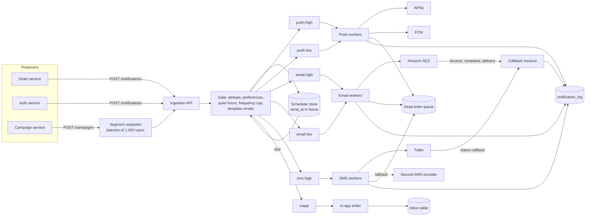
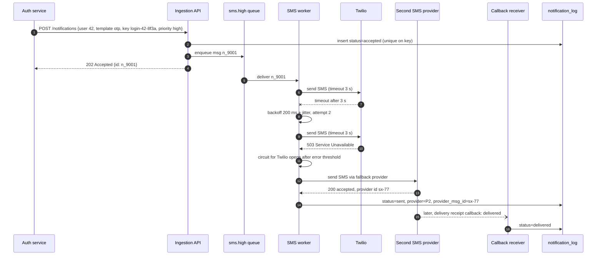
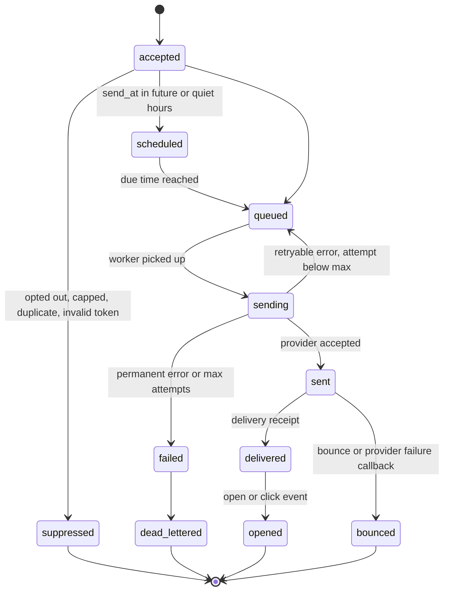
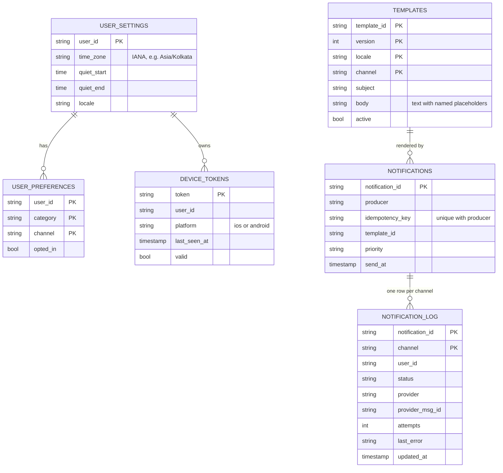

# Case Study - Notification System

> [!summary] TL;DR
> A notification system takes "tell this user (or these 5 million users) something" from other services and delivers it by push, email, SMS or in-app message. The hard parts are not sending: they are keeping a one-time password (OTP) fast while a marketing blast is running, never sending the same message twice, respecting user preferences, and surviving slow or failing third-party providers.

> [!abstract] Core idea
> - One ingestion API; behind it, separate queues per channel and per priority, so an OTP never waits behind a promotion.
> - A gate in front of the queues drops duplicates (idempotency keys), applies opt-outs and quiet hours, and caps marketing frequency per user.
> - Channel workers call providers (APNs, FCM, SES, Twilio) with timeouts, retries with backoff, a dead letter queue and a fallback provider.
> - Delivery status comes back later by callbacks and is recorded per message.
> - Broadcasts expand a segment into per-user messages in batches and are throttled to provider quotas.

## 1. Why it exists - requirements

Without a shared service, every team calls Twilio and SES directly. Each one re-implements retries, nobody checks opt-outs consistently, and a marketing team's 10-million-email campaign uses up the account's sending quota while password-reset emails wait for an hour.

**Functional requirements**
- Channels: **mobile push** (iOS via APNs, Android via FCM), **email**, **SMS**, **in-app inbox**.
- Two classes: **transactional** (OTP, order shipped, payment receipt; triggered by an event, one recipient) and **marketing** (campaigns to a **segment**, a saved query such as "users in Mumbai who booked a movie in the last 30 days").
- **Templates** with versions and locales (`order_shipped`, v3, `hi-IN`).
- **User preferences**: opt out per channel and category, **quiet hours** in the user's time zone (no promos 22:00 to 08:00), unsubscribe links.
- **Scheduling**: send at a time, or at 10:00 in each user's local time.
- **Delivery tracking**: queued, sent, delivered, opened or clicked, failed, with reasons.

**Non-functional requirements**
- OTP and other transactional messages: handed to the provider within 2 s at p99 (a target).
- At-least-once internally, effectively-once to the user via deduplication.
- Marketing must never starve transactional traffic.
- Horizontal scaling for broadcasts of tens of millions of messages.

**Out of scope**: building an SMS gateway or mail server, campaign authoring UI, A/B testing analytics, rich content rendering.

## 2. Mental model

Think of a **post office sorting room**. Letters (requests) arrive at one counter. A clerk checks the address book (preferences) and throws away exact copies (dedupe). Letters are dropped into separate bins: express and bulk, per carrier (channel and priority queues). Each carrier (provider) has its own couriers (workers) who know that carrier's rules and limits. Undeliverable letters go to a dead-letter shelf, and delivery receipts come back later through a separate door (callbacks).

Two principles:
1. **Isolation by priority and channel.** Separate queues and separate worker pools; a slow SMS provider cannot block push, and a campaign cannot block an OTP.
2. **The provider is the bottleneck and the unreliable part.** Design for its quotas, latency and outages, not for your own CPU.

## 3. How it works - high-level design



**Write path (accepting a request).** The ingestion API validates the request and stores it in `notification_log` with status `accepted` keyed by the idempotency key, then the gate decides per recipient and channel:
1. **Dedupe:** has this `(producer, idempotency_key)` been accepted already? If so, return the original ID.
2. **Preferences:** is the user opted out of this category on this channel? Is the device token valid? Is there an email address?
3. **Quiet hours and scheduling:** if a marketing message lands in quiet hours or has a future `send_at`, put it in the scheduler store.
4. **Frequency cap:** no more than 3 marketing pushes per user per 24 h (a product choice).
5. **Render** the template for the user's locale and **enqueue** to the queue for that channel and priority.

Transactional messages skip steps 3 and 4 (an OTP at 23:00 must go out) but never skip dedupe or a hard opt-out from that channel.

**Delivery path (the OTP SMS with a failing provider).**



A timeout does not prove the first provider failed to send. Retrying the same provider without a provider-side idempotency feature, or failing over to another provider, can therefore produce a duplicate SMS. For OTPs that is acceptable (two identical codes); for a "you were charged" message the worker must first query the provider for the earlier attempt. See [[Timeouts, Retries and Backoff]] and [[Circuit Breaker]].

**Message lifecycle.**



## 4. Worked example - estimates, API and data model

### Whiteboard version

```text
Daily: 10M push + 5M email + 1M SMS = 16M/day ≈ 185/s average
Broadcast: 20M users in 30 min ≈ 11.1k/s  (60x the average)
OTP: 1M/day of the SMS, must reach the provider in < 2 s p99

POST /v1/notifications {recipient|segment, template_id, params,
                        channels, priority, idempotency_key, send_at}

[producers] -> [ingestion API] -> [gate] -> [queues per channel x priority]
            -> [channel workers] -> [APNs | FCM | SES | Twilio]
            <- [callbacks] -> [notification_log]
```

### Estimates (inputs are interview assumptions; results are estimates)

| Quantity | Arithmetic | Result |
| --- | --- | --- |
| Daily volume | 10M + 5M + 1M | 16M messages/day |
| Average rate | 16,000,000 / 86,400 s | ≈ 185 messages/s |
| Broadcast peak | 20,000,000 pushes / 1,800 s | ≈ 11,100 pushes/s |
| Log rows | 16M/day × 90 days retention | 1.44 billion rows |
| Log storage | 1.44B × 300 B per row | ≈ 432 GB before replication |
| SMS cost driver | 1M SMS/day × provider price per SMS | SMS is the expensive channel; cap marketing SMS hard |
| Device tokens | 50M users × 1.5 devices × 200 B | ≈ 15 GB |

**What the numbers decide.** 185/s is trivial for any queue. The design is driven by the **11k/s broadcast peak** and by **provider quotas**: an SES account has a per-second sending rate set by AWS for that account, so a 5M-email campaign must be spread over time anyway. The queue's job is to smooth the burst, and the worker pool's rate limiter must match the provider quota.

### API

```http
POST /v1/notifications
Authorization: Bearer <service token>
Content-Type: application/json

{
  "recipient": {"user_id": "u_42"},
  "template_id": "order_shipped",
  "params": {"order_id": "ORD-7781", "eta": "2026-11-06"},
  "channels": ["push", "email"],
  "priority": "high",
  "category": "order_updates",
  "idempotency_key": "order-ORD-7781-shipped",
  "send_at": null
}
```

```http
HTTP/1.1 202 Accepted
Content-Type: application/json

{"notification_id": "n_9001", "status": "accepted"}
```

- `recipient` is either `{"user_id": ...}` or `{"segment_id": ...}`; a segment send is a **campaign** and goes through the expander.
- A repeated `idempotency_key` returns `200 OK` with the original `notification_id` instead of creating a new one.
- `GET /v1/notifications/{id}` returns per-channel status. `PUT /v1/users/{id}/preferences` updates opt-outs and quiet hours.
- Providers call `POST /v1/callbacks/{provider}`; the receiver verifies the provider's signature and dedupes by provider event ID (see [[Webhooks - Sending and Receiving]]).

### Data model



`NOTIFICATIONS` has a unique index on `(producer, idempotency_key)`; the insert either succeeds or returns the existing row, which is the dedupe. In PostgreSQL 17 that is `INSERT ... ON CONFLICT (producer, idempotency_key) DO NOTHING RETURNING notification_id`, followed by a `SELECT` when nothing is returned.

### Code: the admission gate (dedupe plus frequency cap)

The gate below keeps an in-memory sliding-window log per user. In production the same logic runs against Redis (a sorted set per user, `ZREMRANGEBYSCORE` then `ZCARD` then `ZADD` in a Lua script) so all gate instances share state; the algorithm and the test cases are the same. The clock is injected so the test controls time.

```go
// Package notify holds the admission gate that sits in front of the
// channel queues: idempotency dedupe plus per-user frequency caps.
package notify

import (
	"sync"
	"time"
)

// Priority separates must-deliver messages from promotional ones.
type Priority int

const (
	Transactional Priority = iota // OTPs, receipts: never capped
	Marketing                     // promos: subject to frequency caps
)

// Decision is the gate's verdict for one notification.
type Decision int

const (
	Admit     Decision = iota
	Duplicate          // same idempotency key seen within the dedupe TTL
	Capped             // user already got Limit marketing messages in Window
)

// Gate is safe for concurrent use. Now is injected so tests control time.
type Gate struct {
	mu       sync.Mutex
	Now      func() time.Time
	Limit    int           // max marketing messages per user per Window
	Window   time.Duration // sliding window length
	DedupTTL time.Duration // how long an idempotency key is remembered
	seen     map[string]time.Time
	sent     map[string][]time.Time // per user: send times inside the window, oldest first
}

// NewGate builds a gate with the given cap and dedupe TTL.
func NewGate(now func() time.Time, limit int, window, dedupTTL time.Duration) *Gate {
	return &Gate{Now: now, Limit: limit, Window: window, DedupTTL: dedupTTL,
		seen: map[string]time.Time{}, sent: map[string][]time.Time{}}
}

// Check decides whether to enqueue a notification and records it if admitted.
func (g *Gate) Check(userID, idemKey string, p Priority) Decision {
	g.mu.Lock()
	defer g.mu.Unlock()
	now := g.Now()
	if t, ok := g.seen[idemKey]; ok && now.Sub(t) < g.DedupTTL {
		return Duplicate
	}
	if p == Marketing {
		log := g.sent[userID]
		cut := 0
		for cut < len(log) && now.Sub(log[cut]) >= g.Window {
			cut++
		}
		log = log[cut:]
		if len(log) >= g.Limit {
			g.sent[userID] = log
			return Capped // not recorded in seen: a later retry may be admitted
		}
		g.sent[userID] = append(log, now)
	}
	g.seen[idemKey] = now
	return Admit
}
```

```go
package notify

import (
	"sync"
	"testing"
	"time"
)

type fakeClock struct{ t time.Time }

func (c *fakeClock) now() time.Time          { return c.t }
func (c *fakeClock) advance(d time.Duration) { c.t = c.t.Add(d) }

func newTestGate() (*Gate, *fakeClock) {
	c := &fakeClock{t: time.Date(2026, 11, 4, 9, 0, 0, 0, time.UTC)}
	return NewGate(c.now, 3, 24*time.Hour, time.Hour), c
}

func TestDuplicateKeyIsDropped(t *testing.T) {
	g, c := newTestGate()
	if d := g.Check("u1", "otp-123", Transactional); d != Admit {
		t.Fatalf("first: %v", d)
	}
	c.advance(10 * time.Minute)
	if d := g.Check("u1", "otp-123", Transactional); d != Duplicate {
		t.Fatalf("retry within TTL: %v", d)
	}
	c.advance(time.Hour)
	if d := g.Check("u1", "otp-123", Transactional); d != Admit {
		t.Fatalf("after TTL: %v", d)
	}
}

func TestMarketingCapSlidesButOTPNeverCapped(t *testing.T) {
	g, c := newTestGate()
	for i, k := range []string{"m1", "m2", "m3"} {
		if d := g.Check("u1", k, Marketing); d != Admit {
			t.Fatalf("promo %d: %v", i, d)
		}
		c.advance(time.Hour)
	}
	if d := g.Check("u1", "m4", Marketing); d != Capped {
		t.Fatalf("4th promo in 24h: %v", d)
	}
	if d := g.Check("u1", "otp-9", Transactional); d != Admit {
		t.Fatalf("OTP must bypass cap: %v", d)
	}
	if d := g.Check("u2", "m5", Marketing); d != Admit {
		t.Fatalf("other user: %v", d)
	}
	// First promo was sent at 09:00; at 09:00 next day it leaves the window.
	c.advance(21 * time.Hour)
	if d := g.Check("u1", "m4", Marketing); d != Admit {
		t.Fatalf("after window slides: %v", d)
	}
}

func TestConcurrentChecksRespectCap(t *testing.T) {
	g, _ := newTestGate()
	var wg sync.WaitGroup
	var mu sync.Mutex
	admitted := 0
	for i := 0; i < 50; i++ {
		wg.Add(1)
		go func(i int) {
			defer wg.Done()
			if g.Check("u1", string(rune('a'+i)), Marketing) == Admit {
				mu.Lock()
				admitted++
				mu.Unlock()
			}
		}(i)
	}
	wg.Wait()
	if admitted != 3 {
		t.Fatalf("admitted %d, want 3", admitted)
	}
}
```

`go vet` and `go test -race` pass on Go 1.24.4 in a scratch module. The concurrent test proves that 50 parallel promos for one user admit exactly 3, which is the property a non-atomic Redis `GET` then `INCR` would break.

### One request traced

1. At 18:02 IST the order service calls `POST /v1/notifications` for `ORD-7781` with key `order-ORD-7781-shipped`, channels push and email, priority high.
2. The API inserts into `NOTIFICATIONS`; the unique index accepts it. The gate reads preferences: `order_updates` is opted in for push and email; the user has two valid device tokens.
3. Transactional, so no quiet-hours or cap check. Templates `order_shipped` v3 `en-IN` for push and email are rendered.
4. Two messages go to `push.high` (one per device) and one to `email.high`. The API returns `202`.
5. A push worker sends to APNs; APNs returns `410` with reason `Unregistered` for the old iPhone token. The worker marks that token `valid = false` and the log row `failed: unregistered`. The other device's push succeeds.
6. The order service retries the call after a network blip; the unique index returns the existing `n_9001`, so nothing is sent twice.
7. SES later reports a delivery event; the callback receiver sets the email row to `delivered`.

## 5. Variants and comparison

| Choice | Option A | Option B | Pick A when | Pick B when |
| --- | --- | --- | --- | --- |
| Queue technology | Kafka topic per channel and priority | SQS queue per channel and priority (or RabbitMQ priority queues) | You need replay, ordering per user and very high throughput | You want per-message retry, visibility timeouts and delay queues without running a cluster |
| Fan-out for campaigns | Expand segment into per-user messages up front | Expand lazily in batches of 1,000 as the send progresses | Small segments | Millions of users: lets you pause or cancel and apply current preferences |
| Delivery semantics | At-least-once + dedupe at the gate and the worker | Best-effort, no retries | Transactional | Low-value promos where a lost message is fine |
| Preference check | At ingestion | At send time | Fast rejection of obvious opt-outs | Scheduled sends, where the user may opt out before `send_at` (do both) |
| Scheduling | Delay queue (SQS delay up to 15 minutes) | Scheduler store polled by time bucket | Short delays | Hours or days ahead, per-time-zone sends |

**Channel comparison (documented behaviour, check current provider docs before quoting limits):**

| Channel | Provider protocol | Invalid recipient signal | Delivery receipt |
| --- | --- | --- | --- |
| iOS push | APNs over HTTP/2 | HTTP 410, reason `Unregistered` | None by default; the app can report opens |
| Android push | FCM HTTP v1 API | Error `UNREGISTERED` | None by default; the app can report opens |
| Email | SES API or SMTP | Bounce notification (hard bounce) | Delivery, bounce and complaint notifications |
| SMS | Twilio REST API | Error codes for invalid or unreachable numbers | Status callback (`sent`, `delivered`, `undelivered`, `failed`) |

## 6. Trade-offs and when not to use

- **Per-priority queues over one queue with a priority field because** a FIFO queue cannot let an OTP overtake 5M promos already in it. The cost is more queues and worker pools to run.
- **At-least-once plus dedupe over exactly-once because** exactly-once to a third-party SMS gateway is impossible; the worker can always crash after the provider accepts and before it records `sent`. Dedupe narrows the duplicate window; it cannot close it. See [[Delivery Semantics and Exactly-Once]].
- **Async 202 over synchronous delivery because** providers take hundreds of milliseconds and fail often. The cost: producers must poll or subscribe for status.
- **Fallback SMS provider** improves availability but doubles integration and contract work, and a failover after a timeout can send twice.
- **When not to build this**: one product with a few thousand emails per day should call SES or a hosted service directly from a background job ([[Background Jobs and Worker Pools]]); add the platform when several teams, channels or campaigns appear.

## 7. In production

- **Real systems and provider behaviour (documented):**
	- APNs returns HTTP `410` with reason `Unregistered` when a device token is no longer active; FCM HTTP v1 returns `UNREGISTERED`. Both mean "delete or disable this token", and continuing to send to dead tokens wastes quota.
	- SES accounts have a maximum send rate and a 24-hour sending quota; new accounts start in a sandbox that only sends to verified addresses. SES publishes bounce, complaint and delivery events, and high bounce or complaint rates can lead to account review, so hard bounces must suppress the address.
	- RFC 8058 defines the `List-Unsubscribe-Post: List-Unsubscribe=One-Click` header (sent together with a `List-Unsubscribe` HTTPS URI and covered by a DKIM signature) for one-click unsubscribe. Since 2024, Gmail and Yahoo require one-click unsubscribe from bulk senders (Gmail defines these as senders of roughly 5,000 or more messages a day to Gmail accounts) on marketing mail.
	- Twilio reports message status through status callbacks; the values for outbound SMS include `queued`, `sending`, `sent`, `delivered`, `undelivered` and `failed` (the full list also has values such as `accepted`, `scheduled` and `canceled`).
- **Failure modes → fixes:**
	- *Marketing blast delays OTPs* → separate high-priority queues and dedicated worker pools; reserve part of each provider's quota for transactional traffic.
	- *Provider outage or slow responses* → per-provider timeouts, a circuit breaker, and failover to a second provider for SMS and email; keep retries capped and jittered so a recovering provider is not hit by a retry storm.
	- *Duplicate sends after a worker crash* → record `sending` with an attempt ID before the call, use the provider's idempotency features where they exist, and check the log before retrying a non-OTP message.
	- *Poison message* (template fails to render for one locale) → after N attempts move it to the dead letter queue with the error; alert and fix, then redrive ([[Dead Letter Queues and Poison Messages]]).
	- *Quiet hours computed in server time* → always store the user's IANA time zone and compute local time per user; a 10:00 local campaign becomes a rolling send across time zones.
	- *Producers lose events when the DB commit and the notify call disagree* → producers write the "order shipped" event with the [[Transactional Outbox and CDC]] pattern, so a notification is requested if and only if the order change committed.
- **SLOs and monitoring (targets, estimates):** transactional time-to-provider p99 under 2 s; queue age (oldest message) per queue, with a strict alert on `*.high`; provider error rate and latency per provider; hard-bounce rate and complaint rate for email; invalid-token rate for push; DLQ depth; campaign progress (sent per second vs plan).

## 8. Deep dive

### 8.1 Broadcasting to 20 million users without hurting anyone

A campaign is a job, not a request. The campaign service stores `campaign(id, segment_id, template, send_window)` and the expander pages through the segment with keyset pagination (`WHERE user_id > $last ORDER BY user_id LIMIT 1000`). For each page it applies preferences, caps and quiet hours, renders, and enqueues to the **low** priority queues. Three controls matter:
- **Throttle to the provider quota.** A token bucket per provider account sized to, say, 80% of the documented send rate, leaving 20% for transactional traffic. A 20M push campaign at 11k/s takes 30 minutes; a 5M email campaign at an assumed 500 emails/s quota takes about 2.8 hours.
- **Pause and cancel.** Because expansion is lazy, setting `campaign.status = paused` stops the expander; messages already queued are checked against the status by workers.
- **Checkpointing.** The expander stores its last `user_id`, so a crash resumes instead of restarting and double-sending.

### 8.2 Deduplication at three levels

1. **Producer to API:** the `(producer, idempotency_key)` unique index; a retrying producer gets the same ID. Keys must describe the business event (`order-ORD-7781-shipped`), not the HTTP attempt.
2. **Queue to worker:** queues redeliver after a visibility timeout or a consumer crash. The worker does a conditional update `status = 'sending' WHERE status = 'queued'` (a compare-and-set) before calling the provider; a second worker sees zero rows updated and skips.
3. **Worker to provider:** the unavoidable gap. If the process dies after the provider accepted the message and before the log update, the redelivered message is sent again. Keep that window small and, for high-value messages, query the provider by your own reference ID before resending.

### 8.3 Device token hygiene

Tokens change when users reinstall apps or restore phones. The app re-registers its token on each start (`PUT /v1/devices`), updating `last_seen_at`. Workers disable tokens on APNs `410 Unregistered` or FCM `UNREGISTERED`, and a weekly job disables tokens not seen for a long period (for example 270 days, a product choice). Without this, a broadcast spends a large share of its throughput on tokens that can never receive a message.

## 9. Interview questions

> [!question]- How do you make sure an OTP is not delayed by a marketing campaign?
> Separate queues per priority (and per channel) with separate worker pools, and reserve part of each provider's rate limit for high priority. A single FIFO queue cannot let an OTP overtake millions of queued promos.

> [!question]- Trap: "We use Kafka with exactly-once semantics, so users never get duplicates."
> Kafka's exactly-once covers reads and writes inside Kafka. The provider call is an external side effect: a worker can crash after Twilio accepted the SMS and before recording it. You get effectively-once at best with dedupe at the gate, a compare-and-set before sending, and provider-side idempotency where it exists.

> [!question]- How do you send a campaign to 20M users?
> Expand the segment lazily in pages of 1,000 users, apply preferences and caps per page, enqueue to low-priority queues, and throttle workers to the provider quota with a token bucket. Checkpoint the last user ID so a crash resumes, and support pause and cancel.

> [!question]- What happens when a push token is invalid?
> APNs returns 410 with reason `Unregistered`, FCM returns `UNREGISTERED`. Mark the token invalid immediately and stop sending to it; also expire tokens not refreshed for months.

> [!question]- Where do you check user preferences, and why twice?
> At ingestion to drop obvious opt-outs early, and again at send time because scheduled and campaign messages may wait hours, during which the user may opt out. Hard opt-outs (unsubscribe) must win even for already-queued messages.

> [!question]- How do you implement "send at 10:00 local time"?
> Store each user's IANA time zone. The scheduler groups users by time zone and enqueues each group when it is 10:00 there, which spreads the campaign across about a day and naturally smooths the load.

> [!question]- The SMS provider times out. Retry or fail over?
> A timeout means "unknown". Retry the same provider with backoff and jitter a limited number of times; if its circuit is open, fail over. For OTPs a possible duplicate is acceptable; for financial alerts, query the first provider for the message before sending again.

## 10. Cheat sheet

A 45-minute interview script:
- **0-5 min, requirements:** channels (push, email, SMS, in-app), transactional vs marketing, preferences and quiet hours, scheduling, tracking; OTP p99 under 2 s; no duplicates.
- **5-10 min, estimates:** 16M/day ≈ 185/s; broadcast 20M in 30 min ≈ 11k/s; provider quotas are the real limit.
- **10-15 min, API and data model:** `POST /v1/notifications` with `idempotency_key`, `priority`, `send_at`; templates, preferences, device tokens, notification log.
- **15-25 min, high-level design:** ingestion API → gate (dedupe, preferences, caps, render) → queues per channel and priority → workers → providers → callbacks → log.
- **25-40 min, deep dives:** priority isolation; campaign expansion and throttling; dedupe at three levels; provider timeout, retry, circuit breaker and fallback; token invalidation.
- **40-45 min, wrap-up:** SLOs (queue age on `*.high`), bounce and complaint monitoring, DLQ redrive, outbox for producers.

## Links

- **Before this:** [[System Design Interview Framework]], [[Queues vs Streams and Broker Comparison]], [[Idempotency and Idempotency Keys]], [[Case Study - URL Shortener]]
- **Next:** [[Case Study - Key-Value Store]], [[Case Study - Chat System]], [[Case Study - News Feed]]
- **Compare with:** [[Notification Service]] (the class-level LLD twin), [[Rate Limiter]], [[Rate Limiting - Algorithms and Distributed Design]], [[Kafka and Event Streaming]], [[Timeouts, Retries and Backoff]], [[Transactional Outbox and CDC]]
