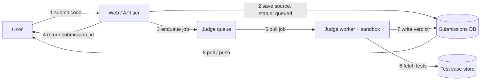
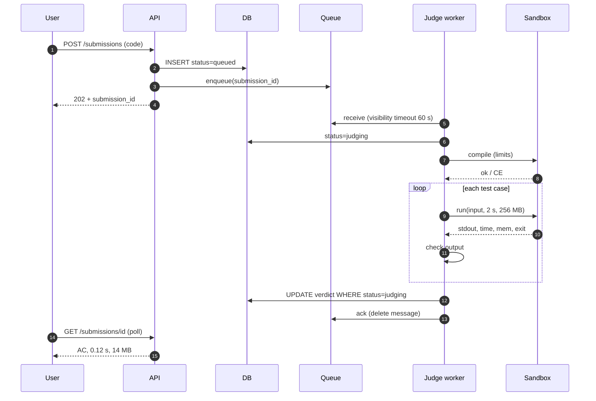
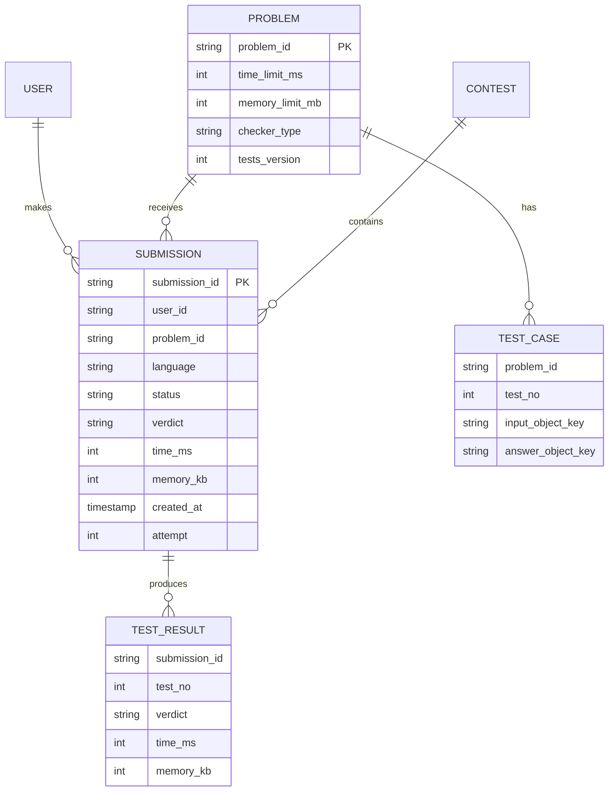
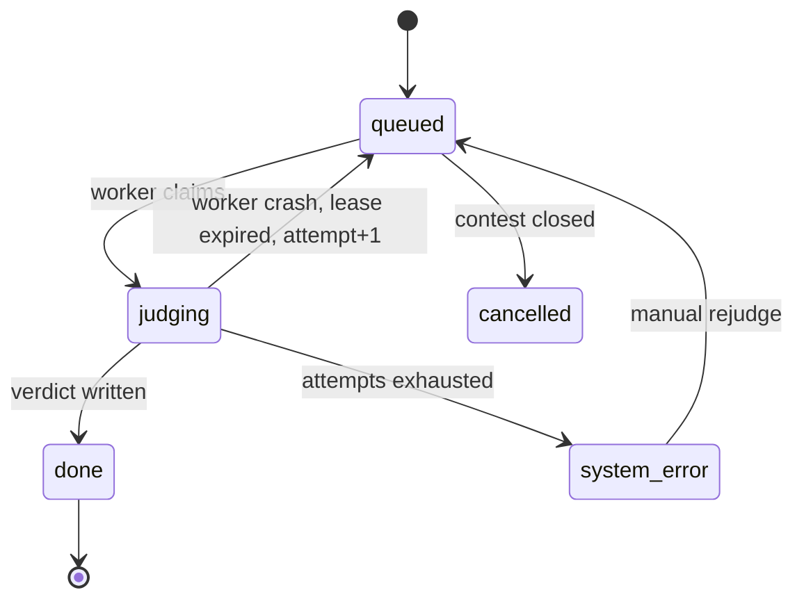
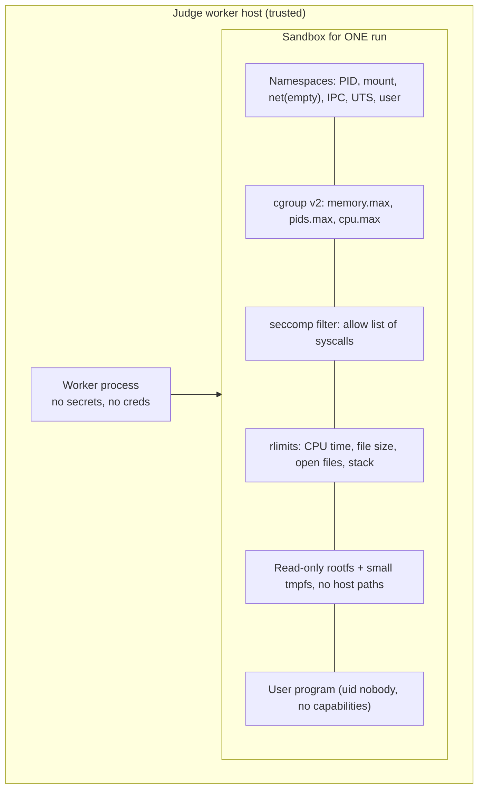
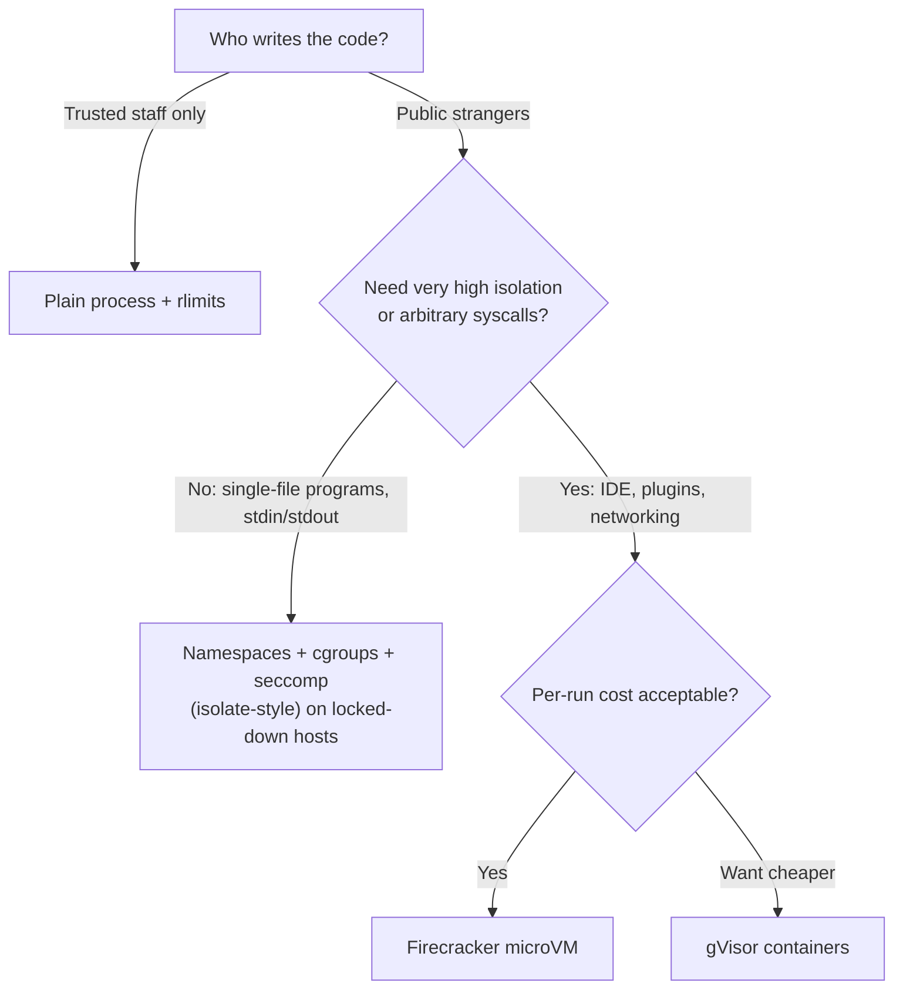
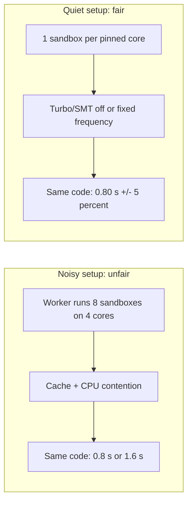
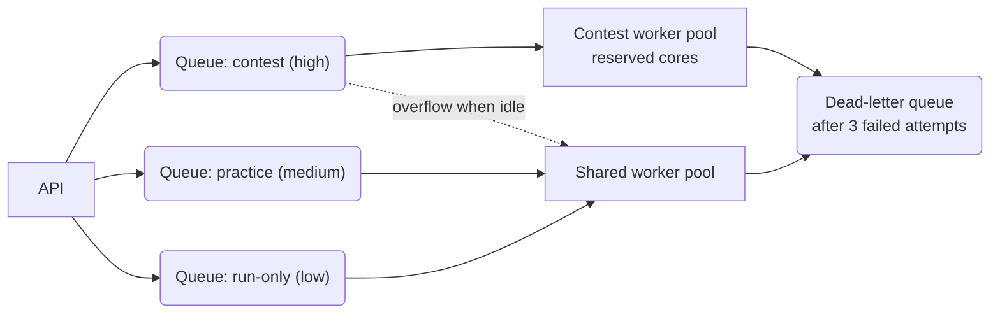
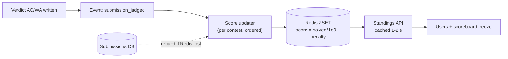
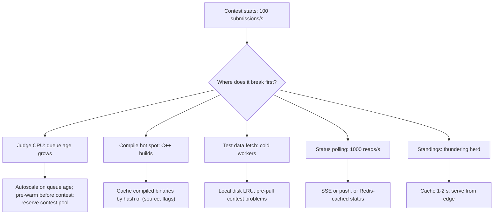

# Case Study - Online Judge

> [!summary] TL;DR
> Design a site like LeetCode or Codeforces: users submit code, the system compiles and runs it against hidden test cases, and returns a verdict (Accepted, Wrong Answer, Time Limit Exceeded) within seconds. The hard part is not storing submissions. It is running **untrusted code safely and fairly** at contest-spike scale. Answer: accept the submission fast, queue it, let a pool of sandboxed workers pull jobs, and push the verdict back to the user.

> [!abstract] Core idea
> - Treat every submission as hostile: it may fork-bomb, read other people's files, open sockets, or try to escape. Isolate it with namespaces, cgroups, seccomp and no network.
> - Split the system into a fast **web tier** (accept and return a submission id) and a slow **judging tier** (compile, run, compare).
> - A **queue** between them absorbs contest spikes. Workers pull jobs at their own pace, so the system degrades to "slower verdicts" instead of falling over.
> - Run a worker's jobs on a **quiet, pinned CPU** with measured limits, so time limits are fair and repeatable.
> - Verdicts are written once, idempotently, and shown through polling or push.

## 1. Why it exists - requirements

A coding-practice site has one unusual job: it runs code written by strangers on your own servers. If you did this naively (`exec.Command("python", "user.py")` on the web server) a single user could delete your disk, mine crypto, scan your internal network, or just write `while True: pass` a thousand times and freeze the site. An **online judge** exists to make "run strangers' code" safe, fair and fast.

Real-life picture: think of a chemistry exam lab. Students (submissions) each get a fume cupboard (sandbox) with a fixed amount of chemicals (memory), a fixed time on the stopwatch (CPU time) and no door to the corridor (no network). The examiner (judge) does not trust anyone, compares the result with the answer sheet (expected output) and writes a grade (verdict). When 500 students arrive at once, they queue outside the lab. Nobody is allowed to skip the queue by shouting.

**Functional requirements**
- Browse problems (statement, examples, limits) and pick a language (C++, Java, Python, Go and so on).
- Submit code for a problem; get a submission id immediately.
- Judge against hidden test cases; return a verdict with time and memory used.
- Show verdict history, source code and (for the failing case, only when allowed) a short diff.
- "Run" button: run the code against a custom input without judging (lower priority).
- Contests: timed events, a live **leaderboard** with scoring and penalty, and fairness rules.

**Non-functional requirements**
- **Security first:** a malicious submission must never read other users' code or tests, reach the network, or crash a worker host.
- **Latency:** verdict in under about 5 s at p95 for a normal problem. Contest spikes may stretch this, but never lose a submission.
- **Fairness:** same code, same input, nearly the same measured time on any worker (within noise).
- **Durability:** an accepted submission is never lost, even if workers crash.
- **Scalability:** survive contest spikes (10-50 times normal load for a few minutes).
- **Correct verdicts:** a worker crash must not produce a false "Time Limit Exceeded". Retry instead.

**Out of scope (say it in the interview):** plagiarism detection, a full web IDE, problem authoring tools.

**Glossary.** A **submission** is one code upload. A **verdict** is the outcome: **AC** accepted, **WA** wrong answer, **TLE** time limit exceeded, **MLE** memory limit exceeded, **RE** runtime error, **CE** compile error, **OLE** output limit exceeded. A **sandbox** is an isolated environment for one run. A **checker** is a program that decides whether the output is right (needed when many answers are valid). A **special judge** is a custom checker.

> [!tip] Remember
> Fast acknowledge, slow judge, strong sandbox. Everything else in this design supports those three ideas.

## 2. Mental model

Picture a **restaurant with a kitchen behind a window**. The front desk (web tier) takes your order slip and gives you a ticket number in a second. The slip goes onto a rail (queue). Cooks (judge workers) each pick one slip, cook inside a closed station (sandbox) with a timer and a fixed amount of ingredients, then put the plate and a score on the counter (verdict store). You check the board (poll or push) for your number.

Where the analogy breaks: a real cook is trusted. Your cooks are not trusted at all, because the "recipe" is written by the customer and may try to burn the kitchen. The station has to be built like a jail cell, not like a bench.



> [!tip] Remember
> The user never waits on the judge inside the HTTP request. They wait on a ticket number.

## 3. How it works - high-level design

### Step by step: one submission

1. **Submit.** The client sends `POST /submissions` with `problem_id`, `language` and the source. The API checks size (for example 64 KB max), rate limits the user and checks the contest window.
2. **Persist.** The API writes the source to a database row with `status = queued` and stores large sources in object storage if needed. This commit is the durable point.
3. **Enqueue.** The API puts `{submission_id}` on the queue. A queue message holds only the id, never the code itself.
4. **Reply.** The API returns `202 Accepted` with the id. This takes tens of milliseconds, independent of judge load.
5. **Claim.** A judge worker with a free sandbox slot pulls the message. The queue hides the message for a **visibility timeout** (for example 60 s) so no other worker takes it.
6. **Prepare.** The worker loads the source, fetches the problem's test cases (cached on local disk by version) and creates a fresh sandbox.
7. **Compile.** For compiled languages, the compiler runs in a sandbox with its own tighter limits (compile bombs are a real attack, for example C++ template recursion or `#include "/dev/random"`).
8. **Run.** For each test case, run the binary in a sandbox with time, memory, process and output limits, feeding the input on stdin and capturing stdout.
9. **Check.** Compare the output with the expected answer, or run the checker program.
10. **Verdict.** Stop at the first failure (ICPC style) or run all tests (partial scoring style). Write the final verdict, time and memory with a conditional update, then ack the queue message.
11. **Notify.** Publish "submission X done" so the user's page updates.



> [!tip] Remember
> The database row is the truth. The queue is just a to-do list that can be rebuilt from rows stuck in `queued`.

## 4. Worked example - estimates, API and data model

### Whiteboard version

```text
Client -> API (auth, rate limit, size check) -> DB row(queued) -> Queue(id)
Judge worker pulls id -> fetch tests (local cache) -> compile in sandbox
  -> run each test in sandbox (cgroup mem/pids/cpu, rlimit, seccomp, no net, tmpfs)
  -> checker -> verdict -> UPDATE ... WHERE status='judging' -> ack
Notify: Redis pub/sub -> SSE; fallback polling.
Contest: priority queue + dedicated worker pool; leaderboard in Redis ZSET.
Scale: judge fleet autoscaled on queue depth/age. Estimates: peak ~100 submissions/s, ~900 cores.
```

### Estimates

All numbers are estimates. State them as assumptions.

| Quantity | Assumption | Arithmetic | Result |
| --- | --- | --- | --- |
| Normal submissions per day | 500k | 500,000 / 86,400 s | **~6 per second** average |
| Contest peak | 20,000 participants, 3 submissions each in the last 10 minutes | 60,000 / 600 s | **~100 submissions/s** |
| Test cases per submission | avg 30, stop at first failure for most WA | avg ~15 actually run | 15 runs |
| CPU per test | avg 0.3 s CPU (limit 2 s) plus sandbox setup 20 ms | 15 x 0.32 s | **~5 CPU-seconds** per submission |
| Compile | C++ about 2 s, Python none | add 1 s average | ~6 CPU-seconds per submission |
| Cores needed at peak | 100 submissions/s x 6 CPU-s | 600 CPU-s per second | **~600 dedicated cores**, plan ~900 for 65% target utilisation |
| Source storage | 5 KB average, 500k per day | 2.5 GB/day | ~900 GB per year (cheap) |
| Test data | 10k problems x 50 MB | 500 GB | object storage, cached on workers |
| Read traffic | 10 status polls per submission | 100 x 10 | ~1,000 reads/s at peak (cached) |

The conclusion to say out loud: **CPU for judging dominates cost**, the database is tiny. Size the judge fleet for the contest peak, but run it autoscaled so you do not pay for 900 cores all month.

### API

```http
POST /v1/submissions
Idempotency-Key: 7f3a...
{"problem_id": "two-sum", "language": "cpp17", "source": "#include ...", "contest_id": null}
202 {"submission_id": "s_8123", "status": "queued"}

GET  /v1/submissions/s_8123
200 {"status": "judging", "progress": {"done": 7, "total": 30}}
200 {"status": "done", "verdict": "AC", "time_ms": 120, "memory_kb": 14336}

POST /v1/run                 # custom input, low priority, smaller limits
GET  /v1/contests/c_9/standings?page=1
GET  /v1/problems/two-sum    # statement, limits, public examples only
```

The `Idempotency-Key` stops a double click or a retry from creating two submissions (see [[Idempotency and Idempotency Keys]]). Hidden test data is never returned by any API.

### Data model



- **Submissions:** relational (Postgres or MySQL). Key access: by `submission_id`, by `(user_id, created_at)` for history and by `(contest_id, problem_id)` for standings. Sharded by `user_id` only when one primary can no longer handle writes. At ~100 writes/s one primary is plenty. Why not a NoSQL store: you need joins for standings and strong consistency on the verdict write. See [[Choosing a Database - Decision Guide]].
- **Test data:** object storage (large, immutable, versioned). Workers keep a local LRU cache keyed by `(problem_id, tests_version)`. See [[Choosing Storage for Files, Search and Analytics - Decision Guide]].
- **Leaderboard:** Redis sorted set per contest, rebuilt from the database if lost (see [[Case Study - Leaderboard and Top-K]]).

### Verdict state machine



> [!tip] Remember
> Estimate CPU-seconds per submission, not requests per second. That single number sizes the fleet.

## 5. Deep dives

### 5.1 The sandbox: how to run hostile code safely

#### In plain words
A sandbox is a box around the program. The program sees a tiny private world: its own filesystem, its own process list, no network, a hard memory ceiling and a stopwatch. If it tries to leave the box, the kernel stops it. You do not rely on one lock. You stack several, so one mistake does not become a breach (defence in depth).

#### Picture it



#### The layers, one by one

1. **Namespaces** give the program its own view. A new PID namespace means it cannot see or signal other processes. A mount namespace gives it a private filesystem. An empty network namespace means no sockets reach anywhere. A user namespace maps "root" inside to nobody outside.
2. **cgroups** (control groups) cap resources. `memory.max` kills the group on overrun, so you get MLE instead of a swap storm. `pids.max` stops a fork bomb. `cpu.max` stops it from hogging cores. Check `memory.events` to tell "killed by OOM" from a normal crash.
3. **seccomp** filters system calls. Allow list only the calls a normal program needs (`read`, `write`, `mmap`, `exit_group`), and kill on `socket`, `ptrace`, `mount`, `clone` with namespace flags, `kexec_load` and friends.
4. **rlimits** (`setrlimit`) add belt and braces: `RLIMIT_CPU` for CPU seconds, `RLIMIT_FSIZE` to cap output file size, `RLIMIT_NOFILE`, `RLIMIT_STACK`.
5. **Filesystem:** read-only root with only the compiler or runtime and libraries; a tiny writable tmpfs for the run. The test input is piped in, never mounted from a shared path. Source and answer files of other users are simply not present.
6. **Drop privileges:** run as an unprivileged uid, drop all capabilities, set `no_new_privs`.
7. **Output cap:** read at most N MB of stdout. A program printing forever would otherwise fill the disk or memory of the worker (verdict OLE).
8. **Wall-clock timer outside the box.** The sandbox's CPU timer does not catch a program that sleeps or blocks forever. The supervisor kills it when wall time exceeds about 2-3 times the CPU limit.

Example attacks and the layer that stops each:

| Attack | What the user writes | Stopped by | Verdict |
| --- | --- | --- | --- |
| Fork bomb | `while(1) fork();` | `pids.max` in cgroup | RE or sandbox kill |
| Memory hog | `malloc` in a loop | `memory.max` | MLE |
| Infinite loop | `while(1);` | CPU rlimit, wall timer | TLE |
| Read the answer file | `open("/data/tests/1.out")` | not mounted, mount namespace | RE or WA |
| Phone home | `socket(...)` | empty net namespace plus seccomp | RE |
| Disk fill | print 10 GB | `RLIMIT_FSIZE`, stdout cap | OLE |
| Escape with ptrace/mount | `ptrace`, `mount` | seccomp kill, no capabilities | RE |
| Compile bomb | deeply recursive template, giant `#include` | compile-stage limits (CPU, memory, output) | CE |

> [!warning] Common mistake
> "Docker is a sandbox, so I am done." A plain container shares the host kernel. A kernel bug can let code escape. Docker adds namespaces and cgroups and a default seccomp profile, but for hostile code you tighten it (custom seccomp, no network, read-only, no capabilities) and often add a stronger boundary, below. See [[Docker 09 - Container Security and Hardening]].

#### Example
A user submits `fork()` in a loop. The worker starts the run inside a cgroup with `pids.max = 64`. After 64 processes `fork` returns an error. The program spins, burns CPU, hits `RLIMIT_CPU` at 2 s and gets SIGXCPU. The supervisor reads the exit status, sees the cgroup `pids` limit event, and reports RE (or TLE). The worker host never slows, because `cpu.max` also capped the cgroup to one core.

#### Why it matters
One escape equals a breach of the host, which holds worker credentials and, in a bad design, other people's code and the hidden tests.

### 5.2 Which isolation technology? (alternatives and choice)

| Option | Isolation strength | Start time | Overhead | Notes |
| --- | --- | --- | --- | --- |
| Plain process + rlimits | Weak | ~ms | none | Only for trusted code. Never for a public judge. |
| Namespaces + cgroups + seccomp (for example `isolate`) | Good (shares kernel) | ~10-30 ms | very low | What many judges use. Judge0 builds on `isolate`. |
| Docker container (hardened) | Good (shares kernel) | ~100-500 ms | low | Convenient images per language. Slower start per run, usually fine if one container runs many test cases. |
| gVisor (user-space kernel) | Stronger (syscalls hit a Go-written kernel) | ~100 ms | 10-50 percent on syscall-heavy code (estimate) | Good middle ground. |
| Firecracker microVM | Strongest (separate kernel via KVM) | ~125 ms (published) | memory per VM | Used for AWS Lambda. Costly for 600 cores of short jobs but right for high-risk code. |

**Choice:** namespaces + cgroups + seccomp as the base, running inside a worker that itself lives in a locked-down VM or node group with **no credentials and no network path to internal services**. Add gVisor or microVMs when you accept arbitrary languages and arbitrary system access (for example an online IDE or a "run any code" product). **Why:** judging needs tens of thousands of very short runs. Heavy VMs per run waste CPU, while the base set blocks all common attacks. The remaining kernel-escape risk is contained by making the host worthless to an attacker (nothing to steal, nothing to reach). See [[Choosing Compute, Scaling and Deployment - Decision Guide]].



> [!tip] Remember
> Stack layers. Then assume one layer will fail, and make sure the host has nothing worth stealing.

### 5.3 Fair and repeatable timing

#### In plain words
If the same code takes 0.8 s on one worker and 1.6 s on another, then "limit 1 s" is a lottery. A judge must measure **CPU time** (not wall time), on a machine that is not busy doing other things, and be generous enough to avoid flapping.

#### Picture it



#### Steps to get stable numbers
1. **Pin each sandbox to its own physical core** (`cpuset`), and leave one core for the supervisor and OS. Do not run more sandboxes than cores.
2. **Measure CPU time** (user + sys) from the cgroup or `wait4` rusage, not wall time. A program blocked waiting does not burn its limit.
3. **Disable noise sources:** fixed CPU frequency, hyper-threading siblings left idle for contest hosts, no background jobs on the host.
4. **Language multipliers:** give Java and Python extra time (for example x2 to x3), because of VM startup and slower runtime. State it on the problem page.
5. **Re-run borderline results.** If a run is within about 10 percent of the limit and fails with TLE, re-run once on another worker before committing the verdict.
6. **Warm-up:** exclude compile time and runtime start from the measured time where possible.

#### Example
Limit 1 s. First run: 1.04 s TLE. The verdict logic sees it is within 10 percent of the limit, so it re-runs on a fresh sandbox: 0.93 s. It reports AC with 0.93 s. Without the re-run, the user would see a random TLE and file a complaint during a live contest.

#### Why it matters
Users and contest organisers forgive a slow verdict but never an unfair one. Fairness is a product feature, and it costs you density (fewer sandboxes per host).

### 5.4 The queue, priorities and backpressure

#### In plain words
When 60,000 submissions arrive in 10 minutes, you cannot run them all at once. The queue holds them. Workers take at their own pace. The queue also lets you decide who goes first: contest submissions before practice, and "Run" button after both.

#### Picture it



#### Options and the choice

| Option | Good | Bad |
| --- | --- | --- |
| SQS or RabbitMQ with visibility timeout / ack | Simple, built for work queues, per-message ack, dead-letter queue | Ordering not needed here, so this is fine. Priorities need multiple queues. |
| Kafka | High throughput, replay | Consumers are per partition, so one slow job blocks others in that partition. A poor fit for long, uneven jobs. |
| DB as queue (`SKIP LOCKED`) | One system, transactional with the submission row | Poll load, harder priorities at large scale. Fine at 100 per second. |

**Choice:** a managed work queue (SQS style) with **separate queues per priority** and a DB row as the source of truth. **Why:** jobs are independent, uneven in length, need per-job ack and retry, and ordering does not matter. Kafka's strength (ordered replayable streams) is wasted here. See [[Kafka vs RabbitMQ vs SQS - Choosing a Message Broker]].

#### Walkthrough: a worker crashes mid-judging
1. Worker A pulls message for `s_8123`; the queue hides it for 60 s.
2. Worker A's host dies after test 12.
3. No ack arrives, so after 60 s the message reappears.
4. Worker B pulls it, increments `attempt` to 2 and judges from test 1.
5. B writes the verdict with `UPDATE ... WHERE status='judging' AND attempt=2`. If A had somehow survived and finished late, its write with attempt 1 is rejected.
6. After 3 failed attempts the message goes to the dead-letter queue and the submission is marked `system_error` for rejudge. See [[Dead Letter Queues and Poison Messages]].

**Backpressure:** at the API, if the contest queue age passes a threshold (for example 60 s), show "judging is slow" and keep accepting. Do not reject. If the practice queue grows, throttle practice first. See [[Backpressure and Flow Control]].

> [!warning] Common mistake
> Sizing the visibility timeout shorter than a worst-case judge run (30 tests x 2 s + compile = about 65 s). The message reappears while worker A is still running, and the job is judged twice. Extend the timeout with heartbeats, or set it above the worst case.

#### Why it matters
This is where "100 submissions per second" turns into "everyone sees a verdict in 20 s" instead of "the site is down".

### 5.5 Contest mode: leaderboard and cheating

#### In plain words
In a contest the rank depends on solved count and penalty time. Everyone refreshes the standings. You compute the score when a verdict arrives, not when someone reads the page.

#### Picture it



#### Steps
1. **Score encoding:** pack solved count and penalty into one number, for example `solved * 1_000_000_000 - penalty_seconds`, so a single sorted set gives the rank. Penalty for ICPC style: minutes of the accepted time plus 20 minutes per earlier wrong try on that problem.
2. **Update on verdict**, in verdict order per user (partition by `contest_id:user_id`), idempotently.
3. **Serve standings from a short cache** (1-2 s). Thousands of readers hit one cached page.
4. **Scoreboard freeze:** in the last hour show a frozen board. Judged results are still recorded; you just stop publishing them until the end.
5. **Rejudge:** if a test is found wrong, mark affected submissions, re-queue, recompute the board from the database. Because the board is derived, rebuilding is safe.
6. **Anti-cheat basics:** per-user rate limits, code similarity check offline after the contest, one account per person, no network inside the sandbox so nobody calls an AI or a friend from the run.

> [!tip] Remember
> Derived data (the leaderboard) is rebuilt from truth (the submissions table). Never make the cache the only copy.

## 6. Bottlenecks and scaling



- **Autoscale the judge fleet** on **queue age** (oldest message waiting), not CPU. CPU on idle workers is low even when the queue is deep. Pre-warm 15 minutes before a scheduled contest, because VM start plus test data fetch can take minutes. See [[Autoscaling]].
- **Cache compiled artefacts** by `hash(source + compiler flags)`. Resubmitting the same code, or "Run" followed by "Submit", skips compile.
- **Pre-pull test data** for contest problems onto each worker at contest start, so the first submissions are not slowed by downloads.
- **Read path:** instead of every browser polling every second, send status updates over SSE or WebSocket from a small notifier fed by Redis pub/sub (see [[Real-time APIs - WebSocket, SSE and Long Polling]]). Polling with backoff (1 s, 2 s, 3 s) is a valid simpler start.
- **Rate limits:** per-user submissions (for example 1 every 5 s in a contest), so one script cannot flood the queue. See [[Rate Limiting - Algorithms and Distributed Design]].
- **DB:** one primary with read replicas for history pages is enough at this scale. Partition `submissions` by month for cheap retention.

## 7. Failure handling

| Failure | Effect | Handling |
| --- | --- | --- |
| Worker crashes mid-judge | Job stuck | Visibility timeout expires, retry with `attempt+1`, fencing on the verdict write |
| Sandbox or runtime itself broken (bad image) | Wrong verdicts | Health check each worker with a known "hello world" and known TLE sample, drain on failure |
| Queue unavailable | Cannot enqueue | Submission row is saved as `queued`; a sweeper re-enqueues rows older than 30 s still `queued` |
| DB primary down | No verdict write | Retry with backoff; failover to replica; jobs remain in the queue |
| Poison submission crashes the worker every time | Retry loop | Max 3 attempts, then DLQ and `system_error`, do not blame the user |
| Test data corrupt or wrong | Wrong verdicts at scale | Test data is versioned; rejudge affected submissions after fixing |
| Sandbox escape suspected | Host compromised | Workers have no secrets and no internal network route; destroy and replace the host; alert on unexpected syscalls or egress |
| Thundering herd after outage | Overload | Jitter, and admit by priority |

> [!warning] Common mistake
> Giving the judge worker broad cloud credentials "to fetch tests". If code ever escapes, the attacker owns the account. Use a narrow, read-only token for one test-data bucket, or a pre-signed URL per problem.

## 8. Trade-offs

| Decision | Option A | Option B | Our pick and why |
| --- | --- | --- | --- |
| Sync vs async judge | Judge inside the HTTP request | Queue + workers | **Async.** Judge time is seconds and bursty. |
| Isolation | Containers only | Layered sandbox on locked hosts | **Layered**, with hosts that hold no secrets. |
| Time fairness vs density | Many sandboxes per host | One per pinned core | **Pinned** for contests, denser for practice. |
| Status delivery | Polling | SSE push | **Polling first**, push when read load hurts. |
| Test data | Download each time | Local cache by version | **Cache.** Immutable, versioned data is cache-friendly. |
| Verdict logic | Run all tests | Stop at first failure | **Stop at first failure** for AC/WA, run all for partial-score problems. |
| Compile | Per run | Cache by hash | **Cache** where code is identical. |
| Queue | Kafka | Work queue (SQS / RabbitMQ) | **Work queue**, see the broker guide. |

## 9. In production

- **Real examples:** Codeforces, LeetCode and HackerRank run contests with spiky load. Judge0 and the IOI's `isolate` are open source and show the layered-sandbox approach. AWS Lambda and Fargate use Firecracker microVMs for hostile multi-tenant code (Firecracker paper, NSDI 2020). Exact internals of the commercial sites are not public, so treat their numbers as unknown.
- **Metrics to watch:** queue depth and oldest-message age, verdict latency p50/p95 per language, sandbox failures, `system_error` rate, worker utilisation, compile cache hit rate, test-data cache hit rate.
- **Alerts:** oldest queued age over 60 s in a contest, `system_error` rate over 0.5 percent, any worker failing its self-test.
- **Operations:** immutable worker images per language, rolled out with canaries and a rejudge plan if a compiler update changes behaviour. Keep compiler and runtime versions pinned and show them on the site.
- **Security posture:** egress denied on worker subnets, no instance profile permissions beyond one bucket read, logs of unexpected seccomp kills as security events.

## 10. Interview questions

> [!question]- How do you run untrusted code safely?
> Layer defences: separate namespaces (PID, mount, empty net, user), cgroup limits (memory, pids, cpu), a seccomp allow list, rlimits, a read-only filesystem with a tiny tmpfs, unprivileged user with no capabilities, an output cap and an outside wall-clock timer. Then assume one layer fails: workers sit on hosts with no secrets and no internal network access. For very high risk, use gVisor or Firecracker.

> [!question]- Why a queue instead of judging inside the request?
> Judging takes seconds and arrives in bursts. A queue lets the API reply in milliseconds, absorbs spikes, lets you prioritise contests, and retries jobs when a worker dies. The user sees a ticket number and a status that updates.

> [!question]- How do you make time limits fair?
> Measure CPU time, one sandbox per pinned core, quiet hosts, language multipliers, and re-run borderline TLE results once on another worker. Mention that you give up some density to get fairness.

> [!question]- A worker dies halfway through a submission. What happens?
> The queue message was not acked, so it reappears after the visibility timeout. A second worker takes it with `attempt+1`. The verdict write is conditional on the attempt number, so a late write from the dead or slow worker is rejected. After 3 attempts the job goes to a DLQ and the submission shows a system error, not a user error.

> [!question]- The contest leaderboard gets 5,000 reads per second. How do you serve it?
> Compute scores on verdict events into a Redis sorted set, serve the standings from a 1-2 s cache or the edge, and rebuild from the submissions table if Redis is lost.

> [!question]- Which database and why?
> Relational for submissions because you need joins for standings and a strongly consistent conditional update for verdicts. Write volume (~100/s) fits one primary. Object storage for test data and large sources. Redis for the leaderboard and status cache.

> [!question]- How would you scale to 10 times more contests?
> Judge CPU is the bottleneck. Autoscale on queue age, shard queues per contest or region, add worker pools per region, cache compiled binaries and test data, and keep the DB scaling for later because it is not the bottleneck. Offer push instead of polling for status.

> [!question]- Follow-up: what if a problem needs a special checker (many valid answers)?
> Run the checker as another sandboxed program with its own limits, feeding it input, the user's output and the jury answer. A buggy checker must give a "system error" and trigger a rejudge, not blame the user.

## 11. Cheat sheet

- Accept fast, queue, judge in sandboxes, notify.
- Sandbox = namespaces + cgroups + seccomp + rlimits + read-only FS + no network + no privileges + output cap + outside timer.
- CPU time per submission sizes the fleet (about 6 CPU-s x 100/s = 600 cores, estimate).
- Queue: work queue with visibility timeout, DLQ, priorities by separate queues.
- Fencing: verdict `UPDATE ... WHERE status='judging' AND attempt=$n`.
- Fair timing: pinned cores, CPU time, re-run borderline.
- Leaderboard: Redis ZSET derived from the DB, cached 1-2 s.
- Scale on queue age. Pre-warm before contests.

## 12. Links

- Decision guides: [[Kafka vs RabbitMQ vs SQS - Choosing a Message Broker]], [[Choosing Compute, Scaling and Deployment - Decision Guide]], [[Choosing a Database - Decision Guide]], [[Choosing an API and Communication Style - Decision Guide]], [[Choosing Storage for Files, Search and Analytics - Decision Guide]], [[Choosing a Caching Strategy - Decision Guide]]
- Concepts: [[Background Jobs and Worker Pools]], [[Docker 09 - Container Security and Hardening]], [[Dead Letter Queues and Poison Messages]], [[Backpressure and Flow Control]], [[Autoscaling]], [[Idempotency and Idempotency Keys]]
- Related case studies: [[Case Study - Distributed Job Scheduler]], [[Case Study - Leaderboard and Top-K]]
- Framework: [[System Design Interview Framework]], [[HLD Round - Complete Step-by-Step Guide]]
