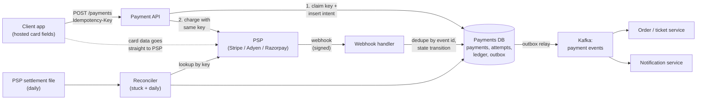
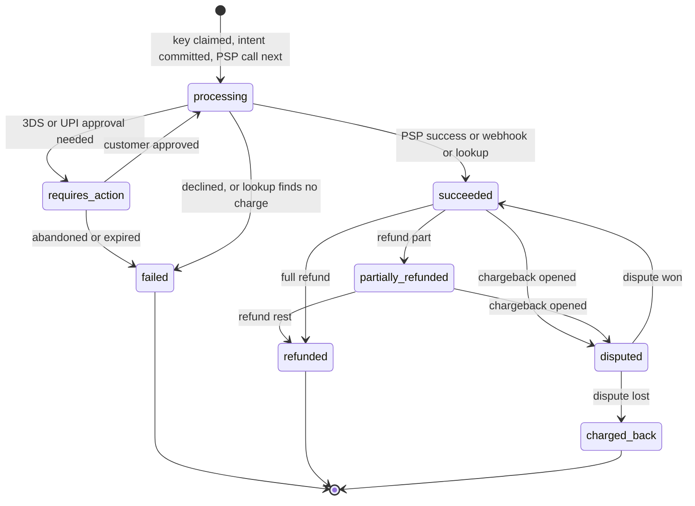
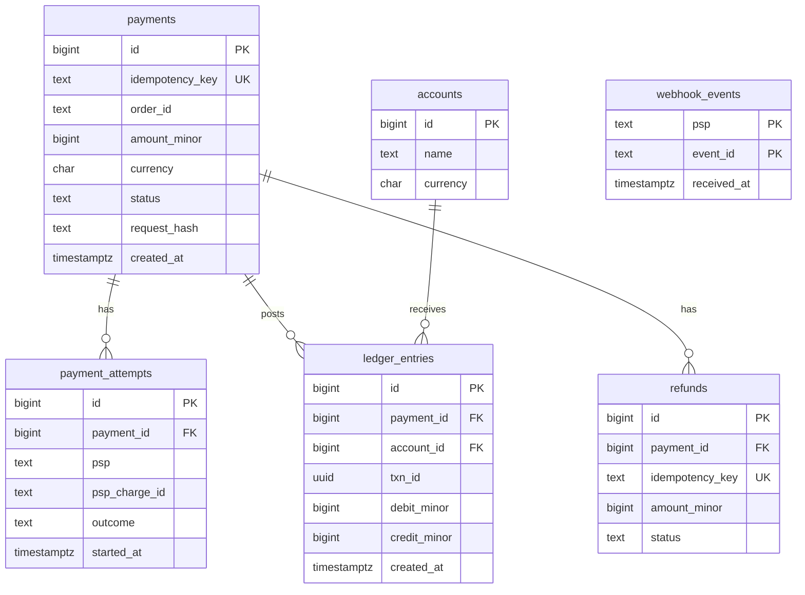
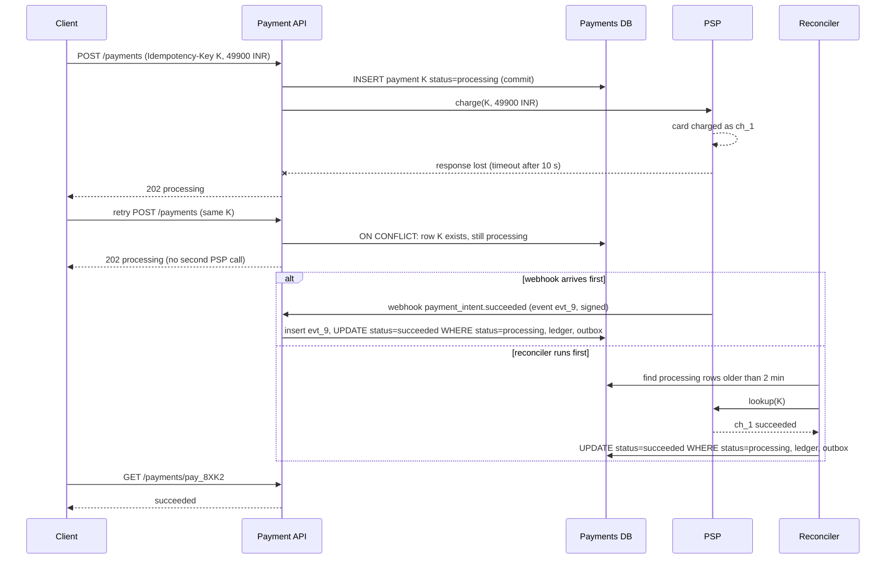

# Case Study - Payment System

> [!summary] TL;DR
> A payment system takes money from a customer through a **payment service provider** (PSP, such as Stripe, Adyen or Razorpay: the company that actually talks to card networks and banks) and records every rupee in an **append-only ledger**. The load is small; the hard part is never charging twice and never losing track of a charge, even when the network times out halfway through.

> [!abstract] Core idea
> - Save the payment intent and its idempotency key in your database **before** you call the PSP, and send the **same key** to the PSP.
> - A timeout means "outcome unknown", not "failed". Resolve it by querying the PSP, waiting for its webhook, or reconciling; never retry with a fresh key.
> - Money lives in a double-entry ledger: immutable rows, debits always equal credits, balances are derived.
> - Webhooks are verified, deduplicated by event id and applied through a state machine that ignores out-of-order events.
> - A daily reconciliation against the PSP's settlement file is the final safety net.

## 1. Why it exists - requirements

A ticketing site sells a ₹499 ticket. The client calls `POST /pay`, your server calls the PSP, the PSP charges the card, and then the response is lost because your 10-second timeout fires. The client sees an error and taps **Pay** again. If the second attempt creates a new charge, the customer pays ₹998. If your service crashed before writing anything, you have a charge on the customer's statement and no record of it at all. Both bugs come from the same root: the system did not write down what it was about to do before doing it.

**Functional requirements**
- Pay-in: charge a card, UPI or wallet through a PSP for an order (`order_id`), including 3-D Secure or UPI approval steps where the customer must act.
- Payment status: `GET /payments/{id}` for the client and the order service.
- Refunds, full or partial, and chargebacks (disputes raised by the card holder's bank).
- Receive PSP webhooks (asynchronous notifications) for final outcomes.
- Auditability: every movement of money can be traced to an immutable ledger entry.
- Payouts to merchants are optional; mention them, and design them only if asked.

**Non-functional requirements**
- **No double charge and no lost charge.** This beats every latency target.
- **Exactly-once effect** for each payment, built from at-least-once delivery plus idempotency (see [[Delivery Semantics and Exactly-Once]]).
- **Strong consistency** for payment state and ledger writes; eventual consistency is acceptable for analytics and notifications.
- **Availability** around 99.95% for the payment API (an estimate of a typical target); during a PSP outage, fail over or fail clearly.
- **PCI DSS scope kept minimal**: raw card numbers never touch our servers.

## 2. Mental model

Think of a careful bank clerk with a paper logbook. Before phoning another bank to move money, the clerk writes "about to send ₹499 for order 42, reference K1" in the logbook. If the phone line drops, the clerk does not dial again with a new reference. The clerk calls back and asks "did reference K1 go through?". At the end of the day the clerk compares the logbook with the other bank's statement, line by line.

Mapped to the system:
- **Logbook line before the call** = the `payments` row plus the idempotency key, committed before the PSP call.
- **Same reference** = the same idempotency key sent to the PSP, which deduplicates on it.
- **Call back and ask** = PSP lookup, webhook or reconciliation for unknown outcomes.
- **Ledger** = double-entry entries that are only ever appended.
- **End-of-day comparison** = reconciliation against the PSP settlement file.

## 3. How it works - high-level design



Step by step:

1. **Tokenize on the client.** The card form is a PSP-hosted iframe or SDK. The browser sends the card number to the PSP and gets back a token (`pm_…`). Our servers only see the token, which keeps us in the smallest PCI DSS scope (SAQ A for a fully outsourced card page, per PCI SSC).
2. **Create the intent.** `POST /payments` carries an `Idempotency-Key` header generated by the client once per checkout attempt. In one database transaction the API inserts the key (unique) and a `payments` row with status `processing`, plus a `payment_attempts` row. Only after this commits does anything leave the building.
3. **Call the PSP with the same key.** The PSP deduplicates on it, so a retry after a timeout returns the original charge instead of creating a new one (Stripe documents this for its `Idempotency-Key` header).
4. **Handle the reply.**
	- Success: in one transaction, set `succeeded`, append two balanced ledger entries, and insert an outbox row.
	- Decline: set `failed` with the decline code; no ledger entries.
	- Timeout or 5xx: leave the row in `processing`. The answer is unknown.
	- `requires_action` (3-D Secure or UPI collect): return the action to the client; the final outcome arrives by webhook.
5. **Webhook.** Verify the signature, insert the event id into `webhook_events` (a unique key turns duplicates into no-ops), then apply the state transition only if it is legal from the current state.
6. **Publish.** An outbox relay ([[Transactional Outbox and CDC]]) puts `payment.succeeded` on Kafka, so the order service confirms the ticket even if the API process died right after commit.
7. **Reconcile.** A sweeper looks up every payment stuck in `processing` for more than a few minutes by key. A daily job matches the ledger with the PSP's settlement report.



The state machine is the guard for every writer: the API, the webhook handler and the reconciler all use `UPDATE … WHERE status = <expected>`, so a late `payment_intent.processing` webhook cannot move a `succeeded` payment backwards.

### Whiteboard version

```text
Client --token--> PSP            (card data never hits us)
Client --POST /payments + Idempotency-Key K--> API
API:  BEGIN; INSERT idempotency_keys(K); INSERT payments(status=processing); COMMIT
API --charge(K, 49900 INR)--> PSP
   ok       -> BEGIN; status=succeeded; 2 ledger rows; outbox row; COMMIT
   declined -> status=failed
   timeout  -> stay processing  ==> reconciler: PSP.lookup(K) / webhook decides
PSP --signed webhook(event_id)--> handler: dedupe event_id, legal transition only
outbox --> Kafka --> order service confirms ticket
nightly: ledger vs PSP settlement file -> mismatches alert a human
Numbers: 1M payments/day = ~12 TPS avg; correctness, not QPS, is the problem
```

## 4. Worked example - estimates, API and data model

### Estimates (all inputs are labelled estimates)

| Quantity | Arithmetic | Result |
| --- | --- | --- |
| Payments per day | given (estimate) | 1,000,000 |
| Average TPS | 1,000,000 / 86,400 s | ≈ 11.6 payments/s |
| Peak TPS (big on-sale, 20× average, estimate) | 11.6 × 20 | ≈ 230 payments/s |
| DB writes per payment | 1 key + 1 payment + 1 attempt + 2 ledger + 1 outbox + ~2 webhook rows | ≈ 8 rows |
| Peak row writes | 230 × 8 | ≈ 1,850 rows/s |
| Storage per payment (estimate 2 KB across all rows and indexes) | 1,000,000 × 2 KB | ≈ 2 GB/day ≈ 730 GB/year |
| PSP latency (estimate p99 2 s) at peak, by Little's law | 230 /s × 2 s | ≈ 460 in-flight PSP calls |

The conclusion is the important part: one well-tuned PostgreSQL primary with a synchronous replica handles 1,850 row writes per second. Sharding is not the first problem. The first problems are idempotency, unknown outcomes, and reconciliation.

### API

```http
POST /v1/payments
Idempotency-Key: 7f9c2a6e-1b0d-4c55-9d1e-2b8f3c0a9e41
Content-Type: application/json

{"order_id": "ord_42", "amount_minor": 49900, "currency": "INR",
 "payment_method_token": "pm_1Q2w3E", "return_url": "https://app.example/pay/return"}

201 Created
{"id": "pay_8XK2", "status": "succeeded", "amount_minor": 49900, "currency": "INR"}

202 Accepted        (outcome unknown or customer action needed; client polls)
{"id": "pay_8XK2", "status": "processing"}

409 Conflict        (same key reused with a different body)
```

- `GET /v1/payments/{id}` returns the current state; the client polls it, or listens on a push channel, after a 202.
- `POST /v1/payments/{id}/refunds` with its own `Idempotency-Key`.
- `POST /v1/psp/webhooks/{psp}` receives PSP events; it is not authenticated by session but by signature.

Amounts are **integers in minor units** (paise, cents) with an ISO 4217 currency code. Floating-point is never used for money: `0.1 + 0.2` is not `0.3` in binary floating point. Note that not every currency has two decimal places (JPY has zero, KWD has three), so the exponent comes from the currency.

### Data model



Core DDL (PostgreSQL 17):

```sql
CREATE TABLE payments (
    id              bigint GENERATED ALWAYS AS IDENTITY PRIMARY KEY,
    idempotency_key text        NOT NULL UNIQUE,
    request_hash    bytea       NOT NULL,          -- detects key reuse with a different body
    order_id        text        NOT NULL,
    amount_minor    bigint      NOT NULL CHECK (amount_minor > 0),
    currency        char(3)     NOT NULL,
    status          text        NOT NULL DEFAULT 'processing',
    created_at      timestamptz NOT NULL DEFAULT now(),
    updated_at      timestamptz NOT NULL DEFAULT now()
);
CREATE INDEX payments_stuck_idx ON payments (updated_at) WHERE status = 'processing';

CREATE TABLE ledger_entries (
    id           bigint GENERATED ALWAYS AS IDENTITY PRIMARY KEY,
    txn_id       uuid        NOT NULL,             -- groups the entries of one transfer
    payment_id   bigint      REFERENCES payments(id),
    account_id   bigint      NOT NULL,
    debit_minor  bigint      NOT NULL DEFAULT 0 CHECK (debit_minor >= 0),
    credit_minor bigint      NOT NULL DEFAULT 0 CHECK (credit_minor >= 0),
    created_at   timestamptz NOT NULL DEFAULT now(),
    CHECK ((debit_minor = 0) <> (credit_minor = 0))  -- exactly one side per row
);
REVOKE UPDATE, DELETE ON ledger_entries FROM payments_app;  -- append-only

CREATE TABLE webhook_events (
    psp         text NOT NULL,
    event_id    text NOT NULL,
    received_at timestamptz NOT NULL DEFAULT now(),
    PRIMARY KEY (psp, event_id)
);
```

Claiming the key is a single atomic statement, never "SELECT, then INSERT if missing" (two concurrent retries would both see "missing" and both charge):

```sql
INSERT INTO payments (idempotency_key, request_hash, order_id, amount_minor, currency)
VALUES ($1, $2, $3, $4, $5)
ON CONFLICT (idempotency_key) DO NOTHING
RETURNING id;
-- no row returned => key already exists: load it and replay or report "in progress"
```

Recording a success, in one transaction (the double-entry pair, the state change and the outbox row commit together or not at all):

```sql
BEGIN;
UPDATE payments SET status = 'succeeded', updated_at = now()
 WHERE id = $1 AND status = 'processing';          -- 0 rows => someone else resolved it: ROLLBACK
INSERT INTO ledger_entries (txn_id, payment_id, account_id, debit_minor, credit_minor) VALUES
    ($2, $1, 101 /* psp_clearing     */, 49900, 0),
    ($2, $1, 202 /* merchant_payable */, 0, 49900);   -- simplified: section 8 splits out platform_revenue
INSERT INTO outbox (topic, key, payload) VALUES ('payments', $1::text, $3);
COMMIT;
```

Checking that the books balance (representative output, PostgreSQL 17):

```sql
SELECT sum(debit_minor) AS debits, sum(credit_minor) AS credits
FROM ledger_entries WHERE created_at >= date '2026-11-03' AND created_at < date '2026-11-04';
```

```text
   debits    |   credits
-------------+-------------
 41237650000 | 41237650000
(1 row)
```

### Go: the core rule, tested

The code below models the store with a mutex-guarded map whose `claim` behaves like `INSERT … ON CONFLICT DO NOTHING`. The interesting cases are in the tests: a PSP that charges the card and then times out, a crash before the PSP call, key reuse with a different amount, and 50 concurrent duplicates.

```go
// Package payment shows the core rule of a payment service: persist the
// intent and idempotency key first, then call the PSP with the same key.
package payment

import (
	"context"
	"errors"
	"fmt"
	"sync"
)

type Status string

const (
	Processing Status = "processing" // intent saved, PSP outcome not known yet
	Succeeded  Status = "succeeded"
	Failed     Status = "failed"
)

// ErrUnknownOutcome means the PSP call timed out: the card may or may not
// have been charged. Never retry blindly with a new key.
var (
	ErrUnknownOutcome = errors.New("psp outcome unknown")
	ErrDeclined       = errors.New("card declined")
	ErrKeyReused      = errors.New("idempotency key reused with a different request")
)

type Payment struct {
	Key         string
	AmountMinor int64 // money in minor units (paise, cents), never float
	Currency    string
	Status      Status
	PSPChargeID string
}

type Entry struct {
	PaymentKey  string
	Account     string
	DebitMinor  int64
	CreditMinor int64
}

// PSP is the payment provider. It must be idempotent on key.
type PSP interface {
	Charge(ctx context.Context, key string, amountMinor int64, currency string) (chargeID string, err error)
	Lookup(ctx context.Context, key string) (chargeID string, found bool, err error)
}

// Store stands in for the payments and ledger_entries tables. Insert fails
// if the key exists, like INSERT ... ON CONFLICT DO NOTHING on a unique key.
type Store struct {
	mu       sync.Mutex
	payments map[string]*Payment
	ledger   []Entry
}

func NewStore() *Store { return &Store{payments: map[string]*Payment{}} }

// claim inserts the intent atomically. It returns the existing row and
// false if the key was already claimed.
func (s *Store) claim(p Payment) (Payment, bool) {
	s.mu.Lock()
	defer s.mu.Unlock()
	if old, ok := s.payments[p.Key]; ok {
		return *old, false
	}
	cp := p
	s.payments[p.Key] = &cp
	return cp, true
}

// finish moves a processing payment to a final state; on success it writes
// the balanced double-entry pair in the same critical section (one DB
// transaction in a real system).
func (s *Store) finish(key string, st Status, chargeID string) Payment {
	s.mu.Lock()
	defer s.mu.Unlock()
	p := s.payments[key]
	if p.Status != Processing {
		return *p // already resolved by webhook or reconciler
	}
	p.Status, p.PSPChargeID = st, chargeID
	if st == Succeeded {
		s.ledger = append(s.ledger,
			Entry{key, "psp_clearing", p.AmountMinor, 0},
			Entry{key, "merchant_payable", 0, p.AmountMinor},
		)
	}
	return *p
}

func (s *Store) Get(key string) (Payment, bool) {
	s.mu.Lock()
	defer s.mu.Unlock()
	p, ok := s.payments[key]
	if !ok {
		return Payment{}, false
	}
	return *p, true
}

// Ledger returns a copy of all ledger entries.
func (s *Store) Ledger() []Entry {
	s.mu.Lock()
	defer s.mu.Unlock()
	return append([]Entry(nil), s.ledger...)
}

type Service struct {
	Store *Store
	PSP   PSP
}

// Pay is safe to call any number of times with the same key.
func (s *Service) Pay(ctx context.Context, key string, amountMinor int64, currency string) (Payment, error) {
	p, created := s.Store.claim(Payment{Key: key, AmountMinor: amountMinor, Currency: currency, Status: Processing})
	if !created {
		if p.AmountMinor != amountMinor || p.Currency != currency {
			return p, ErrKeyReused
		}
		if p.Status == Processing {
			return p, ErrUnknownOutcome // in flight or unresolved: client polls GET /payments/{id}
		}
		return p, nil // replay the stored result
	}
	// Step 2 happens only after the intent is durable. Same key goes to the PSP.
	chargeID, err := s.PSP.Charge(ctx, key, amountMinor, currency)
	switch {
	case err == nil:
		return s.Store.finish(key, Succeeded, chargeID), nil
	case errors.Is(err, ErrDeclined):
		return s.Store.finish(key, Failed, ""), ErrDeclined
	default:
		// Timeout or 5xx: leave it processing; the reconciler or webhook decides.
		return p, fmt.Errorf("%w: %v", ErrUnknownOutcome, err)
	}
}

// Reconcile resolves one stuck payment by asking the PSP, which knows the key.
func (s *Service) Reconcile(ctx context.Context, key string) (Payment, error) {
	p, ok := s.Store.Get(key)
	if !ok || p.Status != Processing {
		return p, nil
	}
	chargeID, found, err := s.PSP.Lookup(ctx, key)
	if err != nil {
		return p, err
	}
	if found {
		return s.Store.finish(key, Succeeded, chargeID), nil
	}
	return s.Store.finish(key, Failed, ""), nil
}
```

```go
package payment

import (
	"context"
	"errors"
	"fmt"
	"sync"
	"testing"
)

// fakePSP is idempotent on key, like Stripe's Idempotency-Key header.
type fakePSP struct {
	mu            sync.Mutex
	charges       map[string]string
	calls         int
	timeoutAfterN int // when >0, the Nth call charges the card but returns a timeout
}

func newFakePSP() *fakePSP { return &fakePSP{charges: map[string]string{}} }

func (f *fakePSP) Charge(_ context.Context, key string, _ int64, _ string) (string, error) {
	f.mu.Lock()
	defer f.mu.Unlock()
	f.calls++
	id, ok := f.charges[key]
	if !ok {
		id = fmt.Sprintf("ch_%d", len(f.charges)+1)
		f.charges[key] = id
	}
	if f.calls == f.timeoutAfterN {
		return "", context.DeadlineExceeded // money moved, response lost
	}
	return id, nil
}

func (f *fakePSP) Lookup(_ context.Context, key string) (string, bool, error) {
	f.mu.Lock()
	defer f.mu.Unlock()
	id, ok := f.charges[key]
	return id, ok, nil
}

func balanced(t *testing.T, es []Entry) {
	t.Helper()
	var d, c int64
	for _, e := range es {
		d += e.DebitMinor
		c += e.CreditMinor
	}
	if d != c {
		t.Fatalf("ledger unbalanced: debits %d credits %d", d, c)
	}
}

func TestRetrySameKeyChargesOnce(t *testing.T) {
	psp := newFakePSP()
	svc := &Service{Store: NewStore(), PSP: psp}
	ctx := context.Background()
	p1, err := svc.Pay(ctx, "key-1", 49900, "INR")
	if err != nil || p1.Status != Succeeded {
		t.Fatalf("first pay: %v %v", p1.Status, err)
	}
	p2, err := svc.Pay(ctx, "key-1", 49900, "INR")
	if err != nil || p2.PSPChargeID != p1.PSPChargeID {
		t.Fatalf("replay: %+v %v", p2, err)
	}
	if psp.calls != 1 {
		t.Fatalf("psp called %d times, want 1", psp.calls)
	}
	if n := len(svc.Store.Ledger()); n != 2 {
		t.Fatalf("ledger entries %d, want 2", n)
	}
	balanced(t, svc.Store.Ledger())
}

func TestTimeoutAfterChargeIsResolvedByReconcile(t *testing.T) {
	psp := newFakePSP()
	psp.timeoutAfterN = 1
	svc := &Service{Store: NewStore(), PSP: psp}
	ctx := context.Background()
	_, err := svc.Pay(ctx, "key-2", 1000, "INR")
	if !errors.Is(err, ErrUnknownOutcome) {
		t.Fatalf("want unknown outcome, got %v", err)
	}
	if p, _ := svc.Store.Get("key-2"); p.Status != Processing {
		t.Fatalf("intent must stay processing, got %s", p.Status)
	}
	// A client retry must not create a second charge.
	if _, err := svc.Pay(ctx, "key-2", 1000, "INR"); !errors.Is(err, ErrUnknownOutcome) {
		t.Fatalf("retry while unresolved: %v", err)
	}
	p, err := svc.Reconcile(ctx, "key-2")
	if err != nil || p.Status != Succeeded || p.PSPChargeID != "ch_1" {
		t.Fatalf("reconcile: %+v %v", p, err)
	}
	if len(psp.charges) != 1 {
		t.Fatalf("charges %d, want 1", len(psp.charges))
	}
	balanced(t, svc.Store.Ledger())
}

func TestReconcileMarksNeverChargedAsFailed(t *testing.T) {
	psp := newFakePSP()
	svc := &Service{Store: NewStore(), PSP: psp}
	svc.Store.claim(Payment{Key: "key-3", AmountMinor: 500, Currency: "INR", Status: Processing}) // crashed before the PSP call
	p, err := svc.Reconcile(context.Background(), "key-3")
	if err != nil || p.Status != Failed {
		t.Fatalf("got %+v %v", p, err)
	}
	if len(svc.Store.Ledger()) != 0 {
		t.Fatal("failed payment must not write ledger entries")
	}
}

func TestKeyReuseWithDifferentAmountRejected(t *testing.T) {
	svc := &Service{Store: NewStore(), PSP: newFakePSP()}
	ctx := context.Background()
	if _, err := svc.Pay(ctx, "key-4", 100, "INR"); err != nil {
		t.Fatal(err)
	}
	if _, err := svc.Pay(ctx, "key-4", 200, "INR"); !errors.Is(err, ErrKeyReused) {
		t.Fatalf("want ErrKeyReused, got %v", err)
	}
}

func TestConcurrentDuplicatesCallPSPOnce(t *testing.T) {
	psp := newFakePSP()
	svc := &Service{Store: NewStore(), PSP: psp}
	var wg sync.WaitGroup
	for range 50 {
		wg.Add(1)
		go func() {
			defer wg.Done()
			_, _ = svc.Pay(context.Background(), "key-5", 700, "INR")
		}()
	}
	wg.Wait()
	if psp.calls != 1 {
		t.Fatalf("psp called %d times, want 1", psp.calls)
	}
	balanced(t, svc.Store.Ledger())
}
```

Verified with Go 1.24: `go vet ./...` is clean and `go test -race ./...` passes all five tests.

One simplification to be honest about: `Reconcile` marks a payment `failed` when the PSP has no charge for the key. In production you only do that after the PSP's own idempotency window has safely passed or after the PSP confirms the attempt is dead, because a slow request might still land. The key's TTL at the PSP (Stripe prunes keys that are at least 24 hours old) is therefore also your deadline for resolving unknowns.

### The timeout trace



Whichever resolver arrives second finds `status <> 'processing'`, updates zero rows, and does nothing. That conditional update is what makes the webhook path and the reconciler path safe to run together.

## 5. Variants and comparison

| Choice | How it works | Use when | Cost |
| --- | --- | --- | --- |
| Single PSP | One integration; PSP's idempotency and webhooks | Most companies, early stage | PSP outage is your outage |
| Multi-PSP with routing | Router picks PSP per method, region, cost or health | High volume, payment-method coverage, outage resilience | Key and state must map per PSP; a retry on PSP B is a **new** charge, so only route a payment elsewhere after PSP A is known not to have charged |
| Authorize then capture | Hold funds at checkout, capture on fulfilment | Goods shipped later, ticket seat confirmed after hold | Authorizations expire (often around 7 days for cards, depends on network and PSP); capture can fail |
| Direct capture (sale) | Auth and capture in one step | Digital goods delivered instantly | Refund needed if fulfilment fails |
| Balance table updated in place | `UPDATE accounts SET balance = balance - x` | Never as the source of truth | Lost history, no audit, race-prone |
| Double-entry ledger | Immutable entries, balance = sum | Always for money | More rows; balance reads need caching or snapshots |
| Event-sourced ledger | Ledger entries are the events; projections build balances | Wallets and complex flows ([[Event Sourcing]]) | Projection rebuilds and versioning |

For the class-level design of a ledger (accounts, transfers, balance invariants in Go), compare with [[Digital Wallet and Ledger]].

## 6. Trade-offs and when not to use

- **Synchronous vs asynchronous confirmation.** Returning the PSP result inline gives a fast happy path, but you still need the webhook path for 3-D Secure, UPI and timeouts. Designing only the inline path is the most common bug.
- **Strong consistency costs availability.** Payment writes go to a single primary with a synchronous replica; during a failover the API may return 503 for tens of seconds. That is the right trade: an unavailable payment page is recoverable, a double charge is a support ticket and a chargeback.
- **Sagas around the payment.** A checkout is a [[Saga Pattern]]: reserve the seat (compensatable), then capture payment (the pivot step), then issue the ticket (retriable until it succeeds). Ordering the steps this way means a stock-out never requires a refund.
- **When not to build this.** If you sell a few products, use the PSP's hosted checkout and its dashboard as your ledger of record, and store only the PSP's payment id against your order. Build your own ledger when you hold customer balances, pay out to merchants, split payments, or must reconcile multiple PSPs.
- **Do not cache payment status aggressively.** A stale `processing` causes clients to retry or users to pay again via a different method.

## 7. In production

- **Real systems.**
	- Stripe exposes idempotency keys on every POST and documents that keys are pruned after they are at least 24 hours old.
	- Brandur Leach's write-up of Stripe-like idempotency keys in PostgreSQL shows the "atomic phases with recovery points" pattern this note uses.
	- Airbnb's engineering blog describes Orpheus, an idempotency library that splits each request into pre-RPC, RPC and post-RPC phases and commits state before the remote call.
- **Failure modes and fixes.**
	- *PSP times out after charging.* The row stays `processing`; the webhook or the reconciler resolves it. Never retry with a new key.
	- *Crash between commit and publishing the event.* The outbox row commits with the state change; the relay publishes later.
	- *Duplicate or out-of-order webhooks.* Dedupe on `(psp, event_id)`; transitions are conditional updates guarded by the state machine.
	- *Forged webhooks.* Verify the HMAC signature over the raw body and reject old timestamps (Stripe's default tolerance is 5 minutes) to stop replays; see [[Webhooks - Sending and Receiving]] and [[Service-to-Service Auth - API Keys, HMAC, mTLS]].
	- *PSP outage.* A [[Circuit Breaker]] per PSP; new payments route to a backup PSP; payments with unknown outcomes stay pinned to the original PSP.
	- *Retry storms.* Clients retry with jittered backoff ([[Timeouts, Retries and Backoff]]), and the idempotency key keeps every retry harmless.
- **What to monitor.**
	- The count and age of payments in `processing`, with an alert above about 5 minutes.
	- Success rate per PSP, per payment method and per issuing bank.
	- PSP p99 latency.
	- Webhook signature failures and the webhook lag.
	- Daily reconciliation mismatches by type: missing in the ledger, missing at the PSP, or amount mismatch.
	- Ledger imbalance, which must always be zero.
	- Refund and chargeback rate.

## 8. Deep dive

### Reconciliation: the last line of defence

Every day the PSP publishes a settlement report with each charge, refund, fee and payout. The reconciler loads it into a staging table and runs a full outer join against the ledger:

```sql
SELECT coalesce(s.psp_charge_id, l.psp_charge_id) AS charge,
       s.amount_minor AS psp_amount, l.amount_minor AS our_amount,
       CASE WHEN l.psp_charge_id IS NULL THEN 'missing_in_ledger'
            WHEN s.psp_charge_id IS NULL THEN 'missing_at_psp'
            ELSE 'amount_mismatch' END AS kind
FROM settlement_2026_11_03 s
FULL OUTER JOIN ledger_charges_2026_11_03 l USING (psp_charge_id)
WHERE s.psp_charge_id IS NULL OR l.psp_charge_id IS NULL OR s.amount_minor <> l.amount_minor;
```

- *Missing in the ledger* means a charge you never recorded: the exact bug the "persist first" rule prevents. It is fixed by posting the entry and alerting a person.
- *Missing at the PSP* usually means a timing difference (a charge near midnight lands in tomorrow's file). It is re-checked the next day before escalating.
- Fees appear only in settlement, so the reconciler posts them as ledger entries (`psp_fees` debit, `psp_clearing` credit). After that, `psp_clearing` should net to the payout amount the bank receives.

### Double-entry accounts for one ticket sale

| Event | Debit | Credit |
| --- | --- | --- |
| Charge ₹499 succeeds | psp_clearing 49,900 | merchant_payable 44,900 and platform_revenue 5,000 |
| PSP fee ₹10 in settlement | psp_fees 1,000 | psp_clearing 1,000 |
| Refund ₹499 | merchant_payable 44,900 and platform_revenue 5,000 | psp_clearing 49,900 |

Each row of the table is one `txn_id`; within it, debits equal credits. Balances are derived as sums (or from periodic snapshots plus later entries), never stored as the only truth. A mistake is fixed by a reversing entry, never by `UPDATE`.

### Hot ledger accounts

A single `merchant_payable` account for a large merchant receives every sale. If you keep a running balance row and lock it per sale, that row becomes a serial bottleneck (one lock holder at a time; see [[Hot Keys and Hot Partitions]]). Options:
- Do not keep a running balance on the write path. Append entries only and compute balances asynchronously.
- Split the account into N sub-accounts (`merchant_payable#0..15`), pick one at random per entry, and sum them for reads.
- Batch: buffer entries for 100 ms and post one aggregated entry per batch, keeping the detail rows for audit.

### Idempotency key details

- **Scope** the key by caller (`merchant_id, key`) so two clients cannot collide.
- **Store a hash of the request body.** Same key with a different body returns 409 (`ErrKeyReused` in the Go code). Otherwise a client bug can turn a ₹100 retry into a replay of a ₹10 payment.
- **In-flight duplicates** get 409 or 202 "processing", not a second execution.
- **Retention** must be at least as long as clients retry and as long as the PSP keeps its own key. Clean up old keys with a partitioned table or a TTL job.
- The deeper treatment lives in [[Idempotency and Idempotency Keys]].

### Refunds and chargebacks

A refund is its own idempotent resource with its own key and its own state machine (`pending → succeeded | failed`). The rule `sum(refunds) ≤ captured amount` is checked under a row lock on the payment (`SELECT … FOR UPDATE`), because two concurrent partial refunds could otherwise both pass the check (see [[Locking - Optimistic vs Pessimistic]]). A chargeback arrives only by webhook; it freezes the disputed amount with ledger entries, collects evidence, and finishes as won (reverse the hold) or lost (money leaves for good, plus a dispute fee).

### Multi-region

Payments need one writer per payment. A common pattern is to home each merchant or user in one region, run the payment primary there with a synchronous replica in another availability zone, and fail over regionally only by operator decision. Active-active writes to the same payment from two regions would need consensus or would risk two charges; see [[Multi-Region Architecture]].

## 9. Interview questions

> [!question]- Your API calls the PSP and the call times out. What do you do?
> Treat it as "unknown", not "failed". The intent is already in the database as `processing` with key K. Return 202 to the client, then resolve by PSP webhook or by a reconciler that looks up K at the PSP. If you must retry the charge, retry with the same K so the PSP deduplicates. Never retry with a new key.

> [!question]- (Trap) Why not record the payment in the ledger after the PSP returns success? That is when money has moved.
> The ledger entry is written after success, but the **intent** must be written before the call. If you write nothing until the PSP answers, a crash or timeout after the charge leaves money taken with no trace in your system. Persist intent and key first, send the same key to the PSP, and post the ledger entries when the outcome is known.

> [!question]- How do two concurrent retries with the same key end up charging only once?
> The key is claimed by one atomic statement, `INSERT … ON CONFLICT (idempotency_key) DO NOTHING RETURNING id`. Exactly one request gets a row back and calls the PSP; the other sees the existing row in `processing` and returns 202 or 409. A "SELECT then INSERT" check has a race window and is wrong.

> [!question]- Webhooks arrive twice and out of order. How do you stay correct?
> Verify the signature over the raw body and reject stale timestamps. Insert `(psp, event_id)` into a table with a unique key, so duplicates are no-ops. Apply transitions with `UPDATE … WHERE status = expected`, so a late `processing` event cannot overwrite `succeeded`. When in doubt, fetch the object from the PSP API instead of trusting the event body.

> [!question]- Why a double-entry ledger instead of a balance column?
> Entries are immutable, so you have a full audit trail and can rebuild any balance at any time. The invariant "debits equal credits" catches bugs immediately. Corrections are reversing entries. A mutable balance column loses history and is easy to corrupt with lost updates.

> [!question]- 1 million payments a day. Do you need sharding?
> No. That is about 12 TPS on average and roughly 230 at a 20× peak (an estimate), about 1,850 row writes per second. One PostgreSQL primary handles that. Spend the design effort on idempotency, the state machine, reconciliation and PSP failover. Shard by merchant later if volume grows by orders of magnitude.

> [!question]- How do you keep card data out of your PCI DSS scope?
> Use PSP-hosted fields or a redirect, so card numbers go from the browser straight to the PSP and you receive only a token. Then your servers never store, process or transmit card numbers, which is the condition for the smallest self-assessment (SAQ A in PCI DSS v4.0). Never log raw request bodies on the card path.

> [!question]- PSP A is down. Can you just retry the payment on PSP B?
> Only for payments that never reached PSP A, or that PSP A confirms it did not charge. A payment with an unknown outcome at A must stay with A until resolved, because a charge on B would be a second, independent charge. Route new payments to B behind a circuit breaker.

## 10. Cheat sheet

- Load is tiny (1M/day ≈ 12 TPS). The design is about correctness.
- Order of operations: claim key and insert intent (commit), then call the PSP with the same key, then record the outcome, ledger entries and outbox row in one transaction.
- Timeout means unknown: resolve with webhook, lookup or reconciliation. Never use a new key.
- States: processing (→ requires_action) → succeeded or failed → refunded or disputed. Every transition is a conditional `UPDATE`.
- Webhooks: verify the HMAC over the raw body, check the timestamp, dedupe on `(psp, event_id)`, apply only legal transitions.
- Ledger: append-only, double-entry, integer minor units with a currency, corrections by reversal.
- Daily reconciliation against the settlement file; alert on missing-in-ledger.
- Hosted fields keep you in SAQ A; multi-PSP routing only for payments not in flight elsewhere.

## Links

- **Before this:** [[Idempotency and Idempotency Keys]], [[Transactions and ACID]], [[Webhooks - Sending and Receiving]], [[Transactional Outbox and CDC]], [[System Design Interview Framework]]
- **Next:** [[Case Study - File Storage and Sync]], [[Saga Pattern]], [[Case Study - Ticket Booking]]
- **Compare with:** [[Digital Wallet and Ledger]] (class-level ledger in Go), [[Movie Ticket Booking]] (LLD checkout flow), [[Event Sourcing]]
