# Case Study - Photo Sharing (Instagram)

> [!summary] TL;DR
> A photo sharing app lets people upload pictures, follow others and scroll a feed of their photos. Three problems dominate:
>
> **storing and serving enormous amounts of binary data cheaply** (object storage plus CDN, several resized copies), **making upload reliable on bad mobile networks** (presigned, resumable, direct-to-storage), and **building a fast feed** (fan-out on write with a celebrity exception, as in [[Case Study - News Feed]]).

> [!abstract] Core idea
> - Separate **metadata** (small, in a database) from **bytes** (huge, in object storage). Never push image bytes through your app servers or your database.
> - The client uploads straight to object storage using a **presigned URL**; the server only issues the URL and records the result.
> - An **asynchronous pipeline** makes thumbnails and other sizes, strips location data, and scans for unsafe content, after the upload is acknowledged.
> - Serve images through a **CDN** with a long cache time. Because images are immutable, each variant has a content-based URL that never changes.
> - Feed generation reuses the hybrid push and pull design: push post IDs to ordinary followers, pull for celebrities.

## Start here: the basics

**The problem in one story.**
You take a photo on a shaky train network and post it.
Your friends scroll past it a minute later, sharp and instant, on small phones and big screens.
Behind that, the app stored billions of photos cheaply, survived a half-finished upload, and built everyone's feed.

**Words you need first**

| Word | Plain meaning | Tiny example |
| --- | --- | --- |
| Metadata | Small facts about a photo | Owner, caption, time, size |
| Object storage | Cheap, huge file storage reached over HTTP | Amazon S3 bucket |
| Presigned URL | A temporary link that lets a client upload directly | Valid for 15 minutes |
| CDN | Servers near users that cache files | Cloudflare edge in Mumbai |
| Thumbnail / variant | A smaller copy of the same image | 150 px and 1080 px versions |
| Async pipeline | Work done in the background after replying | Resize after "upload done" |
| Fan-out | Copying one item to many followers' feeds | One post to 300 feeds |

**Picture it**

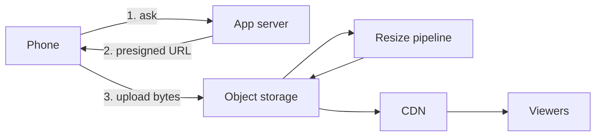

**Analogy.** A photo lab with a drop-box: the front desk only gives you a ticket, you drop the film in the box yourself, and the lab prints sizes later; copies sit in shops near every customer.
Where it breaks: a lab does not need to show your prints to 300 friends within seconds, which is what the feed adds.

**How the rest of this note builds up**

- First, requirements and the mental model (sections 1-2).
- Then the big picture with step-by-step upload and feed viewing (section 3).
- Then the worked example: estimates, API, data model and content-addressed keys (section 4).
- Then variants, trade-offs and production lessons (sections 5-7).
- Finally the SDE-3 deep dive: resumable uploads, the image pipeline, CDN caching, counters, storage tiers and privacy (section 8).

> [!tip] Remember
> Metadata in the database, bytes in object storage, served by CDN, uploaded directly by the client.

## 1. Why it exists - requirements

People want to share photos with friends and see what friends shared. The technical challenge is volume: a modest app with 200 million daily users produces petabytes of images a year, and every one of those users opens the app many times a day. Photos are big (megabytes), but the feed needs thousands of them per second to feel instant.

**Functional requirements**
- Upload a photo with a caption, tags and optional location.
- Follow and unfollow users.
- View a home feed of photos from people you follow, newest or ranked first.
- View a user's profile grid.
- Like and comment (kept light here; counters are covered in section 8).
- Basic search by user name and hashtag (out of scope in depth).

**Non-functional requirements**
- **Read-heavy:** about 200 photo views per upload (20 billion views per day against 100 million uploads; interview assumption).
- **Durable:** an uploaded photo must never be lost. Target eleven nines of object durability, which managed object stores advertise.
- **Low latency:** feed first page under 300 ms at p99 from the server (target, estimate); images start rendering in under 1 second on a decent connection.
- **Available:** feed and image serving are 99.99%; upload may be a little lower (99.9%) because the client can retry.
- **Eventually consistent feed:** a new photo may take a few seconds to reach followers, but the poster sees their own photo at once.
- **Mobile friendly:** unreliable networks, resumable uploads, small payloads.

**Out of scope:** stories, reels and video (see [[Case Study - Video Streaming]]), direct messages, ads, and the machine-learning ranking model itself.

> [!tip] Remember
> Say out loud on the whiteboard: "photos are blobs, so the database holds only pointers." It tells the interviewer you know where the bytes go.

## 2. Mental model

Picture a **photo lab with a shop front**. You (the client) walk to the back door of a huge warehouse (object storage) with a stamped pass (the presigned URL) and drop your photo yourself, so the shop clerk (the app server) never carries heavy boxes.

Back-room staff then make small prints in different sizes (the resize pipeline). A catalogue card file (the metadata database) says which shelf each print is on. Customers pick up prints from neighbourhood kiosks (the CDN), not from the warehouse.

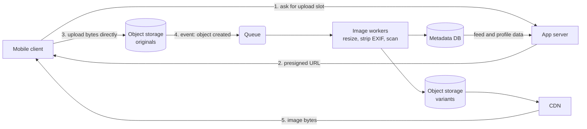

> [!tip] Remember
> Bytes go client to storage to CDN to client. Metadata goes through the app. Two separate roads.

## 3. How it works - high-level design

### The big picture

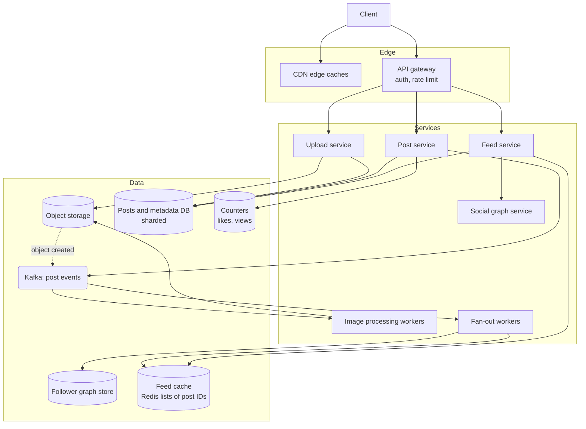

### Step-by-step: uploading a photo

1. The client asks `POST /v1/media` with the file size and content type. The server checks auth and a quota.
2. The server creates a media record with status `pending` and returns a **presigned URL** (or several for multipart upload) that is valid for about 15 minutes.
3. The client uploads the bytes straight to object storage. For large files it sends 5-10 MB parts and can retry failed parts.
4. The client calls `POST /v1/posts` with the media ID and caption. The server marks the media `uploaded` and writes the post row.
5. Object storage emits an "object created" event. A worker consumes it, validates the file, generates variants, strips private metadata, and marks the media `ready`.
6. The post service publishes a `post.created` event. Fan-out workers add the post ID to followers' feeds.
7. The client shows the post from local data immediately (optimistic UI), so the poster does not wait for steps 5-6.

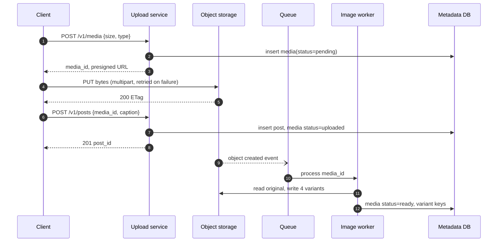

### Step-by-step: viewing the feed

1. The client calls `GET /v1/feed?cursor=...&limit=20`.
2. The feed service reads the user's list of post IDs from the feed cache.
3. It merges recent posts from any celebrities the user follows (pull side).
4. It fetches post metadata in a batch (`MGET` from cache, misses from the database).
5. It returns post JSON that contains **image URLs**, not images.
6. The client downloads each image from the CDN at the size that fits the screen.

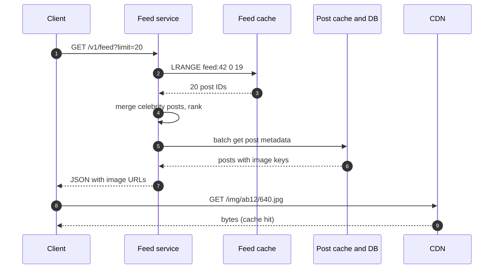

## 4. Worked example - estimates, API and data model

### Whiteboard version

```text
DAU 200M, 100M uploads/day, 100 views per user per day
Uploads: 100M / 86,400 = 1.2k/s (peak x3 = 3.5k/s)
Views:   200M x 100 = 20B/day = 231k/s (peak x3 = 700k/s)
Bytes per photo: original 2 MB + variants 0.8 MB = 2.8 MB
Storage/day: 100M x 2.8 MB = 280 TB/day -> ~102 PB/year
Egress: 231k/s x 150 KB = 35 GB/s (~280 Gbps); CDN 95% hit -> origin ~14 Gbps
Metadata: 100M x 365 x 5 yr = 182.5B rows x 300 B = ~55 TB

[client] -> presigned PUT -> [object store] -> queue -> [resize workers]
[client] -> [feed svc] -> [Redis feed IDs] -> post metadata -> CDN URLs
```

### Estimates (all inputs are assumptions, so all results are estimates)

| Quantity | Arithmetic | Result |
| --- | --- | --- |
| Upload rate | 100,000,000 / 86,400 s | about 1,157 per second |
| Upload peak (×3 assumed) | 1,157 × 3 | about 3,500 per second |
| Image view rate | 200M users × 100 views / 86,400 s | about 231,000 per second |
| View peak | 231,000 × 3 | about 700,000 per second |
| Bytes stored per photo | 2 MB original + 4 variants totalling 0.8 MB | 2.8 MB |
| Storage per day | 100M × 2.8 MB | about 280 TB |
| Storage per year | 280 TB × 365 | about 102 PB (before replication; object stores handle durability internally) |
| Average bytes served per view | thumbnail-heavy mix, assumed | 150 KB |
| Egress average | 231,000 × 150 KB | about 35 GB/s (about 280 Gbps) |
| Origin egress at 95% CDN hit | 5% × 280 Gbps | about 14 Gbps |
| Metadata rows in 5 years | 100M × 365 × 5 | about 182.5 billion |
| Metadata size | 182.5B × 300 B | about 55 TB |

**What the numbers decide.**
- Storage is dominated by image bytes (PB), metadata is small (tens of TB). So bytes go in object storage and metadata in a sharded database.
- Egress is huge, so the **CDN is not optional**. Without it, origin bandwidth would be 20 times higher.
- Uploads at 3.5k/s are easy for a distributed system but bandwidth-heavy; direct-to-storage upload avoids routing 280 TB/day through app servers.
- Most stored data is rarely viewed after the first week. Move old originals to cheaper storage tiers (section 8.5).

### API

```http
POST /v1/media
Authorization: Bearer <token>
Content-Type: application/json

{"content_type": "image/jpeg", "size_bytes": 2412345}
```

```http
HTTP/1.1 201 Created
Content-Type: application/json

{"media_id": "m_7Hq2", "upload": {"method": "PUT",
 "url": "https://storage.example.com/up/m_7Hq2?sig=...", "expires_in": 900}}
```

| Endpoint | Success | Notes and errors |
| --- | --- | --- |
| `POST /v1/media` | 201 with presigned URL | 413 too large, 415 type not allowed, 429 quota |
| `POST /v1/posts` | 201 with `post_id` | `Idempotency-Key` header stops duplicate posts on retry; 409 if media not uploaded |
| `GET /v1/feed?cursor=&limit=` | 200 | Cursor pagination, never offset |
| `GET /v1/users/{id}/posts?cursor=` | 200 | Profile grid |
| `POST /v1/posts/{id}/likes` | 204 | Idempotent; the same user liking twice is a no-op |
| `POST /v1/users/{id}/follow` | 204 | 429 when follow spam is detected |

See [[Idempotency and Idempotency Keys]] and [[Pagination, Filtering and Sorting]].

### Data model

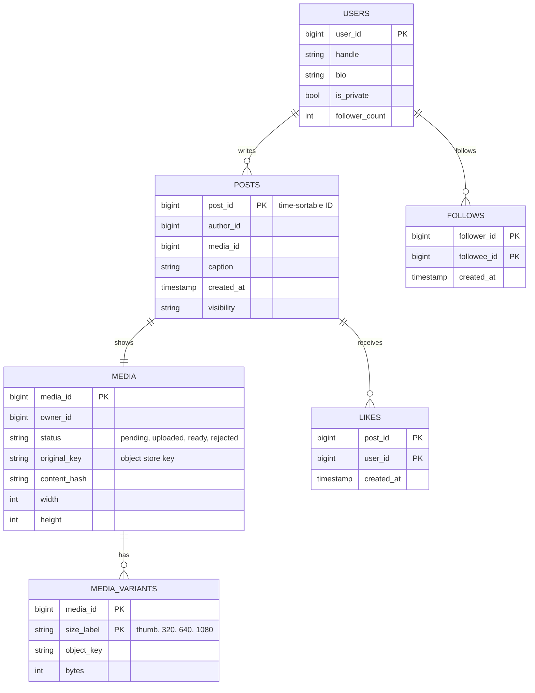

**Storage choices and why:**
- **Posts and media metadata:** a sharded relational database or a wide-column store, sharded by `author_id` so a profile grid is one shard. Alternatives: a single PostgreSQL instance (fine below a few TB), or Cassandra (good for huge write volume and simple access patterns). See [[Choosing a Database - Decision Guide]] and [[Partitioning and Sharding]].
- **Follows:** stored twice (by follower and by followee) so both "who do I follow" and "who follows me" are single-shard lookups. A graph database is not needed for one-hop queries.
- **Feed lists:** Redis lists of post IDs, capped near 800 per user.
- **Images:** object storage. See [[Choosing Storage for Files, Search and Analytics - Decision Guide]].

**Time-sortable IDs.** Instagram's 2012 engineering post describes 64-bit IDs made from 41 bits of milliseconds since a custom epoch, 13 bits for the logical shard, and 10 bits for a per-shard sequence. The ID sorts by time and tells you which shard holds the row. See [[Unique ID Generation]].

### Object keys: content-addressed and immutable

Store each variant under a key such as `img/{hash prefix}/{content_hash}_{size}.jpg`. Because the key contains the hash of the content, the bytes behind a URL never change, so you can send `Cache-Control: public, max-age=31536000, immutable`. If a user replaces their photo, the new photo has a new hash and a new URL, and nothing needs to be purged from the CDN.

### One photo traced end to end

1. Asha takes a 2.4 MB photo. The app asks for an upload slot and gets `m_7Hq2` plus a presigned URL.
2. The app uploads in three chunks of 0.8 MB (a resumable-upload protocol; S3-style multipart needs parts of at least 5 MB except the last, so a 2.4 MB photo would go as one PUT). The second chunk fails on a weak signal and is retried alone.
3. Asha hits Post. The server saves `post_id = 1587...` with `media_id = m_7Hq2`, and returns 201 in about 40 ms. Asha sees the photo in her own feed from the local copy.
4. A worker receives the "object created" event, decodes the image, strips GPS data from the EXIF metadata, and writes four variants: 150 px, 320 px, 640 px and 1080 px wide. It sets the media status to `ready`.
5. A fan-out worker reads Asha's 800 followers and pushes the post ID onto each follower's feed list. Asha is not a celebrity, so push is chosen.
6. A follower opens the app. The feed service returns the post with `https://cdn.example.com/img/ab/ab12..._640.jpg`. The first viewer in the region causes a CDN miss; the next thousand are CDN hits.

## 5. Variants and comparison

### Upload path

| Option | How | Strengths | Weaknesses |
| --- | --- | --- | --- |
| Through the app server | Client posts bytes to your API, which forwards to storage | Simple, full control | App servers carry 280 TB per day; ties up connections; slow clients hold threads |
| Presigned direct upload (chosen) | Client PUTs to storage with a signed URL | Offloads bandwidth, scales with the storage service, supports multipart and resume | Client logic is more complex; you validate after the fact |
| Resumable protocol (tus style) | Chunked upload with offset tracking | Excellent for flaky networks | Needs a server that understands the protocol |

See [[File Upload Architecture]] and [[File Uploads and Object Storage]].

### Image processing

| Option | When processed | Strengths | Weaknesses |
| --- | --- | --- | --- |
| Eagerly on upload (chosen for standard sizes) | A worker makes all variants right after upload | Fast first view; predictable cost | Wastes work on sizes nobody requests |
| Lazily on first request | An image service resizes the first time a size is asked | Saves storage and compute | First viewer waits; needs cache protection against stampedes |
| Hybrid | Eagerly make 2-3 common sizes, lazily make the rest, cache in CDN | Balances both | More moving parts |

### Feed strategy

| Option | Summary | Note |
| --- | --- | --- |
| Fan-out on write | Push the post ID to every follower's feed | Fast reads; heavy writes for big accounts |
| Fan-out on read | Build the feed when the user opens the app | Cheap writes; slow reads |
| Hybrid (chosen) | Push for normal accounts, pull for celebrities | The common production answer |

The full treatment is in [[Case Study - News Feed]]; the general push-versus-pull pattern is covered in [[Fan-out on Write vs Fan-out on Read]].

### Image formats

| Format | Quality per byte | Support | Use |
| --- | --- | --- | --- |
| JPEG | Baseline | Universal | Safe default |
| WebP | Smaller than JPEG at similar quality | Wide | Serve when the client supports it |
| AVIF | Smaller still | Growing | Serve when supported; encoding costs more CPU |

Serve the best format the client advertises in its `Accept` header, and cache each format as its own object.

## 6. Trade-offs and when not to use

- **Presigned direct upload over proxying bytes because** it keeps terabytes off the app tier and scales with the storage service. Price: the server cannot inspect bytes inline, so validation happens afterward and rejected files must be cleaned up.
- **Object storage over a database blob column because** a database is priced and tuned for small rows, and images would bloat backups and replication. Price: you maintain a pointer and must keep the two consistent (section 7).
- **Immutable content-hashed URLs over mutable ones because** the CDN can cache them for a year and you never purge. Price: a changed image gets a new URL, so metadata must be updated.
- **Eager variants over lazy ones because** the first view is fast. Price: more storage and wasted work. Many teams start lazy and move to eager for hot sizes.
- **Fan-out on write for most accounts because** reads vastly outnumber writes. Price: celebrity posts need the pull path, covered in [[Case Study - News Feed]].
- **Eventual consistency for feeds because** it keeps reads cheap. Price: a follower may see a new post seconds late; the poster is shown their own post immediately through read-your-writes.
- **When not to build this way:** a tiny internal photo tool does not need a CDN, queues or sharding. One bucket, one PostgreSQL table and a thumbnail function are enough.

> [!warning] Common mistake
> Saving the post row before the file is safely uploaded. If the upload then fails, you have a post pointing at nothing. Mark media `pending` first, and only create the visible post when the object is confirmed.

## 7. In production

- **Instagram (public engineering posts):** the 2012 sharding post describes PostgreSQL with many logical shards mapped to fewer physical servers, and 64-bit IDs that embed a timestamp, a shard ID and a sequence number so IDs are generated inside the database without a central service.

  A 2011 post describes using Redis hashes to map hundreds of millions of media IDs to user IDs in far less memory than one key per entry.
- **Facebook Haystack and f4 (public papers):** Facebook found that one file per photo caused extra disk operations for file-system metadata, so Haystack packs many photos into large files with an in-memory index, so a read needs about one disk operation. f4 later moved older, rarely read blobs to erasure-coded storage to cut the replication cost.

  The lesson is the same as our tiering in section 8.5.
- **Object storage (documented):** managed object stores offer multipart upload, presigned URLs, lifecycle rules and storage classes for infrequently accessed data.
- **Failure modes and fixes:**
	- *Upload abandoned halfway:* a lifecycle rule aborts incomplete multipart uploads after 1-7 days; a reaper job deletes `pending` media older than 24 hours.
	- *Worker crash during resize:* the queue redelivers the event; the job is idempotent because it writes the same content-hashed keys. See [[Background Jobs and Worker Pools]].
	- *Poison image (corrupt or decompression bomb):* limit pixel dimensions and decode time; send repeated failures to a dead-letter queue and mark the media `rejected`.
	- *CDN outage or miss storm:* fail over to a second CDN or the origin with rate limits; keep origin capacity for a degraded hit ratio.
	- *Viral photo:* CDN absorbs views; the like counter is sharded (section 8.4). See [[Hot Keys and Hot Partitions]].
	- *Inconsistent metadata and storage:* a daily reconciliation job lists objects and rows, flags orphans and deletes them after a grace period.
- **What to monitor (targets are estimates):** upload success rate above 99%, time from upload to `ready` under 10 seconds at p95, CDN hit ratio above 95%, image p99 time to first byte, feed fan-out lag, queue depth for image workers, and storage growth per day.

## 8. Deep dive

### 8.1 Reliable uploads on bad networks

**In plain words.** Phones go through tunnels. If a 5 MB upload dies at 90% and the app restarts it from zero, users give up. So the file is cut into parts, each uploaded and acknowledged on its own.

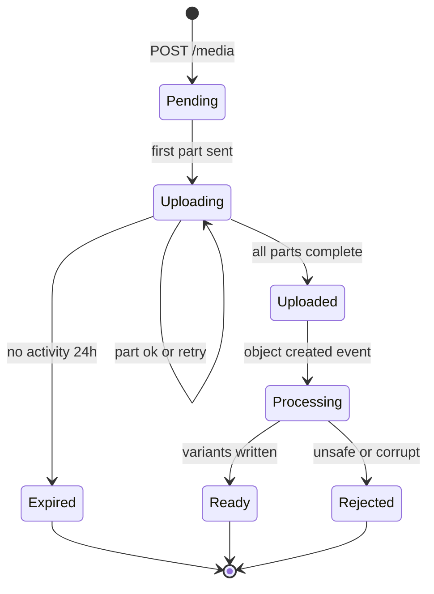

1. The client splits the file into parts of 5 MB or more (a limit of many object stores for parts except the last).
2. It uploads parts in parallel (3-4 at once), each with its own checksum.
3. If a part fails, only that part is retried.
4. After all parts succeed, the client (or storage) completes the upload; storage assembles the object.
5. The client commits the post with a client-generated `Idempotency-Key`, so retries never create duplicates.

**Why it matters.** Mobile success rate is a product metric. Resumable uploads can be the difference between a post and an abandoned draft.

### 8.2 The image processing pipeline

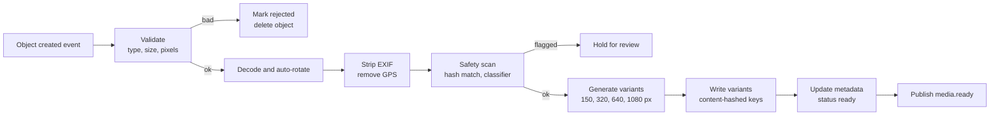

Key points:
- **Validation by content, not file name.** Check the real image header, limit width times height (a small file can decode to a gigantic bitmap), and cap decode time.
- **Strip location data.** Camera EXIF often contains GPS coordinates; leaking them is a privacy incident.
- **Idempotent workers.** Output keys are derived from the content hash, so a retry overwrites the same objects.
- **Scale workers by queue depth,** not by CPU alone. See [[Background Jobs and Worker Pools]].
- **Ordering:** the post is allowed to appear before variants are ready. The client shows a blurred placeholder (a tiny preview or a color) until the variant arrives, or the feed falls back to the original.

### 8.3 Serving images: CDN, sizes and cache keys

1. The metadata contains a list of variant keys, not full URLs. The service builds URLs with the CDN host, so you can switch CDN vendors.
2. The client picks the smallest variant at least as wide as its screen slot (device pixels matter).
3. The CDN caches by full URL. Because each URL is immutable, set a one-year cache lifetime.
4. A **shield** (a mid-tier cache) between edge and origin reduces origin load on a miss storm.
5. Private accounts need access control. Use **signed, expiring URLs** (or signed cookies) so a leaked link stops working. Cost: such URLs differ per viewer and cache less well, so use a token that covers a path prefix and a time window.

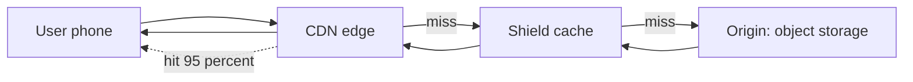

See [[CDN and Edge]].

### 8.4 Likes and views: counters without hot rows

A photo from a celebrity can get 50,000 likes a minute. An `UPDATE posts SET like_count = like_count + 1` on one row serializes on a lock and becomes a hot spot.

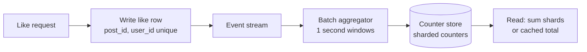

- Record the like itself in a table keyed by `(post_id, user_id)`. The unique key makes liking twice a no-op and powers "liked by you".
- Aggregate increments through a stream and write the count periodically (every second), or use `N` sharded counters per hot post and sum them.
- Show approximate counts ("1.2M") from a cache and refresh slowly; exact real-time counts are not worth the cost.

See [[Hot Keys and Hot Partitions]] and [[Case Study - News Feed]].

### 8.5 Storage tiers and cost

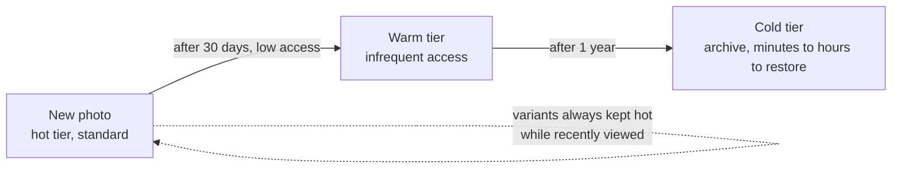

- **Variants** serve almost all views and are small; keep them on the standard tier.
- **Originals** are rarely read after processing (only for re-encoding or download); move them to colder tiers by lifecycle rule.
- Facebook's f4 paper reports using erasure coding for warm data to reduce storage overhead compared with full replication.
- Always keep at least two independent copies (or erasure-coded fragments across failure domains), so one data center loss does not lose photos. Managed stores do this for you.

### 8.6 Privacy, deletion and abuse

- **Deleting a photo:** mark the post `deleted` immediately (hides it everywhere because hydration checks it), then a background job removes objects and variants, and a CDN purge handles any cached copies. Remember backups and legal retention.
- **Private accounts:** the feed service checks the viewer follows the author at read time; image URLs are signed.
- **Abuse:** hash-match uploads against known-bad lists, run a classifier, rate-limit uploads per user ([[Rate Limiting - Algorithms and Distributed Design]]), and queue reports for review.

> [!tip] Remember
> The hard parts here are not exotic. They are: keep bytes out of your servers, make uploads resumable, make URLs immutable so the CDN does the work, and never put a hot row on the like counter.

## 9. Interview questions

> [!question]- Why not store images in the database?
> A database is tuned for small rows and transactional access. Multi-megabyte blobs inflate backups, replication and cache memory, and make the database the bandwidth bottleneck. Object storage is cheaper per byte, built for durability, and serves through a CDN. Keep only the object key and metadata in the database.

> [!question]- How does a presigned URL upload work, and why use it?
> The server signs a time-limited URL that authorises one `PUT` to a specific object key. The client sends the bytes directly to storage, so the app servers do not carry the traffic. The server then confirms the upload and records it.
>
> Risks to handle: validate the file afterward, restrict size and type (a presigned PUT cannot enforce a size limit; a presigned POST policy with `content-length-range` can, or check size after upload), and expire the URL quickly.

> [!question]- Trap: a user uploads a 1 MB file that decodes to a 50,000 by 50,000 pixel bitmap. What happens?
> It is a decompression bomb that can exhaust worker memory. Read the header first, reject images over a pixel limit (for example 100 megapixels), cap decode time and memory per job, and run image decoding in an isolated worker so a crash does not hurt other jobs.

> [!question]- How do you build the feed for a user who follows a celebrity with 100M followers?
> Do not push to 100M lists. Store ordinary authors' posts in followers' cached lists (push), and at read time merge the celebrity's latest posts (pull). Cache the celebrity's recent post IDs so pulls are cheap. Details in [[Case Study - News Feed]].

> [!question]- How do you make sure users see a new photo's thumbnail quickly if processing takes seconds?
> Show the poster's local copy immediately. For followers, either wait to fan out until the media is `ready` (adds a few seconds) or fan out at once and have the client show a placeholder with the original as a fallback. Pick by whether a few seconds of delay or a blurry first frame is worse for the product.

> [!question]- How would you reduce storage cost by half?
> Move originals older than 30 days to infrequent access and older than a year to archive; serve WebP or AVIF to shrink variants; drop rarely requested sizes and generate them lazily; deduplicate identical uploads by content hash; use erasure coding rather than triple replication for warm data.
>
> State the trade-off: slower restore for cold originals and more CPU for newer formats.

> [!question]- How do you delete a photo everywhere, including the CDN?
> Mark deleted in metadata so no feed or profile returns it, delete the objects asynchronously, and issue a CDN invalidation for those URLs. Because the URL is content-hashed and no longer referenced, stale CDN copies are reachable only by someone who has the link. For sensitive cases use short-lived signed URLs so access ends quickly.

> [!question]- What if traffic grows 10 times?
> Image bytes scale with the CDN and object store, so add CDN capacity, a shield tier and more regions. Metadata needs more shards (by author ID) and more read replicas or cache. Fan-out needs more workers and a lower celebrity threshold. Image workers scale by queue depth. The first thing to watch is origin egress and fan-out lag.

## 10. Cheat sheet

A 45-minute script:

- **0-5 min, requirements:** upload, follow, feed, profile; 200M DAU, 100M uploads/day, ~200 views per upload; durable photos, fast feed, eventual consistency, mobile networks.
- **5-10 min, estimates:** 1.2k uploads/s (3.5k peak); 231k views/s (700k peak); 2.8 MB per photo → 280 TB/day ≈ 102 PB/year; egress about 280 Gbps → CDN essential; metadata about 55 TB over 5 years.
- **10-15 min, API and data:** `POST /media` returns a presigned URL; `POST /posts` with idempotency key; `GET /feed?cursor`; tables: users, media, media_variants, posts, follows (stored twice), likes.
- **15-25 min, design:** client to object storage direct; queue to image workers; metadata DB sharded by author; Redis feed lists of IDs; CDN with immutable content-hashed URLs.
- **25-40 min, deep dives:** resumable multipart upload and the media state machine; image pipeline (validate, strip EXIF, variants, scan); hybrid fan-out; sharded like counters; storage tiering.
- **40-45 min, wrap-up:** monitor upload success, time to ready, CDN hit ratio, fan-out lag; failure modes (poison image, abandoned uploads, CDN miss storm); cost levers.

| Decision | Choice | Why |
| --- | --- | --- |
| Where do bytes go? | Object storage plus CDN | Cheap, durable, offloads bandwidth |
| Upload path | Presigned multipart | Keeps app tier light, resumable |
| Variants | Eager for common sizes | Fast first view |
| URL style | Content-hashed, immutable | Cache for a year, no purges |
| Feed | Hybrid push and pull | Fast reads, bounded writes |
| Counters | Sharded or aggregated | Avoid a hot row |

## Links

- **Before this:** [[System Design Interview Framework]], [[Back-of-the-Envelope Estimation]], [[Case Study - News Feed]], [[CDN and Edge]]
- **Concepts:** [[Fan-out on Write vs Fan-out on Read]], [[File Upload Architecture]], [[File Uploads and Object Storage]], [[Unique ID Generation]], [[Partitioning and Sharding]], [[Hot Keys and Hot Partitions]]
- **Decision guides:** [[Choosing Storage for Files, Search and Analytics - Decision Guide]], [[Choosing a Database - Decision Guide]]
- **Related designs:** [[Case Study - Video Streaming]], [[Case Study - Notification System]], [[Case Study - URL Shortener]]
- **Supporting:** [[Background Jobs and Worker Pools]], [[Rate Limiting - Algorithms and Distributed Design]], [[Idempotency and Idempotency Keys]], [[Pagination, Filtering and Sorting]]

### Watch on YouTube

- [Instagram System Design / Design Photo-Sharing Application / System Design Interview](https://www.youtube.com/watch?v=da7mdMz0g0g) · Tech Takshila · 20 min · 27,713 views
- [Design Photo Sharing Service / Instagram](https://www.youtube.com/watch?v=qP12SpInZOI) · Scribble Lab · 7 min · 29 views
