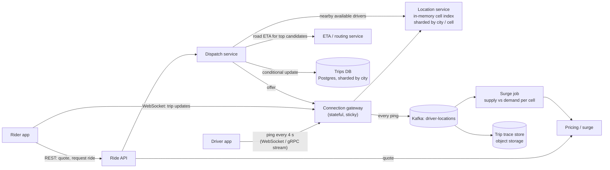
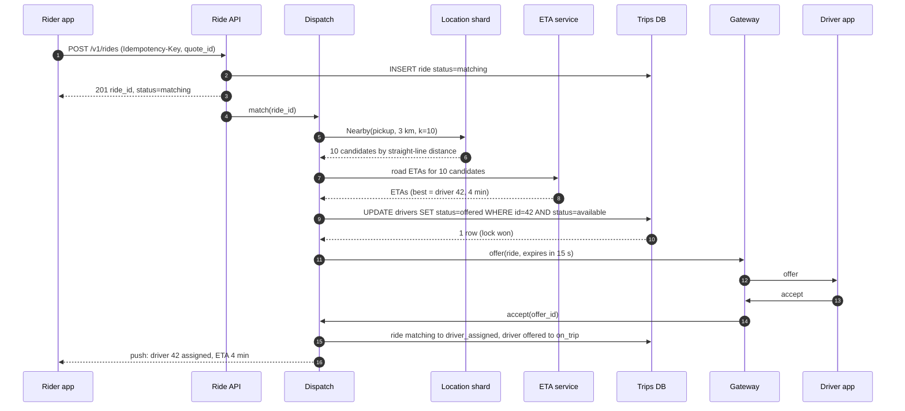
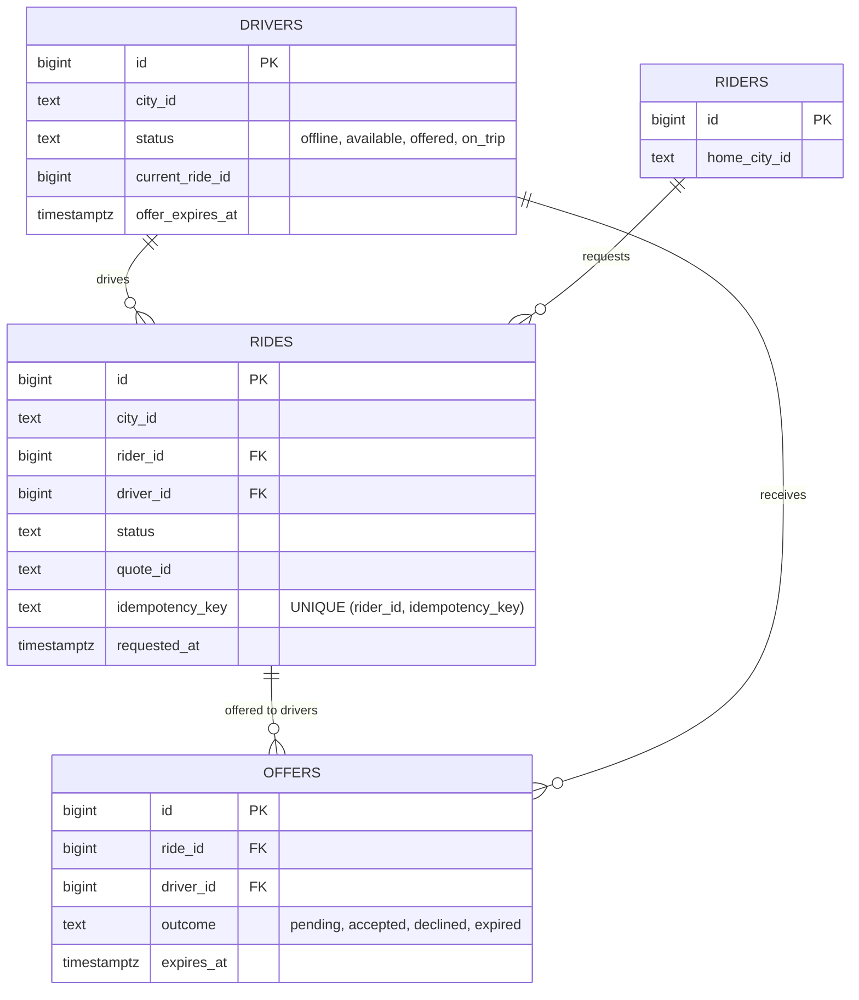
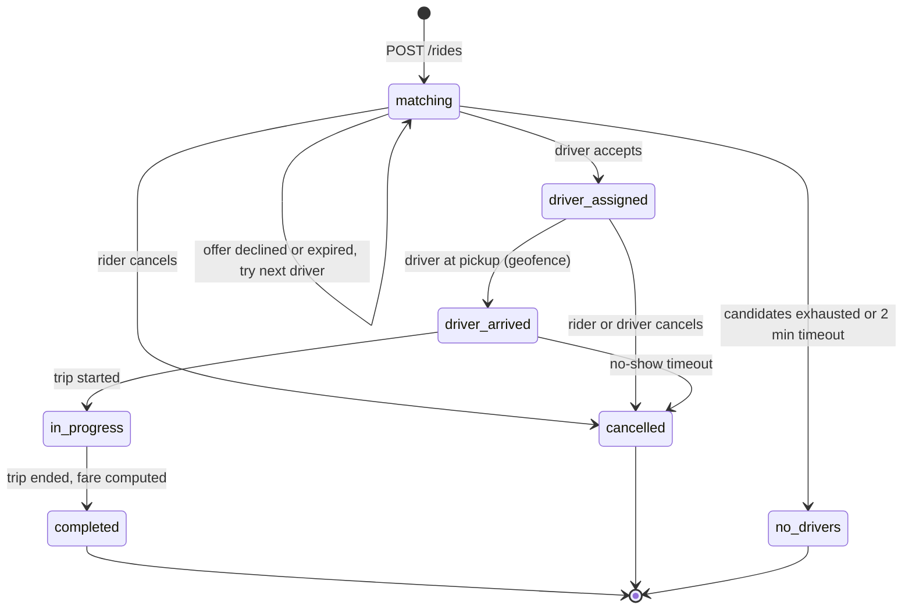

# Case Study - Ride Sharing and Proximity

> [!summary] TL;DR
> Design the backend of an Uber-style app: drivers send their GPS position every few seconds, riders ask for a car, and the system finds nearby free drivers, offers the trip to exactly one of them, and tracks the trip. The hard parts are a write-heavy **location index** that lives in memory, and a **dispatch** step that must never give one driver to two riders.

> [!abstract] Core idea
> - Driver locations are **soft state**: a fresh copy arrives every 4 seconds, so keep them in RAM, bucketed by map cell, and do not write each ping to a database.
> - "Nearby" means "my cell plus its neighbours", then filter by real distance. Pick a cell size at least as wide as the search radius.
> - Dispatch is a **conditional update**: a driver moves from `available` to `offered` only if they are still `available`. That single check stops double assignment.
> - Shard everything by city (or region) so a ride, its driver and its location shard live together.
> - Straight-line distance only shortlists drivers; road-network **ETA** picks the winner.

## 1. Why it exists - requirements

A rider in Bengaluru opens the app at 9 am. Within a second or two they want to see cars around them, a fare quote, and after tapping "Book", a driver who accepted within about 15 seconds. Meanwhile one million drivers across the country are each sending a GPS fix every 4 seconds. A naive design that stores each fix as a row and answers "nearby" with a SQL range scan collapses under 250,000 writes per second.

**Functional requirements**
- Drivers go online and offline and stream their location while online.
- Riders get a fare quote (with surge pricing) and request a ride from pickup to drop-off.
- The system matches the request to one nearby available driver; the driver accepts or declines.
- Both sides see live trip status and the driver's position until drop-off.
- Riders can see approximate nearby cars before booking.

**Non-functional requirements**
- Match latency: driver offer sent within about 2 s of the request (p99).
- **Correctness:** one driver never holds two trips; one ride never gets two drivers.
- Location freshness: a driver shown or matched was seen in the last ~30 s.
- Availability over strict consistency for the location index (a stale dot on the map is fine; a double booking is not).
- Out of scope: payments (see [[Case Study - Payment System]]), driver onboarding, ratings, pooled rides.

**Glossary.** A **ping** is one location update from a driver. A **cell** is a small area of the map with an ID (a geohash string, an H3 index, an S2 cell). **Dispatch** is choosing a driver and sending them an **offer** that they accept or let expire. **ETA** is the estimated time for the driver to reach the pickup by road. **Surge** is a price multiplier applied when demand outruns supply in an area.

## 2. Mental model

Think of a city map cut into a grid of tiles, and a board on the wall with one pin per free driver. Every 4 seconds each driver tells you which tile they are on, and you move their pin. When a rider calls, you look at the rider's tile and the 8 tiles around it, measure the distance to each pin, ring the closest driver, and **take their pin off the board while the phone is ringing** so nobody else can ring them too.

Everything else in the design (sharding, ETA, surge, live tracking) is about doing that at a million pins and hundreds of calls per second.

## 3. How it works - high-level design



The flow of one booking:

1. **Ping path.** The driver app keeps a long-lived connection to a gateway (see [[Scaling WebSockets]]). Each ping goes to the location service shard that owns the driver's city, which moves the driver to the right cell, and to Kafka for history, surge and analytics.
2. **Quote.** The rider asks for a quote; pricing reads the current surge multiplier for the pickup cell and returns a `quote_id` valid for a couple of minutes, so the price the rider saw is the price they pay.
3. **Request.** `POST /v1/rides` with an idempotency key creates a ride in `matching`.
4. **Candidate search.** Dispatch asks the location service for the k nearest available drivers within a radius (cell plus neighbours, filtered by distance, fresh pings only).
5. **Rank.** The ETA service computes road-network ETAs for the shortlist (say the top 10); dispatch picks the best by ETA, driver rating and acceptance rate.
6. **Lock and offer.** One conditional update moves that driver from `available` to `offered` with a 15-second expiry. If zero rows change, someone else got them first; try the next candidate.
7. **Accept.** The driver accepts; the ride moves to `driver_assigned` and both apps start receiving trip updates over their connections. If the offer expires or is declined, the driver returns to `available` and dispatch offers the next candidate.



## 4. Worked example - estimates, API and data model

### Whiteboard version

```text
Driver app --ping 4s--> Gateway --> Location shard (RAM: cell -> drivers)
                            \--> Kafka --> surge job, trip traces
Rider app --request--> Ride API --> Dispatch:
     1. Nearby(cell + 8 neighbours, radius, fresh only)
     2. ETA on top 10
     3. UPDATE driver SET offered WHERE status='available'  (0 rows -> next)
     4. offer, 15 s TTL -> accept -> ride driver_assigned
Shard key: city. Ride, driver row and location shard share it.
Numbers: 1M drivers, 250k pings/s, ~520 ride requests/s at peak.
```

### Estimates

All inputs below are estimates for a large single-country deployment.

| Quantity | Assumption | Arithmetic | Result |
| --- | --- | --- | --- |
| Online drivers at peak | estimate | | 1,000,000 |
| Ping rate | 1 ping / 4 s / driver | 1,000,000 ÷ 4 s | **250,000 writes/s** |
| Ping size on the wire | ~100 B (id, lat, lon, heading, speed, timestamp, framing) | 250,000/s × 100 B | 25 MB/s ≈ 200 Mbit/s ingress |
| Location index RAM | ~200 B per driver incl. map overhead | 1,000,000 × 200 B | **~200 MB** (fits one host; sharded for write rate and blast radius) |
| Trips per day | estimate 15 M | 15,000,000 ÷ 86,400 s | ~174 requests/s average |
| Peak ride requests | 3 × average | 174 × 3 | **~520 requests/s** |
| Ping history | drivers online ~8 h/day | 1,000,000 × (8 × 3,600 s ÷ 4 s) = 7.2 B pings × ~50 B (compact stored form, estimate) | ~360 GB/day to Kafka, then object storage |
| "Cars nearby" views | 500,000 riders with the app open, refresh every 5 s | 500,000 ÷ 5 s | 100,000 reads/s (serve from cached per-cell snapshots) |

The numbers drive three decisions:
- 250,000 writes per second of data that is replaced 4 seconds later does not belong in a durable database; it belongs in RAM.
- 520 dispatches per second is modest; a relational database handles the transactional part (rides, offers, driver status) easily once sharded by city.
- The read side for "cars nearby" is bigger than the dispatch side, so it is served from a snapshot per cell that refreshes every second or two, not from a query per rider.

### Choosing a cell size

A geohash with `p` characters has `5p` bits, split between longitude and latitude (longitude gets the extra bit when `5p` is odd). Cell sizes at the equator (computed from the bit split; longitude width shrinks with `cos(latitude)`):

| Precision | Bits (lon/lat) | Cell size at the equator | Good for |
| --- | --- | --- | --- |
| 5 | 13 / 12 | ~4.9 km × 4.9 km | search radius up to ~4.9 km |
| 6 | 15 / 15 | ~1.2 km × 0.61 km | search radius up to ~0.6 km |
| 7 | 18 / 17 | ~153 m × 153 m | dense pickup zones, cell-level surge |

The rule: a 3 × 3 block of cells is guaranteed to contain every point within radius `r` of the rider only if a cell is at least `r` wide in both directions. For a 2 km pickup radius use precision 5, then filter by real distance. Using precision 7 and scanning 9 cells would silently ignore drivers 300 m away.

### API

```http
POST /v1/quotes
{"pickup": {"lat": 12.9716, "lon": 77.5946}, "dropoff": {"lat": 12.9352, "lon": 77.6245}, "product": "mini"}
200 {"quote_id": "q_7f3", "fare": {"amount": 21400, "currency": "INR", "minor_units": 2}, "surge": 1.3, "expires_at": "2026-11-04T09:02:00Z"}

POST /v1/rides
Idempotency-Key: 6c1d0d8e-4f1a-4c3e-9a51-3b8e2f0c9d11
{"quote_id": "q_7f3"}
201 {"ride_id": "r_91", "status": "matching"}

GET  /v1/rides/r_91            -> {"status": "driver_assigned", "driver": {...}, "eta_s": 240}
POST /v1/rides/r_91/cancel     -> 200 (fee rules apply after assignment)
POST /v1/offers/o_55/accept    -> driver side; 409 if the offer already expired
```

Driver pings travel on the streaming connection as small binary messages: `{driver_id, lat, lon, heading, speed, ts, seq}`. The `seq` lets the server drop out-of-order pings after a reconnect.

### Data model



The live position is **not** in this schema. It lives only in the location service and in the Kafka history stream.

The dispatch lock and the accept, in PostgreSQL 17:

```sql
-- Step 6: reserve one driver. Zero rows means another dispatcher won.
UPDATE drivers
SET status = 'offered', current_ride_id = $1, offer_expires_at = now() + interval '15 seconds'
WHERE id = $2 AND city_id = $3 AND status = 'available'
RETURNING id;

-- Step 7: the driver accepts. Both rows live on the same city shard, so one transaction.
BEGIN;
UPDATE drivers SET status = 'on_trip', offer_expires_at = NULL
WHERE id = $2 AND status = 'offered' AND current_ride_id = $1 AND offer_expires_at > now();
-- if 0 rows: the offer expired; ROLLBACK and return 409 to the driver app
UPDATE rides SET status = 'driver_assigned', driver_id = $2
WHERE id = $1 AND status = 'matching';
-- if 0 rows: the rider cancelled meanwhile; ROLLBACK (the sweeper or a release
-- step returns the driver to available) and tell the driver the trip is gone
COMMIT;

-- Sweeper, every second: expired offers release the driver.
UPDATE drivers SET status = 'available', current_ride_id = NULL, offer_expires_at = NULL
WHERE status = 'offered' AND offer_expires_at < now();
```

### Ride lifecycle



### Go: geohash and an in-memory cell index

This is the core of one location shard: encode a position to a geohash cell, keep drivers bucketed by cell, and answer "k nearest fresh drivers within r km" by scanning the 3 × 3 block and filtering by great-circle distance. The clock is injected so tests control staleness. For production indexing choices (H3, S2, quadtrees, Redis GEO) see [[Geospatial Indexing]].

```go
package geo

import (
	"errors"
	"math"
	"sort"
	"sync"
	"time"
)

const base32 = "0123456789bcdefghjkmnpqrstuvwxyz"

// Encode interleaves longitude and latitude bits (longitude first)
// and writes 5 bits per base-32 character.
func Encode(lat, lon float64, precision int) string {
	latLo, latHi := -90.0, 90.0
	lonLo, lonHi := -180.0, 180.0
	out := make([]byte, 0, precision)
	even, bit, ch := true, 0, 0
	for len(out) < precision {
		if even { // longitude bit
			mid := (lonLo + lonHi) / 2
			if lon >= mid {
				ch = ch<<1 | 1
				lonLo = mid
			} else {
				ch <<= 1
				lonHi = mid
			}
		} else { // latitude bit
			mid := (latLo + latHi) / 2
			if lat >= mid {
				ch = ch<<1 | 1
				latLo = mid
			} else {
				ch <<= 1
				latHi = mid
			}
		}
		even = !even
		if bit++; bit == 5 {
			out = append(out, base32[ch])
			bit, ch = 0, 0
		}
	}
	return string(out)
}

// Box is the cell a geohash covers.
type Box struct{ LatLo, LatHi, LonLo, LonHi float64 }

// Decode returns the bounding box of a geohash.
func Decode(h string) (Box, error) {
	b := Box{-90, 90, -180, 180}
	even := true
	for i := 0; i < len(h); i++ {
		v := -1
		for j := 0; j < len(base32); j++ {
			if base32[j] == h[i] {
				v = j
				break
			}
		}
		if v < 0 {
			return Box{}, errors.New("geo: invalid geohash character")
		}
		for mask := 16; mask > 0; mask >>= 1 {
			if even {
				mid := (b.LonLo + b.LonHi) / 2
				if v&mask != 0 {
					b.LonLo = mid
				} else {
					b.LonHi = mid
				}
			} else {
				mid := (b.LatLo + b.LatHi) / 2
				if v&mask != 0 {
					b.LatLo = mid
				} else {
					b.LatHi = mid
				}
			}
			even = !even
		}
	}
	return b, nil
}

// Neighbors returns the cell itself plus its 8 neighbours (fewer near the poles).
// It steps one cell width from the centre and re-encodes, wrapping longitude.
func Neighbors(h string) ([]string, error) {
	b, err := Decode(h)
	if err != nil {
		return nil, err
	}
	dLat, dLon := b.LatHi-b.LatLo, b.LonHi-b.LonLo
	cLat, cLon := (b.LatLo+b.LatHi)/2, (b.LonLo+b.LonHi)/2
	seen := map[string]bool{}
	var out []string
	for _, dy := range []float64{-1, 0, 1} {
		lat := cLat + dy*dLat
		if lat > 90 || lat < -90 {
			continue
		}
		for _, dx := range []float64{-1, 0, 1} {
			lon := cLon + dx*dLon
			if lon >= 180 {
				lon -= 360
			} else if lon < -180 {
				lon += 360
			}
			c := Encode(lat, lon, len(h))
			if !seen[c] {
				seen[c] = true
				out = append(out, c)
			}
		}
	}
	return out, nil
}

// HaversineKm is the great-circle distance in kilometres.
func HaversineKm(lat1, lon1, lat2, lon2 float64) float64 {
	const r = 6371.0 // mean Earth radius, km
	rad := math.Pi / 180
	dLat := (lat2 - lat1) * rad
	dLon := (lon2 - lon1) * rad
	a := math.Sin(dLat/2)*math.Sin(dLat/2) +
		math.Cos(lat1*rad)*math.Cos(lat2*rad)*math.Sin(dLon/2)*math.Sin(dLon/2)
	return 2 * r * math.Asin(math.Sqrt(a))
}

// Driver is the latest known position of one available driver.
type Driver struct {
	ID       string
	Lat, Lon float64
	Cell     string
	SeenAt   time.Time
}

// Index is an in-memory driver index bucketed by geohash cell,
// the shape one shard of a location service keeps in RAM.
type Index struct {
	mu        sync.Mutex
	precision int
	staleTTL  time.Duration
	now       func() time.Time
	byCell    map[string]map[string]*Driver
	byID      map[string]*Driver
}

func NewIndex(precision int, staleTTL time.Duration, now func() time.Time) *Index {
	return &Index{
		precision: precision, staleTTL: staleTTL, now: now,
		byCell: map[string]map[string]*Driver{}, byID: map[string]*Driver{},
	}
}

// Update records a location ping and moves the driver between cells if needed.
func (ix *Index) Update(id string, lat, lon float64) {
	ix.mu.Lock()
	defer ix.mu.Unlock()
	cell := Encode(lat, lon, ix.precision)
	if d, ok := ix.byID[id]; ok && d.Cell != cell {
		ix.removeLocked(d)
	}
	d := &Driver{ID: id, Lat: lat, Lon: lon, Cell: cell, SeenAt: ix.now()}
	ix.byID[id] = d
	if ix.byCell[cell] == nil {
		ix.byCell[cell] = map[string]*Driver{}
	}
	ix.byCell[cell][id] = d
}

// Remove takes a driver out of the index (went offline or got a trip).
func (ix *Index) Remove(id string) {
	ix.mu.Lock()
	defer ix.mu.Unlock()
	if d, ok := ix.byID[id]; ok {
		ix.removeLocked(d)
	}
}

func (ix *Index) removeLocked(d *Driver) {
	delete(ix.byID, d.ID)
	if m := ix.byCell[d.Cell]; m != nil {
		delete(m, d.ID)
		if len(m) == 0 {
			delete(ix.byCell, d.Cell)
		}
	}
}

// Match is a candidate driver with its straight-line distance.
type Match struct {
	ID     string
	DistKm float64
}

// Nearby scans the rider's cell and its 8 neighbours, drops stale pings
// and drivers beyond radiusKm, and returns the k closest.
func (ix *Index) Nearby(lat, lon, radiusKm float64, k int) []Match {
	ix.mu.Lock()
	defer ix.mu.Unlock()
	cells, _ := Neighbors(Encode(lat, lon, ix.precision))
	cutoff := ix.now().Add(-ix.staleTTL)
	var out []Match
	for _, c := range cells {
		for _, d := range ix.byCell[c] {
			if d.SeenAt.Before(cutoff) {
				continue
			}
			if dist := HaversineKm(lat, lon, d.Lat, d.Lon); dist <= radiusKm {
				out = append(out, Match{d.ID, dist})
			}
		}
	}
	sort.Slice(out, func(i, j int) bool { return out[i].DistKm < out[j].DistKm })
	if len(out) > k {
		out = out[:k]
	}
	return out
}
```

Tests (`go vet` clean, `go test -race` passes on Go 1.24.4):

```go
package geo

import (
	"sync"
	"testing"
	"time"
)

func TestEncodeKnownValue(t *testing.T) {
	// Reference value from the geohash article on Wikipedia.
	if got := Encode(57.64911, 10.40744, 11); got != "u4pruydqqvj" {
		t.Fatalf("got %s", got)
	}
}

func TestDecodeContainsPoint(t *testing.T) {
	lat, lon := 12.9716, 77.5946 // Bengaluru
	b, err := Decode(Encode(lat, lon, 6))
	if err != nil {
		t.Fatal(err)
	}
	if lat < b.LatLo || lat > b.LatHi || lon < b.LonLo || lon > b.LonHi {
		t.Fatalf("point outside its own cell: %+v", b)
	}
	// Precision 6 = 30 bits: 15 for longitude, 15 for latitude.
	if w := b.LonHi - b.LonLo; w != 360.0/(1<<15) {
		t.Fatalf("lon width %v", w)
	}
	if _, err := Decode("abc"); err == nil {
		t.Fatal("'a' is not in the geohash alphabet; want error")
	}
}

func TestNeighborsAreNineDistinctCells(t *testing.T) {
	n, err := Neighbors(Encode(12.9716, 77.5946, 6))
	if err != nil {
		t.Fatal(err)
	}
	if len(n) != 9 {
		t.Fatalf("want 9 cells, got %d", len(n))
	}
	// Across the antimeridian: neighbours must wrap, not fall off the map.
	w, _ := Neighbors(Encode(0.0, 179.999, 5))
	if len(w) != 9 {
		t.Fatalf("want 9 wrapped cells, got %d", len(w))
	}
}

func TestEdgeOfCellProblem(t *testing.T) {
	// Two points ~22 m apart on either side of the equator share no prefix.
	a, b := Encode(0.0001, 10, 6), Encode(-0.0001, 10, 6)
	if a[0] == b[0] {
		t.Fatalf("expected different first chars, got %s %s", a, b)
	}
	if d := HaversineKm(0.0001, 10, -0.0001, 10); d > 0.03 {
		t.Fatalf("distance %v km", d)
	}
}

func TestIndexNearbyWithFakeClock(t *testing.T) {
	now := time.Date(2026, 11, 4, 9, 0, 0, 0, time.UTC)
	clock := func() time.Time { return now }
	// Precision 5 cells are ~4.9 km x 4.9 km at the equator (~4.8 km wide here), wider than the 2 km search
	// radius, so the 3x3 block is guaranteed to contain every match.
	ix := NewIndex(5, 30*time.Second, clock)

	ix.Update("near", 12.9720, 77.5950)  // ~60 m away
	ix.Update("mid", 12.9800, 77.5946)   // ~930 m away
	ix.Update("far", 13.0500, 77.5946)   // ~8.7 km away, beyond the radius
	ix.Update("stale", 12.9717, 77.5947) // will go stale

	now = now.Add(20 * time.Second)
	ix.Update("near", 12.9720, 77.5950)
	ix.Update("mid", 12.9800, 77.5946)
	now = now.Add(15 * time.Second) // "stale" last seen 35 s ago

	got := ix.Nearby(12.9716, 77.5946, 2.0, 5)
	if len(got) != 2 || got[0].ID != "near" || got[1].ID != "mid" {
		t.Fatalf("got %+v", got)
	}

	ix.Remove("near")
	got = ix.Nearby(12.9716, 77.5946, 2.0, 5)
	if len(got) != 1 || got[0].ID != "mid" {
		t.Fatalf("after remove: %+v", got)
	}
}

func TestIndexMovesDriverBetweenCells(t *testing.T) {
	now := time.Unix(0, 0)
	ix := NewIndex(6, time.Minute, func() time.Time { return now })
	ix.Update("d1", 12.9716, 77.5946)
	ix.Update("d1", 28.6139, 77.2090) // drove to Delhi (test only)
	if got := ix.Nearby(12.9716, 77.5946, 5, 5); len(got) != 0 {
		t.Fatalf("old cell still holds driver: %+v", got)
	}
	if got := ix.Nearby(28.6139, 77.2090, 1, 5); len(got) != 1 {
		t.Fatalf("new cell missing driver: %+v", got)
	}
}

func TestIndexConcurrentUpdates(t *testing.T) {
	now := time.Unix(0, 0)
	ix := NewIndex(6, time.Minute, func() time.Time { return now })
	var wg sync.WaitGroup
	for g := 0; g < 8; g++ {
		wg.Add(1)
		go func(g int) {
			defer wg.Done()
			for i := 0; i < 200; i++ {
				ix.Update(string(rune('a'+g)), 12.97+float64(i)*1e-4, 77.59)
				ix.Nearby(12.97, 77.59, 1, 3)
			}
		}(g)
	}
	wg.Wait()
	if n := len(ix.byID); n != 8 {
		t.Fatalf("want 8 drivers, got %d", n)
	}
}
```

`TestEdgeOfCellProblem` shows why you always scan neighbours: two points 22 m apart on either side of the equator get geohashes that differ in the very first character, so a prefix match alone would never find one from the other.

## 5. Variants

| Choice | Option | How it works | Use when | Cost |
| --- | --- | --- | --- | --- |
| Location index | Geohash buckets in RAM (above) | string cell → set of drivers | simple, any language | rectangular cells distort with latitude; edge effects |
| | H3 hexagons | 16 resolutions; all 6 neighbours are equidistant | surge, supply/demand heat maps, ring searches (`gridDisk`) | library dependency; cells do not nest exactly |
| | S2 cells | Hilbert curve over cube faces, 31 levels | covering arbitrary regions with few cells | more complex API |
| | Redis GEO (`GEOADD`, `GEOSEARCH`) | sorted set scored by a 52-bit geohash | small to mid scale, quick start | every update is a sorted-set write on one shard thread; cluster sharding by city is manual |
| | PostGIS + GiST index | R-tree-like index on geometry | durable geo data (zones, geofences, places) | poor fit for 250k updates/s of throwaway points |
| Dispatch | Greedy, first come first served | best driver for each request, immediately | low density | globally worse matches at peak |
| | Batched matching | collect requests for ~1-2 s, solve an assignment that minimizes total ETA | dense cities at peak | adds the batch window to latency |
| | Broadcast offer | offer to several drivers, first accept wins | very low acceptance rates | needs the same conditional update; wastes driver attention |
| Rider updates | Push over WebSocket | gateway pushes driver position | live map | connection state (see [[Scaling WebSockets]]) |
| | Polling every 3-5 s | stateless GETs | simple clients | more requests, coarser updates |

## 6. Trade-offs

- **RAM index over a database.** You lose durability, and that is fine: if a location node dies, its drivers' next pings rebuild the state within about 4 seconds. Losing a ride row is not fine, so rides and offers stay in a durable store.
- **City sharding over global cells.** Sharding by city keeps the ride, the driver row and the location shard together, so dispatch is one-shard work and one SQL transaction. The cost: very big cities need sub-sharding by cell, and trips that cross a city boundary need a hand-off rule (the pickup city owns the ride).
- **Straight-line shortlist, road ETA ranking.** Haversine distance is cheap but wrong across rivers and one-way streets. Calling the routing engine for 10 candidates, not 500, keeps dispatch under budget.
- **Offer TTL length.** Short TTL (10 s) means faster fallback but more missed offers from drivers who are driving; long TTL (30 s) means riders wait longer when a driver ignores the offer.
- **When a simpler design wins:** for a city-scale taxi company with 2,000 drivers, Redis GEO plus Postgres is enough. There are 500 pings per second; no custom sharding is needed.

## 7. In production

- **Real systems.** Uber developed and open-sourced H3 to analyse its marketplace data, such as setting dynamic prices (see the H3 introduction on h3geo.org). Redis GEO and PostGIS are the common off-the-shelf choices at smaller scale.
- **Failure: a location shard restarts.** All its drivers vanish for one ping interval. Fix: dispatch treats "no candidates" as retryable for a few seconds; optionally run a hot replica fed from the same ping stream.
- **Failure: gateway deploy drops 200,000 connections at once.** Reconnect storm. Fix: drain gradually and make clients reconnect with jittered backoff (see [[Timeouts, Retries and Backoff]]).
- **Failure: GPS jitter.** Pings jump across a river or into a building. Fix: map-matching (snap to the road graph) and drop pings that imply impossible speed.
- **Failure: hot cell.** An airport or a stadium after a concert concentrates thousands of drivers and requests in one cell. Fix: finer cells there, or a dedicated FIFO queue for the airport lot (see [[Hot Keys and Hot Partitions]]).
- **What to monitor:** ping ingest rate and lag per shard; percentage of stale drivers; match latency p50/p99; offer acceptance rate; `no_drivers` rate per cell; dispatch conflict rate (conditional update returning 0 rows); ETA error (predicted vs actual pickup time).

## 8. Deep dive

**Why soft state changes everything.** A ping has a useful life of about 4 seconds. Replicating it synchronously, fsyncing it, or indexing it in a B-tree spends money protecting data that is about to be overwritten. The location service therefore keeps one copy in memory per shard and accepts losing a few seconds of positions on failure. History goes to Kafka asynchronously for things that need it later: trip traces for fare disputes, ETA model training and surge.

**Exactly one driver per ride.** Two dispatchers can pick the same driver because both read the in-memory index, which is only a hint. Correctness comes from the conditional update on the durable driver row (`WHERE status = 'available'`), not from the index. That is a compare-and-set: the database's row lock serializes the two updates, and the loser sees zero rows. The same pattern works in Redis with `SET driver:42:offer <ride> NX PX 15000`. After winning, dispatch removes the driver from the in-memory index so the next search skips them. If dispatch crashes after the update but before sending the offer, the 15-second expiry and the sweeper return the driver to `available`. An accept that arrives after expiry fails the `offer_expires_at > now()` check and gets a 409.

**Surge pricing.** A streaming job reads the ping topic and the request events, and every minute computes, per H3 cell, `demand = requests + app opens` and `supply = available drivers`. The multiplier is a capped, smoothed function of the ratio, so it does not flicker between neighbouring minutes. The quote stores the multiplier with an expiry, so the rider pays what they were shown even if surge changes before booking.

**ETA.** The routing service holds the road graph in memory and uses a speed-up technique such as Contraction Hierarchies so a point-to-point route takes milliseconds rather than a full Dijkstra over millions of nodes. Live traffic adjusts per-segment speeds, and a learned model corrects the remaining bias. Dispatch only calls it for the shortlist.

**Cars-nearby fan-out.** 100,000 rider reads per second do not each run a query. Each location shard publishes a coarse snapshot per cell (positions rounded, only available drivers) every 1-2 seconds; rider requests read the snapshot for their cell and neighbours from a cache. Rounding positions also protects driver privacy.

## 9. Interview questions

> [!question]- Why not store driver locations in Postgres with PostGIS and query them with `ST_DWithin`?
> 250,000 updates per second means 250,000 row versions, WAL records and GiST index updates per second, for data that is stale 4 seconds later. PostGIS is great for durable geometry (zones, geofences). Live positions are soft state and belong in an in-memory index sharded by city.

> [!question]- How do you guarantee one driver is not assigned to two riders?
> The in-memory index is only a hint. Reservation is a compare-and-set on the durable driver row: `UPDATE drivers SET status='offered' WHERE id=$1 AND status='available'`. The loser gets zero rows and tries the next candidate. An offer expiry plus a sweeper releases drivers if dispatch crashes mid-offer.

> [!question]- Trap: "Use geohash precision 7 and look only in the rider's cell." What breaks?
> Two things. A rider near a cell edge misses drivers a few metres away in the next cell, so you must scan the 8 neighbours too. And precision 7 cells are about 153 m wide, so even a 3 × 3 block only covers ~150 m in every direction; a 2 km radius needs precision 5 cells, then a real distance filter.

> [!question]- How would you shard the location service?
> By city or metro region first, because dispatch, rides and drivers all stay inside a city. Inside very large cities, sub-shard by cell prefix and send a driver's pings to the shard that owns their current cell; a query near a shard boundary fans out to at most a few neighbouring shards.

> [!question]- The driver accepts at second 16 of a 15-second offer. What happens?
> The accept transaction requires `status = 'offered' AND offer_expires_at > now()`, so it updates zero rows and the driver app gets a 409 "offer expired". The sweeper has already returned the driver to `available`, and dispatch may have offered the ride to someone else.

> [!question]- What happens when a location node crashes?
> Its drivers disappear from search for one ping interval, then reappear as pings land on the replacement. Dispatch retries "no candidates" for a few seconds before declaring `no_drivers`. Nothing durable was lost because rides and offers are in the database.

> [!question]- How do you compute surge without hammering the dispatch path?
> Off the hot path: a stream job aggregates requests and available drivers per H3 cell per minute from Kafka, smooths and caps the ratio, and writes multipliers to a cache read by pricing. Quotes lock the multiplier for a short time.

## 10. Cheat sheet

- 1M drivers × 1 ping / 4 s = 250k writes/s → in-memory cell index, not a database.
- Nearby = own cell + 8 neighbours, filter by haversine, drop pings older than ~30 s; cell width ≥ search radius.
- Geohash p5 ≈ 4.9 km, p6 ≈ 1.2 × 0.6 km, p7 ≈ 153 m (equator).
- Dispatch lock: `UPDATE … SET offered WHERE status='available'`, 15 s offer TTL, sweeper releases.
- Shard by city: ride, driver row and location shard together → one-shard transactions.
- Shortlist by straight line, rank by road ETA.
- Surge per H3 cell per minute from the Kafka stream; quote locks the price.
- Location is soft state; rides and offers are durable.

## Links

- **Before this:** [[System Design Interview Framework]], [[Back-of-the-Envelope Estimation]], [[Geospatial Indexing]], [[Scaling WebSockets]]
- **Building blocks:** [[Partitioning and Sharding]], [[Consistent Hashing]], [[Replication]], [[Caching Patterns]], [[Kafka and Event Streaming]], [[Hot Keys and Hot Partitions]], [[Idempotency and Idempotency Keys]], [[Timeouts, Retries and Backoff]], [[Distributed Locks and Fencing Tokens]]
- **Next:** [[Case Study - Distributed Job Scheduler]], [[Case Study - Metrics and Logging Platform]]
- **Compare with:** [[Ride Sharing]] (class-level LLD twin), [[Delivery Partner Assignment]] (the same matching problem for deliveries), [[Case Study - Ticket Booking]] (the same "hold one item exactly once" pattern for seats)
