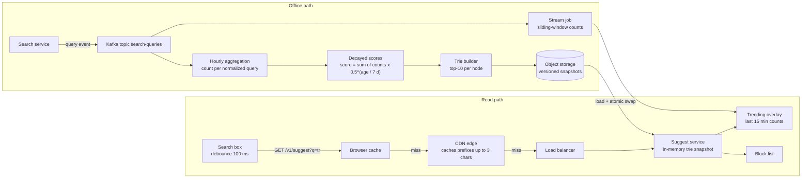
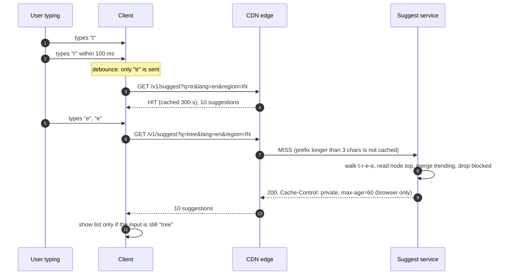
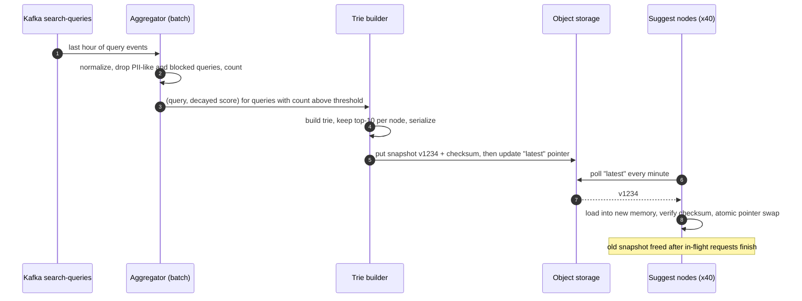
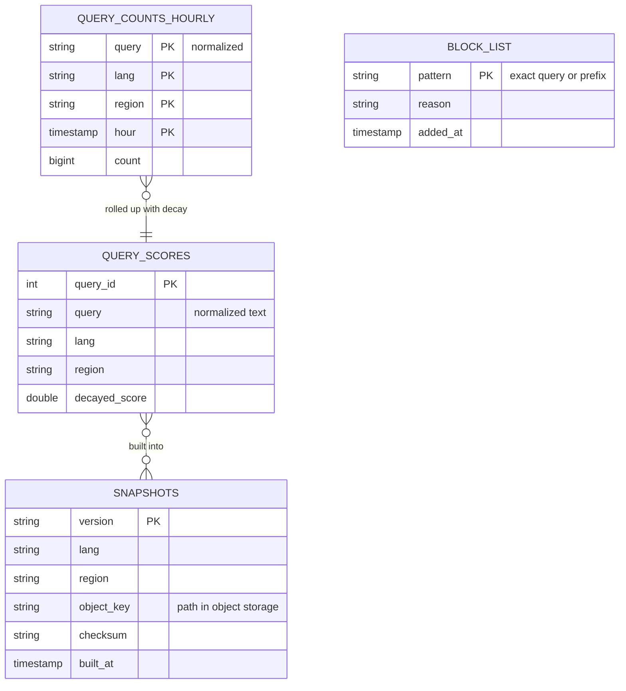

# Case Study - Search Autocomplete

> [!summary] TL;DR
> Search autocomplete (typeahead) shows the top 5 to 10 popular queries that start with what the user has typed so far, updated on every keystroke. The design splits into a fast read path (a precomputed prefix → top-K lookup served from memory and caches in a few milliseconds) and a slow offline path that counts real queries and rebuilds that lookup every few minutes or hours.

> [!abstract] Core idea
> - Never compute "top K for this prefix" at request time; precompute it for every prefix and store it in each trie node (or in a prefix → list table).
> - A lookup then walks at most `len(prefix)` characters and returns a stored list: effectively constant time.
> - Query logs flow into an aggregation pipeline (counts with time decay); a builder produces an immutable snapshot; serving nodes swap snapshots atomically.
> - Most keystrokes never reach the service: debouncing on the client, browser caching and CDN caching for short prefixes absorb them.
> - Trending queries need a fast lane (streaming counts merged on top of the snapshot), and offensive suggestions need a block list.

## 1. Why it exists - requirements

Typing "how to bo" and seeing "how to boil eggs" saves keystrokes, fixes spelling and steers users to queries that return good results. Users expect suggestions to keep up with typing, so the whole round trip must fit between keystrokes.

**Functional requirements**
- Given a prefix, return the **top 10** completions ranked by popularity.
- Prefix match only (no mid-word or typo-tolerant matching in the base design; covered in section 5).
- Suggestions reflect popularity over recent weeks, with **trending** queries showing up within about 15 minutes (a product target).
- Remove offensive, dangerous or legally blocked suggestions quickly.
- Optional: personalization (the user's own recent queries first), per-language and per-region lists.

**Non-functional requirements**
- End-to-end latency under 100 ms at p99 from keystroke to rendered list (a common product target); the server part under 10 ms.
- High availability: if autocomplete fails, search still works, so it degrades gracefully to "no suggestions".
- Read-heavy: every search session generates several lookups; writes are batch rebuilds.

**Out of scope**: the search results page itself, spelling correction, ranking by click-through models (mentioned as an extension).

## 2. Mental model

Picture a **library card catalogue drawer for every prefix**. The drawer labelled "tr" does not contain every book starting with "tr"; it contains a single card with the 10 most borrowed titles already written on it. Looking something up is opening the right drawer. The expensive work, counting borrowings and rewriting the cards, happens at night (the offline builder), and a clerk pins a "trending this hour" note to drawers when something spikes (the fast lane).

The data structure is a **trie** ([[Tries, Suffix Trees and Suffix Arrays]]): each node is a prefix, children extend it by one character. The design trick is to cache the answer, the top-K list, in every node, trading memory for constant-time reads.

## 3. How it works - high-level design



**Read path.** The client waits about 100 ms after the last keystroke (debounce) before sending a request, so fast typists send far fewer requests than keystrokes. The response for a short prefix like "t" is the same for everyone in a region, so it can be cached in the browser and the CDN for a few minutes. Longer prefixes reach the suggest service, which walks its in-memory trie, merges the trending overlay, filters the block list and returns JSON.



The last step matters: responses can arrive out of order, and the client must drop a response for a prefix the user has already typed past.

**Build path.** Every hour, the pipeline publishes a new immutable snapshot.



## 4. Worked example - estimates, API and data model

### Whiteboard version

```text
Users:     100M DAU × 10 searches/day × ~6 requests per search (after debounce)
           = 6B requests/day ≈ 69k/s average, ~140k/s peak (×2 assumed)
Cache:     prefixes ≤ 3 chars served by CDN; assume 50% of requests -> ~70k/s at origin peak
Data:      keep queries seen ≥ 10 times in 30 days: ~100M distinct queries
Snapshot:  up to ~2B trie nodes worst case (estimate) is too big -> cap prefixes at 20 chars,
           store top-10 as IDs -> ~tens of GB per language; shard or trim
API:       GET /v1/suggest?q=<prefix>&lang=en&region=IN -> {suggestions: [...]}

[client debounce] -> [browser cache] -> [CDN] -> [suggest svc: trie in RAM]
[search logs] -> [Kafka] -> [aggregate + decay] -> [builder] -> [snapshot store]
[Kafka] -> [stream job] -> [trending overlay]
```

### Estimates (inputs are assumptions; results are estimates)

| Quantity | Arithmetic | Result |
| --- | --- | --- |
| Requests per day | 100M users × 10 searches × 6 requests | 6 billion/day |
| Average rate | 6,000,000,000 / 86,400 s | ≈ 69,400 requests/s |
| Peak rate (×2) | 69,400 × 2 | ≈ 139,000 requests/s |
| Origin peak after CDN (50% hit, assumed) | 139,000 × 0.5 | ≈ 70,000 requests/s |
| Suggest nodes | 70,000 / ~5,000 requests/s per node (assumed, small JSON from memory) | 14 nodes; run about 40 across 3 zones for headroom and failover |
| Distinct queries kept | after a threshold of 10 occurrences in 30 days (assumed) | ≈ 100M |
| Trie nodes | ≤ 100M queries × average 20 chars, minus shared prefixes | upper bound 2B; with prefix sharing assume ~500M |
| Node size | top-10 as 4-byte query IDs (40 B) + children map (~60 B) | ≈ 100 B |
| Snapshot size | 500M nodes × 100 B | ≈ 50 GB per language-region |
| Query string table | 100M × ~25 B | ≈ 2.5 GB |

**What the numbers decide.** A 50 GB snapshot fits in RAM on a large machine but is costly to replicate on 40 nodes and slow to reload hourly. Three standard fixes: store only prefixes up to 20 characters (longer prefixes rarely change the answer), keep only nodes reached by real traffic, and **shard by prefix** (for example by the first two characters) so each node holds a slice. The read rate, in contrast, is easy once the CDN takes short prefixes.

### API

```http
GET /v1/suggest?q=tr&lang=en&region=IN&limit=10
Accept: application/json
```

```http
HTTP/1.1 200 OK
Cache-Control: public, max-age=300
Content-Type: application/json

{"prefix": "tr",
 "snapshot": "v1234",
 "suggestions": ["trump", "tree", "trip advisor", "try", "true love",
                 "train status", "translate", "trending news", "truecaller", "trivago"]}
```

- The prefix is normalized on the server (lower case, Unicode NFC, collapsed spaces) so `Tr` and `tr` hit the same cache entry.
- Personalized requests (`&user=...`) must use `Cache-Control: private` and skip the CDN; a common split is "global list from the CDN plus up to 3 recent personal queries merged on the client".
- Logging: the search service, not the suggest service, logs **submitted** queries. Logging every keystroke prefix would flood the pipeline with partial queries.

### Data model



The serving format is not a table: it is the serialized trie, where each node stores its character, child offsets and the top-10 `query_id` list, plus a string table mapping IDs to text.

### Code: a trie with top-K cached in every node

`Build` runs in the offline builder; `Lookup` runs in the suggest service. The trie is immutable after building, so concurrent lookups need no locks, and a new snapshot replaces the old one with an atomic pointer swap.

```go
// Package autocomplete builds an immutable trie in which every node stores
// the top-K completions under it, so a lookup costs O(len(prefix)).
package autocomplete

import (
	"sort"
	"strings"
)

// Suggestion is a full query and its (decayed) popularity score.
type Suggestion struct {
	Query string
	Score int64
}

type node struct {
	children map[rune]*node
	top      []Suggestion // best K completions in this subtree, highest first
}

// Trie is built offline from aggregated query counts and then only read,
// so concurrent lookups need no locks.
type Trie struct {
	root *node
	k    int
}

// better orders by score descending, then alphabetically for stable output.
func better(a, b Suggestion) bool {
	if a.Score != b.Score {
		return a.Score > b.Score
	}
	return a.Query < b.Query
}

// Build inserts every query and keeps the top k at each node on the path.
func Build(counts map[string]int64, k int) *Trie {
	t := &Trie{root: &node{children: map[rune]*node{}}, k: k}
	for q, c := range counts {
		s := Suggestion{Query: strings.ToLower(q), Score: c}
		n := t.root
		t.offer(n, s)
		for _, r := range s.Query {
			child, ok := n.children[r]
			if !ok {
				child = &node{children: map[rune]*node{}}
				n.children[r] = child
			}
			n = child
			t.offer(n, s)
		}
	}
	return t
}

// offer inserts s into n.top if it ranks in the top k.
func (t *Trie) offer(n *node, s Suggestion) {
	i := sort.Search(len(n.top), func(i int) bool { return better(s, n.top[i]) })
	if i >= t.k {
		return
	}
	n.top = append(n.top, Suggestion{})
	copy(n.top[i+1:], n.top[i:])
	n.top[i] = s
	if len(n.top) > t.k {
		n.top = n.top[:t.k]
	}
}

// Lookup returns up to k suggestions for prefix: walk the prefix, read the cache.
func (t *Trie) Lookup(prefix string) []Suggestion {
	n := t.root
	for _, r := range strings.ToLower(prefix) {
		next, ok := n.children[r]
		if !ok {
			return nil
		}
		n = next
	}
	return n.top
}
```

```go
package autocomplete

import (
	"fmt"
	"reflect"
	"sync"
	"testing"
)

var counts = map[string]int64{
	"tree":         500,
	"try":          300,
	"true love":    250,
	"trump":        900,
	"trie":         40,
	"toy story":    700,
	"tree house":   120,
	"trip advisor": 300,
}

func queries(s []Suggestion) []string {
	out := make([]string, len(s))
	for i, x := range s {
		out[i] = x.Query
	}
	return out
}

func TestLookupReturnsTopKInOrder(t *testing.T) {
	tr := Build(counts, 3)
	got := queries(tr.Lookup("tr"))
	want := []string{"trump", "tree", "trip advisor"} // 300 ties broken alphabetically
	if !reflect.DeepEqual(got, want) {
		t.Fatalf("tr: got %v want %v", got, want)
	}
	if got := queries(tr.Lookup("TREE")); !reflect.DeepEqual(got, []string{"tree", "tree house"}) {
		t.Fatalf("tree: got %v", got)
	}
	if got := tr.Lookup("xyz"); got != nil {
		t.Fatalf("unknown prefix: %v", got)
	}
}

func TestMatchesBruteForce(t *testing.T) {
	big := map[string]int64{}
	for i := 0; i < 2000; i++ {
		big[fmt.Sprintf("q%d", i)] = int64((i * 7919) % 1000)
	}
	tr := Build(big, 5)
	for _, p := range []string{"q", "q1", "q19", "q199"} {
		var all []Suggestion
		for q, c := range big {
			if len(q) >= len(p) && q[:len(p)] == p {
				all = append(all, Suggestion{q, c})
			}
		}
		for i := 0; i < len(all); i++ { // simple selection sort by better()
			for j := i + 1; j < len(all); j++ {
				if better(all[j], all[i]) {
					all[i], all[j] = all[j], all[i]
				}
			}
		}
		if len(all) > 5 {
			all = all[:5]
		}
		if got := tr.Lookup(p); !reflect.DeepEqual(got, all) {
			t.Fatalf("%s: got %v want %v", p, got, all)
		}
	}
}

func TestConcurrentReads(t *testing.T) {
	tr := Build(counts, 3)
	var wg sync.WaitGroup
	for i := 0; i < 16; i++ {
		wg.Add(1)
		go func() {
			defer wg.Done()
			for j := 0; j < 1000; j++ {
				if len(tr.Lookup("t")) != 3 {
					t.Error("want 3")
					return
				}
			}
		}()
	}
	wg.Wait()
}
```

`go vet` and `go test -race` pass on Go 1.24.4 in a scratch module. `TestMatchesBruteForce` checks the cached lists against a full scan for 2,000 queries, which is the property that matters: the precomputed answer equals the slow answer.

Build cost: each query updates `len(query) + 1` nodes, and each update is a binary search plus a shift of at most K entries, so building costs about `O(total characters × K)`. For 100M queries of 20 characters and K = 10 that is about 2 × 10^10 small operations, minutes on one machine (an estimate), which is why it runs offline.

### One request traced

1. At 21:00 the hourly snapshot `v1234` for `en/IN` is live on all suggest nodes.
2. A user types "t" and "r" within 100 ms, pauses for 300 ms, then types "e" and "e". With a 100 ms debounce the client sends only `q=tr` and then `q=tree`.
3. `q=tr` is served by the CDN (prefix length 2, cached 300 s).
4. `q=tree` misses the CDN. The suggest node walks 4 nodes, reads `["tree", "tree house", ...]`, merges the trending overlay (nothing trending), checks the block list and returns in about 1 ms of server time (an estimate for an in-memory walk).
5. The user submits "tree house". The search service logs it to Kafka; it appears in the next hourly count and, if it spikes, in the trending overlay within 15 minutes.

## 5. Variants and comparison

| Option | How it works | Use when | Cost |
| --- | --- | --- | --- |
| Trie with top-K per node (this note) | Precomputed lists in memory, O(prefix length) lookup | Large global query logs, strict latency | Memory heavy; rebuild to update |
| Prefix → top-K table in a KV store (Redis, DynamoDB) | Builder writes one row per prefix; service does one `GET` | Simpler serving tier, shared cache across nodes | One network hop per lookup; many keys (one per prefix) |
| Redis sorted set with `ZRANGE ... BYLEX` | All queries in one sorted set with score 0; lexicographic range gives all matches, then rank | Small catalogues (thousands to low millions of entries) | Must scan all matches to rank by popularity; no top-K shortcut |
| Search engine completion suggester (Elasticsearch) | In-memory FST built per index segment; weights per suggestion | You already run Elasticsearch and need typo tolerance or context filters | Cluster to operate; weights updated by reindexing |
| Fuzzy or infix matching (n-gram index) | Index character n-grams, match anywhere in the string | Product names, contacts, "contains" search | Bigger index; ranking harder |

**Ranking signal choices:**

| Signal | Pro | Con |
| --- | --- | --- |
| Raw count over all time | Simple | Old queries dominate forever |
| Count in a sliding window (last 30 days) | Fresh | Needs per-day buckets; sudden drop when an old spike leaves the window |
| Exponential decay (half-life 7 days, as in the diagram) | Smooth, one number per query | Needs periodic re-scoring |
| Click-through or result quality | Suggests queries that lead to good results | Needs a learning pipeline |

## 6. Trade-offs and when not to use

- **Precompute over compute-on-read because** finding the top 10 among millions of matching queries per keystroke is too slow at 70k requests/s; the price is staleness (up to one build interval) and memory.
- **Immutable snapshots over in-place updates because** they make reads lock-free and rollback trivial (point back to the previous version); the price is a full rebuild per interval, softened by the trending overlay.
- **CDN caching of short prefixes because** short prefixes are both the most frequent and the most shared; the price is up to 5 minutes of staleness for those prefixes and no personalization in cached responses.
- **When not to use this design:** a catalogue of 50,000 products or city names fits in a PostgreSQL 17 table with a `text_pattern_ops` B-tree index or a `pg_trgm` index, or in a single Redis sorted set. Build the trie pipeline only when query logs, not a fixed list, define the suggestions.

## 7. In production

- **Well-documented building blocks:**
	- Elasticsearch's completion suggester stores suggestions in an in-memory finite-state transducer (FST) per segment and is built for fast prefix lookup with weights, documented as optimized for speed rather than flexibility.
	- Redis `ZRANGE key [prefix (prefix\xff BYLEX` (since Redis 6.2; `ZRANGEBYLEX` before) returns members in a lexicographic range, a common small-scale autocomplete building block.
	- Google documents that it removes autocomplete predictions that violate its policies (for example violent, sexually explicit or hateful predictions) and offers a way to report them. Every public autocomplete needs the same filter.
- **Failure modes → fixes:**
	- *Bad snapshot (empty or corrupted)* → validate before publishing (node count, top queries for sample prefixes compared with the previous version within a tolerance); nodes verify checksums; keep the previous snapshot to roll back by moving the "latest" pointer.
	- *Offensive or harmful suggestion goes live* → the block list is checked at serving time, so a removal takes effect in seconds without a rebuild; purge affected CDN paths.
	- *Trending spam* (bots submit a query to push it into suggestions) → count distinct users or sessions instead of raw submissions, cap per-user contributions, and require a minimum number of distinct users.
	- *Snapshot reload causes GC pauses or memory doubling* → two snapshots are briefly in memory during the swap; size nodes for 2x the snapshot, or use an off-heap or memory-mapped format.
	- *Privacy leak* (a rare query with a phone number or name appears as a suggestion) → minimum distinct-user thresholds and PII filters in the aggregator.
- **SLOs and monitoring (targets):** server p99 under 10 ms; end-to-end p99 under 100 ms; availability 99.9% (search works without it); CDN hit ratio; snapshot age (alert if older than 3 build intervals); share of empty responses for common prefixes; block-list propagation time.

## 8. Deep dive

### 8.1 Trending queries without hourly lag

A breaking news query must appear within minutes, but a full trie rebuild takes longer than that. A **fast lane** solves it:
1. A stream job ([[Stream Processing Basics]]) keeps per-query counts in 5-minute tumbling windows for the last hour.
2. It flags a query as trending when its current-window rate is well above its baseline (for example 5x its decayed hourly average and at least 500 distinct users, both product thresholds).
3. Trending queries, at most a few thousand, are pushed to suggest nodes as a small overlay map from prefix to trending queries.
4. At lookup the node merges `node.top` with overlay entries for this prefix and re-sorts the top 10. The overlay is tiny, so the merge costs microseconds.

Counting the heaviest queries in a stream without storing every query exactly is a Count-Min Sketch or heavy-hitters problem; see [[Bloom Filters and Probabilistic Data Structures]] and [[Case Study - Leaderboard and Top-K]].

### 8.2 Sharding the trie

When one language-region snapshot no longer fits comfortably on one node, shard it.
- **By prefix range:** shard 1 holds prefixes starting `a`-`c`, and so on. Simple routing (the first characters pick the shard) but skewed: far more English queries start with "s" than with "x". Split ranges by measured traffic, not by alphabet, and keep a routing table.
- **By hash of the first two characters:** more even, but a range of related prefixes no longer lives together, which does not matter here because each lookup touches one prefix.
- **Replicate everything, shard by language and region:** often the simplest answer, because each language-region pair is a natural shard and users rarely cross them.

The top levels (prefixes of 1 to 2 characters) are the hottest and smallest; they are cached by the CDN anyway.

### 8.3 Unicode and normalization

Lower-casing is locale-sensitive (Turkish dotted and dotless i), accents may or may not matter ("café" vs "cafe"), and scripts like Hindi combine characters. Normalize queries the same way in the aggregator and at lookup: Unicode NFC, locale-aware lower-casing, optional accent folding per language. Store trie edges by rune (as the Go code does with `range` over a string), not by byte, so a multi-byte character is one edge. A mismatch between build-time and request-time normalization shows up as "no suggestions" for real users, so test it with sample inputs in every supported language.

## 9. Interview questions

> [!question]- Why store the top-K list in every trie node?
> Without it, a lookup for "t" would have to visit every query under "t" (millions) and sort them. With a cached list, a lookup walks at most `len(prefix)` nodes and returns the stored list. The cost is memory (K entries per node) and offline rebuilds.

> [!question]- How many requests hit the backend per keystroke?
> Far fewer than one: the client debounces (about 100 ms), cancels stale requests, and caches results; the CDN caches short prefixes shared by everyone. With typical typing rhythm a 10-keystroke query produces a handful of requests (the estimate above assumes 6), and short prefixes rarely reach the origin.

> [!question]- Trap: "Update the trie in place on every search so suggestions are always fresh."
> That puts writes on the hottest read structure: every node on the path needs a lock or copy-on-write, top-K lists must be recomputed under contention, and spam goes live instantly. Rebuild snapshots offline and add a small trending overlay for freshness.

> [!question]- How do you handle trending queries?
> A streaming job counts submissions in short windows and flags queries growing much faster than their baseline, with minimum distinct-user thresholds. Those few thousand queries are pushed to serving nodes as an overlay merged at lookup time.

> [!question]- How do you remove an offensive suggestion within minutes?
> Keep a block list checked at serving time, not only at build time, and purge CDN entries for the affected prefixes. The next build drops the query from the trie permanently.

> [!question]- How would you personalize suggestions without losing CDN caching?
> Serve the global list from the CDN and merge the user's own recent queries on the client (or from a small per-user store with `Cache-Control: private`). Mixing personal data into a cached public response would leak it to other users.

> [!question]- Trie or a prefix → list table in Redis?
> Both precompute. The trie keeps everything in process memory (fastest, no network hop, rebuilt per node). A Redis table is shared and simpler to update per prefix but adds a network hop and holds one key per prefix. Choose by snapshot size and how many serving nodes you run.

## 10. Cheat sheet

A 45-minute interview script:
- **0-5 min, requirements:** top 10 by popularity for a prefix; p99 under 100 ms end to end; trending within 15 minutes; block list; out of scope: typo tolerance, results page.
- **5-10 min, estimates:** 6B requests/day ≈ 69k/s, 140k/s peak; CDN halves it; 100M distinct queries; snapshot tens of GB per language-region.
- **10-15 min, API and data model:** `GET /v1/suggest?q=&lang=&region=`; hourly counts, decayed scores, block list, snapshot metadata.
- **15-25 min, high-level design:** client debounce → browser cache → CDN → suggest service with in-memory trie; Kafka → aggregation → builder → object storage → atomic swap.
- **25-40 min, deep dives:** top-K per node and its build cost; trending overlay; sharding; snapshot validation and rollback; normalization.
- **40-45 min, wrap-up:** SLOs (snapshot age, CDN hit ratio), abuse and privacy filters, personalization on the client.

## Links

- **Before this:** [[Tries, Suffix Trees and Suffix Arrays]], [[Back-of-the-Envelope Estimation]], [[Caching Patterns]], [[Case Study - Key-Value Store]]
- **Next:** [[Case Study - News Feed]], [[Case Study - Leaderboard and Top-K]], [[Search Engines and Inverted Indexes]]
- **Compare with:** [[Keyword, Semantic and Hybrid Search]], [[Bloom Filters and Probabilistic Data Structures]], [[CDN and Edge]], [[Kafka and Event Streaming]], [[Stream Processing Basics]]
