# Case Study - Social Graph and Friend Recommendations

> [!summary] TL;DR
> A **social graph** stores who is connected to whom. The product needs four fast answers: "list my friends", "are A and B friends?", "who are our mutual friends?" and "who might I know?".
>
> The design stores each person's **adjacency list** on one shard (partitioned by user id), keeps both directions of a friendship in sync with an outbox, caches hot lists, and computes "people you may know" offline as a friends-of-friends join, then serves the precomputed top results from a key-value store.

> [!abstract] Core idea
> - Model people as **nodes** and friendships as **edges**. Shard by `user_id` so a friend list is one shard read, never a scatter-gather.
> - A friendship touches two users on two shards, so one friend request means two writes. Use a canonical relation row plus an outbox to project both adjacency lists, and repair drift.
> - Mutual friends is a **set intersection** of two lists (hundreds of ids each). Celebrities with millions of followers need special handling (supernodes).
> - "Degrees of separation" is a **bidirectional BFS** that stops at depth 2 or 3 online.
> - "People you may know" counts friends-of-friends, ranks them with features, and is **precomputed in batch**; online it is a lookup plus filtering (blocked, already friends, dismissed).

## Start here: the basics 🟢

> [!info] How to read this note (pick your level)
> - 🟢 **New to this?** Read "From zero" below, then sections 1, 2 and the cheat sheet (10). Stop there, that is a full first pass.
> - 🟡 **Know the basics?** Add sections 3 (how it works), 4 (worked example), 5 (variants) and 6 (trade-offs).
> - 🔴 **Interview / SDE-3 prep?** Add 7, 8 and 9. Headings are tagged 🟢🟡🔴 so you always know where you are.

> [!note] Before this note
> - [[System Design Interview Framework]]: the order to work in: requirements, estimates, API, data, design, deep dives.
> - [[Back-of-the-Envelope Estimation]]: turning a billion users with 300 friends each into terabytes and reads per second.
> - [[Graphs and Graph Algorithms]]: nodes joined by edges, and breadth-first search (BFS), which explores one hop at a time.
> - [[Partitioning and Sharding]]: splitting data across many servers by a key such as user ID.

**From zero, in 60 seconds** 🟢

A social network is a big web of people and the links between them.
In computer words, each person is a **node** and each friendship is an **edge**. Together they make a **graph**.
Each person's friend list is stored together in one place, so "show my friends" is one quick read.
Mutual friends are just the names that appear in both lists.

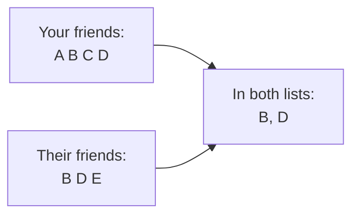

"People you may know" are friends of your friends. Working that out for a billion people is heavy, so it is done offline and saved.

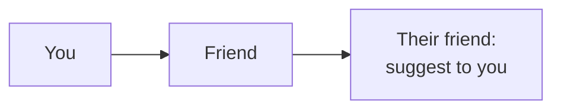

So the rest of this note is just these 3 questions:
1. How do you store a billion friend lists so reading one is fast?
2. How do you count mutual friends quickly?
3. How do you make good friend suggestions without a huge live search?

**The problem in one story.**
You open a social app and see your 300 friends.
You visit a stranger's profile and see "12 mutual friends".
A box says "People you may know" with someone from your old school.
All three answers must come back fast for a billion users.

**Words you need first**

| Word | Plain meaning | Tiny example |
| --- | --- | --- |
| Graph | A set of things (nodes) joined by links (edges) | People joined by friendships |
| Node / edge | A person / one friendship between two people | Asha — Ravi |
| Adjacency list | The list of everyone one node links to | Asha: [Ravi, Meera, ...] |
| Shard | One slice of the data on its own server | Users 0-1M on shard 1 |
| Friends-of-friends | People your friends know but you do not | Ravi's friend Kiran |
| Set intersection | Items that appear in both of two lists | Mutual friends of A and B |
| Outbox | A table of "events to send" written with the main change | "A and B are now friends" |

| Supernode | A node with a huge number of edges, which becomes a hot spot | a celebrity with 100 million followers |
| Projector | A worker that copies a change into read-friendly tables | writes B into A's list and A into B's list |
| BFS | Breadth-first search: explore all friends, then all their friends, one layer at a time | "is Kiran within 3 hops of me?" |

**Picture it**

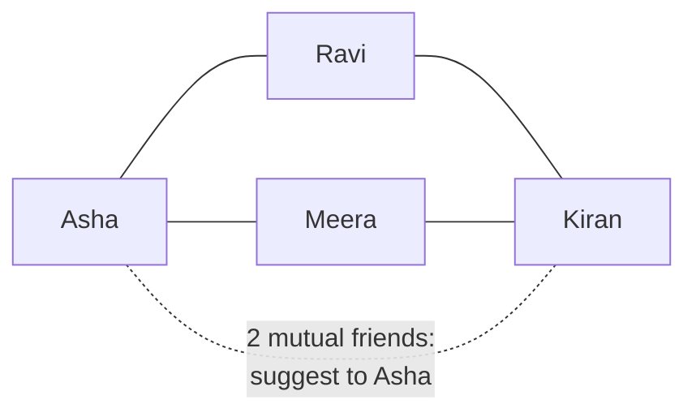

**Analogy.** A city phone book where each person has a page listing their friends.
Where it breaks: a phone book is printed once, but friendships change every second and each page may sit on a different server.

**How the rest of this note builds up**

- First, the four questions the product asks (section 1) and the phone-book mental model (section 2).
- Then storage options and the architecture (section 3).
- Then estimates, API, data model, the friend-request lifecycle and one traced friendship (section 4).
- Finally the SDE-3 deep dive: mutual friends at scale, the suggestions pipeline, bidirectional BFS, supernodes and keeping both sides in sync (sections 5-8).

> [!tip] Remember
> Shard friend lists by user, write both sides of every friendship, and compute suggestions offline.

## 1. Why it exists - requirements 🟢

Every social product is a graph underneath. On the first day you can keep friendships in one SQL table and run `JOIN`s. On the day you have a billion users, three things break: friend lists no longer fit one database, "mutual friends" becomes a join on two huge tables, and suggestions would need billions of two-hop traversals per day.

The graph is also different from other data: reads follow edges (hop by hop), a request often touches many users at once, and a single person (a celebrity) can have 10,000 times more edges than average.

**Functional requirements**
- Send, accept, reject and cancel a friend request. Remove a friend. Block a user.
- List a user's friends (paginated, newest first), and the friend count.
- "Are A and B friends?" (used on every profile view and privacy check).
- Mutual friends between two users, with count.
- Degrees of separation ("2nd connection", "3rd+") between viewer and another user.
- Friend suggestions ("people you may know"), with a reason ("12 mutual friends").
- Follow model for public figures (asymmetric): follow, unfollow, follower count and list.

**Non-functional requirements**
- Friend list and "are we friends" read p99 under 50 ms (a target for this design).
- Reads dominate writes by more than 100 to 1.
- A friendship change is visible to both users within a few seconds; both sides eventually agree.
- Privacy is a correctness requirement: a block or an unfriend must take effect in every read path, including suggestions.
- Suggestions can be hours old, but must never show blocked users or existing friends.
- Handle celebrity accounts with tens of millions of edges without hurting other users.

### Real-life example: LinkedIn connections 🟢

On LinkedIn, a stranger's profile shows "2nd" next to their name and "14 mutual connections".
The "People you may know" box often shows an old classmate, because many of your connections are also connected to them.
When you accept a request, both of you see each other in your lists within a second or two.
If you block someone, they must vanish from your suggestions and searches at once.

**Out of scope:** feed ranking (see [[Case Study - News Feed]]), messaging, and people search (see [[Case Study - Search Autocomplete]]).

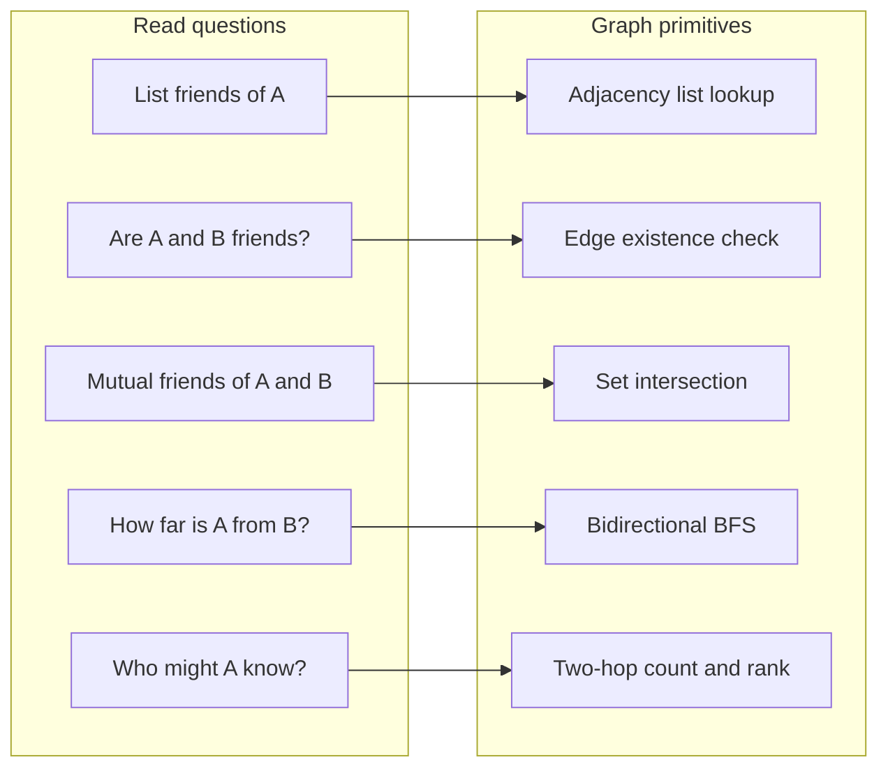

> [!tip] Remember
> Every feature maps to one graph primitive. If you can name the primitive, you can name its cost.

## 2. Mental model 🟢

Think of a **city phone book where every person has a personal page listing their friends**. Finding your friends is turning to your own page: one lookup. Finding mutual friends is laying two pages side by side and ticking off names that appear on both.

Finding someone's friends-of-friends is opening each friend's page, which is about 300 more lookups. Finding suggestions for everyone means opening every page in the city for every person, which is why we do it overnight with many clerks instead of at the moment someone asks.

Where the analogy breaks: pages are on different floors (shards), and when two people become friends, both pages must be updated, on two different floors, at the same time.

Terms:
- **Node (vertex):** a user. **Edge:** a relationship between two users.
- **Undirected edge:** friendship (symmetric). **Directed edge:** follow (A follows B does not mean B follows A).
- **Degree:** number of edges of a node. Average degree here is about 300; a celebrity's in-degree can be 100 million.
- **Adjacency list:** all neighbors of one node stored together.
- **Supernode:** a node with an enormous degree; a hot spot.
- **Mutual friends:** the intersection of two friend sets.
- **Friend-of-friend (FoF):** a node two hops away.
- **Triadic closure:** the idea that if A knows B and B knows C, A is likely to know C. This is the basis of most suggestions.

> [!tip] Remember
> One person's neighbors live together. Everything cheap in this design is "read one person's list"; everything expensive is "read many people's lists".

## Common beginner mistakes 🟢

- **Computing "people you may know" live for every request** → about 90,000 candidates per user, tens of thousands of times a second → compute it in a nightly batch and store the top 100.
- **Storing each friendship only once** → "list my friends" must search every shard → store a copy in each person's list, kept in sync by a projector.
- **Writing both copies with two separate best-effort calls** → a crash leaves A friends with B but not B with A → write one canonical row plus an outbox event, and replay idempotently.
- **Paging a 5,000-friend list with `OFFSET`** → re-reads thousands of rows per page → use a cursor on `(created_at, friend_id)`.
- **Treating a celebrity like a normal user** → one shard holds 100 million follower rows → bucket supernode lists and avoid scanning them online.

## 3. How it works - high-level design 🟡

> 🟢 → 🟡 **You now know** the phone-book idea: each person's friend list lives together, and suggestions are worked out offline. **Next we open the box**: the storage choices, and the services that turn one "Accept" into two friend-list updates.

### Storing the graph: the options

**Step by step:**
1. Small app: one SQL table `friendships(a, b)` with an index each way. Good up to about 100 million edges.
2. Bigger: store each user's list together, keyed by `user_id`, in sharded SQL or a wide-column store. "My friends" is one read on one shard.
3. Put a cache in front, because the same popular lists are read again and again.
4. Use a native graph database only when deep multi-hop queries are the main job and the graph fits its sharding limits.

**In plain words.** You can store edges as rows in a SQL table, as adjacency lists in a key-value or wide-column store, or inside a real graph database. The right choice depends on whether the graph fits one machine and how deep your traversals go.

**Picture it.**

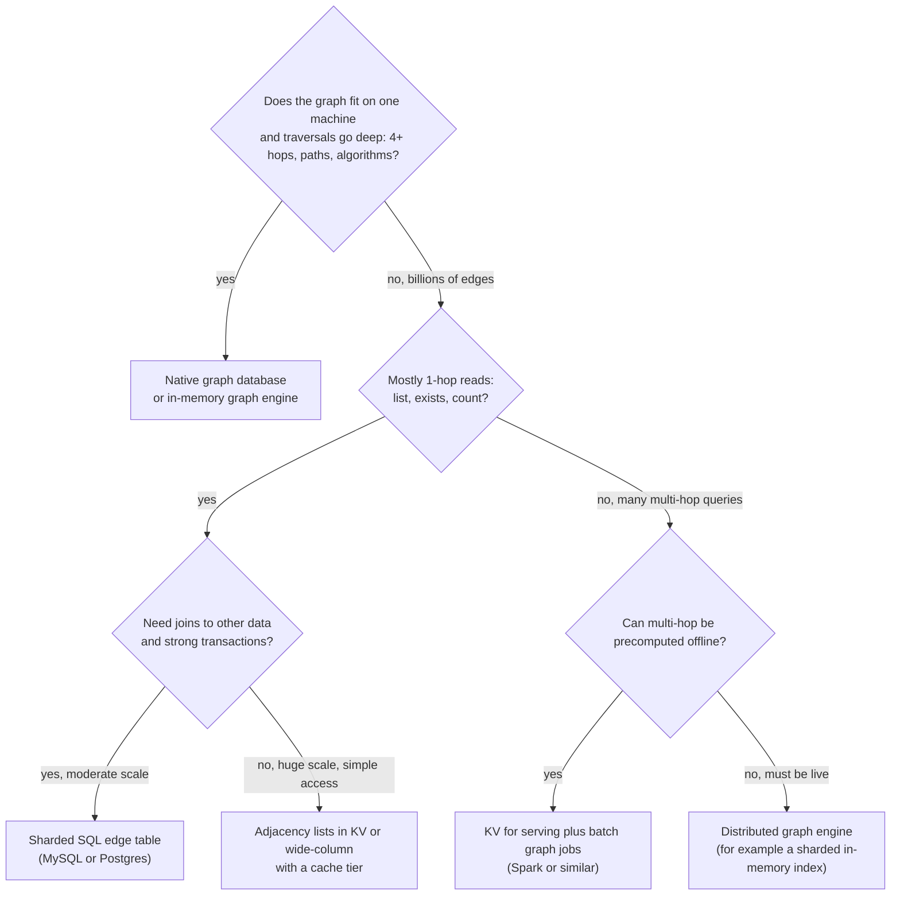

**Example.** Facebook's TAO (published 2013) keeps the social graph in MySQL, shards it by object id, and puts a write-through cache tier (writes go through the cache to the database, so the cache stays current) in front so that most reads never reach MySQL. TAO's data model has *objects* (users, posts) and *associations* (typed edges, such as friend or liked) with association lists ordered by time. Twitter's Who-To-Follow service (published 2013) loaded the whole follow graph into the memory of a single machine with the Cassovary library, because for a graph of that time, one big-memory machine was simpler than a distributed graph. LinkedIn has published a paper on LIquid, a graph database serving its connection graph from a sharded in-memory index. These show three real approaches: sharded storage plus a cache, one big in-memory server, and a purpose-built distributed graph engine.

**Why it matters.** The graph database is rarely the right first answer at a billion users: you need sharding, caching and simple lookups first; native graph engines shine for deep traversals on data that fits their memory model.

For the generic database decision see [[Choosing a Database - Decision Guide]].

### The architecture

**Step by step (plain):**
1. Ravi accepts Asha's request. The friendship service updates one row for the pair (Asha, Ravi) to FRIENDS and writes an outbox event in the same transaction.
2. The event goes to Kafka.
3. The projector adds Ravi to Asha's list and Asha to Ravi's list. Doing it twice changes nothing.
4. The caches for both lists are cleared, so the next read shows the new friend.
5. Tonight's batch job will also start suggesting Ravi's friends to Asha.

**In plain words:** a graph service stores friend lists split by user; an offline job makes suggestions; caches serve the hot reads.

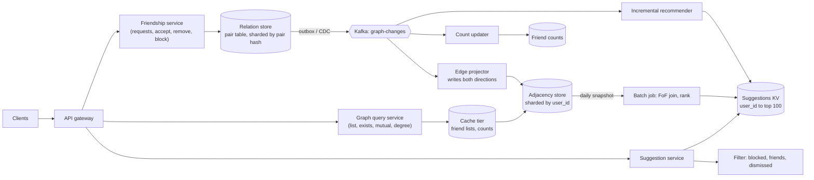

Walk through it:
1. The **friendship service** owns the rules (limits, blocks, pending state) and writes one canonical row per pair.
2. A **change event** is emitted through an outbox (see [[Transactional Outbox and CDC]]), never as a "best effort" second call.
3. The **edge projector** writes both adjacency lists, one per user shard, and is idempotent.
4. The **graph query service** serves lists, existence checks and mutual friends from a cache over the adjacency store.
5. **Suggestions** come from a precomputed key-value table, built in batch and nudged by a stream for fresh edges.

> [!tip] Remember
> Two copies of the same friendship (one per user) are the price of fast reads. An outbox plus a projector keeps them honest.

## 4. Worked example - estimates, API and data model 🟡

### Whiteboard version

```text
relation(pair min,max) --outbox--> Kafka --> projector --> adj[A] += B ; adj[B] += A   (idempotent)
shard adj by hash(user_id); list = 1 shard read; exists = point lookup (A,B)
mutual = intersect(adj[A], adj[B])   (probe smaller into larger; cache hot lists)
degree = bidirectional BFS, depth <= 2 per side online
PYMK = batch: edges JOIN edges on friend id, count per (u,w), rank, store top 100 in KV
read time: drop blocked / already friends / dismissed
```

Say aloud: 1 billion users, 300 friends each, so 300 billion adjacency entries (150 billion friendships); about 7.2 TB raw, 14.4 TB with indexes and about 43 TB with 3x replication (estimates).

### Estimates

**In plain words:** rough sums: users, total friendships, storage, and reads per second.

All inputs are **estimates** for this exercise.

| Quantity | Arithmetic | Result |
| --- | --- | --- |
| Registered users | given | 1 B |
| Daily active users | given | 500 M |
| Avg friends per user | given | 300 |
| Adjacency entries | 1 B x 300 | 300 B entries (each friendship stored twice, so 150 B friendships) |
| Entry size | user id 8 B + friend id 8 B + created_at 8 B | 24 B raw |
| Raw storage | 300 B x 24 B | about 7.2 TB |
| With index and overhead (2x), replication (3x) | 7.2 TB x 2 x 3 | about 43 TB |
| Graph reads | 500 M DAU x 10 graph reads/day = 5 B/day / 86,400 | about 58k/s average, about 175k/s peak (3x) |
| Friend requests | 500 M x 5% send one/day = 25 M/day / 86,400 | about 290/s average, about 900/s peak |
| Write-to-read ratio | 290 vs 58,000 | about 1 to 200 |
| Mutual friends | two lists of 300 ids | about 600 comparisons, microseconds in memory |
| FoF candidates per user | 300 x 300 | about 90,000 (with overlap, perhaps 50,000 distinct) |
| FoF join size | 1 B users x 90,000 | about 9 x 10^13 pairs for a naive full join (the reason it must be pruned) |
| Suggestions storage | 1 B x 100 ids x 8 B | about 800 GB, small |
| Online BFS to depth 4 | 300^4 | about 8 x 10^9 nodes, impossible, so use bidirectional search: depth 3 online costs 2 hops + 1 hop (about 90,000 + 300 ids); depth 4 (2 + 2) costs about 2 x 90,000 = 180,000 ids and only fits a larger time budget |

The key numbers: storage is large but ordinary; the FoF join is enormous unless pruned; and no online query may go beyond a few thousand lookups.

### API

**In plain words:** send and accept friend requests, list friends, get mutual friends, and get suggestions.

```http
POST   /v1/friend-requests               {"to_user": 8841}            -> 201 {"id": "fr_9"}
POST   /v1/friend-requests/{id}/accept                                -> 204   (idempotent)
POST   /v1/friend-requests/{id}/reject                                -> 204
DELETE /v1/friend-requests/{id}                                       -> 204   (cancel own request)
DELETE /v1/friends/{user_id}                                          -> 204   (unfriend)
POST   /v1/blocks                        {"user_id": 8841}            -> 204
GET    /v1/users/{id}/friends?cursor=abc&limit=50   -> {"items": [...], "next": "def"}
GET    /v1/users/{id}/friend-count                  -> {"count": 312}
GET    /v1/relationship/{other_id}                  -> {"state": "friends", "since": "2024-03-01"}
GET    /v1/users/{id}/mutual-friends?limit=20       -> {"count": 14, "sample": [...]}
GET    /v1/users/{id}/connection-degree             -> {"degree": 2}      (1, 2, 3, or "3+")
GET    /v1/suggestions/people?limit=20              -> [{"user": 77, "mutual": 12, "reason": "..."}]
POST   /v1/suggestions/{user_id}/dismiss            -> 204
```

Notes:
- Lists use **cursor pagination** by `(created_at, friend_id)`, never `OFFSET`; with 5,000 friends an `OFFSET` scan re-reads thousands of rows.
- `accept` is idempotent: accepting an already-accepted request returns success.
- Privacy is enforced in the query service (a blocked user's list must return 404-like behavior, and `mutual-friends` may only show people the viewer is allowed to see).

### Data model

**In plain words:** one row is the official record of a friendship; each person also has their own friend list copy for fast reads.

Two layers: a **relation** table (the single canonical truth for a pair, used for state changes) and an **adjacency** table (a read-optimized projection per user).

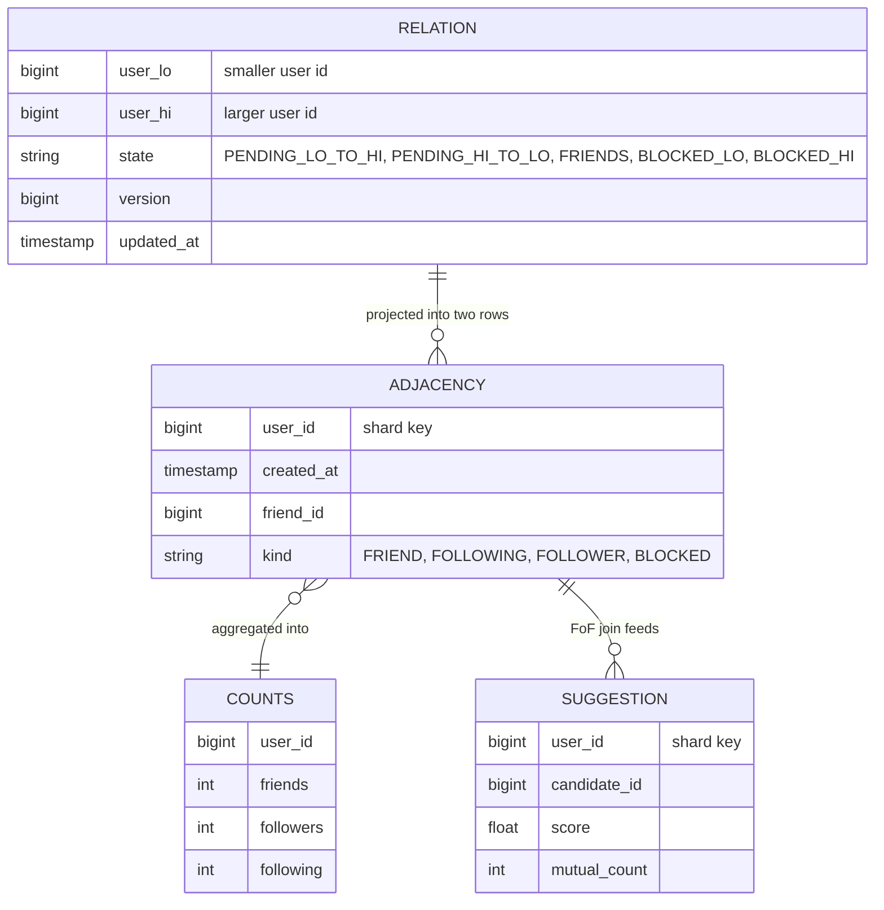

```sql
-- Canonical pair row. Key is the ORDERED pair, so A->B and B->A map to the same row and concurrent updates serialize.
CREATE TABLE relation (
    user_lo    bigint NOT NULL,
    user_hi    bigint NOT NULL CHECK (user_lo < user_hi),
    state      text   NOT NULL,
    version    bigint NOT NULL DEFAULT 1,
    updated_at timestamptz NOT NULL DEFAULT now(),
    PRIMARY KEY (user_lo, user_hi)
);

-- Adjacency projection, sharded by user_id. Clustering order gives "newest friends first" for free.
CREATE TABLE adjacency (
    user_id    bigint      NOT NULL,
    created_at timestamptz NOT NULL,
    friend_id  bigint      NOT NULL,
    kind       text        NOT NULL,
    PRIMARY KEY (user_id, kind, created_at DESC, friend_id)
);
-- Point lookup "is B a friend of A" needs a second index (user_id, kind, friend_id) or a KV copy.
CREATE UNIQUE INDEX adjacency_exists ON adjacency (user_id, kind, friend_id);
```

Good key choices:
- **Relation keyed by the ordered pair** removes the A-sends-to-B and B-sends-to-A race: both hit the same row, one wins, the other sees the first and the system turns it into an accept.
- **Adjacency keyed by `user_id`** puts one user's list together on one shard.
- **Time-ordered clustering** makes "latest 50 friends" a short range scan.
- **Count table** is separate: `friend_count` is read on every profile, so never run `count(*)` on a 5,000-entry list (see [[Case Study - Distributed Counter (Likes and Views)]] for count patterns).

> [!tip] Remember
> The relation row is the truth for changes. The adjacency rows are copies for reads. Copies can be rebuilt; the truth cannot.

### The friend-request lifecycle

**In plain words:** a request is pending, then accepted, declined or cancelled.

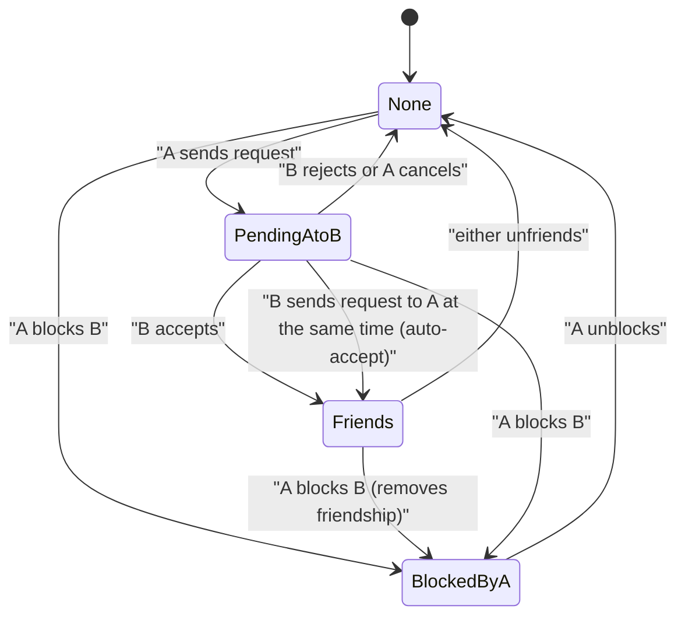

### One friendship traced

**In plain words:** follow one "Accept" tap as it updates both people's friend lists.

1. B taps "Accept" on A's request. The client calls `POST /v1/friend-requests/fr_9/accept`.
2. The friendship service reads `relation(lo=A, hi=B)` and checks `state = PENDING_A_TO_B`, `version = 3`.
3. In one transaction it runs `UPDATE relation SET state='FRIENDS', version=4 WHERE pair = (A,B) AND version = 3` and inserts an outbox row `{pair, FRIENDS, version 4}`. One row changed, so there is no race.
4. The outbox relay publishes the change to Kafka (key = pair id), so events for one pair stay in order.
5. The **edge projector** consumes it, then writes `adjacency(A) += B` and `adjacency(B) += A`. Each write is an upsert keyed `(user_id, kind, friend_id)`, so a replay changes nothing.
6. The count updater increments `friends` for A and for B, but only when the upsert actually inserted a new row (so duplicates never double count).
7. Caches for `adj:A` and `adj:B` are invalidated. Both users see each other in their lists, usually within a second or two.

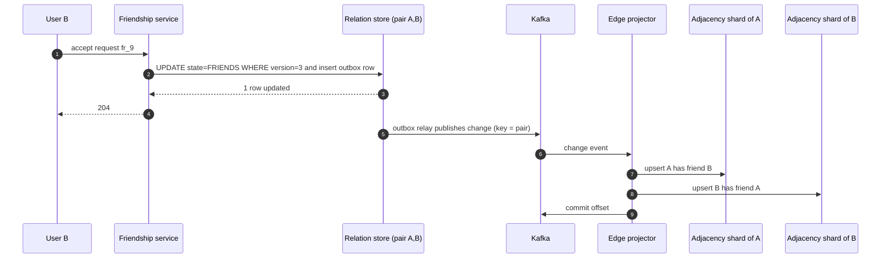

> [!tip] Remember
> One transaction on one row decides the truth. Everything else is replayable projection.

## 5. Variants and comparison 🟡

| Approach | How it works | Use when | Cost / failure mode |
| --- | --- | --- | --- |
| Single SQL edge table | `friendships(a, b)` with indexes both ways | Under about 100 M edges; joins to other data | Joins on two big tables; one primary becomes the limit |
| Sharded SQL adjacency (by user_id) | One row per direction, shard by user | Billions of edges, simple queries | Cross-shard write for each friendship; no cross-user joins |
| KV or wide-column adjacency | Row key = user id, value = list or clustered columns | Very large, access by user, high throughput | You build mutual friends and filtering yourself |
| TAO-style cache over sharded MySQL | Write-through cache tier, objects plus association lists | Read-heavy at billions of edges | Complex cache invalidation; inverse edge consistency is eventual |
| Native graph DB (Neo4j style) | Index-free adjacency: each node points to its neighbors | Deep traversals, path queries, data fits one cluster | Harder to shard evenly; supernodes hurt; fewer ops tools |
| In-memory graph on one big server | Whole graph loaded in RAM (Twitter's Cassovary) | Graph fits in RAM (about 1 TB for billions of edges, an estimate); offline or recsys | Single point of reload; scaling ceiling |
| Distributed graph engine (LIquid-like) | Sharded in-memory index, graph query language | Live multi-hop queries at very large scale | Heavy engineering investment |
| Hash partition by user | `hash(user_id) mod N` or consistent hashing | Default | A user's friends are scattered across shards |
| Graph-aware partition (community detection) | Place tightly connected users together | Cut cross-shard hops | Costly to compute; shifts over time; rarely used for live serving |

See [[Consistent Hashing]] and [[Partitioning and Sharding]] for resharding, and [[Choosing Consistency, Replication and Partitioning - Decision Guide]] for the consistency choice between the two sides of a friendship.

### Things people confuse this with 🟡

| System | What it stores | How it differs from a social graph |
| --- | --- | --- |
| [[Case Study - News Feed]] | Lists of posts to show each user | Uses the graph to know whom you follow, but stores posts, not relationships |
| Graph database (Neo4j) | Any graph with fast multi-hop queries | A storage tool; at a billion users it is hard to shard, so big networks use sharded lists instead |
| Contacts list on your phone | People you saved | One-sided and private; no mutual friends, suggestions or two-sided agreement |

## 6. Trade-offs and when not to use 🟡

- **Two copies vs one.** Storing both directions doubles storage but makes "list my friends" a single-shard range scan. One copy would force a scatter-gather to find all edges that point at you.
- **Eventual consistency between the two sides.** For a second or so, A may see B in their list while B does not yet see A. This is acceptable for friends, not for a bank. If you need atomic cross-shard writes use a distributed transaction (slower, less available) or sagas with compensation.
- **Precomputed suggestions go stale.** A new friend of yours should not be suggested again. Filtering at read time fixes correctness; refresh cadence (daily plus incremental) fixes freshness.
- **A graph database is not a free win.** Deep traversal is fast in memory, but sharding a graph is hard, because edges cross every cut. Use one when traversals really are deep and the data fits.
- **Do not compute FoF online for everyone.** It would be 90,000 candidates per request, times 58,000 requests per second.
- **Friend caps are a design tool.** Facebook publicly limits a personal account to 5,000 friends, which bounds adjacency list size, mutual-friend cost and the batch join. Asymmetric follow graphs (celebrities) need a different treatment.

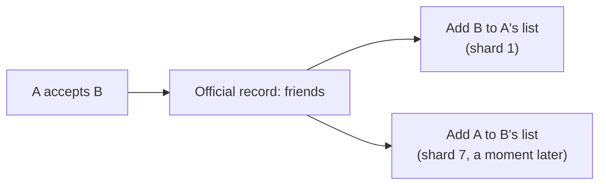

## 7. In production 🔴

> 🟡 → 🔴 **You now know** the storage choice, the architecture, the sizing, the API, the tables and one friendship traced. **Next is the advanced part**: failure stories, mutual friends at scale, the suggestions pipeline, bidirectional BFS, supernodes and keeping both sides in sync.

- **Failure modes and fixes:**
	- Projector crashes after writing A's list but before B's. Result: asymmetric edge. Fix: upserts are idempotent and the event is replayed; a repair job compares `relation` with both adjacency sides and fixes drift (TAO calls out inverse association repair as an eventual process).
	- Hot shard because of a celebrity's follower list. Fix: bucket supernode lists (section 8.4), cache page 1, rate-limit follower-list reads.
	- Cache stampede on a viral profile. Fix: single-flight cache refill (only one request reloads, the rest wait for it), short stale-while-revalidate window (serve the old copy while it refreshes). See [[Cache Failure Modes - Stampede, Avalanche, Penetration, Hot and Big Keys]].
	- Blocked user still appears in suggestions. Fix: filter by block list at read time, and keep a Bloom filter or a small per-user block set in the suggestion service.
	- Batch job late or failed. Fix: keep yesterday's suggestions, mark freshness, alert when older than 36 hours.
	- Request spam: one account sends 5,000 requests. Fix: per-user daily limits, risk scoring, and requiring acceptance before an edge exists.
	- Unfriend race (A unfriends while B accepts). Fix: both operations are compare-and-set on the same `relation` row version; the later one fails or retries.
- **What to monitor:**
	- Edge projector lag (seconds from relation commit to both adjacency rows).
	- Asymmetry count (adjacency rows without their mirror) from the repair job.
	- Cache hit rate for friend lists, p99 list latency by shard, and top hot users.
	- Suggestion freshness, batch job duration, and click-through or accept rate of suggestions.
	- Block-leak rate: suggestions shown that violate a block (must be zero, alert on any).
- **Privacy operations:** account deletion must remove the user from every adjacency list (a large fan-in write), suggestions and caches. Run it as an asynchronous, idempotent job and keep a tombstone so later projector events for that user are ignored.

## 8. Deep dive 🔴

### 8.1 Mutual friends: set intersection at scale

**In plain words.** Take your friend list and mine. Names that appear in both are mutual friends. For short lists that is trivial. For one huge list (a celebrity) it is expensive, so we test each of the short list's names against the big one.

**Picture it.**

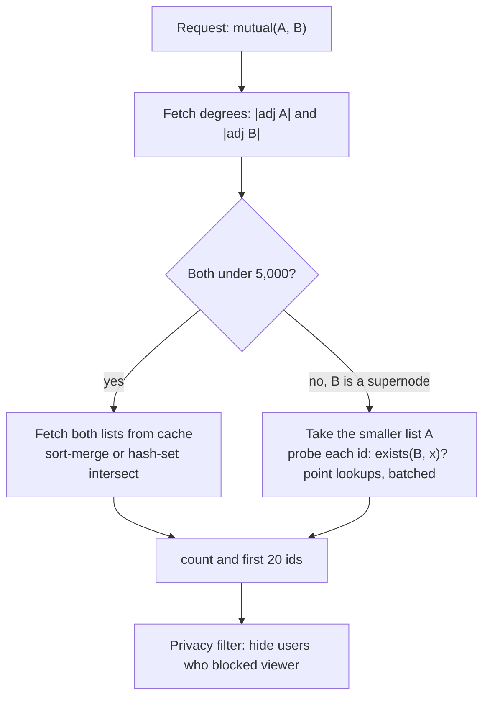

**Example.** A has 300 friends and B has 280. Hash A's ids into a set (300 entries), scan B's ids (280 lookups), keep the hits: about 580 operations, microseconds in memory. The cost is dominated by fetching the two lists, not by comparing them. If B were a public figure with 20 M followers, you would never load the 20 M list. You would ask the adjacency store "is x in B's list?" for each of A's 300 ids, in one batched request per shard.

**Making it fast.**
1. Cache each active user's friend list as a compact sorted array of ids (300 ids x 8 B = 2.4 KB).
2. For larger sets, **Roaring bitmaps** (compressed bitsets over id space: one bit per possible user ID, packed tightly) make intersections extremely quick, at the cost of needing dense-ish ids.
3. Return a **count and a sample** (first 20), not all mutual friends; most UIs show "14 mutual friends".
4. For the "mutual" count on a suggestion card, precompute it in the batch job (it is the FoF count itself).

**What happens if** one list is stale? The mutual count may be off by one for a few seconds. Acceptable; show an approximate count.

**Why it matters.** The intersection is cheap; fetching lists is the real cost. Cache lists, bound the large side, return samples.

### 8.2 Friend suggestions: the friends-of-friends pipeline

**In plain words.** The best simple guess for "people you may know" is people who share many of your friends. Count, for each person two hops away, how many of your friends connect to them. Higher counts rank first. Then mix in other signals.

**Picture it.**

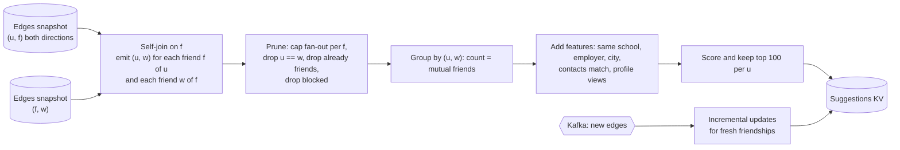

**Example, tiny graph.** Alice is friends with Bob, Carol, Dan. Bob is friends with Alice, Eve, Frank. Carol is friends with Alice, Eve. Dan is friends with Alice, Eve, Grace. Candidates for Alice: Eve (via Bob, Carol, Dan: 3 mutual), Frank (via Bob: 1), Grace (via Dan: 1). Eve ranks first, "3 mutual friends".

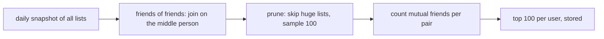

**Numbered steps.**
1. Take a daily snapshot of the adjacency data (all edges, both directions).
2. Join the edge set with itself on the middle node. Every friend `f` of `u` emits all of `f`'s other friends as candidates for `u`.
3. Prune hard. Skip friends with more than a cap (say 1,000) neighbors because they connect everyone and add little signal; sample at most 100 neighbors per middle node. Remove existing friends and blocked users.
4. Group by `(u, w)` and count; the count is the mutual friend count.
5. Combine with other features (shared workplace, school, contacts matched, interactions) in a scoring model, then keep the top 100 per user in a key-value table keyed by `user_id`.
6. At request time: fetch the 100 candidates, filter again (blocked, newly friends, dismissed, deactivated), rank, return 20.

**Why pruning matters.** Without pruning the join emits about 9 x 10^13 pairs (a naive estimate: 1 B users x 300 x 300). With a cap of 100 sampled neighbors per middle node it falls by several times, and restricting to active users (500 M) cuts it further. Real systems also compute only for users who will open the page.

**Alternatives.** Twitter's Who-To-Follow used a different approach: load the graph into one machine's memory and run personalized random walks (start at you, hop to random neighbours many times, and count where you land; personalized PageRank and SALSA) from each user's neighborhood to rank candidates, rather than a pure mutual-friend count. Embedding methods (graph neural networks, or matrix factorization over the adjacency matrix) learn a vector per user and find nearest neighbors with an ANN index. They also catch relations that share no common friends, at higher cost and lower explainability.

**Freshness.** After accepting a friendship, the new friend's friends are great candidates. A stream job reads graph-change events and updates the suggestions of the two users and their friends' lists within minutes; the daily batch re-bases everything.

**Why it matters.** Suggestions drive network growth. They can be a day stale, but they must never leak blocked users or re-suggest existing friends.

### 8.3 Degrees of separation: bidirectional BFS

**In plain words.** "How far apart are we?" Searching outward from one person takes ever bigger steps. Searching from both ends and meeting in the middle is hugely cheaper.

**Picture it.**

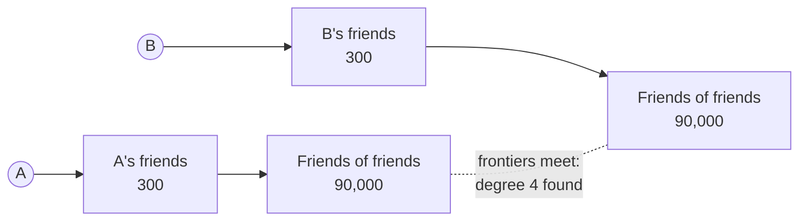

**Example.** One-sided BFS to depth 4 touches about 300^4 = 8.1 x 10^9 nodes (more than the population, because of overlap, but still impossible online). Two frontiers of depth 2 each touch about 2 x 90,000 = 180,000 nodes. Find any common id in the two frontiers and the distance is the sum of the depths.

**Numbered steps.**
1. If A and B are friends, degree is 1 (one edge lookup).
2. Fetch `adj(A)` and `adj(B)`. If they intersect, degree is 2.
3. Expand each side one more hop in parallel: fetch all of `adj(x)` for `x` in each list (300 batched multi-gets spread over shards).
4. If the new frontiers intersect with the other side's frontier, degree is 3 (or 4 with two-hop frontiers on both sides).
5. Stop at a hard limit (depth 3 online: one side expands 2 hops, about 90,000 ids, the other 1 hop, which fits a work cap of about 100,000 ids) and return "3+". Depth 4 (2 + 2, about 180,000 ids) needs a larger budget or an offline job.

**Optimizations.** Always expand the smaller frontier next; cache `adj` lists; skip supernodes while expanding (a path through a celebrity is rarely meaningful); and use a time budget (about 100 ms) so a slow query returns "3+".

**Why it matters.** The same trick generalizes to shortest-path features (LinkedIn-style "2nd connection"). Showing a degree is cheap; exact shortest paths between arbitrary pairs are a batch job.

### 8.4 Partitioning and supernodes

**In plain words.** Hash the user id to choose a shard, and put all of one person's edges there. This makes list reads local. A celebrity's follower list (100 M entries) is too big and too hot for one shard, so we split that one list into numbered buckets.

**Picture it.**

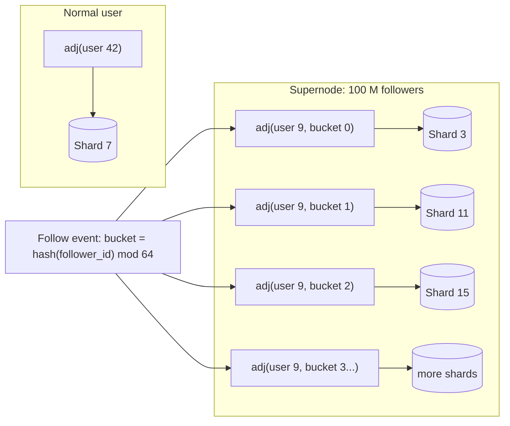

**Example.** For a normal user the shard key is `user_id`. For a user above a degree threshold (say 100,000), the key becomes `(user_id, bucket)` with `bucket = hash(follower_id) mod 64`. A follow event goes to one bucket (spreads writes). "Is X a follower of 9?" computes the bucket and does one lookup. A paginated follower list reads buckets in turn or merges them. The count is kept in a separate counter ([[Case Study - Distributed Counter (Likes and Views)]]).

**Rules of thumb.**
1. Shard by user for the symmetric friend graph; every list is local.
2. Detect supernodes by degree and promote them to bucketed layout; never block normal users on this logic.
3. Cap or avoid scanning supernode lists in features like mutual friends and degrees.
4. Use **consistent hashing** or a directory service for shard placement, so adding shards moves only a fraction of users. See [[Consistent Hashing]].
5. For the asymmetric follow graph, store `following(u)` (small) and `followers(u)` (big) in two tables.

**Fan-out interplay.** Feeds for celebrities use fan-out on read (pull) because pushing a post to 100 M follower inboxes is too slow. The graph layer is what makes the follower list available for that decision. See [[Case Study - News Feed]].

**Why it matters.** The average user is easy; the maximum user decides your worst-case latency.

### 8.5 Keeping both sides of a friendship in sync

**In plain words.** A friendship needs two rows, A's and B's, on two different shards. No single database can atomically update two machines cheaply. We pick one place that decides the truth (the pair row) and let the two copies follow it.

**Options compared.**

| Option | How | Pros | Cons |
| --- | --- | --- | --- |
| Distributed transaction (2PC) | Both shards commit atomically | Strong consistency | Slow, blocks on a failed participant |
| Saga with compensation | Write A, then B; if B fails, undo A | No global lock | Visible intermediate state; compensation code |
| Canonical row plus outbox and projector (chosen) | One local transaction; async projection both sides, idempotent | Simple, fast, replayable | A short window where one side lags |
| Write A synchronously, B via async queue (TAO-like) | Inverse edge written separately; repair job | Fast writes | Needs repair for failures |

The chosen approach matches how TAO describes inverse associations being maintained: possibly on different shards, with eventual repair. For the idempotency and exactly-once effect of the projector see [[Idempotency and Idempotency Keys]] and [[Transactional Outbox and CDC]].

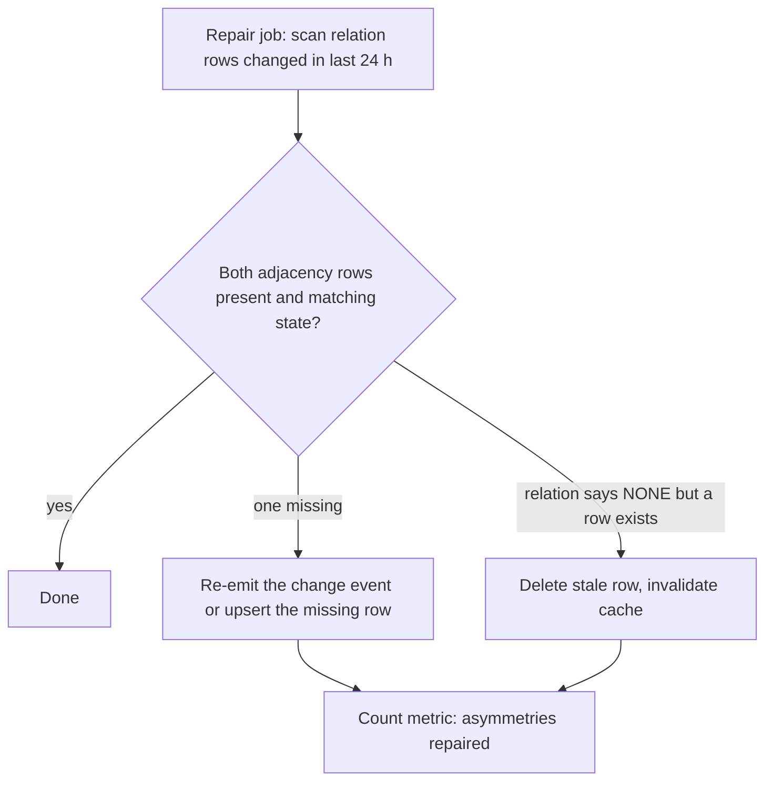

**Why it matters.** Eventual consistency is acceptable only because a repair loop and an idempotent projector exist. Say both.

> [!tip] Remember
> Shard by user, make one row the truth, project the rest, and repair. Bound every online traversal to a few thousand lookups.

## 9. Interview questions 🔴

> [!question]- How do you store a graph of one billion users and 300 billion friendship entries?
> Partition by user id so each person's adjacency list lives on one shard, store both directions of each friendship (about 300 B entries, about 7 TB raw), cache hot lists, and keep a separate counter for friend counts.
>
> A relation row per pair is the canonical truth; adjacency rows are projections. A graph database is not required for one-hop reads.

> [!question]- A friendship is two writes on two shards. How do you avoid a half-written friendship?
> Make a single canonical row per ordered pair the truth, update it in one local transaction with an outbox row, and let an idempotent projector write both adjacency rows from the event. If it crashes midway, replay fixes it, and a repair job reconciles drift. A distributed transaction would work but is slower and less available.

> [!question]- How do you compute mutual friends quickly?
> Intersect the two adjacency lists: hash the smaller list and probe with the larger. For a supernode, probe the smaller list's ids against the large list with batched existence lookups. Return a count and a small sample, and cache sorted id arrays. For dense id ranges use Roaring bitmaps.

> [!question]- Design "people you may know" for a billion users.
> Count friends-of-friends. Offline, self-join the edge snapshot on the middle node, prune (cap high-degree middle nodes, drop existing friends and blocked users), group by pair to get the mutual count, add features such as shared school and contacts, keep the top 100 per user in a KV store.
>
> Online, fetch the 100, filter again and return 20. A stream job refreshes fresh friendships.

> [!question]- Trap: "Use a graph database for everything." Good idea at this scale?
> Usually not for the primary serving path. One-hop list and exists lookups are served better and cheaper by sharded stores with a cache. Graph databases suit deep traversals when the data fits their memory and sharding model; sharding a graph is hard because edges cross every cut.

> [!question]- How do you answer "how far is user B from me?" in 100 ms?
> Bidirectional BFS: expand each side to depth 2 (about 90,000 ids each at 300 friends), check frontier intersection, stop at depth 3 or a work budget, and return "3+" beyond that. One-sided BFS to depth 4 would touch billions of nodes.

> [!question]- A celebrity with 100 million followers breaks one shard. What do you change?
> Promote that node to a bucketed layout: key `(user_id, hash(follower) mod 64)`, spread writes and reads, keep the count in a separate sharded counter, cache the first page, and exclude the node from expensive traversals. Normal users stay on the simple layout.

> [!question]- Someone blocks a user. Where must that take effect?
> Everywhere: friend lists, mutual friends, search, suggestions (read-time filter plus batch exclusion), degree results, notifications and feed. Store blocks as a small per-user set cached near each service, apply the filter at read time (batch results go stale), and test with a metric that must stay at zero for block leaks.

## Self-check 🟢🟡

> [!question]- Easy: what are a node and an edge in a social graph?
> A node is a person; an edge is a link between two people, such as a friendship.

> [!question]- Easy: how do you find mutual friends?
> Take both friend lists and keep the names that appear in both.

> [!question]- Easy: why are suggestions computed offline?
> Friends-of-friends for every user is far too much work to do live on each request.

> [!question]- Medium: 1 billion users × 300 friends. How many adjacency entries?
> 300 billion (150 billion friendships, stored once per side).

> [!question]- Medium: the projector writes A's list, then crashes before B's. What fixes it?
> The event is replayed and the upserts are idempotent; a repair job also compares the canonical rows with both lists.

> [!question]- Medium: why does bidirectional BFS beat one-sided BFS?
> Two small frontiers of about 300² each meet in the middle, instead of one frontier growing to 300⁴.

## 10. Cheat sheet 🟢

A 45-minute script:

- **0-5 min, requirements:** friend request, accept, remove, block; list friends; are-we-friends; mutual friends; degree; suggestions; follow model for celebrities. Reads over 100x writes, privacy is correctness.
- **5-10 min, estimates:** 1 B users x 300 = 300 B adjacency entries, about 7 TB raw, about 43 TB replicated; 58k reads/s average (175k/s peak); about 290 writes/s; FoF naive about 9 x 10^13 pairs.
- **10-15 min, API and data:** friend-request endpoints (accept is idempotent); list with cursor; `relation(user_lo, user_hi, state, version)`, `adjacency(user_id, kind, created_at, friend_id)`, counts, suggestions KV.
- **15-25 min, high-level design:** friendship service with canonical row and outbox, Kafka, edge projector, adjacency store sharded by user, cache tier, query service, batch plus stream suggestion pipeline, filter at read.
- **25-40 min, deep dives:** mutual friends intersection; FoF join with pruning and ranking; bidirectional BFS; supernode bucketing; cross-shard consistency and repair.
- **40-45 min, wrap-up:** monitor projector lag, asymmetry, cache hit rate, block leaks, suggestion freshness; what to simplify (single sharded SQL, no ML, daily batch only).

| Question | Primitive | Cost |
| --- | --- | --- |
| My friends | One shard range scan | O(page size) |
| Are we friends | Point lookup | O(1) |
| Mutual friends | Set intersection | O(d) with a cached list |
| Degree | Bidirectional BFS, depth 2 + 2 | about 2 x d^2 lookups, bounded |
| Suggestions | Offline FoF join and rank | huge, so precompute |

## Links

- **Before this:** [[System Design Interview Framework]], [[Back-of-the-Envelope Estimation]], [[Graphs and Graph Algorithms]], [[Partitioning and Sharding]]
- **Building blocks:** [[Consistent Hashing]], [[Transactional Outbox and CDC]], [[Idempotency and Idempotency Keys]], [[Hot Keys and Hot Partitions]], [[Stream Processing Basics]], [[Kafka and Event Streaming]], [[Bloom Filters and Probabilistic Data Structures]], [[Wide-Column Stores and Cassandra]], [[Indexing Fundamentals]]
- **Decision guides:** [[Choosing a Database - Decision Guide]], [[Choosing Consistency, Replication and Partitioning - Decision Guide]], [[Choosing a Caching Strategy - Decision Guide]]
- **Compare with:** [[Case Study - News Feed]], [[Case Study - Distributed Counter (Likes and Views)]], [[Case Study - Search Autocomplete]], [[Cache Failure Modes - Stampede, Avalanche, Penetration, Hot and Big Keys]]

### Watch on YouTube

- [System Design: Social Graph (with FAANG Senior Engineer)](https://www.youtube.com/watch?v=Jdj2OsGeiA8) · System Design Fight Club · 50 min · 4,187 views
- [Social Network Friend Recommendation System in JavaFX / JavaFx / JavaProject / DS](https://www.youtube.com/watch?v=czOP1uBvhP4) · CodingWorldHere · 7 min · 101 views
