# Case Study - Stock Exchange

> [!summary] TL;DR
> A stock exchange is a machine that takes buy and sell orders and pairs them, strictly by price first and arrival time second. The hard part is not volume, it is **determinism and fairness**: every order must get one global position in line, be matched in microseconds, and survive a crash without anyone losing or gaining a trade.

> [!abstract] Core idea
> - One **sequencer** stamps every incoming order with a global sequence number and writes it to a durable, replicated log. That log is the source of truth.
> - A **matching engine** per symbol runs on a single thread, in memory, reading that log in order. Same input log in, same trades out (**deterministic**).
> - The **order book** keeps one FIFO queue per price level plus a hash map from order id to its place in the queue, so add, cancel and match are all near O(1).
> - High availability comes from **hot-warm replicas** that replay the same sequenced log, not from locks or distributed transactions in the hot path.
> - Everything else (market data, clearing, reporting, risk dashboards) is downstream and can be eventually consistent.

## Start here: the basics 🟢

> [!info] How to read this note (pick your level)
> - 🟢 **New to this?** Read "From zero" below, then sections 1, 2 and the cheat sheet (10). Stop there, that is a full first pass.
> - 🟡 **Know the basics?** Add sections 3 (how it works), 4 (worked example), 5 (variants) and 6 (trade-offs).
> - 🔴 **Interview / SDE-3 prep?** Add 7, 8 and 9. Headings are tagged 🟢🟡🔴 so you always know where you are.

> [!note] Before this note
> - [[System Design Interview Framework]]: the order to work in: requirements, estimates, API, data, design, deep dives.
> - [[Clocks and Ordering]]: machine clocks disagree, so a fair order comes from one counter, not from timestamps.
> - [[Event Sourcing]]: store every change as an event in a log, and rebuild the current state by replaying it.
> - [[Back-of-the-Envelope Estimation]]: turning a billion orders a day into orders per second.

**From zero, in 60 seconds** 🟢

A stock exchange matches people who want to buy with people who want to sell.
For each stock it keeps an **order book**: a list of buy prices and sell prices, best first.
When a buy price meets a sell price, a trade happens.
Fairness rule: same price, the earlier order wins. So every order gets a number in strict arrival order, from one place called the **sequencer**.

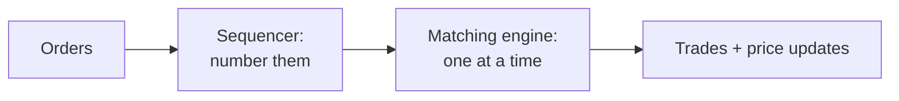

The numbered list of orders is saved first. If the engine crashes, a backup replays the same list and gets the exact same book.

So the rest of this note is just these 3 questions:
1. How do you decide a fair order for orders that arrive at the same moment?
2. How do you match orders fast and the same way every time?
3. How does a backup take over without losing a single trade?

**The problem in one story.**
You want to buy 10 shares at ₹100; someone else wants to sell 10 at ₹100.
The exchange must match you two fairly.
If two buyers offer the same price, whoever came first must win, every time.
And nobody may ever lose a trade because a server crashed.

**Words you need first**

| Word | Plain meaning | Tiny example |
| --- | --- | --- |
| Order | A request to buy or sell at a price | BUY 10 @ ₹100 |
| Bid / ask | A buy offer / a sell offer | Bid ₹99, ask ₹101 |
| Order book | All waiting orders for one stock, sorted by price | Best bid at the top |
| Matching | Pairing a buyer and seller whose prices cross | BUY @101 meets SELL @100 |
| Sequence number | A counter stamped on each event to fix its order | Order #1001 came before #1002 |
| Log | An append-only list of events kept on disk | Every order, in order |
| Deterministic | Same input always gives the same output | Replay the log, get the same trades |

| Sequencer | The one component that gives every order its number | order gets `seq = 8,120,433` |
| Tick | The smallest price step; prices are stored as whole ticks | 5010 ticks = ₹50.10 |
| Hot-warm replica | A standby engine that replays the same log and can take over | backup is 2 events behind, catches up, takes over |

**Picture it**

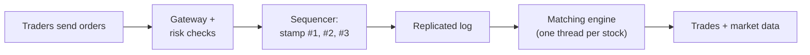

**Analogy.** One strict clerk per stock who numbers every order in a ledger and matches them one at a time.
Where it breaks: a human clerk takes seconds; the real engine handles each order in microseconds and must be replayable exactly.

**How the rest of this note builds up**

- First, why exchanges exist and their requirements (section 1), then the clerk mental model (section 2).
- Then the high-level design and estimates (section 3).
- Then API, data model and a matching trace through the order book (section 4).
- Finally the SDE-3 deep dive: sequencer and log, determinism, failover and fairness, pre-trade risk, scaling and failures (sections 5-8).

> [!tip] Remember
> Put every order in one numbered log, and let a single-threaded engine replay it in order.

## 1. Why it exists - requirements 🟢

Picture a vegetable market with one rule: the highest buyer and the lowest seller deal first, and if two people offer the same price, whoever shouted first wins. Now make it electronic, with millions of shouts a day, where being 50 microseconds late can cost money and nobody may ever argue about who was first.

A stock exchange exists to be that fair referee, at machine speed.

### Real-life example: buying shares on Zerodha 🟢

You open Zerodha at 9:15 am and place an order to buy 10 shares of a company at ₹1,500.
Your broker sends it to the exchange (NSE), where thousands of other buy and sell orders for that stock are waiting.
If a seller is waiting at ₹1,500 or less, you get your shares within a fraction of a second; if not, your order waits in the book.
If two people offered ₹1,500 at almost the same moment, the one the exchange numbered first is filled first.

**Functional requirements**
- Place an order: **limit** (buy at most X, sell at least X), **market** (any price), and time-in-force (how long the order stays valid) variants such as **IOC** (immediate-or-cancel) and **FOK** (fill-or-kill). Stop orders are optional.
- Cancel or amend an open order.
- Match orders by **price-time priority**: best price first, earliest arrival first at the same price.
- Publish **market data**: the best bid and ask, depth of book, and every trade ("the tape").
- Send each participant execution reports (acknowledged, partially filled, filled, cancelled, rejected).
- Pre-trade risk checks: enough cash or shares, price within limits, rate limits per participant.
- Hand finished trades to **clearing and settlement** (moving the actual shares and money). Settlement in the US is T+1 (one business day after the trade) since 28 May 2024.
- Scope for the interview: a few thousand symbols, equities only, one region. Ignore options, auctions and cross-market routing unless asked.

**Non-functional requirements**
- **Latency:** an order to its acknowledgement in well under 1 ms at the exchange boundary (an estimate for a software design; real exchanges quote tens of microseconds inside the matching engine).
- **Determinism and fairness:** the same sequence of orders always yields the same trades. No participant may get a faster path.
- **Durability:** an acknowledged order is never lost, even if a server dies a microsecond later.
- **Availability:** about 99.99% during market hours (an estimate of a typical target), with failover in seconds, not minutes.
- **Throughput:** tens of thousands of orders per second average and several times that at the open and close (see estimates below).
- **Auditability:** regulators can replay the whole day from the log. Clocks are synchronised to UTC (MiFID II RTS 25 asks for 100 microseconds for high-frequency algorithmic trading).

> [!tip] Remember
> Say this first: "correctness and fairness beat raw throughput; one ordered log and one thread per symbol is the simplest way to get both."

## 2. Mental model 🟢

Think of an old trading pit with a very strict clerk standing at each stock's window. All orders for that stock go through that one clerk, who writes them in a numbered ledger (1, 2, 3, ...) and then matches them one at a time.

Nobody else touches the book. If the clerk faints, a second clerk who has been copying the same numbered ledger line by line picks up at the next number.

Mapped to the system:
- **The numbered ledger** is the sequenced event log written by the sequencer.
- **One clerk per window** is one single-threaded matching engine per symbol (or group of symbols).
- **The second clerk copying along** is a hot-warm replica replaying the same log.
- **Shouting prices across the room** is market data, which is a read-only broadcast of what the clerk decided.

Where the analogy breaks: a human clerk is slow, so the pit had many windows. A modern engine is so fast that one thread can match millions of orders a second, so the design stays simple and shards only by symbol.

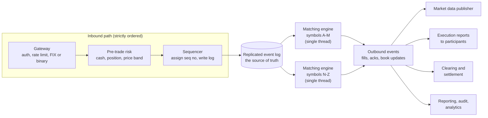

## Common beginner mistakes 🟢

- **Keeping the order book in a SQL table** → each match costs a database round trip of hundreds of microseconds → keep the book in memory, fed by the log.
- **Ordering orders by their timestamps** → clocks on different machines disagree → let one sequencer number every order.
- **Running several engines for the same stock to scale** → two books mean the same order could match twice → one single-threaded engine per stock (or group of stocks).
- **Storing prices as floats** → `50.1` cannot be stored exactly → store prices as whole ticks.
- **Acknowledging an order before it is safely logged** → a crash loses an order the trader thinks was accepted → write it to the replicated log, then ack.

## 3. How it works - high-level design 🟡

> 🟢 → 🟡 **You now know** the core idea: one numbered log of orders, and one engine per stock that matches them in that order. **Next we open the box** and follow one order from the broker's connection through checks, numbering, matching and reporting.

**Step by step (plain):**
1. Your broker sends "BUY 350 @ 50.10" over its always-open connection to an exchange gateway.
2. The gateway checks the stock exists and that your broker has the money reserved.
3. The sequencer gives the order number 130, writes it to the log on two machines, and tells the broker "accepted".
4. The matching engine for that stock reads order 130, sees sellers waiting at 50.10, and fills 300 from the first seller and 50 from the second.
5. Trades go out as reports to both sides and as market data to everyone; settlement happens later, away from this fast path.

Read the diagram above left to right, then follow one order through these steps.

1. **Connect.** A broker's trading system opens a long-lived TCP session to a **gateway** using the **FIX** protocol (the industry text protocol for orders) or an exchange-specific binary protocol. The gateway authenticates the session and applies a per-participant rate limit.
2. **Validate and risk-check.** The order is checked for sanity (known symbol, tick size: the allowed price step, quantity limits) and for risk (does the buyer have the cash reserved, is the price within, say, 10% of the last trade). A failed check is rejected immediately and never reaches the log.
3. **Sequence.** The sequencer gives the order the next number, for example `seq=8,120,433`, plus a timestamp, and appends it to the event log. The log write is replicated to at least one other machine before the order is acknowledged. This number is the order's permanent place in the queue.
4. **Match.** The matching engine for that symbol reads events in sequence order. It looks at the opposite side of the book, fills what it can, rests the remainder in the book, and emits events: `OrderAccepted`, `Trade`, `OrderCancelled`.
5. **Publish.** Outbound events fan out. Participants get execution reports; the **market data publisher** sends book updates to everyone at the same time; the **clearing** service records the trade for settlement; the audit store keeps a copy.
6. **Settle.** A day later (T+1 in the US) the clearing house nets trades and moves shares and cash. This is slow and batch-oriented and is not part of the hot path. A [[Case Study - Digital Wallet and Ledger]]-style ledger records the money side.

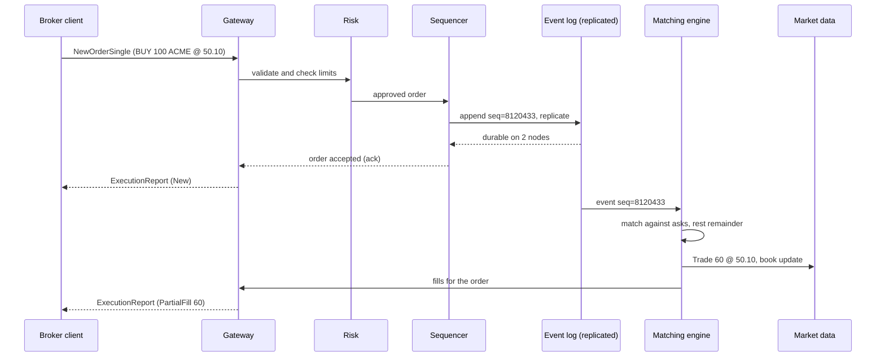

The ack in the middle is the key promise: once the participant sees "accepted", the order is durable in the log, so even if the matching engine crashes the order will still be matched when a replica replays the log.

### Whiteboard version

```text
Client --FIX/binary TCP--> Gateway (auth, rate limit)
   --> Risk (cash, position, price band) --> Sequencer
Sequencer: seq++ ; append to log ; replicate to >=1 peer ; then ack
Log --> Matching engine per symbol (1 thread, in memory, deterministic)
   Order book: bids and asks, each = price levels, each level = FIFO queue
              + hash map orderId -> node (O(1) cancel)
   price-time priority: best price, then lowest seq
Engine --> events --> market data (multicast) | exec reports | clearing | audit
HA: warm engines replay the same log; primary dies -> promote warm, continue at next seq
Recovery: snapshot + replay log tail
Numbers (estimates): 1B orders/day ~ 43K/s avg over 6.5 h, 5x peak ~ 210K/s,
   one thread matches millions/s, so scale = shard by symbol, not by order
```

### Estimation (every input is a labelled estimate)

**In plain words:** rough sums: orders per second, trades per second, and how much the event log grows.

| Quantity | Arithmetic | Result |
| --- | --- | --- |
| Orders per day (estimate) | given | 1,000,000,000 |
| Trading seconds | 6.5 h × 3,600 | 23,400 s |
| Average orders per second | 1,000,000,000 / 23,400 | ≈ 42,700 /s |
| Peak at the open (estimate 5× average) | 42,700 × 5 | ≈ 213,000 /s |
| Hottest single symbol (estimate 10% of peak) | 213,000 × 0.10 | ≈ 21,000 /s |
| One matching thread capacity (LMAX reported) | Fowler's article | ≈ 6,000,000 orders/s on one thread |
| Order message size (estimate) | binary, ~100 bytes | 100 B |
| Inbound log per day | 1,000,000,000 × 100 B | ≈ 100 GB/day |
| Outbound events (estimate 3× inbound: acks, fills, book updates) | 100 GB × 3 | ≈ 300 GB/day |
| Events kept for 7 years of audit (estimate) | 400 GB × 252 days × 7 | ≈ 706 TB raw (about 700 TB; real stores compress, so treat as an upper bound) |

The takeaway: the hottest symbol is about 21,000 orders per second, a small fraction of what one thread can do. So you do not need many threads per symbol. You need **one fast thread**, a durable log, and a fair ordering path. The expensive parts are latency, jitter (variation in latency) and failover, not raw capacity.

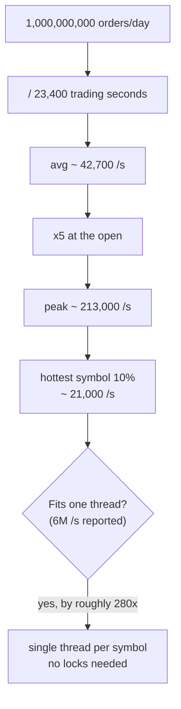

## 4. Worked example - API, data model and a matching trace 🟡

### API

**In plain words:** traders keep a connection open and send small binary messages: new order, cancel, and reports back.

Participants do not use REST. They use a persistent session so there is no connection setup in the hot path. See [[Choosing an API and Communication Style - Decision Guide]] for the general choice.

| Direction | Message | Meaning |
| --- | --- | --- |
| Client to exchange | `NewOrder(clOrdId, symbol, side, qty, type, price, tif)` | place an order; `clOrdId` is the client's own id, used for dedupe |
| Client to exchange | `Cancel(clOrdId)` and `Replace(clOrdId, qty, price)` | cancel or amend |
| Exchange to client | `ExecutionReport(orderId, status, lastQty, lastPx, leavesQty)` | accepted, partial fill, fill, cancelled, rejected |
| Exchange to world | `MarketData: BookUpdate(symbol, side, price, qty)` and `Trade(symbol, price, qty, ts)` | public feed |
| Operator | REST for reference data, reports, account admin | not latency sensitive |

Participants send a unique `clOrdId` per order. If a session drops and the client resends, the gateway recognises the id and does not double-submit. This is the same idea as an idempotency key in [[Idempotency and Idempotency Keys]], enforced at the session level.

### Data model

**In plain words:** the main data is just the numbered order log and the book in memory; databases come later for reports.

The hot path has no database. The "data model" is the event log and the in-memory book. A relational or columnar store sits downstream for reports (see [[Choosing a Database - Decision Guide]]).

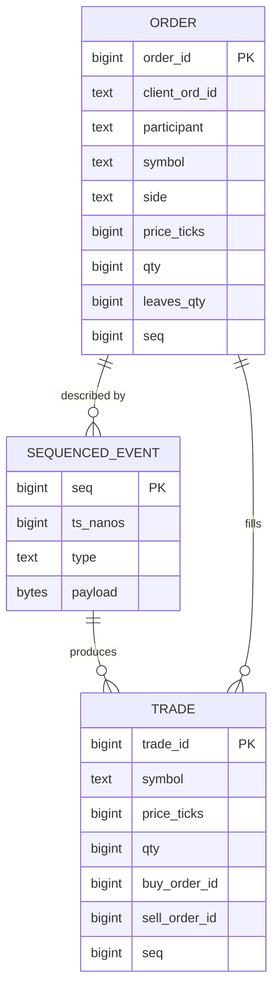

Rules that matter:
- Prices are **integers in ticks** (for example 5010 = 50.10), never floating point.
- Every record carries the `seq` of the event that caused it. That makes replay and audit exact.
- The `SEQUENCED_EVENT` log is **append-only**. A cancel is a new event, never a delete.
- Orders and trades in the SQL store are a **projection** of the log (see [[CQRS]] and [[Event Sourcing]]), rebuilt at any time.

### The order book

A book has two sides. **Bids** (buyers) sorted high to low, **asks** (sellers) sorted low to high. At each price there is a queue of orders in arrival order.

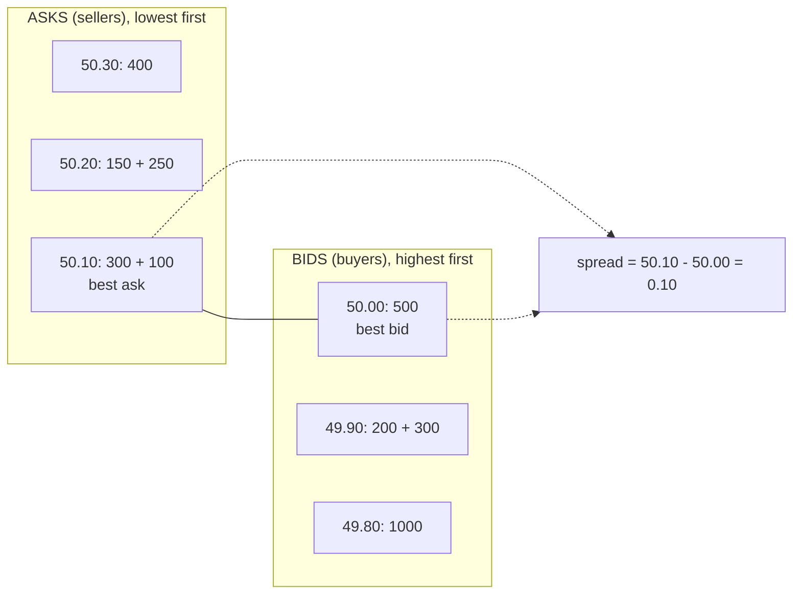

**Matching trace.** Initial asks at 50.10: order S1 (300 shares, seq 100) then S2 (100 shares, seq 105). A new `BUY 350 @ 50.10` arrives as seq 130.

1. Buy price 50.10 is greater than or equal to the best ask 50.10, so it can match.
2. The front of the 50.10 queue is S1 (earliest seq). Fill 300 shares at 50.10. S1 is now empty and is removed.
3. Next is S2 with 100 shares. Fill 50 shares at 50.10. S2 keeps 50 left, still at the front of the queue.
4. The buy order is fully filled (300 + 50 = 350). Nothing rests in the book.
5. Events emitted: `Trade(300@50.10)`, `Trade(50@50.10)`, a fill for the buyer, partial fills for S1 and S2.

If the buy had been `BUY 500 @ 50.10`, the last 100 shares would rest in the book as a new bid at 50.10, because no more asks are at or below that price.

> [!warning] Common mistake
> Do not say "I will store the order book in a SQL table and `SELECT ... ORDER BY price, created_at LIMIT 1` to match". A database round trip is hundreds of microseconds to milliseconds and takes locks. The book lives in memory inside the matching engine; the database only receives results afterwards.

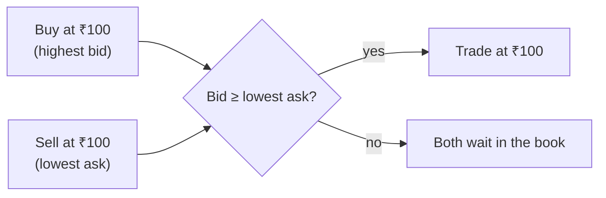

### Order book data structures

**In plain words:** what each book operation needs to be fast, and which data structure gives it.

| Operation | Needs | Structure choice |
| --- | --- | --- |
| Find best bid or ask | min or max price level | keep a pointer to the best level, update on change |
| Add order to a price | find the level, append | hash map or array keyed by price tick, then a tail pointer on a **doubly linked list** |
| Cancel an order | jump to the order directly | hash map `orderId -> list node`, unlink in O(1) |
| Match | pop from the front of the best level | head of the best level's list |
| Create a new price level | keep levels sorted | sorted array, balanced tree or skip list (see [[Trees, BSTs and Balanced Trees]]); heaps give best price but make removal of an arbitrary level awkward (see [[Heaps and Priority Queues]]) |

A simple and very fast approach for a bounded price range: an **array indexed by tick** (price minus a base price), each cell holding a linked-list queue. Best-price lookup is a cached pointer. Add, cancel and match are O(1) in the common case.

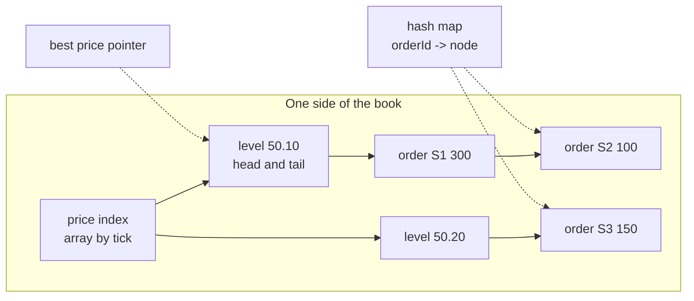

## 5. Variants and comparison 🟡

Real exchanges differ in how they pair orders and how they build the ordered log.

| Choice | Alternatives | Pick here | Why |
| --- | --- | --- | --- |
| Matching rule | **price-time (FIFO)**, **pro-rata** (split fills across all orders at a price by size), price-size | price-time | simplest, fair, the default for equities; pro-rata is common for some futures |
| Threading | one thread per symbol, many threads with locks, optimistic locking | one thread per symbol | locks cost more than the match itself; one thread gives determinism for free |
| Ordering | wall-clock timestamps, a sequencer, a consensus group per order | a sequencer | timestamps from different machines cannot give a trustworthy total order (see [[Clocks and Ordering]]); consensus per order is too slow |
| Log transport | Kafka, a custom journal, Aeron, shared memory ring buffer | custom journal or Aeron plus a ring buffer in the hot path; Kafka downstream | Kafka batches for throughput and adds milliseconds; fine for fan-out, too slow for matching (see [[Kafka vs RabbitMQ vs SQS - Choosing a Message Broker]]) |
| Availability | active-active matching, **hot-warm replay**, a shared database | hot-warm replay | active-active would need the two copies to agree on order, which is the sequencer's job anyway |
| State storage | database, in-memory with log and snapshot | in-memory with log and snapshot | the log is the database; recovery equals replay |
| Deployment | public cloud VMs, bare metal with pinned cores and kernel-bypass networking | bare metal for the matching tier | jitter and scheduler noise matter more than elasticity; see [[Choosing Compute, Scaling and Deployment - Decision Guide]] |

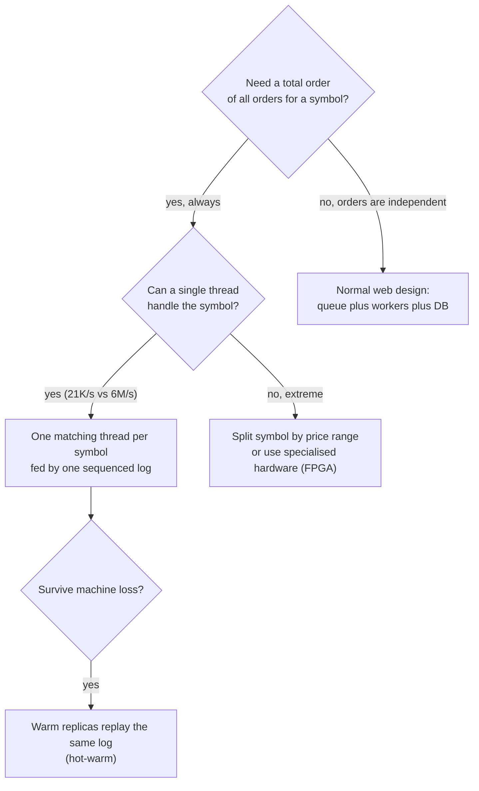

### Things people confuse this with 🟡

| System | What it does | How it differs from an exchange |
| --- | --- | --- |
| Broker app (Zerodha, Groww) | Takes your order and sends it to the exchange | Holds your account and money; does not match buyers with sellers |
| [[Case Study - Payment System]] | Moves money between parties | Correctness matters, but no order book, price-time priority or microsecond race |
| [[Case Study - Ride Sharing and Proximity]] | Matches riders with drivers | Matching too, but seconds of delay and approximate fairness are fine |

## 6. Trade-offs and when not to use 🟡

- **Single thread per symbol** gives determinism and no locking, but a hot symbol cannot use more than one core. The workaround is a faster thread (cache-friendly data, no allocation, no GC pauses), not more threads.
- **Synchronous log replication** before the ack protects against loss but adds a network round trip, around tens to hundreds of microseconds inside one data centre (an estimate). Asynchronous replication is faster and can lose the last few orders on a crash. Exchanges choose durability.
- **Hot-warm** failover is simple but wastes standby capacity and needs careful promotion so two engines never both think they are primary (**split brain**: two leaders acting at once).
- **One log for all symbols** gives a single global order, which is easy to audit but a throughput ceiling. **A log per symbol group** scales further but loses cross-symbol ordering, which matters for spreads and multi-leg orders.
- **Not for you** if your problem is "match riders to drivers" or "assign jobs": those tolerate seconds of latency and eventual consistency, so use [[Case Study - Ride Sharing and Proximity]] or [[Case Study - Distributed Job Scheduler]] patterns instead.

> [!tip] Remember
> Name the trade-off in one sentence: "I give up multi-core matching per symbol and accept sync replication latency, to get determinism and zero lost orders."

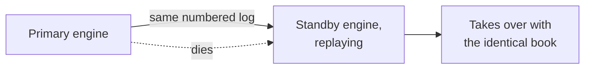

## 7. In production 🔴

> 🟡 → 🔴 **You now know** the order path, the sizing, the messages, the order book and how a match works. **Next is the advanced part**: what real exchanges do, the sequencer and log, determinism, failover and fairness, pre-trade risk, scaling and failures.

- **Real-life example, LMAX.** LMAX Exchange (a London retail FX trading venue) published its architecture: business logic on one thread, input and output through a ring buffer (the **Disruptor**), and the whole state rebuilt by replaying events. Fowler reports about 6 million orders per second on one thread. This is the canonical public reference for the single-thread design.
- **Kernel-bypass networking and pinned cores.** Matching hosts run on bare metal (real servers, no virtual machines) with the thread pinned to a CPU core, no other work on that core, and often kernel-bypass network cards, so the OS scheduler never interrupts matching.
- **Clock sync.** Hosts sync to GPS or PTP (Precision Time Protocol, accurate to under a microsecond on a good network) time. Timestamps are for audit and not for ordering; ordering comes from the sequence number.
- **Market data fairness.** The publisher sends the same packet to all subscribers at the same moment, typically with UDP multicast (one packet the network copies to every subscriber at once). Participants colocated in the exchange data centre use equal-length cables so nobody has a physical latency edge.
- **Circuit breakers.** The exchange halts trading in a symbol when price moves too fast. This is a business rule inside the matching engine, enforced by an event in the log.
- **Observability.** The key metrics are tail latency (p99, p99.99) of gateway to ack, sequencer log write time, queue depth at each stage, replication lag to the warm engine, and number of rejected orders by reason.

## 8. Deep dive 🔴

### Deep dive 1: the sequencer and the event log

**In plain words.** Two orders can reach two different gateways at nearly the same moment. Someone has to decide who is first, once and forever. The **sequencer** is that someone. It numbers events 1, 2, 3 and writes them to a log.

**Picture it.**

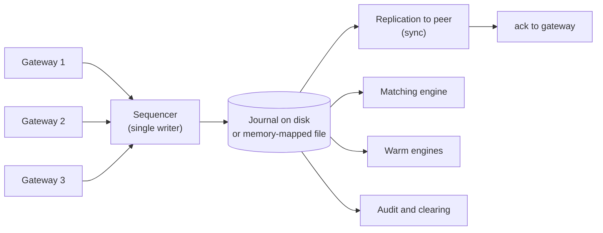

**Example.** Gateway 1 sends order A at 10:00:00.000000100. Gateway 2 sends order B at 10:00:00.000000090 by its own clock. Clocks differ by a few microseconds, so by timestamp B looks first. The sequencer saw A first and numbered it 500, B 501. A is first, by definition, and everyone agrees because everyone reads the same log. The rule is "sequencer arrival is the truth".

**Why it matters.** A single writer avoids distributed agreement on every order. The cost is that the sequencer is a single point of failure, so it has its own replicas. Only the sequencer's role changes on failover, via a consensus-based election such as Raft (see [[Consensus - Raft and Paxos]] and [[Leader Election]]). The election happens rarely; ordering happens on every order.

Design details:
1. **Batching.** The sequencer writes many events per disk or network flush to amortise cost, while keeping the order within the batch.
2. **Durability.** The ack waits until the event is in memory on the primary and at least one replica, with disk flush done asynchronously or on a battery-backed device (an estimate of common practice).
3. **Gap detection.** Consumers track the last seq they processed. A gap means a lost packet; they ask for retransmission.
4. **Snapshots.** Periodically the matching engine writes its book to disk with the seq it reached. Recovery loads the snapshot and replays only the tail.

### Deep dive 2: the matching engine and determinism

**In plain words.** The engine is a loop: read the next event, apply it to the in-memory book, write the resulting events out. No threads fighting, no network calls, no database calls, no random numbers, no reading the wall clock.

**Picture it.**

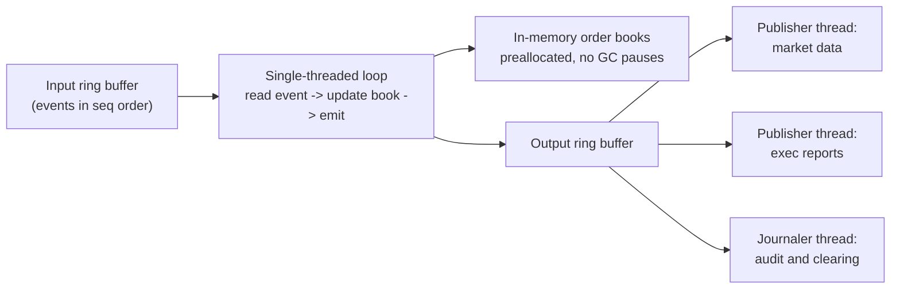

**Example (determinism).** Replay log segment 1 to 1,000,000 on any machine. The final book and the list of trades are byte-for-byte equal, because the engine's only input is the log. If one line of code used `time.Now()` or iterated a hash map in random order, two machines could disagree and the warm replica would silently diverge from the primary. That is the bug class to avoid.

**Why it matters.** Determinism is what makes hot-warm failover and exact audit replay possible. It is why the engine avoids anything non-deterministic and why timestamps in events come from the sequencer, not from the engine.

Performance rules that follow from "one fast thread":
- Allocate memory up front (object pools, arrays) and avoid garbage collection pauses; in Go, avoid per-order heap allocation and keep the working set small enough to stay in CPU cache (see [[Memory Hierarchy and CPU Caches]]).
- Use a ring buffer (a fixed-size circular array that one thread writes and another reads, with no locks) between threads instead of a locked queue; the Disruptor paper reports this as the reason for its latency profile.
- Keep I/O out of the matching thread. A separate thread reads from the network, another writes the journal and publishes.

### Deep dive 3: high availability, recovery and fairness

**In plain words.** If the primary matching engine dies, a standby must take over with exactly the same book, without duplicating or losing a trade.

**Picture it.**

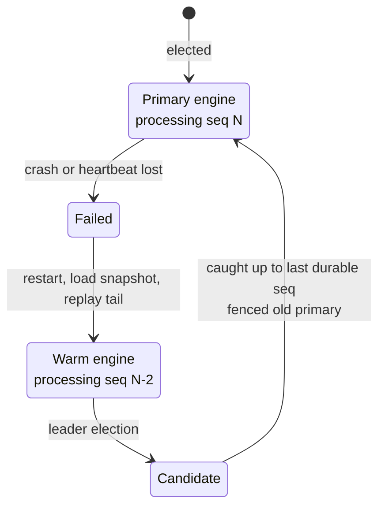

**Example (failover).** The primary dies after emitting trades for seq 9,000. The warm engine had processed up to seq 8,998 and the log is durable to 9,001. The warm node reads 8,999 to 9,001 from the log, ends in exactly the same state, and starts accepting new events at 9,002. Trade ids derive from `seq`, so the trades for 8,999 and 9,000 that the old primary already sent are recognised as duplicates by downstream consumers (dedupe by id; see [[Delivery Semantics and Exactly-Once]]).

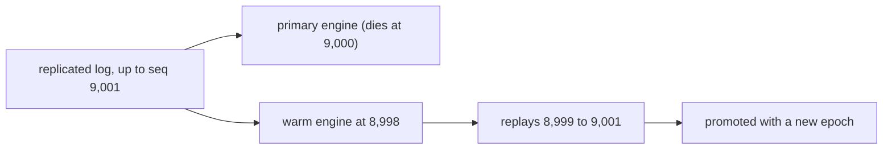

**Fencing.** A frozen old primary that wakes up must not keep publishing. Use an epoch number in the log: events from a lower epoch are rejected (see [[Distributed Locks and Fencing Tokens]]).

**Fairness.**
- Gateways timestamp on arrival for audit but the **sequencer** decides order.
- Market data goes out through one publisher so all subscribers see the same sequence of updates; public feed and private execution reports are sent in a defined order so no one learns of their own fill before the world sees the trade, or the reverse, depending on the exchange rule.
- **Self-trade prevention** and **rate limits** at the gateway avoid abusive or runaway algorithms.

> [!warning] Common mistake
> "I will use a load balancer and several matching engines for the same symbol to scale." Two engines for one symbol means two books, so a buyer could match in one and a seller in the other and orders could cross at invalid prices. One symbol, one writer, always.

### Deep dive 4: pre-trade risk and the money side

**In plain words:** before an order enters, check that the buyer has the cash and the seller has the shares.

Sell-side orders need shares; buy-side orders need cash. The check must be fast but it must also be consistent with what the participant already has outstanding. Two common designs:

1. **Reserve at the gateway.** A risk service in front of the sequencer keeps a per-participant in-memory view of cash and positions, applies each order against it (reduce available cash by qty × price), and rejects if negative.

It is updated by the same outbound events (fills) so it converges. Because it is before the log, a rejection costs nothing downstream.
2. **Reserve inside the engine.** Slower and couples risk to matching; rarely used for the hot path.

The authoritative cash and share balances live in a ledger outside the hot path (see [[Case Study - Digital Wallet and Ledger]] and [[Case Study - Payment System]]). Fills become ledger postings through clearing, with exactly-once effect via event ids and an outbox.

### Scaling and bottlenecks

**In plain words:** what slows down first as volume grows, and the fix for each.

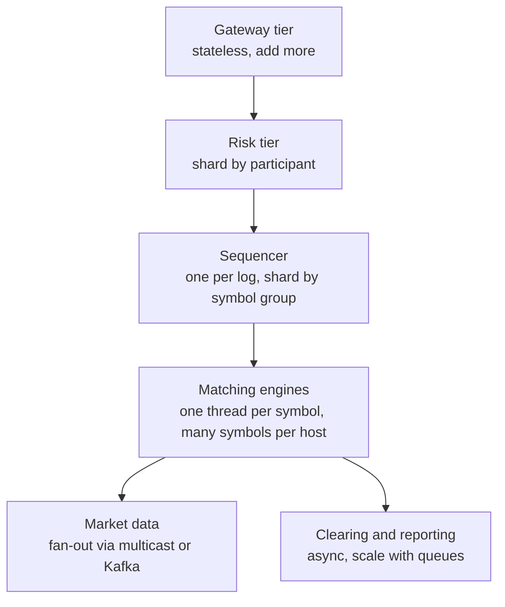

- **Bottleneck 1: the sequencer log write.** Fix by batching, by replicating in memory first, and by sharding symbols across several logs when one is saturated.
- **Bottleneck 2: a hot symbol (an index ETF, a fund that trades like one share, or a meme stock).** Give it its own core and its own log, and keep other symbols off that core.
- **Bottleneck 3: market data fan-out to thousands of subscribers.** Use multicast inside the data centre and a distribution tier (a pub-sub tier built on Kafka or WebSockets, see [[Scaling WebSockets]]) for the slower outside world. Public retail apps are fine with 100 ms delayed feeds; trading firms get the raw feed.
- **Bottleneck 4: recovery time.** Long replays are slow. Snapshot every few minutes and keep the tail short.

### Failure handling

**In plain words:** for each part that can fail, what happens and how it recovers.

| Failure | What happens | Recovery |
| --- | --- | --- |
| Gateway dies | Client sessions drop | Client reconnects, sends a resend request; `clOrdId` dedupe prevents double orders |
| Sequencer primary dies | No new orders get numbers | Replica promoted by consensus; epoch bumped; acked events are already in the replica |
| Matching engine dies | Orders keep being logged but not matched | Warm engine replays log, takes over in seconds |
| Network partition between primary and replica | Cannot meet "durable on 2 nodes" | Stop acking (fail closed) rather than risk loss; halt trading if needed |
| Corrupt or bad order burst | Runaway algorithm floods the gateway | Per-participant rate limit and kill switch; circuit breaker halts the symbol |
| Whole data centre lost | Primary site gone | Disaster-recovery site with the replicated log, brought up by operator decision (see [[Multi-Region Architecture]]) |

### Trade-off table: the main decisions

**In plain words:** the big choices in one table, with the pick and the reason.

| Decision | Alternatives | Choice | Why | Guide |
| --- | --- | --- | --- | --- |
| Order of events | timestamps, vector clocks, sequencer | sequencer | total order, simple, audit-friendly | [[Choosing Consistency, Replication and Partitioning - Decision Guide]] |
| Hot-path transport | Kafka, RabbitMQ, custom log, Aeron | custom log or Aeron, Kafka only downstream | latency and jitter | [[Kafka vs RabbitMQ vs SQS - Choosing a Message Broker]] |
| Source of truth | SQL database, in-memory plus log | log plus snapshots | speed, replay | [[Choosing a Database - Decision Guide]] |
| Client protocol | REST, WebSocket, FIX or binary TCP | FIX or binary TCP | persistent session, low overhead | [[Choosing an API and Communication Style - Decision Guide]] |
| Runtime | cloud VMs, containers, bare metal | bare metal for matching | jitter control | [[Choosing Compute, Scaling and Deployment - Decision Guide]] |
| Read models | query the engine, projections | projections via events | engine stays pure | [[CQRS]] |

## 9. Interview questions 🔴

> [!question]- Why does a stock exchange match on a single thread? Is that not a scaling bottleneck?
> One thread per symbol gives determinism and removes locking, which costs more than the matching itself. The numbers show it is enough: about 21,000 orders per second for a hot symbol (an estimate) against about 6 million per second reported for the LMAX single thread. Scaling is by symbol: more symbols, more engine threads and hosts.

> [!question]- How do you decide which of two simultaneous orders came first?
> By the sequencer's arrival order, not by wall-clock timestamps. Clocks on different machines drift by microseconds and can disagree. The sequencer assigns increasing numbers and writes them to a replicated log, so everyone agrees by reading the log.

> [!question]- The primary matching engine crashes mid-day. How do you recover with no lost or duplicated trade?
> Warm engines replay the same sequenced log and keep an identical book. One is promoted, catches up to the last durable sequence number, and continues. Trade ids derive from the sequence number, so downstream consumers dedupe the few events the old primary already sent. A fencing epoch stops a zombie primary from publishing.

> [!question]- (Trap) Why not use Kafka as the order queue and match from there?
> Kafka is built for throughput and durability with batching, which adds milliseconds, and its partitions and consumer rebalances add jitter. The hot path needs microseconds and low jitter. Use Kafka after matching, for fan-out to clearing, analytics and notifications.

> [!question]- How is cancel implemented in O(1)?
> A hash map from order id to the node in its price level's doubly linked list. Cancel looks up the node and unlinks it. If the level becomes empty it is removed and the best-price pointer is updated if needed.

> [!question]- How do you make market data fair for all subscribers?
> One publisher emits one sequenced stream, sent by multicast so all colocated subscribers get the packet at essentially the same moment, with equal-length cables. Each message has a sequence number so subscribers detect gaps and request retransmits.

> [!question]- Where do cash and share balances live, and how do fills reach them?
> In a double-entry ledger outside the hot path. The matching engine emits trade events; clearing consumes them through an outbox or log with event ids and posts balanced ledger entries exactly once. A fast in-memory risk view in front of the sequencer prevents obvious overdrafts before orders enter the log.

> [!question]- What do you do if the replica is unreachable and you cannot get durability for new orders?
> Fail closed: stop acknowledging new orders, or halt trading, rather than accept orders that could be lost. Fairness and correctness beat availability here, which is the CP side of CAP (see [[CAP and PACELC]]).

## Self-check 🟢🟡

> [!question]- Easy: what is an order book?
> All waiting buy and sell orders for one stock, sorted by price.

> [!question]- Easy: two buyers offer the same price. Who wins?
> The one with the earlier sequence number.

> [!question]- Easy: why is the book kept in memory, not in a database?
> A database round trip is far slower than matching in memory.

> [!question]- Medium: asks at 50.10 are S1 (300) then S2 (100). A BUY 350 @ 50.10 arrives. What trades happen?
> 300 with S1 and 50 with S2; S2 keeps 50 at the front of the queue.

> [!question]- Medium: why one thread per symbol instead of many with locks?
> Locks cost more than the match itself, and one thread makes results deterministic and replayable.

> [!question]- Medium: how does a standby engine take over without losing a trade?
> It replays the same durable log up to the last event, then is promoted with a higher epoch so the old primary is fenced off.

## 10. Cheat sheet 🟢

- Correctness and fairness first. One total order via a sequencer, durable before ack.
- One single-threaded, deterministic matching engine per symbol, in memory, fed by the log.
- Order book: price levels (array by tick or tree) of FIFO queues plus a hash map for O(1) cancel; price-time priority.
- Hot-warm replicas replay the same log; promote with consensus and fence with an epoch.
- Kafka and databases sit downstream; the hot path uses a custom journal or Aeron and a ring buffer.
- Estimates: 1B orders/day ≈ 43K/s avg, ≈ 213K/s peak, hot symbol ≈ 21K/s; one thread is reported at about 6M/s.
- Market data by multicast with sequence numbers; settlement T+1 in the US, outside the hot path.
- Money lives in a ledger ([[Case Study - Digital Wallet and Ledger]]); risk is a fast reservation in front of the log.

> [!tip] Remember
> What interviewers look for: "why single thread", "who decides order", "how does failover stay exact", and "what stays out of the hot path". Follow-ups: auctions at open and close, pro-rata matching, multi-region DR, cross-symbol multi-leg orders, and how you would test determinism (replay the log on two builds and diff the output).

## Links

- **Before this:** [[System Design Interview Framework]], [[Clocks and Ordering]], [[Event Sourcing]], [[Back-of-the-Envelope Estimation]]
- **Next:** [[Case Study - Digital Wallet and Ledger]], [[Case Study - Payment System]], [[Consensus - Raft and Paxos]]
- **Compare with:** [[Order Book Matching Engine]] (the LLD version in Go), [[Case Study - Ticket Booking]] (inventory under contention), [[Case Study - Distributed Message Queue]]
- **Decision guides:** [[Choosing a Database - Decision Guide]], [[Choosing Consistency, Replication and Partitioning - Decision Guide]], [[Kafka vs RabbitMQ vs SQS - Choosing a Message Broker]], [[Choosing an API and Communication Style - Decision Guide]], [[Choosing Compute, Scaling and Deployment - Decision Guide]]

### Watch on YouTube

- [27: High Throughput Stock Exchange / Systems Design Interview Questions With Ex-Google SWE](https://www.youtube.com/watch?v=dGYfpO3WJ1o) · Jordan has no life · 20 min · 51,032 views
- [Low Latency Stock Exchange Design Deep Dive with Google SWE! / Systems Design Interview Question 15](https://www.youtube.com/watch?v=erusCJu6CQY) · Jordan has no life · 22 min · 40,211 views
