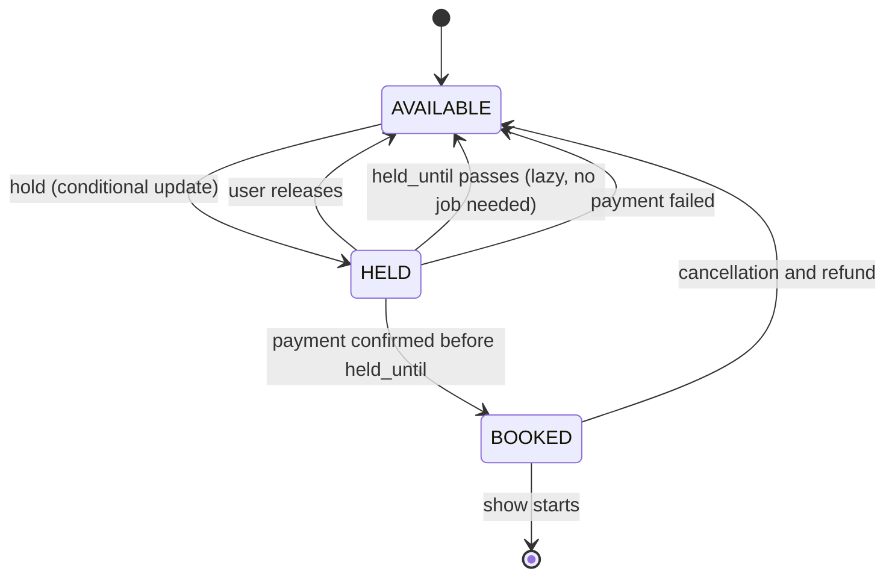
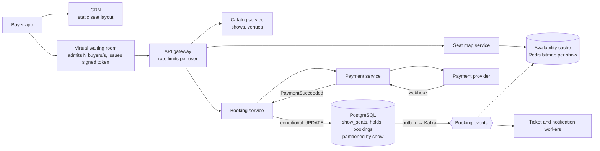
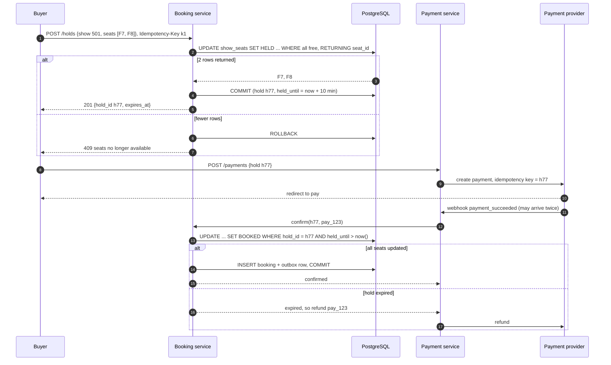
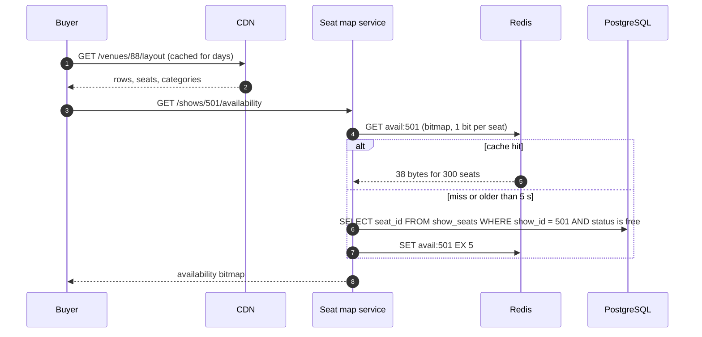
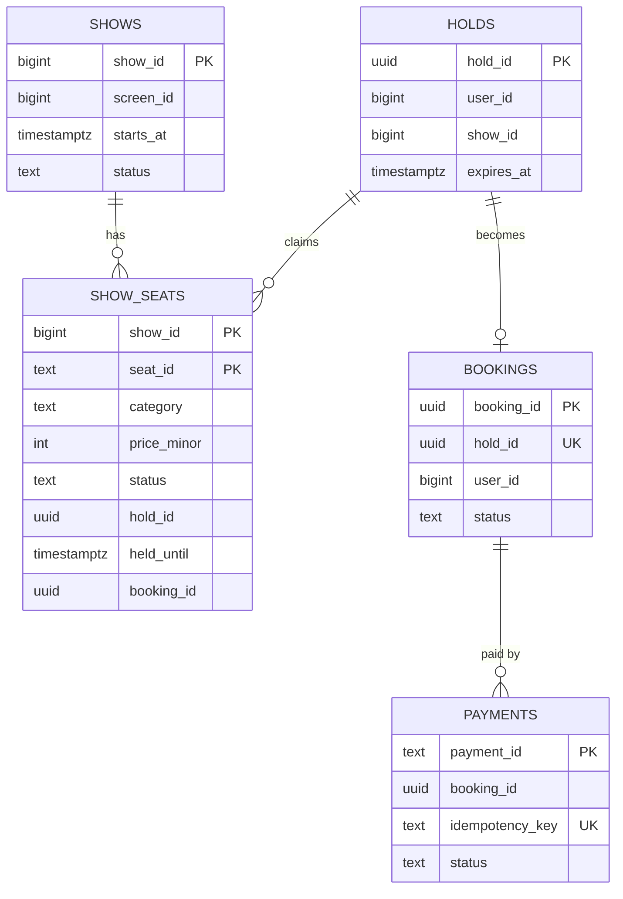

# Case Study - Ticket Booking

> [!summary] TL;DR
> A ticket booking system (cinemas, concerts, trains) lets many people pick specific seats and pay for them, without ever selling one seat twice. The design centres on a short **hold** (a reservation that expires after about 10 minutes unless paid), a database rule that makes double booking impossible, and a **virtual waiting room** that admits buyers at a safe rate when a big sale opens.

> [!abstract] Core idea
> - Seat state moves `AVAILABLE → HELD → BOOKED`; a hold carries an expiry time, so an abandoned hold frees itself without any cleanup job.
> - Taking seats is one **conditional update** ("set HELD where still free"); the database row lock decides the winner, and the loser sees 0 rows updated.
> - Holding several seats is **all-or-nothing**: if any seat is gone, nothing is held.
> - Payment confirmation is **idempotent**, and a payment that arrives after the hold expired is refunded, not forced through.
> - On-sales are protected by a waiting room that admits buyers at the rate the booking path can serve.

## 1. Why it exists - requirements

Two people click seat F7 for the same 9 pm show within the same millisecond. The naive code reads the seat, sees it free, and writes "booked":

```sql
SELECT status FROM show_seats WHERE show_id = 501 AND seat_id = 'F7';  -- both see AVAILABLE
UPDATE show_seats SET status = 'BOOKED', user_id = $me WHERE show_id = 501 AND seat_id = 'F7';
```

Both transactions pass the check and both write; the second write silently overwrites the first, and two people arrive at the cinema with tickets for F7. Wrapping this in a transaction does **not** fix it at PostgreSQL's default isolation level, READ COMMITTED: both transactions still read "AVAILABLE" before either writes. The fix is to make the check and the write one atomic statement, or to lock the row before reading, as shown below. (See [[Isolation Levels and MVCC]] for why.)

A second problem appears when a popular concert opens: 1 million people arrive in the first minute for 50,000 seats. Without admission control, the seat map service, the database and the payment provider are all overwhelmed at once.

**Functional requirements**
- Browse cities, venues, shows and showtimes.
- See a seat map with live availability.
- Select up to 10 seats and hold them for 10 minutes while paying.
- Pay; on success the booking is confirmed and a ticket (QR code) is sent.
- Cancel within policy; refund.

**Non-functional requirements**
- **No double booking, ever.** This is the correctness property; everything else bends around it.
- Seat map reads in under 200 ms p99; slight staleness (a few seconds) is acceptable because the hold step re-checks.
- Fairness and survival during on-sales: a queue, not a crash.
- Holds expire reliably even if every background job is down.

**Out of scope:** pricing rules, dynamic pricing, theatre-side box-office integration details.

## 2. Mental model

Think of a **cloakroom with numbered hooks**. To claim a hook you hang your coat on it; if someone's coat is already there, you cannot. A hold is a coat with a **timer tag**: if you do not come back with payment in 10 minutes, the attendant treats the hook as empty, even if the coat is still hanging there. Paying swaps the timer tag for a permanent ticket.

Terms:
- **Inventory:** the set of sellable seats for one show (`show_seats` rows).
- **Hold (reservation):** a temporary claim with an expiry time `held_until`.
- **Conditional update:** an `UPDATE ... WHERE <condition still true>` whose row count tells you whether you won.
- **On-sale:** the moment tickets for a high-demand event become available.

The seat lifecycle:



## 3. How it works - high-level design



1. **Static seat layout** (rows, seat positions, categories) never changes per show, so it is served from the CDN. Only availability is dynamic.
2. **Seat map service** returns availability from a cache that is updated by booking events and expires after a few seconds; it is a hint, not the truth.
3. **Booking service** owns the truth in PostgreSQL. A hold is a conditional update over the requested seats; a confirmation is a conditional update over the hold's seats.
4. **Payment service** creates a payment with an idempotency key derived from the hold ID and handles the provider's webhook. See [[Case Study - Payment System]].
5. **Events** leave through the outbox pattern ([[Transactional Outbox and CDC]]) to refresh caches, issue tickets and send notifications.

**Write path: hold, pay, confirm.**



**Read path: seat map.**



## 4. Worked example - estimates, API and data model

### Whiteboard version

```text
[Waiting room] -> [Booking svc] --UPDATE ... WHERE free--> [Postgres show_seats (show_id, seat_id) PK]
                        |                                        AVAILABLE -> HELD(held_until) -> BOOKED
                        +--> [Payment svc, key = hold_id] --webhook--> confirm(hold) idempotent
[Seat map svc] <- Redis bitmap per show (hint only, rebuilt from DB every few seconds)
```

Say the invariant first: "a seat row can only change from free to held in one atomic conditional update, so two buyers can never both succeed." Then the numbers.

### Estimates

All inputs are **estimates** for this exercise.

| Quantity | Arithmetic | Result |
| --- | --- | --- |
| Sellable seats per day | 3,000 screens × 5 shows × 250 seats | 3.75 M seats/day |
| Bookings per day | given | 1 M bookings/day (≈ 2.5 seats each) |
| Average booking rate | 1 M ÷ 86,400 s | ≈ 12 bookings/s |
| Seat map views | 30 views per booking | ≈ 350 views/s average, a few thousand/s at Friday-evening peaks |
| On-sale demand | 1 M buyers in the first 10 minutes for 50,000 seats | ≈ 1,700 arrivals/s, 20 buyers per seat |
| Booking capacity during on-sale | target 500 holds/s (a design choice, tested by load tests) | admit ≈ 500 buyers/s from the waiting room |
| Time to admit the whole queue | 1 M ÷ 500/s | ≈ 33 min, far longer than the seats last |
| Seats sold per admitted buyer | ≈ 2.5 seats | 50,000 seats ÷ 2.5 ≈ 20,000 buyers ≈ 40 s of admission at 500/s |
| Row storage | 3.75 M rows/day × ≈ 100 B | ≈ 375 MB/day of `show_seats`; archive past shows |
| Availability bitmap | 300 seats ÷ 8 bits | 38 bytes per show; 15,000 shows/day ≈ 570 KB total |

The headline: steady state is tiny (12 bookings per second fits on one PostgreSQL primary). The whole difficulty is the on-sale spike and the correctness rule. Admitting 500 buyers per second sells out a 50,000-seat concert in under a minute of admission, so most queued buyers should be told "sold out" by the waiting room, not by the database.

### API

```http
GET  /v1/shows/501/availability            -> {"seats_free_bitmap": "base64...", "as_of": "2026-11-04T18:00:03Z"}

POST /v1/holds
Idempotency-Key: 6b0c...e1
{"show_id": 501, "seats": ["F7", "F8"]}
201 {"hold_id": "h77", "expires_at": "2026-11-04T18:10:03Z", "amount": {"currency": "INR", "value": 64000}}
409 {"error": "seats_unavailable", "seats": ["F8"]}

DELETE /v1/holds/h77                        -> 204 (release early)

POST /v1/holds/h77/payments
{"method": "upi"}
201 {"payment_id": "pay_123", "redirect_url": "https://psp.example.com/..."}

GET  /v1/bookings/b901                      -> {"status": "CONFIRMED", "tickets": [...]}
```

The amount is in the currency's minor unit (paise), as an integer, never a float.

### Data model



```sql
-- PostgreSQL 17
CREATE TABLE show_seats (
    show_id     bigint NOT NULL,
    seat_id     text   NOT NULL,
    category    text   NOT NULL,
    price_minor integer NOT NULL,
    status      text   NOT NULL DEFAULT 'AVAILABLE'
                CHECK (status IN ('AVAILABLE', 'HELD', 'BOOKED')),
    hold_id     uuid,
    held_until  timestamptz,
    booking_id  uuid,
    PRIMARY KEY (show_id, seat_id)          -- one row per seat per show: the anti-double-booking rule
);

CREATE TABLE bookings (
    booking_id uuid PRIMARY KEY,
    hold_id    uuid NOT NULL UNIQUE,        -- a hold becomes at most one booking
    user_id    bigint NOT NULL,
    status     text NOT NULL,
    created_at timestamptz NOT NULL DEFAULT now()
);
```

**Hold: all-or-nothing in one statement.**

```sql
BEGIN;
UPDATE show_seats
SET    status = 'HELD', hold_id = $1, held_until = now() + interval '10 minutes'
WHERE  show_id = $2
  AND  seat_id = ANY($3::text[])
  AND  (status = 'AVAILABLE' OR (status = 'HELD' AND held_until <= now()))
RETURNING seat_id;
-- application: if rows returned <> cardinality($3) then ROLLBACK (409) else COMMIT
COMMIT;
```

Why this is safe under READ COMMITTED: if two transactions target F7, the second one blocks on the first one's row lock. When the first commits, PostgreSQL re-checks the `WHERE` clause against the new row version (`status = 'HELD'`, not expired), the condition fails, and the second transaction updates 0 rows for F7. No `SELECT ... FOR UPDATE` is needed. Expired holds are taken over by the same statement, which is why no sweeper job is required for correctness.

**Confirm: only a live hold can become a booking.**

```sql
-- first, outside this transaction: SELECT booking by hold_id; if one exists, return it (webhook replay)
BEGIN;
UPDATE show_seats
SET    status = 'BOOKED', booking_id = $2, held_until = NULL
WHERE  hold_id = $1 AND status = 'HELD' AND held_until > now()
RETURNING seat_id;
-- if rows <> seats in the hold: ROLLBACK and refund
INSERT INTO bookings (booking_id, hold_id, user_id, status) VALUES ($2, $1, $3, 'CONFIRMED')
ON CONFLICT (hold_id) DO NOTHING;
INSERT INTO outbox (topic, payload) VALUES ('booking.confirmed', $4);
COMMIT;
```

A replayed webhook finds the seats already `BOOKED` (0 rows) and the booking already present; the service then returns the existing booking instead of refunding. That check (look up `bookings` by `hold_id` first) is what makes confirmation idempotent.

Representative output (PostgreSQL 17) for two concurrent holds on F7 and F8:

```text
-- session A (psql)                           -- session B (started 2 ms later, blocked on F7's row lock until A commits)
 seat_id                                       seat_id
---------                                     ---------
 F7                                           (0 rows)
 F8
(2 rows)                                      UPDATE 0

UPDATE 2
```

### The same rules in Go

An in-memory model of the inventory rules, with an injected clock so expiry is tested without sleeping. In production these rules live in the SQL above; the Go version makes them executable and testable. It compiles and passes `go vet` and `go test -race` on Go 1.24.

```go
// Package booking is an in-memory model of the seat inventory rules that the
// real system enforces in PostgreSQL: a hold is all-or-nothing, it expires
// after a TTL without any cleanup job, and a seat can be booked only once.
package booking

import (
	"errors"
	"strconv"
	"sync"
	"time"
)

var (
	ErrSeatTaken   = errors.New("seat already held or booked")
	ErrHoldExpired = errors.New("hold expired")
	ErrUnknownHold = errors.New("unknown hold")
)

type seat struct {
	holdID    string    // "" when free
	heldUntil time.Time // meaningful only while not booked
	booked    bool
}

type Hold struct {
	ID      string
	ShowID  string
	Seats   []string
	UserID  string
	Expires time.Time
	Booking string // payment reference once confirmed
}

type Inventory struct {
	mu    sync.Mutex
	now   func() time.Time
	seats map[string]*seat // showID + "/" + seatID
	holds map[string]*Hold
	n     int
}

func New(now func() time.Time) *Inventory {
	return &Inventory{now: now, seats: map[string]*seat{}, holds: map[string]*Hold{}}
}

// free reports whether s can be taken at time t: never held, or the hold lapsed.
func free(s *seat, t time.Time) bool {
	return !s.booked && (s.holdID == "" || !t.Before(s.heldUntil))
}

// HoldSeats holds every seat or none (like one UPDATE ... WHERE all free).
func (inv *Inventory) HoldSeats(show, user string, seatIDs []string, ttl time.Duration) (*Hold, error) {
	inv.mu.Lock()
	defer inv.mu.Unlock()
	t := inv.now()
	for _, id := range seatIDs {
		if s, ok := inv.seats[show+"/"+id]; ok && !free(s, t) {
			return nil, ErrSeatTaken
		}
	}
	inv.n++
	h := &Hold{ID: "h" + strconv.Itoa(inv.n), ShowID: show, Seats: seatIDs, UserID: user, Expires: t.Add(ttl)}
	for _, id := range seatIDs {
		inv.seats[show+"/"+id] = &seat{holdID: h.ID, heldUntil: h.Expires}
	}
	inv.holds[h.ID] = h
	return h, nil
}

// Confirm turns a live hold into a booking. Calling it again with the same
// payment reference (a retried webhook) succeeds without side effects.
func (inv *Inventory) Confirm(holdID, paymentRef string) error {
	inv.mu.Lock()
	defer inv.mu.Unlock()
	h, ok := inv.holds[holdID]
	if !ok {
		return ErrUnknownHold
	}
	if h.Booking != "" {
		if h.Booking == paymentRef {
			return nil // idempotent replay
		}
		return ErrSeatTaken
	}
	t := inv.now()
	for _, id := range h.Seats {
		s := inv.seats[h.ShowID+"/"+id]
		if s.holdID != holdID || !t.Before(s.heldUntil) {
			return ErrHoldExpired // caller must refund the payment
		}
	}
	for _, id := range h.Seats {
		inv.seats[h.ShowID+"/"+id].booked = true
	}
	h.Booking = paymentRef
	return nil
}
```

```go
package booking

import (
	"errors"
	"fmt"
	"sync"
	"sync/atomic"
	"testing"
	"time"
)

type clock struct {
	mu sync.Mutex
	t  time.Time
}

func (c *clock) Now() time.Time          { c.mu.Lock(); defer c.mu.Unlock(); return c.t }
func (c *clock) Advance(d time.Duration) { c.mu.Lock(); c.t = c.t.Add(d); c.mu.Unlock() }

func newClock() *clock { return &clock{t: time.Date(2026, 11, 4, 18, 0, 0, 0, time.UTC)} }

func TestOnlyOneOfManyConcurrentBuyersGetsTheSeat(t *testing.T) {
	inv := New(newClock().Now)
	var wins atomic.Int32
	var wg sync.WaitGroup
	for u := 0; u < 1000; u++ {
		wg.Add(1)
		go func(u int) {
			defer wg.Done()
			if _, err := inv.HoldSeats("show1", fmt.Sprint("u", u), []string{"F7", "F8"}, 10*time.Minute); err == nil {
				wins.Add(1)
			}
		}(u)
	}
	wg.Wait()
	if wins.Load() != 1 {
		t.Fatalf("%d buyers hold F7+F8, want exactly 1", wins.Load())
	}
}

func TestHoldIsAllOrNothing(t *testing.T) {
	inv := New(newClock().Now)
	if _, err := inv.HoldSeats("show1", "a", []string{"F8"}, time.Minute); err != nil {
		t.Fatal(err)
	}
	if _, err := inv.HoldSeats("show1", "b", []string{"F7", "F8", "F9"}, time.Minute); !errors.Is(err, ErrSeatTaken) {
		t.Fatalf("err = %v, want ErrSeatTaken", err)
	}
	if _, err := inv.HoldSeats("show1", "c", []string{"F7", "F9"}, time.Minute); err != nil {
		t.Fatalf("F7 and F9 must still be free: %v", err)
	}
}

func TestExpiredHoldFreesSeatsAndCannotBeConfirmed(t *testing.T) {
	c := newClock()
	inv := New(c.Now)
	h, _ := inv.HoldSeats("show1", "a", []string{"A1"}, 10*time.Minute)
	c.Advance(10 * time.Minute) // TTL reached, no sweeper ran
	h2, err := inv.HoldSeats("show1", "b", []string{"A1"}, 10*time.Minute)
	if err != nil {
		t.Fatalf("seat should be free after expiry: %v", err)
	}
	if err := inv.Confirm(h.ID, "pay-a"); !errors.Is(err, ErrHoldExpired) {
		t.Fatalf("late payment: err = %v, want ErrHoldExpired", err)
	}
	if err := inv.Confirm(h2.ID, "pay-b"); err != nil {
		t.Fatal(err)
	}
}

func TestConfirmIsIdempotent(t *testing.T) {
	inv := New(newClock().Now)
	h, _ := inv.HoldSeats("show1", "a", []string{"B2"}, time.Minute)
	for i := 0; i < 3; i++ { // payment webhook delivered three times
		if err := inv.Confirm(h.ID, "pay-1"); err != nil {
			t.Fatalf("attempt %d: %v", i, err)
		}
	}
	if err := inv.Confirm(h.ID, "pay-2"); !errors.Is(err, ErrSeatTaken) {
		t.Fatalf("second payment for the same hold: err = %v", err)
	}
	if _, err := inv.HoldSeats("show1", "b", []string{"B2"}, time.Minute); !errors.Is(err, ErrSeatTaken) {
		t.Fatal("a booked seat must never be held again")
	}
}
```

## 5. Variants and comparison

| Approach to "who gets the seat" | How it works | Use when | Cost |
| --- | --- | --- | --- |
| Conditional `UPDATE ... WHERE free` | One statement; the row lock and re-check pick one winner | Default for seat inventory in a relational database | Hot rows during on-sales serialise on locks |
| `SELECT ... FOR UPDATE` then `UPDATE` | Lock rows first, read, decide in code, write | The decision needs logic that cannot be written in SQL | Holds locks across a round trip; lock ordering matters to avoid deadlocks |
| Optimistic version column | `UPDATE ... WHERE version = $read_version`; retry on 0 rows | Low contention (most seats most of the time) | Retry storms under on-sale contention |
| SERIALIZABLE isolation | Database aborts conflicting transactions with SQLSTATE 40001 | Complex multi-row invariants | Every caller must retry; more aborts under load |
| Redis hold (`SET seat:{501}:F7 h77 NX EX 600`, Lua for many seats) | Fast in-memory claim with TTL; database confirms later | Extreme on-sale throughput in front of the database | Two sources of truth; Redis failover can lose a hold, so the database must still reject a double booking |
| Distributed lock per seat | Lock service grants a lease per seat | Rarely justified here | Extra system; needs fencing tokens to be safe, see [[Distributed Locks and Fencing Tokens]] |
| General-admission counter | `UPDATE sections SET sold = sold + $n WHERE sold + $n <= capacity` | Standing areas, no seat numbers | One very hot row; split into sub-counters |

## 6. Trade-offs and when not to use

- **Hold duration is a business trade-off.** Long holds (15 minutes) give slow payers time but keep seats unsellable while abandoned. Short holds (5 minutes) cause more expired-hold refunds. Pick it from payment-time data; 8 to 10 minutes is common.
- **The seat map is always slightly stale.** Do not try to make it exact; the hold step is the source of truth, and a 409 with "pick another seat" is an acceptable experience.
- **A waiting room adds friction.** For a small venue or steady-state traffic it is pure overhead; turn it on only for flagged on-sales.
- **Redis holds add speed and risk.** A Redis failover between the hold and its replication can lose the hold and let a second buyer take the seat in Redis; the database `UPDATE ... WHERE free` still prevents a double sale. Keep the database as the judge.
- **Do not use distributed transactions** across the booking database and the payment provider. Use the hold as the first step of a saga: hold, pay, confirm or compensate by refund. See [[Saga Pattern]].

## 7. In production

- **Failure modes → fixes:**
	- Payment succeeds after the hold expired → confirmation fails the `held_until > now()` check; refund automatically and tell the user. Never extend a hold silently after another buyer may have taken the seat.
	- Payment webhook delivered twice, or the user double-clicks "pay" → idempotency key per hold at the payment provider; `bookings.hold_id` is `UNIQUE`; confirmation looks up the existing booking first. See [[Idempotency and Idempotency Keys]].
	- Payment outcome unknown (provider timed out) → keep the booking `PENDING_PAYMENT`, query the provider or wait for the webhook, and run a reconciliation job; the hold may be extended only while the outcome is unknown and only if the seat is still held by this hold.
	- Deadlock between two multi-seat holds touching the same seats in different order → PostgreSQL detects it and aborts one with SQLSTATE 40P01; retry with backoff (see [[Timeouts, Retries and Backoff]]), and sort seat IDs to reduce the chance.
	- On-sale overload → virtual waiting room with signed admission tokens, per-user rate limits at the gateway ([[Rate Limiting - Algorithms and Distributed Design]]), and shedding seat-map refreshes before booking requests ([[Load Shedding and Graceful Degradation]]).
	- Bots buying out inventory → waiting-room tokens bound to a session, per-account seat limits, and bot detection, see [[API Abuse and Bot Protection]].
- **What to monitor:**
	- Hold success rate and 409 rate per show.
	- Hold-to-booking conversion and expired-hold count.
	- Refunds caused by late payments.
	- Lock wait time and deadlock count on `show_seats`.
	- Waiting-room queue length and admission rate.

## 8. Deep dive

**Why no sweeper is needed, and why you still run one.** Correctness comes from the `held_until <= now()` clause in the hold statement: an expired hold is just a free seat. A sweeper that resets expired rows to `AVAILABLE` every minute is still useful so the availability cache and analytics see the right state, but if it stops, nothing breaks.

**Hot shows.** During an on-sale every request targets one show's few thousand rows. Partition `show_seats` by `show_id` (see [[Partitioning and Sharding]]), so one show's contention does not slow others. Within a show, contention is per seat: 20 buyers for one seat means 19 quick zero-row updates, which PostgreSQL handles well if transactions are short. Keep the hold transaction to the single `UPDATE` and commit; never call the payment provider inside it.

**Best-available seat selection.** Many buyers do not pick seats; they ask for "2 best seats in Gold". Doing that in the database with a `SELECT ... FOR UPDATE SKIP LOCKED LIMIT 2` over free seats ordered by a quality score lets concurrent buyers pick different seats without waiting on each other. Contiguity (adjacent seats) needs a smarter query or an in-memory allocator per show.

**The waiting room.** Buyers who arrive before the sale get a random position (so arriving at 09:59:59 does not beat arriving at 09:58); afterwards, arrivals are first come, first served. The waiting room issues a signed, short-lived admission token at a rate matched to the booking path's tested capacity, and the gateway rejects booking calls without a valid token. When inventory reaches zero, the waiting room tells everyone still queued, which removes the remaining load entirely.

**Redis in front of the database for extreme on-sales.** A Lua script runs atomically, so it can first check that every requested seat key is absent and only then `SET` all of them with `EX 600` as the hold TTL; no other command can run between the check and the sets. Only buyers who win in Redis go on to the database `UPDATE`, which still enforces the rule. Because Redis Cluster runs a script only when all its keys are in one hash slot, name keys with a hash tag such as `seat:{501}:F7` so one show's seats share a slot.

**Twin at class level.** The object model (Show, Seat, SeatLock, Booking, strategies for pricing) is designed in [[Movie Ticket Booking]]; this note owns the distributed parts.

## 9. Interview questions

> [!question]- How do you guarantee a seat is never sold twice?
> Make "claim if free" one atomic database operation: `UPDATE show_seats SET HELD ... WHERE show_id, seat_id AND (AVAILABLE or hold expired)` and check the row count. One row per `(show_id, seat_id)` as the primary key means there is nowhere for a second booking to go.

> [!question]- Trap: "Wrap the read and the write in a transaction and overselling is impossible." True?
> Not at PostgreSQL's default READ COMMITTED: both transactions can read "available" before either writes, and both write. Use a conditional update with a row-count check, `SELECT ... FOR UPDATE`, or SERIALIZABLE with retries on SQLSTATE 40001.

> [!question]- How do holds expire if the cleanup job is down?
> Expiry is part of the claim condition (`held_until <= now()` counts as free), so an expired hold is overwritten by the next buyer's update. The cleanup job only refreshes caches and reports.

> [!question]- The payment succeeds 30 seconds after the hold expired and someone else took the seat. What now?
> Confirmation fails its `held_until > now()` check, so no booking is created; the system refunds the payment automatically and tells the user. The seat is never taken from the second buyer.

> [!question]- 1 million people arrive for 50,000 seats. What do you build?
> A virtual waiting room that admits buyers at the tested capacity of the booking path (for example 500/s) with signed tokens, static layout on the CDN, a short-lived availability cache, per-user limits, and a sold-out signal that drains the queue once inventory hits zero.

> [!question]- Would you hold seats in Redis or in the database?
> The database by default, because it must enforce the rule anyway and 12 bookings per second is trivial. Add Redis holds only as a fast pre-filter for extreme on-sales, keeping the database update as the final judge.

> [!question]- How is the booking flow kept consistent with the payment provider without 2PC?
> As a saga: hold (local transaction) → pay (provider call with idempotency key = hold ID) → confirm (local transaction) or compensate (release the hold, refund). Events leave through an outbox.

## 10. Cheat sheet

A 45-minute script:

- **0-5 min, requirements:** browse, seat map, hold up to 10 seats for 10 minutes, pay, ticket, cancel. Invariant: no double booking. On-sales: 1 M buyers, 50,000 seats.
- **5-10 min, estimates:** 1 M bookings/day ≈ 12/s (one PostgreSQL primary is enough); seat-map reads ≈ 30× bookings; on-sale 1,700 arrivals/s, admit ≈ 500/s; bitmap 38 B per show.
- **10-15 min, API and data:** `GET availability`, `POST /holds` with idempotency key, `POST /holds/{id}/payments`, `GET /bookings/{id}`; `show_seats (show_id, seat_id)` PK with `status, hold_id, held_until, booking_id`; `bookings.hold_id UNIQUE`.
- **15-25 min, high-level design:** CDN layout → waiting room → gateway → seat map (Redis bitmap hint) and booking service (PostgreSQL truth) → payment service → outbox events → tickets and notifications.
- **25-40 min, deep dives:** conditional update and why READ COMMITTED re-check makes it safe; all-or-nothing multi-seat holds; lazy expiry; late payments refunded; idempotent confirmation; waiting room; Redis holds with hash tags as an optional pre-filter.
- **40-45 min, wrap-up:** monitor hold success, conversions, expired holds, refunds, lock waits, queue length. Compare with the class-level [[Movie Ticket Booking]].

## Links

- **Before this:** [[Transactions and ACID]], [[Locking - Optimistic vs Pessimistic]], [[Isolation Levels and MVCC]], [[Idempotency and Idempotency Keys]]
- **Next:** [[Case Study - Payment System]], [[Case Study - Leaderboard and Top-K]]
- **Compare with:** [[Movie Ticket Booking]] and [[Hotel Booking]] (class-level twins: date-range holds instead of seats), [[Saga Pattern]], [[Distributed Locks and Fencing Tokens]]
