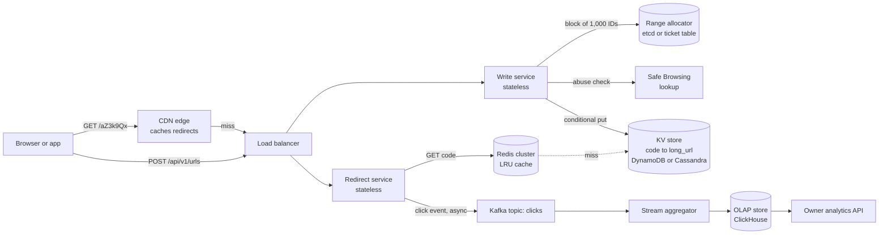
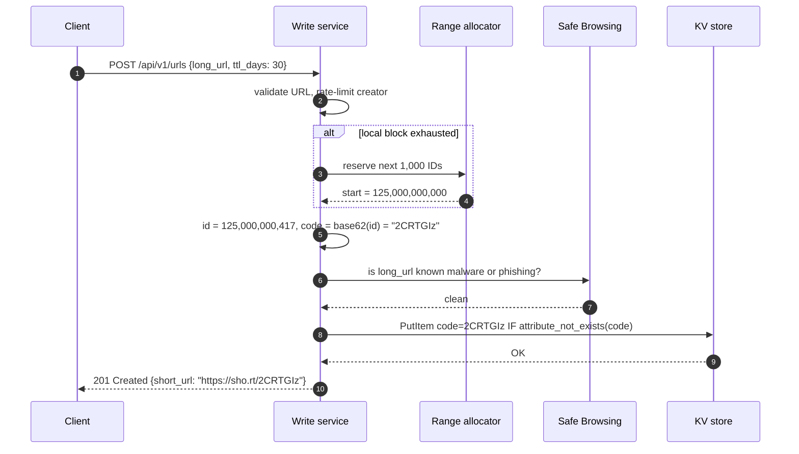
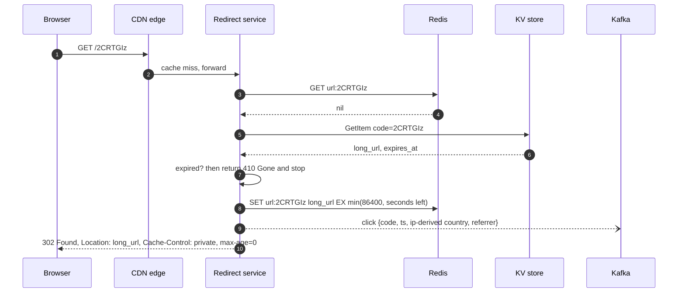
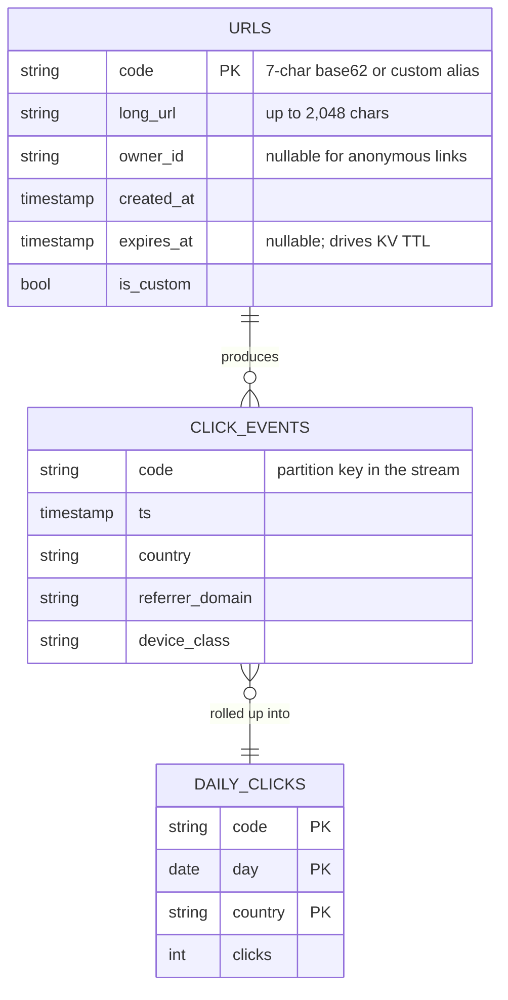

# Case Study - URL Shortener

> [!summary] TL;DR
> A URL shortener maps a long web address to a short code such as `sho.rt/aZ3k9Qx` and sends anyone who opens the code to the original address. Writes are rare and reads are huge (about 100 reads per write), so the design is a unique-key generator on the write side and a cache-heavy key-value lookup on the read side.

> [!abstract] Core idea
> - The code is just a primary key: `code → long_url` in a key-value store.
> - Generate codes from a counter encoded in base62 (no collisions), handed out to servers in blocks so the counter is not a bottleneck.
> - Redirects are served from CDN and Redis; the database sees only cache misses.
> - Choose 302 when you need click analytics, 301 when you want browsers to remember the redirect.
> - Click analytics go to a queue and an analytics store, never into the redirect's critical path.

## 1. Why it exists - requirements

Long URLs break in SMS messages, printed posters and tweets with character limits, and they reveal tracking parameters. A shortener gives a short, stable alias and, as a bonus, counts clicks.

**Functional requirements**
- `shorten(long_url)` returns a short code; the same user may ask for a **custom alias** (`sho.rt/diwali-sale`).
- `GET /{code}` redirects to the long URL.
- Optional **expiry** (TTL) per link.
- **Click analytics**: total clicks, by day, country and referrer, visible to the link owner.

**Non-functional requirements**
- Read-heavy: about **100 redirects per created link** (an assumption to confirm with the interviewer).
- Redirect latency: server-side p99 under 20 ms from cache (a target, an estimate).
- Availability of redirects matters more than availability of creation: a broken printed QR code cannot be reprinted. Target 99.99% for redirects.
- Codes must never collide and must not be guessable in sequence if links are private (see section 8).

**Out of scope**: user accounts and billing, link editing after creation, a link-preview page, QR-code rendering.

## 2. Mental model

A URL shortener is a **coat-check counter**. You hand over a long coat (the URL) and get a small numbered ticket (the code). The hard parts are not the hanger rail; they are making sure two clerks never hand out the same ticket number, and serving the queue of people collecting coats very fast.

Two ideas carry the whole design:
1. **The write path is an ID problem.** Turn a unique number into a short string. Uniqueness is the job of [[Unique ID Generation]]; base62 is just the encoding.
2. **The read path is a cache problem.** A redirect is a single-key lookup with a 100:1 read ratio, the best case for [[Caching Patterns]] (cache-aside) and [[CDN and Edge]].

## 3. How it works - high-level design



**Write path.** The write service holds a block of pre-reserved IDs (for example 1,000) in memory. For each create it takes the next ID, encodes it in base62, checks the URL against a malware list, and stores `code → long_url` with a conditional put. It fetches a new block from the range allocator only once per 1,000 creates.



**Read path with a cache miss.** Most redirects end at the CDN or Redis. The sequence below shows the slow path, which must still be fast.



## 4. Worked example - estimates, API and data model

### Whiteboard version

```text
Writes:  100M/day  ≈ 1.2k/s   (peak ×3 ≈ 3.5k/s)
Reads:   10B/day   ≈ 116k/s   (peak ×3 ≈ 350k/s)
Rows:    100M × 365 × 5 = 182.5B   × 500 B ≈ 91 TB
Codes:   62^7 ≈ 3.5 trillion  (62^6 ≈ 56.8B is too small)

POST /api/v1/urls {long_url, alias?, ttl_days?}  -> 201
GET  /{code}                                       -> 302 | 404 | 410

[client] -> [CDN] -> [redirect svc] -> [Redis] -> [KV: code -> long_url]
[write svc] --(ID block)--> [range allocator]
[redirect svc] --(click)--> [Kafka] -> [ClickHouse]
```

### Estimates (all inputs are interview assumptions, so the results are estimates)

| Quantity | Arithmetic | Result |
| --- | --- | --- |
| Create rate | 100,000,000 / 86,400 s | ≈ 1,157 writes/s |
| Redirect rate | 10,000,000,000 / 86,400 s | ≈ 115,741 reads/s |
| Peak (×3 for daily peaks, assumed) | 115,741 × 3 | ≈ 350,000 reads/s |
| Rows after 5 years | 100M × 365 × 5 | 182.5 billion rows |
| Row size | code 7 B + URL ~ 300 B + owner, timestamps, overhead | ≈ 500 B (assumed) |
| Storage after 5 years | 182.5 × 10^9 × 500 B | ≈ 91 TB before replication; ≈ 274 TB at RF=3 |
| Cache for the hot set | top 100M codes × 500 B | ≈ 50 GB of Redis, spread over a few shards |
| Redirect egress | 115,741/s × ~500 B response | ≈ 58 MB/s |

**Key space.** With 7 base62 characters there are `62^7 = 3,521,614,606,208` codes, about 3.5 trillion. Five years use `182.5B / 3.52T ≈ 5.2%` of them. Six characters give `62^6 = 56,800,235,584`, about 56.8 billion, which runs out in about 1.5 years at 100M per day. That single calculation justifies the code length.

**What the numbers decide.** 1.2k writes/s fits on any distributed KV store, so the write side is not the problem. 116k reads/s at a hot set of 50 GB means Redis plus CDN absorb nearly all reads; at a 95% cache hit rate (assumed) the KV store sees about 5.8k reads/s.

### API

```http
POST /api/v1/urls
Authorization: Bearer <token>
Idempotency-Key: 7f1c2c8e-1d9a-4b6f-9a51-0c3e9f2d4b10
Content-Type: application/json

{"long_url": "https://shop.example.com/sale?utm_source=sms&utm_campaign=diwali",
 "alias": "diwali-sale",
 "ttl_days": 30}
```

```http
HTTP/1.1 201 Created
Location: https://sho.rt/diwali-sale
Content-Type: application/json

{"code": "diwali-sale", "short_url": "https://sho.rt/diwali-sale",
 "expires_at": "2026-12-04T10:00:00Z"}
```

| Endpoint | Success | Errors |
| --- | --- | --- |
| `POST /api/v1/urls` | 201 Created | 400 invalid URL, 409 alias taken, 422 URL flagged as malware, 429 creator rate limit |
| `GET /{code}` | 302 Found (or 301, see section 5) | 404 unknown code, 410 Gone after expiry |
| `GET /api/v1/urls/{code}/stats?from=&to=` | 200 with click counts | 403 not the owner |

The `Idempotency-Key` header lets a mobile client retry a timed-out create without getting two codes; see [[Idempotency and Idempotency Keys]].

### Data model



`URLS` lives in a KV store partitioned by `code` (DynamoDB or Cassandra); the access pattern is only "get by code" and "put if absent", so there are no joins and partitioning is trivial (see [[Partitioning and Sharding]]). `CLICK_EVENTS` is a Kafka topic; `DAILY_CLICKS` is a table in an OLAP store such as ClickHouse.

### Code: base62 encoding and block allocation

This is the code-generation core: a counter split into blocks, encoded in base62. Each write server owns one `Allocator`; the `RangeSource` is a ticket table or an etcd counter in production and an in-memory fake in tests.

```go
// Package shortener turns numeric IDs into short codes and hands out IDs
// from pre-allocated ranges so that app servers rarely touch the counter.
package shortener

import (
	"errors"
	"sync"
)

const alphabet = "0123456789ABCDEFGHIJKLMNOPQRSTUVWXYZabcdefghijklmnopqrstuvwxyz"

// Encode writes id in base62, left-padded with '0' to at least width chars.
func Encode(id uint64, width int) string {
	buf := make([]byte, 0, 11)
	for id > 0 {
		buf = append(buf, alphabet[id%62])
		id /= 62
	}
	for len(buf) < width {
		buf = append(buf, '0')
	}
	for i, j := 0, len(buf)-1; i < j; i, j = i+1, j-1 {
		buf[i], buf[j] = buf[j], buf[i]
	}
	return string(buf)
}

// ErrBadCode is returned for characters outside the base62 alphabet.
var ErrBadCode = errors.New("shortener: invalid code")

// Decode is the inverse of Encode.
func Decode(code string) (uint64, error) {
	var id uint64
	for i := 0; i < len(code); i++ {
		c := code[i]
		var v uint64
		switch {
		case c >= '0' && c <= '9':
			v = uint64(c - '0')
		case c >= 'A' && c <= 'Z':
			v = uint64(c-'A') + 10
		case c >= 'a' && c <= 'z':
			v = uint64(c-'a') + 36
		default:
			return 0, ErrBadCode
		}
		id = id*62 + v
	}
	return id, nil
}

// RangeSource hands out the start of a fresh, never-reused block of IDs.
// In production it is a ticket table or an etcd/ZooKeeper counter.
type RangeSource interface {
	NextRange(size uint64) (start uint64, err error)
}

// Allocator serves IDs from a local block and refills it from the source.
type Allocator struct {
	mu        sync.Mutex
	src       RangeSource
	blockSize uint64
	next, end uint64 // next ID to hand out; end is exclusive
}

// NewAllocator creates an allocator that fetches blockSize IDs at a time.
func NewAllocator(src RangeSource, blockSize uint64) *Allocator {
	return &Allocator{src: src, blockSize: blockSize}
}

// Next returns a unique ID. IDs left in a block when the process dies are skipped, never reused.
func (a *Allocator) Next() (uint64, error) {
	a.mu.Lock()
	defer a.mu.Unlock()
	if a.next == a.end {
		start, err := a.src.NextRange(a.blockSize)
		if err != nil {
			return 0, err
		}
		a.next, a.end = start, start+a.blockSize
	}
	id := a.next
	a.next++
	return id, nil
}

// MemorySource is an in-process RangeSource used in tests.
type MemorySource struct {
	mu    sync.Mutex
	next  uint64
	Calls int
}

// NextRange reserves [next, next+size).
func (m *MemorySource) NextRange(size uint64) (uint64, error) {
	m.mu.Lock()
	defer m.mu.Unlock()
	start := m.next
	m.next += size
	m.Calls++
	return start, nil
}
```

```go
package shortener

import (
	"sync"
	"testing"
)

func TestEncodeDecodeRoundTrip(t *testing.T) {
	cases := map[uint64]string{
		0:                 "0000000",
		61:                "000000z",
		62:                "0000010",
		3_521_614_606_207: "zzzzzzz", // 62^7 - 1, the largest 7-char code
	}
	for id, want := range cases {
		got := Encode(id, 7)
		if got != want {
			t.Fatalf("Encode(%d) = %q, want %q", id, got, want)
		}
		back, err := Decode(got)
		if err != nil || back != id {
			t.Fatalf("Decode(%q) = %d, %v", got, back, err)
		}
	}
	if _, err := Decode("ab-c"); err != ErrBadCode {
		t.Fatalf("want ErrBadCode, got %v", err)
	}
}

func TestAllocatorUniqueUnderConcurrency(t *testing.T) {
	src := &MemorySource{}
	a := NewAllocator(src, 1000)
	const workers, per = 8, 5000
	var mu sync.Mutex
	seen := make(map[uint64]bool, workers*per)
	var wg sync.WaitGroup
	for w := 0; w < workers; w++ {
		wg.Add(1)
		go func() {
			defer wg.Done()
			for i := 0; i < per; i++ {
				id, err := a.Next()
				if err != nil {
					t.Error(err)
					return
				}
				mu.Lock()
				if seen[id] {
					t.Errorf("duplicate id %d", id)
				}
				seen[id] = true
				mu.Unlock()
			}
		}()
	}
	wg.Wait()
	if len(seen) != workers*per {
		t.Fatalf("got %d ids", len(seen))
	}
	if src.Calls != 40 { // 40,000 IDs / 1,000 per block
		t.Fatalf("range fetches = %d, want 40", src.Calls)
	}
}

func TestTwoAllocatorsNeverCollide(t *testing.T) {
	src := &MemorySource{}
	a, b := NewAllocator(src, 10), NewAllocator(src, 10)
	seen := map[uint64]bool{}
	for i := 0; i < 25; i++ {
		for _, al := range []*Allocator{a, b} {
			id, _ := al.Next()
			if seen[id] {
				t.Fatalf("collision on %d", id)
			}
			seen[id] = true
		}
	}
}
```

`go vet` and `go test -race` pass on Go 1.24.4 (run in a scratch module). The second test shows the point of blocks: 40,000 IDs cost only 40 round trips to the counter.

### One request traced

1. A marketer posts `https://shop.example.com/sale?...` with `ttl_days: 30` and no alias.
2. The write service's current block is `[125,000,000,000, 125,000,001,000)`; the next ID is `125,000,000,417`.
3. `Encode(125000000417, 7)` gives a 7-character code: `2CRTGIz`.
4. Safe Browsing says the URL is clean. `PutItem ... IF attribute_not_exists(code)` succeeds; `expires_at` is set 30 days out and copied into the DynamoDB TTL attribute.
5. A customer taps the SMS link. The CDN has no cached response (we send `302` with `max-age=0`), the redirect service misses Redis, reads the KV store in about 5 ms (an estimate for a single-digit-millisecond KV read), fills Redis and returns `302`.
6. The click event goes to Kafka without blocking the response. A stream job rolls it into `DAILY_CLICKS(code, 2026-11-04, IN) += 1`.

## 5. Variants and comparison

**Key generation** is the main design choice.

| Option | How it works | Use when | Cost |
| --- | --- | --- | --- |
| Hash and truncate | `base62(md5(long_url))[:7]`, on collision append a salt and retry | You want the same long URL to map to the same code (dedupe) | Every write needs a read or conditional put to detect collisions; collision rate rises as the table fills (birthday bound) |
| Counter + base62 (single DB sequence) | One `SEQUENCE` hands out IDs | Small scale, one region | The sequence is a single point of failure and a write hotspot |
| Counter in blocks (ticket server, etcd) | Each server reserves 1,000 IDs at a time, encodes locally | The default at scale; this note's choice | Codes are sequential and guessable unless scrambled (section 8); unused IDs in a crashed server's block are lost (harmless) |
| Pre-generated key service (KGS) | Offline job fills a table of random unused codes; servers claim batches | You want random-looking codes without collision checks | Extra service and table to run; must mark keys used atomically |
| Snowflake-style 64-bit ID | Timestamp + worker ID + sequence, then base62 | You already run a Snowflake service | 64-bit IDs encode to 11 base62 chars, too long for a "short" code |

**Redirect status code** (RFC 9110):

| Code | Meaning | Browser caching | Analytics | Use for |
| --- | --- | --- | --- | --- |
| 301 Moved Permanently | Permanent | Cacheable by default; browsers may skip your server on repeat visits | Undercounts repeat clicks | Links where speed and lower load matter more than analytics |
| 302 Found | Temporary | Not cached unless headers say so | Every click reaches you | The default for analytics-driven shorteners |
| 307 Temporary Redirect | Temporary, method preserved | Like 302 | Every click | Same as 302 when non-GET requests are possible |
| 308 Permanent Redirect | Permanent, method preserved | Like 301 | Undercounts | Rare for shorteners |

## 6. Trade-offs and when not to use

- **302 over 301 because** analytics are a product feature; the price is every click hitting the CDN or origin. If analytics are not needed, 301 with a long `Cache-Control: max-age` cuts origin traffic sharply.
- **Counter over hash because** it never collides and needs no read-before-write; the price is predictable codes. Scramble with a bijection if that matters.
- **KV store over PostgreSQL because** 91 TB and a single access pattern fit a partitioned KV store; a single PostgreSQL 17 instance can serve a small internal shortener (millions of rows) perfectly well, and that is the simpler choice below roughly a few TB.
- **Async analytics over synchronous counters because** an `UPDATE clicks = clicks + 1` per redirect turns a viral link into a write hotspot.
- **When not to build one**: an internal tool with a few thousand links works fine with one PostgreSQL table, a `BIGSERIAL` key and no cache. For marketing at scale, a hosted shortener may beat building your own.

## 7. In production

- **Real building blocks (documented):**
	- Flickr's 2010 ticket-server design used MySQL `REPLACE INTO` with `auto_increment` on two servers (odd and even IDs) to hand out unique IDs; the block allocator here is the same idea with larger reservations.
	- DynamoDB `PutItem` with `attribute_not_exists(code)` gives a race-free "insert if absent" for custom aliases; DynamoDB TTL deletes expired items in the background, typically within a few days, so readers must still check `expires_at`.
	- Cassandra offers `INSERT ... IF NOT EXISTS` (a lightweight transaction using Paxos), which is slower than a plain write, so use it only for custom aliases.
	- Google Safe Browsing offers a lookup API and a local-list update API to check URLs for malware and phishing.
- **Failure modes → fixes:**
	- *Range allocator down* → write servers keep serving from their current block; give each server two blocks (current and next) so a 1-minute outage at 1.2k writes/s does not stop creates. Redirects are unaffected.
	- *Viral link (hot key)* → one Redis shard takes a huge share of traffic. Put the redirect in a short CDN cache (`s-maxage=60`) or a small in-process LRU in the redirect service; see [[Hot Keys and Hot Partitions]] and [[Cache Failure Modes - Stampede, Avalanche, Penetration, Hot and Big Keys]].
	- *Cache penetration by random codes* (a bot scans `/aaaaaaa`, `/aaaaaab`, ...) → every miss hits the KV store. Cache negative results for a short time, rate-limit by IP, and optionally put a Bloom filter of existing codes in front (see [[Bloom Filters and Probabilistic Data Structures]]).
	- *Abuse: phishing links* → check on create, re-scan periodically, and let the redirect service return a warning page for flagged codes. Rate-limit creates per user and per IP ([[Rate Limiting - Algorithms and Distributed Design]]).
	- *Kafka down* → buffer click events in memory with a bounded queue and drop when full; redirects must never block on analytics.
- **SLOs and what to monitor (targets, estimates):** redirect availability 99.99% monthly; redirect p99 under 20 ms at the origin; cache hit ratio above 95%; KV read and conditional-put error rates; remaining IDs in each server's block; Safe Browsing call latency; Kafka producer drop count.

## 8. Deep dive

### 8.1 Making sequential codes unguessable

Counter IDs produce codes such as `...0001`, `...0002`. Anyone can enumerate everyone's links. Two fixes keep the "no collision" property:
- **Bijective scrambling.** Apply a reversible permutation to the ID before encoding, for example `code_id = (id × m) mod 62^7`. Multiplication by any `m` coprime to `62^7` (any number not divisible by 2 or 31) is a bijection on `[0, 62^7)`. Unique IDs in give unique codes out, but neighbouring IDs give unrelated codes. A small Feistel cipher over the 42-bit space is stronger.
- **Random codes from a KGS.** A pre-generated pool of random codes; servers claim a batch with `UPDATE ... SET used = true ... RETURNING` (or delete-on-claim). The hard part moves to keeping the pool full.

Scrambling hides sequence, not existence: with 182.5B of 3.52T codes used (5.2%), a random 7-character guess hits a real link about 1 time in 19 (an estimate from that ratio). Private links therefore need longer codes (10+ characters) or authentication, not just scrambling.

### 8.2 Custom aliases and the race

Two users ask for `diwali-sale` at the same moment. A "read, then write if absent" check has a race window. The fix is to make the store decide: a conditional put (`attribute_not_exists`), an `INSERT ... IF NOT EXISTS`, or in PostgreSQL 17 `INSERT ... ON CONFLICT (code) DO NOTHING RETURNING code`, where an empty result means "taken, return 409". Custom aliases share the table with generated codes, so reserve a namespace: generated codes are exactly 7 base62 characters, and aliases must be longer or contain a `-`, so they can never collide with a future generated code.

### 8.3 Expiry and cleanup

Expiry has two halves:
- **Lazy check on read.** The redirect service compares `expires_at` with now and returns `410 Gone`, and sets the Redis TTL to `min(1 day, time left)` so caches do not outlive the link.
- **Background deletion.** DynamoDB TTL or Cassandra `USING TTL` removes rows later; on a SQL store, a batch job deletes in chunks (`DELETE ... WHERE ctid IN (SELECT ctid ... LIMIT 10000)`) to avoid long locks. Expired codes are **not reused**: someone may still have the old link printed, and reuse would send them to a stranger's page.

## 9. Interview questions

> [!question]- Why 7 characters?
> Base62 with 7 characters gives 62^7 ≈ 3.5 trillion codes. At 100M new links per day for 5 years we need 182.5 billion, about 5% of the space. Six characters give only 56.8 billion, which runs out in about 1.5 years.

> [!question]- 301 or 302 for the redirect?
> 301 is permanent and cacheable by default, so browsers may never ask again: lower load, but you lose repeat-click analytics and cannot change the target. 302 (or 307) is temporary and not cached by default, so every click is counted. Pick 302 when analytics are a feature.

> [!question]- Trap: "Just hash the URL with MD5 and take 7 characters. Collisions are impossible, right?"
> No. Truncating to 7 base62 characters keeps about 41.7 bits; by the birthday bound collisions become likely after a few million URLs (√(3.5 × 10^12) ≈ 1.9 million). You need a collision check (conditional put and retry with a salt), which a counter-based design avoids completely.

> [!question]- How do you generate unique codes across 50 write servers without a bottleneck?
> Each server reserves a block of IDs (say 1,000) from an etcd counter or a ticket table, then hands them out from memory. The counter sees one request per 1,000 creates. A crashed server loses its unused IDs, which is harmless because the key space is huge.

> [!question]- A link goes viral at 200k clicks/s. What breaks and how do you fix it?
> One Redis shard owns that key and saturates. Serve it from the CDN with a short `s-maxage`, add a small in-process LRU in redirect servers, or replicate the hot key to several Redis keys with a random suffix. Analytics are already async, so counting is not a hotspot.

> [!question]- How would you stop the shortener being used for phishing?
> Check URLs on create against a threat list such as Google Safe Browsing, re-scan existing links periodically, rate-limit creates per user and IP, and let redirects show an interstitial warning for flagged codes instead of redirecting.

> [!question]- Should the same long URL always get the same code?
> Only if the product wants it. Deduping needs an index on `long_url` (or its hash) per owner, which adds a lookup to every write. Most shorteners give each create its own code because different owners want separate analytics.

## 10. Cheat sheet

A 45-minute interview script:
- **0-5 min, requirements:** shorten, redirect, custom alias, expiry, analytics; 100:1 reads; redirects 99.99%; out of scope: accounts, editing.
- **5-10 min, estimates:** 1.2k writes/s, 116k reads/s (350k peak), 182.5B rows ≈ 91 TB, 62^7 ≈ 3.5T codes, hot set ≈ 50 GB.
- **10-15 min, API and data model:** `POST /api/v1/urls` → 201, `GET /{code}` → 302/404/410; KV table `code → long_url, owner, expires_at`.
- **15-25 min, high-level design:** write service + range allocator + conditional put; redirect service + Redis + CDN; clicks → Kafka → ClickHouse.
- **25-40 min, deep dives:** code generation options and guessability; 301 vs 302; hot links and cache penetration; custom alias race; expiry.
- **40-45 min, wrap-up:** failure modes (allocator down, Kafka down), SLOs, what you would build next (multi-region active-active reads, link editing).

## Links

- **Before this:** [[System Design Interview Framework]], [[Back-of-the-Envelope Estimation]], [[Unique ID Generation]], [[Caching Patterns]]
- **Next:** [[Case Study - Notification System]], [[Rate Limiting - Algorithms and Distributed Design]], [[Case Study - Key-Value Store]]
- **Compare with:** [[Hot Keys and Hot Partitions]], [[CDN and Edge]], [[Bloom Filters and Probabilistic Data Structures]], [[Kafka and Event Streaming]]
