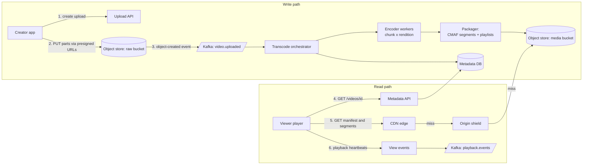
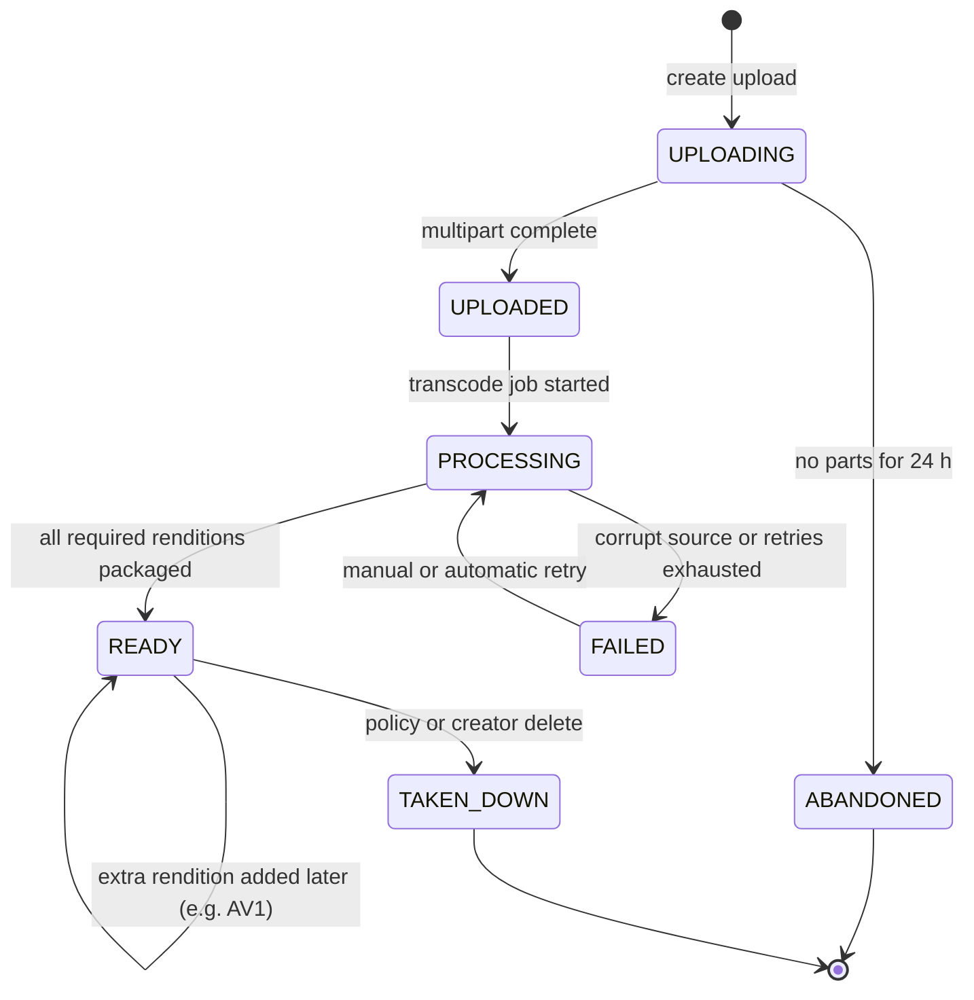
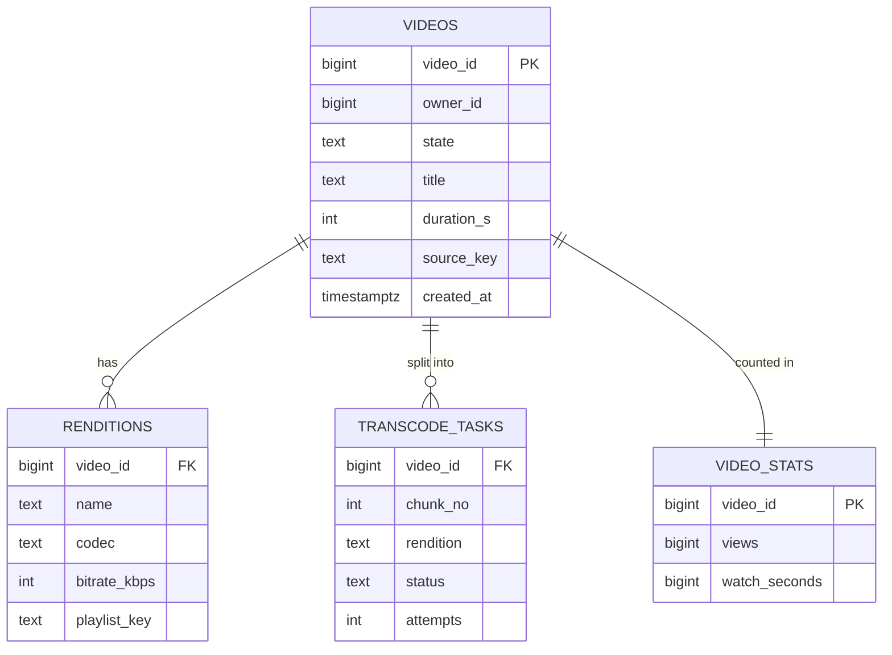
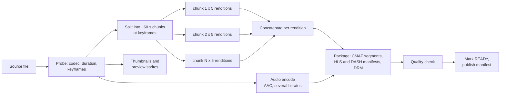
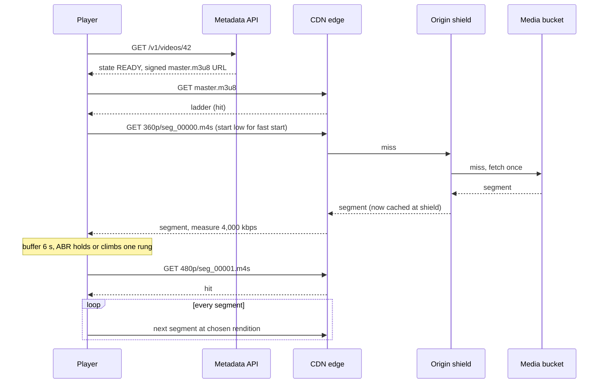

# Case Study - Video Streaming

> [!summary] TL;DR
> Design a YouTube- or Netflix-style service: creators upload large video files, the system converts each file into many small pieces at several quality levels, and viewers stream those pieces from servers close to them. The player picks the quality piece by piece to match the viewer's network speed.

> [!abstract] Core idea
> - Uploads go straight to object storage in resumable parts; the API servers never carry video bytes.
> - A transcoding pipeline splits the source into chunks, encodes each chunk at every quality level in parallel, and packages the result into 2–6 second segments plus playlists (HLS or DASH).
> - Playback is plain HTTP GETs of static segment files, so a CDN serves almost all of the traffic; the origin only sees cache misses.
> - The player, not the server, chooses the quality for every next segment from measured throughput and buffer level (adaptive bitrate, ABR).
> - Classic mistake: designing a streaming server that pushes video over a custom socket. Segments over HTTP are what make CDN caching possible.

## 1. Why it exists - requirements

A video file is huge and viewers are everywhere. A 10-minute 1080p source upload at 10 Mbps is about 750 MB. If 1 million people press play in the same hour and every byte comes from one data centre, that data centre needs terabits per second of egress, and a viewer on a 2 Mbps mobile link cannot play a 5 Mbps file at all.

**Terms used below:**
- **Transcoding:** decoding the uploaded video and re-encoding it at other resolutions, bitrates or codecs.
- **Rendition:** one encoded version of a video, for example 720p at 2.8 Mbps in H.264.
- **Bitrate ladder:** the set of renditions produced for a video, from lowest to highest bitrate.
- **Segment:** a few seconds of one rendition stored as its own file.
- **Manifest (playlist):** a text file that lists the renditions and their segments. HLS uses `.m3u8` files; DASH uses an `.mpd` XML file.
- **ABR (adaptive bitrate):** the player logic that switches rendition between segments.
- **CDN:** a network of cache servers near viewers; see [[CDN and Edge]].

**Functional requirements:**
- Creators upload videos up to a few GB, resumable over flaky networks.
- The system transcodes each video into a ladder of renditions and makes it playable within minutes.
- Viewers browse metadata, start playback quickly and seek.
- Quality adapts to network conditions without stalling.
- View counts and watch history are recorded.

**Non-functional requirements:**
- Start-up time under about 2 seconds and a rebuffering ratio well under 1% of watch time (product targets, an estimate of typical goals).
- Playback availability is the top priority; upload and transcoding may be slower and retried.
- Egress cost dominates the bill, so the design must push bytes to the edge.
- Out of scope: recommendations, comments, live streaming (covered briefly in Variants), payments.

## 2. Mental model

Think of a publisher of printed books. The author hands in one manuscript (the upload). The printing plant (transcoding) produces a large-print edition, a paperback and a pocket edition (renditions), each cut into numbered chapters (segments). Copies are shipped to local bookshops (CDN edges) before readers ask. A reader walks into the nearest shop and takes chapter after chapter, choosing the pocket edition while on the bus and the large-print edition at home (ABR).

Two paths, very different in shape:
- **Write path** (upload and transcode): rare, heavy on CPU, can take minutes, must never lose data.
- **Read path** (playback): very frequent, heavy on bandwidth, must be fast, and is served almost entirely from caches.

## 3. How it works - high-level design



**Step by step:**
1. The creator app asks the Upload API for an upload. The API writes a `videos` row in state `UPLOADING` and returns presigned URLs for the parts; see [[File Upload Architecture]].
2. The app uploads parts directly to the raw bucket. A lost connection re-sends only the missing parts.
3. Completing the multipart upload fires an object-created event. A consumer moves the video to `PROCESSING` and starts a transcode job.
4. The orchestrator splits the source into chunks on keyframe boundaries, fans out one task per (chunk, rendition), then a packager writes segments and playlists. The video becomes `READY`.
5. A viewer fetches metadata (title, a signed manifest URL) from the Metadata API, then fetches the manifest and segments through the CDN.
6. The player sends heartbeats every few seconds; a stream pipeline turns them into view counts and watch history.



A video can be `READY` as soon as the minimum ladder (say 360p and 720p in H.264) exists. More expensive renditions, such as AV1 or 4K, are added later without blocking publication.

## 4. Worked example - estimates, API and data model

### Whiteboard version

```text
[Creator] --parts--> [Raw object store] --event--> [Transcode DAG] --segments--> [Media store]
                                                                                    |
[Viewer] <--segments over HTTP-- [CDN edge] <--miss-- [Origin shield] <------------+
  ABR: next segment rendition = f(throughput, buffer)
```

Five boxes and one rule. Everything else in this note is a detail of one of them.

### Estimates

All inputs below are **estimates** chosen for the exercise, not published figures for any company.

| Input | Value |
| --- | --- |
| Daily active viewers | 100 million |
| Watch time per viewer | 60 min/day |
| Average delivered bitrate | 3 Mbps |
| Uploads | 500,000 videos/day |
| Average video length | 10 min |
| Source bitrate | 10 Mbps |

**Egress (read path):**
- Bits per day = 100,000,000 viewers × 3,600 s × 3,000,000 bit/s = 1.08 × 10^18 bit/day.
- In bytes: 1.08 × 10^18 / 8 = 1.35 × 10^17 B ≈ **135 PB/day** delivered.
- Average rate: 1.08 × 10^18 bit / 86,400 s ≈ 1.25 × 10^13 bit/s = **12.5 Tbps**. With an evening peak of 2× the average (estimate), about **25 Tbps**.
- If the CDN hit ratio is 95%, the origin still serves 5% × 25 Tbps = 1.25 Tbps at peak. A 99% hit ratio cuts that to 250 Gbps. Each point of hit ratio is worth 250 Gbps of origin egress.

**Storage (write path):**
- One source: 600 s × 10 Mbit/s = 6,000 Mbit = 750 MB.
- The ladder in the code below sums to 400 + 800 + 1,400 + 2,800 + 5,000 = 10,400 kbps. For one codec: 600 s × 10.4 Mbit/s = 6,240 Mbit = 780 MB.
- With a second codec family at about half the size (an estimate for a newer codec), renditions total about 780 + 390 = 1,170 MB.
- Per video: 750 MB source + 1,170 MB renditions ≈ 1.9 GB. Per day: 500,000 × 1.9 GB ≈ **950 TB/day**, about **350 PB/year** before replication.

**Transcoding compute:**
- Video seconds per day: 500,000 × 600 s = 3 × 10^8 s.
- If encoding the whole ladder costs 20 CPU-seconds per second of video (estimate; it varies by an order of magnitude with codec and preset), that is 6 × 10^9 CPU-s/day / 86,400 s ≈ **69,000 cores** busy on average.

**Object counts:**
- With 6-second segments, a 10-minute rendition has 600 / 6 = 100 segments. Five renditions × 2 codecs = 1,000 segment files plus 11 playlists per video, about 500 million new objects per day.

**Metadata and view events:**
- Metadata reads: 100 M viewers × 20 page or player requests/day = 2 × 10^9/day ÷ 86,400 ≈ 23,000 QPS average. Small JSON, cacheable.
- Heartbeats every 10 s: 100 M × 3,600 s ÷ 10 s = 3.6 × 10^10/day ≈ 417,000 events/s average. That is a stream-processing problem, not a database-write problem.

### API

| Call | Purpose |
| --- | --- |
| `POST /v1/uploads` `{filename, size_bytes, content_type}` | Creates the video row; returns `video_id`, `upload_id` and presigned part URLs |
| `PUT <presigned part URL>` | Uploads one part straight to the object store |
| `POST /v1/uploads/{upload_id}/complete` `{parts:[{n, etag}]}` | Finishes the multipart upload (idempotent; see [[Idempotency and Idempotency Keys]]) |
| `GET /v1/videos/{video_id}` | Title, duration, state, thumbnail URLs, signed manifest URL |
| `GET https://cdn.example.com/v/{video_id}/master.m3u8?sig=…` | Master playlist from the CDN |
| `GET https://cdn.example.com/v/{video_id}/720p/seg_00042.m4s` | One segment from the CDN |
| `POST /v1/playback/heartbeats` `{session_id, video_id, position_s, rendition, rebuffer_ms}` | Batched playback telemetry |

A master playlist (HLS) lists the renditions; the player picks one per segment:

```text
#EXTM3U
#EXT-X-VERSION:7
#EXT-X-INDEPENDENT-SEGMENTS
#EXT-X-STREAM-INF:BANDWIDTH=528000,RESOLUTION=426x240,CODECS="avc1.42c015,mp4a.40.2"
240p/index.m3u8
#EXT-X-STREAM-INF:BANDWIDTH=3080000,RESOLUTION=1280x720,CODECS="avc1.64001f,mp4a.40.2"
720p/index.m3u8
#EXT-X-STREAM-INF:BANDWIDTH=5500000,RESOLUTION=1920x1080,CODECS="avc1.640028,mp4a.40.2"
1080p/index.m3u8
```

A media playlist lists the segments of one rendition:

```text
#EXTM3U
#EXT-X-VERSION:7
#EXT-X-TARGETDURATION:6
#EXT-X-PLAYLIST-TYPE:VOD
#EXT-X-MAP:URI="init.mp4"
#EXTINF:6.000,
seg_00000.m4s
#EXTINF:6.000,
seg_00001.m4s
#EXT-X-ENDLIST
```

`BANDWIDTH` is the peak bitrate in bits per second, including audio, which is why it is higher than the video-only ladder value.

### Data model



```sql
CREATE TABLE videos (
    video_id    bigint PRIMARY KEY,           -- Snowflake-style ID
    owner_id    bigint NOT NULL,
    state       text   NOT NULL CHECK (state IN
                 ('UPLOADING','UPLOADED','PROCESSING','READY','FAILED','ABANDONED','TAKEN_DOWN')),
    title       text   NOT NULL,
    duration_s  int,
    source_key  text   NOT NULL,              -- raw-bucket object key
    created_at  timestamptz NOT NULL DEFAULT now()
);

CREATE TABLE transcode_tasks (
    video_id   bigint NOT NULL REFERENCES videos,
    chunk_no   int    NOT NULL,
    rendition  text   NOT NULL,
    status     text   NOT NULL DEFAULT 'PENDING',
    attempts   int    NOT NULL DEFAULT 0,
    PRIMARY KEY (video_id, chunk_no, rendition)  -- re-running a task overwrites, never duplicates
);
```

Segments and playlists live in object storage, not in the database. The database stores only keys. View counts are pre-aggregated by the stream pipeline and written in batches into `video_stats`; they are never incremented row-by-row per view.

### The player's ABR rule in Go

The server publishes the ladder; the player decides. This is a simplified hybrid rule in the spirit of production players: estimate throughput from recent segment downloads, spend only a safety fraction of it, and let the buffer level decide how bold to be.

```go
// Package abr picks the next video rendition from measured throughput and buffer level.
package abr

import "time"

// Rendition is one rung of the bitrate ladder.
type Rendition struct {
	Name        string
	BitrateKbps int
}

// ABR is a hybrid throughput + buffer rule. Ladder must be sorted by ascending bitrate.
type ABR struct {
	Ladder  []Rendition
	Safety  float64       // use only this fraction of the estimate, e.g. 0.8
	LowBuf  time.Duration // below this, never switch up and step down one rung
	HighBuf time.Duration // switch up (one rung at a time) only above this
	Window  int           // number of recent segments in the estimate

	samples []float64 // kbps per downloaded segment
}

// Observe records one finished segment download.
func (a *ABR) Observe(bytes int, took time.Duration) {
	if took <= 0 {
		return
	}
	kbps := float64(bytes*8) / 1000 / took.Seconds()
	a.samples = append(a.samples, kbps)
	if len(a.samples) > a.Window {
		a.samples = a.samples[len(a.samples)-a.Window:]
	}
}

// Estimate is the harmonic mean of recent samples; one fast outlier cannot inflate it.
func (a *ABR) Estimate() float64 {
	if len(a.samples) == 0 {
		return 0
	}
	var inv float64
	for _, s := range a.samples {
		inv += 1 / s
	}
	return float64(len(a.samples)) / inv
}

// Choose returns the ladder index for the next segment.
func (a *ABR) Choose(current int, buffer time.Duration) int {
	budget := a.Safety * a.Estimate()
	target := 0
	for i, r := range a.Ladder {
		if float64(r.BitrateKbps) <= budget {
			target = i
		}
	}
	switch {
	case buffer < a.LowBuf:
		// Danger zone: the buffer is draining. Step down at least one rung.
		return min(target, max(current-1, 0))
	case buffer < a.HighBuf:
		// Comfortable but not rich: allow down-switches, hold instead of going up.
		return min(target, current)
	default:
		// Rich buffer: climb at most one rung per segment to avoid oscillation.
		return min(target, current+1)
	}
}
```

```go
package abr

import (
	"math"
	"testing"
	"time"
)

func ladder() []Rendition {
	return []Rendition{
		{"240p", 400}, {"360p", 800}, {"480p", 1400},
		{"720p", 2800}, {"1080p", 5000},
	}
}

func newABR() *ABR {
	return &ABR{Ladder: ladder(), Safety: 0.8, LowBuf: 10 * time.Second,
		HighBuf: 30 * time.Second, Window: 3}
}

func TestHarmonicMeanResistsSpike(t *testing.T) {
	a := newABR()
	// Three 2 MB segments; the third downloads 10x faster (a cache-hit spike).
	a.Observe(2_000_000, 4*time.Second)        // 4,000 kbps
	a.Observe(2_000_000, 4*time.Second)        // 4,000 kbps
	a.Observe(2_000_000, 400*time.Millisecond) // 40,000 kbps
	got := a.Estimate()
	want := 3 / (1/4000.0 + 1/4000.0 + 1/40000.0) // 5,714.3 kbps
	if math.Abs(got-want) > 0.01 {
		t.Fatalf("estimate = %.2f, want %.2f", got, want)
	}
}

func TestChooseRules(t *testing.T) {
	a := newABR()
	for range 3 {
		a.Observe(2_500_000, 4*time.Second) // 5,000 kbps each
	}
	// budget = 0.8 * 5000 = 4000 kbps -> 720p (index 3) is the best fit
	cases := []struct {
		name    string
		current int
		buffer  time.Duration
		want    int
	}{
		{"rich buffer climbs one rung", 1, 40 * time.Second, 2},
		{"rich buffer stops at target", 3, 40 * time.Second, 3},
		{"middle buffer holds", 1, 20 * time.Second, 1},
		{"low buffer steps down", 3, 5 * time.Second, 2},
		{"low buffer at bottom stays", 0, 5 * time.Second, 0},
	}
	for _, c := range cases {
		if got := a.Choose(c.current, c.buffer); got != c.want {
			t.Errorf("%s: got %d want %d", c.name, got, c.want)
		}
	}
}

func TestThroughputCollapseDropsImmediately(t *testing.T) {
	a := newABR()
	for range 3 {
		a.Observe(250_000, 4*time.Second) // 500 kbps
	}
	// budget 400 kbps -> only 240p fits; even a rich buffer must drop to it
	if got := a.Choose(4, 40*time.Second); got != 0 {
		t.Fatalf("got %d want 0", got)
	}
}

func TestNoSamplesStartsLowest(t *testing.T) {
	if got := newABR().Choose(0, 0); got != 0 {
		t.Fatalf("got %d want 0", got)
	}
}
```

Output of `go test -race ./...` in the scratch module (Go 1.24.4):

```text
ok  	example.com/abr	1.151s
```

Two design points the test pins down:
- The **harmonic mean** of 4,000, 4,000 and 40,000 kbps is about 5,714 kbps, while the arithmetic mean would be 16,000 kbps. One lucky download from a warm cache would otherwise push the player to 1080p and cause a stall.
- **Down fast, up slow.** A collapse in throughput drops straight to the rung that fits; climbing happens one rung per segment and only with a full buffer.

## 5. Variants

| Variant | How it differs | Use when | Cost |
| --- | --- | --- | --- |
| VOD with fixed ladder | Same renditions for every video | Small catalogue, simple ops | Wastes bits on easy content, starves complex scenes |
| Per-title or per-shot encoding | Ladder chosen per video (or per scene) from trial encodes | Large catalogue with heavy egress | More CPU per video; pays back on popular titles |
| Live streaming (HLS/DASH) | Encoder ingests RTMP/SRT, segments are written as they happen, playlist keeps growing | Sports, events | 10–30 s latency with 6 s segments and a 3-segment buffer (estimate) |
| Low-latency live (LL-HLS, low-latency DASH with CMAF chunks) | Segments are published in sub-second parts before they finish | Interactive or betting-sensitive live | More requests per second, tighter CDN support needed |
| WebRTC | Real-time media over UDP between peers or via an SFU | Calls, sub-second interaction | Hard to cache, scales by server fan-out, not CDN |
| Short-form feed (TikTok-style) | Short clips, aggressive prefetch of the next videos | Swipe feeds | Prefetched bytes are wasted on skipped videos |

**HLS vs DASH vs CMAF:** HLS (RFC 8216) is the format Apple devices and Safari play natively; DASH is an ISO standard used widely on Android, smart TVs and browsers through Media Source Extensions. CMAF is a fragmented-MP4 segment format that both can reference, so one set of segment files can serve both manifest types: storage and CDN caches hold one copy of the media instead of two.

## 6. Trade-offs

- **Segment length.** Short segments (2 s) let ABR react faster and cut live latency, but multiply request count and per-request overhead. Apple's authoring spec recommends a 6-second target duration for HLS; VOD services commonly use 2–6 s.
- **Encode ahead vs just-in-time.** Encoding every rendition at upload wastes CPU on the long tail of videos that get few views. Just-in-time packaging (store one mezzanine file per rendition, package into HLS or DASH on request) or encoding rare renditions lazily saves storage, but adds first-view latency and origin CPU.
- **Codec choice.** Newer codecs (HEVC, VP9, AV1) cut bytes at the same quality but cost much more encode CPU and are not decoded by every device. A common answer: H.264 for universal reach, plus a newer codec for popular titles where egress savings repay the encode cost.
- **Own CDN vs commercial CDN.** Building ISP-embedded caches (Netflix Open Connect) only pays at very large, predictable egress. Most companies should buy CDN capacity, often from more than one vendor.
- **When not to build this:** for a few hundred internal videos, a managed video service or plain progressive MP4 download from a CDN is simpler. ABR and a transcode farm are worth it only when viewers have varied networks and the catalogue is large.

## 7. In production

- **Real systems:**
	- Netflix runs its own CDN, Open Connect: appliances placed inside ISP networks and at internet exchanges, filled with predicted-popular content during off-peak hours (documented on the Open Connect site).
	- Netflix described per-title encoding in 2015: each title gets its own bitrate ladder from trial encodes, instead of one fixed ladder (Netflix Technology Blog).
	- Players such as hls.js, Shaka Player and ExoPlayer implement ABR on the client; the buffer-based approach comes from Huang et al., SIGCOMM 2014.
- **Failure modes and fixes:**
	- *Thundering herd on a new release:* millions of first requests miss the edge at once. Fix: pre-warm (push) popular titles to edges, and use an origin shield tier so each edge miss becomes at most one origin fetch. See [[Hot Keys and Hot Partitions]].
	- *Poison video:* a corrupt upload crashes encoder workers repeatedly. Fix: cap attempts per task, mark the video `FAILED`, send the task to a dead letter queue; see [[Dead Letter Queues and Poison Messages]].
	- *Worker dies mid-chunk:* the task lease expires and another worker re-runs it. Output keys are deterministic (`video/rendition/chunk`), so a rerun overwrites instead of duplicating.
	- *Playlist cached too long:* for VOD, playlists and segments are immutable and can be cached for days. For live, the media playlist changes every segment, so it gets a short TTL (about one target duration) while segments stay long-lived; see [[HTTP Caching - Cache-Control, ETag, Conditional Requests]].
	- *Hotlinking and piracy:* signed URLs or signed cookies with short expiry on manifests, and DRM (Widevine, FairPlay, PlayReady) for premium content.
- **What to monitor:**
	- Viewer side: start-up time, rebuffering ratio, average delivered bitrate, rendition switches per minute, playback failure rate.
	- CDN: hit ratio per region, origin egress, 4xx/5xx by edge.
	- Pipeline: upload-to-ready time (p50, p99), transcode queue depth, task failure rate.

## 8. Deep dive

### The transcoding DAG

Encoding a 2-hour film serially takes hours. Parallelism comes from splitting along time:



- **Keyframe alignment is mandatory.** A player can switch renditions only at a segment boundary, and each segment must start with a keyframe (an IDR frame) so it decodes on its own. All renditions are therefore encoded with the same fixed GOP (group of pictures) length, for example a keyframe every 2 s with 6 s segments, so segment `n` covers the same time range in every rendition.
- **Chunk boundaries** must also fall on keyframes, or the joined output glitches. Encoders are run with closed GOPs so no frame references a frame in another chunk.
- **Orchestration:** the DAG is a durable workflow: each task is idempotent, retried with backoff, and the join waits for all chunk tasks. This is a job for [[Workflow Engines and Durable Execution]] or the design in [[Case Study - Distributed Job Scheduler]]; the events that start it come from [[Kafka and Event Streaming]].
- **Priority:** popular creators and short clips go to a fast queue; a 4K AV1 re-encode of an old video goes to a cheap batch queue (spot instances), because it can be interrupted and retried.

### Playback timeline



Starting at a low rendition is deliberate: the first segment is small, so playback starts quickly, and its download time gives the first throughput sample.

### CDN economics and the long tail

- Popularity is heavily skewed: a small share of titles accounts for most views. Those titles stay in edge caches; the long tail does not.
- Tiered caching (edge, then regional shield, then origin) turns millions of edge misses into thousands of shield misses into a handful of origin reads.
- Predictable catalogues (films, series) can be **pushed** to edges overnight. User-generated catalogues are mostly **pulled** on demand because popularity is hard to predict.
- Storage tiers follow the same curve: new and popular renditions in standard object storage, older ones in infrequent-access storage, and the original source in archive storage for re-encoding later.

### Counting views

Heartbeats flow into Kafka; a stream job deduplicates by `session_id`, applies a rule such as "a view counts after 30 s of playback" (an example rule), aggregates per video per minute and writes batched increments to `video_stats`. A real-time counter can be approximate, while billing-grade numbers (for creator payouts or ads) are reconciled by a batch job. This is the same pattern as [[Case Study - Ad Click Aggregation]].

## 9. Interview questions

> [!question]- Why stream over HTTP segments instead of a custom streaming protocol?
> Segments are static files, so any HTTP cache or CDN can serve them, and they pass through firewalls and proxies. The server keeps no per-viewer state; the client drives everything with plain GETs. That is what lets egress scale to tens of Tbps.

> [!question]- Who decides the quality level, and on what signals?
> The player. Before each segment it combines a throughput estimate from recent downloads (a harmonic mean resists outliers) with its buffer level: low buffer means step down, high buffer allows a cautious step up. The server only publishes the ladder.

> [!question]- How do you make transcoding a 2-hour film take minutes?
> Split the source into chunks at keyframes, encode every (chunk, rendition) pair in parallel on many workers, then concatenate and package. Tasks are idempotent with deterministic output keys, so a crashed worker's task is simply re-run.

> [!question]- Trap: "Put the videos in the database as BLOBs so everything is in one place."
> No. Video bytes go to object storage and are served by the CDN; the database holds metadata and object keys only. BLOBs would bloat backups and replication, and every byte would flow through the database and app servers instead of the edge.

> [!question]- Why must all renditions share keyframe positions?
> The player switches renditions at segment boundaries. If segment 42 of 720p and segment 42 of 1080p do not start at the same time with an independently decodable frame, switching shows glitches or forces a re-download.

> [!question]- A new episode launches at 9 pm. What breaks, and how do you prevent it?
> Every edge misses at once and floods the origin. Pre-position the episode on edges before launch, put a shield tier between edges and origin, and collapse concurrent misses for the same object into one upstream fetch.

> [!question]- How do you count views without hammering the database?
> Send heartbeats to a stream (Kafka), deduplicate per session, aggregate per video per minute in a stream processor, and write batched increments. Show an approximate live number; reconcile exact numbers in a batch job.

## 10. Cheat sheet

- Upload: presigned multipart PUTs straight to object storage; API handles metadata only.
- Transcode: probe, split at keyframes, encode chunk × rendition in parallel, join, package to CMAF with HLS and DASH manifests.
- Same GOP across renditions so the player can switch at any segment boundary.
- Playback: static segments over HTTP from a CDN; origin shield collapses misses.
- ABR on the client: harmonic-mean throughput × safety factor, gated by buffer level; down fast, up slow.
- Egress estimate: viewers × seconds × bitrate; 100 M × 1 h × 3 Mbps ≈ 12.5 Tbps average.
- View counts: heartbeats → Kafka → windowed aggregation → batched writes, batch reconciliation.

## Links

- **Before this:** [[System Design Interview Framework]], [[Back-of-the-Envelope Estimation]], [[CDN and Edge]], [[File Upload Architecture]], [[File Uploads and Object Storage]]
- **Next:** [[Case Study - Distributed Message Queue]], [[Case Study - Ad Click Aggregation]]
- **Compare with:** [[Case Study - File Storage and Sync]] (also chunked uploads to object storage, but sync instead of streaming), [[Case Study - Distributed Job Scheduler]] (the engine under the transcode DAG), [[Scaling WebSockets]] (stateful connections, the opposite of stateless segment GETs)
