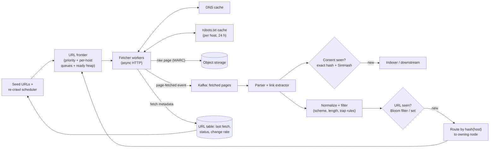
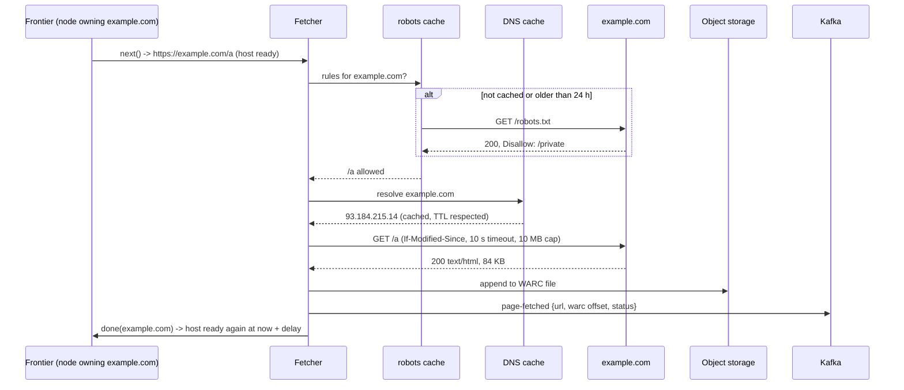
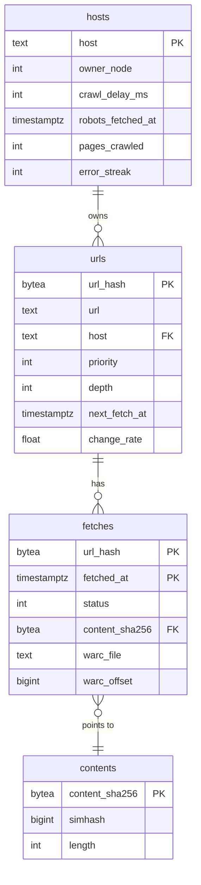
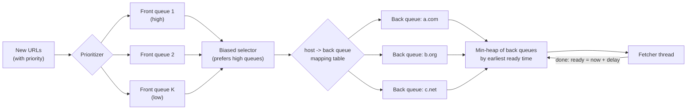

# Case Study - Web Crawler

> [!summary] TL;DR
> A web crawler downloads pages, pulls out their links, and downloads those too, for a search index or an archive. At a billion pages a month the hard parts are not the downloading: they are **politeness** (never hammering one website), **deduplication** (never fetching the same URL or near-identical content twice), and avoiding **crawler traps** (sites that generate endless URLs).

> [!abstract] Core idea
> - The **URL frontier** (the to-do list of URLs) is the heart: priority queues in front, one FIFO queue per host behind, and a heap that releases a host only when its politeness delay has passed.
> - Partition work by **host**, so one worker owns each host and politeness is a local decision.
> - Deduplicate URLs after normalizing them, with a Bloom filter or a hash set at scale; deduplicate content with exact hashes and SimHash for near-duplicates.
> - Respect robots.txt (RFC 9309), cache it per host, and cap pages and depth per host to escape traps.
> - Store raw pages in object storage and hand them to parsing and indexing through a queue, so fetching never waits on processing.

## 1. Why it exists - requirements

The naive crawler is a breadth-first search: a queue of URLs, a loop that pops one, fetches it, and pushes its links. Run that with 500 threads and three things go wrong within minutes:
- **It attacks one site.** Most links on a page point to the same host, so the queue fills with `example.com/*` and 500 threads hit one small server at once. That is effectively a denial-of-service attack, and the site will ban you.
- **It loops forever.** A calendar page links to "next month" endlessly, and session ids in URLs make every link look new.
- **It wastes bandwidth.** The same article is reachable by many URLs (`?utm_source=`, `#section`, `http` vs `https`, mirrors).

**Functional requirements**
- Given seed URLs, discover and download HTML pages across the web; store raw content with fetch metadata (time, status, headers).
- Extract links and enqueue new ones; skip URLs already seen.
- Obey robots.txt, plus a politeness delay per host.
- Re-crawl pages on a schedule that depends on how often they change.
- Feed downstream consumers (indexing, as in [[Search Engines and Inverted Indexes]]).

**Non-functional requirements**
- **Scale:** 1 billion pages per month (an estimate of the target), with horizontal growth.
- **Politeness:** at most one in-flight request per host, and a gap between requests.
- **Robustness:** survive malformed HTML, slow servers, huge responses, traps and worker crashes.
- **Freshness and priority:** important and fast-changing pages are fetched more often.
- **Extensibility:** new content types and processing stages without rewriting the fetcher.

## 2. Mental model

Imagine a team of librarians photocopying every book in a city. A dispatcher holds one small tray per library branch and hands out at most one request per branch at a time, waiting a few seconds before sending anyone back to the same branch. A big ledger records every book title already requested, so nobody fetches the same book twice. Each librarian copies a book, notes the other books it cites, and passes those titles back to the dispatcher. The dispatcher refuses requests to branches that have posted "no visitors in this wing", and stops sending people to a branch that seems to have infinitely many "next volume" books.

Mapped to the system:
- **Trays per branch** = per-host queues in the frontier.
- **Waiting before returning** = the politeness delay.
- **Ledger of titles** = the seen-URL set or Bloom filter.
- **Posted rules** = robots.txt.
- **Infinite next volume** = a crawler trap, handled by per-host page and depth caps.

## 3. How it works - high-level design



Step by step:
1. **Frontier** chooses the next URL whose host is allowed to be fetched now (the mechanism is in section 8 and in the Go code).
2. **Fetcher** resolves DNS through a local cache, checks robots.txt from a per-host cache, and fetches with strict limits: connect and read timeouts, a maximum body size, and a cap on redirects ([[Timeouts, Retries and Backoff]]).
3. The raw response is written to object storage in WARC (Web ARChive) files, and a small event goes to Kafka ([[Kafka and Event Streaming]]). Fetching and parsing are decoupled, so a slow parser creates lag, not lost pages ([[Backpressure and Flow Control]]).
4. **Parser** extracts links and text. The content fingerprint decides whether the page is new content or a duplicate of a page already stored.
5. Each extracted URL is **normalized** (lower-case host, drop the fragment and default port, strip known tracking parameters), filtered (allowed schemes, URL length, per-host caps), and checked against the **seen-URL** set.
6. New URLs are routed to the crawler node that owns `hash(host)`, using [[Consistent Hashing]] so adding a node moves only about `1/N` of hosts.



### Whiteboard version

```text
seeds -> [FRONTIER: front queues by priority -> back queue per host -> heap by ready_at]
            |  next(): pop host with ready_at <= now, take 1 URL, ready_at = now + delay
            v
       [FETCHERS] -- DNS cache, robots cache (RFC 9309), timeouts, size cap
            | raw page -> object storage (WARC);  event -> Kafka
            v
       [PARSER] -> content dedupe (sha256 exact, SimHash near-dup)
            | links -> normalize -> filter traps -> seen? (Bloom / set)
            v
       route by hash(host) to owning node -> back into that node's frontier
Numbers: 1B pages/month = ~386 pages/s; 100 KB/page = ~310 Mbit/s;
         10B URLs in a 1% Bloom filter = ~12 GB
```

## 4. Worked example - estimates, API and data model

### Estimates (inputs are labelled estimates)

| Quantity | Arithmetic | Result |
| --- | --- | --- |
| Pages per month | target (estimate) | 1,000,000,000 |
| Seconds per month | 30 × 86,400 s | 2,592,000 s |
| Average fetch rate | 1,000,000,000 / 2,592,000 s | ≈ 386 pages/s |
| Peak (2× average, estimate) | 386 × 2 | ≈ 770 pages/s |
| Average page size (estimate, HTML + headers) | | 100 KB |
| Download bandwidth | 386 pages/s × 100 KB | ≈ 38.6 MB/s ≈ 309 Mbit/s |
| Raw storage per month | 10^9 × 100 KB | 100 TB |
| Compressed (estimate 4:1 for HTML with gzip) | 100 TB / 4 | ≈ 25 TB/month |
| Concurrent fetches, Little's law (estimate 1 s average fetch) | 386 /s × 1 s | ≈ 386 in flight |
| Distinct hosts needed (one in-flight request per host) | ≥ 386 hosts in flight; more once politeness gaps are added | ≥ 386 hosts |
| Known URLs (seen set, estimate) | 10 × pages crawled | 10^10 URLs |
| Exact seen set with 8-byte hashes | 10^10 × 8 B | 80 GB |
| Bloom filter at 1% false positives (≈ 9.6 bits per URL) | 10^10 × 9.6 bits / 8 | ≈ 12 GB |

The interesting line is concurrency: 386 fetches per second only works if work is spread across many hosts. A frontier that hands out the next URL in plain FIFO order will stall on the one host that dominates the queue.

### Interfaces

A crawler has no public API, but its internal interfaces are worth stating:

```text
Frontier.Add(url, priority)                 -> enqueued | duplicate | rejected
Frontier.Next()                             -> (url, 0) | ("", wait_duration)
Frontier.Done(host, status, retry_after?)   -> updates ready_at (backs off on 429/503)
Fetcher.Fetch(url) -> {status, headers, body_ref, fetched_at, final_url}
Event page.fetched {url, final_url, status, warc_file, offset, length, content_sha256}
```

### Data model



At 10 billion URLs, the `urls` table belongs in a wide-column store partitioned by host (for example Cassandra, see [[Wide-Column Stores and Cassandra]]), so each crawler node reads and writes the hosts it owns. Raw bodies never go in the database; they live in WARC files in object storage, and the `fetches` row stores the file and offset.

### Go: a polite frontier with an injected clock

The frontier keeps one FIFO queue per host and a min-heap of hosts ordered by `readyAt`, the earliest time the host may be fetched again. `Next` pops a URL only from a host whose time has come; otherwise it tells the caller how long to wait. The clock is injected, so the tests control time exactly. A plain map plays the seen set; at web scale it becomes a Bloom filter ([[Bloom Filters and Probabilistic Data Structures]]).

```go
// Package frontier is a polite URL frontier: one FIFO queue per host and a
// min-heap of hosts ordered by the earliest time each may be fetched again.
package frontier

import (
	"container/heap"
	"net/url"
	"strings"
	"sync"
	"time"
)

// Normalize makes equivalent URLs compare equal before dedupe:
// lower-case scheme and host, drop default ports and the #fragment.
func Normalize(raw string) (string, string, bool) {
	u, err := url.Parse(raw)
	if err != nil || (u.Scheme != "http" && u.Scheme != "https") || u.Host == "" {
		return "", "", false
	}
	u.Scheme = strings.ToLower(u.Scheme)
	host := strings.ToLower(u.Hostname())
	port := u.Port()
	if (u.Scheme == "http" && port == "80") || (u.Scheme == "https" && port == "443") {
		port = ""
	}
	u.Host = host
	if port != "" {
		u.Host = host + ":" + port
	}
	u.Fragment, u.RawFragment = "", ""
	if u.Path == "" {
		u.Path = "/"
	}
	return u.String(), u.Host, true
}

type hostQueue struct {
	host    string
	urls    []string
	readyAt time.Time
	index   int // position in the heap, -1 when not in it
}

type readyHeap []*hostQueue

func (h readyHeap) Len() int           { return len(h) }
func (h readyHeap) Less(i, j int) bool { return h[i].readyAt.Before(h[j].readyAt) }
func (h readyHeap) Swap(i, j int) {
	h[i], h[j] = h[j], h[i]
	h[i].index, h[j].index = i, j
}
func (h *readyHeap) Push(x any) { q := x.(*hostQueue); q.index = len(*h); *h = append(*h, q) }
func (h *readyHeap) Pop() any {
	old := *h
	q := old[len(old)-1]
	*h, q.index = old[:len(old)-1], -1
	return q
}

type Frontier struct {
	mu    sync.Mutex
	now   func() time.Time // injected clock
	delay time.Duration    // politeness gap per host (or the robots.txt Crawl-delay)
	seen  map[string]bool  // a Bloom filter at web scale
	hosts map[string]*hostQueue
	ready readyHeap
}

func New(now func() time.Time, delay time.Duration) *Frontier {
	return &Frontier{now: now, delay: delay, seen: map[string]bool{}, hosts: map[string]*hostQueue{}}
}

// Add enqueues a URL once. It returns false for duplicates and bad URLs.
func (f *Frontier) Add(raw string) bool {
	u, host, ok := Normalize(raw)
	if !ok {
		return false
	}
	f.mu.Lock()
	defer f.mu.Unlock()
	if f.seen[u] {
		return false
	}
	f.seen[u] = true
	q, ok := f.hosts[host]
	if !ok {
		q = &hostQueue{host: host, readyAt: f.now(), index: -1}
		f.hosts[host] = q
	}
	q.urls = append(q.urls, u)
	if q.index == -1 {
		heap.Push(&f.ready, q)
	}
	return true
}

// Next returns a URL whose host may be fetched now. If none is ready it
// returns "" and how long to wait for the earliest host.
func (f *Frontier) Next() (string, time.Duration) {
	f.mu.Lock()
	defer f.mu.Unlock()
	if f.ready.Len() == 0 {
		return "", 0
	}
	q := f.ready[0]
	now := f.now()
	if wait := q.readyAt.Sub(now); wait > 0 {
		return "", wait
	}
	u := q.urls[0]
	q.urls = q.urls[1:]
	q.readyAt = now.Add(f.delay)
	if len(q.urls) == 0 {
		heap.Pop(&f.ready) // host leaves the heap; readyAt is kept for politeness
	} else {
		heap.Fix(&f.ready, q.index)
	}
	return u, 0
}
```

```go
package frontier

import (
	"testing"
	"time"
)

type fakeClock struct{ t time.Time }

func (c *fakeClock) Now() time.Time          { return c.t }
func (c *fakeClock) Advance(d time.Duration) { c.t = c.t.Add(d) }

func TestNormalize(t *testing.T) {
	cases := map[string]string{
		"HTTP://Example.COM:80/a#top": "http://example.com/a",
		"https://example.com:443":     "https://example.com/",
		"https://example.com:8443/x":  "https://example.com:8443/x",
	}
	for in, want := range cases {
		got, _, ok := Normalize(in)
		if !ok || got != want {
			t.Errorf("Normalize(%q) = %q, want %q", in, got, want)
		}
	}
	if _, _, ok := Normalize("mailto:a@b.com"); ok {
		t.Error("mailto must be rejected")
	}
}

func TestDedupe(t *testing.T) {
	c := &fakeClock{t: time.Unix(0, 0)}
	f := New(c.Now, time.Second)
	if !f.Add("https://a.com/x") || f.Add("https://A.com/x#frag") {
		t.Fatal("second, equivalent URL must be a duplicate")
	}
}

func TestPolitenessPerHost(t *testing.T) {
	c := &fakeClock{t: time.Unix(0, 0)}
	f := New(c.Now, 2*time.Second)
	f.Add("https://a.com/1")
	f.Add("https://a.com/2")
	f.Add("https://b.com/1")

	got := map[string]bool{}
	for range 2 {
		u, _ := f.Next()
		got[u] = true
	}
	if !got["https://a.com/1"] || !got["https://b.com/1"] {
		t.Fatalf("first two fetches should be one per host, got %v", got)
	}
	u, wait := f.Next()
	if u != "" || wait != 2*time.Second {
		t.Fatalf("a.com must wait 2s, got %q wait %v", u, wait)
	}
	c.Advance(1500 * time.Millisecond)
	if u, wait = f.Next(); u != "" || wait != 500*time.Millisecond {
		t.Fatalf("still 500ms to wait, got %q %v", u, wait)
	}
	c.Advance(500 * time.Millisecond)
	if u, _ = f.Next(); u != "https://a.com/2" {
		t.Fatalf("got %q", u)
	}
}

func TestDrainedHostStaysPolite(t *testing.T) {
	c := &fakeClock{t: time.Unix(0, 0)}
	f := New(c.Now, time.Second)
	f.Add("https://a.com/1")
	f.Next()
	f.Add("https://a.com/2") // new link found right after the fetch
	if u, wait := f.Next(); u != "" || wait != time.Second {
		t.Fatalf("re-added host must still wait, got %q %v", u, wait)
	}
}
```

Verified with Go 1.24: `go vet ./...` is clean and `go test -race ./...` passes all four tests. The last test guards a subtle bug: when a host's queue drains, the host leaves the heap, but its `readyAt` must survive, or a link discovered a millisecond later would be fetched immediately and break politeness.

This frontier starts the politeness gap when a URL is handed out. A production version starts it when the fetch **finishes** (a `Done(host)` call), so a slow server automatically gets fewer requests; Mercator-style crawlers set the gap to a multiple (for example 10×) of the last fetch time.

## 5. Variants and comparison

| Choice | How it works | Use when | Cost |
| --- | --- | --- | --- |
| Single-queue BFS | One FIFO of URLs | Toy crawls of one site you own | No politeness, traps, hot hosts |
| Mercator-style frontier | Front queues by priority feed back queues, one host per back queue, heap by ready time | General web crawling | More state per host; must persist queues |
| Focused crawler | Score links by topic relevance and only follow high scores | Vertical search (jobs, products) | Needs a classifier; misses pages behind low-score links |
| Partition by host hash | Each node owns hosts via consistent hashing | Default for distributed crawlers | Huge hosts make one node hot; split them by path |
| Partition by URL hash | Any node can take any URL | Never with politeness | Politeness needs a global lock or rate limiter per host |
| Exact URL set (sharded) | Hash set or KV of 8-byte URL hashes | You can afford ~80 GB per 10^10 URLs and need no false positives | Memory or a disk lookup per URL |
| Bloom filter | ~9.6 bits per URL at 1% false positives | Memory is tight; missing 1% of URLs is acceptable | False positives mean pages are **never** crawled |
| Headless browser rendering | Run JavaScript before extracting links | Single-page apps | 10× to 100× more CPU per page (estimate); run only for hosts that need it |

## 6. Trade-offs and when not to use

- **Freshness vs coverage.** Every re-crawl of a known page is a new page you did not fetch. Spend the budget by estimated change rate and importance, not uniformly.
- **Politeness vs throughput.** Throughput comes from breadth across hosts, never from depth on one host. A crawl that needs 10,000 pages from one site per hour should ask the site for a feed or a sitemap instead.
- **Bloom filter false positives** silently skip pages. That is acceptable for a broad crawl and not for "archive everything on this domain"; use an exact set there.
- **Store raw pages** even though parsing is the goal: when the parser improves, you can reprocess without re-fetching the web.
- **When not to build a crawler.** If the data is available through an API, sitemaps, RSS, Common Crawl's public archives or a data partnership, use that. Crawling sites that forbid it in robots.txt or their terms of service is a legal and ethical problem, not a technical one.

## 7. In production

- **Real systems.**
	- Mercator (Heydon and Najork) introduced the front-queue and back-queue frontier still taught in Introduction to Information Retrieval.
	- Google published near-duplicate detection with 64-bit SimHash fingerprints, treating pages within a Hamming distance of 3 as near-duplicates (Manku et al., 2007).
	- Googlebot ignores the non-standard `Crawl-delay` directive, per Google's own documentation.
- **robots.txt rules (RFC 9309).**
	- Use the `User-agent` group that matches the crawler's product token (else the `*` group), and within it the longest matching `Allow` or `Disallow` rule; on a tie, `Allow` wins.
	- If robots.txt returns a 4xx status (for example 404), the crawler may crawl everything. (Google treats 429 like a 5xx, which is the safer choice.)
	- If it returns a 5xx or is unreachable, assume complete disallow.
	- Do not use a cached copy for more than 24 hours unless robots.txt is unreachable.
	- Parse at least the first 500 KiB.
	- `Crawl-delay` is not part of the RFC; honour it if present as a courtesy.
- **Failure modes and fixes.**
	- *Crawler traps:* calendars, faceted search, session ids, and `../a/../a/` path loops. Fix them with:
		- caps on URL length, path depth and repeated path segments;
		- a page budget per host;
		- stripping session parameters;
		- detecting near-duplicate content under different URLs.
	- *Slow or hostile servers:* connect, read and total timeouts, a body-size cap, a redirect cap (for example 5), and no retry storm. Back off a host on 429 or 503 and honour `Retry-After`.
	- *DNS as a bottleneck:* at hundreds of fetches per second, resolver latency dominates. Use a local caching resolver and async lookups.
	- *Worker crash:* frontier state (per-host queues and the seen set) is checkpointed or lives in a durable store, and in-flight URLs are re-queued after a lease expires.
	- *Hot hosts:* a giant host such as a large wiki owns a disproportionate share of URLs. Give it a negotiated higher rate, or split its URL space across several queues that share one host-level rate limit ([[Rate Limiting - Algorithms and Distributed Design]]).
- **What to monitor.**
	- Pages per second, overall and per node.
	- Frontier size and its age distribution.
	- Status-code mix and the duplicate-content rate.
	- Per-host error streaks.
	- robots.txt fetch failures.
	- The Kafka lag between fetchers and parsers.
	- Pages per host, as a trap detector: a host whose page count keeps growing with near-identical content.

## 8. Deep dive

### The two-level frontier



- **Front queues** implement priority, for example from PageRank-like importance or estimated change rate.
- **Back queues** implement politeness: each holds URLs of exactly one host, and the heap releases a host only after its delay.
- When a back queue empties, the router refills it with a new host from the front queues.
- The IR textbook (Manning et al.) suggests about three times as many back queues as fetcher threads, so threads rarely find every host still waiting.
- The Go code above is the back-queue half: per-host queues plus the ready heap.

### URL normalization and dedupe

Two URLs that fetch the same resource should become one string before the seen-check:
- lower-case the scheme and host;
- drop default ports and the fragment;
- resolve `.` and `..` path segments;
- percent-encode consistently;
- remove known tracking parameters (`utm_*`, session ids);
- follow `rel="canonical"` hints, after fetching.

Only normalize what is safe: path case and query-parameter order can matter to a server.

Then hash the result (for example 64 bits) and test it against the seen set. With a Bloom filter sized at about 9.6 bits per element for 1% false positives, 10^10 URLs need about 12 GB, split by host hash across nodes so each node checks only its own hosts. Remember the direction of the error: a false positive says "seen" for a new URL, so that page is skipped, never fetched twice.

### Content dedupe with SimHash

Exact duplicates are caught with a SHA-256 of the normalized body. Near-duplicates (the same article with a different ad block or date) need **SimHash**:
1. Split the text into features (for example word shingles) and hash each feature to 64 bits.
2. For each bit position, add the feature's weight if that bit is 1 and subtract it if 0.
3. The fingerprint has bit `i` set where the sum is positive.

Similar documents get fingerprints that differ in few bits. Manku et al. used 64-bit fingerprints with a threshold of 3 differing bits and indexed fingerprints in permuted tables so the search for "within 3 bits" stays fast at billions of pages.

### Re-crawl scheduling

Each URL gets a `next_fetch_at`. After a fetch, compare the content hash with the last one:
- if it changed, shorten the interval (for example halve it);
- if not, lengthen it, within bounds such as 1 hour to 30 days.

Conditional requests (`If-Modified-Since`, `If-None-Match`) turn unchanged pages into cheap 304 responses. Sitemaps with `lastmod` and feeds give direct change signals. The scheduler feeds due URLs back into the frontier with a priority that blends importance and staleness. Finding due URLs is itself a time-indexed job queue (see [[Case Study - Distributed Job Scheduler]]).

### Scaling out

- **Nodes.** Each node owns a set of hosts through consistent hashing on `host`. It runs its own frontier, fetchers, robots cache and seen-filter shard.
- **Routing links.** Links found on node A for a host owned by node B are batched and sent to B, either over a partitioned Kafka topic keyed by host or by direct RPC. Batching matters: most links are cross-host, so per-link RPCs would cost more than fetching.
- **Rebalancing.** When a node joins, only the hosts on its arc of the ring move, together with their queues and seen-set slices.
- **Geography.** For politeness and latency, a host can be pinned to a crawler region near it.

## 9. Interview questions

> [!question]- How do you make sure you never send more than one request at a time to a website?
> Partition URLs by host, so exactly one node owns each host. In that node's frontier, keep one queue per host and a min-heap of hosts by `ready_at`; a fetcher takes a URL only from a host whose `ready_at` has passed, and the host's next slot is set from when the fetch finishes. No global lock is needed because ownership is exclusive.

> [!question]- (Trap) A Bloom filter for seen URLs has 1% false positives. Does that mean 1% of pages get crawled twice?
> No, the opposite. A false positive says "already seen" for a URL that is new, so that page is **never** crawled. Bloom filters have no false negatives, so duplicates are still prevented. If missing 1% of pages is unacceptable for a domain, use an exact set there.

> [!question]- How do you detect and escape crawler traps?
> Limit URL length, path depth and repeated path segments; cap pages per host per crawl cycle; strip session parameters; and watch for hosts whose new pages are near-duplicates (SimHash) of pages already seen. When a host trips these rules, stop expanding its links and flag it for review.

> [!question]- Estimate the resources for 1 billion pages per month.
> 10^9 / 2.592×10^6 s ≈ 386 pages/s. At 100 KB per page (an estimate) that is about 39 MB/s, or about 310 Mbit/s, and 100 TB of raw HTML a month (about 25 TB compressed). With a 1 s average fetch, Little's law gives about 386 concurrent fetches, so at least that many hosts must be in flight at once.

> [!question]- Why store raw pages instead of only the parsed text?
> Parsers and extractors change. With raw WARC files you can reprocess the corpus with new logic without re-fetching billions of pages, which would cost bandwidth and the sites' goodwill. Raw storage is also needed for auditing what was fetched and when.

> [!question]- What does RFC 9309 say you must do if robots.txt returns 503 or 404?
> 503 or unreachable: assume the whole site is disallowed. A 4xx such as 404: robots.txt does not exist, so the crawler may access everything. Cache the result, but for no longer than 24 hours under normal conditions.

> [!question]- How do you decide which pages to re-crawl and how often?
> Keep a per-URL change estimate. If the content hash changed since the last fetch, shorten the interval; if it did not, lengthen it, within bounds. Use conditional GETs to make unchanged pages cheap, and prefer sitemap `lastmod` hints. Weight the schedule by importance so a news homepage is checked every few minutes and an old forum thread every few weeks.

## 10. Cheat sheet

- The frontier has front queues for priority and back queues for politeness (one host each), plus a min-heap by `ready_at`.
- Partition by `hash(host)` with consistent hashing; politeness becomes a local decision.
- Normalize URLs, then check a seen set. A Bloom filter at 1% costs ≈ 9.6 bits per URL; a false positive means a skipped page.
- Content dedupe: SHA-256 for exact duplicates, 64-bit SimHash within 3 bits for near-duplicates.
- RFC 9309: 4xx means allow all, 5xx means disallow all, cache for at most 24 h; Crawl-delay is non-standard.
- Traps: cap URL length, depth, repeated segments and pages per host.
- 1B pages/month ≈ 386 pages/s ≈ 310 Mbit/s ≈ 100 TB raw per month.
- Fetch → WARC in object storage → Kafka → parse; re-crawl adaptively with conditional GETs.

## Links

- **Before this:** [[Bloom Filters and Probabilistic Data Structures]], [[Consistent Hashing]], [[Back-of-the-Envelope Estimation]], [[Case Study - File Storage and Sync]]
- **Next:** [[Search Engines and Inverted Indexes]], [[Case Study - Search Autocomplete]], [[Case Study - Distributed Job Scheduler]]
- **Compare with:** [[Rate Limiting - Algorithms and Distributed Design]] (per-host politeness is a rate limit), [[Pub-Sub Message Queue]] (class-level queue design), [[Kafka and Event Streaming]]
