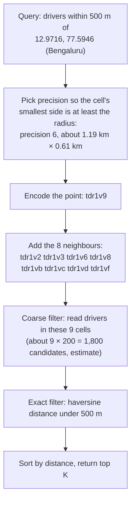
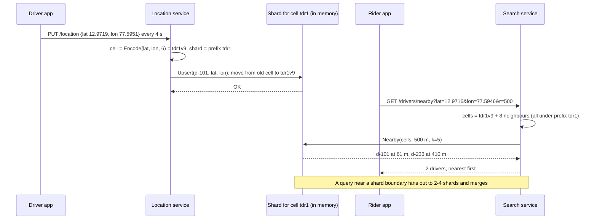

# Geospatial Indexing

> [!summary] TL;DR
> A geospatial index answers "what is near this point?" quickly. Instead of measuring the distance to every object, it divides the map into cells (geohash, quadtree, S2, H3) or boxes (R-tree), so a query only checks the few cells around the point and then measures exact distance for the small set of candidates.

> [!abstract] Core idea
> - A normal B-tree sorts one value. Latitude and longitude are two values, so "near" cannot be found with one range scan on either.
> - Most systems turn 2-D positions into **cells** with IDs that can be indexed: geohash strings, S2 or H3 cell IDs, quadtree nodes.
> - A proximity query always has two steps: **coarse filter** (scan the cell plus its neighbours) then **exact filter** (true distance on the candidates).
> - Classic mistake: searching only the cell that contains the point. A driver 50 m away across the cell edge is missed; always include the neighbouring cells.

## 1. Why it exists

A ride-hailing app has **1,000,000 online drivers**. Each sends its location every **4 seconds**. A rider in Bengaluru asks, "show drivers within 500 m".

- **Naive scan:** compute the distance from the rider to all 1,000,000 drivers. At roughly 50 ns per haversine distance (estimate for modern CPUs), that is 1,000,000 × 50 ns = **50 ms of CPU per query**. At 10,000 rider searches per second, that is 10,000 × 50 ms = **500 CPU-seconds per second**, or about 500 cores, only for distance maths.
- **Two B-tree indexes** (`lat`, `lon`) do not fix it: `lat BETWEEN a AND b` returns a horizontal strip across the whole world at that latitude (thousands of drivers), and the database must intersect it with a vertical strip.
- **Writes:** 1,000,000 drivers ÷ 4 s = **250,000 location updates per second**. Whatever index you choose must absorb that write rate.

With a cell index at roughly 1 km cells, the query reads 9 cells. If a busy city cell holds about 200 drivers (estimate), the query computes 9 × 200 = 1,800 distances instead of 1,000,000, about **550 times less work**.

## 2. Mental model

Think of a city map with a grid printed on it. Every square has a label. To find cafés near you, you look in your square and the eight squares around it, then measure only those cafés with a ruler.

- Smaller squares mean fewer cafés to measure, but more squares to look in for a big search radius.
- Labels are designed so that **nested squares share a prefix**: square `tdr1v` contains squares `tdr1v0 … tdr1vz`. "Zoom in" means "add a character".

Terms used below:

- **Cell:** one region of the grid. Its **ID** is what goes in the index.
- **Precision / level / resolution:** how deep the subdivision is. Higher means smaller cells.
- **Space-filling curve:** a path that visits every cell of a 2-D grid once, turning 2-D positions into a 1-D order that a B-tree or sorted set can index. Geohash uses the **Z-order (Morton) curve**; S2 uses the **Hilbert curve**, which keeps neighbours closer together.
- **Haversine distance:** the great-circle distance between two points on a sphere.
- **KNN (k nearest neighbours):** "the 5 closest drivers", as opposed to "all drivers within 500 m" (a radius query).

## 3. How it works

### 3.1 Geohash

1. Start with the whole world: longitude −180 to 180, latitude −90 to 90.
2. Halve the longitude range: if the point is in the upper half, write bit 1, otherwise 0.
3. Halve the latitude range the same way. Keep alternating: even bits refine longitude, odd bits refine latitude.
4. Every 5 bits become one base32 character from `0123456789bcdefghjkmnpqrstuvwxyz` (no `a`, `i`, `l`, `o`).

So a geohash is a **Z-order curve** written as text. Its key property: **a shared prefix means the same parent cell**, so a prefix query on a B-tree or a sorted set finds everything in a cell.

Cell sizes, **measured** with the Go code in section 4 at the equator (cells get narrower east-west towards the poles by `cos(latitude)`; at Bengaluru, 13° N, width is 97% of the equator value):

| Precision | Bits (lon + lat) | Width × height at the equator | Typical use |
| --- | --- | --- | --- |
| 4 | 10 + 10 | 39.1 km × 19.5 km | Region, city sharding |
| 5 | 13 + 12 | 4.89 km × 4.89 km | City district |
| 6 | 15 + 15 | 1.22 km × 0.61 km | Driver search within about 500 m |
| 7 | 18 + 17 | 153 m × 153 m | Street block |
| 8 | 20 + 20 | 38 m × 19 m | Building |
| 9 | 23 + 22 | 4.8 m × 4.8 m | Parking spot |

Odd precisions give square-ish cells; even precisions give cells twice as wide as they are tall.



**Why neighbours are required.** Two points 10 m apart on either side of a cell edge can have completely different geohashes. At the worst boundary (the equator or the prime meridian), `s0000` and `kpbpb` are neighbours with no common prefix at all. Prefix closeness implies location closeness; the reverse is **not** true.

### 3.2 Quadtree

A quadtree starts with one square for the whole map. When a square holds more than **K points** (for example 100), it splits into 4 children (NW, NE, SW, SE). Dense downtowns become deep trees with small squares; oceans stay one big square.

- **Query:** walk down the tree, visiting only squares that intersect the search circle.
- **Strength:** adapts to density, so every leaf holds about the same number of points.
- **Weakness:** frequent moves (drivers) cause splits and merges; the tree lives in memory and is hard to shard. PostgreSQL ships one as an index: SP-GiST with the `quad_point_ops` operator class (and `kd_point_ops` for a k-d tree).

### 3.3 S2 and H3

- **S2 (Google):** project the sphere onto the 6 faces of a cube, subdivide each face as a quadtree, and number the cells along a **Hilbert curve**. 31 levels (0 to 30); a cell ID is a 64-bit integer, and level-30 cells are about 1 cm². A **region coverer** approximates a circle or polygon with a handful of cells of mixed levels, which become a few integer **range scans**. Used inside Google and by MongoDB's `2dsphere` index.
- **H3 (Uber):** an icosahedron-based grid of **hexagons**, 16 resolutions (0 to 15), each resolution's cells about 7 times smaller in area than the one above. Hexagons have one kind of neighbour (all 6 share an edge and are equally far from the centre), which makes "rings" of neighbours (`gridDisk(cell, k)`) and smoothing of demand and supply clean. Each resolution has exactly 12 pentagons, which code must tolerate. Children do not nest exactly inside parents.

### 3.4 R-tree and GiST

An **R-tree** groups nearby objects into minimum bounding rectangles, and those rectangles into bigger rectangles, like a B-tree of boxes. It indexes **shapes** (polygons, lines), not just points. PostGIS uses R-tree-style indexing through PostgreSQL's **GiST** framework: `CREATE INDEX ... USING gist (geom)`. The `<->` operator lets GiST return rows in distance order for KNN queries.

## 4. Worked example

### Whiteboard version

```text
encode(lat, lon, p):            nearby(lat, lon, r):
  lon range [-180,180]            c  = encode(lat, lon, p)   # p: cell side >= r
  lat range [-90, 90]             cells = c + 8 neighbours
  repeat 5*p times:               for each cell: for each driver in cell:
    even bit: halve lon range         d = haversine(rider, driver)
    odd  bit: halve lat range         if d <= r: keep (driver, d)
    bit = 1 if point in upper half sort by d, return top k
  every 5 bits -> base32 char
neighbour: centre ± one cell width/height, re-encode (wrap lon at ±180)
```

### Go code: geohash, neighbours, haversine and an in-memory driver index

`Index` keeps `cell → driver → position` and `driver → cell`, so a location update is a move between two map entries. It passes `go vet` and `go test -race` on Go 1.24.

```go
package geo

import (
	"math"
	"sort"
	"strings"
	"sync"
)

const base32 = "0123456789bcdefghjkmnpqrstuvwxyz" // geohash alphabet: no a, i, l, o

// Encode interleaves longitude and latitude bits (longitude first) and writes
// them 5 bits per character.
func Encode(lat, lon float64, precision int) string {
	latLo, latHi := -90.0, 90.0
	lonLo, lonHi := -180.0, 180.0
	var sb strings.Builder
	bit, ch, even := 0, 0, true
	for sb.Len() < precision {
		if even { // even bits refine longitude
			mid := (lonLo + lonHi) / 2
			if lon >= mid {
				ch = ch<<1 | 1
				lonLo = mid
			} else {
				ch <<= 1
				lonHi = mid
			}
		} else { // odd bits refine latitude
			mid := (latLo + latHi) / 2
			if lat >= mid {
				ch = ch<<1 | 1
				latLo = mid
			} else {
				ch <<= 1
				latHi = mid
			}
		}
		even = !even
		if bit++; bit == 5 {
			sb.WriteByte(base32[ch])
			bit, ch = 0, 0
		}
	}
	return sb.String()
}

// Box is the cell a geohash names.
type Box struct{ LatLo, LatHi, LonLo, LonHi float64 }

func (b Box) Center() (lat, lon float64) {
	return (b.LatLo + b.LatHi) / 2, (b.LonLo + b.LonHi) / 2
}

// Decode returns the bounding box of a geohash.
func Decode(hash string) Box {
	b := Box{-90, 90, -180, 180}
	even := true
	for i := 0; i < len(hash); i++ {
		v := strings.IndexByte(base32, hash[i])
		for k := 4; k >= 0; k-- {
			on := v>>k&1 == 1
			if even {
				mid := (b.LonLo + b.LonHi) / 2
				if on {
					b.LonLo = mid
				} else {
					b.LonHi = mid
				}
			} else {
				mid := (b.LatLo + b.LatHi) / 2
				if on {
					b.LatLo = mid
				} else {
					b.LatHi = mid
				}
			}
			even = !even
		}
	}
	return b
}

// Neighbors returns the 8 cells around hash (fewer near a pole). It steps one
// cell height/width from the centre and re-encodes, wrapping longitude at ±180.
func Neighbors(hash string) []string {
	b := Decode(hash)
	lat, lon := b.Center()
	dLat, dLon := b.LatHi-b.LatLo, b.LonHi-b.LonLo
	var out []string
	for _, dy := range []float64{-1, 0, 1} {
		for _, dx := range []float64{-1, 0, 1} {
			if dx == 0 && dy == 0 {
				continue
			}
			nLat := lat + dy*dLat
			if nLat < -90 || nLat > 90 {
				continue // no cell beyond the pole
			}
			nLon := lon + dx*dLon
			if nLon >= 180 {
				nLon -= 360
			} else if nLon < -180 {
				nLon += 360
			}
			out = append(out, Encode(nLat, nLon, len(hash)))
		}
	}
	return out
}

// HaversineKm is the great-circle distance on a sphere of radius 6371 km.
func HaversineKm(lat1, lon1, lat2, lon2 float64) float64 {
	const r = 6371.0
	rad := math.Pi / 180
	dLat := (lat2 - lat1) * rad
	dLon := (lon2 - lon1) * rad
	a := math.Sin(dLat/2)*math.Sin(dLat/2) +
		math.Cos(lat1*rad)*math.Cos(lat2*rad)*math.Sin(dLon/2)*math.Sin(dLon/2)
	return 2 * r * math.Asin(math.Sqrt(a))
}

// Index is an in-memory driver index: cell -> driver -> position.
type Index struct {
	mu        sync.RWMutex
	precision int
	cells     map[string]map[string]point
	where     map[string]string // driver -> current cell
}

type point struct{ lat, lon float64 }

type Hit struct {
	ID     string
	DistKm float64
}

func NewIndex(precision int) *Index {
	return &Index{precision: precision,
		cells: make(map[string]map[string]point), where: make(map[string]string)}
}

// Upsert moves a driver: remove from its old cell, add to its new one.
func (ix *Index) Upsert(id string, lat, lon float64) {
	cell := Encode(lat, lon, ix.precision)
	ix.mu.Lock()
	defer ix.mu.Unlock()
	if old, ok := ix.where[id]; ok && old != cell {
		delete(ix.cells[old], id)
		if len(ix.cells[old]) == 0 {
			delete(ix.cells, old)
		}
	}
	if ix.cells[cell] == nil {
		ix.cells[cell] = make(map[string]point)
	}
	ix.cells[cell][id] = point{lat, lon}
	ix.where[id] = cell
}

// Nearby scans the query cell plus its 8 neighbours, then filters by true
// distance. It is correct only while radiusKm <= the cell's smallest side.
func (ix *Index) Nearby(lat, lon, radiusKm float64, k int) []Hit {
	center := Encode(lat, lon, ix.precision)
	cells := append([]string{center}, Neighbors(center)...)
	ix.mu.RLock()
	var hits []Hit
	for _, c := range cells {
		for id, p := range ix.cells[c] {
			if d := HaversineKm(lat, lon, p.lat, p.lon); d <= radiusKm {
				hits = append(hits, Hit{id, d})
			}
		}
	}
	ix.mu.RUnlock()
	sort.Slice(hits, func(i, j int) bool { return hits[i].DistKm < hits[j].DistKm })
	if len(hits) > k {
		hits = hits[:k]
	}
	return hits
}
```

The tests check a published reference value, the prefix property, the cell size, neighbours (including across the ±180° line), and the edge case that motivates neighbour search.

```go
package geo

import (
	"math"
	"slices"
	"strings"
	"sync"
	"testing"
)

func TestEncodeKnownValue(t *testing.T) {
	// Reference value from the geohash literature (Jutland, Denmark).
	if got := Encode(57.64911, 10.40744, 11); got != "u4pruydqqvj" {
		t.Fatalf("Encode = %s, want u4pruydqqvj", got)
	}
}

func TestPrefixMeansContainment(t *testing.T) {
	h := Encode(12.9716, 77.5946, 9) // Bengaluru
	for p := 1; p < 9; p++ {
		if !strings.HasPrefix(h, Encode(12.9716, 77.5946, p)) {
			t.Fatalf("precision %d is not a prefix of %s", p, h)
		}
	}
	b := Decode(h)
	if 12.9716 < b.LatLo || 12.9716 > b.LatHi || 77.5946 < b.LonLo || 77.5946 > b.LonHi {
		t.Fatalf("point not inside its own cell %+v", b)
	}
}

func TestCellSizeAtPrecision6(t *testing.T) {
	b := Decode(Encode(0, 0, 6))
	// 30 bits: 15 for longitude, 15 for latitude.
	if w := b.LonHi - b.LonLo; math.Abs(w-360.0/(1<<15)) > 1e-12 {
		t.Fatalf("width = %v deg", w)
	}
	if h := b.LatHi - b.LatLo; math.Abs(h-180.0/(1<<15)) > 1e-12 {
		t.Fatalf("height = %v deg", h)
	}
	// At the equator: about 1.22 km wide and 0.61 km tall.
	wKm := HaversineKm(0, b.LonLo, 0, b.LonHi)
	hKm := HaversineKm(b.LatLo, 0, b.LatHi, 0)
	if math.Abs(wKm-1.22) > 0.01 || math.Abs(hKm-0.61) > 0.01 {
		t.Fatalf("cell = %.3f x %.3f km", wKm, hKm)
	}
}

func TestNeighborsAreAdjacentAndDistinct(t *testing.T) {
	h := Encode(12.9716, 77.5946, 6)
	n := Neighbors(h)
	if len(n) != 8 {
		t.Fatalf("got %d neighbours", len(n))
	}
	seen := map[string]bool{h: true}
	b := Decode(h)
	for _, c := range n {
		if seen[c] {
			t.Fatalf("duplicate cell %s", c)
		}
		seen[c] = true
		nb := Decode(c)
		touchLat := nb.LatHi >= b.LatLo-1e-9 && nb.LatLo <= b.LatHi+1e-9
		touchLon := nb.LonHi >= b.LonLo-1e-9 && nb.LonLo <= b.LonHi+1e-9
		if !touchLat || !touchLon {
			t.Fatalf("%s does not touch %s", c, h)
		}
	}
}

func TestNeighborsWrapAtAntimeridian(t *testing.T) {
	h := Encode(0.1, 179.999, 5)
	n := Neighbors(h)
	if !slices.Contains(n, Encode(0.1, -179.999, 5)) {
		t.Fatalf("east neighbour across ±180 missing from %v", n)
	}
}

func TestHaversineOneDegreeLatitude(t *testing.T) {
	if d := HaversineKm(0, 0, 1, 0); math.Abs(d-111.195) > 0.01 {
		t.Fatalf("1 degree = %.3f km, want about 111.195", d)
	}
}

func TestNearbyFindsDriverAcrossCellEdge(t *testing.T) {
	ix := NewIndex(6)
	// Rider just west of a precision-6 cell edge; driver just east of it.
	b := Decode(Encode(12.9716, 77.5946, 6))
	lat := (b.LatLo + b.LatHi) / 2
	rider := b.LonHi - 0.0005
	ix.Upsert("d-across", lat, b.LonHi+0.0005) // about 110 m away, other cell
	ix.Upsert("d-far", lat+0.05, rider)        // about 5.6 km away
	if Encode(lat, rider, 6) == Encode(lat, b.LonHi+0.0005, 6) {
		t.Fatal("test setup: points should be in different cells")
	}

	hits := ix.Nearby(lat, rider, 0.5, 10)
	if len(hits) != 1 || hits[0].ID != "d-across" {
		t.Fatalf("hits = %v, want only d-across", hits)
	}
}

func TestUpsertMovesDriverBetweenCells(t *testing.T) {
	ix := NewIndex(6)
	ix.Upsert("d1", 12.9716, 77.5946)
	ix.Upsert("d1", 13.1986, 77.7066) // drove to the airport, ~27 km away
	if h := ix.Nearby(12.9716, 77.5946, 0.5, 5); len(h) != 0 {
		t.Fatalf("old position still indexed: %v", h)
	}
	if h := ix.Nearby(13.1986, 77.7066, 0.5, 5); len(h) != 1 {
		t.Fatalf("new position not found: %v", h)
	}
}

func TestIndexConcurrentUpdatesAndQueries(t *testing.T) {
	ix := NewIndex(6)
	var wg sync.WaitGroup
	for g := 0; g < 8; g++ {
		wg.Add(2)
		go func() {
			defer wg.Done()
			for i := 0; i < 200; i++ {
				ix.Upsert(string(rune('a'+g)), 12.97+float64(i)*1e-5, 77.59)
			}
		}()
		go func() {
			defer wg.Done()
			for i := 0; i < 200; i++ {
				ix.Nearby(12.97, 77.59, 1, 5)
			}
		}()
	}
	wg.Wait()
	if h := ix.Nearby(12.97, 77.59, 1, 20); len(h) != 8 {
		t.Fatalf("got %d drivers, want 8", len(h))
	}
}
```

Measured from this code: the Bengaluru point `12.9716, 77.5946` encodes to `tdr1v9` at precision 6, and its 8 neighbours are `tdr1v2 tdr1v8 tdr1vb tdr1v3 tdr1vc tdr1v6 tdr1vd tdr1vf`.

### The same query in Redis

Redis stores GEO members in a **sorted set** whose score is a 52-bit interleaved geohash, so `GEOSEARCH` is a set of score-range scans plus a distance filter, the same two-step idea.

```bash
GEOADD drivers:blr 77.5946 12.9716 d-101 77.5990 12.9730 d-102
GEOSEARCH drivers:blr FROMLONLAT 77.5946 12.9716 BYRADIUS 500 m ASC COUNT 5 WITHDIST
```

Note the argument order: **longitude first**. `GEOSEARCH` exists since Redis 6.2 and replaces the deprecated `GEORADIUS`. Removing a driver is `ZREM drivers:blr d-101`, since a GEO set is a sorted set.

### The same query in PostgreSQL 17 with PostGIS

```sql
CREATE EXTENSION IF NOT EXISTS postgis;

CREATE TABLE driver_location (
    driver_id  bigint PRIMARY KEY,
    pos        geography(Point, 4326) NOT NULL,
    updated_at timestamptz NOT NULL DEFAULT now()
);

CREATE INDEX driver_location_pos_gist ON driver_location USING gist (pos);

-- Drivers within 500 m, nearest first. ST_MakePoint takes (longitude, latitude).
EXPLAIN (ANALYZE, BUFFERS)
SELECT driver_id,
       ST_Distance(pos, ST_MakePoint(77.5946, 12.9716)::geography) AS meters
FROM driver_location
WHERE ST_DWithin(pos, ST_MakePoint(77.5946, 12.9716)::geography, 500)
ORDER BY pos <-> ST_MakePoint(77.5946, 12.9716)::geography
LIMIT 5;
```

Representative output (PostgreSQL 17, PostGIS 3.5, 1,000,000 rows):

```text
Limit  (cost=0.41..33.52 rows=5 width=24) (actual time=0.190..0.274 rows=5 loops=1)
  Buffers: shared hit=21
  ->  Index Scan using driver_location_pos_gist on driver_location  (cost=0.41..860.85 rows=130 width=24) (actual time=0.188..0.270 rows=5 loops=1)
        Index Cond: (pos && _st_expand('0101000020E6100000...'::geography, '500'::double precision))
        Order By: (pos <-> '0101000020E6100000...'::geography)
        Filter: st_dwithin(pos, '0101000020E6100000...'::geography, '500'::double precision, true)
        Rows Removed by Filter: 2
        Buffers: shared hit=21
Planning Time: 0.412 ms
Execution Time: 0.311 ms
```

How to read it: `ST_DWithin` is expanded into an `&&` bounding-box test that the GiST index can answer (the coarse filter), and the exact distance check runs as a `Filter` on the candidates (the exact filter). `Order By` with `<->` makes the index return rows nearest first, so `LIMIT 5` stops early.

A Postgres row per driver works for thousands of updates per second. For 250,000 updates per second, every update is an MVCC row version plus a GiST index entry and WAL, so ride-hailing systems keep **live** locations in memory (Redis or an in-process index sharded by cell) and use PostGIS for stored geometry: zones, geofences, addresses.

### How a location update and a search flow through a sharded index



## 5. Variants and comparison

| Index | How it works | Use when | Cost |
| --- | --- | --- | --- |
| Geohash | Z-order curve as base32 text; prefix = parent cell | Simple systems, any KV store or B-tree; Redis GEO uses a 52-bit geohash score | Rectangles distort with latitude; edge cases need neighbours; Z-order jumps |
| Quadtree | Split a square into 4 when it holds more than K points | In-memory indexes with very uneven density | Rebalancing on moves; hard to shard and persist |
| S2 | Cube faces + quadtree + Hilbert curve; 64-bit cell IDs | Covering circles and polygons with few cell ranges; global data | More complex library; square-ish cells of varying shape |
| H3 | Hierarchical hexagons, 16 resolutions | Aggregating supply and demand, surge pricing zones, smoothing over neighbours | Inexact parent-child nesting; 12 pentagons per resolution |
| R-tree / GiST (PostGIS) | Nested bounding boxes of shapes | Polygons and lines (geofences, delivery zones), SQL joins on geometry | Write cost per update; one database node |
| k-d tree / BKD tree | Alternate splitting on x and y | Read-mostly point data; Elasticsearch `geo_point` uses BKD trees | Rebuilds or merges on heavy updates |

> [!warning] Interview trap
> "Same geohash prefix" means "same cell", not "close together", and "close together" does not mean "same prefix". A query that only scans the rider's own cell misses nearby drivers across the edge. Always scan the cell **and its 8 neighbours** (or a ring in H3, or a covering in S2), then filter by true distance.

## 6. Trade-offs and when not to use

- **Precision choice is a trade-off.** Too coarse (precision 5, about 4.9 km) and each query filters thousands of candidates; too fine (precision 8, about 38 m × 19 m) and a 500 m radius needs about 1,000 m ÷ 38 m × 1,000 m ÷ 19 m ≈ 26 × 53 ≈ 1,400 cells. Pick the precision whose smallest cell side is at least the search radius, so 9 cells always cover the circle. For radius queries that vary widely, store several precisions or use S2 coverings.
- **Hotspots follow people.** Cells over an airport or a stadium after a match hold far more drivers and queries than the median cell. Sharding by cell turns them into hot partitions; split dense cells to a finer precision or shard by finer prefixes there. See [[Hot Keys and Hot Partitions]].
- **Distance is not travel time.** 500 m across a river can be a 6 km drive. The index produces candidates; an ETA or routing service ranks them.
- **When not to use a spatial index:** a few thousand points (a store locator for 300 branches) fit in one array; scan it. Data that is only ever filtered by city or postcode needs a normal B-tree index on that column.
- **Spherical vs planar maths.** PostGIS `geometry` in SRID 4326 measures in **degrees**, not metres; use `geography` (or a projected SRID) for metre distances. Redis assumes a sphere, with up to 0.5% error.

## 7. In production

- **Real systems:**
	- Redis GEO (`GEOADD`, `GEOSEARCH`) for live locations in many delivery and ride apps.
	- Uber built and open-sourced H3 for its marketplace (supply, demand and pricing per hexagon).
	- Google open-sourced the S2 library, which it uses internally for map data; MongoDB's `2dsphere` indexes and BigQuery geography functions also build on S2 cells.
	- PostGIS (GiST) for polygons: delivery zones, geofences, "is this address inside the service area?".
	- Elasticsearch `geo_point` and `geo_shape` for search with geo filters.
- **Failure modes → fixes:**
	- Driver missing from results after crossing a cell edge → the update must remove the driver from the **old** cell (track `driver → cell`, as `Index.where` does), and queries must include neighbours.
	- Stale drivers (app killed) stay in the index → expire positions: keep `updated_at` and skip entries older than 3 update intervals, or use one Redis key per cell per time bucket that expires.
	- One shard hot during a stadium exit → split the hot cell into its children and assign them to more shards.
	- Wrong argument order (latitude where longitude is expected) → points land in the ocean; Redis, PostGIS `ST_MakePoint` and GeoJSON are all **longitude first**. Add validation: latitude in [−90, 90], longitude in [−180, 180].
- **What to monitor:** query p99, candidates scanned per query (coarse-filter efficiency), points per cell (max and p99), update rate per shard, age of the oldest position returned.

## 8. Deep dive

- **Why the neighbour trick needs radius ≤ smallest cell side.** The 3 × 3 block around the centre cell extends at least one full cell in every direction. If the radius is larger than the cell's smallest side, the circle can reach the second ring of cells, and results are silently incomplete. At precision 6 the smallest side is about 0.61 km, so the Go `Nearby` is correct only for radii up to about 600 m.
- **Z-order vs Hilbert locality.** A Z-order curve jumps across the map at quadrant boundaries, so cells that are neighbours in space can be far apart in the 1-D order. A Hilbert curve never jumps: consecutive positions are always adjacent cells. That is why S2 coverings turn into fewer, longer ID ranges than geohash prefixes for the same region.
- **Poles and the antimeridian.** Near the poles geohash cells become thin slivers, and at the ±180° line neighbours wrap around (the Go code handles the wrap; the test covers it). S2's cube projection keeps cell shapes more uniform everywhere.
- **Sharding a live location index.** Shard by a coarse cell prefix (for example geohash precision 4, or H3 resolution 5 or so). A query touches 1 shard most of the time and 2-4 near shard edges. Keep each shard's index in memory and replicated; positions are refreshed every few seconds, so losing a shard costs at most one update interval of data, not durable state.
- **Write-heavy vs read-heavy structures.** A geohash map or Redis sorted set makes an update `O(1)` or `O(log n)` with no rebalancing, which suits 250,000 updates per second. R-trees and k-d trees are better for read-mostly data (points of interest, zones), where expensive rebalancing happens rarely.
- **KNN without a radius.** "Nearest 5 drivers, wherever they are": start with the 9 cells; if fewer than 5 results, widen to the next ring of neighbours (or one precision coarser) and repeat. PostGIS `ORDER BY pos <-> point LIMIT 5` does this inside the GiST index.

## 9. Interview questions

> [!question]- Why not just index latitude and longitude with two B-tree indexes?
> Each index can only narrow one dimension: a latitude range is a strip around the world. The database must scan and intersect two large strips. A spatial index (cells, GiST, S2) narrows both dimensions at once, so the candidate set is close to the actual circle.

> [!question]- How does geohash work, and why does a shared prefix matter?
> It alternately halves longitude and latitude, writes one bit per halving, and packs 5 bits per base32 character. A shared prefix means the points are in the same parent cell, so a prefix or range scan on a sorted index returns a whole cell.

> [!question]- A driver 30 m away does not show up in the search. What is the bug? (trap)
> The search scanned only the rider's own cell, and the driver is across the cell edge with a different geohash. Scan the cell plus its 8 neighbours, at a precision whose smallest side is at least the radius, then filter by exact distance. Also check the update path removes drivers from their old cell.

> [!question]- Geohash, quadtree, S2 or H3: which for a ride-sharing dispatch index?
> Geohash or S2 cells in an in-memory or Redis index for live locations, because updates are cheap and sharding by prefix is simple. H3 for pricing and supply-demand aggregation, because hexagon rings make smoothing easy. A quadtree when density varies wildly and the index fits one machine.

> [!question]- How would you handle 250,000 location updates per second?
> Keep live positions in memory, sharded by a coarse cell prefix, with each update moving the driver between cells (track driver → cell). Do not write each update to a disk-based spatial index. Persist a sampled trail asynchronously for analytics, and expire positions not refreshed within a few intervals.

> [!question]- What does PostGIS do for `ST_DWithin` with a GiST index?
> It expands the point by the distance into a bounding box, uses the GiST index for the `&&` box-overlap test (coarse filter), then runs the exact distance check on candidates. `ORDER BY geom <-> point LIMIT k` lets the index return nearest rows first.

> [!question]- When does the "cell plus 8 neighbours" method return wrong results?
> When the radius is larger than the smallest cell side, the circle can reach beyond the 3 × 3 block. Pick a coarser precision, or compute a covering of the circle (S2 region coverer, H3 `gridDisk` with a larger k).

## 10. Cheat sheet

- Two-step query: coarse filter by cells (cell + neighbours) → exact haversine filter → sort.
- Geohash: interleave lon/lat bits (lon first), base32; prefix = parent cell; precision 6 ≈ 1.22 × 0.61 km, 7 ≈ 153 m.
- Choose precision so smallest cell side ≥ radius, else results are incomplete.
- Quadtree adapts to density; S2 uses a Hilbert curve and 64-bit cell IDs; H3 uses hexagons with 16 resolutions.
- PostGIS: `geography` + GiST, `ST_DWithin` for radius, `<->` for KNN; longitude first everywhere.
- Redis GEO = sorted set with 52-bit geohash scores; `GEOSEARCH` since 6.2.
- Live locations (250k updates/s): in memory, sharded by coarse cell; dense cells become hot partitions.

## Links

- **Before this:** [[Indexing Fundamentals]], [[Index Types and Index Design]], [[Partitioning and Sharding]]
- **Next:** [[Case Study - Ride Sharing and Proximity]]
- **Compare with:** [[Ride Sharing]] and [[Delivery Partner Assignment]] (class-level matching logic), [[Search Engines and Inverted Indexes]] (geo filters in search)
