# Batch Processing and Data Pipelines

> [!summary] TL;DR
> **Batch processing** means collecting data over a period (an hour, a day) and processing it in one big job. It is built for **throughput and correctness**, not for speed of any single result. A **data pipeline** chains such jobs: pull data from sources, clean it, join and aggregate it, then load it into a store where analysts and products can read it. The skill in interviews is knowing when batch is the right tool, how to make jobs safe to re-run, and how to split work across machines.

> [!abstract] Core idea
> - Big jobs are split into **partitions**, run in parallel on many machines, and joined by a **shuffle** (moving data so that equal keys meet).
> - A pipeline is a **DAG**: a graph of steps with dependencies and no cycles. A scheduler runs it, retries failures and supports **backfills** (re-running old dates).
> - Every job must be **idempotent**: running it twice for the same input gives the same output. That one rule makes retries and reprocessing safe.
> - Data lands in a **lake** (cheap files), a **warehouse** (fast SQL) or a **lakehouse** (files with table features). **CDC** moves changes from your production database without loading it.
> - Interview trap: reaching for streaming when "yesterday's numbers by 6 a.m." is the real requirement. Batch is cheaper and simpler.

## Start here: the basics 🟢

> [!info] How to read this note (pick your level)
> - 🟢 **New to this?** Read "From zero" below, then sections 1, 2 and the cheat sheet (10). Stop there, that is a full first pass.
> - 🟡 **Know the basics?** Add section 3 (how it works), 4 (worked example) and 5 (variants).
> - 🔴 **Interview / SDE-3 prep?** Add 6, 7, 8 and 9. Headings are tagged 🟢🟡🔴 so you always know where you are.

**From zero, in 60 seconds** 🟢

Some work does not need an answer right now. "Yesterday's sales per city" can wait until morning.
So you collect the data all day and process it in one big go. That big go is a **batch job**.
The data is too big for one computer. So you cut it into slices, and many computers each handle one slice at the same time.

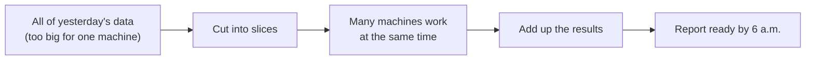

Some steps must wait for others. "Build revenue" must wait for "load orders". A chain of steps like that is a **pipeline**.
Machines crash, so steps get re-run. A good step gives the same result if you run it twice.

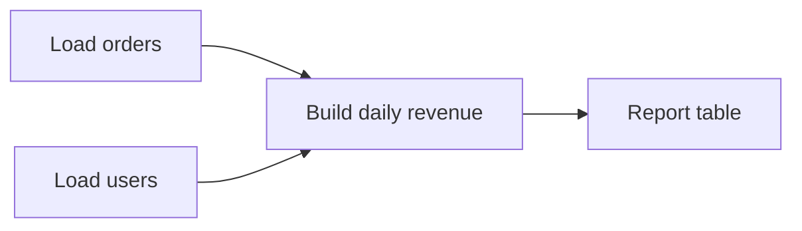

The rest of this note is just these 3 questions:
1. How do you split the work and bring matching data back together?
2. How do you chain the steps and run them safely every day?
3. Where does the data land, and when should you use streaming instead?

**The problem in one story**

A shop wants a report every morning: yesterday's sales per city.
Yesterday's data is 5 TB spread over many files.
One computer would take all day to read it.
So the work is split across many machines, run overnight, and the report is ready by 6 a.m.

**Words you need first**

| Word | Plain meaning | Tiny example |
|---|---|---|
| Batch job | A program that processes a big, fixed chunk of data at once | Nightly sales total |
| Partition | One slice of the data that one worker handles | Files for `date=2026-11-12` |
| Shuffle | Moving records between machines so equal keys meet | All `city=Pune` rows go to one worker |
| DAG | Steps with arrows showing order, and no loops | extract -> clean -> aggregate |
| Scheduler | A tool that runs the DAG on time and retries failures | Airflow |
| Idempotent | Running it twice gives the same result as once | Overwrite a day's partition, do not append |
| Backfill | Re-running a job for old dates | Recompute last month after a bug fix |
| CDC | Change data capture: copy DB changes as they happen | Read the MySQL binlog |

**Picture it**

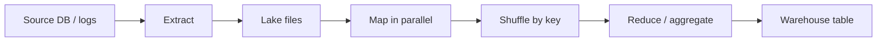

**Analogy**

Counting votes in an election: many counting centres count their own boxes in parallel, then send tallies per candidate to one place to add up.
Where it breaks: vote counting runs once, while pipelines rerun daily and must survive a centre crashing halfway (retries, idempotency).

**How the rest of this note builds up**

- First why batch exists and the mental model of partitions and DAGs (sections 1-2).
- Then how MapReduce, Spark, shuffles, schedulers and storage layers work (section 3).
- Then a worked example pipeline (section 4).
- Finally variants (lake, warehouse, lakehouse, CDC), trade-offs, production practice and the SDE-3 deep dive on exactly-once and event time (sections 5-8).

> [!tip] Remember
> Split the data, process the parts in parallel, shuffle to group by key, and make every step safe to rerun.

## 1. Why it exists 🟢

Think of the end-of-month bank statement. The bank does not recompute your balance after each coffee. It collects the month's transactions and, in one run, produces every customer's statement. Many questions are like this: reports, billing, recommendations, search indexes, ML training sets, fraud models.

Why not run these queries on the production database?

- A report that scans 2 billion order rows would hog the primary database for an hour and slow every customer request. (Production databases are tuned for many small transactions; see [[Storage Engines - B-tree vs LSM and WAL]].)
- The data you need often lives in 12 different systems (orders, clicks, payments, support tickets). One query cannot join them.
- The data is too big for one machine. 10 TB of logs per day cannot be read by one process in reasonable time: at a disk read speed of 500 MB/s (an estimate for one SSD), 10 TB takes about 5.5 hours. Spread over 100 machines, it takes about 3.3 minutes.

So we **copy data out** to a separate analytics system and process it in bulk, in parallel. That separation of "operational" (OLTP) and "analytical" (OLAP) systems is the first idea of this note.

> [!tip] Remember
> Batch exists to move heavy, wide, slow-to-compute work off the live system and run it in parallel.

## 2. Mental model 🟢

### 2.1 A big kitchen with an assembly line

**In plain words:** Imagine a catering company that must prepare 100,000 meals by morning. They do not cook one meal at a time. They split the order into 1,000 trays (**partitions**), give each cook a tray, then bring all dishes of the same type to one table (**shuffle**) for packing. If a cook falls ill, someone else redoes just that tray.

The analogy breaks down in one way: in a data job, "cooks" are machines that can fail at random, and the whole system is designed so a lost tray is simply recomputed, not a disaster.

Key terms:

- **Batch job:** a finite computation over a bounded input that starts, runs and finishes.
- **Partition:** a slice of the data that one task processes. More partitions means more parallelism.
- **Shuffle:** redistributing records across machines so all records with the same key end up together (needed for group-by and join). It is the most expensive step.
- **DAG (directed acyclic graph):** steps with arrows for "must finish before"; no loops.
- **ETL / ELT:** Extract-Transform-Load vs Extract-Load-Transform (section 5).
- **Backfill:** re-running a pipeline for past dates, after a bug fix or a new column.
- **Idempotent:** safe to run more than once; the second run changes nothing.

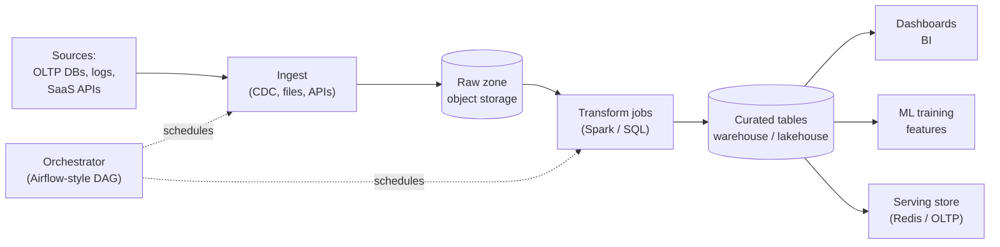

> [!tip] Remember
> Split by partition, shuffle by key, retry by task, schedule by DAG.

## 3. How it works 🟡

### 3.1 MapReduce: the original mental model

**In plain words:** To count words across a billion pages, each machine first counts the words in its own pages (**map**). Then all counts for the same word are sent to one machine, which adds them up (**reduce**). The "send to one machine" part is the shuffle.

**Picture it:**

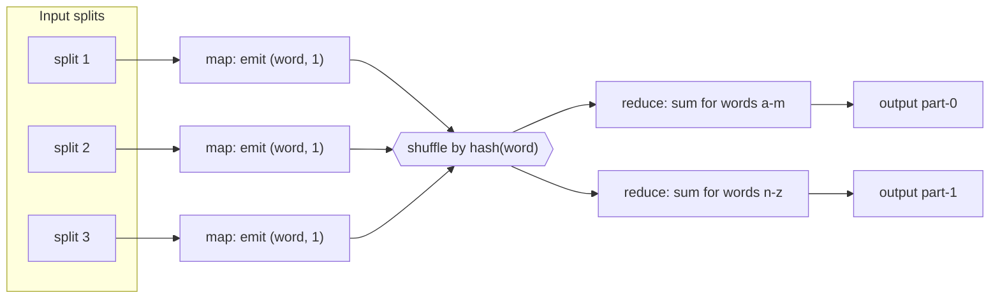

**Example:** Page 1: "to be or not". Page 2: "to be". Maps emit `(to,1) (be,1) (or,1) (not,1)` and `(to,1) (be,1)`. The shuffle sends all `to` records to one reducer, which outputs `(to, 2)`.

**Why it matters:** The model forces work to be **independent per partition**, which is what allows scaling to thousands of machines and recovering from failures by re-running only the lost tasks. The 2004 MapReduce paper established this at Google.

Step by step:

1. The input is split into chunks of roughly 128 MB.
2. One map task per chunk runs on a machine that already holds the data (move code to data, not data to code).
3. Map output is partitioned by key hash and written to local disk.
4. Reducers fetch their partition from every mapper (the shuffle), sort by key, and apply the reduce function.
5. If a task fails or a machine dies, the framework re-runs that task elsewhere. Because tasks are deterministic, the result is the same.

> [!warning] Common mistake
> Thinking shuffle is "just a network copy". It involves writing to disk, sorting, network transfer and merging. In real jobs it dominates run time, so most tuning is about reducing shuffled bytes.

### 3.2 Spark: a DAG of in-memory stages

**In plain words:** Spark keeps the same idea but describes the whole job as a graph of transformations and runs it lazily. It keeps intermediate data in memory when it can, which makes multi-step jobs far faster than writing every step to disk.

Terms:

- **Narrow transformation:** each output partition depends on one input partition (`filter`, `map`). No shuffle, so steps are **pipelined** together in one stage.
- **Wide transformation:** each output partition needs data from many input partitions (`groupBy`, `join`, `distinct`). Requires a shuffle and starts a new **stage**.
- **Lazy evaluation:** nothing runs until an **action** (`write`, `count`) is called, so the planner can optimise the whole graph.
- **Lineage:** the recorded recipe of how a partition was built. If a partition is lost, Spark recomputes it from lineage, as in the RDD paper.

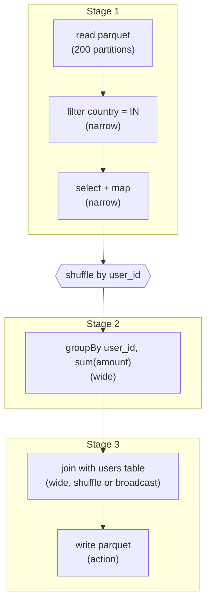

**Example (numbers):** 1 TB of order data, 200 MB per partition after filtering = about 5,000 partitions. With 500 cores, tasks run in 10 waves. If shuffle moves 300 GB across the network at an effective 10 GB/s cluster-wide, that is about 30 seconds of pure transfer (estimate), plus disk and sort time.

**Why it matters:** Knowing which operations shuffle tells you why a job is slow and how to fix it.

### 3.3 Partitioning, skew and joins

**In plain words:** A job is only as fast as its slowest task. If one key (say `user_id = null`, or a huge customer) holds 40% of the rows, one task gets 40% of the work and everyone waits. That is **data skew**, the batch version of [[Hot Keys and Hot Partitions]].

Fixes:

1. **Broadcast join:** if one side is small (under a few hundred MB), copy it to every worker so the big side is never shuffled.
2. **Salting:** add a random suffix to the hot key on the big side and replicate the small side for each suffix, so the hot key spreads over N tasks.
3. **Filter early:** drop nulls and unneeded columns before the shuffle.
4. **Pre-aggregate** ("combiner"): sum locally before shuffling, so fewer rows travel.
5. **Right-size partitions:** about 100 to 200 MB per partition is a common starting point; too many tiny partitions waste scheduling time, too few leave cores idle.

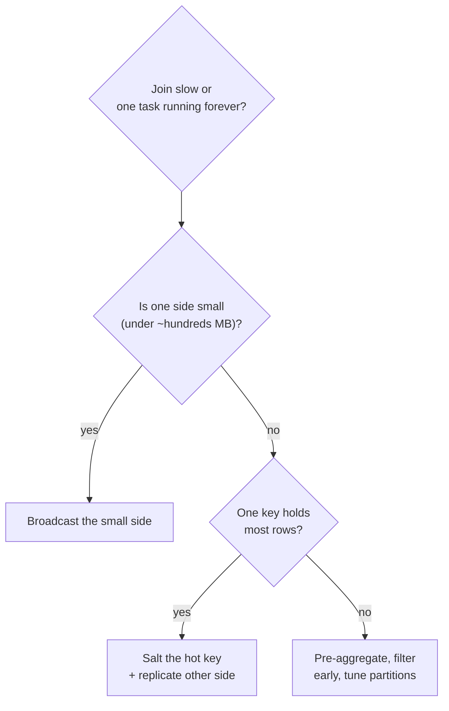

### 3.4 File formats and layout

**In plain words:** Analytics reads a few columns of many rows ("sum of `amount`"). Storing data by **column** (Parquet, ORC) lets the engine read only the needed columns and compress them well. See [[Time-Series and Columnar Storage]].

- **Partition directories by date:** `events/dt=2026-11-09/part-0001.parquet`. A query with a date filter reads only those folders (**partition pruning**).
- **Predicate pushdown:** Parquet stores min/max per column chunk, so row groups that cannot match are skipped.
- **Avoid the small-files problem:** millions of 1 MB files make listing and opening slow. Compact into files of 128 MB to 1 GB.

> [!tip] Remember
> Batch performance is mostly about moving fewer bytes: prune partitions, read few columns, shuffle less.

### 3.5 Orchestration: the pipeline DAG

**In plain words:** A pipeline has many steps with dependencies: "load orders" and "load users" must both finish before "build daily revenue". An **orchestrator** (Airflow-style) runs steps in order, retries failures, alerts people, and records which dates have been done.

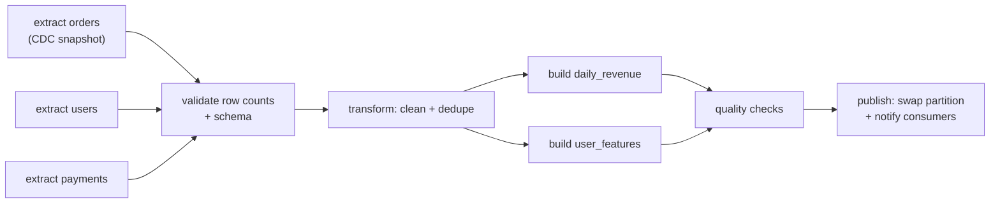

Rules of a healthy DAG:

1. **Each run has a data interval** (for example `dt=2026-11-09`), and tasks read and write by that interval, not by "now". This is what makes backfills correct.
2. **Retries with backoff** for transient failures; **alerts** for repeated ones.
3. **Sensors or events** to wait for upstream data (file arrived, table partition exists), not fixed sleeps.
4. **Quality gates** before publishing: row counts within range, no null primary keys, schema unchanged.
5. **Small, single-purpose tasks:** a failed task re-runs alone, not the whole day.

### 3.6 Idempotent jobs and safe reruns

**In plain words:** Jobs fail halfway and get retried. If a retry appends the same rows again, your revenue doubles. An **idempotent** job overwrites its own output for its interval, so running it twice leaves the same result.

Three patterns:

1. **Overwrite the partition:** the job for `dt=2026-11-09` replaces the whole `dt=2026-11-09` folder (write to a temp path, then atomically swap or rename).
2. **Upsert by primary key:** `MERGE INTO target USING staging ON id WHEN MATCHED UPDATE WHEN NOT MATCHED INSERT`.
3. **Deterministic output IDs:** derive the ID from the input (`hash(order_id, dt)`), so duplicates collide and are dropped.

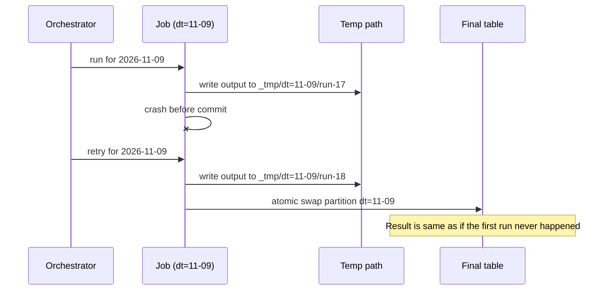

> [!warning] Common mistake
> Using `INSERT ... SELECT` into a table on every run with no dedupe. A retry or a backfill silently duplicates data and no error is raised. Always overwrite by interval or upsert by key. See [[Idempotency and Idempotency Keys]] for the API-side version of the same idea.

> [!tip] Remember
> Idempotent + interval-based = retries and backfills are safe.

## 4. Worked example 🟡

### Daily revenue pipeline for a food-delivery company

Goal (functional): by 6 a.m., finance sees yesterday's revenue per city, per restaurant, after refunds. Non-functional: correct to the rupee, re-runnable, and 3 years of history backfillable.

Assumptions (estimates): 2 million orders per day, 1 KB per order row, 5 million order-events per day, 30 cities.

**Step 1: sizes.**

- Orders: 2 M × 1 KB = 2 GB per day, about 730 GB per year. Tiny by big-data standards; Spark is needed less for size than for joining many sources and for backfills.
- Raw events: 5 M × 0.5 KB = 2.5 GB/day.
- Time budget: start 01:00, finish by 05:00, so 4 hours. A job that finishes in 20 minutes leaves large headroom for retries.

**Step 2: design.**

1. **Ingest orders by CDC.** A connector reads the database transaction log (binlog or WAL) and writes change events to Kafka, then to the raw zone as files. This avoids heavy queries on the primary and captures updates and deletes. See [[Transactional Outbox and CDC]].
2. **Ingest payments and refunds** from the payment provider's daily settlement file, landing as-is in `raw/payments/dt=...`.
3. **Transform (01:30):** for the interval `dt=D`, read raw changes, keep the latest version of each order (dedupe by `order_id`, take highest log position), join with payments and refunds.
4. **Aggregate:** `GROUP BY city, restaurant_id` for revenue, refunds, net.
5. **Quality gates:** total order count must be within 20% of the 7-day average; no null `city`; net revenue equals sum of payments settled for the date within tolerance.
6. **Publish:** overwrite partition `daily_revenue/dt=D` in the warehouse, then notify the BI tool.

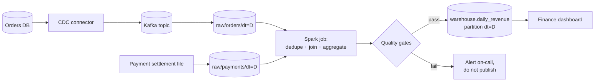

**Step 3: a refund arrives late.** On 11-12 a refund for an order from 11-09 appears. Options:

- **Reprocess a window:** each night, recompute the last 7 days (not just yesterday). Late data is absorbed, and idempotent overwrites make this safe. Cost: 7 times the compute, which is tiny here (about 7 × 4.5 GB, roughly 30 GB of input).
- Or **event-time partitioning plus a correction row** dated 11-12. Finance prefers this when books are closed.

Whichever you pick, say it out loud: late data is a business decision as much as a technical one.

**Step 4: a bug fix needs a 3-year backfill.** The orchestrator creates 1,095 runs, one per day. Because each run reads and overwrites only its own `dt`, they can run in parallel with a concurrency limit (for example 10 at a time) without stepping on each other. Total: 1,095 runs × 20 minutes / 10 parallel = about 36 hours (estimate).

### Whiteboard version

```text
OLTP DB --CDC--> Kafka --> raw/ (files, by dt)         [immutable, replayable]
                              |
Settlement files ------------>|
                              v
              Spark: dedupe -> join -> aggregate        [idempotent, by dt]
                              |
                 quality gates (counts, nulls, sums)
                              |
         overwrite warehouse.daily_revenue/dt=D --> BI
Orchestrator: DAG, retries, sensors, backfill (many dt in parallel), alerts
Late data: recompute last 7 days nightly
```

> [!tip] Remember
> Keep raw data immutable, make transforms functions of (raw, interval), and every fix becomes "re-run".

## 5. Variants and comparison 🟡

### 5.1 ETL vs ELT

**In plain words:** **ETL** cleans data before loading it into the warehouse. **ELT** loads raw data first and transforms it inside the warehouse with SQL. ELT became popular because modern warehouses and lakehouses scale compute cheaply and store raw data cheaply.

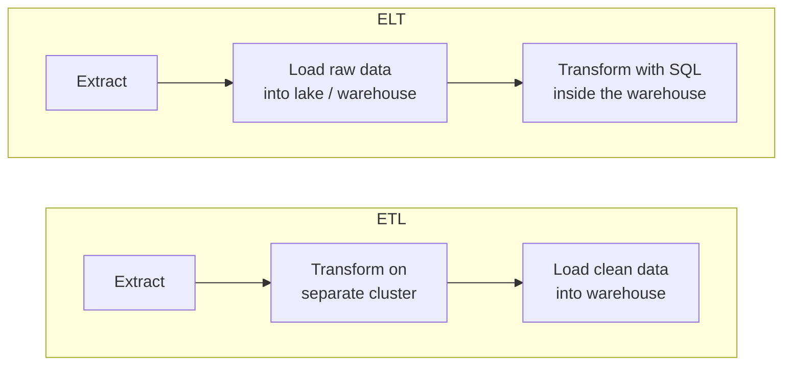

| | ETL | ELT |
| --- | --- | --- |
| Where transform runs | Separate engine before load | Inside warehouse or lakehouse |
| Raw data kept | Often discarded | Kept (can re-transform anytime) |
| Reprocessing | Needs the source again | Re-run SQL on stored raw data |
| Good for | Strict privacy (mask before load), tiny targets | Flexible analytics, fast iteration |
| Risk | Bug loses information forever | Raw PII sits in the warehouse; needs access control |

### 5.2 Lake, warehouse and lakehouse

**In plain words:** A lake is a cheap big folder of files. A warehouse is a fast, strict SQL database for reports. A lakehouse is the cheap folder with table rules added on top.

| | Data lake | Data warehouse | Lakehouse |
| --- | --- | --- | --- |
| Storage | Files on object storage (S3), any format | Managed columnar tables | Open files (Parquet) plus a table layer |
| Schema | On read (flexible) | On write (strict) | Enforced by table format, can evolve |
| Transactions | None (files) | Yes | Yes (via Delta, Iceberg, Hudi metadata) |
| Cost | Lowest | Highest per TB | Low storage, pay for compute |
| Typical use | Raw landing, ML, logs | BI, finance, governed reporting | One copy for BI and ML |
| Weakness | Swamp: no governance, no updates | Costly for raw and unstructured data | Newer; table maintenance (compaction) is on you |

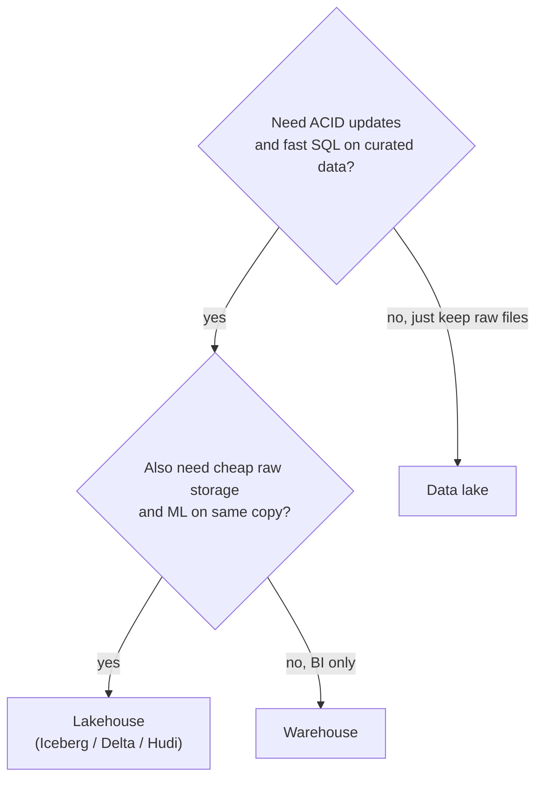

### 5.3 Batch vs streaming

**In plain words:** Batch is like washing all the dishes at night. Streaming is washing each plate the moment you finish eating. One is cheap and simple, the other is fast but needs constant work.

| | Batch | Streaming |
| --- | --- | --- |
| Latency | Minutes to hours | Seconds or less |
| Complexity | Lower | Higher (state, windows, late events, exactly-once) |
| Cost | Cheaper per record | Always-on compute |
| Reprocessing | Re-run a job | Replay the log, harder to get identical results |
| Typical use | Reports, billing, ML training | Fraud, live dashboards, alerting |

Real answers are often **both**: stream for fast, approximate numbers; batch to recompute the exact truth. See [[Stream Processing Basics]] and [[Case Study - Ad Click Aggregation]].

### 5.4 Lambda vs Kappa

**In plain words:** Lambda runs two systems side by side (one slow and exact, one fast and rough). Kappa runs only the fast one and replays old data through it when it needs to fix things.

- **Lambda:** a batch layer (accurate, slow) plus a speed layer (fast, approximate), merged at query time. Downside: two code paths that must agree.
- **Kappa:** one streaming code path; reprocess by replaying the log from the start. Downside: replaying months of data through a stream engine can be slow and costly.
- Many teams now use a stream engine for both and a table format (Iceberg/Delta) that supports both streaming writes and batch reads.

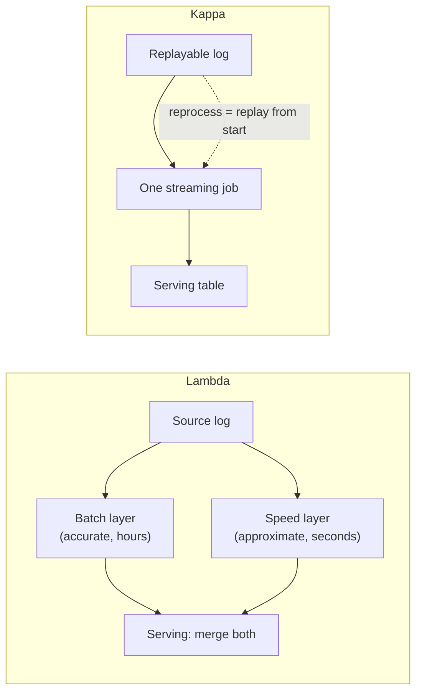

### 5.5 Engines for the "T" and OLAP

**In plain words:** These are the tools that do the actual crunching. Pick by where your data lives and who writes the code (engineers in Spark, analysts in SQL).

| Tool | Best at | Note |
| --- | --- | --- |
| Spark | Large batch ETL, ML prep, also streaming | General purpose; needs tuning |
| SQL in warehouse (BigQuery, Snowflake, Redshift) | ELT, ad-hoc analysis | Pay per scan or per compute |
| Flink | Stateful streaming, low-latency | Also runs batch |
| Presto / Trino | Interactive SQL over lakes | Query engine, not a store |
| ClickHouse, Druid, Pinot | Fast OLAP queries for dashboards and user-facing analytics | Pre-aggregated or columnar stores; see [[Time-Series and Columnar Storage]] |

> [!tip] Remember
> Pick by latency need first (batch vs stream), then by data shape (lake, warehouse, lakehouse).

## 6. Trade-offs and when not to use 🟡

- **Do not use batch** when the business needs results in seconds: fraud decisions, live inventory, rate limits. Use streaming or the serving database.
- **Do not use streaming** when a daily report is fine. Stream state, late events and exactly-once semantics cost engineering effort every week.
- **Do not use Spark for 2 GB.** A single-node SQL query (Postgres replica, DuckDB, warehouse SQL) beats the overhead of a cluster. Distributed engines pay off when data no longer fits one machine or when you need parallel backfills.
- **Freshness vs cost:** hourly runs cost roughly 24 times a daily run's compute per day if each reprocesses everything. Use **incremental** processing (only new or changed partitions).
- **CDC vs periodic dumps:** CDC captures every change and deletes with low load on the source, but needs operations: connector health, schema changes, snapshot handling. A nightly full dump is simpler, and fine for small tables.
- **Warehouse vs lake:** a warehouse is easier for analysts but costly for raw data; a lake is cheap but needs governance. A lakehouse tries to give both and adds table maintenance chores.
- **Immutable raw vs privacy:** keeping raw data forever conflicts with GDPR erasure. Plan for deletion in raw files (table formats with row-level delete, or tokenize PII before landing).

## 7. In production 🔴

- **Public examples:** Google built MapReduce (2004) for indexing and log analysis; Spark came from UC Berkeley's AMPLab and is widely used for ETL; Airbnb created Apache Airflow, now a common orchestrator; LinkedIn's Kafka feeds both stream and batch consumers; Uber and Netflix have written about lakehouse-style table formats (Hudi came from Uber, Iceberg from Netflix). These attributions are well documented on the projects' own sites.
- **Metrics to watch:** job duration vs the SLA, freshness (time since the last successful partition), rows in vs out, rows rejected by quality gates, retries per task, skew (max task time over median), shuffle bytes, small-file count.
- **SLAs and freshness alerts:** alert on "table not updated by 06:00", not just on task failure. A silently skipped job fails no task but breaks the dashboard.
- **Failure modes → fixes:**
	- Duplicate rows after a retry → job was not idempotent; switch to partition overwrite or MERGE.
	- A job slows from 20 min to 3 hours → skew or a data growth jump; check the slowest task and shuffle size, broadcast or salt.
	- Upstream schema change breaks the job → schema checks in the DAG; use a schema registry for events (see [[Event Schemas and Schema Registry]]).
	- Late data missing from reports → rolling reprocess of the last N days, or correction rows.
	- Downstream reads a half-written partition → write to temp path and swap atomically, or publish a "success" marker only at the end.
	- Backfill overwhelms the source or warehouse → concurrency limit and off-peak windows.
- **Data quality:** treat checks as code, run them before publish, and quarantine bad rows rather than dropping them silently.
- **Lineage and ownership:** record which tables feed which; when a source changes, know who to notify.

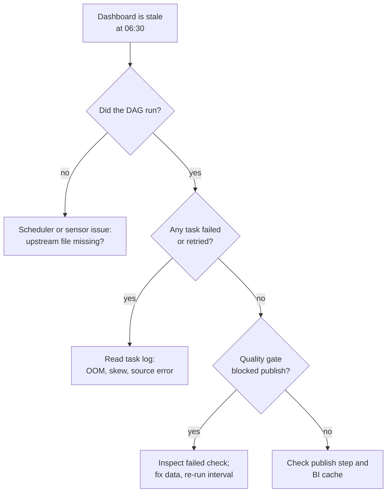

## 8. Deep dive 🔴

### 8.1 Why shuffle is the bottleneck

**In plain words:** In a shuffle, every worker has to send a little bit of data to every other worker. That is a huge number of tiny network trips, so this step is usually the slowest.

Every wide step does the following: each map task partitions its output by key into R buckets, writes them to local disk, and each of R reduce tasks pulls its bucket from every one of M map tasks.

That is **M × R small transfers**. With M = 5,000 and R = 5,000 that is 25 million fetches. Real engines reduce this with sort-based shuffle (one file per map task with an index), push-based or external shuffle services, and by coalescing partitions. Fewer and larger partitions reduce the count, but too few lose parallelism.

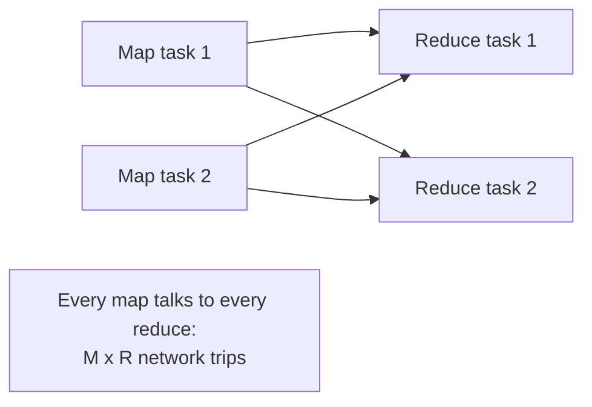

### 8.2 Fault tolerance without replication of results

**In plain words:** If a worker dies, you do not need a backup copy of its output. You just run the same step again on the same input, and you get the same answer.

Batch frameworks recover by **recomputation**. Because tasks are deterministic and inputs are immutable, a lost output is rebuilt from lineage. Long lineage chains are cut by **checkpointing** (write to durable storage). This is why non-deterministic code (random numbers, `now()`, calling an external API) is dangerous in tasks: a retry gives different output.

Seed randomness, pass the run time as a parameter, and treat API calls as a separate ingestion step.

### 8.3 Exactly-once output

**In plain words:** Steps may run more than once. The trick is to make only one run "count": write to a temp place first, then swap it in with one quick move.

True exactly-once in a distributed job is built from at-least-once execution plus an idempotent or atomic commit. Spark and similar engines write task outputs to a temporary location and the driver commits the job by renaming or by writing table-format metadata in one atomic step.

Table formats (Delta, Iceberg, Hudi) make this safer on object storage, where rename is not atomic, by using a transaction log or manifest pointer. Say: "at-least-once compute, atomic commit, idempotent keys."

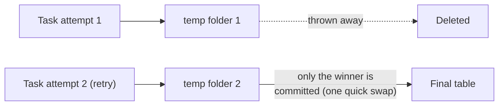

### 8.4 Event time vs processing time

**In plain words:** A sale at 11:58 p.m. may only reach you at 12:05 a.m. Count it on the day it happened, not the day it arrived.

A record carries two clocks: when it happened (**event time**) and when you processed it (**processing time**). Reports must group by event time, but data arrives late (mobile app offline for 2 hours). Batch handles this by reprocessing a trailing window; streaming handles it with watermarks and allowed lateness.

Define the lateness you accept (for example 7 days) and what happens after it (drop, or write a correction).

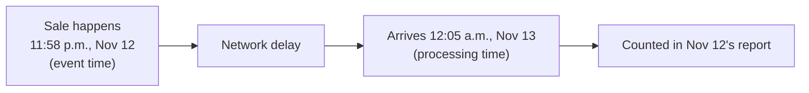

### 8.5 Slowly changing dimensions

**In plain words:** When a customer moves city, you must choose: rewrite history, or keep both the old and new city with dates.

A customer changes city. Do past orders show the old city or the new one? **SCD Type 1** overwrites (history lost); **Type 2** adds a new row with `valid_from` and `valid_to` so history is preserved. In batch pipelines, Type 2 is common for dimensions like customer, restaurant and price.

### 8.6 CDC details

**In plain words:** CDC means reading the database's own diary of changes, so you copy every change without slowing the database down.

- **Log-based CDC** (Debezium on MySQL binlog or PostgreSQL WAL) reads the same log used for replication, so it adds little load and sees every commit in order, including deletes.
- **Initial snapshot** copies existing rows, then streaming of changes takes over from a recorded log position. Get this handover wrong and you lose or duplicate rows.
- **Schema changes** in the source must flow through (add column, rename). Plan schema evolution rules.
- **Why not dual-write** from the application to both DB and Kafka? A crash between the two writes leaves them inconsistent. Use CDC or the outbox pattern in [[Transactional Outbox and CDC]].

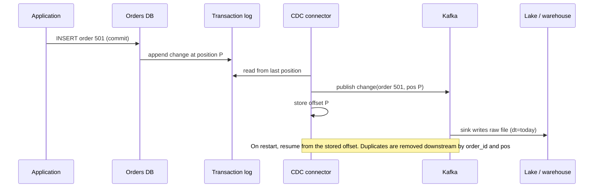

### 8.7 Cost levers

**In plain words:** Most of the bill is storage and compute time. Store smaller files, read less, and turn machines off when idle.

- Store as compressed Parquet: often several times smaller than CSV or JSON (the ratio depends on the data).
- Use lifecycle rules: move old raw data to cheaper storage tiers.
- Prune partitions and select only needed columns; in pay-per-scan warehouses, this is a direct bill reduction.
- Use spot or preemptible instances for batch workers; batch tolerates task retries well.
- Compute only what changed (incremental models).

## 9. Interview questions 🔴

> [!question]- Design a pipeline that produces daily business reports from many sources.
> Ingest by CDC and file drops into an immutable raw zone (object storage, partitioned by date). Transform with Spark or warehouse SQL into curated tables, per date interval, idempotently (partition overwrite or MERGE). Orchestrate as a DAG with retries, sensors and quality gates; publish by atomic partition swap. Support backfills by re-running intervals; handle late data by reprocessing the last N days.

> [!question]- How do you make a batch job safe to retry or backfill?
> Make it a pure function of its input interval. Write output to a temp location and swap the partition atomically, or upsert by primary key. No non-deterministic inputs (use the run date, not `now()`). Then a retry or backfill gives identical output.

> [!question]- Batch or streaming for this requirement?
> Ask for the latency that the business really needs. Seconds (fraud, live ops) means streaming. Hours (reports, billing, ML training) means batch, which is cheaper and simpler. If both, stream for the fast approximate view and batch to recompute the exact one.

> [!question]- A Spark job has 199 tasks done and one running for an hour. What is wrong?
> Data skew: one key holds a large share of rows. Confirm in the stage view (max vs median task time and input size). Fix by broadcasting the small side, salting the hot key, filtering nulls, or pre-aggregating before the shuffle.

> [!question]- ETL or ELT, and lake, warehouse or lakehouse?
> ELT when storage and warehouse compute are cheap and you want to re-transform raw data; ETL when you must mask data before it lands. Lake for cheap raw storage, warehouse for governed BI, lakehouse when you want one copy with transactions for both BI and ML.

> [!question]- How do you get data out of the production database without hurting it?
> Use log-based CDC (read the transaction log, as replication does) and stream changes to Kafka and then to the lake. Take an initial snapshot, hand over at a recorded log position, and dedupe downstream. Avoid heavy queries on the primary; if you must query, use a read replica.

> [!question]- What is a backfill and what can go wrong?
> Re-running a pipeline for past dates after a fix. Risks: non-idempotent jobs creating duplicates, overloading sources, overwriting data consumers already use, and old data failing new schema rules. Mitigate with idempotent overwrites, concurrency limits, off-peak windows and shadow tables compared before swapping.

## 10. Cheat sheet 🟢

- Batch = bounded input, high throughput, results later; run in parallel by partition.
- Narrow ops pipeline; wide ops shuffle; shuffle is the expensive step.
- Skew fixes: broadcast, salt, filter nulls, pre-aggregate, right-size partitions.
- DAG orchestration: interval-based runs, retries, sensors, quality gates, atomic publish.
- Idempotent: overwrite by interval or upsert by key; no `now()` in tasks.
- ELT keeps raw data; ETL masks before load. Lake = cheap files, warehouse = governed SQL, lakehouse = files plus ACID table layer.
- CDC from the transaction log, snapshot then stream; dedupe by key and position.
- Late data: reprocess the last N days or add correction rows.
- Lambda = batch + speed; Kappa = replay one stream.
- Do not use a cluster for data that fits on one machine.

## Links 🟢

- **Before this:** [[Stream Processing Basics]], [[Partitioning and Sharding]], [[Time-Series and Columnar Storage]]
- **Next:** [[Transactional Outbox and CDC]], [[Case Study - Ad Click Aggregation]], [[Case Study - Metrics and Logging Platform]]
- **Decide:** [[Choosing Storage for Files, Search and Analytics - Decision Guide]]
- **Related:** [[Idempotency and Idempotency Keys]], [[Scheduled Jobs - Cron to Durable Schedulers]], [[Workflow Engines and Durable Execution]], [[Event Schemas and Schema Registry]], [[Hot Keys and Hot Partitions]], [[Kafka and Event Streaming]], [[Storage Engines - B-tree vs LSM and WAL]]

### Watch on YouTube

- [The Hidden Cost of Batch Processing / Modern Data Engineering Pipelines](https://www.youtube.com/watch?v=rrOj9efHtMs) · Confluent Developer · 11 min · 1,252 views
- [What is Stream Processing? / Batch vs Stream Processing / Data Pipelines / Real-Time Data Processing](https://www.youtube.com/watch?v=ya4298V8Mqo) · BI Insights Inc · 6 min · 23,731 views
