# Coordination and Configuration Services

> [!summary] TL;DR
> A **coordination service** is a small, strongly consistent, replicated store (ZooKeeper, etcd, Consul) that a big system leans on for the few facts every machine must agree on: who is the leader, who is alive, who holds a lock, and what the current configuration is. It is not a general database. It stays small and boring so that the large, fast parts of the system can be built on top of it.

> [!abstract] Core idea
> - Agreement is hard (see [[Consensus - Raft and Paxos]]). Instead of every team re-implementing it, run one tiny consensus cluster (3 or 5 nodes) and let everything else ask it.
> - It exposes four primitives: **small values** (config), **ephemeral entries tied to a session or lease** (membership, locks), **watches** (push on change), and **atomic compare-and-set** (leader election, fencing).
> - A lock or leader role is safe only together with a **fencing token**; a lease alone is not enough, because pauses and clock drift exist.
> - Dynamic config is code. Roll it out in stages, validate it, version it and keep a rollback.

## Start here: the basics 🟢

> [!info] How to read this note (pick your level)
> - 🟢 **New to this?** Read "From zero" below, then sections 1, 2 and the cheat sheet (10). Stop there, that is a full first pass.
> - 🟡 **Know the basics?** Add section 3 (how it works), 4 (the five jobs) and 5 (variants).
> - 🔴 **Interview / SDE-3 prep?** Add 6, 7, 8 and 9. Headings are tagged 🟢🟡🔴 so you always know where you are.

> [!note] Before this note
> - [[Consensus - Raft and Paxos]]: a few machines can agree on one value by majority vote, even if one or two of them die.
> - [[Service Discovery]]: services find each other through a live list that machines join with heartbeats and fall out of when they stop.

**From zero, in 60 seconds** 🟢

You run 40 copies of the same service. They need to agree on small things.
Which copy is the boss? Who is alive? What is the retry limit today?
If each copy decides alone, they disagree and things break.
So you keep those small facts in one tiny, very reliable store. ZooKeeper and etcd are such stores. People call them **coordination services**.
The store itself runs on 3 or 5 machines that vote, so it keeps working if one dies. That voting is called **consensus**.

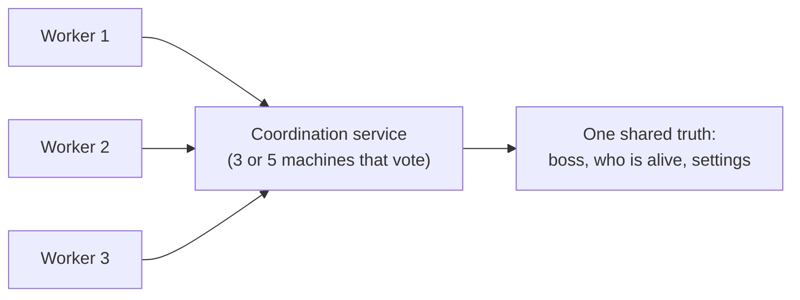

Workers do not keep asking "did anything change?". They ask once and say "tell me when it changes". That is a **watch**.

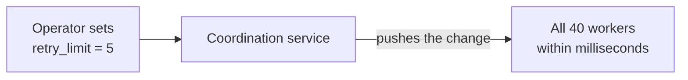

The rest of this note is just these 3 questions:
1. How does the store know who is alive and who is the boss?
2. How do workers hear about changes fast?
3. When is this the wrong tool (too much data, too much traffic)?

**The problem in one story**

You run 5 copies of a service. Exactly one of them must send the daily emails.
If two send, customers get duplicate emails. If none sends, nobody gets one.
The copies also need to agree on settings, like a feature flag, and notice when a copy dies.
Agreeing like this across machines is hard, so one small trusted service does it for everyone.

**Words you need first**

| Word | Plain meaning | Tiny example |
|---|---|---|
| Consensus | Machines agreeing on one value even when some fail | Raft in etcd |
| Quorum | More than half of the nodes | 2 of 3, or 3 of 5 |
| Leader election | Picking exactly one node to do a job | One scheduler instance active |
| Session / lease | A time-limited claim that ends if the client stops renewing | Lock expires 10 s after a crash |
| Ephemeral node | An entry deleted automatically when its session ends | ZooKeeper `/workers/w1` |
| Watch | A push notification when a value changes | Service reloads config on change |
| Compare-and-set | Write only if the value is still what you expect | Set leader only if no leader key exists |
| Fencing token | A number that grows with each new lock holder | Storage rejects writes with an old token |
| Linearizable | Every read sees the latest finished write, as if there were one copy | read the leader key and always get the newest |
| Revision / version | A counter that goes up on every change | `/config/retry_limit` is at version 12 |
| Compaction | Throwing away old versions to save space | etcd keeps only recent revisions |
| GC pause | The program freezes for a moment while it frees memory | a 12 s Java pause |
| Canary | Trying a change on a small slice first | new config on 1% of hosts |
| CP | Stays correct during a network split, even if some requests fail | the minority side refuses writes |

**Picture it**

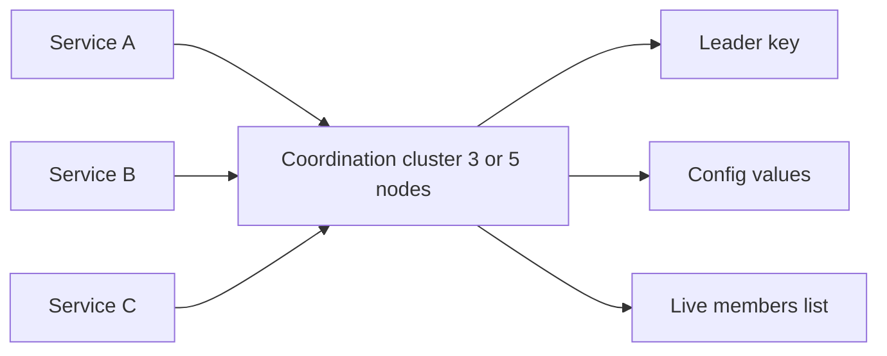

**Analogy**

An office notice board: one place where everyone reads who is in charge today and what the rules are, and a note falls off if its owner stops renewing it.
Where it breaks: a real notice board is one piece of wood, while this service is several machines that must agree before a note counts.

**How the rest of this note builds up**

- First why a shared coordination service exists and its mental model (sections 1-2).
- Then how its primitives work: values, sessions, watches, compare-and-set (section 3).
- Then a worked example of leader election and config (section 4).
- Finally ZooKeeper vs etcd vs Consul, trade-offs, production practice and the SDE-3 deep dive on fencing and clocks (sections 5-8).

> [!tip] Remember
> Do not build consensus yourself; ask a small coordination cluster, and always pair locks with fencing tokens.

## 1. Why it exists 🟢

You run a fleet of 40 workers that process nightly invoices. Three problems show up in the first week.

- Exactly one worker must run the "close the books" job at midnight. If two run it, customers are billed twice. If none runs it, nobody gets an invoice.
- Operations wants to change the retry limit from 3 to 5 without redeploying 40 workers and without 40 SSH sessions.
- The dashboard needs to know which of the 40 workers are alive right now, within seconds.

You could use a database row for each of these. Soon you discover subtle failures: a worker that died while holding the "leader" row never releases it; polling the config table every second from 4,000 clients hurts; and two workers can both believe they are leader during a network split.

A coordination service solves exactly this class of problem once, correctly, and cheaply. Google built **Chubby** for it (2006). Yahoo built **ZooKeeper** (2010 paper). **etcd** and **Consul** are the modern cousins, and Kubernetes keeps all of its cluster state in etcd.

> [!tip] Remember
> Coordination services exist for the few small facts a whole fleet must agree on, not for your data.

## 2. Mental model 🟢

Think of the **notice board in a village hall with a caretaker who never lies**.

- Anyone can pin a small note ("retry limit = 5"). Everyone reads the same note.
- Some notes are written in **disappearing ink** that fades when the person who wrote it leaves the hall. These are presence notes: "Alice is here".
- You can ask the caretaker, "tell me when note 7 changes" (a **watch**).
- To claim the one meeting room, you try to pin a note that says "room: Alice". The caretaker allows only the first one (atomic create).

Where the analogy breaks: a real notice board is one piece of wood. This board is replicated on 3 or 5 machines that vote on every change, so it survives the loss of a minority of them.

The price is that every write waits for a majority round trip, so the board is slow compared with a cache and small compared with a database.

### Real-life example: Kubernetes and Kafka 🟢

Every Kubernetes cluster, including the ones running apps like Swiggy or Zomato, keeps all its state in etcd: which pods exist, which node runs them, which config they use. When you change a setting, the change goes into etcd, and the parts of Kubernetes watching that key react within moments.
Kafka, used by most large apps to move events, used ZooKeeper for years to decide which broker is the boss and to track which brokers are alive.
In both cases the coordination store holds only small facts; the real data (your orders, your messages) lives elsewhere.

## Common beginner mistakes 🟢

- **Using it as a database or cache** → it is small (etcd defaults to 2 GiB) and every write needs a vote → keep only small facts there: leader, members, config.
- **Trusting a lock just because the lease has not expired yet** → after a long pause another worker may already hold it → pass a fencing token and let storage reject old ones.
- **Running 4 or 6 nodes "for extra safety"** → 4 survives no more failures than 3 → use 3 or 5.
- **Having every waiter watch the same lock key** → when it frees, hundreds wake up at once → each waiter watches only the one just ahead of it.
- **Pushing a config change to every machine at once** → one typo breaks the whole fleet → validate, canary on 1%, then widen, with one-step rollback.

### Coordination service vs things people confuse it with 🟡

| Thing | What it holds | Example |
| --- | --- | --- |
| Coordination service | A few small facts everyone must agree on | leader key, live members, `retry_limit` |
| Database | Your real business data, lots of it | orders, users, payments |
| Cache (Redis) | Fast copies; fine if briefly wrong | profile JSON, session |
| Feature-flag service | On/off switches for features, with targeting | "new checkout for 10% of users" |

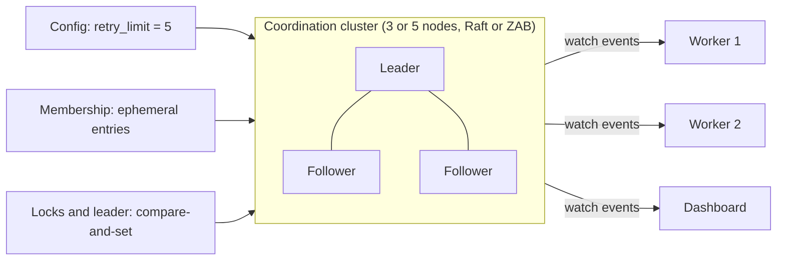

## 3. How it works 🟡

> 🟢 → 🟡 **You now know** a coordination service is a tiny, voting cluster that holds the few facts a whole fleet must agree on. **Next we open the box**: how it stores values with versions, how it decides who is alive, how it pushes changes, and the voting underneath. Each subsection starts with a plain walk-through; the full detail follows.

### One data model: a small tree or key space with versions

**In plain words.** Both systems store small values under names. ZooKeeper arranges the names like a file system tree of **znodes** (`/services/payments/p-7`). etcd uses a flat key space where `/services/payments/p-7` is just a string, and prefix reads give you the same effect. Every change bumps a version number that the server assigns.

**Step by step:**
1. The key `/config/retry_limit` holds `3`, at version 12.
2. Worker A reads it: value 3, version 12.
3. Worker A writes `5` with the rule "only if the version is still 12". It works; the version becomes 13.
4. Worker B, which also read version 12, tries to write `4` with the same rule. It fails, because the version is now 13.
5. Worker B re-reads, sees `5`, and decides again. No silent overwrite happened.

**Picture it.**

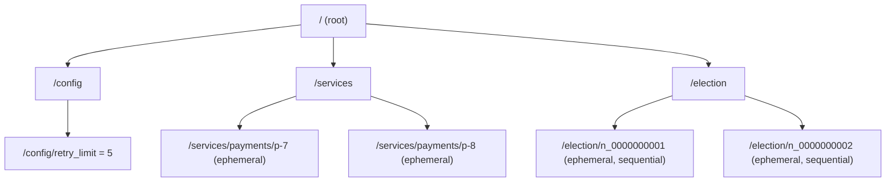

**Example.** A write to `/config/retry_limit` returns a new version. A client can say "update this key only if its version is still 12". If someone else changed it in between, the update fails, and the client re-reads. This is **compare-and-set** (CAS), and every lock and election recipe is built on it.

**Why it matters.** Versioned values turn races into clean failures instead of silent overwrites.

> [!tip] Remember
> Small values plus versions plus compare-and-set are the whole toolbox.

### Sessions and leases: how "alive" is defined

**In plain words.** A client that cannot be trusted to clean up after itself (it can crash) gets a **session** (ZooKeeper) or a **lease** (etcd, Consul sessions). The session has a time to live (TTL). The client must keep renewing it. Entries attached to the session vanish when it expires.

**Step by step:**
1. Worker w1 asks etcd for a lease that lives 10 seconds.
2. It writes `/workers/w1` attached to that lease. The dashboard, watching `/workers/`, sees w1 appear.
3. Every 3 seconds w1 renews the lease.
4. At 40 s w1 crashes. Renewals stop.
5. At about 50 s the lease expires, `/workers/w1` is deleted, and the dashboard sees w1 disappear.

**Picture it.**

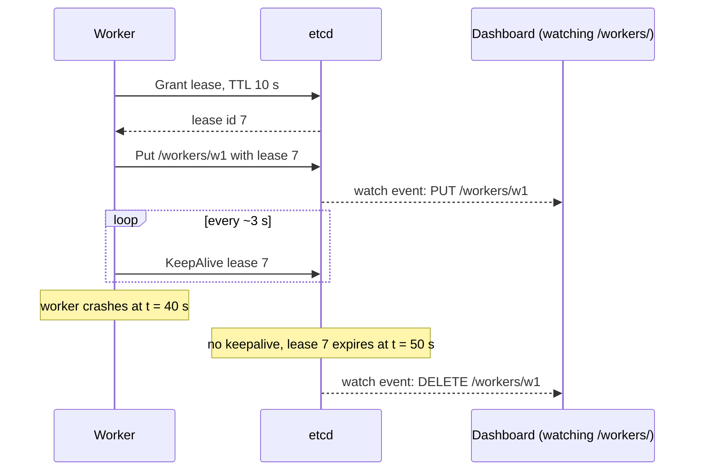

**Example.** TTL 10 s with keepalives every ~3 s tolerates two lost heartbeats. If the worker crashes at t = 40, the dashboard learns within about 10 s (the TTL) plus watch latency. A shorter TTL detects death faster but turns a 12-second garbage-collection pause or network blip into a false death.

**Why it matters.** This is how locks are released for dead owners without a human, and how membership stays honest. It is the same lease idea described in [[Service Discovery]] and [[Failure Detection, Gossip and Membership]].

> [!warning] Common mistake
> Believing "my lease is still valid" while your process is paused. A long GC pause or a VM freeze can outlast the lease, and you wake up thinking you are still the leader. That is why you need fencing tokens (below).

### Watches: being told instead of asking

**In plain words.** Polling 4,000 clients every second against one cluster is wasteful. A **watch** lets a client say "tell me when this changes" and receive a push.

**Step by step:**
1. A worker reads `/config/retry_limit` and says "tell me when it changes".
2. Nothing happens for hours, and the worker sends no requests.
3. An operator writes `5`. The cluster pushes a "changed" event to every watching worker.
4. Each worker re-reads the current value (it does not trust the event alone).
5. In ZooKeeper the worker then sets a fresh watch; in etcd the stream simply continues from the last revision.

**Picture it.**

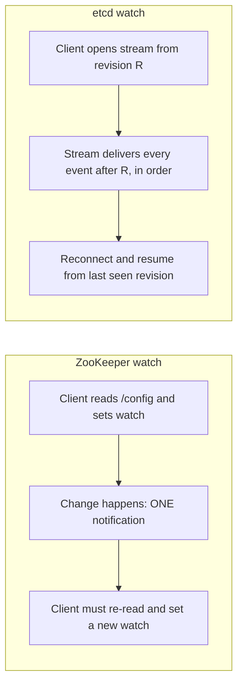

**Example.** In ZooKeeper, a watch is a **one-time trigger**: after it fires you must re-register. Changes between the notification and the re-registration are not announced; you catch up by reading the current value. In etcd, a watch is a stream tied to **revisions**, a cluster-wide counter that grows on every write. If your client disconnects at revision 900 and reconnects, it asks to resume at 901 and misses nothing, as long as that history has not been compacted away.

**Why it matters.** Always design clients as "on notification, re-read the truth" and not "apply the delta I was told", because notifications can coalesce or be lost across reconnects.

> [!warning] Common mistake
> Forgetting compaction. etcd keeps old revisions only until compaction. A client that was offline too long gets a "required revision has been compacted" error and must re-list the whole prefix and restart the watch from the latest revision.

### The consensus underneath

**In plain words.** Each write goes to the leader, which replicates it to followers and commits it once a **majority (quorum)** has stored it. Reads can be served by the leader linearizably (always the newest value), or by followers if you accept slightly stale data.

**Step by step:**
1. The cluster has 3 nodes. One is the leader.
2. A client writes `retry_limit = 5`. The leader adds it to its log.
3. The leader sends it to both followers. One follower saves it and says "ok".
4. Leader + 1 follower = 2 of 3, a majority. The write is committed, the client gets "ok", and watches fire.
5. If a network cut leaves a node alone, that lone node cannot reach a majority, so it refuses writes instead of going its own way.

**Picture it.**

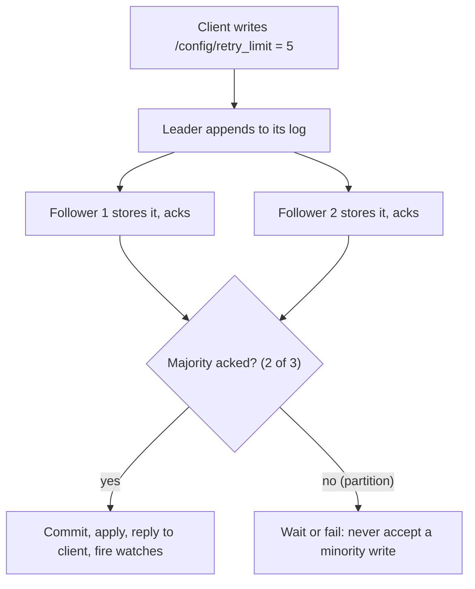

**Example.** With 3 nodes you tolerate 1 failure (majority = 2). With 5 you tolerate 2 (majority = 3). Going from 3 to 4 nodes tolerates no more failures than 3 (majority of 4 is 3), so use odd sizes. More nodes make writes slower because more acks and more network are involved. Most production clusters run 3 or 5.

**Why it matters.** During a network partition the minority side stops accepting writes. It chooses consistency over availability (CP, see [[CAP and PACELC]]). That is the feature you are buying.

> [!tip] Remember
> Sessions say who is alive, watches say what changed, consensus says the order of changes.

## 4. Worked example 🟡

The five jobs a coordination service does, with a concrete scenario each.

### Job 1: Configuration

**In plain words:** Put the setting in one place, and let every worker listen for changes to it.

Retry limit lives at `/config/invoicer/retry_limit`. Each worker reads it at startup and watches it. An operator writes `5`. Within milliseconds, all 40 workers get the event, re-read, and apply it to new jobs. No redeploy.

### Job 2: Membership and discovery

**In plain words:** Each worker signs a register that erases its name if it stops checking in. The register is the live list of who is up.

Each worker puts `/workers/<id>` with a lease. The scheduler lists the prefix to see who is alive, and watches it to react to joins and leaves. This is a registry exactly like the one in [[Service Discovery]].

### Job 3: Leader election

**In plain words:** Everyone takes a numbered ticket. The smallest number is the boss. When the boss leaves, the next number takes over.

Step by step, with the ZooKeeper-style recipe (sequential ephemeral znodes):

1. Each candidate creates `/election/n_` as **ephemeral and sequential**, so the server appends a counter: `n_0000000007`.
2. It lists the children. If its node has the **lowest** number, it is the leader.
3. Otherwise it watches **only the node just below its own**, not all of them.
4. When the leader's session dies, its node disappears. The next candidate's watch fires, it re-lists, and becomes leader.

Watching only the predecessor avoids a **herd effect**, where 500 candidates all wake up and hammer the cluster each time the leader changes.

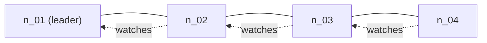

etcd does the same with a key whose **create revision** orders candidates; Kubernetes controllers use a `Lease` object that the leader renews, and others take it over when it expires. More on roles in [[Leader Election]].

### Job 4: Distributed lock with a fencing token

**In plain words:** A lock alone is not enough, because a frozen worker may wake up and think it still holds it. So each lock comes with a rising number, and storage rejects old numbers.

A lock is "create this key if absent". The danger is the paused client.

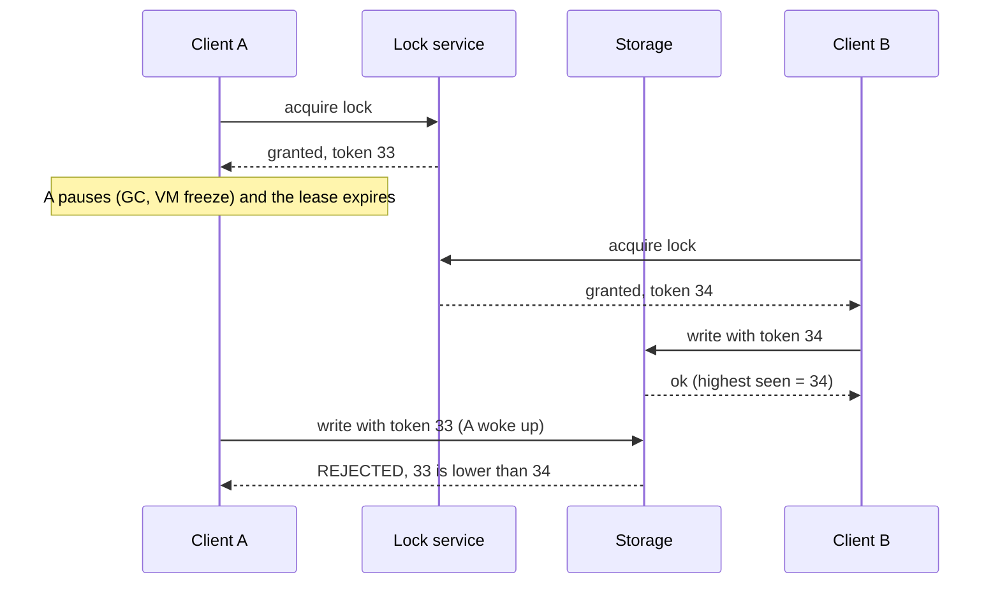

The token is a number that only grows. ZooKeeper's transaction id (`zxid`) or etcd's key revision work as tokens. The **storage** checks it and rejects old ones. Full theory is in [[Distributed Locks and Fencing Tokens]].

### Job 5: Rolling out dynamic config safely

**In plain words:** A bad setting can break everything at once, just like bad code. So roll it out slowly, check it, and keep an easy undo.

Changing a value everywhere at once is as risky as deploying code everywhere at once. Facebook's configuration system (SOSP 2015 paper) treats config as code: it is reviewed, validated, canaried and rolled out in stages.

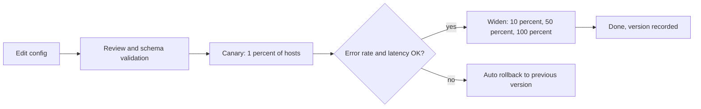

### Whiteboard version

Say it in 60 seconds, drawing one box:

- "Coordination cluster of 3 or 5 nodes, consensus-based, holds small data only."
- "Config via watched keys, membership via leased ephemeral keys, leader election via lowest sequence or create revision, locks via CAS plus a fencing token."
- "Clients cache locally and survive a cluster outage with the last known config."
- "Never put hot data path traffic through it."

## 5. Variants and comparison 🟡

| System | Data model | Consensus | Liveness primitive | Watch style | Notes |
| --- | --- | --- | --- | --- | --- |
| ZooKeeper | Tree of znodes, small values | ZAB (ZooKeeper's own Raft-like protocol) | Session with ephemeral znodes | One-time triggers | JVM, mature; used for Kafka metadata until KRaft |
| etcd | Flat key space, MVCC revisions | Raft | Lease with keepalive | Streaming watch from a revision | Go; Kubernetes API server's store |
| Consul | KV store plus catalog | Raft (servers), gossip (Serf) agents | Session, health checks | Blocking queries (long poll) | Strong on discovery and health |
| Chubby (Google, internal) | Small files with locks | Paxos | Sessions and leases | Event notifications | The design that inspired the others |
| Kubernetes API (on etcd) | Typed objects, resourceVersion | via etcd | `Lease` objects for leader election | List and watch | Operators use it instead of raw etcd |

### Which lock: etcd, Redis or a database?

**In plain words:** Pick the lock by how bad a mistake would be. Money or data safety needs etcd plus fencing. A "do not run the job twice, but it is fine if it does" case can use Redis.

| Option | Safety | Speed | Use when | Avoid when |
| --- | --- | --- | --- | --- |
| etcd or ZooKeeper lock with fencing token | Strong (consensus) | Milliseconds, limited write rate | Correctness matters: leader for a scheduler, singleton job | You need tens of thousands of lock ops per second |
| Redis lock (`SET key value NX PX ttl`) | Best effort on a single node; Redlock (a recipe that takes the lock on a majority of several Redis nodes) across nodes is debated (see Kleppmann's critique) | Sub-millisecond | Efficiency only: avoid duplicate work, double-sending is harmless | A duplicate holder would corrupt money or data |
| Database row lock or Postgres advisory lock (`pg_advisory_lock`, a named lock that is not tied to any row) | Strong inside that one database, and released if the session dies | Fast, no new infrastructure | The protected data lives in that same database | The lock must span systems, or the DB is already your bottleneck |

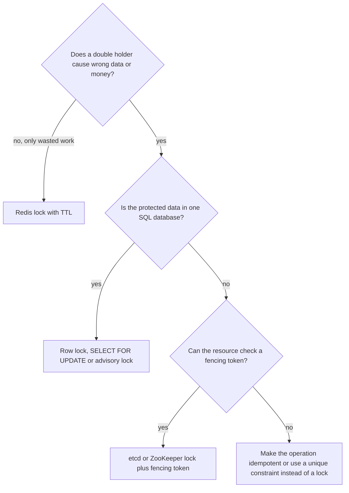

> [!tip] Remember
> Lock for efficiency: Redis is fine. Lock for correctness: consensus store plus a fencing token, or let the database enforce it.

## 6. Trade-offs and when not to use 🟡

- **Small by design.** etcd's default storage quota is 2 GiB and its default request size limit is 1.5 MiB. ZooKeeper znodes default to a 1 MB limit. Do not store blobs, user data or high-churn counters.
- **Writes are slow and bounded.** Every write is a majority round trip (disk fsync on each node plus network). Think thousands to low tens of thousands of writes per second at best (estimate; depends on hardware). Reads can scale with followers at the cost of staleness.
- **It becomes the single point of truth.** If the cluster loses its majority, writes stop. Clients must cache and degrade, not crash.
- **Operations are real work.** Disk latency, snapshots, compaction and member changes need care. A slow disk on the leader slows the whole cluster.
- **When not to use it.** Do not use it as a cache, a queue or a database. If you only need feature toggles, a managed flag service is simpler (see [[Feature Flags]]). If you run only inside Kubernetes, use ConfigMaps, Secrets and `Lease` objects through the API instead of operating your own etcd.

> [!tip] Remember
> The cluster must be boring: small data, few writes, odd-sized, fast disks.

## 7. In production 🔴

> 🟡 → 🔴 **You now know** the primitives and the five jobs (config, membership, leader, locks, safe rollout). **Next comes the senior view**: who runs this in the real world, how these clusters fail, and the details behind odd cluster sizes, fresh vs fast reads, lock recipes and clocks.

- **Real systems.**
  - Kubernetes keeps all objects in etcd, and controllers read them through the API server's list-and-watch.
  - Kafka used ZooKeeper for controller election and metadata until KRaft mode (Kafka's built-in Raft) (production ready from 3.3) moved this into Kafka itself, which shows teams do remove the extra dependency when they can.
  - Chubby underpins Google's infrastructure per the 2006 paper, and ZooKeeper was built at Yahoo for the same purpose.
  - Facebook's configuration system (SOSP 2015) distributes config changes to its fleet with validation and canaries.
- **Failure modes and fixes.**
  - *Leader flapping from slow disks or network jitter* → dedicated fast disks (SSD), tune heartbeat and election timeouts to the network, alert on leader changes.
  - *Client believes it is leader after a pause* → fencing tokens checked by the resource, and the leader stops acting when it cannot renew.
  - *Watch storm* (thousands of clients wake on one key) → watch only what you need, use the predecessor pattern, add a local agent or proxy that fans out.
  - *Cluster out of space* (etcd quota hit, alarm raised) → compact and defragment, and find the client writing too much.
  - *Bad config pushed everywhere* → staged rollout, validation, keep the last known good in each process, one-command rollback.
  - *Cluster unreachable* → clients keep the last good config and last good membership list and retry with backoff.
- **What to monitor.** Leader changes per hour, proposal commit latency and fsync latency (etcd exposes `etcd_disk_wal_fsync_duration_seconds` and `etcd_disk_backend_commit_duration_seconds`), database size against quota, number of watchers and sessions, client request latency, and "config version in use" per host so you can see a half-finished rollout.

## 8. Deep dive 🔴

### Why 3 or 5, never 4 or 6

**In plain words:** A vote needs more than half. Adding a 4th machine costs money but still survives only 1 failure, same as 3.

A quorum is more than half. Three nodes need 2 (tolerate 1 loss). Four need 3 (still tolerate only 1 loss). Five need 3 (tolerate 2). Even sizes add cost without adding fault tolerance, and a 2-2 split can leave neither side with a majority.

Across three availability zones, 3 or 5 nodes spread 1-1-1 or 2-2-1 keeps a majority alive if one zone goes down.

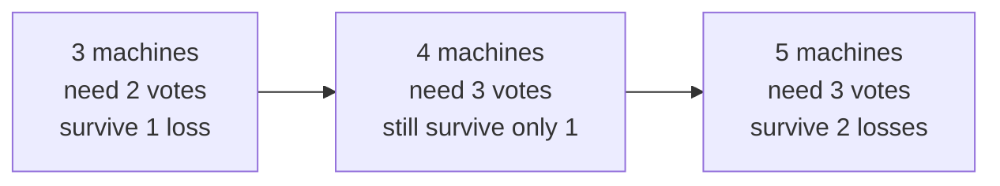

### Reads: linearizable or fast?

**In plain words:** You can ask the boss (always fresh, slower) or ask any member (fast, maybe slightly old).

A linearizable read is confirmed through the leader (etcd uses a ReadIndex round with a quorum check), so it sees every committed write. A serializable read served from one follower is faster but may be behind. Config distribution tolerates staleness; lock decisions do not. Pick per call.

### Lock recipes and the thundering herd

**In plain words:** If 100 waiters all watch the same lock, all 100 wake up when it frees. Better: each waiter watches only the one just ahead of it in line.

A naive lock has all waiters watch the same key; when the holder leaves, everyone wakes and races. The sequential-node recipe has each waiter watch only its predecessor, so one wake-up per release. This is what separates a recipe that works for 5 clients from one that works for 5,000.

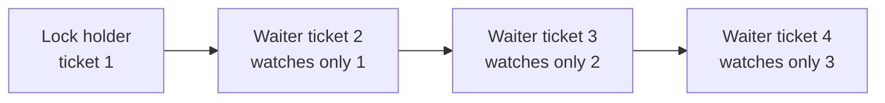

### Sessions, TTLs and clocks

**In plain words:** The server decides when your session is dead, not you. After a long pause, assume you lost your locks.

A session expires according to the **server's** clock and timeouts, not the client's belief. After a pause, the client must treat all its locks as lost and check, for example, that its session or lease is still valid before acting, and still rely on the fencing token for the final say.

Leases bound how long a dead owner holds a role, but never prove that a live owner is still the owner at this instant.

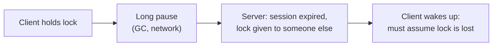

### Using a database instead

**In plain words:** For a small system, the database you already have can pick a leader. You do not always need a new cluster.

For small systems a Postgres advisory lock is a legitimate leader election: the first process to `pg_try_advisory_lock(id)` leads, and the lock is released if its connection dies. It costs no new infrastructure. It stops being enough when the database itself is the thing you need to survive losing, or when coordination must span systems.

### Config versioning and rollback

**In plain words:** Give every config a version number. Undo means "go back to the last good number", not "edit by hand and hope".

Treat each config as an immutable version with an id. Servers report the version they run. A rollback is "point to version N-1", not "edit and hope". Keep schema validation at write time so a typo cannot reach production, and keep a local last-known-good copy so a process can start while the coordination service is down.

## 9. Interview questions 🔴

> [!question]- When would you use ZooKeeper or etcd instead of a database?
> When many machines must agree on a few small facts quickly and safely: leader, membership, lock ownership, current config. These need consensus, ephemeral entries that vanish when the owner dies, and push notifications. A normal database lacks sessions that clean up dead owners and efficient watches, and polling it does not scale. But the coordination store is not for bulk data.

> [!question]- Design a distributed lock for a job that must run once. What goes wrong with a plain TTL lock?
> A plain TTL lock fails when the holder pauses past the TTL: a second holder is granted the lock while the first still thinks it holds it, and both write. Fix: issue a monotonically increasing fencing token with each grant (etcd revision, ZooKeeper zxid) and make the storage reject writes with a lower token. If the storage cannot check tokens, make the operation idempotent or enforce uniqueness with a database constraint.

> [!question]- Redis lock, etcd lock or database lock: how do you choose?
> Ask what happens on a double holder. If it only wastes work, Redis `SET NX PX` is fine and fast. If it corrupts data and the data is in one SQL database, use a row or advisory lock there. If it must span systems and be strongly safe, use etcd or ZooKeeper with a fencing token. Redlock's safety across several Redis nodes is disputed (Kleppmann), so do not use it for correctness.

> [!question]- How do you roll out a configuration change to thousands of servers safely?
> Treat it like a deploy. Validate against a schema, review it, canary on 1 percent, watch error rate and latency, widen in stages, and auto-roll back on regression. Version every config, let hosts report the version they run, and keep a last-known-good copy locally so a coordination outage does not stop restarts.

> [!question]- Why an odd number of nodes, and what happens in a partition?
> A majority quorum must exist for writes. Odd sizes give the best fault tolerance per node (3 tolerates 1, 5 tolerates 2, 4 still tolerates only 1). In a partition, the side with a majority continues, and the minority stops accepting writes and cannot elect a leader. This is the CP choice.

> [!question]- What is a watch, and what can go wrong with it?
> A watch pushes a change notification instead of making clients poll. In ZooKeeper it is one-shot and must be re-registered, so clients re-read on every event. In etcd it is a stream resumed from a revision, which fails if that revision was compacted. Other problems: herd effects when many watch one key, and lost events across reconnects, so always re-read the truth.

> [!question]- Your leader election works in tests but you see two leaders in production. Why?
> Most likely a pause or partition let the old leader keep acting after its lease expired, because it never re-checked. Fixes: the leader must stop work when it cannot renew within its lease, downstream writes must carry and check a fencing token, and clocks should not be trusted for correctness.

## 10. Cheat sheet 🟢

- Coordination service = tiny consensus cluster (3 or 5 nodes) for config, membership, locks and elections.
- Primitives: small versioned values, leased ephemeral entries, watches, compare-and-set.
- ZooKeeper: znode tree, sessions, one-time watches. etcd: flat keys, leases, streaming watches from a revision.
- Election: lowest sequence number or create revision wins; watch only your predecessor.
- Lock for correctness needs a fencing token checked by the resource. Redis locks are for efficiency only.
- Keep it small: etcd default 2 GiB quota and 1.5 MiB request. Never a cache, queue or database.
- Roll config out like code: validate, canary, widen, rollback, keep last known good.
- Clients cache so they survive a coordination outage.

## Self-check 🟢🟡

> [!question]- (easy) What kind of data belongs in a coordination service?
> A few small facts the whole fleet must agree on: leader, live members, config, locks.

> [!question]- (easy) What is a watch?
> A request to be told when a value changes, instead of asking again and again.

> [!question]- (easy) Why do entries tied to a lease vanish when a worker dies?
> The worker stops renewing, the lease expires, and everything attached to it is deleted.

> [!question]- (medium) Why use 3 or 5 nodes and not 4?
> 4 needs 3 votes and still survives only 1 failure, the same as 3, at more cost.

> [!question]- (medium) Why is a lease alone not enough for a safe lock?
> A paused holder can wake after the lease expired and act anyway; a fencing token lets storage reject it.

> [!question]- (medium) How does the lowest-sequence-number recipe avoid a herd effect?
> Each candidate watches only the node just ahead of it, so one release wakes one waiter.

## Links 🟢

- **Before this:** [[Consensus - Raft and Paxos]], [[Service Discovery]], [[Failure Detection, Gossip and Membership]]
- **Next:** [[Leader Election]], [[Distributed Locks and Fencing Tokens]], [[Feature Flags]]
- **Compare with:** [[Kubernetes Fundamentals]] (ConfigMaps and Leases on etcd), [[High Availability and Failover]], [[Case Study - Distributed Job Scheduler]] (singleton scheduling and leader election), [[Case Study - Key-Value Store]], [[Rollback and Safe Migrations]]

### Watch on YouTube

- [What is ZooKeeper? - Coordination Services / Systems Design Interview 0 to 1 with Ex-Google SWE](https://www.youtube.com/watch?v=F06tdYgcz_A) · Jordan has no life · 7 min · 40,552 views
- [Coordination Services / System Design / High Level Design](https://www.youtube.com/watch?v=6mX8pxmqA7w) · Reactify Labs · 20 min · 170 views
