# Cost-Aware System Design

> [!summary] TL;DR
> A design that works but costs ten times too much is a failed design. **Cost-aware design** means knowing the four big bills (compute, storage, network egress, managed services), estimating **cost per request** or per user, and choosing the cheapest option that still meets the SLA. In an interview, bring cost up yourself, in one or two sentences, at the decisions where it changes the answer.

> [!abstract] Core idea
> - Cost is a design dimension next to latency, availability and consistency. Every choice moves it.
> - The usual surprises are **network egress**, **cross-AZ traffic**, **over-provisioned databases** and **hot storage for cold data**.
> - A cache or CDN is a cost tool: every hit removes work from the expensive layer.
> - Match the **purchase model** to the load shape: reserved for the steady base, on-demand for the swing, spot for work that can be interrupted.
> - Say the number. "About 3 cents per thousand requests" is stronger than "it should be cheap".

## Start here: the basics 🟢

> [!info] How to read this note (pick your level)
> - 🟢 **New to this?** Read "From zero" below, then sections 1, 2 and the cheat sheet (10). Stop there, that is a full first pass.
> - 🟡 **Know the basics?** Add section 3 (cost levers), 4 (worked example), 5 and 6.
> - 🔴 **Interview / SDE-3 prep?** Add 7, 8 and 9. Headings are tagged 🟢🟡🔴 so you always know where you are.

> [!note] Before this note
> - [[Back-of-the-Envelope Estimation]]: you can turn users and requests into rough numbers like "150 TB a day"; here we multiply those numbers by a price.
> - [[Scaling Basics]]: you add servers, caches and replicas as load grows; each of those has a monthly cost.

**From zero, in 60 seconds** 🟢

In the cloud you do not buy computers. You rent them by the hour, and you pay for every GB you store and send.
So every design choice has a price tag, even if nobody shows it to you.
The surprise is usually not the servers. It is data leaving the cloud, called **egress**, and data moving between data centres.
A cost-aware design guesses the monthly bill early, before the bill guesses it for you.
The best single number is **cost per request** (or per user, or per order): total bill divided by how much work you did.

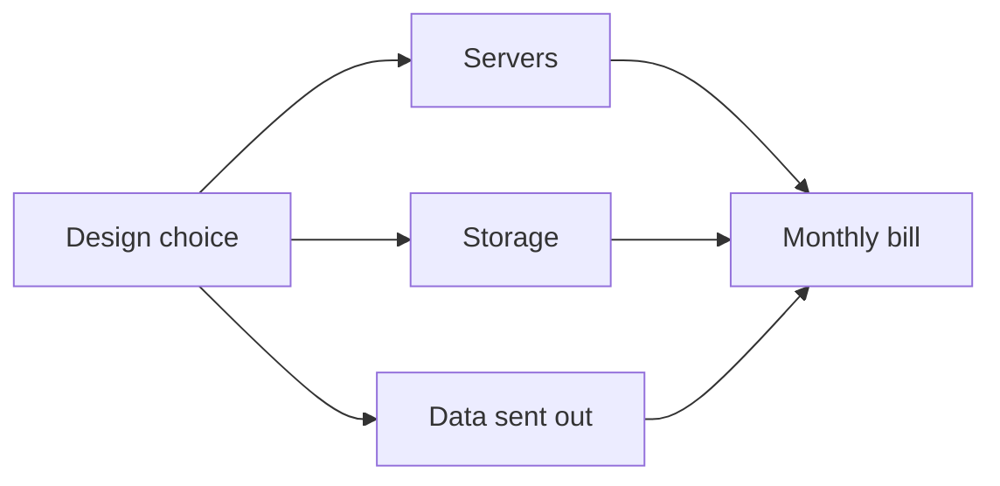

Most savings come from three moves: do less work, keep data on cheaper shelves, and send less data over the network.

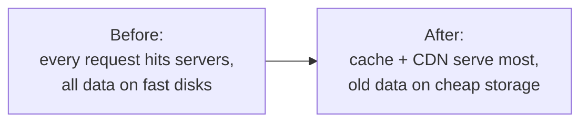

The rest of this note is just these 3 questions:
1. Where does the money actually go?
2. Which levers cut the bill without hurting users?
3. How do you trade cost against speed, safety and uptime in an interview?

**The problem in one story**

A startup launches a photo app on the cloud. It works, and users love it.
At the end of the month the cloud bill is bigger than the revenue.
Most of it is not servers: it is data sent out to users and between data centres.
A good design checks what each choice costs before the bill arrives.

**Words you need first**

| Word | Plain meaning | Tiny example |
|---|---|---|
| Egress | Data leaving the cloud provider's network, paid per GB | Images downloaded by users |
| Availability zone (AZ) | A separate data centre inside one region | `ap-south-1a` |
| Cross-AZ traffic | Data between zones, often charged both ways | App in zone A reading DB in zone B |
| On-demand | Pay per hour, no commitment | A VM started for a test |
| Reserved / savings plan | Commit for 1-3 years for a discount | Always-on database server |
| Spot | Spare capacity, cheap, can be taken back any time | Nightly batch job |
| Storage tier | Hot (fast, pricey) vs cold (slow, cheap) storage | S3 Standard vs Glacier |
| CDN | Edge caches near users | Serves images so origin does not pay egress each time |
| GB-month | One GB stored for one month, the unit storage is billed in | 1 TB for a month = 1,000 GB-months |
| IOPS | Disk reads and writes per second; some disks charge for a reserved amount | 3,000 IOPS provisioned |
| NAT gateway | A cloud box that lets private servers reach the internet; charged per GB | servers pulling images through NAT |
| Hit ratio | Share of requests answered by the cache | 90% hit = 1 in 10 reaches the DB |
| Right-sizing | Picking the smallest machine that still meets the load | 16 vCPU at 25% busy → 4 vCPU |
| Cost per request | Monthly bill divided by requests served | $0.05 per 1,000 requests |

**Picture it**

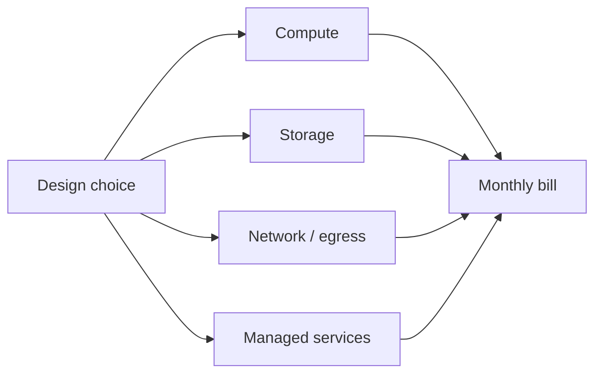

**Analogy**

Running a restaurant: rent, ingredients, delivery fees and caterers each add to the bill, and the owner controls profit by choosing how much of each to use.
Where it breaks: a restaurant's prices are on a menu you can read, while cloud costs hide in per-GB and per-request charges you only see in the bill.

**How the rest of this note builds up**

- First why cost matters and the mental model of where money goes (sections 1-2).
- Then how each cost lever works: compute purchase models, storage tiers, network, caching (section 3).
- Then a worked cost estimate (section 4).
- Finally variants, trade-offs, production practice (FinOps) and the SDE-3 deep dive (sections 5-8).

> [!tip] Remember
> Every design choice has a price; estimate egress, cross-AZ traffic and storage tier first.

## 1. Why it exists 🟢

You design a photo sharing app. 10 million daily users each view 50 images of 300 KB.

That is 10M x 50 x 300 KB = 150 TB per day of image traffic (an estimate).

If served from origin to the internet at roughly $0.09 per GB (a typical first-tier cloud egress list price, approximate), that is about $13,500 per day, or over $400,000 per month, for bandwidth alone. The servers are a rounding error next to it.

A CDN with a 95 percent hit ratio (an estimate) cuts origin egress to 7.5 TB per day, and a CDN's own per-GB price is usually lower than cloud egress. The architecture is the same boxes. The bill is about a tenth.

Interviewers at SDE-3 level notice when a candidate sees this unprompted.

> [!tip] Remember
> The biggest line on the bill is usually the one nobody drew on the whiteboard: the arrows.

## 2. Mental model 🟢

Think of running a **restaurant**. Rent (compute you keep on), ingredients (storage), delivery fees (network), and the catering company you hire for desserts (managed services).

You control profit by:

- not paying rent for empty tables (autoscaling),
- buying flour in bulk for what you surely use (reserved),
- buying surplus produce cheap for jobs that can wait (spot),
- keeping the best-selling dishes ready (cache),
- and not hiring a caterer for something the kitchen does in five minutes (build versus buy).

The analogy breaks at one point: restaurant costs are visible on one invoice, but cloud costs show up as thousands of line items, and the expensive ones (data transfer) hide inside architecture decisions.

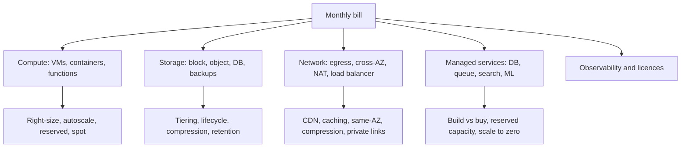

> [!tip] Remember
> Four buckets: compute, storage, network, managed services. Ask which one dominates before optimising any of them.

### Real-life example: IPL streaming on Hotstar 🟢

During an IPL final, millions of people watch the same video at once. Sending each viewer's video straight from Hotstar's own servers would mean a giant bill for data sent out, plus servers that cannot keep up.
So video pieces are cached on CDN servers close to viewers; nearly every request is answered there, and only a small share reaches the origin.
The video is also stored in a few quality levels, so a phone on weak signal gets a smaller file, which means fewer bytes to pay for.
Transcoding new videos runs on cheap spare machines that can be taken back at any time, because a stopped job can simply restart.

## Common beginner mistakes 🟢

- **Counting servers and ignoring data transfer** → the biggest line (egress) is missing from your estimate → multiply GB sent out by the price per GB.
- **Keeping all data on the fastest storage forever** → old data you rarely read costs as much as new data → move it to cheaper tiers with lifecycle rules.
- **Buying everything on-demand at peak size** → you pay for peak all day → reserve the always-on base, autoscale the peak, use spot for batch.
- **Cutting a second zone to save money on a user-facing service** → one data centre outage takes you down → say the availability hit out loud before cutting.
- **Saying "it should be cheap"** → nobody can check it → give one number: "about $0.02 per order".

## 3. How it works 🟡

> 🟢 → 🟡 **You now know** the bill has four buckets and that the network is usually the surprise. **Next we open the box**: what each driver costs, cost per request, how caches and CDNs pay for themselves, storage tiers, ways to buy compute, hidden network charges, and build vs buy. Most subsections start with a plain walk-through; the full detail follows.

### 3.1 The main cost drivers

**In plain words:** cloud prices are not uniform. Some things are nearly free (inbound traffic, small storage), and some are expensive per unit (outbound traffic, provisioned IOPS, managed enterprise features). Knowing the shape of the price list lets you estimate before you build.

**Step by step:**
1. Write your estimate: 100 servers, 50 TB stored, 150 TB a month sent to users.
2. Multiply each by its rough price: servers per month, storage per GB-month, egress per GB.
3. Add the hidden ones: traffic between zones, NAT, logs and metrics.
4. Look at which line is biggest. That is the one to attack first.
5. Usually it is egress or the database, not the app servers.

| Driver | How it is billed | Typical surprise | Rough scale (approximate list prices) |
| --- | --- | --- | --- |
| Compute | Per second or hour of running capacity | Idle capacity at night, oversized instances | A general 4 vCPU, 16 GB VM costs on the order of $100-200 per month on-demand |
| Block storage | Per GB-month plus provisioned IOPS | Paying for provisioned IOPS never used | Around $0.08-0.10 per GB-month for general SSD |
| Object storage | Per GB-month, per request, per retrieval | Millions of tiny PUTs, retrieval fees on cold tiers | Standard roughly $0.023 per GB-month; cold archive tiers a fraction of that |
| Internet egress | Per GB out | Serving large files from origin | Around $0.05-0.09 per GB at volume tiers |
| Cross-AZ traffic | Per GB, both directions | Chatty services spread across zones, database replication | Around $0.01 per GB each way |
| NAT gateway | Hourly plus per GB processed | Pulling large images or S3 data through NAT | Around $0.045 per GB processed |
| Managed DB | Instance hours plus storage plus IO plus backups | Multi-AZ doubles instance cost; read replicas add more | Multi-AZ roughly 2x single instance |
| Logs and metrics | Per GB ingested, per series | High-cardinality metrics, debug logs left on | Can rival compute on chatty systems |

> [!warning] Common mistake
> Estimating only server count and ignoring data transfer. In media, analytics and chatty-microservice systems, network is often the largest or second largest line.

**Why it matters:** the first estimate you make in an HLD, QPS and storage, is already the cost model. Multiply it by a price.

See [[Back-of-the-Envelope Estimation]] for the arithmetic habits.

### 3.2 Cost per request and cost per user

**In plain words:** a monthly total means little until you divide it by something you can compare. **Cost per request** (or per order, per DAU) tells you whether the business model works and which component to attack.

Method:

1. Estimate monthly traffic (requests, orders, active users).
2. Add up monthly cost for each component.
3. Divide. Compare to revenue per unit.

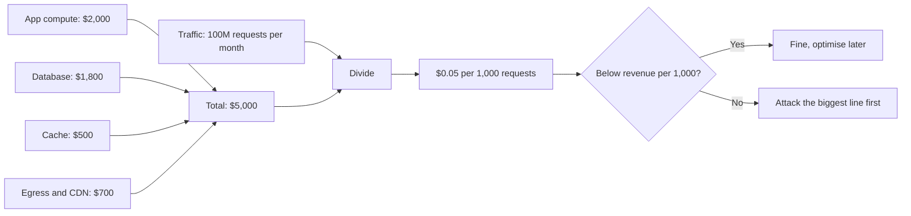

**Example (all numbers are illustrative):** food delivery app, 3 million orders per month, infra bill $60,000. That is $0.02 per order. If the average order brings $0.40 in platform fee, infra is 5 percent of revenue, which is fine. If it were $0.30 per order, you would have a business problem, and the design review should find out why: usually a heavy dependency (maps API calls, SMS, a per-call managed service) rather than servers.

Third-party per-call costs matter. Maps and routing APIs, SMS, payment fees and ML inference are often bought per request. A design that calls them on every page view can cost more than all your servers. The fix is caching, batching, and not calling them in the hot path.

**Why it matters:** per-unit cost tells you which optimisation deserves engineer time.

### 3.3 Cache ROI and CDN offload

**In plain words:** a cache costs money (memory is more expensive than disk), but each hit removes work from a more expensive resource. Worth it when the **hit ratio** times the savings per hit exceeds the cache's own cost.

**Step by step:**
1. The database must handle 10,000 reads a second. That needs 1 primary + 3 replicas, about $6,000 a month.
2. Add a Redis cache. 90% of reads (9,000 a second) are answered from it.
3. The database now sees 1,000 reads a second. One primary + 1 replica is enough.
4. Subtract: database savings minus the cache's own cost. If positive, the cache pays for itself.
5. A CDN does the same for bytes: every image served at the edge is egress you do not pay at origin.

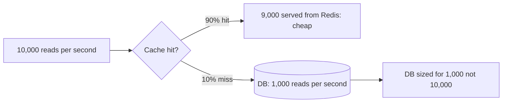

**Example with numbers (estimates):** a database sized for 10,000 reads per second might need a large instance with read replicas (say 1 primary plus 3 replicas at $1,500 each, $6,000 per month). With a 90 percent hit ratio, the database sees 1,000 reads per second, so one primary plus one replica ($3,000) is enough. A cache cluster of $1,000 per month saves $3,000 and also improves latency. Net saving about $2,000 per month.

Break-even rule of thumb: cache when hit ratio is high and values are small, shared and read-heavy. Do not cache data that is unique per request (hit ratio near zero) or tiny cheap queries that cost less than the cache lookup path. See [[Choosing a Caching Strategy - Decision Guide]].

**CDN offload** is the same idea at the network layer: every byte served from an edge is a byte you do not pay origin egress for, and often at a lower per-GB price. Pick cacheable URLs (versioned static assets, images, video segments), long TTLs, and compression. See [[CDN and Edge]].

**Why it matters:** the first cost lever for a read-heavy system is almost always caching, before more servers.

### 3.4 Storage tiers and lifecycle

**In plain words:** most data is read often when new and almost never when old. Storing all of it on the fastest, priciest tier wastes money. **Tiering** moves data to cheaper, slower storage as it ages, and **lifecycle rules** do it automatically.

**Step by step:**
1. A user uploads a photo. It sits on the hot tier, read many times in the first weeks.
2. After 30 days a lifecycle rule moves it to the infrequent-access tier, about half the price.
3. After 90 days it moves to an archive tier, a small fraction of the price, but slower and with a fee to read.
4. When the retention period ends, it is deleted.
5. No person has to remember any of this; the rules run on their own.

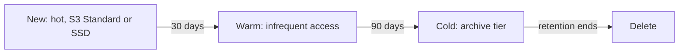

| Tier | Cost per GB-month | Retrieval | Use for |
| --- | --- | --- | --- |
| Hot (Standard, SSD) | Highest | Instant, no fee | Recent orders, current photos |
| Infrequent access | Lower (roughly half) | Instant, per-GB retrieval fee | Older photos, reports |
| Archive | Much lower | Minutes to hours, fees | Compliance copies, old backups |

**Example (estimate):** 1 PB of user uploads. If 80 percent is older than 90 days and rarely read, moving that part to a cold tier at, say, a fifth of the price drops the storage bill by about 64 percent for that portion. Caveat: if you move something to archive and then read it constantly, retrieval fees and minimum storage durations can cost more than you saved. Always check access patterns first. See [[AWS 07 - S3]].

Other storage levers: compress (columnar formats and zstd for logs and analytics), **deduplicate** large objects, set **retention** on logs and backups, and delete orphaned snapshots and unattached volumes.

**Why it matters:** storage cost grows forever unless something deletes or demotes data.

### 3.5 Compute: right-sizing, autoscaling, reserved and spot

**In plain words:** there are three ways to pay for compute, and they suit different load shapes.

**Step by step:**
1. Your app needs 20 servers at night and 100 at the evening peak.
2. Reserve 20 for 1-3 years at a big discount; they are always busy anyway.
3. Let autoscaling add up to 80 on-demand servers for the peak and remove them after.
4. Run the nightly batch job on spot machines at up to about 90% off; if one is taken back, the job retries.
5. Check each service's real CPU use and shrink machines that are mostly idle.

| Model | Price | Commitment | Use for |
| --- | --- | --- | --- |
| On-demand | Full price | None | Spiky, unknown, short-lived |
| Reserved or Savings Plan | Up to roughly 60-70 percent off (provider advertises up to about 72 percent) | 1 or 3 years of spend | The steady baseline you will certainly run |
| Spot (interruptible) | Up to about 90 percent off | Can be reclaimed with short notice (AWS gives a 2-minute warning) | Batch, stateless workers, CI, stream processors that checkpoint |
| Serverless functions | Per invocation and duration | None | Spiky, low-volume, event-driven work |

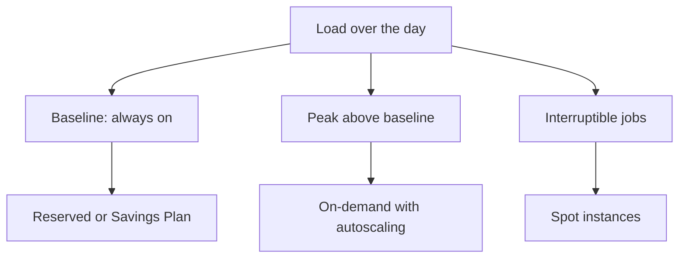

**Example (illustrative):** traffic runs between 20 and 100 servers across the day, average 45. Reserve 20 (the floor), autoscale 20-80 more on-demand, and run the nightly batch on spot. Paying on-demand for 100 servers all day would cost about 2.2 times the average need.

Right-sizing: look at p95 CPU and memory of each service. If a 16 vCPU service never exceeds 25 percent, drop to 8 or 4 vCPU. Check Go service memory limits and `GOMAXPROCS` (how many CPU cores the Go runtime uses) against the container limit. See [[Autoscaling]] and [[AWS 04 - Compute Choices - EC2, ECS-Fargate, EKS, Lambda]].

Serverless versus containers: functions are cheapest at low or spiky traffic and become more expensive than always-on containers when the load is steady and high. There is a break-even request rate; estimate it per workload rather than guessing.

**Why it matters:** the same workload can cost 2-3 times more depending on how you buy it.

### 3.6 Hidden network costs: egress, cross-AZ, NAT

**In plain words:** some network traffic is free (inside one AZ over private IPs, inbound from internet), and some is billed per GB. The surprises are the paths that look internal but are billed.

**Step by step:**
1. A user downloads an image: data leaves the cloud, billed per GB (egress).
2. The app in zone A reads from a database replica in zone B: billed per GB, both ways.
3. A private server fetches files from S3 through a NAT gateway: billed per GB processed.
4. The same S3 fetch through a gateway VPC endpoint (a private door from your network to S3) has no NAT charge.
5. So: CDN for users, same-zone calls where safe, and private endpoints for cloud storage.

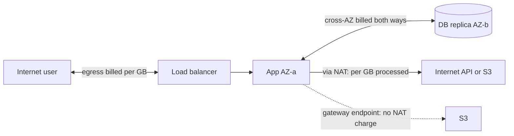

Fixes, in order of effect:

1. **CDN and compression** for user-facing egress.
2. **Gateway VPC endpoints** for S3 and DynamoDB so traffic skips NAT charges.
3. **Zone-aware routing**: prefer same-AZ replicas and service instances when latency and failure isolation allow.
4. **Batch and compress** inter-service payloads (Protobuf, a compact binary format, over JSON; gzip for bulk).
5. **Keep chatty pairs together** (service plus its cache in the same zone) while still keeping a copy in another zone for availability.
6. **Avoid cross-region replication** of everything. Replicate only what the SLA demands. See [[Multi-Region Architecture]].

**Why it matters:** a multi-AZ database that replicates 5 TB per month across zones adds about 2 x 5,000 GB x $0.01 = $100 (illustrative), which is small. A chatty microservice mesh pushing 500 TB per month across zones is $10,000. Scale decides.

### 3.7 Managed services versus build

**In plain words:** a managed database costs more per unit than a self-run one, but you do not pay engineers to patch, back up and fail it over. The honest comparison is the whole cost, including the people.

**Step by step:**
1. Managed Postgres costs, say, 50% more than the same machine you run yourself.
2. Running it yourself means upgrades, backups, failover and a person on call at 3 a.m.
3. Add those people's time to the self-run cost.
4. For a small team, managed is almost always cheaper in total.
5. Only at very large scale with a platform team (like Dropbox's storage) does building win.

| Factor | Managed (RDS, MSK, ElastiCache) | Self-run (on VMs or Kubernetes) |
| --- | --- | --- |
| Per-unit price | Higher (often 20-100 percent over raw compute) | Lower |
| Engineer time | Low | High: upgrades, failover, backups, on-call |
| Risk of operator error | Lower | Higher |
| Features and tuning | Limited | Full control |
| Right at | Small to mid scale, small teams | Very large scale with a platform team |

Two public data points, both worth quoting carefully:

- **Amazon Prime Video** (2023 engineering blog) reported moving a video-quality monitoring service from a distributed serverless design (Step Functions, Lambda, S3 intermediate storage) to a single-process design and cutting infrastructure cost by about 90 percent for that service. Lesson: per-call and per-state-transition pricing punishes chatty fine-grained designs.
- **Dropbox** (S-1 filing and engineering blog) built its own storage system (Magic Pocket) and moved most file storage off S3, reporting large savings. Lesson: at exabyte scale with a dedicated team, building can win. This does not apply to a normal startup.

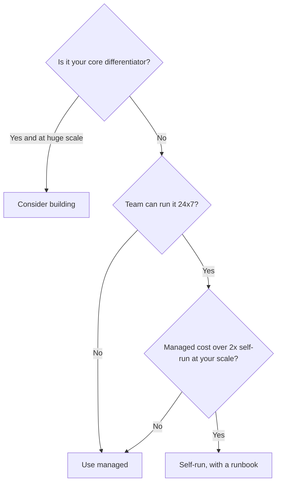

**Why it matters:** the cheapest line item and the cheapest system are not the same thing.

### 3.8 Bringing cost up in the interview

**In plain words:** do not lecture about cost. Slip it in at the decision points where it changes the design, in one sentence, with a number.

1. **During estimation:** after QPS and storage, add "that is about N TB per month of egress, which would be roughly $X, so I will put a CDN in front."
2. **When choosing storage:** "Hot for 30 days, lifecycle to cheaper tiers after, because 90 percent of reads hit the last month."
3. **When choosing compute:** "Reserve the baseline, autoscale the peak, spot for the batch workers."
4. **When a managed service is picked:** "At this scale managed costs a premium but saves a team of on-call engineers. I would revisit at 10x."
5. **At the wrap-up:** "The cost drivers are egress and the database. Here is the first thing I would cut."

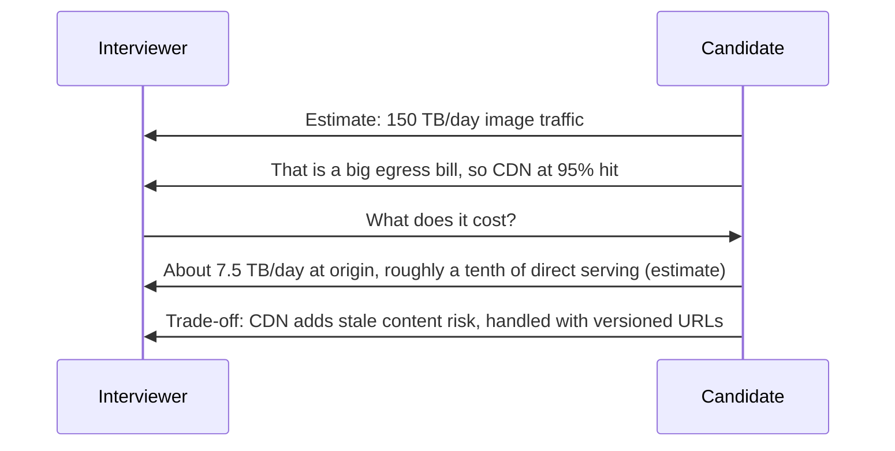

> [!tip] Remember
> One sentence, one number, one trade-off. Then move on.

## 4. Worked example 🟡

**Problem:** cost-review the video streaming part of a startup app. 2 million monthly viewers, average 4 hours per month, average bitrate 3 Mbps (all estimates).

1. **Traffic.** 3 Mbps is 0.375 MB per second, 1.35 GB per hour. 4 hours per viewer per month is 5.4 GB. For 2M viewers: 10.8 PB per month.
2. **Naive cost.** Origin egress at a blended $0.05 per GB: 10,800,000 GB x $0.05 = $540,000 per month. The design is dead on arrival.
3. **CDN with 98 percent hit ratio** (video segments are highly cacheable): origin serves 216 TB, about $10,800 of egress. CDN delivery at a negotiated $0.01-0.02 per GB for 10.8 PB is about $108,000-216,000. Still large, so negotiate, or consider multi-CDN and committed-use pricing.
4. **Reduce bytes.** Adaptive bitrate (the player switches quality to match the network) with better codecs (AV1 or HEVC, newer video compression formats, for supported devices) can cut bytes at equal quality. A 20 percent drop in average bitrate is 20 percent off the biggest line.
5. **Storage.** 50,000 titles, multiple renditions, say 20 GB each: 1 PB. Keep popular renditions hot, rarely watched ones on infrequent access, regenerate the long tail on demand.
6. **Compute.** Transcoding is batch, restartable, parallel: run it on spot instances with checkpointing per segment.
7. **Cost per user.** (CDN $150,000 + storage $20,000 + compute $15,000 + other $15,000) / 2M = $0.10 per viewer per month (estimate). Compare that to subscription revenue.

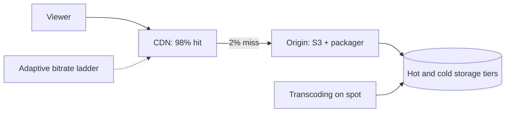

Result: from $540,000 of naive monthly egress alone to about $200,000 in total (about $0.10 per viewer) through CDN offload, bitrate control, tiering and spot transcoding. The point is the method: estimate, find the dominant line, attack it.

## 5. Variants and comparison 🟡

| Lever | Typical saving | Risk | Best for |
| --- | --- | --- | --- |
| CDN and caching | 50-95 percent of egress and origin load | Stale content, purge complexity | Read-heavy, public content |
| Reserved or savings plans | Up to 30-70 percent on baseline | Over-commitment | Stable base load |
| Spot | Up to 60-90 percent | Interruptions | Batch, stateless, checkpointed work |
| Right-sizing | 20-50 percent on over-provisioned services | Under-provision at peaks | Any long-running fleet |
| Storage tiering | 40-80 percent on cold data | Retrieval fees and latency | Aging data |
| Compression and better formats | 20-80 percent on bytes and storage | CPU cost | Logs, analytics, media |
| Scale to zero | Large for idle environments | Cold starts | Dev, staging, spiky functions |
| Build versus buy | Depends on scale | Hidden people cost | Only at very large scale |

All savings above are broad, commonly cited ranges and estimates, not guarantees.

## 6. Trade-offs 🟡

| Saving | What you give up |
| --- | --- |
| Smaller instances, high utilisation | Headroom for spikes; run at 50-70 percent peak, not 95 |
| Single AZ for a service | Availability. Do not cut this for anything user-facing without stating the SLA hit |
| Cold storage | Retrieval latency and fees |
| Spot | Interruptions, need for checkpoints |
| Long cache TTLs | Freshness |
| Aggressive log sampling | Debugging detail. Keep errors and slow requests at 100 percent |
| Self-hosting | Engineer time and on-call load |
| Reserved commitments | Flexibility if architecture changes |

> [!warning] Common mistake
> Cutting redundancy to save money and not telling the interviewer the availability cost. Cost cuts that silently lower the SLA are a red flag. State the trade-off.

## 7. In production 🔴

> 🟡 → 🔴 **You now know** each cost lever and how to estimate a bill. **Next comes the senior view**: how teams keep cost under control in production (tags, budgets, alerts), and how cost trades against availability, consistency and lock-in.

- **Tag everything** (team, service, environment) so each bill line has an owner. Untagged spend cannot be fixed.
- **Budgets and anomaly alerts.** A daily spend alarm catches a runaway loop or a forgotten test cluster within a day, not at month end.
- **Cost dashboards per service**, with cost per request next to latency and error rate. See [[Performance Engineering and Capacity Planning]].
- **Metric cardinality and log volume.** Cardinality is the number of distinct label values. A label with user IDs in a metric can create millions of series and a large observability bill. Review before shipping.
- **Idle resources.** Schedule dev and staging off at night; delete unattached volumes, old snapshots and unused load balancers.
- **Review commitments** quarterly. Reserved capacity bought for one architecture stays after you migrate.
- **Test with load, not guesses.** Autoscaling that thrashes (scale up and down every few minutes) pays for instance warm-up repeatedly. See [[Autoscaling]].
- **Cloud egress alternatives.** Some providers charge little or nothing for egress (Cloudflare R2 advertises zero egress fees), which changes the maths for large public content. Weigh it against integration cost.

## 8. Deep dive 🔴

### Unit economics as a design constraint

**In plain words:** Set a money budget per order (or per user) first. Then check every design idea against it, like you check against a speed target.

Define the target first: "infra cost under 3 percent of GMV (gross merchandise value: the total money of all orders)" or "under $0.02 per order". Then every design choice is checked against the budget, the same way latency budgets work. A p99 budget splits across hops; a cost budget splits across components.

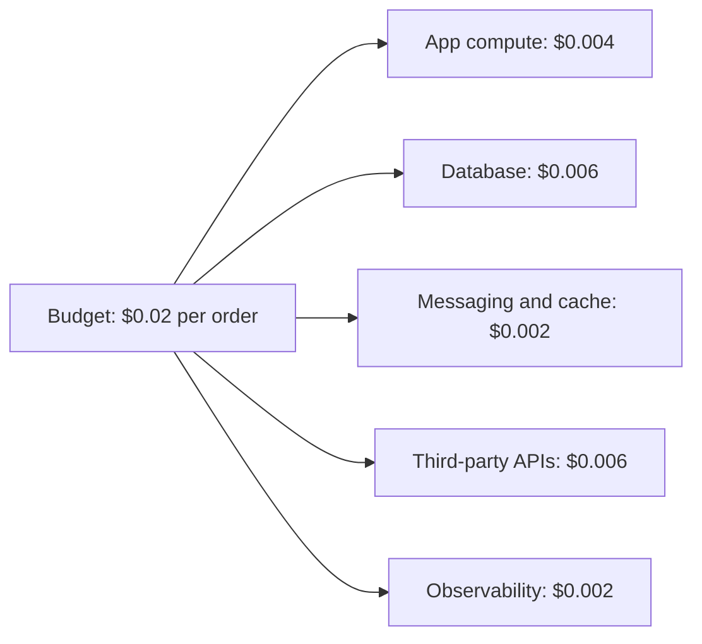

### Cost versus availability

**In plain words:** Each extra "nine" of uptime means more spare copies running. Spares cost money even when nothing breaks.

Each extra nine of availability roughly demands another level of redundancy: multi-AZ, then multi-region. Multi-region active-active can more than double infra cost and adds cross-region transfer. Choose the tier from the business impact of downtime, not from habit. A small internal tool does not need three regions. See [[Multi-Region Architecture]].

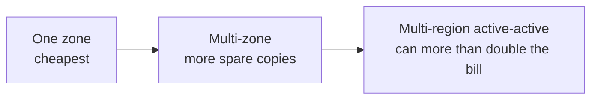

### Cost of consistency and durability

**In plain words:** Making every copy agree right away, and never losing a byte, means more waiting and more copies. Both cost money.

Synchronous cross-region replication and strongly consistent reads cost latency and money. Quorum writes use more IO and network. Provisioned IOPS and multi-AZ standby are insurance you pay for every month. State what failure each one covers.

### Egress as a lock-in factor

**In plain words:** Clouds charge you to take data out. The more data you store in one cloud, the more it costs to ever leave.

Moving data out of a cloud costs per GB. A design that keeps a 5 PB data lake in one provider has a real exit cost: at roughly $0.05 per GB, about $250,000 just to read it out (illustrative). Mention it only if the interviewer asks about multi-cloud or vendor lock-in.

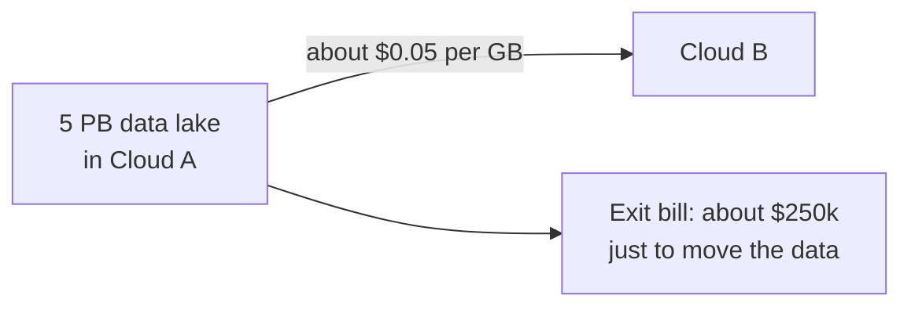

### Whiteboard version

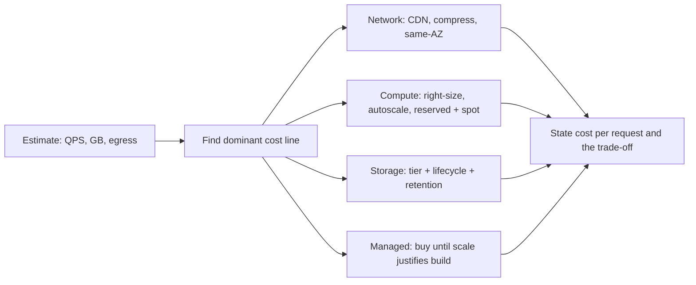

Say it in 30 seconds: "Four buckets: compute, storage, network, managed. I estimate each, find the dominant line (usually egress or the database), and attack that first: CDN and cache for reads, reserved baseline plus autoscale plus spot for compute, lifecycle tiers for storage. I report cost per request and say what each saving costs me in availability or freshness."

## 9. Interview questions 🔴

> [!question]- The interviewer says your design is too expensive. What do you do?
> Ask what the budget is (cost per user or per request). Estimate the bill by bucket, find the dominant line, usually egress or the database, then name two or three levers for it with numbers: CDN and caching, right-sizing, tiering, spot for batch. State the trade-off each lever makes (freshness, interruptions, retrieval latency). Do not cut redundancy without saying what happens to the SLA.

> [!question]- How would you cut the cost of serving a petabyte of mostly cold user photos?
> Lifecycle rules: hot tier for recent uploads, infrequent access after about 30 days, archive for very old, deleted when retention ends. Add a CDN for popular items, store derived thumbnails separately so full-size files are rarely read, and check access logs before tiering to avoid retrieval fees on data that is actually warm.

> [!question]- When would you use spot instances, and when not?
> For interruptible, restartable, parallel work such as video transcoding, batch ETL, CI and stateless workers that checkpoint. Not for the primary database, leader nodes or latency-critical single points. Mix: a reserved baseline and on-demand for the guaranteed part, with spot capacity for the rest and several instance types to reduce simultaneous reclaim.

> [!question]- Your microservices bill shows large cross-AZ and NAT charges. Why, and what do you change?
> Chatty calls spread across zones are billed per GB both ways, and traffic to S3 or the internet through a NAT gateway is billed per GB processed. Fixes: zone-aware routing, co-locate chatty pairs, use gateway endpoints for S3 and DynamoDB, compress and batch payloads, cache lookups. Keep a replica in another zone for availability anyway.

> [!question]- Serverless or containers for an API with steady 2,000 requests per second?
> Containers, most likely. Functions are cost-efficient for spiky or low volume. At steady high volume the per-invocation pricing exceeds always-on, reserved capacity. Compute the break-even from average duration, memory and request rate. Keep functions for spiky event handlers around the system.

> [!question]- When is building your own better than a managed service?
> When the service is a core differentiator or the scale is so large that the premium exceeds the cost of a dedicated team. Dropbox built its own storage at exabyte scale. For most teams the people cost, on-call and risk make managed cheaper overall. Say you would revisit at about ten times the scale.

## 10. Cheat sheet 🟢

| Bucket | First lever | Number to quote |
| --- | --- | --- |
| Network egress | CDN, compression, cache | Cost = GB out x price per GB (about $0.05-0.09, approximate) |
| Compute | Right-size, autoscale | Run at 50-70 percent peak |
| Compute pricing | Reserved base, spot batch | Savings plans up to about 72 percent, spot up to about 90 percent (provider-advertised ceilings) |
| Storage | Lifecycle tiers, retention | Hot roughly $0.023 per GB-month, colder tiers far less |
| Database | Cache reads, right-size, read replicas | 90 percent hit ratio means 10x fewer DB reads |
| Cross-AZ | Zone-aware routing | About $0.01 per GB each way (approximate) |
| NAT | Gateway endpoints | About $0.045 per GB processed (approximate) |
| Managed vs build | Buy until scale or differentiation | Count engineer time |
| Reporting | Cost per request or per user | Compare to revenue per unit |

Interview habit: estimate, find the dominant line, one lever, one number, one trade-off.

## Self-check 🟢🟡

> [!question]- (easy) What are the four big cost buckets?
> Compute, storage, network (especially egress) and managed services.

> [!question]- (easy) What is egress?
> Data leaving the cloud provider's network, billed per GB.

> [!question]- (easy) Why is a CDN a cost tool, not just a speed tool?
> Every byte served from the edge is a byte you do not pay origin egress for.

> [!question]- (medium) 10M users × 50 images × 300 KB a day at $0.09/GB. Rough daily egress cost?
> 150 TB ≈ 150,000 GB × $0.09 ≈ $13,500 a day.

> [!question]- (medium) Load swings between 20 and 100 servers. How do you buy compute?
> Reserve the 20 baseline, autoscale the rest on-demand, and run batch work on spot.

> [!question]- (medium) Why is cross-AZ traffic a hidden cost?
> It looks internal but is billed per GB in both directions, so chatty services split across zones add up.

## Links 🟢

- Estimation and scale: [[Back-of-the-Envelope Estimation]], [[Scaling Basics]], [[Performance Engineering and Capacity Planning]]
- Network and caching: [[CDN and Edge]], [[Caching Patterns]], [[Choosing a Caching Strategy - Decision Guide]]
- Cloud: [[AWS 04 - Compute Choices - EC2, ECS-Fargate, EKS, Lambda]], [[AWS 07 - S3]], [[Autoscaling]]
- Resilience cost: [[Multi-Region Architecture]]
- Framework: [[System Design Interview Framework]], [[Security, Privacy and Compliance in HLD]]

 🟢

### Watch on YouTube

- [8 Most Important System Design Concepts You Should Know](https://www.youtube.com/watch?v=BTjxUS_PylA) · ByteByteGo · 6 min · 612,191 views
- [Agentic AI System Design: Evals, Guardrails and Cost](https://www.youtube.com/watch?v=dDXgPTDpcis) · codebasics · 92 min · 38,810 views
