# Fan-out on Write vs Fan-out on Read

> [!summary] TL;DR
> When one person posts and many people must see it, you choose **when to do the work**.
>
> **Fan-out on write (push)** copies the post into every follower's inbox when it is posted, so reading is one cheap lookup.
>
> **Fan-out on read (pull)** stores the post once and assembles each reader's view when they open the app.
>
> Real systems use a **hybrid**: push for normal accounts, pull for celebrities.

> [!abstract] Core idea
> - Both models do the same total "delivery" work in the end. They differ in **when** (at post time or at read time) and **who pays** (the writer's path or the reader's path).
> - Push wins when reads are far more frequent than writes and the audience is small. Pull wins when the audience is huge or most readers never come back.
> - The cost of push is **write amplification** (one post becomes N writes) and wasted work for inactive users. The cost of pull is **read amplification** (one read becomes N lookups and a merge) and slow reads.
> - The same pattern, the **inbox**, shows up in feeds, chat, notifications and live comments. Learn it once.
> - Interview trap: saying "just push everything". A user with 50 million followers makes that a 50-million-write event.

## Start here: the basics 🟢

> [!info] How to read this note (pick your level)
> - 🟢 **New to this?** Read "From zero" below, then sections 1, 2 and the cheat sheet (10). Stop there, that is a full first pass.
> - 🟡 **Know the basics?** Add section 3 (push, pull, hybrid), 4 (worked estimate) and 5.
> - 🔴 **Interview / SDE-3 prep?** Add 6, 7, 8 and 9. Headings are tagged 🟢🟡🔴 so you always know where you are.

**From zero, in 60 seconds** 🟢

You post a photo. 500 people follow you. Each one should see it in their feed.
You can do the work when you post: drop a copy into each follower's list right away. That is **push** (fan-out on write).
Or you can do the work when a follower opens the app: go and collect posts from everyone they follow. That is **pull** (fan-out on read).
Push makes reading fast but posting slow. Pull makes posting fast but reading slow.

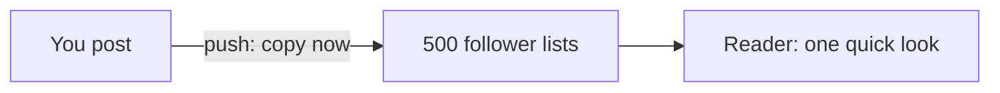

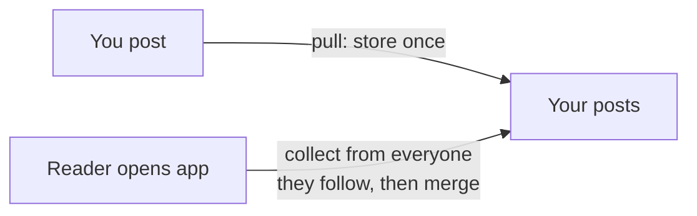

A celebrity with 50 million followers breaks push: one post means 50 million copies. So real apps mix both. That mix is called the **hybrid**.

The rest of this note is just these 3 questions:
1. When is push better, and when is pull better?
2. How does the hybrid handle celebrities and sleepy users?
3. How do you store, sort and page through the feed at large scale?

**The problem in one story.**
You post a holiday photo. 500 friends follow you.
Each of them opens the app later and expects to see your photo near the top.
Someone has to put your photo in front of 500 people.
The only question is: do you do that work now, when you post, or later, when each friend opens the app?

**Words you need first**

| Word | Plain meaning | Tiny example |
|---|---|---|
| Follower | A user who wants to see your posts | 500 friends follow you |
| Feed / timeline | The list of recent posts a user sees on opening the app | Your home screen |
| Inbox | A ready-made per-user list of post ids, stored for fast reading | Bob's list: [p9, p7, p3] |
| Fan-out | One event causing many deliveries | 1 post sent to 500 inboxes |
| Push / pull | Do the work at post time / do it at read time | Mail delivered vs fetching it yourself |
| Cache (Redis) | Fast in-memory store used to keep inboxes | `LPUSH inbox:bob p9` |
| Read-to-write ratio | How many reads happen per write | 100 reads per post |
| Celebrity / hot account | An account with a huge audience | 50 M followers |

**Picture it**

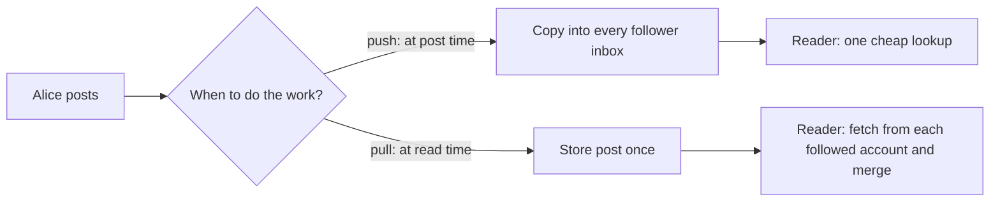

**Analogy.** Push is a newspaper delivered to every door each morning. Pull is walking to the shop to pick one up when you want it.
Where it breaks: a real reader buys one paper, but a pull feed must visit many "shops" (one per followed account) and merge the results.

**How the rest of this note builds up**

- First, why it exists (sections 1-2): the read-to-write numbers and the celebrity problem.
- Then how push, pull, the hybrid and the inactive-user cap work (section 3).
- Then a worked estimate and a comparison of where each model appears (sections 4-5).
- Finally the SDE-3 deep dive (section 8): merging, cursors, ordering, tiering and sharding the inbox.

> [!tip] Remember
> Push pays at write time, pull pays at read time; pick by read-to-write ratio and audience size.

## 1. Why it exists 🟢

Think about how a newspaper reaches you. A newspaper can be **delivered to your door each morning** (the paper company does the work once, early, for every subscriber). Or you can **walk to the shop and pick one up** (you do the work, when you want it). Social apps face the same choice for every post.

Take a feed with 300 million users. Suppose the average user follows 200 accounts and opens the app 10 times a day (all numbers here are estimates for the scenario).

- **Reads:** 300 M users × 10 opens = 3 billion feed reads per day = about **35,000 reads per second** on average, maybe 100,000 per second at peak.
- **Writes:** if 10% of users post once a day, that is 30 million posts per day = about **350 posts per second**.

So the feed is read about 100 times more often than it is written. That ratio is what makes "do the work at write time" attractive: do the work once per post, so each of the 100 reads is trivial.

But look at the other side. One celebrity with 50 million followers posts. Pushing means 50 million inbox writes for one post.

At 100,000 inbox writes per second per cluster (an estimate), that one post keeps the fan-out workers busy for **500 seconds**, over 8 minutes.

During that time the celebrity's post is not visible to most followers, and every other user's post is stuck in the same queue.

> [!tip] Remember
> The right model depends on two numbers: the read-to-write ratio, and the size of the audience per post.

## 2. Mental model 🟢

### 2.1 Post office versus pick-up counter

**In plain words:** Fan-out on write is a post office that puts a copy of every letter into each recipient's **mailbox** the moment it arrives. Fan-out on read is a **notice board**: one copy is pinned up, and every person walks over and reads it when they like.

The analogy breaks down because a real notice board needs no merging. Pull-based feeds must read from many boards (one per followed account), then **merge and sort** the results, which is the expensive part.

Key terms:

- **Fan-out:** one event causing many deliveries. A post to 500 followers has a fan-out of 500.
- **Inbox (also called timeline, mailbox or feed store):** a per-user list of item references, stored ready to read.
- **Write amplification:** writes caused per original write. Push has amplification equal to the follower count.
- **Read amplification:** reads caused per original read. Pull has amplification equal to the number of accounts followed.
- **Hybrid:** push for most accounts, pull for a few very large ones, merged at read time.

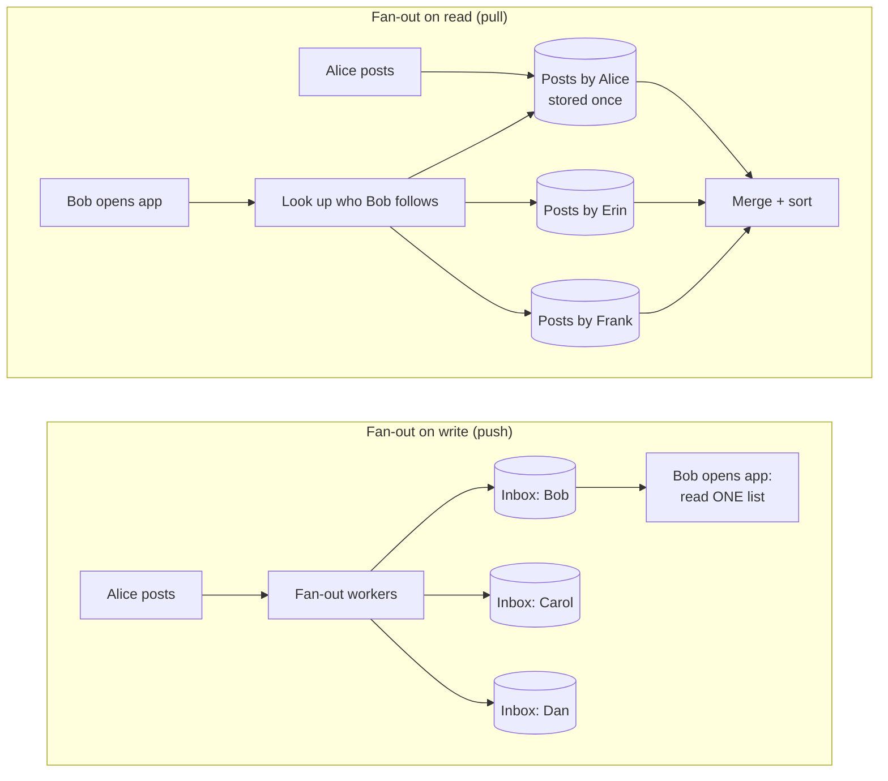

> [!tip] Remember
> Push = pay at write time, cheap reads. Pull = pay at read time, cheap writes.

## 3. How it works 🟡

### 3.1 Fan-out on write (push)

**In plain words:** When Alice posts, the system looks up all her followers and appends the post's ID to each follower's inbox. When Bob opens the app, the app reads his inbox and fetches the posts. No searching, no merging.

**Picture it:**

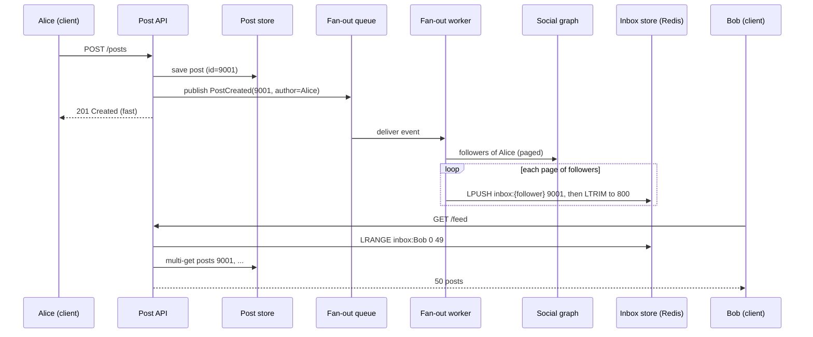

**Example (numbers):** Alice has 500 followers. One post = 1 row in the post store + 500 inbox writes. Bob's feed read = 1 inbox read (50 IDs) + 1 batch fetch of 50 posts = 2 round trips, about 5 to 10 ms.

**Why it matters:** Feed reads become predictable and fast, which is what users feel. The writer's request is also fast, because fan-out happens **asynchronously** after the post is saved.

Step by step:

1. The post is saved first (the source of truth). The API replies to Alice right away.
2. A `PostCreated` event goes onto a queue (Kafka or SQS). See [[Kafka and Event Streaming]].
3. A worker reads the follower list, in pages of 1,000 so no single task is huge.
4. For each follower, it pushes the post ID onto that follower's inbox and trims the list to a cap (for example the latest 800 items).
5. On read, the feed service reads the inbox IDs and **hydrates** them: fetches the post bodies, author names and like counts from caches.

> [!warning] Common mistake
> Storing the whole post in every inbox. Store only the **post ID** (8 bytes) plus maybe a timestamp. Otherwise an edit or delete has to rewrite millions of copies, and storage balloons.

### 3.2 Fan-out on read (pull)

**In plain words:** Nothing is copied at post time. When Bob opens the app, the system asks "who does Bob follow?", fetches the latest posts from each, merges them by time, and returns the top page.

**Picture it:**

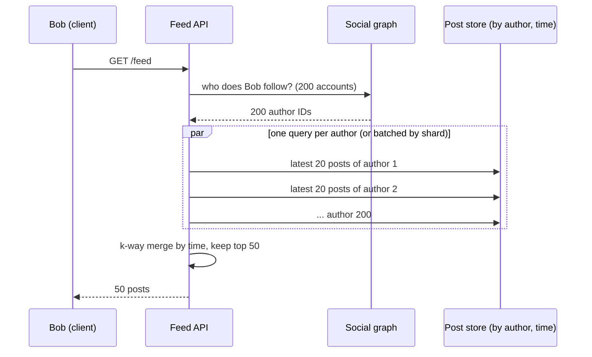

**Example (numbers):** 200 followed accounts, 20 recent posts each = 4,000 candidate posts, merged down to 50. If the post store is sharded by author, the query touches many shards. A single feed read costs 200 lookups (or around 20 batched calls). At 35,000 reads per second that is 7 million lookups per second.

**Why it matters:** Writes are trivial (one row) and a post is visible instantly to everyone. But reads are slow and expensive, and read-side load grows with the number of accounts a user follows.

Step by step:

1. Post is stored once, indexed by `(author_id, time)`.
2. At read time the API fetches Bob's followee list (cached).
3. It queries each followee's recent posts, usually in parallel and batched per shard.
4. It runs a k-way merge on the timestamps (or on a ranking score) and returns a page.
5. A cache of the merged result for 30 to 60 seconds protects the store from repeated refreshes.

> [!tip] Remember
> Pull is simple to build and always fresh, but its read cost scales with "accounts followed". Push moves that cost to write time.

### 3.3 The hybrid for celebrities

**In plain words:** Treat accounts differently by size. For a normal account with 300 followers, push. For an account with 20 million followers, do **not** push. Instead, at read time, the reader's feed merges their pre-built inbox with the latest posts from the few big accounts they follow.

**Picture it:**

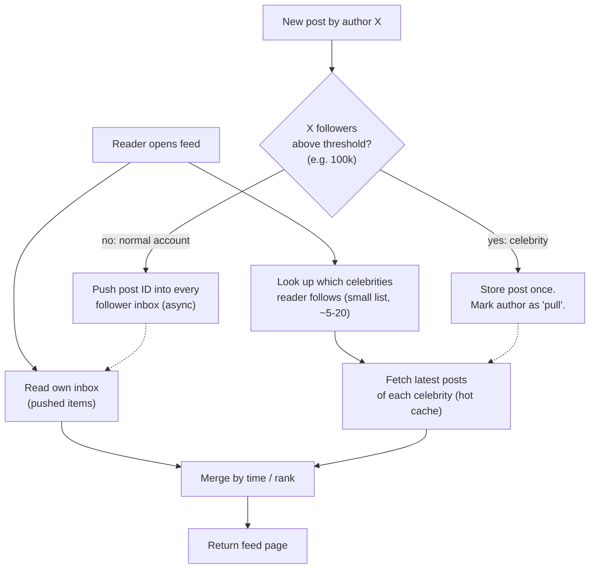

**Example (numbers):** A typical reader follows 200 accounts, of which 4 are celebrities. Read cost: 1 inbox read + 4 cache reads of celebrity timelines (these are shared across all followers, so they sit in cache and are extremely hot), then a merge. A celebrity post costs 1 write, not 20 million.

**Why it matters:** This keeps both cost curves flat. Twitter publicly described exactly this design in 2013 (the current system differs): per-user timelines in Redis filled on write, with accounts that have very large follower counts merged in at read time.

> [!warning] Common mistake
> Picking the celebrity threshold by gut. Pick it from numbers: choose the follower count where fan-out time for one post exceeds your freshness goal. For example, 100,000 inbox writes per second and a 10 second goal gives a threshold near 1 million followers; many systems pick lower to protect the shared queue.

### 3.4 Inactive users and the cap

**In plain words:** Most accounts on any app are not opened today. Pushing a post into inboxes of people who will not log in for a month is wasted work.

Two standard fixes:

1. **Push only to active users.** Track "last seen". Fan out to users active in the last 7 to 30 days. When a dormant user returns, **rebuild** their inbox with a pull and then switch them back to push.
2. **Cap the inbox.** Keep the last N items (for example 800). Older items are served by pull from the post store when the user scrolls deep.

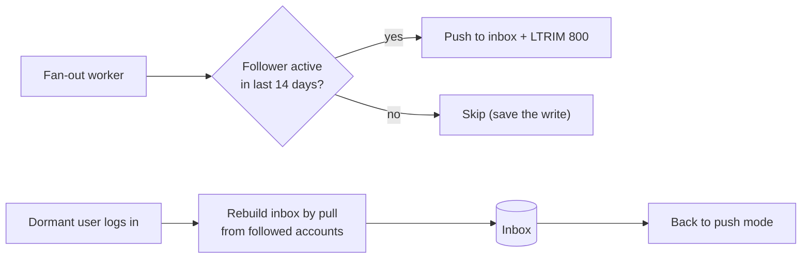

> [!tip] Remember
> Push wasted on inactive users is the biggest hidden cost. Skip them and rebuild on return.

## 4. Worked example 🟡

### Estimating both models for a feed with 100 million users

**In plain words:** We do rough maths for both ways and compare. The winner is whichever does less total work for the same feed.

Assumptions (labelled estimates): 100 M daily active users, 150 follows each on average, 20% post once per day, each user opens the feed 8 times a day, peak is 3 times the average.

**Step 1: traffic.**

- Posts per day: 100 M × 20% = 20 M posts = about 230 posts per second average, 700 at peak.
- Feed reads per day: 100 M × 8 = 800 M = about 9,300 per second average, 28,000 at peak.
- Read-to-write ratio: 28,000 / 700 = about **40 to 1**.

**Step 2: push cost.**

- Each user has about 150 followers on average (follows equal followers across the graph on average).
- Inbox writes per day: 20 M × 150 = **3 billion**, about 35,000 per second average, 105,000 at peak.
- Inbox storage: 100 M users × 800 items × 8 bytes = **640 GB** of IDs, about 1.3 TB with replication and overhead (estimate). Fits in a Redis cluster of roughly 20 to 30 nodes at 64 GB each.
- Feed read cost: 1 inbox read + 1 hydration batch = about 2 operations.

**Step 3: pull cost.**

- Writes: 700 per second at peak, trivial.
- Feed read: 150 lookups each. 28,000 × 150 = **4.2 million lookups per second** at peak (before caching). Even with batching by shard, this is far more database work than push needs.

**Step 4: the skew.**

- Say 5,000 accounts have more than 1 million followers, and together they post 20,000 times per day. Pushing those costs 20,000 × (say) 3 M average followers = **60 billion** inbox writes per day, which is **20 times** all the rest combined.
- So 0.005% of accounts would cause 95% of the push work. That is why the hybrid exists.

| Model | Writes/s (peak) | Feed read cost | Verdict |
| --- | --- | --- | --- |
| Pure push | 105,000 normal + about 2,000,000 celebrity-induced (60 B/day is about 700,000/s average, 3x at peak) | 2 ops | Celebrities break it |
| Pure pull | 700 | ~150 lookups | Reads too heavy at 28k/s |
| Hybrid | ~105,000 | ~2 ops + ~5 hot cache reads | Both curves stay flat |

### Whiteboard version

```text
Post  --> store once (post store)
      --> event --> fan-out workers
                     |-- author followers < T : LPUSH inbox:{f} postId ; LTRIM 800 (active users only)
                     |-- author followers >= T: do nothing (celebrity)
Read  --> inbox:{me} (IDs)  +  latest posts of celebrities I follow
      --> merge by time/rank --> hydrate (cache) --> return
Rules: store IDs not bodies; skip inactive users; cap inbox; threshold T from math
```

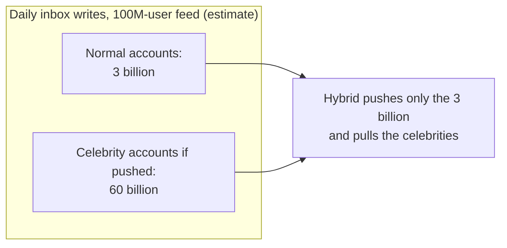

> [!tip] Remember
> Always do the arithmetic on both sides and on the biggest account. The long tail of huge accounts decides the design.

## 5. Variants and comparison 🟡

| Aspect | Fan-out on write (push) | Fan-out on read (pull) | Hybrid |
| --- | --- | --- | --- |
| Read latency | Low (1 inbox read) | High (many lookups + merge) | Low (inbox + few hot reads) |
| Write cost | High, equals follower count | Low, one row | Medium |
| Freshness | Delayed by fan-out lag | Instant | Normal: small lag, celebrity: instant |
| Storage | Large (an entry per follower) | Small | Medium |
| Wasted work | Inactive followers | None | Small (skip inactive) |
| Edit / delete | Must handle copies (store IDs, filter at read) | Trivial | Same as push for IDs |
| Ranking by ML | Hard to re-rank a frozen inbox | Easy (rank at read) | Rank at read over candidates |
| Failure mode | Backlog in fan-out queue, stale feeds | Slow reads, overloaded post store | Both, but smaller |
| Best fit | Many reads per write, small audiences | Huge audiences, sparse readers | Social feeds at scale |
| Wrong choice when | Audiences are huge (celebrity) | Read rate is very high | Tiny scale; extra complexity |

### Where each model appears in real systems

**In plain words:** Big apps almost never use pure push or pure pull. This table shows which mix each one is known to use, and why.

| System | Model | Why (publicly described) |
| --- | --- | --- |
| Twitter home timeline | Hybrid: Redis lists filled on write, celebrities merged at read | Timelines at Scale talk (2013) |
| Chat inbox (WhatsApp-style) | Push into a per-recipient queue until delivered | One recipient or a small group; delivery needs a per-device state |
| Large chat channels (Discord-style) | Pull: messages stored once per channel, readers read the channel | A channel can have huge membership; no per-user copy |
| Notifications | Push (a per-user notification list) | Each item is relevant to few users and must persist per user |
| Live comments on a stream | Pull / pub-sub: viewers subscribe to the stream's topic | One hot topic, huge audience, short lifetime; see [[Case Study - Live Comments and Reactions]] |
| Photo feed with ranking | Pull candidates + ML ranking at read | The ranker needs fresh signals; see [[Case Study - Photo Sharing (Instagram)]] |

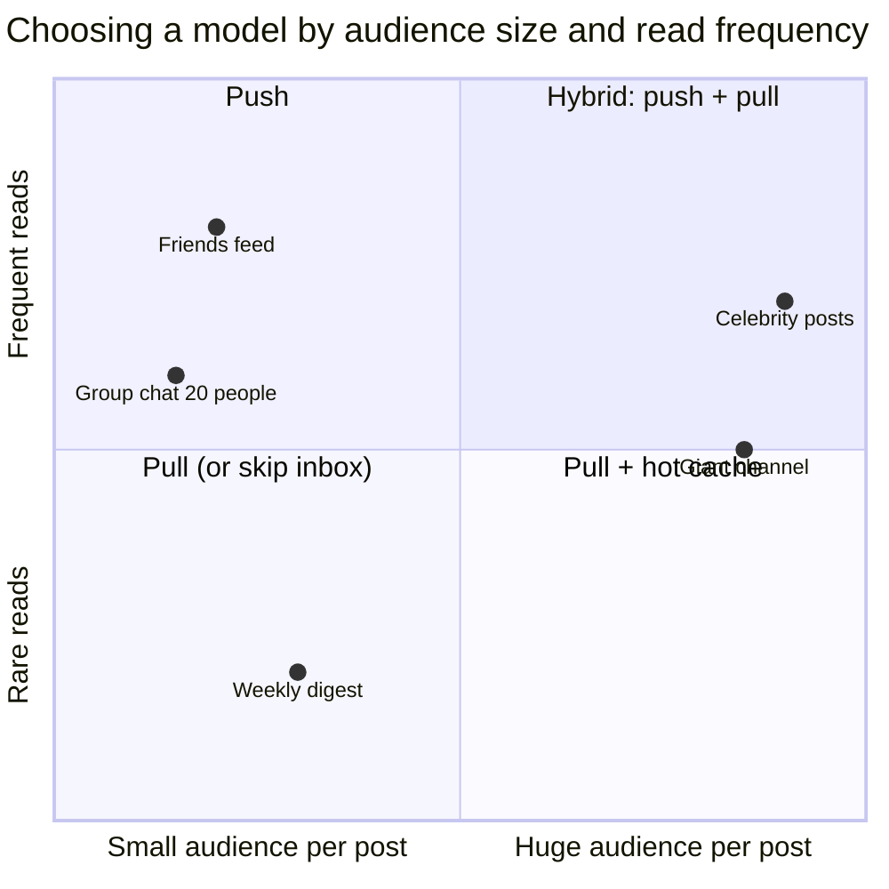

> [!tip] Remember
> Use the audience-size and read-frequency pair to place any new feature on the grid.

## 6. Trade-offs and when not to use 🟡

- **Do not push everything.** The celebrity case alone breaks it. Always ask "what is the largest audience for one post?"
- **Do not pull everything** when reads outnumber writes by 100 to 1 and audiences are small. You will rebuild the same merge 100 times.
- **Push gives stale-until-delivered feeds.** If the fan-out queue is backed up by 5 minutes, the post is 5 minutes late. Monitor fan-out lag, not just API latency. See [[Backpressure and Flow Control]].
- **Push makes deletes, edits and privacy changes harder.** Inbox holds IDs. At read time, hydrate, then **filter**: skip deleted posts, posts from blocked or unfollowed authors, and posts the viewer may no longer see. Do not try to chase every copy.
- **Pull makes ranking easy but latency hard.** ML ranking needs candidates; pull gives you a fresh candidate set. Many feeds therefore use push or hybrid for **candidate generation** and a ranker at read time.
- **Hybrid adds complexity.** Two code paths, a threshold to tune, and a merge to test. At small scale (say under 1 million users), plain pull with a cache is usually enough. Do not add push until measurement shows read cost is the problem.
- **Unfollow and follow need handling.** On follow, backfill the new followee's last few posts into the inbox. On unfollow, filter at read time (cheap) rather than deleting entries.

## 7. In production 🔴

- **Fan-out queue health.** Metrics: queue depth, consumer lag per partition, age of the oldest unprocessed event, inbox writes per second, p99 time from post to "visible in the last follower's inbox". Alert on the last one.
- **Isolation.** Put big fan-outs on a **separate queue or priority class** from normal ones, so one 5-million-follower post cannot delay everyone else's. See [[Hot Keys and Hot Partitions]] for the same idea with keys.
- **Chunking.** Split a fan-out into pages of 500 to 1,000 followers, each an independent, idempotent task. If a worker dies, only that page is retried. Writing the same ID twice to an inbox must be harmless: use a sorted set keyed by post ID, or de-duplicate on read.
- **Redis inbox sizing.** A Redis list of 800 IDs at 8 bytes is under 10 KB with overhead. Use a sorted set when you need to merge by score or remove by ID, at a higher memory cost.
- **Cold-start rebuild.** Keep a rebuild path (pull) that can reconstruct any user's inbox. It handles Redis data loss, new users and returning users with the same code.
- **Backfill on follow.** When Bob follows Alice, write Alice's last 20 post IDs into Bob's inbox. Otherwise Bob's feed looks empty of Alice until she posts again.
- **Failure modes → fixes:**
	- Fan-out lag grows → add consumers, shed work for inactive users, lower the push threshold.
	- Inbox store (Redis) loses a node → rebuild by pull on next read; do not treat the inbox as the source of truth.
	- A feed shows a deleted post → hydrate and filter at read; never rely on removing it from all inboxes.
	- A celebrity post spikes reads on one cache key → local L1 cache and key replication; see [[Hot Keys and Hot Partitions]].

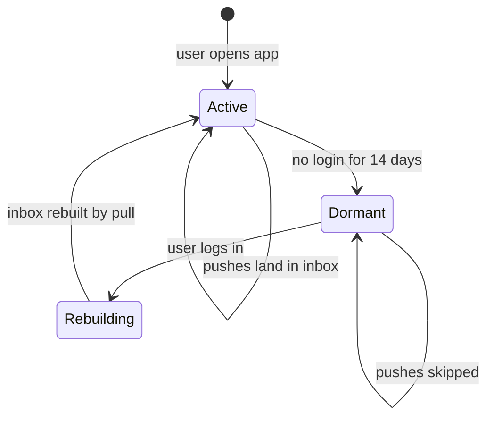

## 8. Deep dive 🔴

### 8.1 The same pattern in chat, notifications and live comments

**In plain words:** "Put something into a per-person box so they read it later" is the inbox pattern. Only the audience size and the lifetime change.

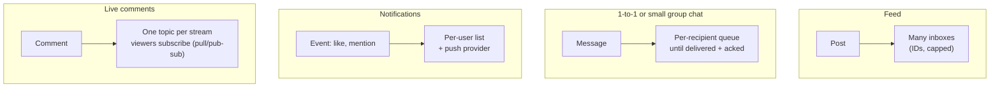

- **Chat:** a message to a friend is pushed to one recipient's inbox (or a small group's). It must not be lost, so each recipient has delivery state. A group of 20 is a fan-out of 20: push is right. A channel with 500,000 members is a read-model: store once per channel. See [[Case Study - Chat System]].
- **Notifications:** each notification is for few people and must persist per person (read/unread). It is a push inbox, plus a push-provider delivery for phones. See [[Case Study - Notification System]].
- **Live comments:** the audience is huge but the data is short-lived, so you do not keep a per-user inbox. Viewers subscribe to the stream's topic and get messages by pub-sub; late joiners fetch the last few. See [[Case Study - Live Comments and Reactions]].

### 8.2 Merging and ranking at read time

**In plain words:** Your feed is built from a few lists that are already sorted by time. Merging sorted lists is cheap, like merging sorted piles of cards.

A hybrid read merges two sorted lists: the inbox (newest first) and each celebrity's recent posts. Because each list is already sorted, a **k-way merge** with a heap runs in O(n log k), where n is items returned and k is the number of lists (5 to 20). That is microseconds of CPU.

The expensive part is not the merge, it is the **network round trips** to fetch lists, so batch and parallelise them.

When a ranker scores items instead of sorting by time, the pipeline becomes: candidate generation (inbox + celebrity posts + recommendations), then ranking (a model scores about 500 candidates), then filtering (blocked, seen, deleted), then page assembly. Push and pull are the **candidate generation** step; ranking is a separate stage.

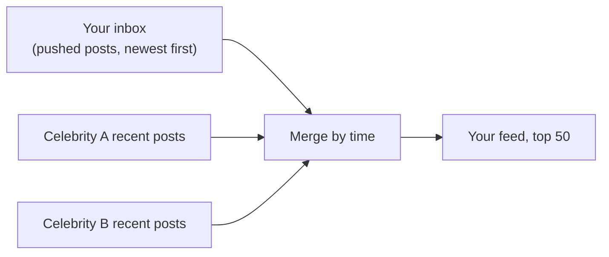

### 8.3 Cursors and pagination

**In plain words:** Do not say "give me items 51 to 100", because new posts shift everything. Say "give me 50 items older than the last one I saw".

Never paginate an inbox by offset: new pushes shift positions and the user sees duplicates. Use a **cursor** (the last post ID or timestamp seen): "give me 50 items older than `cursor`". Snowflake-style IDs (see [[Unique ID Generation]]) make IDs time-ordered, so the post ID itself is the cursor.

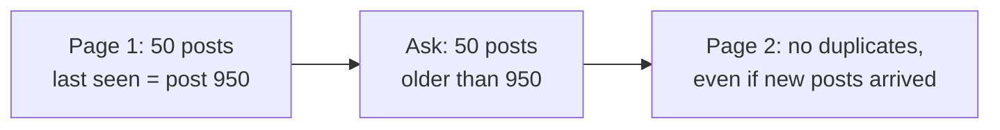

### 8.4 Ordering and consistency

**In plain words:** Copies may land out of order. Sort by the post's own time when you read, so the feed still looks right.

- Inbox order is by post time, but fan-out workers run in parallel, so two posts can arrive out of order. Sort by the post's own timestamp or ID at read time instead of trusting insertion order.
- A user's own post should appear in their feed immediately, even if fan-out is delayed. Merge "my recent posts" into my feed at read time: this is the **read-your-writes** guarantee.
- Fan-out is **at-least-once**, so duplicates are possible. Make the inbox write idempotent (sorted set by post ID, or de-dupe at read).

### 8.5 Storage tiering for inboxes

**In plain words:** Keep feeds of active users in fast memory. Throw away feeds of users who never open the app, and rebuild them if they come back.

Hot inboxes (active users) live in memory (Redis). Cold ones (dormant users) are dropped and rebuilt on demand, or kept in a disk-backed store. This tiering makes push affordable: memory is spent only on the 10 to 30% of users who are active.

### 8.6 Sharding the inbox

**In plain words:** Split the feed store by reader, so each reader's feed sits on one machine and loads in one trip.

Shard the inbox by **recipient user ID**, so one feed read hits one shard. The writer's fan-out, in contrast, touches many shards (one per follower), so batch writes per shard: group 1,000 followers by shard and send one pipeline per shard. See [[Partitioning and Sharding]].

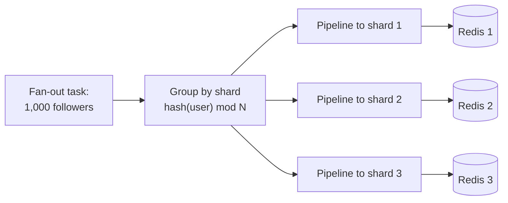

## 9. Interview questions 🔴

> [!question]- Design a news feed. Push or pull?
> Say it depends on read-to-write ratio and audience size. Feeds are read-heavy, so push (fan-out on write) into per-user inbox lists of post IDs makes reads cheap. But celebrities make push explode, so use a hybrid: push for normal accounts, merge celebrity posts at read time. Add: skip inactive users, cap inbox length, hydrate and filter at read.

> [!question]- A user with 50 million followers posts. What happens in your system?
> Not a push. The author is flagged as a "pull" account, so the post is stored once and cached hard. Followers' feed reads merge their inbox with the latest posts from the few celebrities they follow. Cost: 1 write instead of 50 million, plus a few extra hot-cache reads per feed read.

> [!question]- How do you handle deletes and edits when posts are copied into many inboxes?
> Inboxes hold only post IDs, not bodies. On read, hydrate IDs from the post store or cache and filter out deleted, blocked or no-longer-visible items. Edits show up automatically because the body is fetched at read. You never chase copies.

> [!question]- Where else does fan-out on write vs read appear?
> Chat (a per-recipient inbox until delivered, but pull per channel for giant channels), notifications (push list per user), live comments (topic subscription, pull/pub-sub), and email. The decision is always audience size and read frequency.

> [!question]- Fan-out lag is 10 minutes. How do you debug and fix it?
> Check queue depth, consumer lag and the age of the oldest event. Look for one huge fan-out blocking a shared partition. Fixes: separate queue for big authors, chunk fan-outs into independent pages, skip inactive users, add consumers, and lower the celebrity threshold.

> [!question]- Why store post IDs and not whole posts in inboxes?
> Storage and consistency. An 8-byte ID times 800 entries is small; whole posts would multiply storage by 100 and make edits, deletes and like counts impossible to keep consistent across millions of copies.

> [!question]- A user was offline for a month and logs in. What do you do?
> Their inbox was skipped for inactivity, so it is stale or gone. Rebuild with a pull from followed accounts, return the result, and switch the user back to push mode.

## 10. Cheat sheet 🟢

- Push = copy to every follower's inbox at post time; reads are one lookup; writes cost followers.
- Pull = store once; reads merge N sources; reads cost followees.
- Hybrid = push for normal authors, pull for celebrities, merge at read.
- Store IDs in inboxes. Cap length. Skip inactive users. Hydrate and filter at read.
- Pick the celebrity threshold from math: fan-out time vs freshness goal.
- Isolate big fan-outs on their own queue. Chunk into idempotent pages. Watch the age of the oldest event.
- Use cursors, not offsets. Merge own posts at read for read-your-writes.
- Same pattern: feed, chat, notifications, live comments.

## Links 🟢

- **Before this:** [[Caching Patterns]], [[Partitioning and Sharding]], [[Back-of-the-Envelope Estimation]]
- **Case studies that use it:** [[Case Study - News Feed]], [[Case Study - Chat System]], [[Case Study - Notification System]], [[Case Study - Live Comments and Reactions]], [[Case Study - Photo Sharing (Instagram)]]
- **Related:** [[Hot Keys and Hot Partitions]], [[Kafka and Event Streaming]], [[Backpressure and Flow Control]], [[Unique ID Generation]]

### Watch on YouTube

- [Fan-Out on Read vs Fan-Out on Write](https://www.youtube.com/watch?v=ktOoq3M9SBQ) · Kartikeya Sharma · 3 min · 2,378 views
- [Timeline Architecture / Fanout on Read vs Fanout on Write / System Design](https://www.youtube.com/watch?v=SeeKlGMxyBQ) · Kartikeya Sharma · 18 min · 1,120 views
