# Multi-Tenancy and Cell-Based Architecture

> [!summary] TL;DR
> A **tenant** is one customer (a company, a school, a shop) using your shared product.
>
> **Multi-tenancy** means many tenants share the same system to keep costs low, and the design problem is making sure one tenant cannot hurt, see or slow down another.
>
> **Cell-based architecture** takes that further: split the whole platform into many independent copies (**cells**), each serving a slice of tenants, so any failure hits only one slice.

> [!abstract] Core idea
> - Choose how much each tenant shares: a full stack each (**silo**), everything shared (**pool**), or a mix (**bridge**).
> - Carry a **tenant id** everywhere and enforce it in the data layer, not just in application code.
> - Stop **noisy neighbours** with per-tenant quotas, concurrency limits and fair queueing.
> - Limit the **blast radius** with cells and **shuffle sharding**, so a bad tenant or a bad deploy touches a small, known set of customers.

## Start here: the basics 🟢

> [!info] How to read this note (pick your level)
> - 🟢 **New to this?** Read "From zero" below, then sections 1, 2 and the cheat sheet (10). Stop there, that is a full first pass.
> - 🟡 **Know the basics?** Add section 3 (how it works), 4 (payroll example) and 5 (variants).
> - 🔴 **Interview / SDE-3 prep?** Add 6, 7, 8 and 9. Headings are tagged 🟢🟡🔴 so you always know where you are.

> [!note] Before this note
> - [[Partitioning and Sharding]]: big data is split into slices (shards) by a key, so each machine holds only part of it.
> - [[Rate Limiting - Algorithms and Distributed Design]]: you can count each caller's requests and reject the extra ones, so one caller cannot flood the system.

**From zero, in 60 seconds** 🟢

Many companies use your app. Each customer company is a **tenant**.
Giving every tenant its own servers is safe but very expensive. Sharing everything is cheap but risky.
Risk one: a tenant sees another tenant's data. Risk two: one busy tenant slows everyone down.
So you share, but you tag every row and every request with the tenant's id, and you limit how much each tenant can use.
Then you go one step further. You split the whole system into a few full copies, each serving a slice of tenants. Each copy is a **cell**.
If one cell breaks, only its tenants feel it.

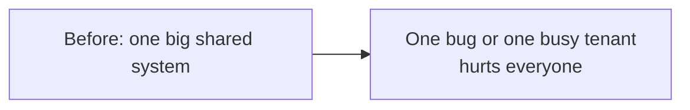

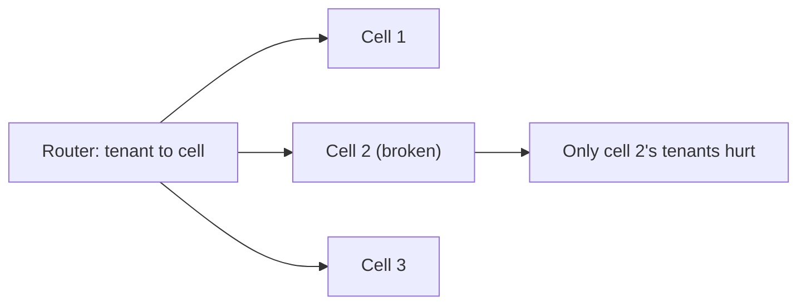

The rest of this note is just these 3 questions:
1. How much do tenants share, and how do you keep their data apart?
2. How do you stop one tenant from slowing the rest?
3. How do cells shrink the damage when something breaks?

**The problem in one story.**
You build an app that 5,000 small companies use to run payroll.
They all share the same servers and the same database, because that is cheap.
One big company runs a huge import and everyone else's payroll gets slow.
Worse, a bug could show company A's salaries to company B.
This note is about sharing safely: cheap like a shared building, safe like separate houses.

**Words you need first**

| Word | Plain meaning | Tiny example |
|---|---|---|
| Tenant | One customer organisation using your shared product | "Acme Ltd" on your payroll SaaS |
| Multi-tenancy | Many tenants share one running system | 5,000 companies on one cluster |
| Tenant id | A number on every request and row saying whose it is | `tenant_id = 42` |
| Shard | One slice of the data on its own database | Tenants 1-500 live on shard 3 |
| Noisy neighbour | A tenant whose heavy use slows others down | A 4-million-job import |
| Quota | A per-tenant limit on usage | Max 50 workers per tenant |
| Blast radius | How many customers one failure can hurt | 1 cell of 20 = 5 percent |
| Cell | A complete, independent copy of the whole service | Cell 7: app, queue, DB, cache |
| SaaS | Software you rent online instead of installing | a payroll app used by 5,000 companies |
| Silo / pool / bridge | Own stack per tenant / everything shared / a mix | banks in silos, shops in the pool |
| RLS (row-level security) | A database rule that hides rows of other tenants | `tenant_id = 42` sees only its rows |
| Directory | A lookup table: which tenant lives on which shard or cell | tenant 42 → shard 3 |
| Shuffle sharding | Each tenant gets its own small random set of workers | tenant A on W1+W5, tenant B on W2+W5 |
| Control plane | The admin side that creates cells and moves tenants, not the request path | "move tenant 42 to cell 5" |

**Picture it**

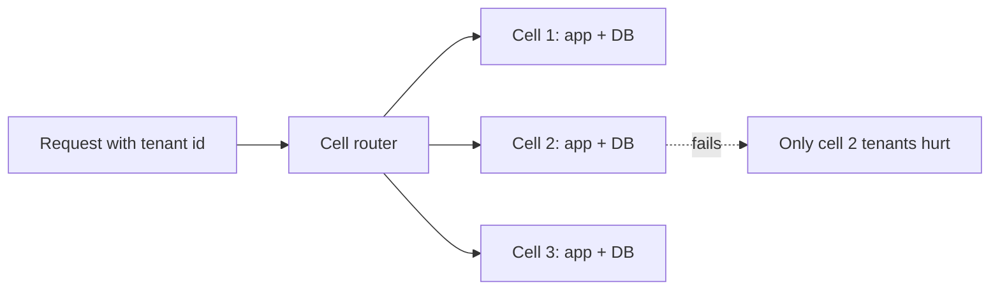

**Analogy.** Multi-tenancy is an apartment building: tenants share walls, pipes and the lift to save money. Cells are several separate buildings, so a fire in one does not reach the others.
Where it breaks: apartment walls are physical, while software isolation exists only if you enforce the tenant id in every layer.

**How the rest of this note builds up**

- First, why it exists and the mental model (sections 1-2).
- Then how it works (section 3): silo, pool and bridge; data isolation; tenant-aware sharding; noisy neighbours; cells; shuffle sharding.
- Then a worked payroll example and a comparison of variants (sections 4-5).
- Finally the SDE-3 deep dive (section 8): cell sizing, placement, evacuation, fairness, observability and security.

> [!tip] Remember
> Tag everything with a tenant id, limit each tenant, and split the platform into cells so one failure hurts only a slice.

## 1. Why it exists 🟢

You build an invoicing SaaS. Customer 1 is a corner shop with 20 invoices a day. Customer 2 is a retail chain that imports 4 million invoices on the first of every month.

If both share one database and one worker pool, the chain's import on the 1st starves the corner shop. Its page takes 40 seconds to load, and the shop owner emails support.

Worse things happen too:

- A bug in a query forgets the `WHERE tenant_id = ?` clause, and the shop sees another company's invoices. That is a data breach, not a bug report.
- A bad deploy breaks login. With one big shared system, all 10,000 tenants are down at once.
- A huge customer demands "my data must live in Germany" or "give me my own database".

Separate stacks per tenant solve all of it but cost too much when you have 10,000 tenants. Multi-tenancy design is the art of sharing enough to be cheap while isolating enough to be safe.

> [!tip] Remember
> Sharing makes it cheap. Isolation makes it safe. Every decision moves the dial between them.

## 2. Mental model 🟢

Think of **housing**.

- **Silo** is a detached house per family: full privacy, expensive, and a lot of buildings to maintain.
- **Pool** is one big apartment block with shared plumbing: cheap, but a burst pipe or a loud neighbour affects everyone.
- **Bridge** is a block of flats where most families share the building but the largest family rents a whole floor with its own meter.
- **Cells** are an entire estate of separate apartment blocks, each with its own plumbing. When the pipe bursts, only one block is flooded.

Where the analogy breaks: tenants can be moved between blocks by software, in minutes or hours, if you design a router for it. Real families cannot.

### Real-life example: Shopify, Slack and Zoho 🟢

Shopify runs millions of online shops on shared machines, but groups shops into isolated "pods", each with its own database, so a problem in one pod does not take down every store.
Slack moved to a "cellular" design so that a failure in one part of its system affects only some workspaces.
Business apps like Zoho or Freshworks serve thousands of companies from one product; every row carries the company's ID, so one company can never see another's data.
And when one big customer runs a huge import, per-customer limits keep small customers fast.

## Common beginner mistakes 🟢

- **Reading the tenant id from the request body** → a user can type someone else's id and read their data → take it from the login token only.
- **Relying on every developer to add `WHERE tenant_id = ?`** → one forgotten filter is a data breach → enforce it in the database with row-level security.
- **Limiting only requests per second** → a tenant can send few but very heavy requests and hold every worker → also cap concurrent work per tenant.
- **Cells that quietly share one auth database or config service** → when that breaks, every cell breaks → give each cell its own copy, or cache it.
- **Building cells for 30 customers** → lots of cost and moving parts for no gain → a shared pool with quotas is enough at small scale.

### Multi-tenancy vs things people confuse it with 🟡

| Idea | What it splits | Main goal |
| --- | --- | --- |
| Multi-tenancy | Customers sharing one product | Cheap sharing with safe isolation |
| Sharding | Data across databases | Hold more data, take more writes |
| Cells | The whole stack into full copies | Limit how many customers one failure hits |
| Shuffle sharding | Workers into many overlapping small sets | Stop one bad tenant from hurting the same others |

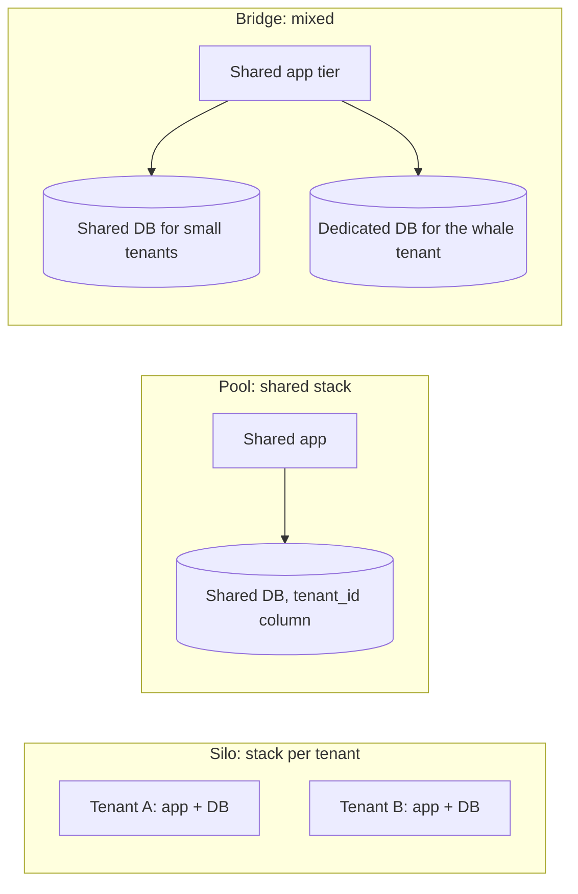

## 3. How it works 🟡

> 🟢 → 🟡 **You now know** tenants share a system, every request carries a tenant id, and cells limit the damage. **Next we open the box**: how much tenants share, where the data boundary sits, how tenants are placed on shards, how to stop noisy neighbours, how cells work, and shuffle sharding. Each subsection starts with a plain walk-through; the full detail follows.

### The three isolation models

**In plain words.** The question is which layers a tenant shares: compute, database, network. You can answer it differently per layer.

**Step by step:**
1. List your tenant types: 9,900 small shops, 3 banks, 1 big retail chain.
2. Small shops: put them all in shared servers and shared tables (pool). Cheapest.
3. Banks: their contracts demand their own database, so give them a separate stack (silo).
4. The retail chain: share the database but give it its own worker pool, so its big jobs do not crowd others.
5. That mix is the bridge model, where most real SaaS ends up.

**Picture it.**

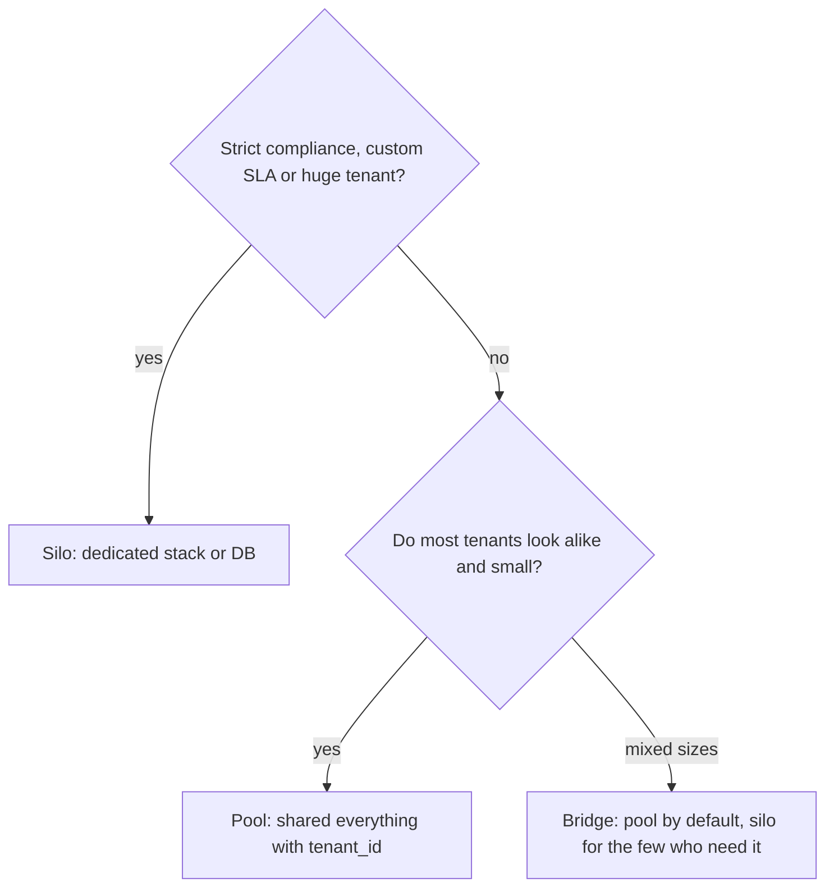

**Example.** An invoicing SaaS pools 9,900 small shops in shared tables. It puts 3 bank customers in silos because their contracts demand dedicated databases, and gives 1 retail chain a dedicated worker pool. This is a bridge.

**Why it matters.** Silo-only is too expensive at scale. Pool-only cannot satisfy your biggest and strictest customers. Bridge is where most real SaaS ends up.

| Model | Isolation | Cost per tenant | Ops effort | Noisy neighbour risk | Best for |
| --- | --- | --- | --- | --- | --- |
| Silo | Strongest | Highest | Many stacks to patch and migrate | None between silos | Regulated, enterprise, very large tenants |
| Pool | Logical only | Lowest | One stack | Highest | Many small tenants, self-serve products |
| Bridge | Mixed | Medium | Two paths to maintain | Controlled | Most B2B SaaS |

### Data isolation: where to put the tenant boundary

**In plain words.** Inside a shared database there are three common ways to keep tenants apart: a `tenant_id` column on every table, one schema per tenant, or one database per tenant.

**Step by step (column + row-level security):**
1. Every table has a `tenant_id` column.
2. A policy on the table says "only return rows where `tenant_id` matches the current tenant".
3. At the start of each request the app sets the current tenant, taken from the login token: 42.
4. A developer writes `SELECT * FROM orders` and forgets the filter.
5. The database still returns only tenant 42's orders, because the policy adds the filter itself.

**Picture it.**

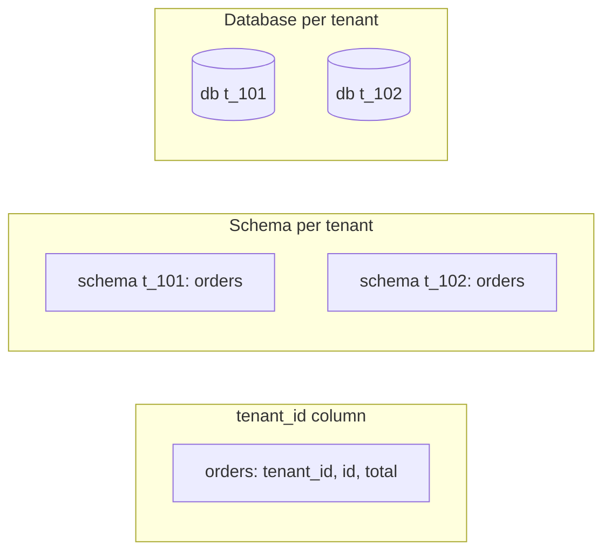

**Example.** With a `tenant_id` column in PostgreSQL you can turn on **row-level security (RLS)**. You attach a policy such as `USING (tenant_id = current_setting('app.tenant_id')::bigint)` to the table, and the application sets `app.tenant_id` on each connection or transaction.

Even if a developer forgets the filter, the database returns only that tenant's rows.

Caveat: RLS does not apply to superusers or roles with `BYPASSRLS` (a permission that skips the policies), and the table owner skips it unless you run `ALTER TABLE ... FORCE ROW LEVEL SECURITY`; the app must connect as a normal role.

**Why it matters.** Enforcement in the data layer turns "every developer must remember" into "the database refuses". Always make `tenant_id` the leading column of the primary key and the main indexes, so queries stay local to one tenant.

| Approach | Isolation | Scale limit | Migration pain | Backup and delete one tenant |
| --- | --- | --- | --- | --- |
| Column + RLS | Logical, policy enforced | Millions of tenants possible | One migration for all | Harder, filter by tenant |
| Schema per tenant | Better | Thousands (catalog size grows) | Run per schema | Easy |
| Database per tenant | Strongest | Hundreds to low thousands per server | Run per database | Very easy |

> [!warning] Common mistake
> Trusting the tenant id from the request body. The tenant must come from the authenticated token (a claim the user cannot edit), then travel with the request in context to every layer. A client that sends `tenant_id=7` in a JSON field is asking you to leak data.

### Tenant-aware sharding and the directory

**In plain words.** When one database cannot hold all tenants, you shard. Sharding by tenant keeps each tenant's data together, so most queries touch one shard and joins stay local. A small **directory** (a lookup table) says which shard each tenant lives on.

**Step by step (moving a big tenant):**
1. The directory says tenant 42 lives on shard 3.
2. Tenant 42 grows huge, so you copy its data to a new shard 5.
3. While copying, new changes keep flowing to shard 5 through change data capture (copying changes from the database log).
4. Pause tenant 42's writes for a moment, flip the directory to "42 → shard 5", and resume.
5. No other tenant noticed anything.

**Picture it.**

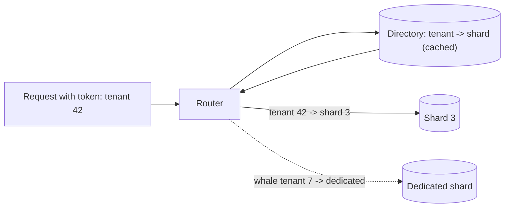

**Example.** Tenant 42 maps to shard 3 in the directory. Moving a tenant is: copy its data to shard 5, catch up using change data capture, briefly pause its writes, flip the directory entry, resume. No other tenant is affected.

A pure hash-based placement cannot do this without a rebalance, which is why directories (or hash plus overrides) are popular in multi-tenant systems. See [[Partitioning and Sharding]].

**Why it matters.** Tenant sizes follow a long tail: a few tenants are 100 times bigger than the median. A directory lets you give the big ones their own shard and move them without downtime. This ties to [[Hot Keys and Hot Partitions]].

> [!tip] Remember
> Tenant id in the token, tenant id first in every key, directory for placement.

### Noisy neighbours: quotas, concurrency limits, fairness

**In plain words.** A noisy neighbour is one tenant consuming so much shared capacity that others suffer. The cure is to cap what each tenant may take, and to share the remainder fairly.

**Step by step:**
1. The retail chain drops 4 million jobs into the queue. A corner shop adds 1 job.
2. With one shared queue, the shop's job waits behind all 4 million.
3. With one queue per tenant, workers take one job from each tenant in turn, so the shop's job runs next.
4. A cap of 50 workers per tenant means the chain can never use all 400 workers.
5. Plans (free, pro, enterprise) set the size of each tenant's caps.

**Picture it.**

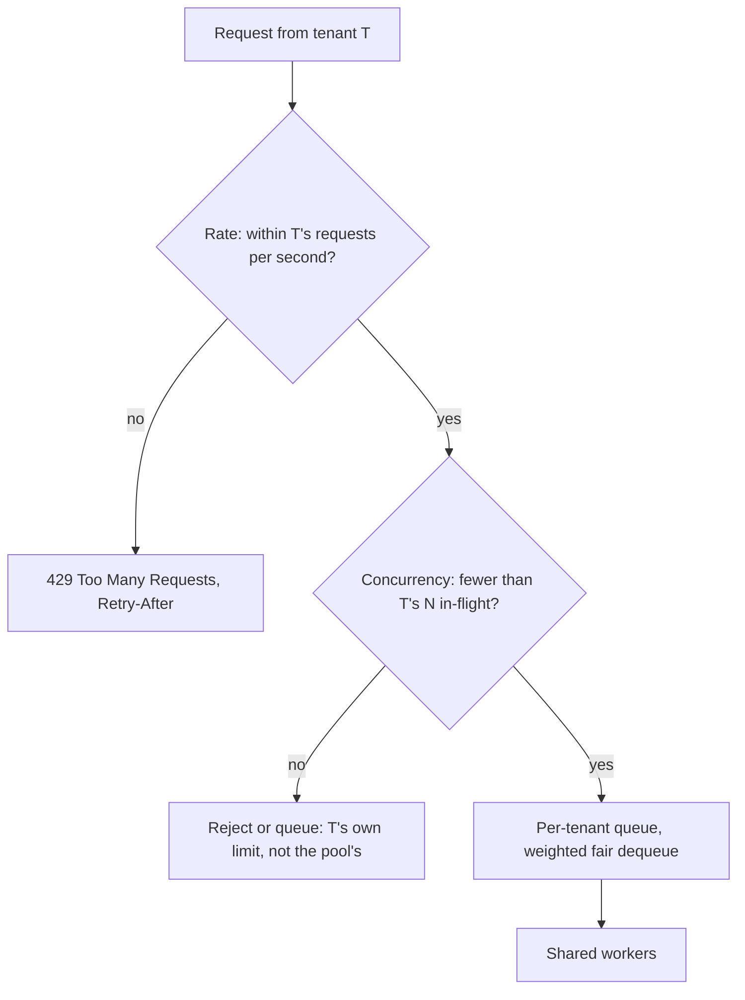

**Example.** The retail chain's import floods the queue with 4 million jobs. Without fairness, the shop's one job waits behind all of them.

- With a **per-tenant queue and round-robin dequeue**, each worker takes one job from each tenant in turn, so the shop's job runs next.
- With **per-tenant concurrency limits** (a bulkhead per tenant: a walled-off share of workers, like the watertight sections of a ship), the chain can use at most, say, 50 of 400 workers.

**Why it matters.** The quota belongs to the tenant, not to the shared pool. Otherwise the pool's global limit makes everyone suffer for one tenant. See [[Rate Limiting - Algorithms and Distributed Design]], [[Bulkheads and Concurrency Limits]] and [[Load Shedding and Graceful Degradation]].

Quotas should reflect plans (free, pro, enterprise) and be changeable without a deploy. Also meter other shared resources: database connections, storage, background jobs, and cache memory.

> [!warning] Common mistake
> Limiting only requests per second. A tenant sending 10 requests per second that each trigger a 30-second report can still eat every worker. Cap concurrency and cost per request too.

### Cells: shrinking the blast radius

**In plain words.** Even with perfect tenant isolation, one bad deploy, one poison request, or one overloaded dependency can take down the whole shared stack.

**Step by step:**
1. Build one full copy of the service: app, queue, database, cache. That is a cell.
2. Make 20 of them. Put 1/20 of the tenants in each.
3. A thin router looks up "tenant → cell" and forwards each request.
4. A bug or bad deploy breaks cell 7. Only 5% of tenants are hit.
5. New releases go to cell 1 first; if it is healthy, then a few more, then the rest.

So instead of one big stack, run many **cells**: complete, independent copies of the service (app, queues, database, cache). Each tenant is assigned to exactly one cell. A thin **cell router** sends each request to the right cell.

**Picture it.**

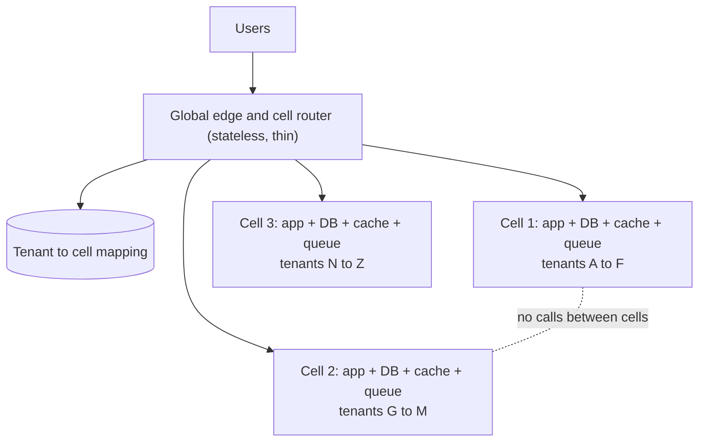

**Example.** You have 20 cells with equal tenants. A bug in cell 7 takes it down. 1/20 = 5 percent of tenants are affected, and the other 95 percent never notice.

You can also **deploy cell by cell**: cell 1 first (a canary), then cells 2 to 5, then the rest, so a bad release is caught after hitting about 5 percent.

A cell has a **maximum size**, so its behaviour is well understood and load-tested; you grow by adding cells, not by growing cells.

**Why it matters.** Without cells, blast radius is 100 percent of customers. With N cells it is about 1/N. AWS describes this in its cell-based architecture guidance, Slack has written about moving to a cellular architecture, and Shopify uses isolated "pods" of shops. Azure's Deployment Stamps pattern is the same idea.

The rules that make cells work:

1. **Cells share nothing.** No cross-cell database calls, no shared queue. A shared piece becomes a new single point of failure.
2. **The router stays dumb and highly available.** It does a lookup and forwards. Cache the mapping so the router works even if the mapping store is briefly down.
3. **A control plane** (separate from the data path) creates cells, assigns tenants, and orchestrates moves.
4. **Cross-tenant features** (global search, marketplace) are the hard part: they need a separate aggregation layer or are limited to within a cell.

> [!warning] Common mistake
> Letting cells quietly depend on a shared service (one auth database, one config service). Then a failure of that shared piece takes all cells down at once, and the cells gave you nothing. Audit dependencies, and replicate or cache shared data into each cell.

### Shuffle sharding: isolation between tenants inside a pool

**In plain words.** Plain sharding gives each tenant one fixed shard, so a poison tenant kills its whole shard and every tenant on it.

**Step by step:**
1. You have 8 workers. Each tenant gets 2 of them, picked differently for each tenant.
2. Tenant A gets W1 and W5. Tenant B gets W2 and W5. Tenant C gets W3 and W7.
3. Tenant A sends a "poison" request that crashes whatever worker runs it. W1 and W5 go down.
4. Tenant B still has W2, so it retries there and works. Tenant C never noticed.
5. Only a tenant with exactly the same pair as A (1 in 28) is fully down.

**Shuffle sharding** gives each tenant a small, random-looking *set* of workers. Two tenants rarely have exactly the same set, so a poison tenant knocks out its own set while almost every other tenant still has at least one healthy worker left.

**Picture it.**

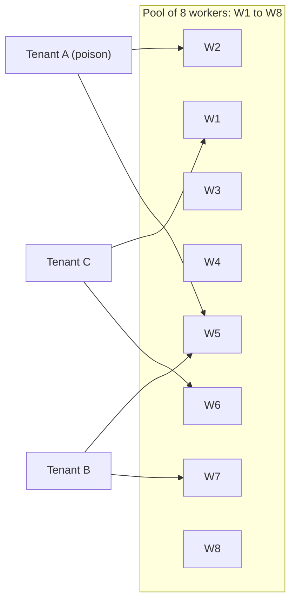

**Example (numbers computed here).** 8 workers, each tenant assigned 2:

- Number of possible pairs: C(8,2) = **28**. A tenant is totally down only if the poison tenant has exactly the same pair, which happens for 1 in 28 (about 3.6 percent) of other tenants.
- 12 of the 28 pairs (about 43 percent) share exactly *one* of the two workers, but they still have their other worker available, so a client that retries on its second worker still gets served.

Scale it up: 100 workers, 5 per tenant gives C(100,5) = 75,287,520 combinations. The chance another tenant shares *all five* with the poison tenant is about 1.3 in 100 million.

AWS's Route 53 uses 2,048 virtual name servers with 4 per domain, which gives C(2048,4), roughly 730 billion combinations, so a domain under attack almost never takes another domain fully offline.

**Why it matters.** It needs the client to retry on another worker in its set, and works best when poison is rare and per-tenant. Cells isolate by deployment unit; shuffle sharding isolates by combination inside one unit. You can use both: shuffle-shard within each cell.

> [!tip] Remember
> Cells cap the blast radius to a slice. Shuffle sharding makes the slice different for every tenant.

## 4. Worked example 🟡

### Scenario: a payroll SaaS for 5,000 companies

**In plain words:** We take the payroll app from the story and walk through every choice: how data is split, how busy tenants are limited, and how cells limit damage.

Requirements: companies must never see each other's data; one company's month-end run must not slow others; a bad release must not stop all payrolls; two banks demand a dedicated database; one customer wants EU-only storage.

Design, step by step:

1. **Identity.** The login token carries `tenant_id` and plan. The API gateway puts it in request context. No handler reads a tenant id from the body.
2. **Isolation model.** Bridge. Small companies are pooled into shared databases with a `tenant_id` column and RLS. The two banks get silo databases. The EU customer's cell runs in an EU region.
3. **Cells.** 10 cells, each with its own app, database, queue and cache, 500 tenants each. A cell router maps tenant to cell.
4. **Quotas.** Per-tenant rate limit by plan, per-tenant concurrency of at most 10 payroll runs, per-tenant queue with round-robin dequeue.
5. **Whale handling.** The largest company (200,000 employees) is moved to its own cell using the directory entry flip.
6. **Deploy.** Cell 1 is the canary, then cells 2 and 3, then the rest, with automatic rollback if the error rate rises.
7. **Failure.** Cell 4's database fails over (or the cell is evacuated to a standby). Only its 500 tenants see disruption (10 percent in this example, and they are the only ones paged about).

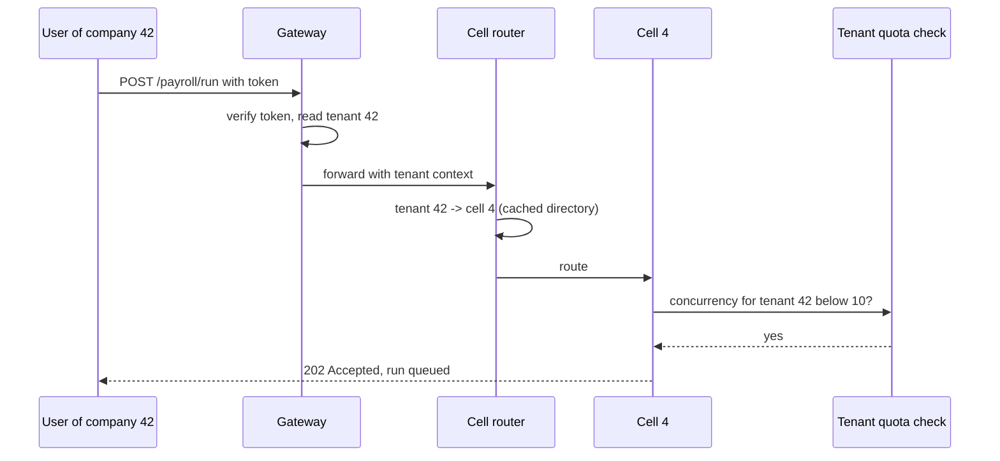

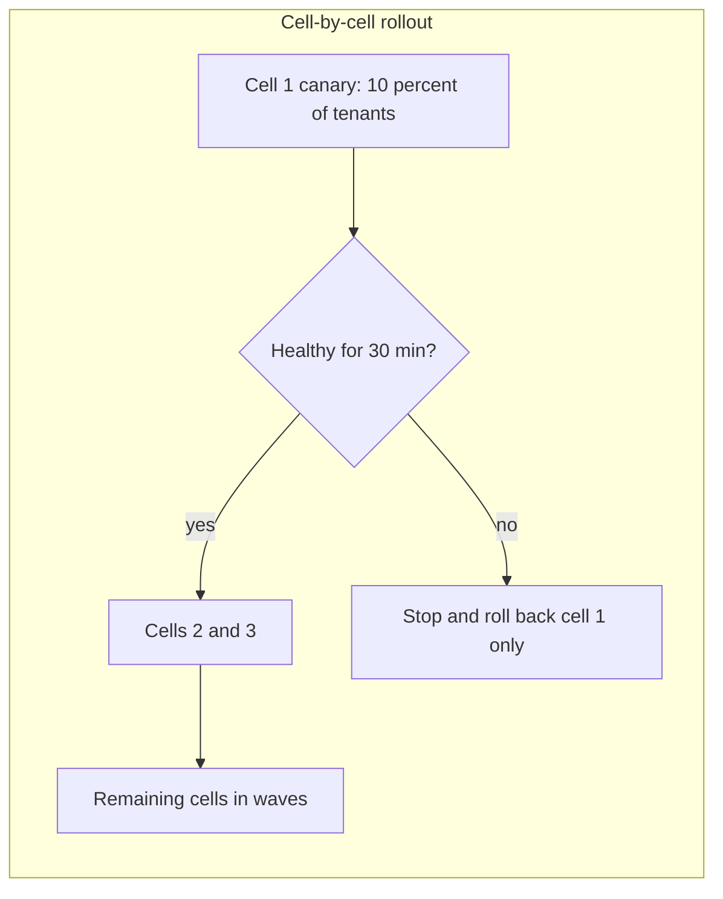

### Whiteboard version

- Draw users to a thin router to N identical cells, each with its own app, DB, queue, cache.
- Under the router, the directory: tenant to cell.
- Inside a cell: per-tenant rate and concurrency limits, tenant_id leading every key, RLS.
- Mention: bridge model, whale gets own cell, deploy cell by cell, shuffle sharding in shared worker pools.

## 5. Variants and comparison 🟡

| Pattern | Isolates | Cost | Complexity | Use when |
| --- | --- | --- | --- | --- |
| Silo per tenant | Everything | High | High (many stacks) | Few, large or regulated tenants |
| Pool with tenant_id and RLS | Data by policy | Low | Low | Many small tenants |
| Pool plus quotas and fair queues | Capacity | Low | Medium | Noisy neighbours appear |
| Bridge | Mixed | Medium | Medium | Mixed customer sizes |
| Cells | Failures and deploys | Medium to high | High | Need small blast radius at scale |
| Shuffle sharding | Poison tenants inside a pool | Low | Medium | Large shared fleet with retrying clients |
| Regional cells | Data residency and region failure | Higher | High | Compliance, see [[Multi-Region Architecture]] |

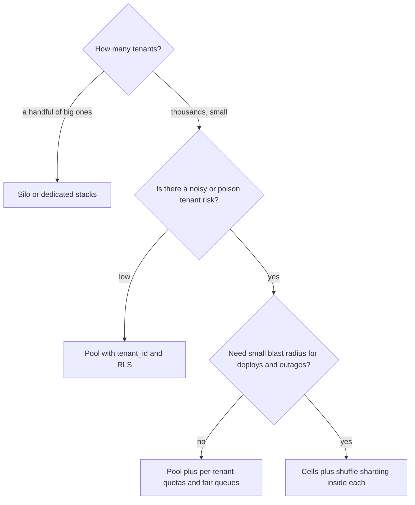

## 6. Trade-offs and when not to use 🟡

- **Cells cost money and effort.** Each cell has a baseline of capacity. 20 cells running at 30 percent use more total hardware than one shared stack at 60 percent. They are worth it when downtime cost is high.
- **Cross-tenant queries are hard.** Admin dashboards, global search and analytics must read from many cells. Build them as an asynchronous pipeline into a separate analytics store.
- **Moving tenants is a product.** A tenant move needs copy, catch-up, cutover and verification. Build and rehearse it before you need it.
- **Many databases are an operational burden.** A migration against 2,000 schemas or 500 databases needs tooling, a version table per tenant, and progress tracking.
- **Over-isolation hurts.** With 30 tenants a plain pool plus quotas is enough. Do not build a cell router for a product that fits in one database.
- **Logical isolation can fail.** RLS and middleware are code. Compliance-heavy customers may still insist on separate databases or keys.

> [!tip] Remember
> Isolation is bought with money and operations. Buy only as much as the failure cost justifies.

## 7. In production 🔴

> 🟡 → 🔴 **You now know** the isolation models, how to stop noisy neighbours, and how cells and shuffle sharding limit damage. **Next comes the senior view**: who runs cells in production, the failure modes, and the details of cell sizing, tenant placement, evacuation, fairness, observability and per-tenant encryption.

- **Real systems.**
  - AWS recommends cell-based architecture to reduce the scope of impact in its Well-Architected guidance, and Route 53 uses shuffle sharding in its Infima library, as described in the Builders' Library.
  - Slack published its migration to a cellular architecture, aimed at limiting the effect of failures in one availability zone or one part of the system.
  - Shopify groups shops into isolated pods, each with its own database and other resources.
  - Azure documents the Deployment Stamps pattern: repeated, independent copies of the application, each serving a set of tenants.
- **Failure modes and fixes.**
  - *Tenant data leak from a missing filter* → RLS or a data-access layer that requires tenant context; automated tests that query as tenant A and assert nothing of B appears.
  - *One tenant slows all* → per-tenant rate, concurrency and queue limits; alert on top-N tenants by resource use.
  - *Cell router outage* → keep it stateless, multi-AZ and cached; it should fail static on the last good mapping (keep serving with the old mapping instead of erroring).
  - *Shared dependency takes all cells down* → dependency audit; give each cell its own copy or cache.
  - *Cell fills up* → enforce max cell size, place new tenants in new cells, and move the largest out.
  - *Wrong tenant in cache keys* → include the tenant id in every cache key and queue name.
- **What to monitor.** Per-tenant request rate, error rate, p99 latency and resource use (top 10 tenants), rejection counts from quotas, cell health and saturation, tenant count and utilisation per cell, tenant-move duration, and cross-cell call count (which should be zero).

## 8. Deep dive 🔴

### Choosing the cell count and size

**In plain words:** Many small cells means small damage when one breaks, but more things to run. Few big cells is cheaper but each failure hurts more people.

More, smaller cells give a smaller blast radius (1/N) and cheaper canaries, but more fixed overhead and more operations. Fewer, larger cells are cheaper but each failure hurts more. Pick a maximum cell size you can load-test and rebuild quickly, and let the count grow. Starting at 5 to 10 cells is common (estimate, depends on the business).

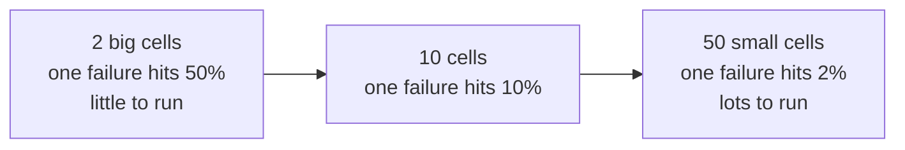

### Placing tenants in cells

**In plain words:** Decide which cell a new customer goes into. Simple rules fill unevenly; smarter rules balance the load.

Strategies: fill one cell to its cap then open the next (simple, uneven), assign the new tenant to the least-loaded cell (balanced), or place by region and plan (compliance). Keep some headroom in every cell for a tenant's growth. The mapping lives in a replicated store that the router caches.

### Evacuating a cell

**In plain words:** If a cell gets sick, move its tenants to healthy cells. That only works if their data is already copied somewhere.

If a cell is unhealthy, you can move its tenants into other cells or a standby cell. This needs data replication per cell (for example, asynchronous replicas elsewhere) and capacity headroom. Many teams skip evacuation and instead rely on fast cell recovery, accepting a partial outage for a small share of tenants.

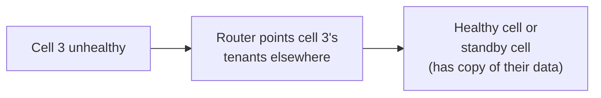

### Fairness details

**In plain words:** Fair sharing is like a queue at a counter where each tenant gets a turn. Paying more can buy you a bigger share of turns.

Round-robin per tenant is equal sharing. **Weighted fair queueing** gives bigger plans proportionally more turns. **Dominant resource fairness** (share by each tenant's most-used resource) is useful when tenants use different mixes of CPU and memory. Also add **admission control** that rejects work from a tenant over quota early and cheaply, before it reaches shared resources (see [[Load Shedding and Graceful Degradation]]).

### Tenant-aware observability

**In plain words:** Put the tenant id in logs and traces so you can debug one customer. But do not make one graph line per tenant, or your metrics system will choke.

Add `tenant_id` to logs and traces but be careful with metrics: one label per tenant for 10,000 tenants explodes the metric cardinality. Record per-tenant metrics for the top N and for plan classes, and use logs or traces to dig into a specific tenant.

### Security details

**In plain words:** Give each tenant its own encryption key. Delete the key and that tenant's data becomes unreadable junk, which is a clean way to erase it.

Per-tenant encryption keys (one key per tenant in a KMS, a key management service that stores and guards keys) allow "crypto-shredding": deleting the key makes that tenant's data unreadable. It supports erasure promises and limits the damage of a leaked database dump.

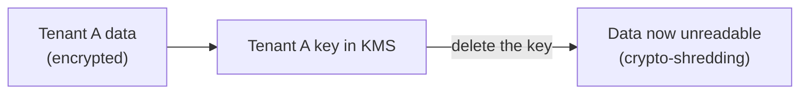

## 9. Interview questions 🔴

> [!question]- Design a multi-tenant SaaS. How do you keep tenants isolated?
> Put the tenant id in the authenticated token and carry it in context to every layer.
>
> Enforce it in the data layer (tenant_id as the leading key column plus row-level security, or schema or database per tenant for stricter tenants).
>
> Add per-tenant quotas for rate, concurrency and storage, and per-tenant queues with fair scheduling.
>
> Use a bridge model: pool for small tenants, silo or dedicated shards for big or regulated ones.

> [!question]- What is a noisy neighbour, and how do you stop it?
> One tenant using so much shared capacity that others slow down. Stop it with per-tenant rate limits, concurrency limits (bulkheads), fair queueing (round-robin or weighted), admission control that rejects over-quota work early, and by moving heavy tenants to dedicated capacity.

> [!question]- What is a cell-based architecture and why use it?
> The platform is split into many complete, independent copies (cells), each serving a fixed set of tenants, behind a thin router. A failure or bad deploy affects roughly 1/N of tenants. Cells share nothing, have a maximum size, and are deployed one at a time. The cost is extra capacity, the router and directory, and harder cross-tenant features.

> [!question]- Explain shuffle sharding with an example.
> Each tenant gets a small random set of workers instead of one shard. With 8 workers and 2 per tenant there are 28 combinations, so only about 1 in 28 other tenants have the same pair as a poison tenant, and others who share one worker can retry on their other worker.
>
> With 100 workers and 5 each, the full overlap chance is about one in 75 million. It needs retrying clients and per-tenant poison to be the main failure.

> [!question]- How would you shard a multi-tenant database, and what do you do with one huge tenant?
> Shard by tenant id so a tenant's data and joins stay on one shard, and use a directory (tenant to shard) so you can move tenants. Give the huge tenant a dedicated shard or cell: copy, catch up via change data capture, brief write pause, flip the directory, resume. Hash-only placement makes this move hard.

> [!question]- Trap: "We have per-tenant rate limits, so noisy neighbours are solved." Is that true?
> No. Request rate is one dimension. A tenant under its rate limit can still run expensive requests that hold all workers, exhaust database connections, fill a shared queue, or use too much cache memory. Add concurrency, cost-based limits and per-tenant queues, and watch resource use per tenant.

> [!question]- How do you handle a customer who demands data residency in the EU?
> Place that tenant in a cell located in an EU region, keep its data, backups and logs there, and make the router send it only to that cell. Avoid cross-region dependencies for personal data. See [[Multi-Region Architecture]].

## 10. Cheat sheet 🟢

- Tenant = customer. Models: silo (stack each), pool (shared), bridge (mix, most common).
- Tenant id comes from the token, travels in context, leads every key. Add RLS so the database enforces it.
- Noisy neighbour cures: per-tenant rate, concurrency, queue and storage limits, fair dequeue, early rejection.
- Directory maps tenant to shard or cell. Whale tenants get dedicated capacity and can be moved.
- Cells: independent full stacks, share nothing, capped size, thin router, deploy cell by cell. Blast radius is about 1/N.
- Shuffle sharding: each tenant gets a random worker subset. 8 workers, 2 each: 28 combos. Needs client retry.
- Cost: extra capacity, router and directory, hard cross-tenant queries. Do not over-build for 30 tenants.

## Self-check 🟢🟡

> [!question]- (easy) What is a tenant?
> One customer organisation using your shared product, like one company on a payroll app.

> [!question]- (easy) Where must the tenant id come from?
> The authenticated login token, never the request body.

> [!question]- (easy) What is a noisy neighbour?
> A tenant whose heavy use slows down everyone sharing the system.

> [!question]- (medium) 20 equal cells and one breaks. What share of tenants is hit?
> About 1/20, so 5%.

> [!question]- (medium) Why are per-tenant rate limits alone not enough?
> A tenant under its rate limit can still send heavy requests that hold all workers; also cap concurrency and cost.

> [!question]- (medium) 8 workers, 2 per tenant, shuffle sharded. How likely is another tenant fully down by a poison tenant?
> Only if it has the exact same pair: 1 in 28, about 3.6%.

## Links 🟢

- **Before this:** [[Partitioning and Sharding]], [[Rate Limiting - Algorithms and Distributed Design]], [[Bulkheads and Concurrency Limits]]
- **Next:** [[Multi-Region Architecture]], [[Load Shedding and Graceful Degradation]]
- **Compare with:** [[Hot Keys and Hot Partitions]] (the skew problem inside a shard), [[Load Balancing]] (routing inside a cell), [[Service Discovery]] (finding the cell), [[High Availability and Failover]]

### Watch on YouTube

- [AWS re:Invent 2024 - SaaS meets cell-based architecture: A natural multi-tenant fit (SAS315)](https://www.youtube.com/watch?v=wYm_PJc2U8c) · AWS Events · 56 min · 4,530 views
- [Multitenancy Explained](https://www.youtube.com/watch?v=60ccSmOxpMw) · IBM Technology · 3 min · 121,078 views
