# Security, Privacy and Compliance in HLD

> [!summary] TL;DR
> In an HLD round, security is not a closing remark.
>
> It is a short, ordered checklist you apply to the boxes you already drew: **encrypt** data in transit and at rest, **classify** what is sensitive and keep it in as few places as possible, **authenticate every call** even inside your network, **log** who touched what, and **plan for deletion** and for where data may live.
>
> Name each control, the threat it stops, and what it costs.

> [!abstract] Core idea
> - Draw a **trust boundary** first. Every arrow that crosses one needs authentication, authorization and encryption.
> - **Envelope encryption** lets you encrypt huge data cheaply with data keys, while a key service guards one master key and logs every use.
> - **Minimise PII**: store the least data in the fewest places, and replace the rest with **tokens**.
> - **Zero trust** means the network location of a caller proves nothing. Each service proves identity on every call.
> - **Erasure and retention** are design problems when data is copied into logs, events, caches and backups. Plan them early.

## Start here: the basics

**The problem in one story.**
You run a food delivery app. It stores names, phone numbers, addresses and cards.
One day a laptop with a database copy is stolen.
Another day a user asks you to delete everything about them, and nobody knows where their data is.
Security in system design means planning, while you draw the boxes, how data is locked, who may touch it, and how it is found and deleted.

**Words you need first**

| Word | Plain meaning | Tiny example |
|---|---|---|
| Encryption | Scrambling data so only key holders can read it | A card number stored as random-looking bytes |
| In transit / at rest | Data moving over a network / data sitting on disk | HTTPS call / a database file |
| TLS | The protocol that encrypts network traffic (the "S" in HTTPS) | Browser to load balancer |
| Key / KMS | The secret that unlocks encrypted data / a service that guards keys | AWS KMS holds the master key |
| PII | Personally identifiable information: data that points to a person | Phone number, email, address |
| Token (tokenization) | A meaningless stand-in for sensitive data | `tok_8f3a` instead of a card number |
| Authentication / authorization | Proving who you are / checking what you may do | Login / "only admins can refund" |
| Trust boundary | A line where data passes between parts that trust each other differently | Internet to your API gateway |

**Picture it**

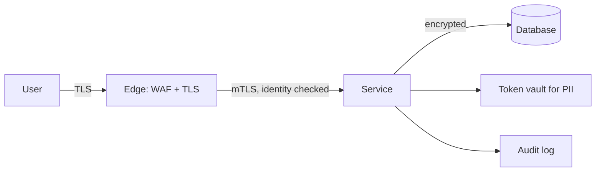

**Analogy.** A bank branch: a guard at the door, a vault that needs a key, a ledger of every vault visit, and customer names kept in a separate locked drawer.
Where it breaks: a bank vault is in one place, while your data is copied into logs, caches, events and backups, and each copy needs the same care.

**How the rest of this note builds up**

- First, why it exists and the bank-branch mental model (sections 1-2).
- Then the controls one by one (section 3): encryption in transit, envelope encryption, secrets, PII and tokens, audit logs and zero trust, erasure and residency, edge defences.
- Then a worked example and trade-offs (sections 4-6).
- Finally the SDE-3 deep dive (section 8): AES-GCM, deterministic encryption, passwords, multi-tenant isolation and threat modelling.

> [!tip] Remember
> Encrypt, minimise, check every call, log access, and know where every copy of personal data lives.

## 1. Why it exists

Imagine you design a food delivery app. In the first draft, the app server writes the customer's phone number, address and card details into one `orders` table. Logs print full request bodies. Every microservice trusts any caller that sits inside the VPC.

Then three things happen in one quarter:

- A debugging endpoint is exposed and one compromised pod can call the payment service freely, because "it is inside the network".
- A support laptop is stolen. The database export on it has 2 million phone numbers in plain text.
- A user in Germany emails: "delete everything you know about me." Nobody knows where the data lives.

None of this is exotic. It is what happens when security is added after the boxes are drawn. Interviewers at SDE-3 level want to see you pre-empt these three scenarios while you draw.

> [!tip] Remember
> Security failures are rarely clever attacks. They are usually data in too many places with too few checks.

## 2. Mental model

Think of a **bank branch**. The street is the internet. The front door has a guard (edge: WAF, TLS).

Inside, the lobby is open, but the vault needs a key and two signatures. Every vault entry is written in a ledger the clerks cannot edit.

Customer files are in numbered folders, and the name-to-number table is in a separate locked drawer.

Mapping:

| Bank | System |
| --- | --- |
| Guard at the door | WAF, TLS termination, rate limits |
| Staff badge checked at every door | Service identity, mTLS, short-lived tokens |
| Vault key held by the bank, not the clerk | KMS master key never leaves the key service |
| Folder number instead of name | Tokenization, pseudonymous IDs |
| Tamper-proof ledger | Append-only audit log |
| Shredding old files on schedule | Retention and erasure jobs |

The analogy breaks in one place: a bank vault holds one copy of the cash, but a system copies data into caches, search indexes, events and backups. Deleting from the "vault" does not delete the copies.

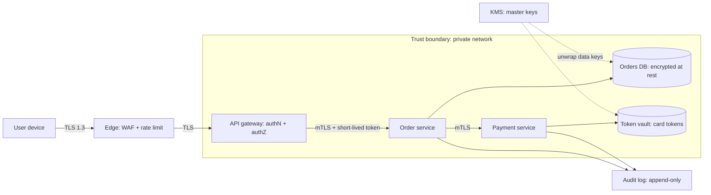

> [!tip] Remember
> Draw the boundary, then ask of every arrow that crosses it: who is calling, may they, is it encrypted, is it logged.

## 3. How it works

### 3.1 Encryption in transit

**In plain words:** data moving between machines can be read or changed by anyone on the path. We wrap each connection in an encrypted channel. The standard is **TLS** (Transport Layer Security): the client checks the server's certificate, both sides agree on a session key, and the rest of the traffic is encrypted and tamper-evident.

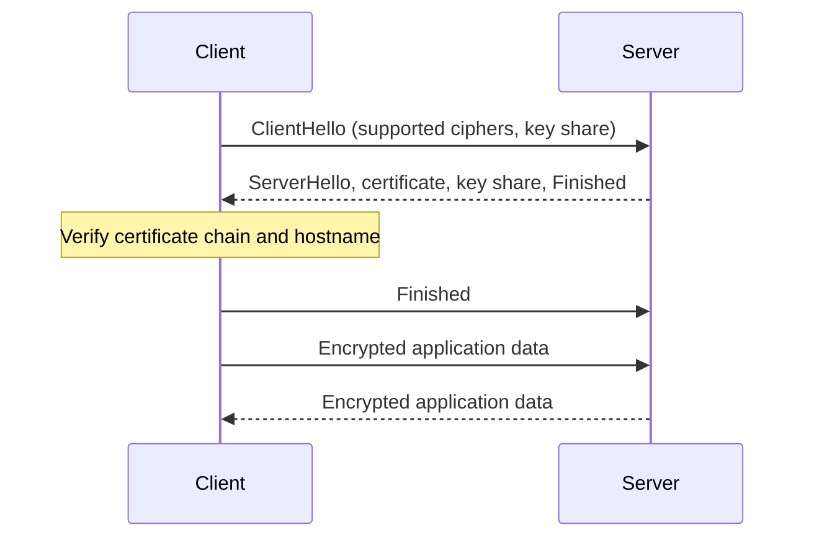

Where TLS is needed in a typical design:

1. **Client to edge:** TLS 1.3 (RFC 8446), with HSTS so browsers never fall back to HTTP.
2. **Edge to service, service to service:** also TLS. "Inside the VPC is safe" is the assumption zero trust removes.
3. **Service to database, cache, broker:** enable TLS on Postgres, Redis and Kafka clients. Cheap insurance.
4. **Cross-region links:** always, since traffic leaves your physical control.

**Example:** terminating TLS at a load balancer and sending plain HTTP behind it is acceptable only if the segment is genuinely isolated and you accept that a compromised host can sniff it.

PCI DSS requires strong cryptography for card data sent over open, public networks; many auditors and security teams also expect internal hops to be encrypted, and it is cheap to do.

**Why it matters:** the cost is a handshake per connection (about one round trip with TLS 1.3, and connection reuse hides it). The benefit is that a stolen packet capture is useless.

See [[TLS and HTTPS]] for the mechanics.

### 3.2 Encryption at rest, KMS and envelope encryption

**In plain words:** a stolen disk or backup should be unreadable. Encrypting at rest means data is stored encrypted, and the key lives somewhere else. The question is where the key lives and who may use it.

Encrypting everything directly with one master key does not scale. The key service is remote, calls cost time and money, and a direct KMS encrypt call is limited to small payloads (4 KB for AWS KMS). So we use **envelope encryption**:

1. The app asks KMS to generate a **data key** (DEK). KMS returns it in two forms: plaintext and encrypted under a master key (**KEK**, held inside KMS).
2. The app encrypts the data locally with the plaintext DEK (for example AES-256-GCM), then discards the plaintext DEK from memory.
3. The app stores the encrypted DEK next to the ciphertext.
4. To read, the app sends the encrypted DEK to KMS. KMS checks the caller's permission, decrypts it, and returns the DEK. The app decrypts the data.

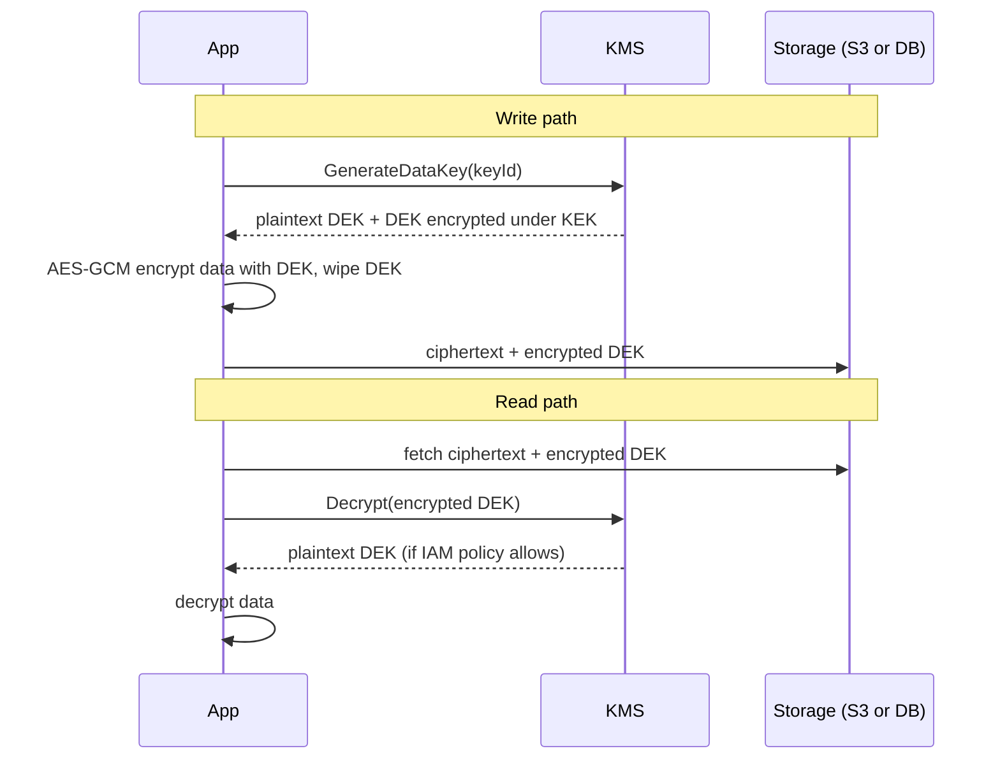

**Example with numbers (estimates):** encrypting 10 TB of user files with one KMS call per file at 10 million files means 10 million KMS calls. Giving each tenant or each day one DEK, and caching it briefly, cuts that to thousands. S3 SSE-KMS "bucket keys" exist for exactly this reason: they reduce the number of KMS requests.

Three benefits you can state in the interview:

- **Rotation is cheap.** Rotate the KEK and re-wrap small DEKs instead of re-encrypting terabytes.
- **Access is auditable.** Every unwrap is a KMS call, and the call is logged (CloudTrail on AWS).
- **Revocation is possible.** Disable the key and the data becomes unreadable.

**Why it matters:** this is also the basis of **crypto-shredding** (section 3.6). See [[Secrets Management]] for where the app's own credentials come from.

### 3.3 Secrets

**In plain words:** database passwords, API keys and signing keys are not config. If they sit in git, container images or environment dumps, one leak gives an attacker everything.

Design rules:

1. Secrets live in a **secrets manager** (Vault, AWS Secrets Manager), fetched at start-up or on demand over an authenticated call.
2. Prefer **short-lived credentials** issued per workload (for example IAM roles, dynamic database users with a one-hour TTL) over long-lived static keys.
3. **Rotate** on a schedule and on suspicion, without downtime (two valid versions during the switch).
4. **Never log** secrets. Redact at the logging layer, not by hoping developers remember.

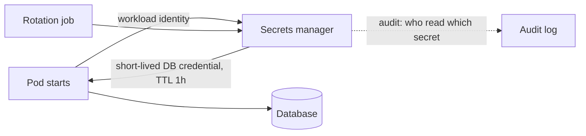

**Why it matters:** the Capital One 2019 incident (public DOJ and regulator filings) started with a request-forgery bug that reached the cloud metadata service and obtained role credentials. Over-broad, long-reach credentials turned a web bug into a data breach. Least privilege shrinks that blast radius. See [[AWS 02 - IAM]].

> [!tip] Remember
> Keys are for locking; secrets managers are for holding keys; short-lived credentials are for limiting what a leak is worth.

### 3.4 PII classification and tokenization

**In plain words:** not all data is equally dangerous. First **classify** it, then spend protection effort where it matters, and then reduce how much sensitive data you hold at all.

A simple four-tier scheme:

| Tier | Examples | Handling |
| --- | --- | --- |
| Public | Menu items, restaurant names | No special controls |
| Internal | Order counts, feature flags | Auth required, normal logs |
| Confidential (PII) | Name, email, phone, address, precise location | Encrypt at rest, access-logged, masked in logs, retention rule |
| Restricted | Card numbers, government IDs, health data, passwords | Isolated store, tokenized or hashed, tight access, separate audit |

**Tokenization** replaces a sensitive value with a random stand-in (**token**). The real value stays in one hardened **vault**; everything else stores the token.

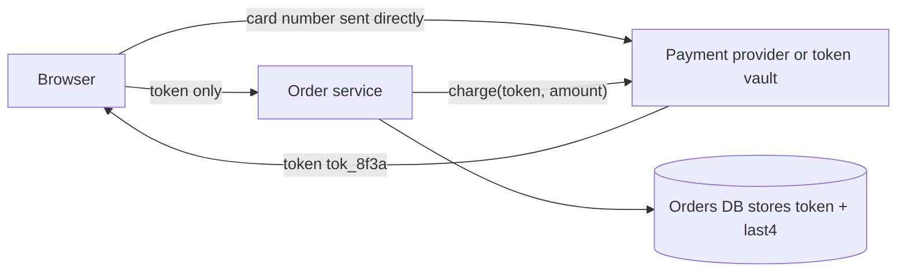

**Example:** card entry goes from the browser straight to the payment provider (Stripe Elements works this way, per Stripe docs). The merchant stores only a token and the last four digits. Under PCI DSS the less card data you touch, the smaller your compliance scope. Note that the card verification code must not be stored after authorization.

Tokenization versus encryption:

| | Encryption | Tokenization |
| --- | --- | --- |
| Reversible by | Anyone with the key | Only the vault lookup |
| Token reveals anything? | Ciphertext is derived from data | No, random |
| Good for | Bulk data, fields in a DB | A few high-risk values (card, ID number) |
| Joins and search | Hard (unless deterministic) | Easy on the token |

Other cheap wins: use random **internal IDs** instead of emails as keys, **mask** values in logs (`+91-98xxxxxx21`), and keep PII out of analytics events by hashing with a salt or dropping it.

**Why it matters:** data you never stored cannot leak, cannot be subpoenaed in bulk, and does not need erasing.

### 3.5 Audit logs and zero trust between services

**In plain words (audit):** when something goes wrong you must answer who read or changed what, and when. An **audit log** is a separate, append-only record of security-relevant actions: logins, permission changes, reads of restricted data, admin actions, key use.

Design points:

1. Write audit events as structured records: actor, action, resource, time, source IP, result.
2. Send them to a **separate store** the application cannot edit, for example object storage with write-once retention (S3 Object Lock) or a log service with restricted delete.
3. Make a gap detectable: sequence numbers or hash chaining, so deletion of a record is visible.
4. Alert on anomalies: a support user exporting 10,000 profiles.

**In plain words (zero trust):** the old model was a castle: tough perimeter, soft inside. Once an attacker is in, everything is reachable. **Zero trust** (NIST SP 800-207) says never assume trust from network location. Every request is authenticated, authorized and encrypted, even between two internal services.

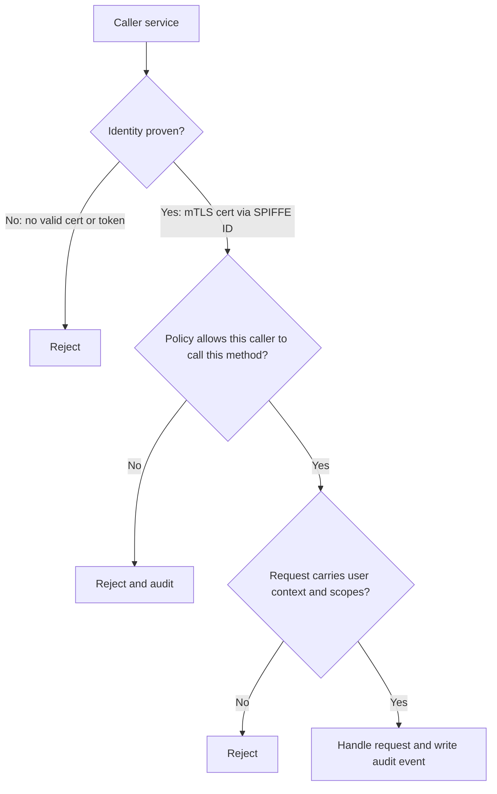

Practical building blocks:

- **mTLS** with workload identities (SPIFFE IDs issued by a mesh or SPIRE) so both sides prove who they are. See [[Service-to-Service Auth - API Keys, HMAC, mTLS]].
- **Authorization policy** per service pair ("only checkout may call `POST /charge`").
- **Propagate the user's identity** (a signed token) rather than letting an internal service act as an all-powerful super user.
- **Network policy** as a second layer, not the only one.

**Why it matters:** the payment service should refuse a call from a compromised recommendation pod, even though both are inside the cluster.

> [!warning] Common mistake
> Saying "we use a service mesh with mTLS" and stopping. mTLS proves who is calling, not that the call is allowed. You still need an authorization policy.

### 3.6 GDPR erasure, retention and data residency

**In plain words (erasure):** under GDPR Article 17, a person can ask you to delete their personal data, and you must do so without undue delay, unless a legal reason requires keeping it (for example tax records). That sounds easy until you remember where the data went.

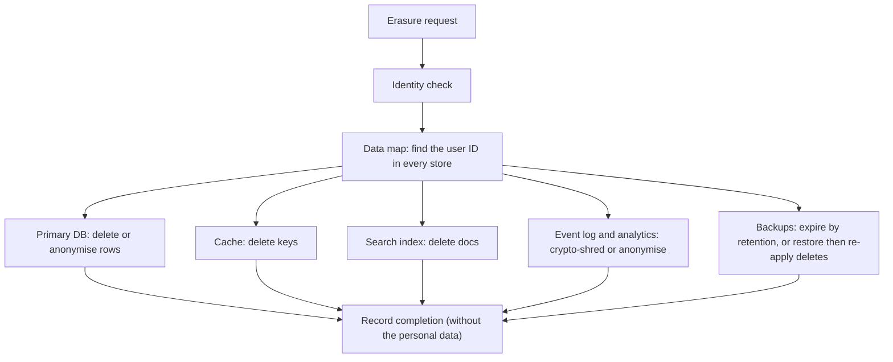

The hard parts, and the usual answers:

| Where the data hides | Problem | Answer |
| --- | --- | --- |
| Primary DB | Foreign keys, history tables | Soft-delete then hard-delete job; anonymise rows you must keep (orders for accounting) |
| Cache, search index | Stale copies | Delete on erasure event; short TTLs bound the leftovers |
| Event log (Kafka, event store) | Append-only by design | **Crypto-shredding**: encrypt each user's personal fields with a per-user key; delete the key and every copy becomes noise |
| Backups | Immutable snapshots | Short retention so they age out; document the window; if restored, replay the deletion list |
| Third parties | Data already shared | Propagate the request via a processor contract |

**Crypto-shredding** ties back to envelope encryption: one DEK per user, wrapped by a KEK. Deleting the DEK is a single small write that renders every copy unreadable, including the ones in events and backups. See [[Event Sourcing]] for why event logs make deletion hard and [[Backup, PITR and Disaster Recovery]] for backup retention.

**In plain words (retention):** GDPR Art. 5(1)(e) says keep personal data no longer than needed. Define a retention period per data class and enforce it with automatic jobs (TTL on rows, object-store lifecycle rules), not with a wiki page.

**In plain words (residency):** some laws restrict moving personal data across borders (GDPR Chapter V on transfers out of the EU; India's DPDP Act 2023 has its own transfer rules).

The design answer is **regional cells**: EU users' data stays in an EU region with its own database and keys, and only non-personal or pseudonymised data flows to a global tier.

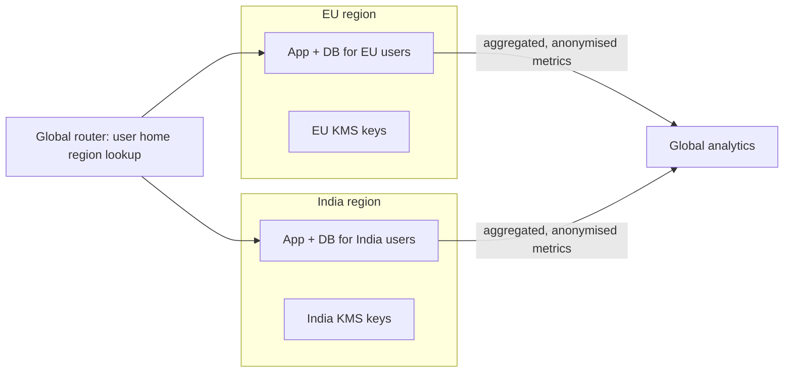

The cost: cross-region features (a user travelling, global search) get harder. See [[Multi-Region Architecture]].

> [!tip] Remember
> Deletion is a pipeline across every copy. Per-user encryption keys turn "delete everywhere" into "delete one key".

### 3.7 Edge defences and abuse

**In plain words:** most attacks arrive as ordinary-looking requests. Put cheap filters at the edge so your core never sees them.

1. **WAF** rules for injection and known bad patterns.
2. **Rate limits** per IP, per user and per API key. See [[Rate Limiting - Algorithms and Distributed Design]].
3. **Input validation** at every service boundary, parameterised queries, output encoding.
4. **Bot and credential-stuffing protection.** See [[API Abuse and Bot Protection]].
5. **Object-level authorization** on every resource lookup (the top item in [[OWASP API Security Top 10]]).

**Why it matters:** the edge is the only layer that absorbs volume attacks without charging your database.

## 4. Worked example

**Problem:** add a "saved cards and delivery history" feature to the food delivery app for users in the EU and India.

Walk it as the interview answer.

1. **Classify.** Card data is Restricted. Name, address, phone are Confidential. Dish names are Internal.
2. **Minimise.** Card capture goes browser to the payment provider. We store `token`, `brand`, `last4`, `exp`. We never see the PAN, so our PCI scope stays small.
3. **Boundary.** Checkout may call Payment. Recommendations may not. Enforced by mTLS identity plus a policy file reviewed in code review.
4. **Encrypt.** TLS 1.3 everywhere. Orders DB and S3 exports encrypted with envelope encryption. Address and phone fields are encrypted with a per-user DEK.
5. **Residency.** Home region chosen at signup. EU users' rows and keys stay in the EU region. Global analytics gets pseudonymous IDs and aggregates only.
6. **Audit.** Any read of a user's saved addresses by staff writes an audit event to a write-once store, with an alert on bulk reads.
7. **Erasure.** The data map lists: orders DB, Redis profile cache, search index, Kafka `order-events`, analytics warehouse, 35-day backups. Erasure deletes the user's DEK, deletes cache and index entries, anonymises order rows kept for accounting, and the backup window is documented as 35 days (an example policy, not a legal rule).
8. **Retention.** Order history is anonymised after the legal accounting period, via a lifecycle job.

Result, in numbers you can state (labelled estimates): one extra KMS call per cold-cache profile read (about a few milliseconds, cached for minutes), one extra hop to the audit stream (async, off the request path), and zero extra card-handling scope.

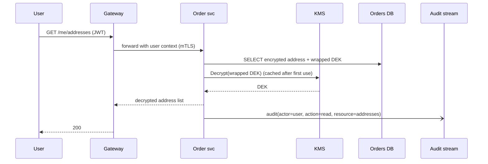

## 5. Variants and comparison

| Choice | Option A | Option B | Pick A when | Pick B when |
| --- | --- | --- | --- | --- |
| Key custody | Provider-managed KMS key | Customer-managed key (CMK) or HSM, or bring your own key | Default, low ops | Regulation or customers demand control and revocation |
| Sensitive value | Encrypt field | Tokenize via vault | Many fields, you need to read them | Few high-risk values, want smaller compliance scope |
| Service auth | mTLS with mesh | Signed JWT per request | Strong identity, many internal calls | Need user context across hops (use both) |
| Deletion in logs | Crypto-shred | Rewrite or compact log | Immutable event stores | Small mutable stores |
| Residency | Regional cells | Single global DB | Laws require it, large user base per region | Small product, no such law applies |
| Audit store | Write-once object store | DB table | Compliance, tamper evidence | Low-stakes internal tools |

## 6. Trade-offs

| Control | Benefit | Cost |
| --- | --- | --- |
| TLS everywhere | Stops sniffing and tampering | CPU for crypto (small on modern hardware with AES-NI), certificate rotation work |
| Envelope encryption | Cheap rotation, audit, revocation | KMS dependency: if KMS is down you cannot unwrap new DEKs; cache DEKs briefly |
| Field-level encryption | Limits DB-admin exposure | No SQL search on the field, harder analytics |
| Tokenization | Smaller scope | Vault becomes a critical, highly available dependency |
| Zero trust and mTLS | Contains lateral movement | Cert lifecycle, debugging complexity, mesh overhead |
| Regional cells | Meets residency law | Duplicated infrastructure, harder global features |
| Short retention | Less to leak, easier erasure | Less data for analytics and disputes |

> [!warning] Common mistake
> Treating encryption at rest as a full defence. If the app has the key and the app is compromised (or has an injection bug), the attacker reads plaintext. Encryption at rest protects lost disks and stolen backups, not a compromised application.

## 7. In production

- **KMS outage.** Cache DEKs in memory for minutes, set alarms on KMS error rate, and decide the failure mode (fail closed for restricted data).
- **Key rotation.** Automatic annual KEK rotation is typical, and re-wrap rather than re-encrypt. Test restoring from backup with a rotated key.
- **Certificate expiry** is a classic outage. Automate issuance and alert 30 days before expiry. See [[TLS and HTTPS]].
- **Log hygiene.** Scan logs for PII patterns in CI and in production sampling. A single `log.Printf("%+v", req)` can undo a year of design.
- **Access reviews.** Quarterly review of who can read restricted stores and use KMS keys. Use just-in-time elevated access with approval and audit.
- **Backups.** Encrypt them with a separate key and test restores. An unreadable backup is not a backup.
- **Breach readiness.** GDPR Art. 33 requires notifying the regulator within 72 hours of becoming aware of a personal-data breach. Know your contact tree in advance. See [[Security Incident Response - When Your Website Is Hacked]].

## 8. Deep dive

### Why AES-GCM and why never roll your own

GCM is an authenticated mode: it encrypts and also detects tampering. The classic mistakes are reusing a nonce with the same key (which breaks confidentiality) and using unauthenticated modes. Use library defaults (for example Go's `crypto/cipher` with `NewGCM`, or a vetted envelope-encryption SDK) and let KMS generate keys.

### Deterministic encryption and search

If you need equality lookup on an encrypted field (find user by email), either store a **keyed hash** (HMAC with a secret) in a separate indexed column, or use deterministic encryption. Both leak equality (two equal values look equal). Do not use plain unsalted hashes of low-entropy values like phone numbers: an attacker can enumerate all numbers.

### Passwords are different

Passwords are never encrypted. They are hashed with a slow, salted algorithm (Argon2id, bcrypt). See [[Password Storage and Login Security]].

### Multi-tenant isolation

For B2B systems, the strongest isolation is a key and a database per tenant (or per tier of tenants).

It makes tenant deletion and tenant-specific key revocation trivial, and limits the blast radius of an authorization bug. It costs more to operate.

The cheaper model is a shared database with a tenant ID on every row, enforced by row-level security, and a per-tenant DEK for sensitive columns.

### Threat modelling in five minutes

Use STRIDE as a prompt: **S**poofing, **T**ampering, **R**epudiation, **I**nformation disclosure, **D**enial of service, **E**levation of privilege. For each arrow across a trust boundary say which of these applies and which control answers it. This turns a vague "we will secure it" into a visible list.

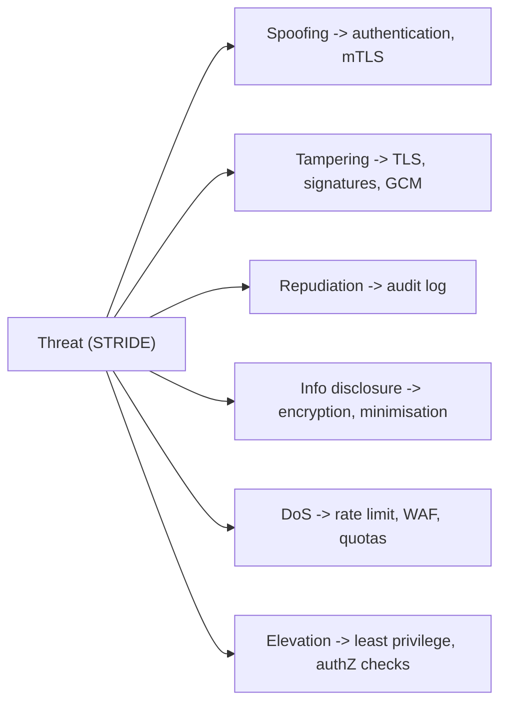

### Whiteboard version

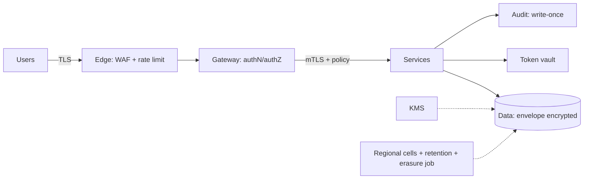

Say it in 30 seconds: "Trust boundary at the gateway. TLS outside, mTLS inside with per-pair policy. Data classified; restricted values tokenized; the rest envelope-encrypted with per-user keys so I can crypto-shred. Audit goes to a write-once store. Data stays in its home region. Retention jobs enforce deletion."

## 9. Interview questions

> [!question]- How would you protect card data in a checkout system?
> Keep it out of your systems. The browser sends the card straight to a payment provider that returns a token; we store the token, brand and last four digits.
>
> That shrinks PCI scope, because we never handle the card number. Server calls use the token.
>
> Never store the verification code after authorization. The remaining risk is the token vault or provider, which is their hardened scope.

> [!question]- Explain envelope encryption and why not encrypt everything with KMS directly.
> KMS calls are remote, rate-limited and size-limited (4 KB for AWS KMS direct encrypt). So KMS generates a data key; we encrypt locally with it and store the wrapped key beside the data. KMS only ever sees small keys, every unwrap is audited, rotation means re-wrapping small keys, and disabling the master key makes the data unreadable.

> [!question]- A user invokes the right to be forgotten. Your data is in Postgres, Redis, Elasticsearch, Kafka and backups. What do you do?
> Keep a data map. Delete or anonymise in Postgres, delete cache and index entries.
>
> For immutable logs use crypto-shredding: personal fields are encrypted with a per-user key, so deleting the key makes every copy unreadable.
>
> Backups age out by retention (document the window) and deletions are replayed on restore. Keep what law requires, such as tax records, in anonymised form.

> [!question]- What does zero trust mean for service-to-service calls, and what is mTLS missing?
> No call is trusted because of where it comes from. Each caller proves identity (mTLS with workload certs) and a policy decides whether that caller may call that method. mTLS only proves identity. You still need authorization policy, user context propagation and audit.

> [!question]- Your service must serve EU and Indian users under local data rules. How do you design it?
> Regional cells: each region has its own app, database and keys, with a home-region lookup at login. Only aggregated or pseudonymised data goes to a global tier. Discuss the cost: duplicated infrastructure, and harder cross-region features such as a traveller's account.

> [!question]- Encryption at rest is on. Is the data safe from a SQL injection bug?
> No. The database decrypts transparently for the application, so an injection query reads plaintext. At-rest encryption protects stolen disks and backups. Injection is stopped by parameterised queries, least-privilege DB accounts and field-level encryption for the most sensitive columns.

## 10. Cheat sheet

| Need | Control | One-line reason |
| --- | --- | --- |
| Stop sniffing | TLS 1.3 everywhere, HSTS | Encrypted, authenticated channel |
| Protect stored data | Envelope encryption, KMS | Cheap rotation, audit, revocation |
| Hold credentials | Secrets manager, short-lived creds | Limit what a leak is worth |
| Reduce scope | Tokenize card and ID values | Data you do not hold cannot leak |
| Contain intruders | Zero trust, mTLS, per-pair policy | No lateral movement for free |
| Answer "who did this" | Append-only audit log | Tamper evidence |
| Delete everywhere | Per-user keys, crypto-shredding | One key delete, many copies |
| Obey location law | Regional cells | Data stays in its region |
| Limit hoarding | Retention jobs | Less to leak or erase |
| Breach clock | GDPR 72 hours to regulator | Pre-built contact tree |

Order to mention in an interview: classify, boundary, TLS, auth, encrypt, tokenize, audit, erase, residency.

## 11. Links

- Authentication basics: [[Authentication vs Authorization]], [[Access and Refresh Tokens]], [[JWT - Structure, Validation and Pitfalls]], [[OAuth 2.0 and OpenID Connect]]
- Services and secrets: [[Service-to-Service Auth - API Keys, HMAC, mTLS]], [[Secrets Management]], [[AWS 02 - IAM]]
- Attack surface: [[OWASP API Security Top 10]], [[CSRF, XSS and Security Headers]], [[API Abuse and Bot Protection]], [[Website Security Hardening Checklist]], [[Security Incident Response - When Your Website Is Hacked]]
- Data and resilience: [[Multi-Region Architecture]], [[Event Sourcing]], [[Backup, PITR and Disaster Recovery]], [[TLS and HTTPS]]
- Framework: [[System Design Interview Framework]], [[Cost-Aware System Design]]

## Links

### Watch on YouTube

- [Security vs. Privacy](https://www.youtube.com/watch?v=x3rg8bttldg) · IBM Technology · 9 min · 33,732 views
- [VIDEO 1.14  Compliance and Privacy in Cybersecurity — Sensitive Data Explained](https://www.youtube.com/watch?v=Tcl2CgyRMW8) · DigitalUrim · 3 min · 24 views
