# Batch vs Stream - Lambda vs Kappa - Decision Guide

> [!summary] TL;DR
> **Batch** processing runs a job over a finished, bounded pile of data (yesterday's orders).
>
> **Stream** processing runs continuously over an endless flow of events and keeps results fresh in seconds.
>
> Choose by three things: how fresh the answer must be, how correct it must be, and how often you will need to recompute history.
>
> **Lambda** runs both paths side by side (two codebases). **Kappa** runs only the stream path and reprocesses by replaying the log (one codebase).
>
> The modern default is a replayable log plus one engine that can run both modes.

> [!abstract] Core idea
> - Ask "what is the cost of a stale answer?" first. If minutes-to-hours is fine, batch is simpler, cheaper and easier to fix.
> - Batch gives easy **reprocessing**: fix the bug, rerun the job. Streams must be able to replay to match that.
> - Stream needs three extra decisions batch does not: event time, windows with late data, and state with checkpoints.
> - Lambda's weakness is two codebases that must give the same answer. Kappa's weakness is long replays and retention cost.
> - Numbers here are rough estimates unless a source is named.

## Start here: the basics 🟢

> [!info] How to read this note (pick your level)
> - 🟢 **New to this?** Read "From zero" below, then sections 1, 2 and the cheat sheet (10). Stop there, that is a full first pass.
> - 🟡 **Know the basics?** Add section 3 (the decision steps), 4 (worked example) and 5 (comparison and drills).
> - 🔴 **Interview / SDE-3 prep?** Add 6, 7, 8 and 9. Headings are tagged 🟢🟡🔴 so you always know where you are.

**From zero, in 60 seconds** 🟢

Data keeps arriving: orders, clicks, payments.
You can wait, collect a big pile, and process it later. That is **batch**.
Or you can handle each event the moment it arrives. That is **stream**.
Batch is simpler and easier to get exactly right. Stream gives fresh answers in seconds but is harder to run.
Sometimes code has a bug and you must fix old results. So you keep all raw events in a log you can replay.

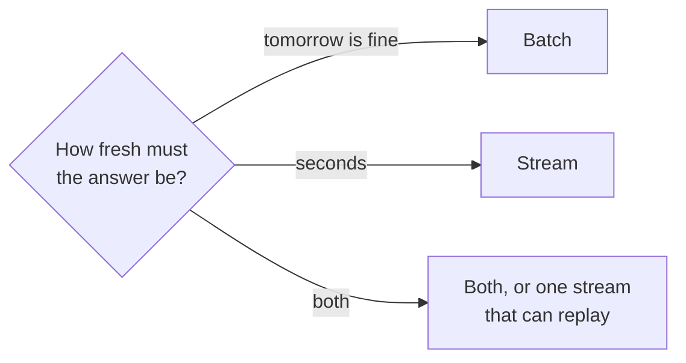

Lambda and Kappa are just two names for "both":
- **Lambda** = run a batch system and a stream system side by side.
- **Kappa** = run only the stream system, and replay the log to fix old results.

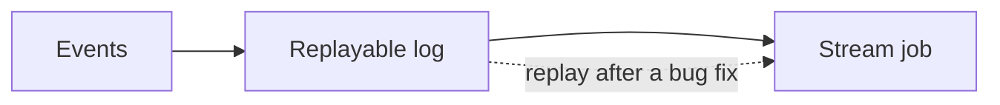

The rest of this note is just these 3 questions:
1. How fresh must the answer be?
2. How will you recompute history when the code changes?
3. Which tool fits, and how do you handle late events?

**The problem in one story.**
A food delivery app collects every order as it happens.
Finance needs yesterday's revenue per restaurant, and tomorrow morning is fine.
Operations needs "orders stuck for 10 minutes" right now, not tomorrow.
You can process data in big scheduled piles (batch) or one event at a time as it arrives (stream).
This guide is about picking one, or both, and fixing results when the code had a bug.

**Words you need first**

| Word | Plain meaning | Tiny example |
|---|---|---|
| Event | One small record that something happened | "order 991 placed at 12:03" |
| Batch job | A program run on a fixed pile of data, then it stops | Nightly revenue job at 02:00 |
| Stream job | A program that never stops and handles events as they come | Live "stuck orders" counter |
| Log (Kafka) | An append-only, replayable list of events | Topic `orders` kept 30 days |
| Latency / freshness | How old the answer is when you read it | Batch: hours; stream: seconds |
| Reprocessing / backfill | Re-running logic over old data after a fix | Recompute last month's totals |
| Window | A time bucket a stream groups events into | Orders per 5 minutes |
| Event time | When the event really happened, not when it arrived | Phone was offline, sent late |

**Picture it**

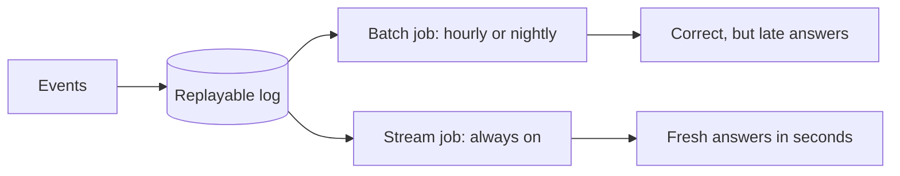

**Analogy.** Batch is doing the laundry once a week in one big load. Stream is washing each shirt the moment it gets dirty.
Where it breaks: re-washing last month's laundry is impossible, but a data system can replay old events if it kept them.

**How the rest of this note builds up**

- First, why it exists and the mental model (sections 1-2).
- Then the decision steps (section 3): freshness, reprocessing, Lambda, Kappa, the modern middle path, windows and late data, choosing the tool.
- Then a worked example, a full comparison and scenario drills (sections 4-5).
- Finally the SDE-3 deep dive (section 8): exactly-once as a combination, why batch is easier to make correct, and sizing by data and state.

> [!tip] Remember
> Ask how stale an answer may be and how you will recompute history; that picks batch, stream or both.

## 1. Why it exists 🟢

Take a food delivery app. The finance team wants "revenue per restaurant per day" to pay restaurants. The operations team wants "orders waiting more than 10 minutes in the last 5 minutes" to dispatch help. The fraud team wants "this card was used in 3 cities in 2 minutes" before the order is accepted.

These are three different freshness needs: a day, a minute, a second. Using one tool for all three is either wasteful (a streaming cluster to pay restaurants once a day) or dangerous (a nightly job for fraud).

There is a second trap: bugs. Last Tuesday the discount logic was wrong for 6 hours. Operations only needs the live number. Finance needs last Tuesday recomputed correctly. A system that cannot **reprocess history** forces manual fixes in a spreadsheet.

In an HLD round, the interviewer listens for whether you pick the freshness first and then the tool, and whether you mention reprocessing and late data without being asked.

> [!tip] Remember
> The question is never "batch or stream?" in general. It is "how stale may this answer be, and how will I recompute it when the logic changes?"

## 2. Mental model 🟢

Think of a **laundromat versus a conveyor-belt dry cleaner**.

- The **laundromat (batch)**: you collect a full basket, run one big wash, and get clean clothes at the end. Efficient per shirt, easy to redo a bad wash, but you wait for the full cycle.
- The **conveyor belt (stream)**: each shirt gets cleaned the moment it arrives. Instant, but the machine runs all day, a stuck shirt jams the belt, and re-cleaning last week's shirts needs a way to put them back on the belt.

**Lambda** is running both: the belt gives an approximate answer now, the laundromat later overwrites it with the exact one. **Kappa** is running only the belt, and for a re-clean you load old shirts (the log) onto a second belt.

The analogy breaks at time: shirts arrive in the order they were dirtied; events often do not. A tunnel delays a phone, so the "10:00 order" can arrive at 10:07. That is what windows and watermarks fix.

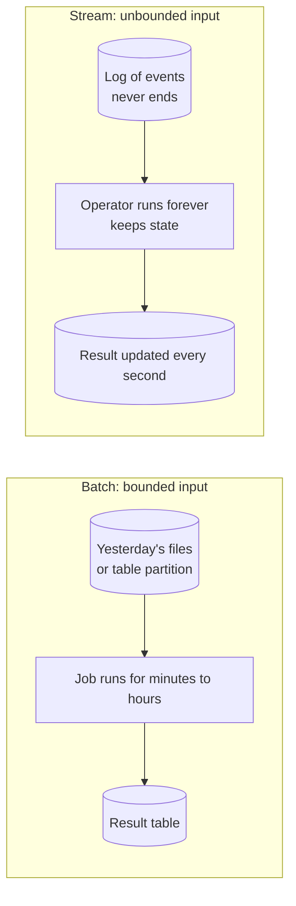

> [!tip] Remember
> Batch has an end and can be re-run. A stream has no end, so correctness has to be built in as state, time and replay.

## 3. How it works 🟡

### Step 1: how fresh must the answer be?

**In plain words:** write down the staleness the business can tolerate. Everything else follows. Freshness is a business number, not a tech preference.

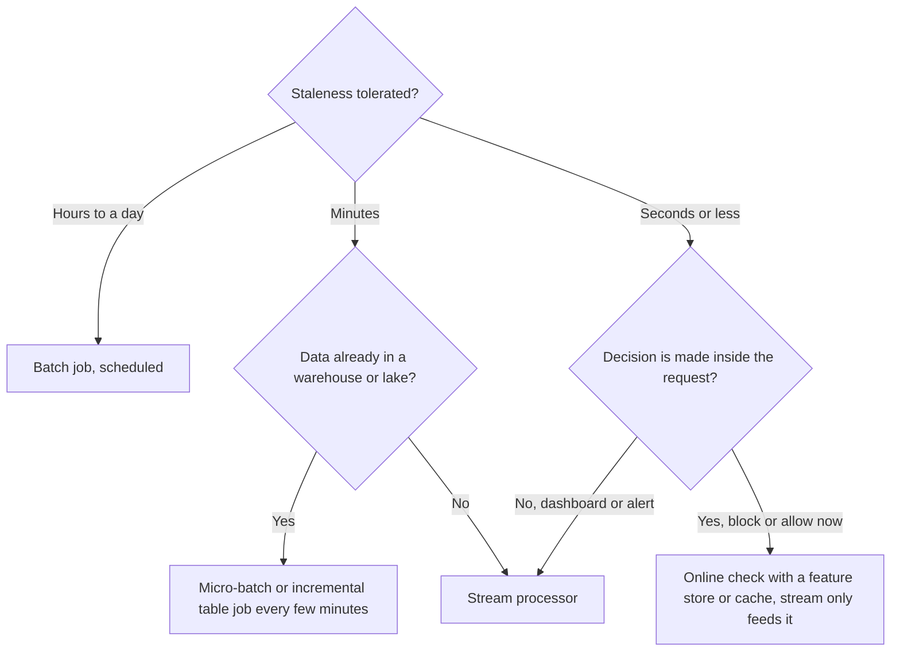

| Staleness | Typical tool | Example |
| --- | --- | --- |
| Days | Nightly batch (Spark, warehouse SQL) | Restaurant payouts, tax reports |
| Hours | Hourly batch or incremental job | Sales dashboards, recommendations retrain |
| Minutes | Micro-batch, or stream with minute windows | Ops dashboards, campaign budget |
| Seconds | Stream processor | Surge pricing, live ETA, alerting |
| Milliseconds | Not stream analytics: in-request lookup | Fraud score at checkout |

**Example with numbers:** payouts are computed once at 02:00 for yesterday. A 20-minute job on 5 GB of orders is fine. Making it a stream would keep a cluster up 24 hours to save a result nobody reads before 09:00.

**Why it matters:** streaming is more expensive to build and to run. Spend that only where freshness earns money.

### Step 2: how will you reprocess?

**In plain words:** logic changes and bugs happen. **Reprocessing** means recomputing results for past data with the fixed code. Batch does it by rerunning on stored input. A stream needs the input kept in a replayable log.

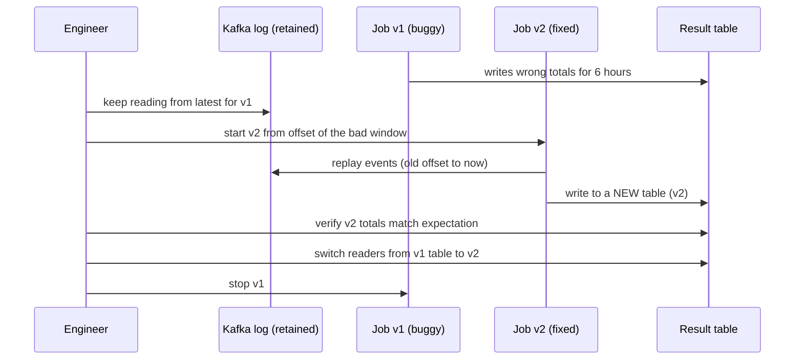

Notice the two rules: write to a new table, then switch readers. Never overwrite while readers are looking.

**Example with numbers (estimate):** 30 days of clicks at 100 million per day is 3 billion events. At 10 times real-time speed a replay of 1 day takes about 2.4 hours; of 30 days, far longer. If the log only keeps 7 days you cannot replay a month, so a copy in object storage (the lake) is the real history.

**Why it matters:** "can we recompute last month?" decides the retention plan: Kafka for days, a lake for months and years.

### Step 3: Lambda architecture

**In plain words:** keep two paths over the same input. A **speed layer** (stream) gives fast, approximate numbers. A **batch layer** recomputes exact numbers later. A **serving layer** merges them at read time.

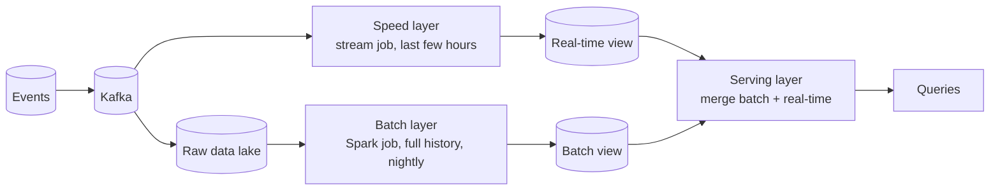

**Example:** an ad platform shows spend per campaign. The stream gives today's running total within 5 seconds. At 03:00 the batch job recomputes yesterday exactly (late clicks included, bots filtered by a heavier model) and replaces the stream's yesterday numbers.

**Why it matters:** Lambda gave exactness plus freshness when stream engines were weak. Its cost is the **dual codebase**: the same business rule written twice, in two frameworks, that must agree. When they drift, the dashboard flickers when yesterday's number changes at 03:00.

> [!warning] Common mistake
> Calling any system with both a stream job and a nightly job "Lambda". True Lambda means both compute the **same** result and a serving layer merges them. A stream for alerts plus a batch for finance reports are two different products, which is fine and common.

### Step 4: Kappa architecture

**In plain words:** drop the batch path. Keep one stream job over a long-retention log. To reprocess, start a new copy of the job from an older offset, let it catch up, then switch.

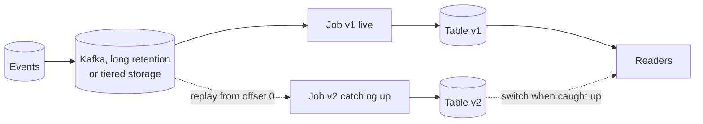

**Example:** a metrics rollup job (1-minute, 1-hour counts). Someone changes the dimension set. Start v2 from the beginning of retention, wait until it catches up, compare, flip the dashboards.

**Why it matters:** one codebase, one semantics. It works best when the log is cheap to retain (tiered storage, object-store-backed topics) and the logic is a pure function of events.

### Step 5: the modern middle path

**In plain words:** today the line is blurry. Engines such as Flink run the same API on bounded input (batch mode) and unbounded input (stream mode). Table formats on object storage (Iceberg, Delta, Hudi) can be read in bulk or incrementally. So you often get "one codebase" without a pure Kappa log.

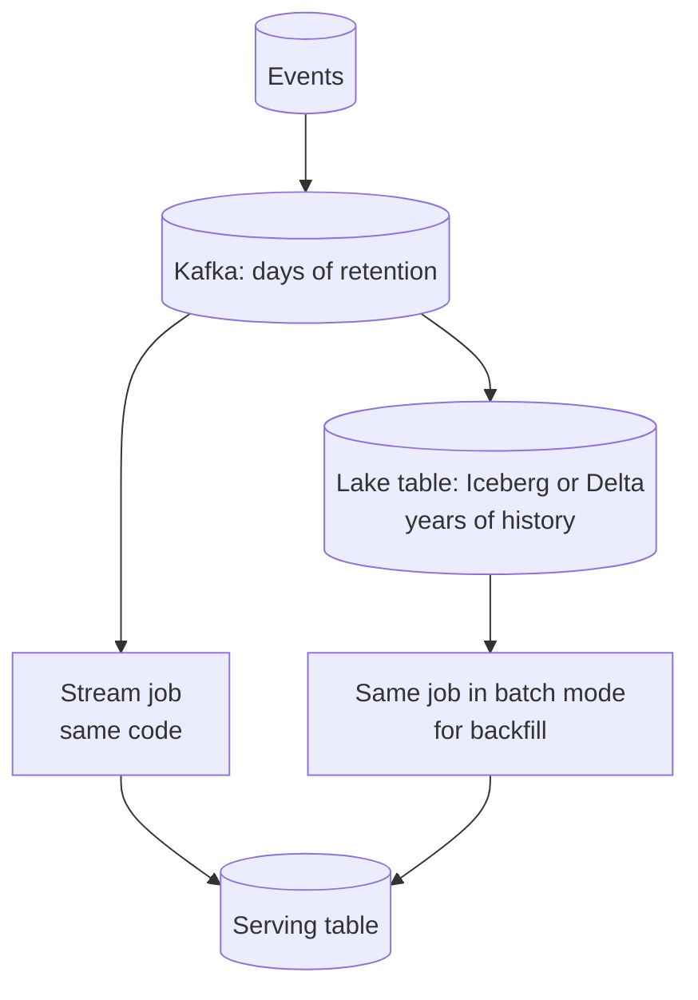

| Question | Pure Lambda | Pure Kappa | Unified engine plus lake |
| --- | --- | --- | --- |
| Codebases | Two | One | One (mode switch) |
| History source | Lake | Kafka (long retention) | Lake for old, Kafka for recent |
| Backfill speed | Fast (batch) | Slow (replay at log speed) | Fast (batch mode on lake) |
| Operational parts | Many | Fewer | Medium |
| Risk | Drift between paths | Retention cost, long replays | Needs care at the cut-over point |

**Why it matters:** in an interview, "I would use one engine for both modes and a lake for backfill" shows you know why Lambda existed and why it is rarely chosen fresh.

> [!tip] Remember
> Lambda: two paths, merge. Kappa: one path, replay. Modern: one code, log for recent, lake for old.

### Step 6: time, windows and late data (stream only)

**In plain words:** in batch, "yesterday's orders" is a closed set. In a stream, you must decide when a window is done. **Event time** is when it happened, **processing time** is when you saw it, and a **watermark** is your guess of "no older events are still coming". See [[Stream Processing Basics]] for the mechanism.

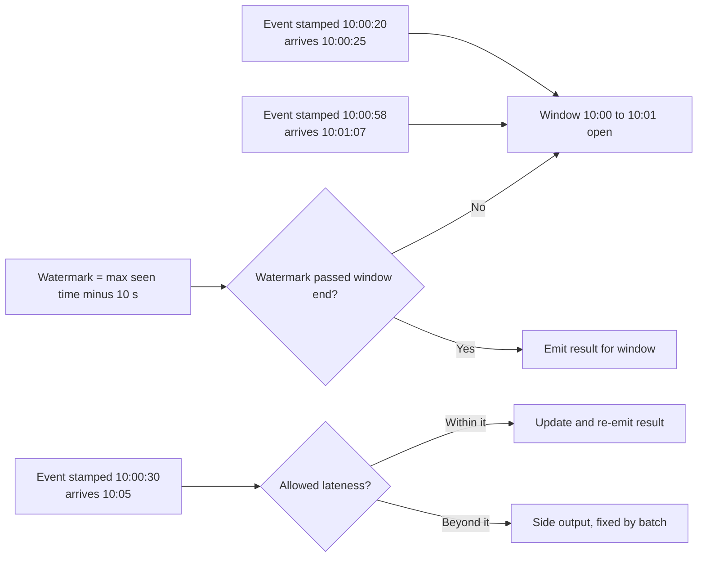

**Example:** minute windows with 10 s of lateness. 99.9 percent of clicks fall inside it (an estimate); the last 0.1 percent go to a side output. A nightly batch job then corrects them. That is the honest use of "Lambda-ish" in practice: stream for fast, batch for exact.

**Why it matters:** batch avoids almost all of this. If you can wait until the day is closed, do.

### Step 7: choosing the tool

**In plain words:** three common choices for the processing step.

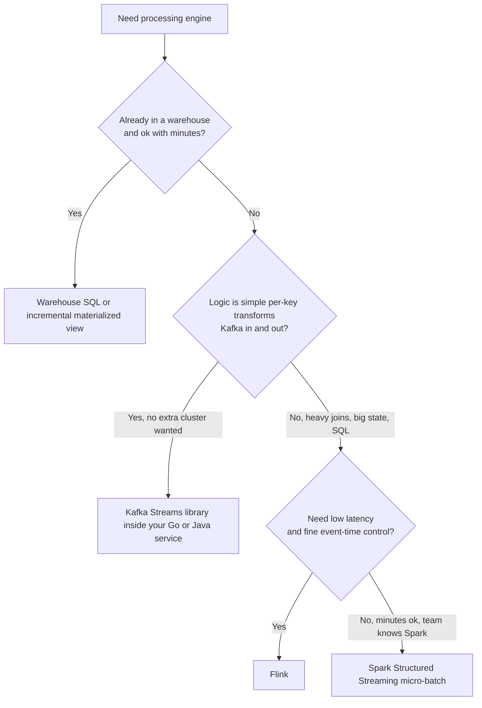

| Tool | Model | Strength | Watch out for |
| --- | --- | --- | --- |
| Spark (batch) | Bounded jobs, wide SQL and ML ecosystem | Huge scans, backfills, team familiarity | Latency of minutes to hours |
| Spark Structured Streaming | Micro-batch by default | Same API as batch, good for minutes latency | Higher latency floor than true streaming |
| Flink | True streaming, event time, checkpointed state | Low latency, large state, strong time model | Operating a cluster, state size tuning |
| Kafka Streams | A library, not a cluster | Simple deployment, exactly-once inside Kafka | Kafka-to-Kafka only, JVM only |
| Warehouse SQL (BigQuery, Snowflake, Redshift) | Batch or scheduled incremental | No cluster to run | Cost per scan, freshness of minutes |

> [!warning] Common mistake
> Saying "Kafka Streams" in a Go-only team without noting it is a JVM library. In a Go shop the realistic options are a Go consumer with its own state (small cases), or a managed Flink or Spark job beside it.

> [!tip] Remember
> Pick the least powerful tool that meets the freshness and state needs.

## 4. Worked example 🟡

### Whiteboard version

**In plain words:** One app, two needs: a live dashboard for operations and exact daily numbers for finance. Watch how each need picks its own path.

Design: **"orders analytics for a food delivery app"** with a ops dashboard (live) and finance payouts (exact).

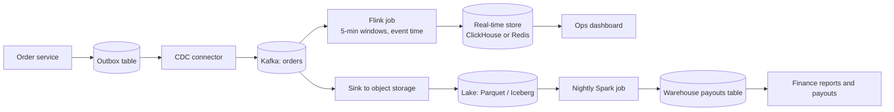

1. **Source of truth:** the orders database. Events leave through the **outbox** so none are lost ([[Transactional Outbox and CDC]]).
2. **Log:** Kafka holds 7 days, so a streaming bug can be replayed.
3. **Fast path:** Flink counts orders per zone in 5-minute event-time windows with 30 s lateness. Dashboard freshness is about 10 seconds (estimate).
4. **Exact path:** every event also lands in the lake. At 02:00 a Spark job recomputes the previous day with discounts, refunds and late events applied. Payouts read only this table.
5. **Reconciliation:** a nightly check compares stream totals against batch totals. A gap above 0.5 percent (an estimated threshold) pages someone.
6. **Why not pure Kappa:** payouts have legal accuracy needs and need months of history; the lake is cheaper than long Kafka retention.
7. **Why not Lambda with a merge layer:** the two outputs serve different users. No merge logic, so no dual-code drift on one number.

**Trade-off to say aloud:** the dashboard and the payouts can differ slightly for yesterday. That is acceptable because the dashboard is labelled "estimate" and the payout is the ledger.

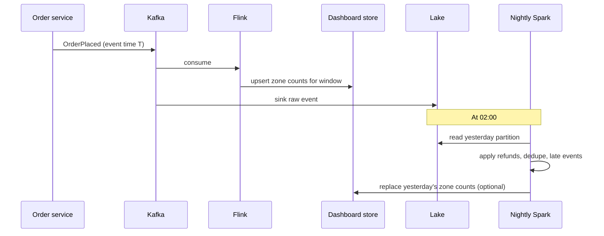

## 5. Variants and comparison 🟡

### The full comparison

**In plain words:** Same question, three speeds. Batch is slow but simple, micro-batch is in between, true stream is fastest but hardest.

| Dimension | Batch (Spark, warehouse) | Micro-batch (Spark SS) | True stream (Flink, Kafka Streams) |
| --- | --- | --- | --- |
| Freshness | Minutes to days | Seconds to minutes | Milliseconds to seconds (estimate) |
| Throughput | Highest per core | High | High, depends on state |
| Correctness model | Closed input, easy exactly-once | Exactly-once with replayable source and idempotent sink | Exactly-once via checkpoints and transactional or idempotent sinks |
| Ordering | Not needed | Per micro-batch | Per key, in event time with watermarks |
| Late data | Rerun the job | Watermark plus lateness | Watermark, allowed lateness, side output |
| Reprocessing | Rerun on stored input | Replay from source | Replay from log offset or savepoint |
| Scaling | Add workers per job | Add executors | Rescale with state redistribution |
| Operational cost | Low (schedule and forget) | Medium | High (always on, state, upgrades) |
| Typical failure modes | Job skew, out-of-memory, late input file | Batch interval backlog | Checkpoint timeouts, state blowup, watermark stuck on idle partition |
| Managed options | EMR, Dataproc, Databricks, BigQuery | Databricks, EMR | Managed Flink offerings, Confluent |
| Wrong choice when | Answer needed in seconds | You need sub-second latency | Hourly report on 5 GB |

Figures marked "estimate" are rough orders of magnitude, not benchmarks.

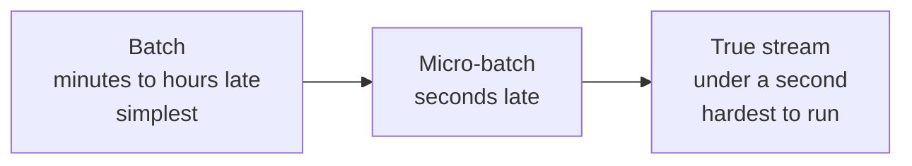

### Real systems (conservative)

**In plain words:** These are publicly known examples of who used which style. Use them as proof points in an interview, not as exact numbers.

- **Lambda**: described by Nathan Marz in the book above, and widely adopted around 2012 to 2016 with Hadoop plus Storm. Twitter's open-source Summingbird was built to run one job definition on both batch and stream for this reason.
- **Kappa idea**: Jay Kreps, who built Kafka at LinkedIn, argued in 2014 that a replayable log removes the need for a separate batch path.
- **Uber, Netflix, LinkedIn** publish engineering blog posts on real-time pipelines built on Kafka with Flink or Samza-like engines and on lake-based batch. Treat any exact architecture claim as something to verify against their current blog posts rather than recite from memory.

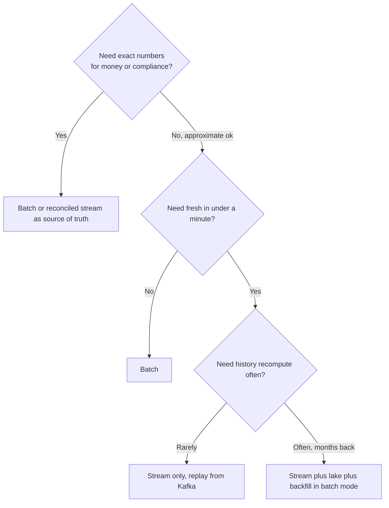

### Scenario drills

**In plain words:** Practice cases. Read the scenario, guess the pick, then check the "why" column.

| Scenario | Pick | Why | Say in the interview |
| --- | --- | --- | --- |
| Restaurant payouts | Nightly batch from the lake | Exactness, refunds, audit, nobody needs it faster | "Money is a batch problem; I close the day, then compute once." |
| Live ops dashboard (orders per zone) | Flink 1-min windows to ClickHouse or Redis | Seconds-fresh, approximate is fine | "Stream for freshness, labelled approximate, corrected by batch." |
| Fraud check at checkout | In-request check using a feature store; stream updates features | Decision must be in milliseconds | "The stream updates counters; the request reads them, it does not wait on a job." |
| Ad click budget cap | Stream aggregation with dedupe, reconciled by batch | Overspend costs money; stale by minutes is bad | "Stream for control, batch for billing truth, see [[Case Study - Ad Click Aggregation]]." |
| Recommendation model retrain | Daily batch | Training is bulk, freshness of hours is fine | "Batch trains; stream only refreshes features." |
| Metrics and logs rollups | Stream rollups, raw to lake | Alert in seconds, history cheap | "See [[Case Study - Metrics and Logging Platform]]." |
| Leaderboard top-K | Stream with state, snapshot to Redis | Fresh rank, small state | "See [[Case Study - Leaderboard and Top-K]]." |
| Daily business report from 3 databases | Warehouse SQL on CDC-loaded tables | No streaming need | "I would not add a stream; I would copy data via CDC and run SQL." |
| Search index update when a product changes | CDC to Kafka to indexer, with weekly full reindex | Incremental plus a safety net | "Stream for freshness, batch rebuild fixes drift." |
| Schema bug found in last week's data | Replay from Kafka if within retention, else batch backfill from lake | Depends on where history lives | "Retention length is a design decision I state up front." |

## 6. Trade-offs and when not to use 🟡

- **Do not stream what a batch can do.** Always-on state, checkpoints, and watermarks cost engineering time.
- **Do not trust a stream alone for money.** Pair it with a batch reconciliation or a ledger.
- **Lambda is rarely right for new systems.** It doubles code. Choose it only when the batch tool does something the stream engine truly cannot (heavy ML, huge joins), and keep the merge logic tiny.
- **Kappa is wrong** when retention of years in the log is too costly and no lake backfill exists.
- **Micro-batch is wrong** when latency must be under a second.
- **Exactly-once is not free.** It needs a replayable source, checkpoints, and an idempotent or transactional sink. See [[Delivery Semantics and Exactly-Once]].
- **Back-pressure:** a slow sink must slow the source, not drop data. See [[Backpressure and Flow Control]].

## 7. In production 🔴

- **Monitor lag, not just errors:** consumer lag per partition (`kafka-consumer-groups.sh --bootstrap-server <broker:9092> --describe --group <group>`; the script has no `.sh` suffix in some packaged installs), end-to-end event-time latency, checkpoint duration and size, and watermark lag.
- **Idle partition trap:** one quiet partition stalls the watermark for the whole job. Configure idleness handling.
- **Skew:** one hot key (a huge restaurant, a viral ad) overloads one worker. Salt the key or pre-aggregate. See [[Hot Keys and Hot Partitions]].
- **Schema changes:** use a registry and compatible changes, or replays break ([[Event Schemas and Schema Registry]]).
- **Reconciliation job:** compare stream totals to batch totals nightly; alert on a threshold you pick from history.
- **Cost:** a 24 by 7 cluster for a once-a-day answer is the most common waste.
- **Backfills:** run to a new table, validate, switch readers; do not write into the live table.

## 8. Deep dive 🔴

### Why exactly-once in a stream is a combination, not a switch

**In plain words:** the engine replays input after a crash, so the same event may be processed twice. The result looks exactly-once only if state, offsets and output move together.

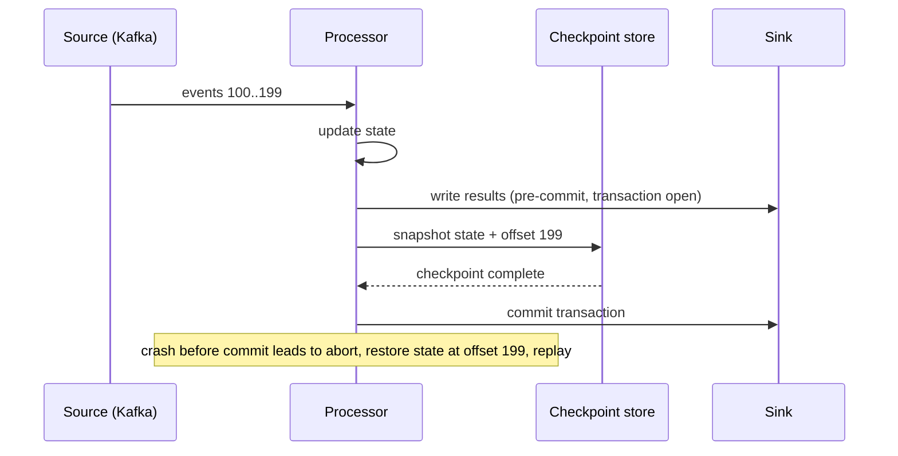

1. The engine snapshots state and source offsets at the same logical point.
2. Output to the sink is staged inside a transaction (or written idempotently by key).
3. Only when the snapshot is durable does the transaction commit.
4. After a crash, state is restored from the last snapshot and the input is replayed from its offset; uncommitted output is discarded.

If the sink cannot do transactions or idempotent writes, you get at-least-once, and duplicates must be removed downstream.

### Why batch is easier to make correct

**In plain words:** A batch run has a clear start and end. If it fails, throw the output away and run it again. A stream never stops, so mistakes are harder to undo.

A batch job has a start and an end, so a failed run is thrown away and rerun with the same input. The output replaces the old partition atomically. No windows, no watermarks, no late data: the "late" file simply belongs to the next run. That is why finance stays on batch.

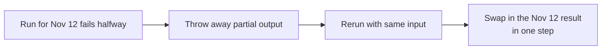

### Choosing by data size and state

**In plain words:** A stream job keeps running totals in memory. If those totals get too big to fit, a stream may be the wrong tool.

State in a stream lives in memory or an embedded store (RocksDB in Flink) and is checkpointed. If state per key times keys exceeds what the cluster can hold, either window it, expire it with TTL, or reduce what is stored (counts, sketches; see [[Bloom Filters and Probabilistic Data Structures]]).

## 9. Interview questions 🔴

> [!question]- When would you choose batch over stream?
> When the answer may be hours old, when correctness or audit matters more than speed (payouts, tax), when data is already in a warehouse, or when the team cannot operate an always-on cluster. Batch is cheaper and reprocessing is just a rerun.

> [!question]- Explain Lambda and Kappa and why Kappa became popular.
> Lambda runs a speed layer (stream) and a batch layer over the same data and merges them at read time; the downside is two codebases that must agree.
>
> Kappa runs only the stream and reprocesses by replaying a retained log.
>
> It became popular because stream engines got exactly-once and event-time support, so the batch path was no longer needed for correctness.
>
> In practice many teams use one engine in both modes plus a lake for backfill.

> [!question]- How do you handle late-arriving data in a stream?
> Use event time, a watermark with a tolerance, and allowed lateness to update emitted windows. Send events beyond that to a side output and correct them in a periodic batch recompute. State the lateness tolerance as a business number.

> [!question]- Your stream job had a bug for 6 hours. How do you fix the numbers?
> Fix the code, start the new version from the offset before the bug (or run it in batch mode over the lake partition), write to a new table, verify totals against a reference, then switch readers. This only works if the input is retained, so retention is a design decision.

> [!question]- Spark Structured Streaming, Flink or Kafka Streams?
> Kafka Streams when it is Kafka-to-Kafka, simple, and the team is on the JVM, with no cluster to run. Flink for low latency, large state and fine event-time control. Spark Structured Streaming when minutes of latency are fine and the team already uses Spark for batch.

> [!question]- Can a stream be the source of truth for money?
> Safer not to. Use a ledger or a closed-day batch for the truth, and the stream for fast, labelled-approximate views, with a nightly reconciliation between them.

> [!question]- How do you get exactly-once results from a pipeline?
> Replayable source, checkpoints that snapshot state with offsets, and a transactional or idempotent sink. Without an idempotent sink it is at-least-once and you dedupe downstream.

## 10. Cheat sheet 🟢

| Need | Pick |
| --- | --- |
| Hours of staleness OK | Batch |
| Money, audit, legal accuracy | Batch or ledger, stream only as preview |
| Seconds-fresh dashboards or alerts | Stream (Flink, Kafka Streams) |
| Minutes fresh, team knows Spark | Spark Structured Streaming |
| Millisecond decision in a request | Online lookup, stream feeds the features |
| Reprocess last week | Replay from Kafka if retained, else batch from lake |
| Reprocess months | Lake plus batch mode |
| Avoid two codebases | Kappa, or a unified engine plus lake |
| Late data | Event time, watermark, allowed lateness, side output |

- **Say it like this:** "I pick by freshness and correctness. The stream gives seconds-fresh approximate numbers; the nightly batch from the lake gives the exact ones, and I reconcile them."
- **Always mention:** retention for replay, late data, idempotent sink, reconciliation.

## Links 🟢

- Concepts: [[Stream Processing Basics]], [[Batch Processing and Data Pipelines]], [[Kafka and Event Streaming]], [[Delivery Semantics and Exactly-Once]], [[Transactional Outbox and CDC]], [[Clocks and Ordering]], [[Backpressure and Flow Control]], [[Time-Series and Columnar Storage]].
- Case studies: [[Case Study - Ad Click Aggregation]], [[Case Study - Metrics and Logging Platform]], [[Case Study - Leaderboard and Top-K]].
- Sibling guides: [[Choosing Storage for Files, Search and Analytics - Decision Guide]], [[Kafka vs RabbitMQ vs SQS - Choosing a Message Broker]], [[HLD Trade-offs Master Cheat Sheet]].
- Framework: [[System Design Interview Framework]], [[HLD Round - Complete Step-by-Step Guide]].

### Watch on YouTube

- [Lambda vs Kappa Architecture / Batch vs Stream Processing Explained](https://www.youtube.com/watch?v=Bnrk9Jz5ko0) · Arpit Vaish · 9 min · 704 views
- [Lambda vs Kappa Architecture: Stream vs Batch Processing in Big Data / Uplatz](https://www.youtube.com/watch?v=oj3QFdRr8xE) · Uplatz · 7 min · 59 views
