# Choosing Compute, Scaling and Deployment - Decision Guide

> [!summary] TL;DR
> In an HLD round the compute question is "where does my code run, how many copies, and how does it grow?".
>
> Start with the simplest thing that meets the load (one well-built service on containers behind a load balancer), keep the app stateless so you can add copies, and move to Kubernetes, serverless or microservices only when a concrete requirement forces it.

> [!abstract] Core idea
> - **Compute**: VMs for full control and odd workloads, containers (ECS/Fargate) for most services, Kubernetes when you run many services and need its ecosystem, serverless for spiky or event-driven work.
> - **Shape**: start with a (modular) monolith; split into microservices only for independent scaling, independent teams or fault isolation.
> - **Scaling**: scale up while it is cheap and simple, scale out for the real ceiling and for availability. Stateless services scale by adding copies; state moves to a database, cache or queue.
> - **Autoscale** on a signal that leads to pain (CPU, requests per pod, queue depth), not one that lags.
> - **Multi-region** only for latency or disaster-recovery targets that one region cannot meet, because it multiplies cost and data complexity.

## Start here: the basics

**The problem in one story.**
You wrote a food ordering service and it runs on one server.
Then a sale brings 10 times the usual traffic and the server falls over.
You must decide where the code runs (a server, a container, a function), how many copies run, and how new versions go out without breaking things.
This guide helps you pick the simplest option that survives the load.

**Words you need first**

| Word | Plain meaning | Tiny example |
|---|---|---|
| VM (virtual machine) | A rented computer with its own OS | One EC2 instance |
| Container | Your app plus its libraries, packed to run anywhere | A Docker image of the API |
| Kubernetes | A system that runs and restarts many containers for you | 40 pods across 6 nodes |
| Serverless | You upload a function; the cloud runs copies on demand | AWS Lambda resizing images |
| Load balancer | Spreads requests across copies of a service | 3,500 RPS split over 8 pods |
| Stateless | A copy keeps no user data in memory between requests | Any pod can serve any user |
| Scale up / scale out | Bigger machine / more machines | 8 to 32 cores / 4 to 12 pods |
| Autoscaling | Adding or removing copies automatically by a signal | Add pods when CPU > 60% |

**Picture it**

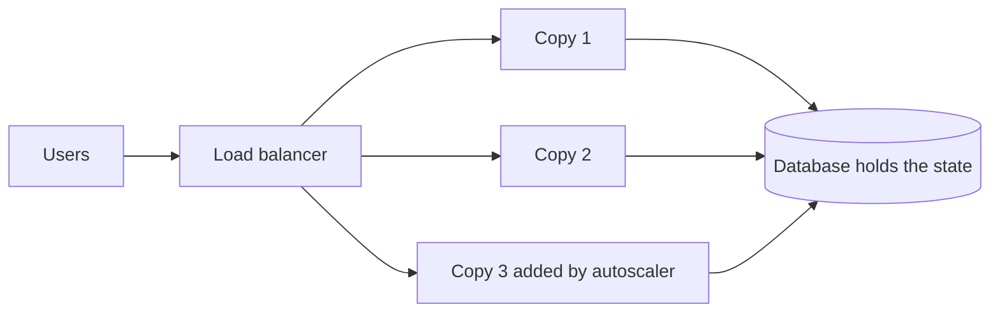

**Analogy.** A restaurant kitchen: at rush hour you add more cooks (scale out) or buy a bigger stove (scale up). Recipes live in a shared book, so any cook can make any dish (stateless).
Where it breaks: new cooks take minutes to arrive, while software copies can start in seconds, or suffer a cold start delay.

**How the rest of this note builds up**

- First, why it exists and the mental model (sections 1-2).
- Then each decision (section 3): compute options, VMs vs containers, Kubernetes, serverless limits, monolith vs microservices, scaling, state, autoscaling, multi-region, deployment.
- Then a worked example and comparison tables (sections 4-5).
- Finally the SDE-3 deep dive (section 8): scale-up for databases, Kubernetes requests and limits, cold starts, headroom arithmetic and stateful workloads.

> [!tip] Remember
> Start simple and stateless, add copies to scale, and add Kubernetes, serverless or microservices only when a real need forces it.

## 1. Why it exists

An interviewer says "design a food ordering backend for 50,000 requests per second at peak". Candidates who jump straight to "Kubernetes, 40 microservices, three regions" lose points, because they never said why. Candidates who say "one service, three pods, a database" lose points for ignoring the load.

The skill being scored is **matching the machinery to the requirement**.

- Too little: the system melts at lunch peak.
- Too much: a team of six spends all its time operating a platform instead of shipping features.

This guide gives you a short set of questions that lead to a concrete choice, and the sentence to say out loud for each one.

> [!tip] Remember
> The goal is not the most modern stack. It is the cheapest stack that meets the stated load, latency and availability, with a named path to the next stage.

## 2. Mental model

Think of **transport for a company**.

- A **VM** is renting a car: you choose everything, you also maintain everything.
- A **container service** (ECS/Fargate) is a taxi fleet you schedule: you say where to go, someone else owns the engine.
- **Kubernetes** is running your own airline: powerful and flexible, but you need pilots, ground crew and a control tower.
- **Serverless** is a ride-hailing app: you pay per trip, nothing sits idle, but you cannot choose the car, and long trips are expensive.

The analogy breaks down on cost: renting cars is cheapest per hour when they are busy all day, and the ride-hailing app is cheapest only when trips are rare.

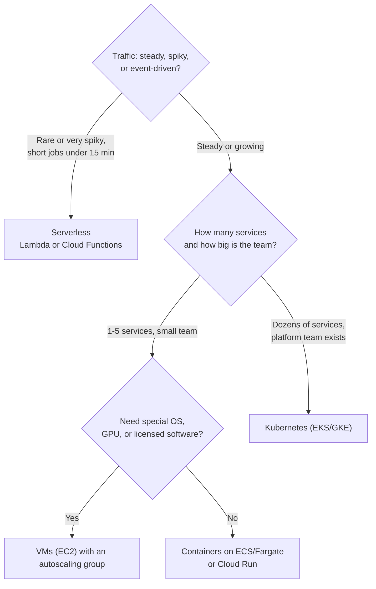

## 3. How it works

### 3.1 The four compute options

**In plain words.** All four run your code. They differ in how much of the machine you manage and how you pay.

| Option | You manage | Billing | Startup | Good for |
| --- | --- | --- | --- | --- |
| VM (EC2, Compute Engine) | OS, patches, runtime, scaling groups | Per second or hour of the instance | Minutes | Databases you self-host, GPU, legacy, long-running stateful processes |
| Container service (ECS on Fargate, Cloud Run) | Image and task size; no servers | Per vCPU and memory per second | Seconds to tens of seconds | Most stateless APIs and workers |
| Kubernetes (EKS, GKE, AKS) | Cluster add-ons, upgrades, networking, policies | Nodes plus control plane fee | Seconds (pod), minutes (new node) | Many services, custom operators, multi-cloud portability |
| Serverless functions (Lambda) | Only function code | Per request and duration | Milliseconds warm, a cold start otherwise | Spiky APIs, event handlers, glue, cron |

**Example.** A photo-resize step triggered by an upload happens 200 times a day. On a VM you pay for 24 hours of idle capacity. On Lambda you pay for 200 short invocations, which is close to nothing.

**Why it matters.** The decision is mostly about **utilisation**: steady high load favours VMs or containers, rare or spiky load favours serverless.

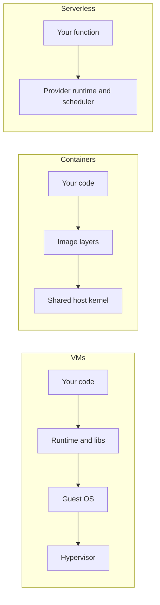

### 3.2 VMs vs containers

**In plain words.** A VM carries a whole operating system. A container shares the host's kernel and carries only your app and its libraries, so it is smaller and starts faster. See [[Docker 01 - Why Containers]] and [[Docker 08 - How Docker Works Under the Hood]].

**Example.** A Go API image can be roughly tens of megabytes (estimate for a static binary on a minimal base), starts in about a second, and you can pack many on one host. A VM image is gigabytes and starts in minutes.

**Why it matters.** Containers give you the same artifact from laptop to prod and make rolling deployments quick. Choose a VM only when you need kernel-level control, strong isolation between tenants, or software that does not containerise.

### 3.3 When Kubernetes is worth it

**In plain words.** **Kubernetes** is a scheduler that keeps the desired number of containers running, restarts failed ones, spreads them across machines and wires up service discovery. It is a platform for running a platform.

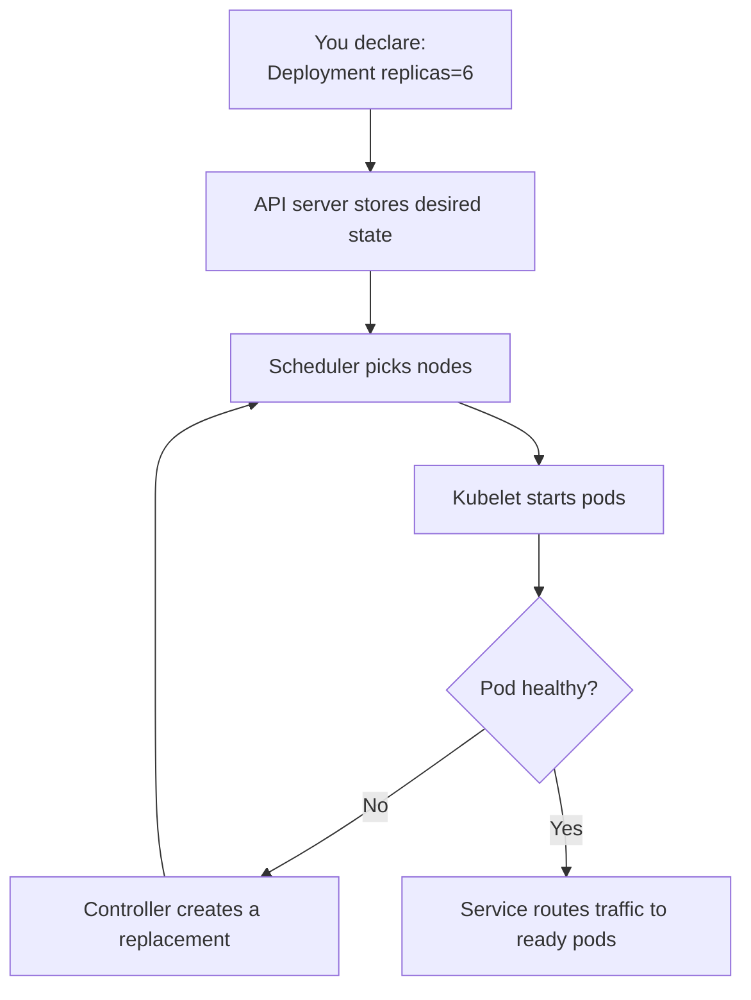

Choose Kubernetes when at least two or three of these hold:

1. You run 15+ services and need consistent deploy, config and secrets handling.
2. A platform team of 3+ people can own upgrades and cluster add-ons.
3. You need ecosystem pieces: operators, service mesh, GitOps, custom autoscalers.
4. You need to run the same way on several clouds or on-premise.

If none hold, ECS on Fargate is less work. See [[Kubernetes Fundamentals]] and [[AWS 04 - Compute Choices - EC2, ECS-Fargate, EKS, Lambda]].

> [!warning] Common mistake
> Saying "Kubernetes" because it is standard. It adds cluster upgrades, networking, RBAC and add-on version management. For a five-service product, say "ECS Fargate now, move to EKS if the service count and team justify a platform team".

### 3.4 Serverless: the real limits

**In plain words.** You upload a function; the provider runs copies when events arrive and scales them for you.

**Limits to quote.** AWS Lambda has a maximum timeout of 15 minutes and a default account concurrency limit of 1,000 per Region (raisable).

Cold starts add latency on the first request to a new instance.

Each concurrent request uses its own instance, so a database with 100 connections can be exhausted by 1,000 concurrent functions unless you use a proxy or pool.

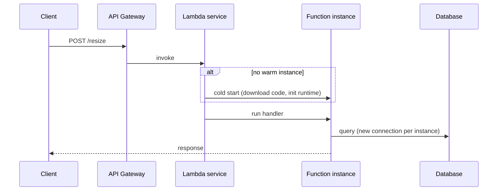

**Why it matters.** Serverless is excellent for glue, schedules and bursty traffic, and a poor fit for steady 50,000 RPS APIs (cost per request adds up), long jobs, or anything with large connection counts to one database.

### 3.5 Monolith vs microservices for this design

**In plain words.** A **monolith** is one deployable unit. **Microservices** are many small units, each owning its data. See [[Monolith vs Microservices]] and [[Modular Monolith]].

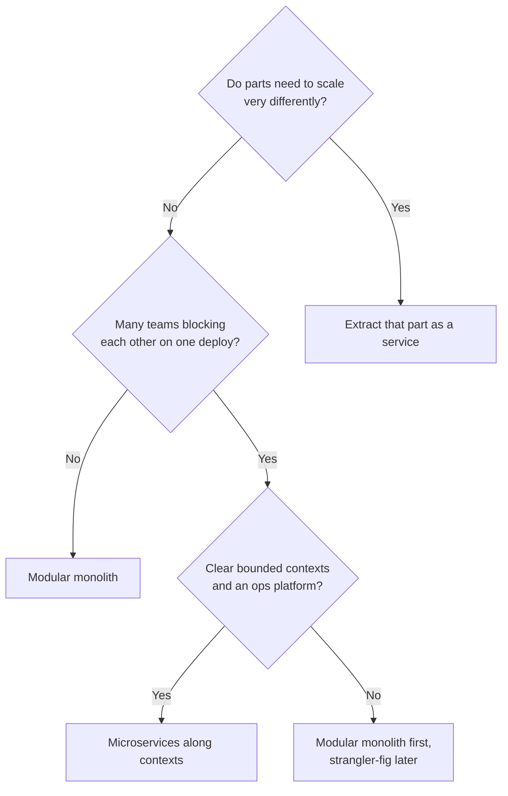

Reasons that justify a split, each with a number you can say:

- **Independent scaling.** Search takes 20x the traffic of checkout, so scale it alone.
- **Independent teams.** 8 squads cannot all release one binary weekly.
- **Fault isolation.** A recommendation outage must not take checkout down.
- **Different tech.** A video encoder wants a GPU fleet, the API does not.

Reasons that do not justify a split: "it is modern", "Netflix does it".

> [!warning] Common mistake
> Proposing microservices on a whiteboard for a 3-person startup and then forgetting the cost: network calls instead of function calls, distributed transactions, per-service pipelines and tracing. Mention the cost the moment you propose the split.

### 3.6 Vertical vs horizontal scaling

**In plain words.** **Vertical scaling** (scale up) means a bigger machine. **Horizontal scaling** (scale out) means more machines. See [[Scaling Basics]].

| | Vertical | Horizontal |
| --- | --- | --- |
| Effort | Almost none (resize instance) | Needs stateless app and a load balancer |
| Ceiling | The largest instance type | Practically far higher |
| Failure | One machine is a single point of failure | Losing one of N loses 1/N capacity |
| Downtime | Often a restart to resize | None with rolling changes |
| Cost curve | Superlinear at the top end | Roughly linear |
| Best for | Relational primary DB, early stage | Stateless app tier, caches, workers |

**Example.** A Postgres primary hits 70% CPU at 4,000 writes per second. Moving from 8 to 32 vCPUs buys time in an afternoon. Sharding (horizontal) is months of work, so you scale up first, add read replicas, and shard only when writes exceed what one node can do. See [[Partitioning and Sharding]].

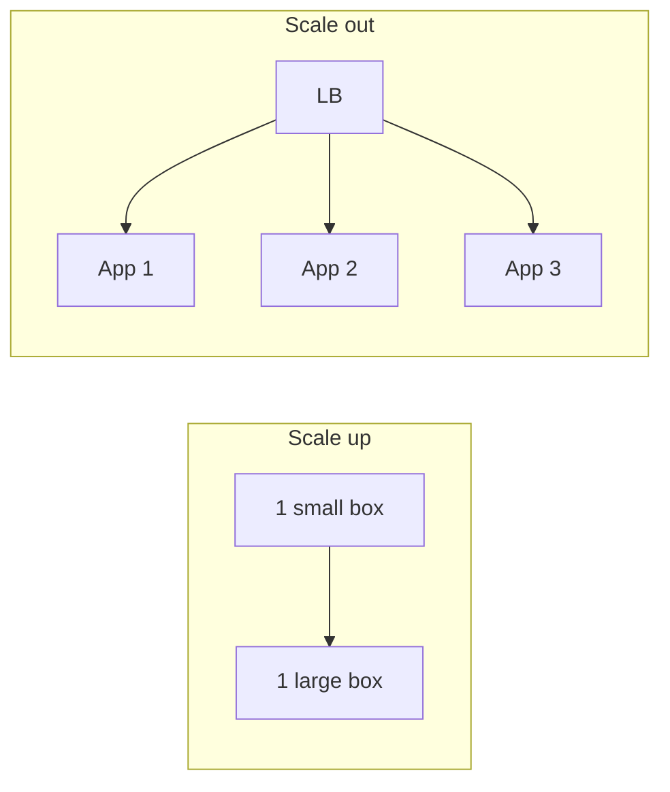

### 3.7 Stateless vs stateful

**In plain words.** A **stateless** service keeps nothing between requests, so any copy can answer any request. A **stateful** one remembers things, so requests for the same data must reach the same place. The Twelve-Factor App says processes should be stateless and share-nothing ([[Cloud Native and the 12-Factor App]]).

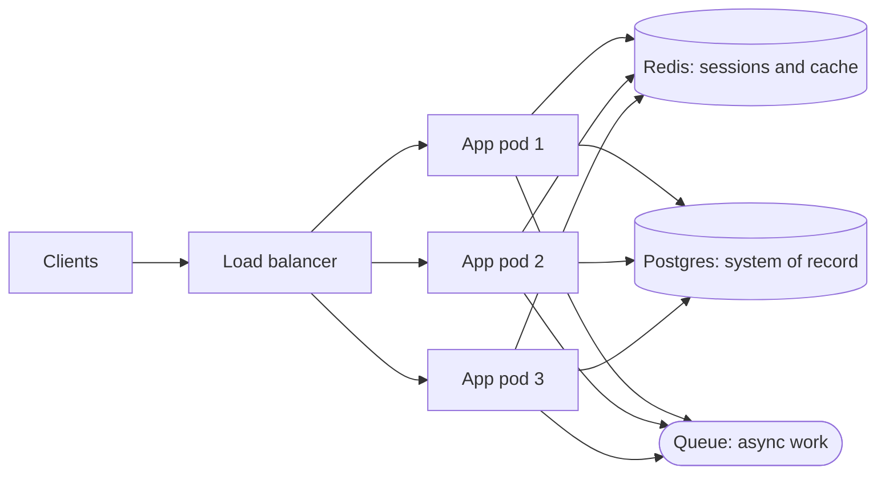

Where each kind of state goes:

| State | Put it in |
| --- | --- |
| User session | Redis, or a signed token (JWT) |
| Uploaded files | Object storage (S3) |
| Durable records | Database |
| Background work | Queue |
| Per-instance cache | Fine, but treat as disposable |

**Why it matters.** The moment the app is stateless, scaling is "add pods" and a crash is a non-event. Stateful systems (databases, Kafka brokers, WebSocket connection holders) need replication, partitioning or sticky routing instead. See [[Scaling WebSockets]].

### 3.8 Autoscaling signals

**In plain words.** An **autoscaler** adds or removes copies based on a measured signal. Pick the signal that rises before users suffer.

The Kubernetes Horizontal Pod Autoscaler computes `desired = ceil(current * currentMetric / targetMetric)`. Scale-down waits for a stabilisation window (300 seconds by default) to avoid flapping. See [[Autoscaling]].

| Signal | Good for | Weak because |
| --- | --- | --- |
| CPU utilisation | CPU-bound API pods | Misses I/O-bound slowness |
| Requests per pod (RPS) | Web APIs | Needs a metrics pipeline |
| Queue depth or age | Workers | Needs a custom or KEDA metric |
| Latency (p95) | Direct user pain | Noisy, can oscillate; adding pods may not fix a slow database |
| Schedule | Known peaks (lunch rush) | Wrong if the pattern shifts |
| Memory | Rarely | Often does not fall after load drops |

**Example.** Food app peak at 12:00. Traffic goes from 5,000 to 25,000 RPS in 10 minutes. Pod startup plus node start is about 2 minutes, so a purely reactive scaler lags. Fix: schedule a pre-scale at 11:45, keep a minimum replica count at the known baseline, and keep headroom of 30 to 50%.

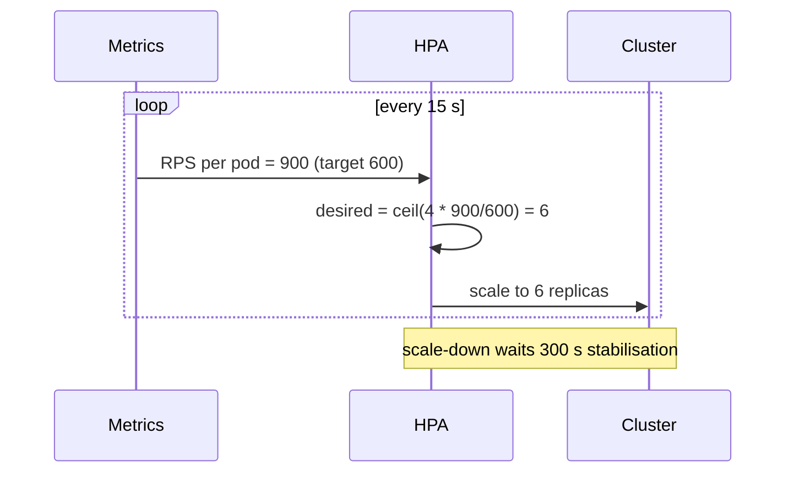

### 3.9 Multi-region

**In plain words.** Running in several geographic regions for lower latency, for surviving a regional outage, or for data-residency law. See [[Multi-Region Architecture]] and [[High Availability and Failover]].

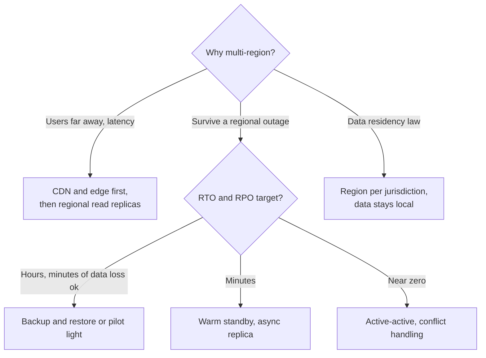

| Pattern | RTO (rough) | Cost | Hard part |
| --- | --- | --- | --- |
| Backup and restore | Hours | Lowest | Restore time is untested |
| Pilot light / warm standby | Minutes to an hour | Medium | Failover runbook, DNS TTL |
| Active-passive | Minutes | High | Replica lag means possible data loss |
| Active-active | Seconds | Highest | Write conflicts, global consistency |

> [!warning] Common mistake
> Saying "active-active in 3 regions" without explaining how writes work. Active-active forces a choice between conflict resolution (CRDTs, last-writer-wins) and a single write region per entity. Name which one.

### 3.10 Deployment strategy

**In plain words.** How a new version replaces the old. See [[Deployment Strategies - Rolling, Blue-Green, Canary]], [[Feature Flags]] and [[Rollback and Safe Migrations]].

| Strategy | Mechanism | Rollback | Extra cost |
| --- | --- | --- | --- |
| Rolling | Replace pods in batches | Roll forward or back, minutes | None |
| Blue-green | Full second stack, flip traffic | Instant flip back | 2x capacity during switch |
| Canary | 1% then 10% then 100% with metric gates | Stop and route back | Needs good metrics |
| Feature flag | Ship dark, enable per cohort | Toggle off | Flag hygiene |

## 4. Worked example

**Prompt.** Food delivery app, 2 million orders per day, peak 3x average, 80% of traffic in India, p99 under 500 ms, 99.95% availability.

**Step 1, load.** 2,000,000 per day is about 23 orders per second average, about 70 at peak. Browsing is 50x that, so about 3,500 read requests per second at peak. This is modest, so it is well within a handful of pods.

**Step 2, compute.** Steady traffic, 8 services eventually, small platform team: ECS Fargate (or EKS if the company already runs it). Not serverless, because steady load makes per-request billing costlier and the DB connection count matters.

**Step 3, shape.** Modular monolith for orders, payments and catalog at launch. Extract **search** and **dispatch** (location updates, 100k driver pings per minute) as services because their scaling profile is different.

**Step 4, scaling.** Stateless pods behind an ALB, 3 minimum across 3 AZs, HPA on requests per pod, scheduled pre-scale for 11:45 and 18:45. Postgres primary scaled up, 2 read replicas, Redis for menus.

**Step 5, region.** Single region (Mumbai) with 3 AZs, since 80% of users are in India. Cross-region backups and a documented warm-standby plan in Hyderabad to meet the DR target. No active-active, because order writes need strong consistency and the target does not demand seconds of RTO.

**Step 6, deployment.** Canary at 5% gated on error rate and p99, rolling for the rest, feature flags for risky changes.

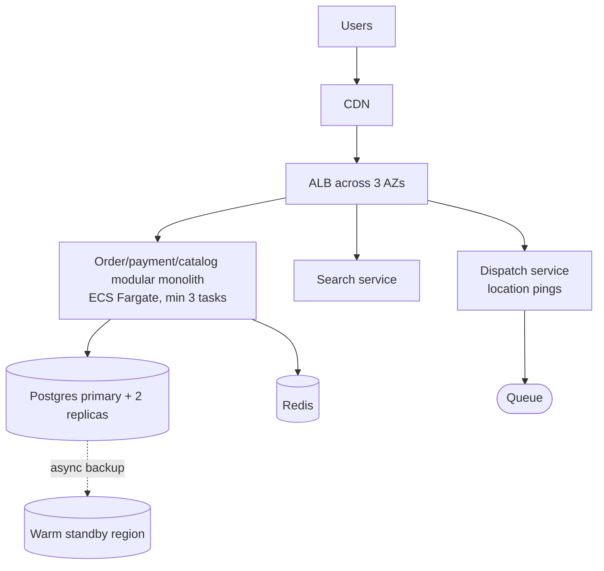

## 5. Variants and comparison

### 5.1 Compute comparison across dimensions

Numbers are rough, documented or estimated, as marked.

| Dimension | VM (EC2) | ECS/Fargate | Kubernetes | Lambda |
| --- | --- | --- | --- | --- |
| Guarantees | Dedicated instance, you own HA | Scheduler restarts failed tasks | Desired-state reconciliation | Provider runs per event, at-least-once on async |
| Scale unit | Instance (minutes) | Task (tens of seconds, estimate) | Pod (seconds) and node (minutes) | Concurrent execution (milliseconds warm) |
| Max run time | Unlimited | Unlimited | Unlimited | 15 minutes (documented) |
| Latency overhead | None | None | None | Cold start, tens of ms to seconds (estimate by runtime) |
| Throughput ceiling | Instance size and count | Task count and quotas | Cluster size | Account concurrency, default 1,000 per Region (documented) |
| Durability of local disk | Instance store lost on stop | Ephemeral | Ephemeral unless PVC | Ephemeral /tmp |
| Ops cost | High: OS, patching | Low | Highest: cluster, add-ons | Lowest |
| Cost at steady load | Lowest | Low to medium | Low if well packed | High at constant high load |
| Managed options | Auto Scaling Groups | Fargate | EKS, GKE, AKS | Lambda, Cloud Functions |
| Typical failure | Config drift, unpatched hosts | Task OOM, image pull limits | Misconfigured requests/limits, upgrade breakage | Cold starts, throttling, DB connection storms |
| Wrong choice when | You have many small stateless services | You need custom operators or heavy ecosystem | Team is small and service count low | Steady 24x7 high throughput or long jobs |

### 5.2 Monolith vs microservices

| Dimension | Modular monolith | Microservices |
| --- | --- | --- |
| Consistency | One database transaction | Sagas and eventual consistency ([[Saga Pattern]]) |
| Latency | In-process calls | Network hop per call, plus tail latency amplification |
| Scaling | Whole app scales together | Per-service scaling |
| Team autonomy | Shared release train | Independent deploys |
| Ops cost | One pipeline | One pipeline, dashboard, on-call per service |
| Failure mode | One bug can take everything down | Cascading failures without timeouts and circuit breakers ([[Circuit Breaker]]) |
| Wrong choice when | 100+ engineers collide on one repo | Team under ~15 engineers (heuristic, not a law) |

## 6. Trade-offs

- **Simplicity vs headroom.** Fewer moving parts break less, but you must have a named path to the next stage (move the hot module out, add replicas, add a region).
- **Cost vs elasticity.** Serverless is cheap at low volume and expensive at high, steady volume. Reserved or savings-plan VMs and containers are cheapest for a steady baseline.
- **Autonomy vs consistency.** Microservices give team independence and cost you transactions and debuggability.
- **Availability vs complexity.** Multi-AZ is cheap (mainly extra capacity plus cross-AZ data transfer fees) and should be the default. Multi-region is a major cost and consistency step.
- **Portability vs managed convenience.** Kubernetes travels between clouds, but you still use cloud-specific load balancers, disks and IAM.

> [!tip] Remember
> Say the trade-off in one sentence at the same time as the choice. It is the single most scored behaviour.

## 7. In production

**Real-life examples.**

- **Netflix** completed its migration from its own data centers to AWS in 2016 and runs a large microservice architecture, built when the company needed independent scaling and team autonomy at huge scale (Netflix Tech Blog).
- **Segment** consolidated its per-destination microservices (well over a hundred destinations) into a single service in 2018 because the operational overhead and queue head-of-line blocking outweighed the benefits (Segment engineering blog).
- **Amazon Prime Video** moved one audio/video quality monitoring component from a serverless, distributed design (Step Functions, Lambda) to a single-process container service in 2023 and reported a 90% cost reduction, because state transitions and data transfer between components were the dominant cost (Prime Video Tech blog).
- **Shopify** runs a very large Rails application as a modular monolith, enforcing component boundaries inside one codebase instead of splitting into hundreds of services (Shopify Engineering).
- **Google** built Kubernetes from lessons of its internal Borg scheduler (Burns et al., ACM Queue 2016).

**Failure modes.**

| Symptom | Likely cause | Fix |
| --- | --- | --- |
| Scale-out does not reduce latency | Shared bottleneck (DB, lock) | Fix the bottleneck, not the pod count |
| Pods flapping up and down | Short scale-down window, noisy metric | Longer stabilisation, smoother metric |
| Autoscaler too slow for peak | Reactive only, slow node start | Scheduled pre-scale, warm pool, headroom |
| Lambda errors under burst | DB connections exhausted, throttling | Connection proxy, reserved concurrency, queue in front |
| Regional failover fails | Never rehearsed, stale replica, DNS TTL | Game days, lower TTL, automated promotion |

**Monitor.** Saturation per tier (CPU, memory, connections), p99 latency, scale events per hour, pending pods, queue age, replication lag, cost per request.

### Whiteboard version

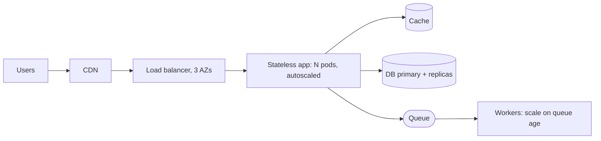

Say: "Stateless app tier on containers, horizontally scaled behind a load balancer across three AZs, state in Postgres, Redis and a queue. One region first; here is how it grows."

## 8. Deep dive

### 8.1 Why scale-up first for databases

A relational primary gives you transactions and joins. Sharding takes them away or makes them expensive. A big instance costs money but zero application change, so exhaust it (plus replicas and caching) before sharding. The scale-up limit is real: the largest instance still has a ceiling, and a single node is a failure domain.

### 8.2 Requests and limits in Kubernetes

The scheduler places pods using **requests**, not limits. If every pod requests 1 CPU but uses 0.1, the cluster looks full while nodes idle, and autoscalers based on CPU utilisation percentages compute against the request. Right-size requests from measured usage, and do not set CPU limits blindly because throttling raises tail latency.

### 8.3 Cold-start mitigation

Provisioned concurrency keeps warm instances ready (you pay for them), smaller deployment packages and lighter runtimes reduce init time, and keeping initialization outside the handler reuses connections across invocations.

### 8.4 Capacity headroom arithmetic

If one pod handles 600 RPS at the p99 target and peak is 3,500 RPS, you need ceil(3500/600) = 6 pods.

1. Add 30% headroom for deploys and failures: 8 pods.
2. With 3 AZs, lose one AZ and you still need 6, so 9 pods spread 3-3-3 survive an AZ outage with 6 left.

This N+1 or AZ-loss sizing is what interviewers want to hear. See [[Back-of-the-Envelope Estimation]].

### 8.5 Stateful workloads on Kubernetes

StatefulSets give stable identity and storage, but running a database on Kubernetes shifts replication, backup and upgrade work to you. Prefer a managed database unless you have a reason not to.

## 9. Real-life drills: scenario to choice to why

| # | Scenario | Pick | Why | Say in the interview |
| --- | --- | --- | --- | --- |
| 1 | Startup MVP, 3 engineers | Modular monolith on ECS Fargate or Cloud Run | Lowest ops cost, one deploy | "Single deployable with clean module boundaries, so I can extract services later." |
| 2 | Image thumbnails on upload | Lambda triggered by S3 event | Bursty, short, event-driven | "Event-driven and spiky, so serverless; I'll cap concurrency to protect the DB." |
| 3 | Payment ledger database | Managed Postgres, scale up, replicas | Needs ACID and joins | "Vertical first, read replicas next, shard only past single-node writes." |
| 4 | 60 services, 15 teams | Kubernetes with a platform team | Consistency, ecosystem | "At this service count the platform investment pays for itself." |
| 5 | Lunch-peak traffic 5x in 10 min | HPA plus scheduled pre-scale plus headroom | Reactive scaling lags | "I'll pre-scale on a schedule and let HPA handle the variance." |
| 6 | Chat with WebSockets | Stateful connection tier, sticky routing, scale on connections | Connections are state | "Gateway holds connections; I scale on connection count and use pub/sub between nodes." |
| 7 | Video transcoding | Queue plus autoscaled GPU workers (VMs or batch) | Long, heavy, special hardware | "Workers scale on queue depth; Lambda's 15-minute limit rules it out." |
| 8 | Global app, users in 3 continents | CDN, regional read replicas, one write region | Latency without write conflicts | "Reads local, writes to home region; full active-active only if the SLA demands it." |
| 9 | Compliance: EU data stays in EU | Region per jurisdiction | Legal requirement | "Partition by tenant region; no cross-region replication of personal data." |
| 10 | Nightly report job | Scheduled container task or Lambda | Runs rarely | "No always-on fleet for a once-a-day job." |
| 11 | Risky release of pricing logic | Canary plus feature flag | Limit blast radius | "5% canary gated on error rate and p99, with a flag to turn it off." |

## 10. How to say it in the interview

- Open with the requirement, then the choice: "At 70 orders per second peak this is a modest load, so I'll keep it simple: a modular monolith on containers behind a load balancer."
- Name the trade-off: "The cost of this is a shared release train; if teams collide, I'd extract the busiest bounded context first."
- Name the exit: "If search traffic grows 10x, I'd split it into its own service with its own autoscaling."
- Stateless line: "I'll keep the app tier stateless, with sessions in Redis and files in S3, so I can scale by adding pods."
- Multi-region line: "I'll start with three AZs in one region. Going multi-region is a cost and write-consistency decision, so I'd only do it for a stated RTO or latency target."

## 11. Interview questions

> [!question]- When would you choose Kubernetes over ECS Fargate?
> When you have many services (roughly 15+), a platform team to run it, and need ecosystem features such as operators, service mesh, GitOps or multi-cloud portability. For a handful of services, Fargate gives containers without cluster management.

> [!question]- Monolith or microservices for a new product?
> Start with a modular monolith. Extract a service when a part needs independent scaling, a different technology, fault isolation, or when team count makes a shared release a bottleneck. Mention the costs: network calls, distributed transactions, per-service operations.

> [!question]- How do you make a service horizontally scalable?
> Make it stateless: sessions in Redis or tokens, files in object storage, durable data in a database, async work in a queue. Then put it behind a load balancer and scale on a leading signal such as requests per pod or queue depth.

> [!question]- Which autoscaling signal would you use and why?
> A leading, saturation-linked one: requests per pod for APIs, queue age for workers. CPU is fine for CPU-bound services. Latency is user-facing but can mislead if the bottleneck is the database. Add scheduled scaling for known peaks because node and pod startup add lag.

> [!question]- When is serverless a bad idea?
> Steady high throughput (cost per request), jobs longer than 15 minutes, workloads needing many DB connections without a proxy, and latency-critical paths that cannot tolerate cold starts.

> [!question]- Do you need multi-region?
> Only for a latency target, a regional-outage RTO/RPO that multi-AZ cannot meet, or data residency. State the pattern (warm standby or active-active) and how writes are handled.

> [!question]- Traffic grows 10x. What do you do?
> Find the bottleneck by measurement, scale the stateless tier out, add cache and read replicas, move work to queues, then scale up the DB, and finally shard. Re-check autoscaling limits and quotas, and load test.

## 12. Cheat sheet

- Default: stateless containers behind a load balancer in 3 AZs.
- VM for special needs, Fargate for most, Kubernetes for many services plus a platform team, Lambda for bursty and short.
- Modular monolith first; split for independent scale, teams, or fault isolation.
- Scale up databases first; scale out the app tier.
- Autoscale on RPS per pod or queue age; pre-scale known peaks.
- Size for the loss of one AZ.
- Multi-region is a cost and write-consistency decision; justify it with RTO, RPO or latency.
- Canary plus feature flags for risky changes.

## Links

- Before this: [[Scaling Basics]], [[Cloud Computing Basics]], [[System Design Interview Framework]]
- Compute: [[AWS 04 - Compute Choices - EC2, ECS-Fargate, EKS, Lambda]], [[AWS 05 - ECS, Fargate and ECR]], [[Kubernetes Fundamentals]], [[Docker 01 - Why Containers]]
- Scaling: [[Autoscaling]], [[Partitioning and Sharding]], [[Back-of-the-Envelope Estimation]], [[Scaling WebSockets]]
- Architecture: [[Monolith vs Microservices]], [[Modular Monolith]], [[Strangler Fig Pattern and Legacy Migration]], [[Saga Pattern]], [[Circuit Breaker]]
- Resilience: [[Multi-Region Architecture]], [[High Availability and Failover]], [[Cloud Native and the 12-Factor App]]
- Deploy: [[Deployment Strategies - Rolling, Blue-Green, Canary]], [[Feature Flags]], [[Rollback and Safe Migrations]]
- Next: [[Choosing Load Balancers, Gateways and Service Mesh - Decision Guide]]

### Watch on YouTube

- [Choosing the Right Approach for Scaling Your Application](https://www.youtube.com/watch?v=Az74cD5q4u0) · Caploitte · 4 min · 348 views
- [Kubernetes Day 8 / Deployment Explained Step-by-Step / Rollout, Rollback, Scaling & CKA Practice](https://www.youtube.com/watch?v=W9ZnUexlXuU) · DevOpsFusion · 27 min · 349 views
