# Choosing Consistency, Replication and Partitioning - Decision Guide

> [!summary] TL;DR
> Three questions decide most data-layer designs in an HLD round.
>
> 1. How fresh must a read be (consistency)?
> 2. Who accepts writes and when does a write count as done (replication)?
> 3. How do you split data once one machine is not enough (partitioning)?
>
> This guide gives a flowchart for each, a comparison table, real systems, and the sentences to say in the interview.

> [!abstract] Core idea
> - Start from the weakest guarantee the business tolerates, then pay for stronger ones only where money or safety demands it.
> - Default replication: single leader, asynchronous followers, one synchronous follower only if losing the last write is unacceptable.
> - Go multi-leader or leaderless only when you must accept writes in several regions or survive partitions without a failover.
> - Default partitioning: do not shard until a single node (plus replicas and caching) cannot hold the load. When you must, pick a key that spreads writes and keeps your hottest query on one shard.
> - Name the trade-off aloud: freshness against latency and availability.

## Start here: the basics 🟢

> [!info] How to read this note (pick your level)
> - 🟢 **New to this?** Read "From zero" below, then sections 1, 2 and the cheat sheet (12). Stop there, that is a full first pass.
> - 🟡 **Know the basics?** Add section 3 (the six decisions), 4 (chat example), 5, 6 and 9 (drills).
> - 🔴 **Interview / SDE-3 prep?** Add 7, 8, 10 and 11. Headings are tagged 🟢🟡🔴 so you always know where you are.

> [!note] Before this note
> - [[Replication]]: the same data is copied to several machines, usually one leader taking writes and followers copying from it.
> - [[Partitioning and Sharding]]: big data is split into slices (shards) by a key so each machine holds only part.
> - [[Consistency Models]]: a promise about how fresh a read is, from "always the latest" to "catches up eventually".
> - [[CAP and PACELC]]: when the network splits you must choose between answering (maybe stale) and staying correct; even without a split, fresher costs slower.

**From zero, in 60 seconds** 🟢

One database gets too busy. So you make copies of it on other machines. Making copies is called **replication**.
Copies take a moment to catch up. So a reader may see slightly old data for a short time.
Later, even copies are not enough, because there is too much data to fit on one machine.
So you split the data into pieces, and each machine owns one piece. That is **partitioning** (or sharding).
Which piece a row goes to is decided by one field, the **shard key**, like user id.

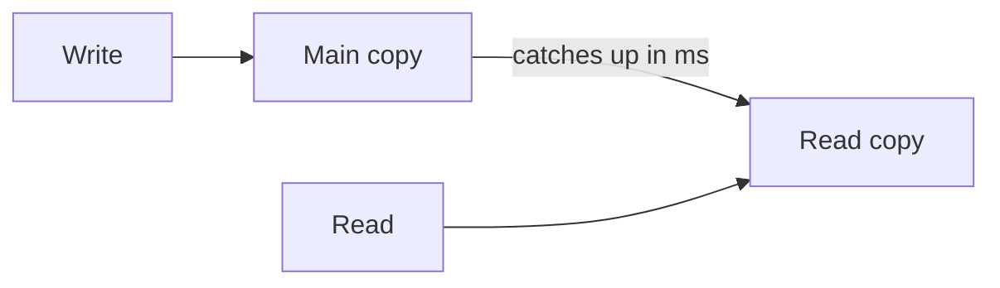

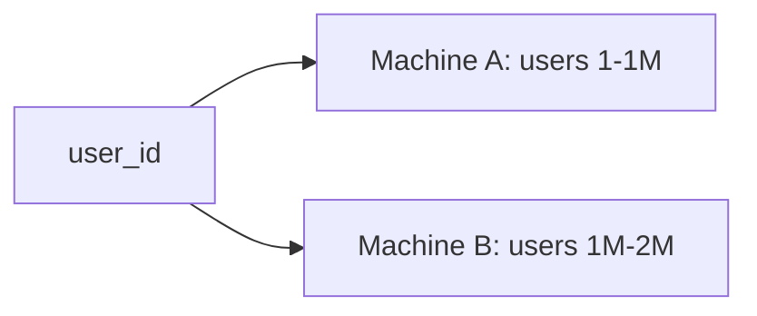

The rest of this note is just these 3 questions:
1. How fresh must each read be?
2. How are the copies kept in sync, and who accepts writes?
3. How do you split the data, and do you even need to?

**The problem in one story.**
Your chat app keeps messages in one database. It gets too busy, so you add copies of the database on other machines.
Now a friend may read a copy that has not yet received your newest message.
Later even the copies are not enough, so you must split the messages across machines.
This guide is about three choices: how fresh reads must be, how copies are kept, and how data is split.

**Words you need first**

| Word | Plain meaning | Tiny example |
|---|---|---|
| Replica | A copy of the data on another machine | 1 leader + 2 followers |
| Leader / follower | The copy that accepts writes / copies that receive them | Writes to leader, reads from followers |
| Sync / async replication | Wait for copies before saying "done" / do not wait | Sync: no data loss; async: faster |
| Consistency | How up to date a read is guaranteed to be | Strong: always the latest write |
| Replication lag | How far behind a follower is | Follower 200 ms behind |
| Partition / shard | One slice of the data on its own machine | Users A-M on shard 1 |
| Shard key | The field that decides which shard a row goes to | `chat_id` |
| Quorum | A majority of copies that must agree | 2 of 3 replicas |
| Linearizable | Every read sees the latest finished write, as if there were one copy | balance always up to date |
| Read-your-writes | You always see your own changes, even if others see them later | your comment shows after reload |
| Failover | Promoting a follower to leader when the leader dies | follower 2 becomes the new primary |
| Cardinality | How many different values a field has | `user_id` high, `country` low |
| Hot shard | One shard getting far more traffic than the rest | all new writes land on the last shard |
| Scatter-gather | A query that must ask every shard and combine the answers | "search all messages for a word" |

**Picture it**

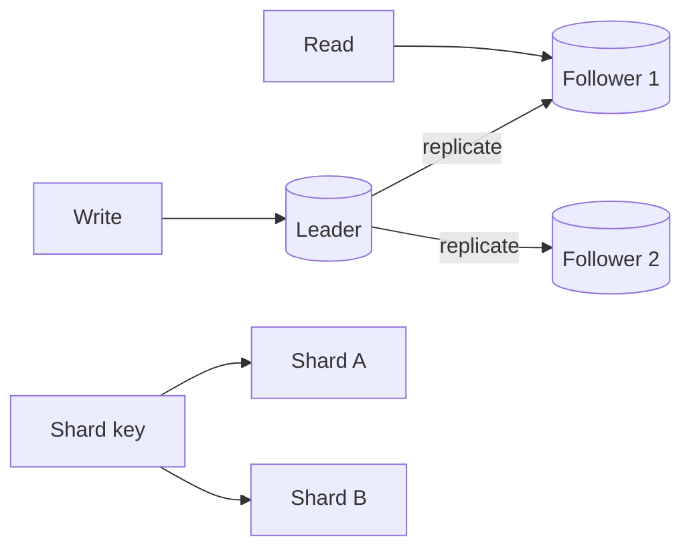

**Analogy.** A shared notebook photocopied for each office: copies let more people read at once, but a copy made this morning misses this afternoon's notes. Splitting the notebook into volumes (A-M, N-Z) is partitioning.
Where it breaks: photocopies are made by hand once, while replicas update continuously, usually within milliseconds.

**How the rest of this note builds up**

- First, why it exists and the mental model (sections 1-2).
- Then six decisions (section 3): consistency level, session guarantees, leader topology, sync vs async, partitioning scheme, shard key, and whether to shard at all.
- Then a worked chat example and comparison tables (sections 4-5).
- Finally the SDE-3 deep dive (section 8): why `R + W > N` is not linearizable, resharding without downtime, cross-shard operations and geo partitioning.

> [!tip] Remember
> Pick the weakest consistency the business allows, one leader with async followers by default, and shard only when one node cannot cope.

## 1. Why it exists 🟢

A single database server eventually fails to meet one of three needs. It may be too slow for the reads, too small for the data, or too fragile because one crash takes the product down.

Each fix creates a new question. Copying data to other machines (replication) raises "will a reader see the latest write?". Splitting data across machines (partitioning) raises "which machine owns this row, and what about queries that touch two machines?".

In an interview these questions arrive in disguise: "what happens if the primary dies?", "can two users see different balances?", "how do you scale writes?". This guide turns each into a short decision procedure.

> [!tip] Remember
> Consistency, replication and partitioning are three separate dials. Turning one changes the cost of the others.

## 2. Mental model 🟢

Think of a bank with branches. Each branch keeps a copy of the customer ledger (replication). A branch handles only certain surnames (partitioning). Customers want to see the true balance (consistency).

If every withdrawal must phone every branch first, balances are always right but service is slow, and it stops when a phone line is cut. If branches update each other at night, service is fast, but two branches can disagree during the day.

The analogy breaks down in one place: real databases can choose different rules per operation. A balance check can be strict while a "last seen" timestamp is allowed to be stale.

### Real-life example: WhatsApp "last seen" vs your UPI balance 🟢

WhatsApp's "last seen" can be a few seconds out of date and nobody minds, so it can be read from any nearby copy.
Your UPI or bank balance must never show money you already spent, so it is read from the one copy that takes the writes.
WhatsApp keeps each chat's messages together on one slice of machines (sharded by chat), so loading a chat touches one place.
The same app makes different choices for different data, and that is the core skill of this guide.

## Common beginner mistakes 🟢

- **Saying "eventual consistency" and stopping** → users see their own post vanish on reload → add read-your-writes for the writer.
- **Making everything strongly consistent "to be safe"** → every read waits on a leader or a majority, and the app is slow → use strong reads only for money, stock and uniqueness.
- **Async replication alone for payments** → a leader crash can lose the last few confirmed writes → replicate synchronously to at least one follower for that data.
- **Sharding by an auto-increment ID with ranges** → every new row lands on the last shard → use a hashed key or a key like `user_id`.
- **Sharding before you need to** → joins, transactions and unique checks get hard → first tune queries, scale up, add replicas and caches.


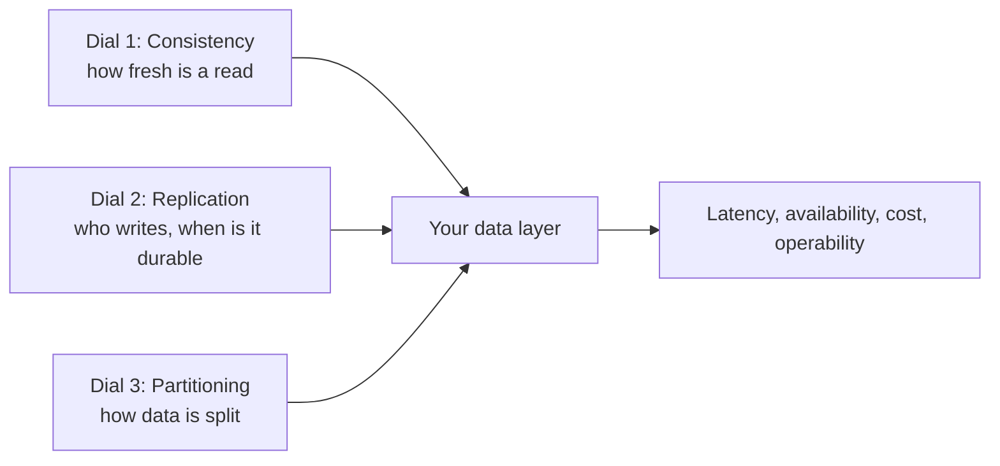

## 3. How it works 🟡

> 🟢 → 🟡 **You now know** the three dials: how fresh reads must be, how data is copied, and how it is split. **Next we open the box**, one decision at a time. Most decisions start with a plain walk-through; the full detail follows.

### Decision 1: how consistent must reads be?

**In plain words.** A **consistency model** is a promise about what a read may return after writes. Stronger promises are easier to program against and slower or less available.

**Step by step:**
1. Asha likes a post. The like is written to the leader; followers get it a moment later.
2. Bob reads the count from a follower and sees 1,204 instead of 1,205. Fine: eventual consistency.
3. Asha pays ₹500. Her balance must never show the old amount.
4. So the balance read goes to the leader (strong consistency), and pays that extra round trip.
5. Rule: choose per piece of data, not one setting for the whole app.

- **Strong (linearizable):** every read returns the latest completed write, as if there was one copy.
- **Causal:** if write B was caused by (read) write A, nobody sees B without A. Unrelated writes may appear in different orders.
- **Eventual:** if writes stop, all replicas converge. Until then, reads can be stale or out of order.

**Picture it.**

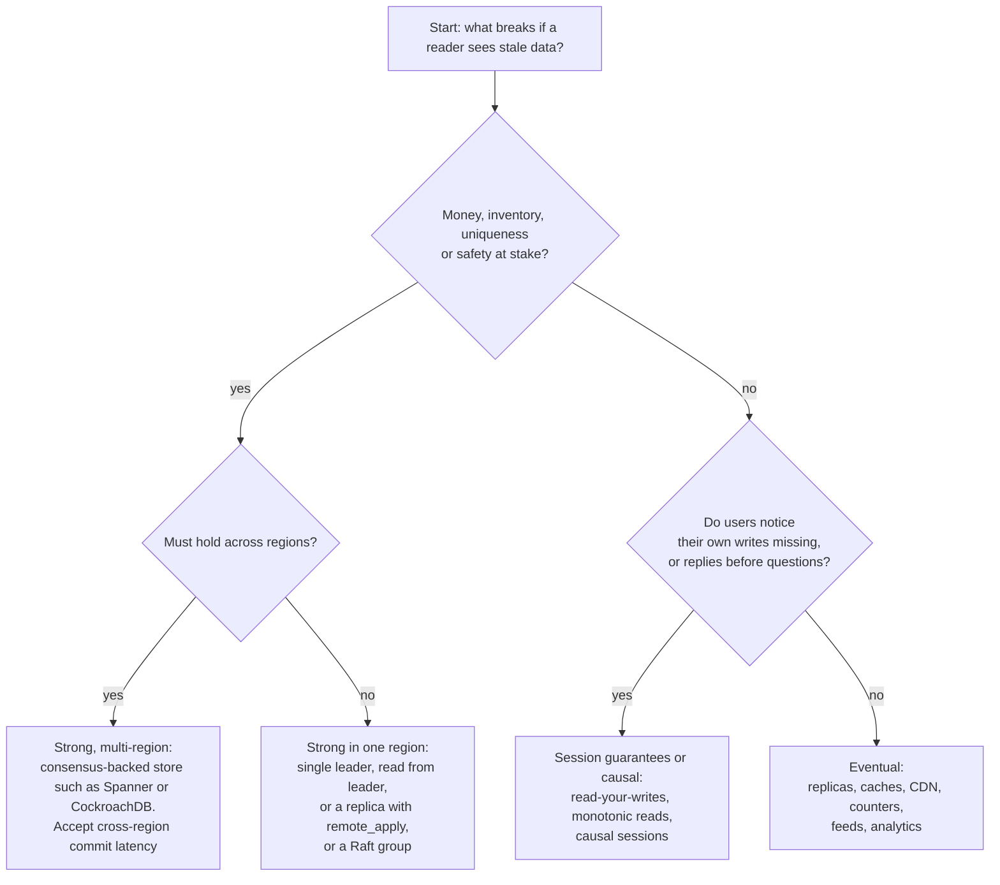

**Example.** Instagram-style "like count". Showing 1,204 instead of 1,206 for two seconds hurts nobody, so eventual is right. A payment ledger that shows 1,000 after you spent 900 can cause a double spend, so it needs strong consistency on that account.

**Why it matters.** Strong consistency costs a round trip to a leader or a quorum on every operation. That is latency and a lost-availability risk. Do not buy it for data that tolerates staleness.

### Session guarantees: the cheap middle

**In plain words:** Most users do not need perfect freshness. They just need to see their own changes, and never see time go backwards. Those are cheap to give.

**Step by step (read-your-writes):**
1. Ravi posts a comment. It is written to the leader.
2. The app remembers "Ravi wrote something 2 seconds ago".
3. Ravi reloads. For the next few seconds his reads go to the leader, so he sees his comment.
4. Everyone else keeps reading from followers and sees it a moment later. Nobody complains.

Many complaints about "eventual consistency" are really about three small problems. Each has a cheap fix without full strong consistency.

| Symptom | Guarantee | Typical fix |
| --- | --- | --- |
| I posted a comment and it vanished on reload | Read-your-writes | Read from the leader for a short window after a write, or pin the session to one replica, or send a version token and wait for a replica to reach it |
| I saw a newer page, then refreshed and saw an older one | Monotonic reads | Route one user to the same replica consistently |
| I see an answer before the question | Consistent prefix / causal | Same partition for related writes, or causal sessions (MongoDB offers causal consistency in client sessions) |

> [!warning] Common mistake
> Saying "eventual consistency" and stopping. Interviewers want to hear which users would notice and what you do about it, usually read-your-writes.

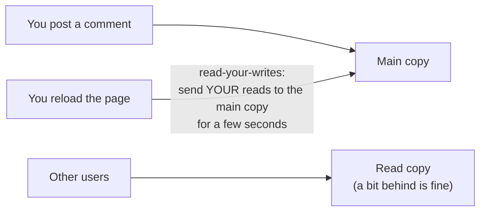

### Decision 2: single-leader, multi-leader or leaderless?

**In plain words.** Replication means keeping copies. The question is who is allowed to accept a write. A **leader** is the one node that orders writes. A **follower** copies the leader. A **leaderless** system lets any replica accept writes and uses quorums to reconcile.

**Step by step:**
1. Single leader: every write goes to one node, which puts them in one order and sends them to followers.
2. Multi-leader: a leader in Europe and one in Asia each accept writes and swap them later. Two edits to the same row can clash.
3. Leaderless: the client writes to several copies at once and counts it done when enough say yes.
4. More leaders means writes are closer to users, but you must decide how to settle conflicts.

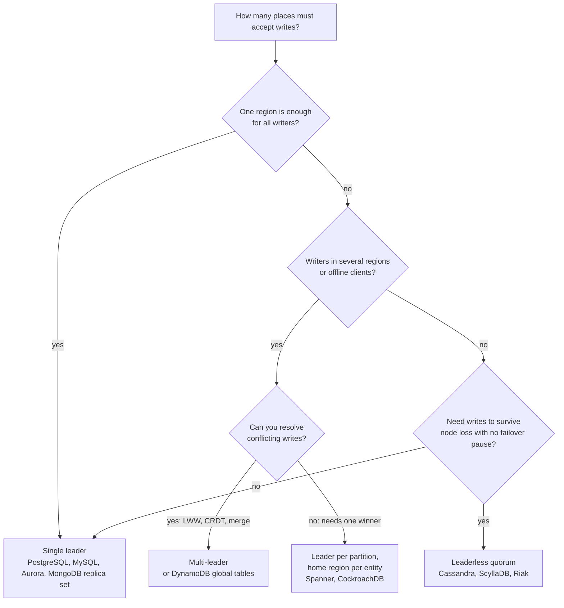

How each one handles a write:

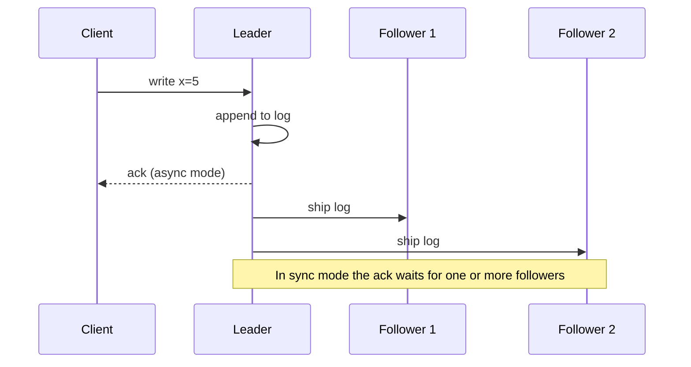

**Example.** A US-only SaaS app uses one PostgreSQL primary with two replicas. A global collaboration tool with users in Europe and Asia may accept writes in each region and merge them (multi-leader). A messaging store that must keep taking writes while nodes die uses a leaderless design such as Cassandra.

**Why it matters.** Single leader gives a clean total order and simple reasoning. Every step beyond it adds conflict handling, which becomes application complexity.

> [!warning] Common mistake
> Calling DynamoDB leaderless. DynamoDB uses a leader per partition. The leaderless ones are Cassandra, ScyllaDB and Riak. See [[Quorums and Leaderless Replication]].

### Decision 3: synchronous or asynchronous replication?

**In plain words.** In **synchronous** replication the leader waits for a follower to confirm before telling the client "done". In **asynchronous** replication it answers at once and the follower catches up later.

**Step by step:**
1. A write arrives at the leader and is saved to its disk.
2. Async: the leader says "done" now and sends the change to followers right after.
3. Sync: the leader first waits for one follower to say "saved", then says "done".
4. The leader crashes. Async may lose the last few "done" writes; sync loses none.
5. The price of sync is one extra network round trip on every write.

| Mode | Write latency | Lost writes if leader dies | Availability |
| --- | --- | --- | --- |
| Async | Lowest (one local fsync) | Possible: the unreplicated tail (the replication lag window) | Highest |
| Sync to one follower | Adds one network round trip | None for acknowledged writes (if that follower survives) | Writes stall if that follower is down, unless you have a standby for it |
| Sync to all | Slowest, limited by the slowest node | None | Poor: any node down stops writes |
| Semi-sync (one of several) | Adds a round trip to the fastest follower | None for acked writes unless both die | Good |

In PostgreSQL this is `synchronous_commit` and `synchronous_standby_names` (note: a synchronous standby has the WAL, but reads on it only see the latest write if you use `synchronous_commit = remote_apply`), where `ANY 1 (s1, s2)` means "wait for any one of these two". Kafka expresses the same idea with `acks=all` and `min.insync.replicas`.

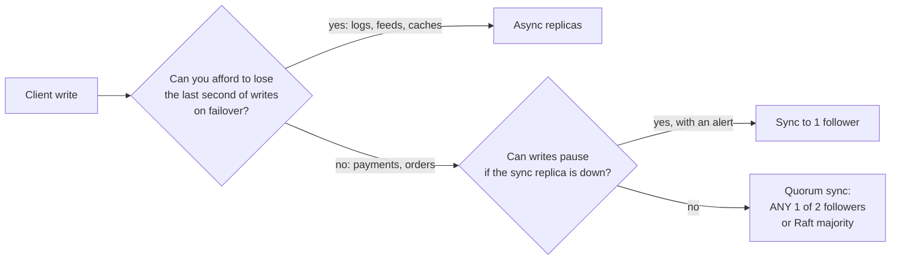

**Example.** Aurora writes each log record to six storage copies across three AZs and counts it durable when four acknowledge (write quorum 4 of 6, read quorum 3 of 6, from the SIGMOD 2017 paper). That is quorum sync, not "wait for everyone".

**Why it matters.** The failover story depends on it: with async, promoting a follower can silently drop acknowledged writes.

### Decision 4: how to partition (range, hash, geo, directory)?

**In plain words.** A **partition** (or shard) is a slice of the data that lives on its own node group. The **partitioning scheme** decides which slice a row goes to.

**Step by step:**
1. Range: names A-M on shard 1, N-Z on shard 2. Great for "all users from A to C", but new time-based keys all hit the last shard.
2. Hash: compute `hash(user_id)` and pick the shard from it. Load spreads evenly, but range queries must ask every shard.
3. Geo: EU users on EU shards, Indian users on Indian shards. Good for law and latency.
4. Directory: a lookup table says where each key lives, so you can move one big customer alone.

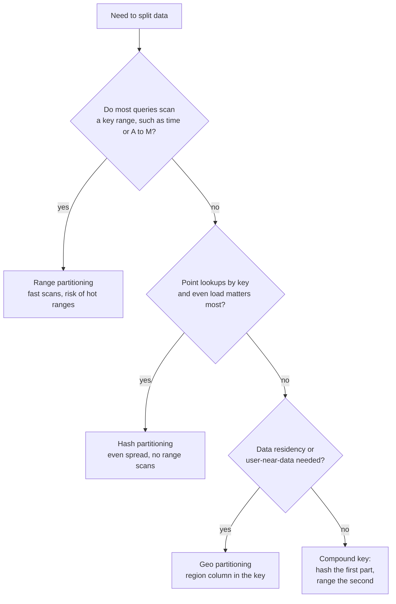

Compare the layouts for one table of events:

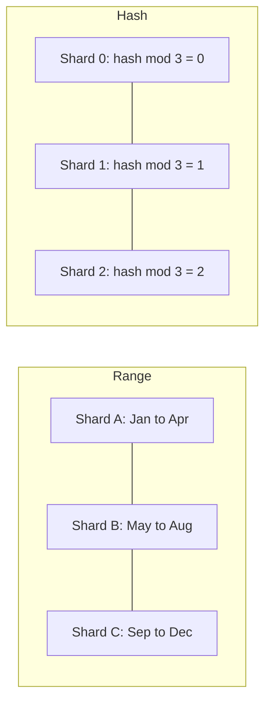

Problems each one creates:

- **Range:** time-ordered keys send all new writes to the last shard (a hot shard). Fix by prefixing with a hash bucket or user id.
- **Hash:** `hash(key) mod N` moves almost every key when N changes. Use a fixed number of virtual partitions (many small logical slices mapped onto fewer machines; Kafka, Elasticsearch, Instagram's logical shards) or consistent hashing, see [[Consistent Hashing]].
- **Geo:** a user who travels, or a query that joins EU and US data, crosses regions.

> [!tip] Remember
> Hash for even spread, range for scans, geo for law and latency. Compound keys give you two of the three.

### Decision 5: picking a shard key

**In plain words.** The **shard key** is the column that decides the shard. It is the hardest-to-change decision in the design. A good key has high cardinality, spreads writes evenly, and keeps your hottest query on one shard.

**Step by step:**
1. Write down the most common query: "show the last 50 messages in chat 991".
2. Pick a key that keeps that query on one shard: `chat_id`.
3. Check the spread: are there many chats, and is no single chat huge? Add a time bucket for giant chats.
4. Check the rare queries: "all messages by user 7" now asks every shard. Accept it, or keep a second index.

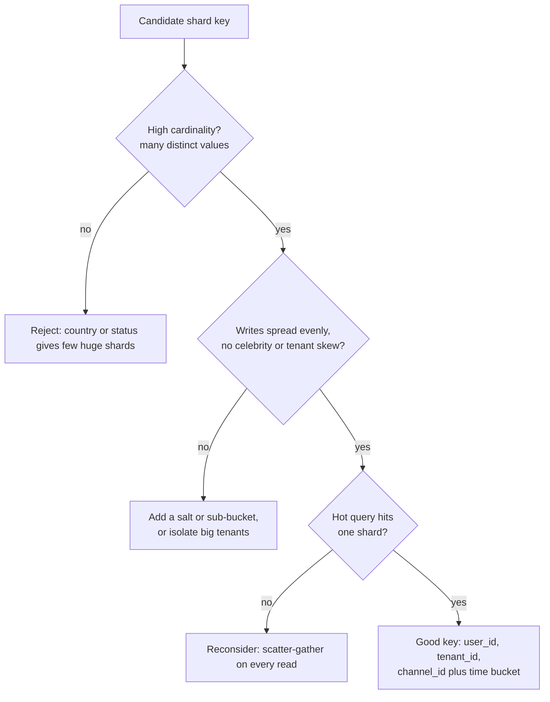

| System | Entity | Typical shard key | Why |
| --- | --- | --- | --- |
| Chat app | Messages | channel id plus time bucket | One channel's history stays together, buckets stop a huge channel growing one partition forever |
| Social app | Posts, likes | user id | A user's data is read together |
| B2B SaaS | All tables | tenant id | Joins stay inside a tenant, noisy tenants can be moved |
| Ride sharing | Trips | geo cell (see [[Geospatial Indexing]]) | Nearby queries touch one cell |
| Orders | Orders | customer id, not order id | "My orders" is one shard. Order id works for point lookup only |

> [!warning] Common mistake
> Sharding by an auto-increment id with range partitioning. All inserts hit the last shard. Also: choosing a key that makes the most common query a scatter-gather across all shards.

### Decision 6: do you need to shard at all?

**In plain words.** Sharding is the last step, not the first. It breaks joins, cross-shard transactions and unique constraints, and it makes every later change harder.

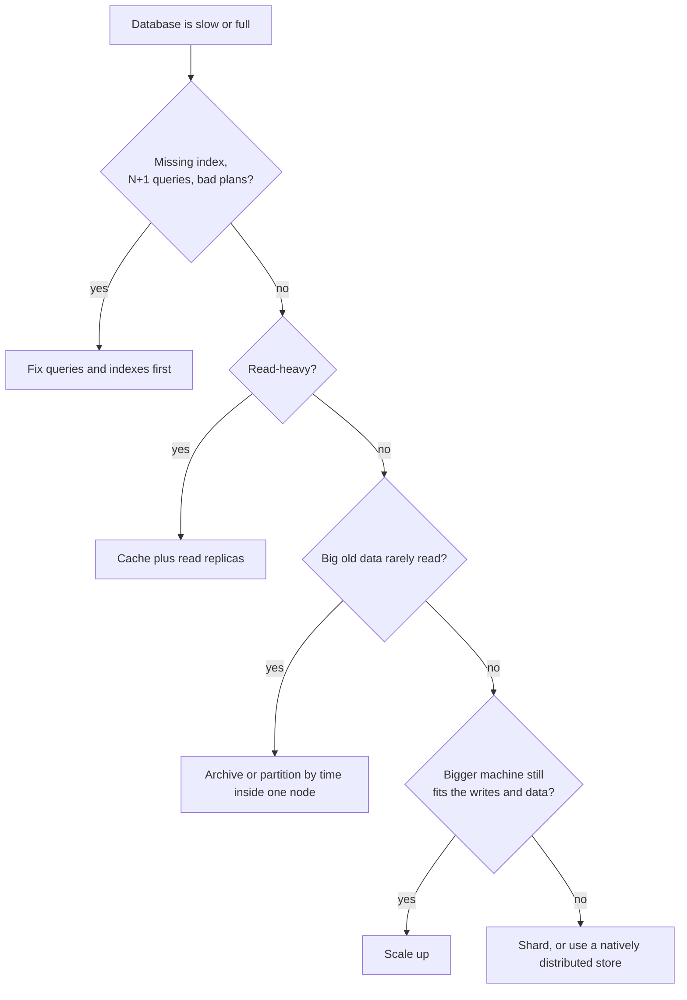

**Example.** Figma wrote in its 2024 engineering post that it first split tables across separate databases by feature (vertical partitioning) and moved to horizontal sharding later, when single-table size and write load demanded it. The order matters: cheap steps first.

**Why it matters.** "I would shard" with no numbers is a red flag. Estimate load first with [[Back-of-the-Envelope Estimation]]. A well-tuned PostgreSQL primary often serves tens of thousands of simple queries per second (an estimate that depends heavily on hardware and workload).

## 4. Worked example: a chat application 🟡

Design the storage for 1:1 and group chat with 50M daily users.

1. **Consistency.** Messages in one channel must appear in one order for everyone: consistent prefix per channel. Cross-channel ordering is irrelevant. Read-your-writes for the sender is required.
2. **Replication.** Messages must stay writable when a node dies, so a leaderless quorum store (Cassandra or ScyllaDB) with `LOCAL_QUORUM` reads and writes fits. User accounts and billing stay in PostgreSQL with a single leader.
3. **Partitioning.** Partition messages by `(channel_id, time bucket)`, clustering by message id (time-sortable) inside it. Single-channel reads hit one partition.
4. **Hot spots.** A huge public channel makes one partition hot. Add a smaller bucket, or cache the newest page.
5. **Skip sharding for accounts.** Users and billing fit on one primary with replicas for a long time.

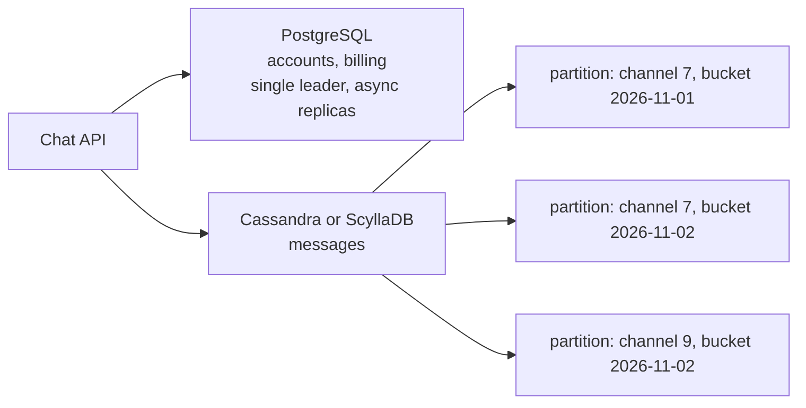

Discord's 2023 write-up describes this shape: messages in Cassandra partitioned by channel and a time bucket, later moved to ScyllaDB, with a service in front that coalesces duplicate reads for hot channels. Treat the numbers in that post as theirs and read the source for them.

### Whiteboard version

```text
Consistency : strongest only where money/safety; session guarantees elsewhere
Replication : 1 leader + async replicas; sync to 1 only if no lost acks allowed
Multi-region: leader per partition (Spanner) or multi-leader + merge rule
Partitioning: hash for spread, range for scans; key = user/tenant/channel+bucket
Shard when  : indexes, cache, replicas, scale-up are exhausted
```

## 5. Variants and comparison 🟡

| Dimension | Single-leader (PostgreSQL, MySQL) | Multi-leader (DynamoDB global tables, multi-region MySQL) | Leaderless (Cassandra, ScyllaDB, Riak) | Consensus per partition (Spanner, CockroachDB, TiDB) |
| --- | --- | --- | --- | --- |
| Consistency model | Strong on leader, stale on async replicas | Eventual across regions, conflicts possible | Tunable: `R + W > N` gives strong-ish reads, not linearizable by default | Strong (serializable or linearizable) |
| Write path | One node orders writes | Each region orders its own, then merges | Any replica, coordinator waits for W | Leader of the range, majority commit |
| Write latency | Local fsync, plus RTT if sync | Local in every region | Local quorum (a few ms in one DC, estimate) | Majority RTT, tens to hundreds of ms cross-region |
| Write scaling | Vertical only, or shard | Per region | Horizontal, by adding nodes | Horizontal, by adding ranges |
| Read scaling | Add replicas (stale) | Local reads in each region | Add nodes | Follower reads (stale) or leader reads |
| Conflicts | None | Yes: last-writer-wins, CRDT, custom merge | Yes: LWW or siblings | None (serialized) |
| Failover | Promote a follower, seconds to minutes | Other regions keep writing | None needed for node loss | Automatic leader re-election |
| Operational cost | Lowest, widely known | High: conflict bugs, clock issues | Medium to high: repair, compaction, tuning | Medium, often managed |
| Typical failure mode | Failover loses async tail, split brain if fencing is missing | Silent overwrites by LWW | Stale reads at low R, tombstone pileups | Cross-region latency, clock skew limits |
| Wrong choice when | Writes exceed one node | You need uniqueness or transfers | You need joins and multi-row transactions | You need sub-10 ms writes everywhere with low cost |

Numbers in latency rows are rough estimates, not benchmarks. See [[Replication]], [[Quorums and Leaderless Replication]], [[Consensus - Raft and Paxos]] and [[Distributed SQL]].

### Consistency choice by data type

**In plain words:** Different data needs different care. Money must be exact. Like counts can be a little behind.

| Data | Consistency | Why |
| --- | --- | --- |
| Account balance, inventory count at checkout | Strong | Wrong value loses money |
| Unique username, email | Strong on the unique check | Duplicates are hard to repair |
| Profile edit by the owner | Read-your-writes | Owner must see their change |
| Timeline, like counts, view counts | Eventual | Staleness invisible |
| Chat inside one channel | Causal or per-channel order | Replies must follow questions |
| Cache of product pages | Eventual with TTL | Freshness traded for speed |

## 6. Trade-offs and when not to use 🟡

- **Strong consistency** adds a round trip per operation and limits availability during partitions (see [[CAP and PACELC]]). Do not use it for counters, feeds and analytics.
- **Async replication** is fast but can lose the tail on failover. Do not use it alone for payments.
- **Multi-leader** turns every concurrent write into a possible conflict. Avoid it when you need uniqueness or balance checks.
- **Leaderless** gives high availability but no joins or multi-row transactions, and needs repair jobs. Avoid it for relational, transaction-heavy data.
- **Sharding** costs you joins, cross-shard transactions and easy schema changes. Avoid it until simpler steps are exhausted.
- **Hash partitioning** kills range scans. **Range partitioning** invites hot spots.

> [!tip] Remember
> Each stronger guarantee or bigger scale step trades away latency, simplicity or a feature. Say which.

## 7. In production 🔴

> 🟡 → 🔴 **You now know** each decision and how to apply it to a chat app. **Next comes the senior view**: how real companies chose, what to monitor, why quorums are not the same as strong consistency, and how to reshard, cross shards and span continents.

- **Instagram (2012 post):** sharded PostgreSQL using many logical shards mapped onto fewer physical servers, with the shard id embedded in the generated 64-bit id so any id tells you where the row lives. Logical shards let them move data without rehashing. See [[Unique ID Generation]].
- **Discord:** Cassandra, then ScyllaDB, for messages keyed by channel and bucket, per their 2023 post.
- **Amazon DynamoDB:** eventually consistent reads by default, strongly consistent reads optional per request, global tables for multi-region writes with last-writer-wins reconciliation by default (a newer multi-Region strong consistency mode for global tables also exists; check current AWS docs for its limits).
- **Google Spanner:** Paxos (a voting protocol) groups per split, TrueTime (Google's clock API with a known error bound) for external consistency, per the OSDI 2012 paper.
- **CockroachDB:** `REGIONAL BY ROW` tables pin rows to a region for latency and residency, with survival goals for zone or region failure.
- **Figma:** vertical partitioning first, then horizontal sharding of PostgreSQL, per their 2024 post.

What to monitor:

| Signal | Why |
| --- | --- |
| Replication lag (seconds, bytes) | Predicts stale reads and the size of the loss window |
| Per-shard QPS and size | Detects hot or oversized shards, see [[Hot Keys and Hot Partitions]] |
| Failover duration and lost writes after drills | Proves the replication mode matches the promise |
| Cross-shard query rate | A rising scatter-gather rate means the shard key is wrong |
| Conflict or repair counts (multi-leader, leaderless) | Reveals overwrites and drift |

## 8. Deep dive 🔴

### Why `R + W > N` is not linearizable

**In plain words:** Asking enough copies means at least one has the latest write. It does not mean everyone sees writes in the same order at the same moment.

Overlap guarantees a read set contains at least one replica with the latest acknowledged write. It does not guarantee that concurrent writes or sloppy quorums and clock-based timestamps behave.

A read during an in-flight write can return the old or new value, and two readers can see them in opposite orders.

For true linearizability you need consensus or a single ordered log. See [[Quorums and Leaderless Replication]].

### Resharding without downtime

**In plain words:** Moving data to a new layout is like moving house while still living in it. Copy first, keep both in sync, then switch over.

1. Create a new layout (more logical shards or new nodes).
2. Dual-write or stream changes from old to new.
3. Backfill and verify counts and checksums.
4. Shift reads gradually, then writes.
5. Keep the old copy until you trust the new one.

Logical shards or consistent hashing make steps 1 and 4 cheap. See [[Zero-Downtime Schema Migrations]] for the same pattern applied to schemas.

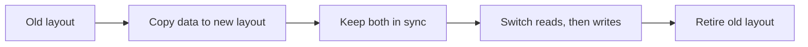

### Cross-shard operations

**In plain words:** If one action touches two machines, try to redesign so it touches one. If you cannot, use a saga (steps plus undo steps) or a slower two-step commit.

When a business operation spans shards you have three options. Redesign the key so it stays on one shard, use a saga with compensations ([[Saga Pattern]]), or use two-phase commit ([[Two-Phase Commit]]) and accept its blocking behavior. Distributed SQL engines hide this but still pay the latency.

### Geo partitioning and the speed of light

**In plain words:** Light takes time to cross an ocean. Any write that must be confirmed on two continents pays that delay every time.

A strongly consistent write across US-East and EU-West needs at least one transatlantic round trip, roughly tens of milliseconds at the physical minimum (an estimate). No technology removes this. Either keep each entity's leader near its users (home region) or accept eventual consistency across regions. See [[Multi-Region Architecture]].

## 9. Scenario drills: scenario, choice, why 🟡

| Scenario | Choice | Why | Say in the interview |
| --- | --- | --- | --- |
| Payment ledger | Single-leader PostgreSQL, sync to one replica, strong reads, shard by account later | Money cannot be lost or duplicated | "I choose durability over latency: one synchronous standby so an acked payment survives failover." |
| Chat messages | Cassandra or ScyllaDB, partition by channel plus bucket, `LOCAL_QUORUM` | High write rate, per-channel reads, node loss tolerated | "Order is only needed within a channel, so partition by channel and bucket." |
| Social feed, like counts | Eventual, async replicas, cache | Staleness is invisible | "Counts may lag a few seconds, that is acceptable." |
| Product catalog | Single primary, replicas and cache | Read-heavy, rarely written | "No sharding needed yet. Replicas and a cache first." |
| User profile edits | Read-your-writes via leader read after write | Owner must see their edit | "Route the owner to the leader for a few seconds after a write." |
| Global SaaS with EU data residency | Geo partition by region, region column in key | Law and latency | "Rows pin to their home region, cross-region joins are rare by design." |
| Collaborative document | Multi-leader or CRDT merge | Offline edits in many places | "Concurrent edits are normal, so use a merge rule, not a lock." |
| Multi-tenant B2B | Shard by tenant id, move big tenants | Joins stay in a tenant | "Tenant is the natural boundary, and noisy tenants can get their own shard." |
| Flash-sale inventory | One strongly consistent counter per item, with a queue in front | Overselling is costly | "Serialize on the item, and shed load with a queue." |
| Time-series metrics | Range by time inside hash of series id, TTL old data | Appends and range scans | "Hash the series, range by time, so scans stay local and writes spread." |

## 10. How to say it in the interview 🔴

- "I would start with a single-leader relational store and async replicas, because it is simple and covers our read load. Where acknowledged writes must survive a failover I add one synchronous standby."
- "Reads from replicas can be stale, so for the user's own writes I use read-your-writes by reading from the leader for a short window."
- "I would not shard yet. At 5,000 writes per second one primary is enough. I would revisit at the point where writes or data size exceed one node."
- "If we shard, I pick tenant id because joins stay inside a tenant. The cost is that cross-tenant reports go to the warehouse."
- "This trades consistency for availability. During a partition this path serves possibly stale data, which is fine for a feed and not for a ledger."

## 11. Interview questions 🔴

> [!question]- When would you choose eventual consistency over strong?
> When stale reads are invisible or harmless (feeds, counts, caches, analytics) and latency or availability matters more. Add session guarantees such as read-your-writes where users would notice. Keep strong consistency for money, inventory and uniqueness.

> [!question]- Synchronous or asynchronous replication for a payments database?
> Synchronous to at least one follower, ideally quorum style (any one of two), so an acknowledged payment survives a leader crash. The cost is added latency and a stall risk if the sync follower is down, handled by having a second candidate and alerting.

> [!question]- How do you pick a shard key?
> High cardinality, even write spread, and the hottest query lands on one shard. Check skew from celebrities or big tenants. Avoid keys that make common queries scatter-gather, and avoid monotonically increasing keys with range partitioning.

> [!question]- Why not shard from day one?
> Sharding removes joins, cross-shard transactions and unique constraints, and complicates every migration. Indexes, caching, replicas and scaling up usually carry a product far. Estimate load and shard only when one node cannot cope.

> [!question]- What goes wrong with `hash(key) mod N`?
> Changing N remaps almost every key, forcing a massive data move. Use a fixed number of logical partitions or consistent hashing so only a fraction of keys move.

> [!question]- Is DynamoDB leaderless?
> No. Each partition has a leader and uses a Multi-Paxos style replication, per the 2022 USENIX ATC paper. The Dynamo paper's design was leaderless, which causes the confusion.

## 12. Cheat sheet 🟢

- Strongest guarantee only where wrong data costs money or safety.
- Default: single leader, async followers, one sync follower for must-not-lose data.
- Multi-leader or leaderless only for multi-region writes or no-failover availability, and only with a conflict story.
- Hash spreads load, range supports scans, geo satisfies residency, compound keys mix them.
- Good shard key: high cardinality, even writes, hot query on one shard.
- Shard last: queries, indexes, cache, replicas, scale up first.
- Fixed logical partitions beat `mod N`.
- Always state the trade-off: freshness versus latency and availability.

## Self-check 🟢🟡

> [!question]- (easy) What is replication lag?
> How far behind a follower copy is from the leader, for example 200 ms.

> [!question]- (easy) Give one piece of data that can be eventually consistent and one that cannot.
> Like counts can lag; a bank balance cannot.

> [!question]- (easy) What is a shard key?
> The field that decides which shard a row lives on, such as `chat_id`.

> [!question]- (medium) What can async replication lose on failover?
> The last writes the leader confirmed but had not yet sent to followers.

> [!question]- (medium) Why is an auto-increment ID with range partitioning a bad shard key?
> Every new row goes to the last range, making one hot shard.

> [!question]- (medium) How do you give read-your-writes without full strong consistency?
> Send a user's reads to the leader for a short time after they write, or pin them to one replica.

## Links 🟢

- Deep notes, storage: [[Replication]], [[Partitioning and Sharding]], [[Consistent Hashing]], [[Distributed SQL]], [[SQL vs NoSQL]], [[Wide-Column Stores and Cassandra]], [[NoSQL Data Modeling]], [[Isolation Levels and MVCC]], [[Backup, PITR and Disaster Recovery]]
- Deep notes, distributed systems: [[CAP and PACELC]], [[Consistency Models]], [[Quorums and Leaderless Replication]], [[Consensus - Raft and Paxos]], [[CRDTs and Conflict Resolution]], [[Multi-Region Architecture]], [[High Availability and Failover]], [[Saga Pattern]], [[Two-Phase Commit]]
- Cloud: [[AWS 08 - RDS and Aurora]]
- System design: [[System Design Interview Framework]], [[Hot Keys and Hot Partitions]], [[Back-of-the-Envelope Estimation]], [[Case Study - Chat System]], [[Case Study - Key-Value Store]]
- Sibling guide: [[Choosing Storage for Files, Search and Analytics - Decision Guide]]

### Watch on YouTube

- [Database Replication, Partitioning & Sharding — Explained in 25 Minutes 🚀](https://www.youtube.com/watch?v=FA2kVglR-ZQ) · Souradrita Sarkar · 25 min · 1,052 views
- [Replication in Distributed Systems: Modes, Consistency, and Architectures Explained](https://www.youtube.com/watch?v=TcxMMxhMJHs) · Byte Sized Tutorials · 5 min · 676 views
