# Choosing Load Balancers, Gateways and Service Mesh - Decision Guide

> [!summary] TL;DR
> Every HLD diagram has a box between the client and the servers. This guide tells you which box to draw: DNS or L4 or L7 for spreading traffic, an API gateway for the edge concerns (auth, rate limits, routing), a BFF when each client type needs a different API, and a service mesh only when you have many services that need uniform mTLS, retries and traffic policy.

> [!abstract] Core idea
> - **DNS load balancing** picks a region or fleet coarsely; it is slow to change because of caching.
> - **L4** (NLB, HAProxy TCP) is fast and protocol-agnostic; **L7** (ALB, Envoy, Nginx) understands HTTP and routes per request.
> - **API gateway** is the front door for external clients; **BFF** is a gateway shaped per client; **service mesh** controls service-to-service traffic.
> - Algorithm: round robin for equal backends and short requests, least request for uneven work, consistent hash when the key must stick.
> - Default answer: managed L7 (ALB) at the edge, an API gateway only if you need its features, and no mesh until pain proves you need one.

## Start here: the basics

**The problem in one story**

A popular shop opens one checkout counter. A queue forms out the door.
The owner opens ten counters and puts a greeter at the entrance who points each shopper to a free counter.
If one counter closes, the greeter stops sending people there.
A load balancer is that greeter for web requests.

**Words you need first**

| Word | Plain meaning | Tiny example |
|---|---|---|
| Server / backend | A machine that runs your app and answers requests | One of 10 copies of the order service |
| Request | One message a client sends and waits on | `GET /menu` |
| DNS | The internet's phone book: name to IP address | `api.shop.com` → `52.1.2.3` |
| L4 (transport layer) | Routing that only sees IP and port, not the content | Forward any TCP connection on port 443 |
| L7 (application layer) | Routing that reads the HTTP request itself | Send `/images/*` to the image service |
| Health check | A periodic "are you alive?" ping to each backend | Call `/healthz` every 5 seconds |
| Gateway | A front door that adds auth, rate limits, routing | Reject requests with no valid token |
| Service mesh | Small proxies beside each service that handle calls between services | Envoy sidecar adds retries and mTLS |

**Picture it**

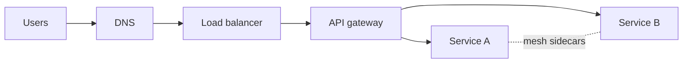

**Analogy**

A load balancer is the greeter at a busy shop sending each shopper to an open counter.
Where it breaks: a greeter cannot hold a phone call open for an hour, but an L4 balancer can keep one long connection pinned to one backend, which is why gRPC needs care.

**How the rest of this note builds up**

- First, why balancing exists and a mental model of the layers (sections 1-2).
- Then how DNS, L4, L7, gateways, BFFs and algorithms work (section 3), with a worked example (section 4).
- Next, the comparison tables, trade-offs and production lessons (sections 5-7).
- Finally, the SDE-3 deep dive on power of two choices, health checks, timeouts, stickiness and the mesh retry trap, plus drills and interview questions (sections 8-12).

> [!tip] Remember
> Start with one managed L7 balancer; add a gateway or a mesh only when a real need names it.

## 1. Why it exists

A product starts with one server. Then traffic grows and the interviewer asks "how do you spread load?". The honest answer has several layers, and candidates often pile every layer into the diagram without saying why.

Each box solves a different problem:

- **Spread load and survive a dead server**: a load balancer.
- **One place for auth, rate limits, API versions, routing**: an API gateway.
- **A different payload for mobile than for web**: a BFF.
- **Encrypt and retry between 200 services without 200 libraries**: a service mesh.

If you cannot name the problem a box solves, leave it out of the diagram.

> [!tip] Remember
> A box earns its place by solving a named problem. Every extra hop adds latency, cost and a failure point.

## 2. Mental model

Think of an **airport**.

- **DNS** is the departure board that says which terminal (region) to go to.
- An **L4 balancer** is the road barrier that sends cars to a car park without reading the tickets.
- An **L7 balancer** is the check-in desk that reads each ticket (URL, headers) and sends you to the right counter.
- The **API gateway** is passport control and security: identity, limits, rules for everyone entering.
- A **BFF** is a concierge for each type of traveler: one for families, one for business.
- A **service mesh** is the internal airport staff who escort bags between terminals, encrypt every handoff and retry lost items.

The analogy breaks down because in software a single product (Envoy, Nginx) can play several of these roles at once.

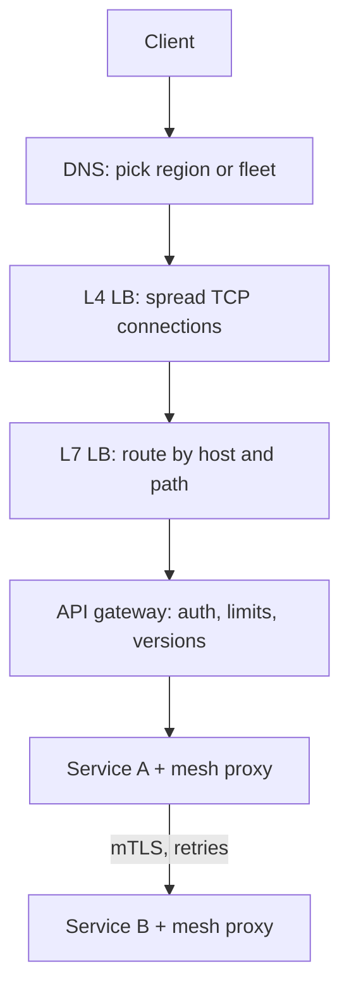

## 3. How it works

### 3.1 DNS load balancing

**In plain words.** One name returns several IP addresses, or different addresses depending on who asks. See [[DNS - Resolution, Records and Caching]].

Methods: round-robin records, weighted records, latency-based or geo-based answers, and health-checked failover (for example Route 53, see [[AWS 09 - Route 53 and ACM]]).

**Example.** `api.example.com` returns the Mumbai balancer for Indian users and the Frankfurt one for European users, with a 60 second TTL.

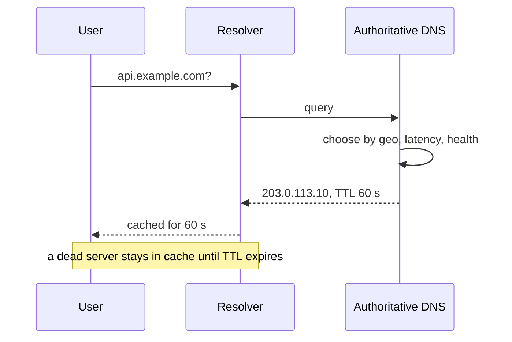

**Why it matters.** DNS is cheap and global, but it cannot react in seconds because resolvers and clients cache answers, and it does not know per-request load. Use it to pick a region, not a pod.

### 3.2 L4 load balancer

**In plain words.** It forwards TCP or UDP connections using IP and port, without reading HTTP. See [[Load Balancing]].

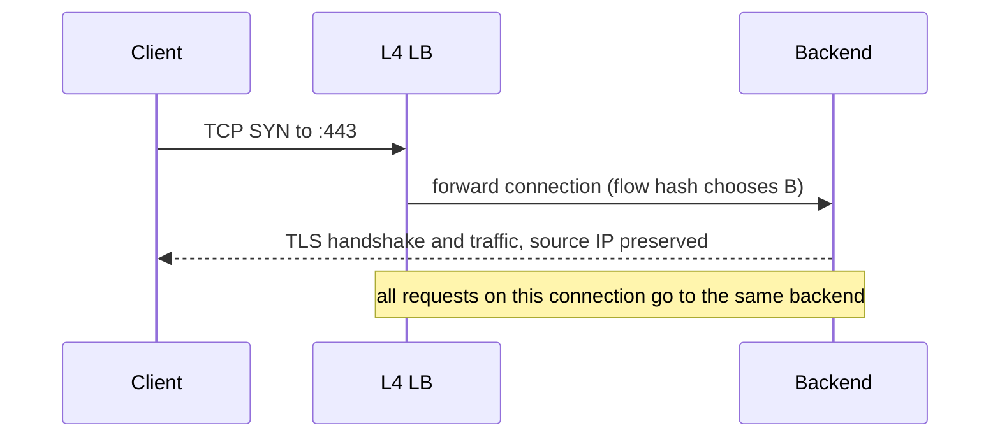

Strengths: very high throughput, low latency, static IPs (AWS NLB gives one static IP per AZ), keeps client source IP, handles any TCP/UDP protocol (databases, MQTT, game traffic).

Weakness: **it balances connections, not requests.** One gRPC or HTTP/2 connection carries thousands of requests, all to one backend. See [[gRPC]].

### 3.3 L7 load balancer

**In plain words.** It reads each HTTP request and decides where it goes, based on host, path, header or cookie.

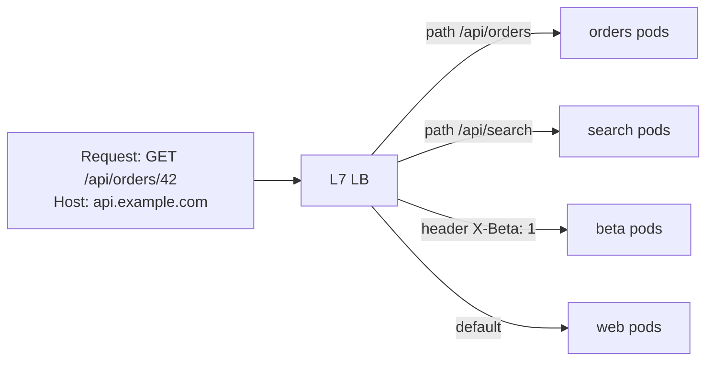

Capabilities: path and host routing, TLS termination, HTTP/2 and gRPC, WebSocket upgrade, retries, header rewriting, weighted canary splits, and per-request balancing. Cost: it parses every request, so it costs more CPU and adds a little latency than L4.

### 3.4 The products

| Product | Layer | Notes |
| --- | --- | --- |
| AWS ALB | L7 | Managed; path/host routing, gRPC, WebSocket, Lambda targets; target group algorithms: round robin (default), least outstanding requests, or weighted random; default idle timeout 60 s |
| AWS NLB | L4 | Managed; static IP per AZ, preserves source IP, TCP/UDP/TLS |
| Nginx | L7 (and L4 stream) | Self-run; widely used as reverse proxy and web server; see [[Nginx]] |
| HAProxy | L4 and L7 | Self-run; very efficient; rich health checks and ACLs |
| Envoy | L7 (and L4) | Programmable by an API (xDS); basis of most service meshes; created at Lyft |
| Cloud-native (GCP, Azure) | Both | Managed equivalents |

For the AWS comparison in depth see [[AWS 06 - Load Balancing (ALB vs NLB)]].

### 3.5 Algorithms

**In plain words.** The algorithm chooses which backend gets the next request.

| Algorithm | How it picks | Use when |
| --- | --- | --- |
| Round robin | Next in turn | Backends equal, requests similar |
| Weighted round robin | Turns in proportion to weights | Mixed instance sizes, canary |
| Least connections / least request | Fewest in-flight | Uneven request cost, long requests |
| Power of two choices | Pick 2 at random, take the less loaded | Many balancers with no shared state; Envoy `LEAST_REQUEST` uses it |
| IP hash / consistent hash | Hash of IP, header or URL | Same key must hit the same backend (cache locality, stickiness) |
| Random | Uniform | Simple, surprisingly fine at scale |

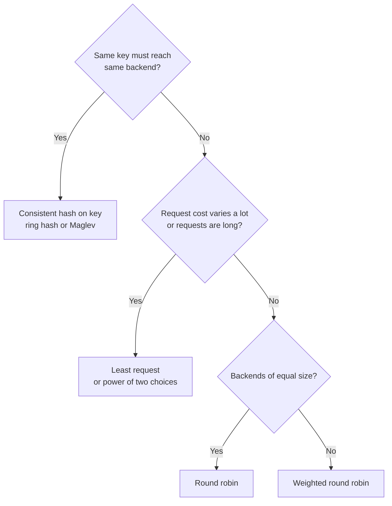

**Example.** Three backends. Backend A is stuck on a 5 second report while B and C handle 20 ms requests. Round robin keeps sending a third of requests to A, which queue. Least request notices A has many in-flight requests and avoids it.

Consistent hashing detail: see [[Consistent Hashing]]. Hot keys can overload one backend, see [[Hot Keys and Hot Partitions]].

### 3.6 API gateway

**In plain words.** A **gateway** is one entry point for external API calls that handles cross-cutting concerns before traffic reaches services. See [[API Gateway and BFF]].

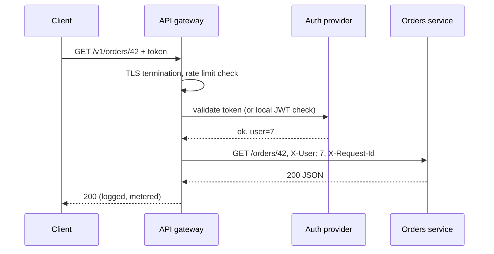

Typical duties: authentication, rate limiting ([[Rate Limiting - Algorithms and Distributed Design]]), request routing and versioning, request logging, response caching, protocol translation, request validation.

Do not put business logic in it. It becomes a bottleneck and a deployment choke point.

### 3.7 API gateway vs BFF

**In plain words.** A **BFF (Backend for Frontend)** is a gateway-like service owned by a client team, shaped for one kind of client. Mobile wants small payloads and fewer round trips, the web wants richer data, partners want stable public contracts.

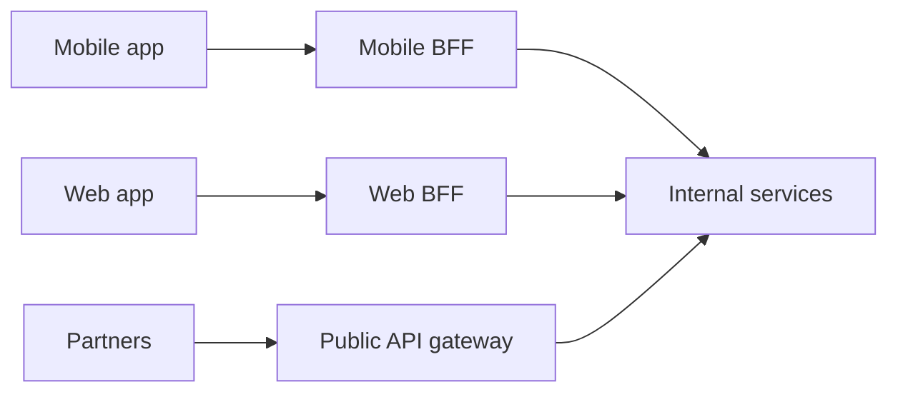

| | API gateway | BFF |
| --- | --- | --- |
| Owner | Platform team | Each client team |
| Shape | One generic edge | One per client type |
| Job | Cross-cutting concerns | Aggregate and shape data for one client |
| Risk | Becomes a monolith of rules | Duplicate logic across BFFs |
| Use when | Many services, one public face | Clients need very different payloads |

> [!warning] Common mistake
> Drawing a gateway and a BFF as the same box. A gateway handles auth and limits for everyone. A BFF composes and trims data for a specific client. Many companies run both, with the gateway in front of the BFFs.

### 3.8 Service mesh

**In plain words.** A **service mesh** moves service-to-service networking (mTLS, retries, timeouts, traffic splitting, metrics) out of your code into proxies deployed next to each service, managed by a control plane.

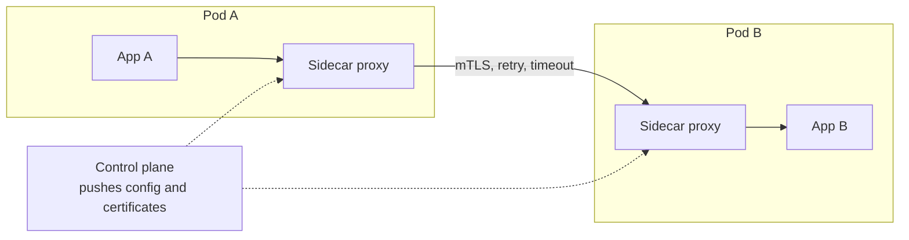

The data plane is a set of proxies (Envoy in Istio, a Rust proxy in Linkerd). Istio also has an ambient mode that avoids per-pod sidecars by using node-level proxies (GA from Istio 1.24). Cilium implements parts of this with eBPF.

What you get: automatic mTLS between services, uniform retries and timeouts, weighted traffic splits for canaries, per-hop metrics and traces, circuit breaking and outlier detection.

What it costs: extra latency per hop (typically sub-millisecond to a few ms per proxy, estimate), CPU and memory per pod for sidecars, a control plane to operate, upgrade coordination, and harder debugging because there is another layer in every call.

### 3.9 Mesh: when and when not

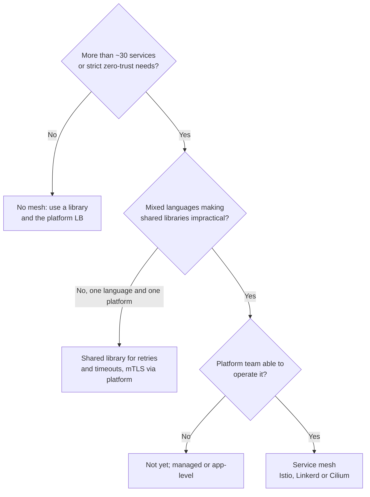

Reasons for a mesh: mTLS everywhere for compliance, many languages, central traffic policy, canary by percentage, consistent observability.

Reasons against: fewer than about 30 services (a heuristic, not a law), a single language where a good client library already does retries and timeouts, a small team, and latency-sensitive paths. A [[Circuit Breaker]] and [[Timeouts, Retries and Backoff]] in code are often enough.

### 3.10 Where client-side balancing fits

In gRPC, the client can hold a list of backends and balance itself, so no central balancer sits in the middle. The list comes from [[Service Discovery]] (DNS, Consul, Kubernetes endpoints, or xDS). It saves a hop but needs a smart client in every language. A mesh sidecar is client-side balancing moved into a proxy.

## 4. Worked example

**Prompt.** Food delivery app: iOS, Android, web, restaurant dashboards and a partner API. 25 services, 3,500 read RPS at peak, WebSocket tracking, gRPC between services.

**Step 1, region.** Route 53 latency-based records point to the Mumbai region, with health-checked failover to a standby.

**Step 2, edge.** A CDN for static assets and menu images ([[CDN and Edge]]), then a public ALB (L7) with TLS terminated by ACM certificates. The ALB routes `/api/*` to the gateway, `/track/*` to the WebSocket tier, with idle timeout raised above the ping interval.

**Step 3, gateway.** API gateway does token validation, per-user rate limiting and API versioning for partners.

**Step 4, BFFs.** A mobile BFF merges menu, offers and ETA into one response to save round trips on slow networks. The web BFF returns richer data.

**Step 5, internal.** Services talk gRPC. A plain L4 balancer would pin each long-lived HTTP/2 connection to one pod, so use Kubernetes headless service plus client-side round robin, or an L7 proxy such as Envoy.

**Step 6, mesh decision.** 25 services and a platform team, plus a security requirement for mTLS: adopt a mesh (Linkerd or Istio) in phases. Without that requirement, defer it and use library-level retries and timeouts.

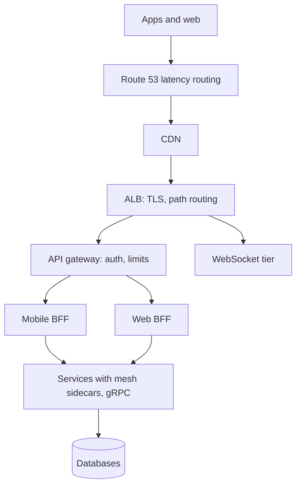

## 5. Variants and comparison

### 5.1 L4 vs L7 vs DNS across dimensions

Numbers are rough estimates unless marked documented.

| Dimension | DNS LB | L4 (NLB, HAProxy TCP) | L7 (ALB, Envoy, Nginx) |
| --- | --- | --- | --- |
| Granularity | Per resolution, cached by TTL | Per connection | Per request |
| Sees | Name only | IP, port | Full HTTP |
| Failover speed | Minutes (TTL and resolver caching) | Seconds (health checks) | Seconds (health checks) |
| Throughput | Not a data path | Millions of connections, highest | Lower per node than L4 |
| Added latency | None in data path | Microseconds to well under 1 ms (estimate) | Around 1 ms or more (estimate) |
| TLS | N/A | Pass-through or terminate (NLB TLS listener) | Terminates, re-encrypts optionally |
| Content routing | No | No | Yes: path, host, header |
| Source IP | N/A | Preserved by NLB for instance targets (configurable for IP targets) | Via X-Forwarded-For or PROXY protocol |
| gRPC and HTTP/2 spread | N/A | Poor: pinned per connection | Good: per request |
| Typical failure | Stale cache sends users to dead IP | Health check misconfig, AZ imbalance | Idle timeout mismatch, 502/504 on slow upstreams |
| Wrong choice when | You need seconds-level failover | You need path routing or HTTP features | You need raw TCP/UDP or static IPs |

### 5.2 Gateway, BFF and mesh

| Dimension | API gateway | BFF | Service mesh |
| --- | --- | --- | --- |
| Traffic | North-south (external to internal) | North-south, per client | East-west (service to service) |
| Main job | Auth, limits, routing | Aggregate and shape | mTLS, retry, traffic policy, telemetry |
| Who owns | Platform | Client team | Platform |
| Ops cost | Low to medium (managed) | One service each | High |
| Failure mode | Single choke point, config sprawl | Duplicated logic | Control plane outage, sidecar overhead, hard debugging |
| Wrong choice when | One service and one client | One client type | Few services, one language |

## 6. Trade-offs

- **Hops vs features.** Each layer adds latency and failure modes. Layer only what you can justify.
- **Managed vs self-run.** ALB and NLB cost money but need no patching. Envoy or Nginx give control and cost operator time.
- **Central vs client-side balancing.** A central balancer is simple for clients but is a hop and a resource to scale. Client-side avoids the hop and needs smart clients.
- **Gateway centralisation vs team speed.** One gateway team can become a ticket queue for every route change. Keep routes declarative and self-service.
- **Mesh uniformity vs complexity.** Uniform mTLS and retries are valuable, but retries without budgets multiply load during incidents.

> [!tip] Remember
> The balancer, the gateway and the mesh are themselves services. Each needs redundancy, capacity planning and monitoring.

## 7. In production

**Real-life examples.**

- **Lyft** built **Envoy** to solve inconsistent networking across polyglot services, then open-sourced it in 2016. It became the data plane for Istio and many gateways (Lyft engineering).
- **Netflix** built **Zuul** as its edge gateway for routing, filtering and resiliency, and open-sourced the asynchronous Zuul 2 (Netflix Tech Blog).
- **Google** described **Maglev**, its software L4 balancer on commodity servers using consistent hashing, in NSDI 2016.
- **AWS** customers commonly place an ALB (L7) in front of services and an NLB where static IPs or non-HTTP protocols are needed (AWS docs).
- **gRPC** guidance recommends L7 or client-side balancing because long-lived HTTP/2 connections defeat L4 balancing (gRPC docs).

**Failure modes.**

| Symptom | Likely cause | Fix |
| --- | --- | --- |
| 502 from the balancer | Backend closed connection early (keep-alive shorter than LB idle timeout) | Backend keep-alive timeout above the LB idle timeout |
| 504 from the balancer | Backend slower than LB timeout | Fix slowness; set timeouts consistently across hops |
| One pod hot, others idle | L4 with gRPC, or sticky sessions | L7 or client-side balancing; drop stickiness |
| Errors during deploy | No connection draining | Deregistration delay, graceful shutdown ([[Graceful Shutdown and Health Checks]]) |
| Retry storm | Retries at every layer | Retry budget, retry at one layer, backoff and jitter |
| Whole site down | Single balancer or gateway | Multi-AZ managed LB, multiple gateway replicas |
| Stale DNS after failover | Long TTL | Lower TTL ahead of time, health-checked records |

**Monitor.** Request rate, 4xx/5xx split by source (LB vs backend), target response time, healthy host count, active connections, rejected connections, TLS handshake errors, retry rate, mesh proxy CPU and memory.

### Whiteboard version

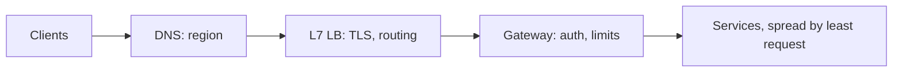

Say: "DNS picks the region, a managed L7 balancer terminates TLS and routes by path, a gateway handles auth and rate limits, and least-request balancing spreads requests. I'd add a mesh only if mTLS or polyglot policy becomes a requirement."

## 8. Deep dive

### 8.1 Power of two choices

Pick two backends at random and send the request to the one with fewer in-flight requests. Mitzenmacher showed this reduces the maximum load dramatically compared with purely random choice, without needing a global view. It is why many independent balancers can share a fleet with no coordination, and why Envoy's least request uses it.

### 8.2 Health checks: active and passive

Active checks probe an endpoint on a schedule. Passive checks (Envoy outlier detection, Nginx `max_fails`) eject a backend that returns errors in real traffic. Use both. A readiness check should reflect ability to serve (dependencies reachable), but not so strict that a shared dependency outage marks every backend unhealthy and takes the whole fleet out.

### 8.3 Timeout alignment

Set timeouts so inner ones are shorter than outer ones: client 10 s, gateway 8 s, service-to-service 3 s, DB 1 s. If the inner timeout is longer, the outer layer gives up and retries while the inner work continues, doubling load. See [[Timeouts, Retries and Backoff]].

### 8.4 Preserving the client IP

L7 proxies replace the source IP with their own. Pass the original in `X-Forwarded-For` (trust only the last known proxy hops) or the PROXY protocol. NLB preserves the client IP for instance targets by default; for IP targets it depends on the preserve-client-IP setting and protocol (check the AWS docs), and rate limiting or geo rules depend on this.

### 8.5 Stickiness

Cookie or IP stickiness pins a user to one backend. It hides statefulness (sessions held in memory) and makes scaling and draining harder. Prefer stateless services with shared session storage. Where affinity is a true need (WebSocket, cache locality) use consistent hashing and accept redistribution on membership change ([[Scaling WebSockets]]).

### 8.6 The mesh retry trap

Mesh retries are easy to enable globally. With 3 layers each retrying 3 times, one failing request can become 27 attempts against an already struggling service. Use a retry budget (a percentage of requests) and retry only idempotent calls.

## 9. Real-life drills: scenario to choice to why

| # | Scenario | Pick | Why | Say in the interview |
| --- | --- | --- | --- | --- |
| 1 | Public REST API, 5 services | ALB plus path routing, simple gateway features | L7 routing and managed TLS | "Managed L7 with path routing; I'd add a gateway when I need per-key limits and versioning." |
| 2 | Game server UDP traffic | NLB (L4) | Non-HTTP, low latency | "UDP means L4; it also preserves the source IP." |
| 3 | gRPC microservices | L7 proxy (Envoy) or client-side round robin | HTTP/2 pins to one backend on L4 | "L4 would pin each connection, so I need per-request balancing." |
| 4 | Whitelisting partner IPs | NLB with static IPs | Partners need fixed addresses | "Static IPs per AZ from NLB, with an ALB behind it if I need HTTP routing." |
| 5 | Mobile app chatty with 6 services | Mobile BFF | Fewer round trips, smaller payloads | "A BFF aggregates calls so the phone makes one request." |
| 6 | Third-party developers | Gateway with API keys, quotas, versioning | Edge concerns for external users | "Gateway enforces keys and rate limits before traffic touches services." |
| 7 | Cache fleet where keys must stick | Consistent hashing at the proxy or client | Cache locality, minimal reshuffle | "Hash on the key so adding a node moves only about 1/N of keys." |
| 8 | Mixed instance sizes | Weighted round robin or least request | Capacity differs | "Weights follow capacity, or least request adapts automatically." |
| 9 | 80 services, mTLS mandate, 4 languages | Service mesh | Uniform policy without per-language libraries | "A mesh gives mTLS and retries uniformly; I accept the operational cost." |
| 10 | 8 services, one language | No mesh, library retries and timeouts | Mesh cost exceeds benefit | "I'd use a shared client library with timeouts and a circuit breaker." |
| 11 | Multi-region failover | DNS with health-checked records and low TTL | Region-level steering | "DNS picks the region; failover time is bounded by TTL, so I keep it low." |
| 12 | Zero-downtime deploy | Connection draining plus readiness checks | Avoid dropped requests | "Deregister, drain in-flight requests, then terminate." |

## 10. How to say it in the interview

- Layers: "DNS steers to a region, a managed L7 balancer terminates TLS and routes by path, a gateway enforces auth and limits."
- Algorithm: "Round robin is fine for equal, short requests. With uneven work I'd use least request, and for cache affinity consistent hashing."
- Trade-off: "Every hop adds latency and a failure domain, so I'd keep the layers I can justify."
- Mesh: "I'd defer a mesh. If we reach dozens of services across languages with an mTLS requirement, I'd adopt one and set retry budgets."
- Failure: "All balancers are multi-AZ, health-checked, with draining on deploy and aligned timeouts."

## 11. Interview questions

> [!question]- L4 or L7 load balancer?
> L7 when you need path or host routing, HTTP features, gRPC per-request balancing or WebSocket upgrades. L4 when you need raw throughput, static IPs, non-HTTP protocols or to preserve the client IP. Often both are stacked: L4 in front of L7 proxies.

> [!question]- What is the difference between an API gateway and a BFF?
> A gateway is one front door that handles cross-cutting concerns (auth, rate limits, routing) for all external clients. A BFF is an aggregation layer shaped for one client type, owned by that client's team. They can coexist, gateway in front of BFFs.

> [!question]- Why is round robin bad for gRPC behind an L4 balancer?
> An L4 balancer assigns a whole TCP connection to a backend, and gRPC multiplexes many requests on a long-lived HTTP/2 connection, so all of them land on one backend. Use an L7 proxy or client-side balancing.

> [!question]- When would you use a service mesh?
> With many services, multiple languages, a need for uniform mTLS and traffic policy, and a platform team to run it. Avoid it for a few services or one language, where libraries and platform features suffice.

> [!question]- How do you pick a balancing algorithm?
> Equal backends and similar requests: round robin. Uneven or long requests: least request or power of two choices. Need key affinity: consistent hashing. Mixed capacity: weights.

> [!question]- Why can DNS failover be slow?
> Resolvers and clients cache records for the TTL (and some ignore it), so users can keep hitting a dead IP after DNS changes. Lower TTLs help but never give per-request control.

> [!question]- Who load-balances the load balancer?
> Managed LBs are multi-AZ by design. Self-run ones use VRRP pairs, anycast or ECMP, and DNS across multiple balancer IPs. See [[Load Balancing]].

## 12. Cheat sheet

- DNS steers regions; L4 spreads connections; L7 routes requests.
- gRPC needs L7 or client-side balancing.
- ALB for HTTP routing, NLB for static IP and non-HTTP, Envoy/Nginx/HAProxy when self-run.
- Round robin, least request, consistent hash: choose by request cost and affinity needs.
- Gateway for external edge concerns, BFF per client type.
- Mesh only for many services and uniform mTLS or polyglot policy.
- Align timeouts inward-shorter; budget retries.
- Drain connections on deploy; run every layer redundantly.

## Links

- Before this: [[Load Balancing]], [[Forward and Reverse Proxies - L4 vs L7]], [[DNS - Resolution, Records and Caching]]
- Tools: [[Nginx]], [[AWS 06 - Load Balancing (ALB vs NLB)]], [[AWS 09 - Route 53 and ACM]], [[TLS and HTTPS]]
- Edge: [[API Gateway and BFF]], [[Rate Limiting - Algorithms and Distributed Design]], [[CDN and Edge]], [[gRPC]]
- Internals: [[Consistent Hashing]], [[Service Discovery]], [[Hot Keys and Hot Partitions]], [[Scaling WebSockets]]
- Resilience: [[Circuit Breaker]], [[Timeouts, Retries and Backoff]], [[Graceful Shutdown and Health Checks]]
- Architecture: [[Monolith vs Microservices]]
- Before this guide: [[Choosing Compute, Scaling and Deployment - Decision Guide]]

### Watch on YouTube

- [Istio & Service Mesh - simply explained in 15 mins](https://www.youtube.com/watch?v=16fgzklcF7Y) · TechWorld with Nana · 16 min · 829,846 views
- [Istio Service Mesh Explained](https://www.youtube.com/watch?v=6zDrLvpfCK4) · IBM Technology · 5 min · 217,723 views
