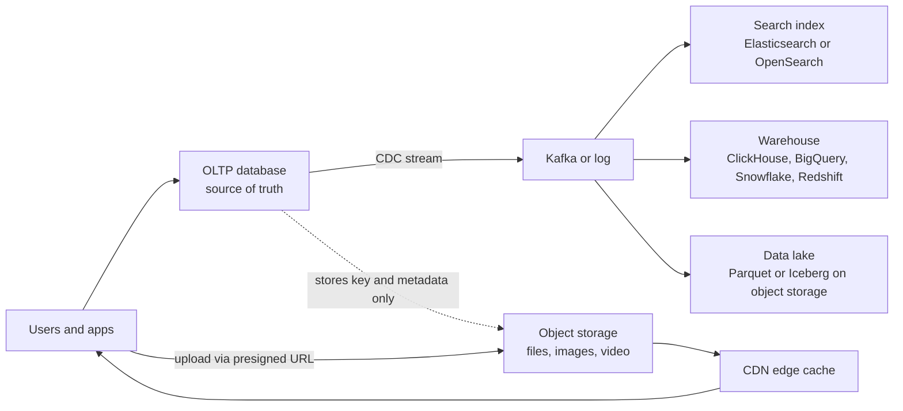
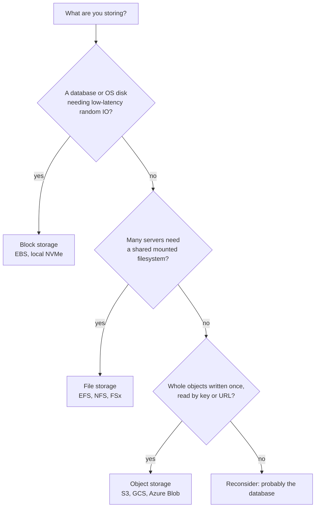
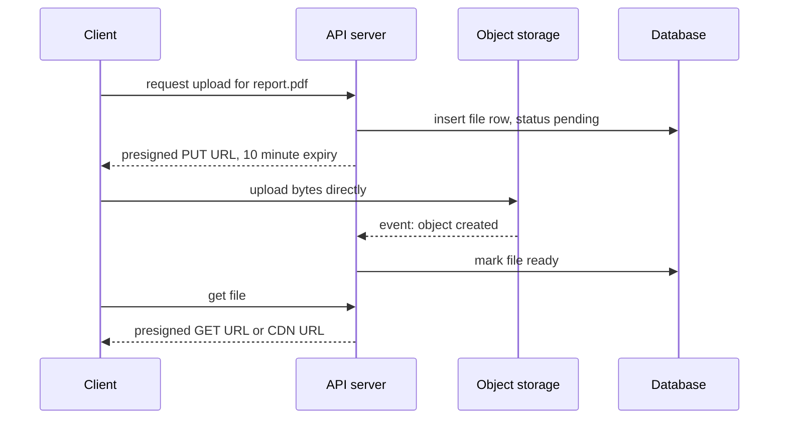
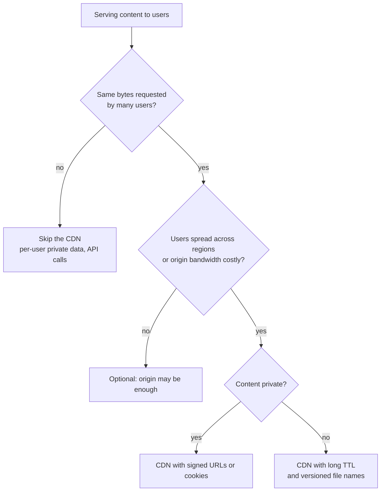
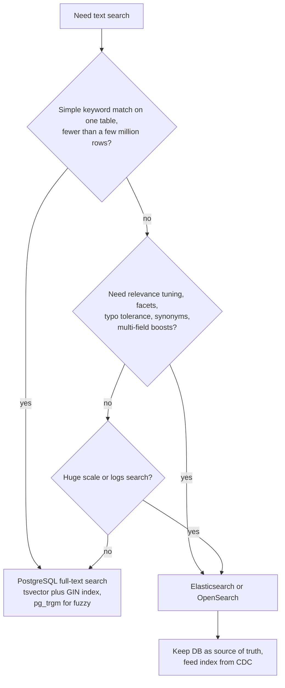
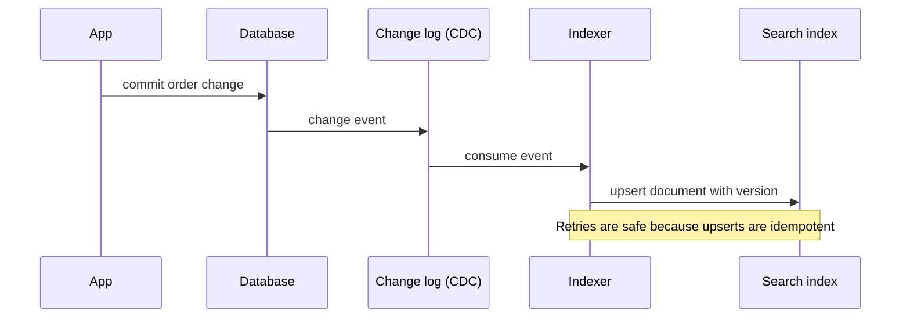
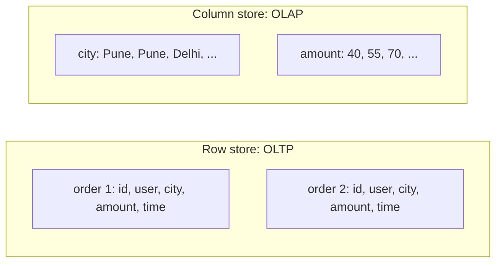
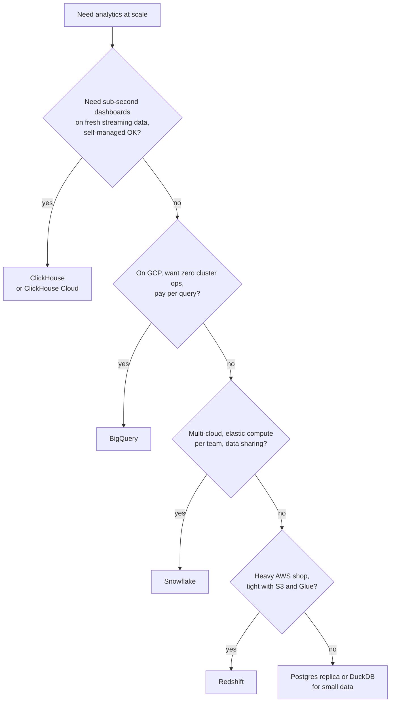
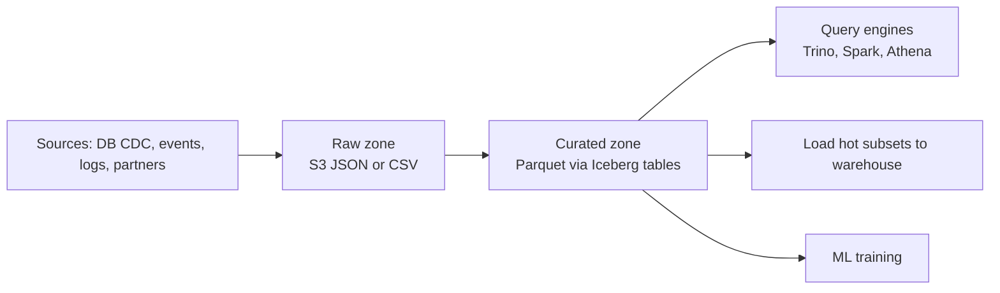
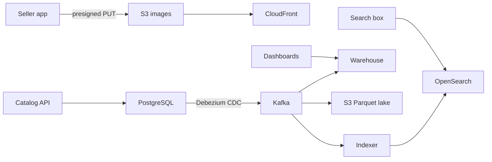

# Choosing Storage for Files, Search and Analytics - Decision Guide

> [!summary] TL;DR
> Your primary database is the wrong place for large files, relevance-ranked text search and heavy analytics. Each has a purpose-built store: object storage for files, a search engine (or database full-text search at small scale) for text, and a columnar warehouse for analytics. This guide shows how to choose, how the pieces connect, and what to say in the interview.

> [!abstract] Core idea
> - Files go to object storage, with metadata in your database and delivery through a CDN.
> - Search: start with the database's built-in full-text search, move to Elasticsearch or OpenSearch when you need relevance tuning, facets, typo tolerance or scale.
> - Analytics: never run heavy scans on the OLTP primary. Copy data to a columnar warehouse via CDC or batch loads.
> - The primary database stays the source of truth. Search indexes and warehouses are derived copies you can rebuild.
> - Keep the derived stores honest by feeding them from a log (change data capture), not by dual writes.

## 1. Why it exists

A typical product starts with one PostgreSQL database. Then three things happen.

Users upload photos and PDFs, and storing 5 MB blobs in rows bloats backups and slows replication. The product team wants a search box with typo tolerance and "did you mean". Finance wants a dashboard that scans a billion orders, and the scan makes checkout slow.

Each problem has a different access pattern. Files are written once and read by streaming bytes. Search reads by words and ranks results. Analytics reads a few columns across many rows. One storage engine cannot be best at all three, so we use specialized stores and connect them.

> [!tip] Remember
> Match the store to the access pattern, and keep one source of truth.

## 2. Mental model

Picture a company with three rooms. The **filing warehouse** (object storage) holds boxes you fetch by label. The **library index** (search engine) tells you which books mention a word, ranked by relevance. The **accounting office** (warehouse) answers questions about totals across years. The **front desk** (OLTP database) handles live customer transactions and keeps the master records.

The analogy breaks down because these rooms stay in sync through automatic copying, and the copies can lag. Plan for that lag.



## 3. How it works

### Decision 1: object, block or file storage?

**In plain words.** **Object storage** keeps whole objects (bytes plus metadata) under a key in a flat namespace and exposes them over HTTP. **Block storage** is a raw disk volume that one machine formats and mounts. **File storage** is a shared network file system with directories and POSIX-style access.



| Dimension | Object (S3) | Block (EBS) | File (EFS) |
| --- | --- | --- | --- |
| Access | HTTP API by key | Raw device, one host | NFS mount, many hosts |
| Consistency | Strong read-after-write (S3, since Dec 2020) | Strong (it is a disk) | Close-to-open style, NFS semantics |
| Durability | 11 nines design goal | Replicated inside one AZ | Across AZs |
| Latency | Tens of ms first byte (estimate) | Sub-ms to ms | Low ms |
| Scaling | Practically unlimited | Fixed volume size | Elastic |
| Cost per GB | Lowest | Higher | Highest |
| Update in place | No, replace the object | Yes | Yes |
| Wrong choice when | You need random small writes or a POSIX filesystem | You need sharing across many hosts | You need cheap bulk storage |

**Example.** An app stores user avatars and invoices in S3, runs PostgreSQL on EBS volumes, and shares a config directory between batch workers on EFS.

**Why it matters.** Putting files in the database makes backups, replication and caching painful. Putting a database on object storage is impossible for random writes.

### Decision 2: how do uploads and downloads flow?

**In plain words.** Do not stream big files through your app servers. Hand the client a **presigned URL**, a time-limited URL signed by your server, so the client uploads straight to object storage.



Steps for large files: split into parts (S3 multipart upload), upload parts in parallel, retry failed parts only, then complete the upload. Always store the object key and metadata in the database, never the bytes.

> [!warning] Common mistake
> Proxying every upload through the app servers. It burns bandwidth and memory, and one slow client holds a connection. Also forgetting to clean up half-finished uploads (set a lifecycle rule).

See [[AWS 07 - S3]] and [[Case Study - File Storage and Sync]].

### Decision 3: do you need a CDN?

**In plain words.** A **CDN** (content delivery network) caches copies of content on servers near users. It cuts latency and takes load off your origin.



Good practice: put a content hash or version in the file name (`app.3fa9c.js`) so you can use a very long cache lifetime and never need to purge. Use short TTLs or purge calls only for content that must change at the same URL.

**Example.** Netflix runs its own CDN called Open Connect, placing appliances inside ISP networks so popular video streams come from within the viewer's network. Most companies instead use a managed CDN such as CloudFront in front of S3. See [[Case Study - Video Streaming]].

**Why it matters.** The CDN can serve a large majority of read traffic for static assets (the exact cache hit ratio depends on content), which protects the origin and cuts latency.

### Decision 4: search with Postgres FTS or Elasticsearch/OpenSearch?

**In plain words.** A search engine builds an **inverted index**: for each word, a list of documents that contain it. Queries become list lookups and merges, then a relevance score ranks the results. See [[Search Engines and Inverted Indexes]].



| Dimension | PostgreSQL FTS | Elasticsearch / OpenSearch |
| --- | --- | --- |
| Setup | Already there | Separate cluster to run |
| Consistency | Transactional with your data | Near-real-time: new documents visible after the refresh (default 1 second) |
| Relevance | Basic (`ts_rank`), limited tuning | Rich scoring, boosting, analyzers, synonyms |
| Features | Stemming, phrase search, trigram for typos | Facets and aggregations, fuzzy, autocomplete, highlighting |
| Scale | One node plus replicas | Shards across many nodes |
| Source of truth | Yes | No, derived index |
| Operational cost | Lowest | Higher: shards, heap, reindexing, mapping changes |
| Wrong choice when | You need facets and ranking at scale | You only filter by a few columns |

**Example.** Wikipedia's on-wiki search (the CirrusSearch extension) has been built on Elasticsearch (check Wikimedia docs for its current engine). A small internal tool with 200,000 support tickets can use PostgreSQL FTS and avoid a second system.

**Why it matters.** Every extra system is another thing to monitor, secure and keep in sync. Choose the smaller one until you hit a concrete limit.

> [!warning] Common mistake
> Using Elasticsearch as the primary database. It is a derived index: mapping changes need reindexing and writes are not transactional with your other data.

### Decision 5: keeping the search index in sync

Dual writes (write DB, then write index in app code) fail when one write succeeds and the other fails. Prefer a log.



Steps:

1. The database commit is the single write.
2. A CDC tool (for example Debezium reading the WAL) emits events.
3. The indexer upserts documents using the entity's version or timestamp to ignore stale events.
4. A nightly or on-demand full reindex repairs drift.

Related: [[Materialized Views and Denormalization]] for the same "derived copy" idea inside one database.

### Decision 6: OLTP or OLAP?

**In plain words.** **OLTP** (online transaction processing) means many small reads and writes of single rows, such as "place order 123". **OLAP** (online analytical processing) means few queries that scan many rows but only a few columns, such as "revenue by city by month".



A row store reads whole rows, which is perfect for fetching one order. A column store reads only the `city` and `amount` columns and compresses similar values well, so a scan over a billion rows touches far fewer bytes. See [[Time-Series and Columnar Storage]].

| Dimension | OLTP (PostgreSQL, MySQL) | OLAP (columnar warehouse) |
| --- | --- | --- |
| Query shape | Point lookups, small writes | Large scans and aggregations |
| Layout | Row-oriented | Column-oriented |
| Concurrency | Thousands of short transactions | Fewer, heavier queries |
| Updates | Frequent, in place | Mostly appends and batch loads |
| Latency goal | Milliseconds | Seconds, sometimes sub-second |
| Wrong choice when | Scanning billions of rows | You need single-row updates and transactions |

> [!tip] Remember
> Run analytics against a copy, never against the primary serving checkout.

### Decision 7: which warehouse?



| Dimension | ClickHouse | BigQuery | Snowflake | Redshift |
| --- | --- | --- | --- | --- |
| Model | Columnar, MergeTree, self-host or cloud | Serverless, Dremel-based | Separated storage and compute, virtual warehouses | Columnar MPP, RA3 nodes with managed storage, serverless option |
| Strength | Very fast scans, real-time ingestion | No infrastructure to run | Elastic isolation per workload, easy sharing | Deep AWS integration |
| Pricing basis | Hardware or cloud usage | Per data scanned or reserved slots | Compute time plus storage | Node hours or serverless usage |
| Updates and deletes | Heavy (mutations), prefer append | Supported, with DML concurrency limits; batch changes | Supported | Supported, needs VACUUM and ANALYZE (largely automatic now) |
| Ops effort | Highest if self-hosted | Lowest | Low | Medium |
| Latency | Often sub-second (estimate, workload dependent) | Seconds | Seconds | Seconds |
| Wrong choice when | You need frequent row updates or no ops team | You need predictable cost with unbounded ad hoc scans | You need very low-latency serving | You are not on AWS |

Pricing and limits change often. Check current vendor docs before quoting numbers in a design.

**Example.** Uber described moving log analytics to ClickHouse in a 2021 engineering post, and Cloudflare is widely known to use ClickHouse for analytics. Teams on Google Cloud commonly choose BigQuery to avoid running clusters.

### Decision 8: do you need a data lake?

**In plain words.** A **data lake** stores raw data in open file formats (Parquet, ORC, JSON) on cheap object storage, and query engines read it in place. A **lakehouse** adds a table layer (Apache Iceberg, Delta Lake, Apache Hudi) for transactions, schema evolution and time travel on those files.



Use a lake when you have many varied sources, huge volumes where warehouse storage is too costly, or ML needs raw data. Skip it when one warehouse already holds everything you analyze. Iceberg was created at Netflix and Hudi at Uber, both to bring table semantics to files on object storage.

> [!tip] Remember
> Lake for cheap, raw, many consumers. Warehouse for fast, curated, SQL-first reporting.

## 4. Worked example: an e-commerce product platform

Requirements: product images, catalog search, and a daily sales dashboard, for 5M products and 1M orders per day.

1. **Images.** Sellers upload through presigned URLs to S3. Rows in PostgreSQL store the key and metadata. CloudFront serves images with versioned names and a long TTL.
2. **Catalog source of truth.** PostgreSQL holds products and orders.
3. **Search.** 5M products with facets (brand, price range) and typo tolerance exceed what PostgreSQL FTS does well, so use OpenSearch. Debezium streams product changes through Kafka to an indexer.
4. **Analytics.** Orders flow via CDC to the warehouse (BigQuery on GCP, or Redshift or Snowflake elsewhere). Dashboards hit the warehouse, never the primary.
5. **Raw archive.** The same stream lands as Parquet in object storage for ML and audits.



### Whiteboard version

```text
Files     : S3 + presigned URLs + CDN, DB keeps key + metadata
Search    : PG FTS small; OpenSearch for facets/relevance/scale; feed by CDC
Analytics : OLTP -> CDC -> warehouse (ClickHouse|BigQuery|Snowflake|Redshift)
Lake      : Parquet/Iceberg on S3 for raw + ML
Rule      : DB = truth, everything else = rebuildable copy
```

## 5. Variants and comparison

| Need | Pick | Alternative | Why |
| --- | --- | --- | --- |
| User uploads | S3 or GCS | Self-hosted object store (MinIO, Ceph) | Managed durability and zero ops |
| Database disks | EBS or local NVMe | Network file system | Latency and IOPS |
| Shared files across workers | EFS | S3 with a client library | Real directory semantics |
| Static asset delivery | CDN over object storage | Serve from app | Latency and origin cost |
| Site search, small | PostgreSQL FTS | Elasticsearch | One less system |
| Site search, large | OpenSearch or Elasticsearch | Algolia or Typesense (managed or simpler) | Faceting and relevance |
| Log search | OpenSearch, or ClickHouse for cost | Loki, which indexes labels only | Cost and query style |
| Dashboards on fresh data | ClickHouse | BigQuery with streaming | Speed versus ops |
| Company reporting | Snowflake, BigQuery or Redshift | Postgres replica | Concurrency and scale |
| Raw history and ML | Lake (Iceberg on S3) | Warehouse only | Cost and flexibility |

See [[Case Study - Metrics and Logging Platform]] and [[Case Study - Search Autocomplete]] for end-to-end designs.

## 6. Trade-offs and when not to use

- **Object storage** has no in-place edits and higher first-byte latency than disks. Do not use it for databases or hot random-write workloads.
- **CDN** gives stale content until the TTL expires or you purge. Skip it for per-user data.
- **Elasticsearch/OpenSearch** adds a cluster to run, near-real-time rather than transactional visibility, and reindexing for mapping changes. Skip it when database FTS is enough.
- **Warehouses** are poor at single-row updates and low-latency serving. Do not use them as an app database.
- **Data lakes** without table formats and governance turn into swamps. Skip them if one warehouse suffices.
- **CDC pipelines** add lag and a failure mode to watch. Accept it knowingly.

## 7. In production

- **Dropbox** stored file blocks on S3 at first, then built its own storage system, Magic Pocket, to cut cost and gain control at huge scale (Dropbox engineering blog, 2016). Smaller companies rarely reach the point where that pays.
- **Netflix** operates Open Connect appliances inside ISPs, and created Apache Iceberg for lake tables.
- **Uber** created Apache Hudi and published its move of log analytics to ClickHouse.
- **Wikipedia** has used Elasticsearch for site search through CirrusSearch (Wikimedia documentation).

What to monitor:

| Signal | Why |
| --- | --- |
| CDN cache hit ratio and origin egress | Shows whether caching works and what it costs |
| Search index lag (CDC offset or timestamp gap) | Users see missing new items when lag grows |
| Index and shard health, heap usage | Prevents cluster red states and slow queries |
| Warehouse query cost and slow queries | Controls surprise bills |
| S3 request errors and incomplete multipart uploads | Prevents silent failures and wasted storage |
| Drift: counts in DB versus index versus warehouse | Catches sync bugs |

## 8. Deep dive

### Object storage consistency and durability

S3 gives strong read-after-write consistency for new objects and overwrites since December 2020. Durability of 11 nines is a design goal based on redundant storage across facilities. It protects against hardware loss, not against your own bad delete, so enable versioning and consider object lock for important data. See [[AWS 07 - S3]].

### Why columnar scans are fast

Columns of the same type compress well (run-length, dictionary, delta encoding). Queries read only needed columns. Engines process data in vectorized batches. Partitioning and sort keys let them skip files and blocks using min/max statistics. This is why a billion-row aggregate can finish in seconds.

### Search indexes are derived state

Because the index can be rebuilt from the source, treat it as disposable. Design a full reindex path, build into a new index and swap an alias, so mapping changes do not cause downtime. See [[Search Engines and Inverted Indexes]].

### Handling deletes and privacy

Deletion requests must reach every copy: database, search index, warehouse, lake and backups. Plan a deletion pipeline early. Lakes with Iceberg or Hudi support row-level deletes, plain Parquet files need rewrites.

### Cost levers

Object storage tiers (infrequent access, archive) cut cost for old data. CDN offload reduces origin egress. Warehouses reward partitioning and selecting only needed columns. Estimate volume first with [[Back-of-the-Envelope Estimation]].

## 9. Scenario drills: scenario, choice, why

| Scenario | Choice | Why | Say in the interview |
| --- | --- | --- | --- |
| Profile photos | S3 plus CDN, key in DB | Write-once blobs read by many | "Upload with a presigned URL, serve via CDN, keep only the key in the database." |
| Video on demand | Object storage plus transcoding plus CDN | Huge files, global viewers | "Store renditions in object storage and let the CDN do delivery." |
| Product search with facets | OpenSearch fed by CDC | Relevance, facets, typos | "The database stays truth, the index is a rebuildable copy." |
| Internal wiki search, 50k pages | PostgreSQL FTS | Small, already in DB | "No new system until we outgrow this." |
| Autocomplete | Specialized index (see [[Case Study - Search Autocomplete]]) | Prefix queries at very low latency | "Prefix structure, cached for popular prefixes." |
| Daily sales reports | Warehouse via CDC or batch | Heavy scans | "Never run them on the primary." |
| Real-time product analytics dashboard | ClickHouse | Fast aggregates on fresh data | "Columnar plus streaming ingestion for sub-second dashboards." |
| Application logs | OpenSearch, or ClickHouse for cost | Search and aggregate | "Retention tiers keep the bill sane." |
| ML training data | Lake of Parquet on S3 | Cheap, raw, many consumers | "Open formats let several engines read the same data." |
| Backups and audit archive | Object storage with archive tier and object lock | Cheap, durable, tamper-resistant | "Lifecycle rules move old data to cold storage." |

## 10. How to say it in the interview

- "Files go to object storage with presigned URLs so bytes never pass through our servers. The database keeps the key and metadata. A CDN serves them."
- "For search I would start with PostgreSQL full-text search. We need facets and typo tolerance at 5 million products, so I move to OpenSearch."
- "The search index is derived. I feed it from a change stream rather than dual writes so a failed index call cannot cause permanent drift."
- "Analytics must not hit the OLTP primary. I replicate to a columnar warehouse and accept minutes of lag."
- "The trade-off is operational: each extra store needs monitoring and a sync path, so I add one only when a measured limit demands it."

## 11. Interview questions

> [!question]- Why not store images in the database?
> Blobs bloat tables, backups and replication, and a database is a costly place to serve bytes. Object storage is cheaper, scales out, and pairs with a CDN. Keep the key and metadata in the database.

> [!question]- When is PostgreSQL full-text search enough?
> For keyword search over a modest dataset (up to a few million rows, an estimate) when you do not need faceting, advanced ranking or typo tolerance beyond `pg_trgm`. It is transactional and needs no extra system.

> [!question]- How do you keep Elasticsearch in sync with the database?
> Use change data capture from the database log into a stream, and an idempotent indexer that upserts by id and version. Add a periodic full reindex to repair drift. Avoid dual writes because one can fail while the other succeeds.

> [!question]- Why are columnar stores better for analytics?
> Analytic queries read a few columns across many rows. Column layout reads only those columns, compresses well and enables vectorized processing and block skipping. Row stores read entire rows.

> [!question]- Warehouse or data lake?
> A warehouse gives fast, curated, SQL-first analytics. A lake keeps raw data cheaply in open formats for many engines and ML. Many companies use both: a lake as the raw layer and a warehouse for curated reporting. Table formats such as Iceberg blur the line.

> [!question]- Should a CDN cache private files?
> Only with signed URLs or cookies and short expiry, so the CDN checks authorization. Never cache per-user responses under a shared URL.

## 12. Cheat sheet

- Files: object storage, presigned uploads, CDN, metadata in the database.
- Block for database disks, file storage for shared mounts, object for everything else.
- Version file names so CDN TTLs can be long.
- Search: PostgreSQL FTS first, OpenSearch or Elasticsearch for facets, relevance and scale.
- The index and warehouse are derived copies, fed by CDC, and rebuildable.
- OLTP rows for transactions, OLAP columns for scans. Never run analytics on the primary.
- ClickHouse for fast fresh dashboards, BigQuery for no ops, Snowflake for elastic isolation, Redshift on AWS.
- Lake for raw, cheap, many consumers. Warehouse for curated reporting.

## Links

- Deep notes, storage: [[SQL vs NoSQL]], [[Search Engines and Inverted Indexes]], [[Time-Series and Columnar Storage]], [[Storage Engines - B-tree vs LSM and WAL]], [[Materialized Views and Denormalization]], [[Backup, PITR and Disaster Recovery]], [[Index Types and Index Design]]
- Deep notes, distributed systems: [[Multi-Region Architecture]], [[CQRS]], [[Event Sourcing]]
- Cloud: [[AWS 07 - S3]], [[AWS 08 - RDS and Aurora]], [[AWS 10 - CloudWatch]]
- System design: [[Case Study - File Storage and Sync]], [[Case Study - Video Streaming]], [[Case Study - Metrics and Logging Platform]], [[Case Study - Search Autocomplete]], [[Case Study - Ad Click Aggregation]], [[Back-of-the-Envelope Estimation]], [[System Design Interview Framework]]
- Sibling guide: [[Choosing Consistency, Replication and Partitioning - Decision Guide]]
