# Choosing a Caching Strategy - Decision Guide

> [!summary] TL;DR
> A **cache** is a small, fast copy of data that is expensive to fetch. Choosing a caching strategy means answering five questions in order: **where** the copy lives (browser, CDN, gateway, app memory, Redis, database), **who fills it** (cache-aside, read-through, write-through, write-behind), **how it stays fresh** (TTL, invalidation, or both), **which store** (local, Redis, Memcached), and **how it survives a stampede**. The safe default is cache-aside in front of the database, a TTL on every key, delete-on-write, and request coalescing.

> [!abstract] Core idea
> - Cache **as close to the user as the data's sharing rules allow**: public and immutable goes to the CDN, per-user goes to Redis or app memory.
> - **Cache-aside + TTL + delete on write** solves about 80 percent of cases. Reach for write-through or write-behind only with a stated reason.
> - Every cache needs an answer to "what if it is empty or down?" Stampede protection is part of the design, not an extra.
> - Numbers in this note are rough estimates unless a source is named.

## Start here: the basics 🟢

> [!info] How to read this note (pick your level)
> - 🟢 **New to this?** Read "From zero" below, then sections 1, 2 and the cheat sheet (10). Stop there, that is a full first pass.
> - 🟡 **Know the basics?** Add section 3 (the five steps), 4 (worked example), 5, 6 and the scenario drills.
> - 🔴 **Interview / SDE-3 prep?** Add 7, 8, 9 and "How to say it in the interview". Headings are tagged 🟢🟡🔴 so you always know where you are.

**From zero, in 60 seconds** 🟢

Reading from a database is slow-ish, and many users ask for the same thing again and again.
So you keep a copy of popular answers in fast memory. That fast copy is a **cache**.
If the copy is there (a **hit**), you answer in about a millisecond. If not (a miss), you ask the database and save the answer for next time.
The catch: when the real data changes, the copy can be wrong for a while.
So every copy gets an expiry time, and you delete the copy when you change the data.

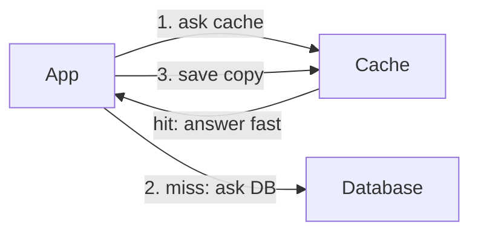

The rest of this note is just these 3 questions:
1. Where should the cache sit, and who fills it?
2. How do you keep it fresh enough?
3. What happens when it is empty, overloaded or down?

**The problem in one story**

You ask a colleague the office Wi-Fi password ten times a day. Each time they look it up in a binder.
After the second time you write it on a sticky note. Now the answer is instant.
But if IT changes the password, your note is wrong until you update it. That is caching: fast copies that can go stale.

**Words you need first**

| Word | Plain meaning | Tiny example |
|---|---|---|
| Cache | A fast store holding copies of data that lives elsewhere | Redis holds a user profile copy |
| Hit / miss | Hit: found in cache. Miss: not there, go to the database | 95 hits per 100 reads |
| TTL | Time to live: how long a cached copy is allowed to stay | Expire after 60 seconds |
| Stale data | A cached copy older than the real value | Old price shown after a change |
| Eviction | Removing items when the cache is full | LRU drops the least recently used key |
| Cache-aside | App checks cache, on miss reads DB and fills cache | Default pattern in most services |
| CDN | A cache spread across cities, near users | Product images served from an edge |
| Stampede | Many requests miss at once and all hit the database | A hot key expires at peak traffic |

**Picture it**

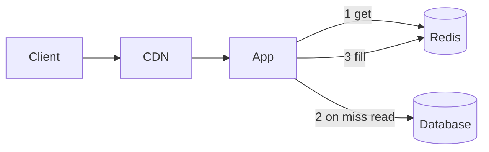

**Analogy**

A cache is the sticky note next to the binder: fast to read, and wrong if the binder changes and no one updates the note.
Where it breaks: a sticky note never fills up, but a real cache has limited memory and must evict entries.

**How the rest of this note builds up**

- First, why caches exist and where they can sit (sections 1-2).
- Then the read and write patterns, invalidation and stampede protection (section 3), with a worked example (section 4).
- Next, variants, trade-offs and production lessons (sections 5-7).
- Finally, the SDE-3 deep dive on two-level caches, multi-region, negative caching and why delete beats update, then interview questions, cheat sheet and drills.

> [!tip] Remember
> Cache-aside, a TTL and delete-on-write; then plan for the cache being empty or down.

## 1. Why it exists 🟢

Say you are designing the home page of a food delivery app. The "restaurants near me" list is read about 50,000 times per second at peak (an estimate) but changes only when a restaurant edits its menu, maybe once a day.

Hitting PostgreSQL for each read means 50,000 queries per second of mostly identical work. A cache turns that into a handful of database queries and a lot of cheap memory reads.

In an HLD round the interviewer does not want "I would add Redis". They want to hear where, which pattern, how fresh, and what breaks. This guide gives you the decision path and the words.

> [!tip] Remember
> "Add a cache" is not a design. "Cache-aside in Redis with a 60 s TTL, delete on write, singleflight on miss" is.

## 2. Mental model 🟢

Think of a restaurant kitchen. The **walk-in fridge** is the database: big, slow to walk to. The **counter shelf** next to the chef is the cache: small, instant. The **pre-plated dishes under the heat lamp** are a CDN edge: they never reach the kitchen at all.

Every caching question is a question about the shelf:

- **Where do I put the shelf?** (layers)
- **Who restocks it?** (patterns)
- **When do I throw old food away?** (TTL and invalidation)

The analogy breaks at invalidation. Food spoils on a known clock; data goes stale the moment someone else changes it, and the shelf cannot see that.

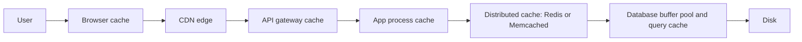

Each hop is a chance to stop early. The earlier you stop, the cheaper the request, but the less control you have over freshness.

> [!tip] Remember
> The best cache hit is the one that never leaves the user's device.

## 3. How it works 🟡

### Step 1: where to cache (the layers)

**In plain words:** you can keep a copy at six places on the path from user to disk. Each place trades reach (how many users share it) against control (how fast you can invalidate).

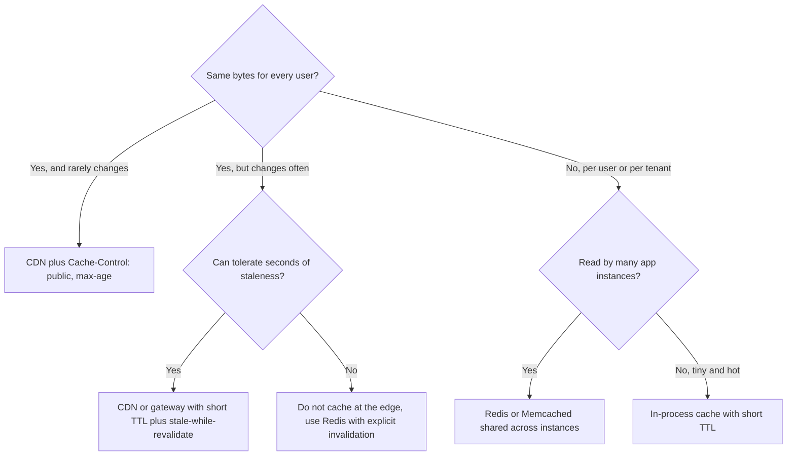

| Layer | What it caches | Who shares it | Invalidate how | Typical use |
| --- | --- | --- | --- | --- |
| Client (browser, app) | Responses, images, local DB | One user | `Cache-Control`, ETag, versioned URLs | Static assets, offline data |
| CDN edge | Whole HTTP responses | Everyone near that edge | Purge API, short TTL, versioned URLs | Images, JS, public catalogue pages |
| API gateway | Responses by URL and headers | All callers of the gateway | TTL, purge | Public GET endpoints, rate-limit counters |
| App process (local) | Objects in memory | One instance | TTL, pub/sub broadcast | Config, feature flags, small lookup tables |
| Distributed (Redis, Memcached) | Objects, query results, sessions | All instances | Delete on write, TTL | Hot rows, sessions, counters, leaderboards |
| Database | Pages in buffer pool, materialized views | The database | Automatic, refresh jobs | Hot index pages, heavy aggregates |

**Example with numbers:** a 200 KB product image fetched 1 million times a day is 200 GB of origin traffic. With a CDN hit ratio of 95 percent (an estimate), origin serves 10 GB.

**Why it matters:** each layer you skip is load you carry in your own servers.

See [[CDN and Edge]] and [[HTTP Caching - Cache-Control, ETag, Conditional Requests]] for the edge mechanics, and [[Caching Fundamentals]] for the rest.

### Step 2: who fills the cache (the patterns)

**In plain words:** when a request misses, someone has to load the value. When data is written, someone has to update or remove the cached copy. The four patterns differ in who does that work.

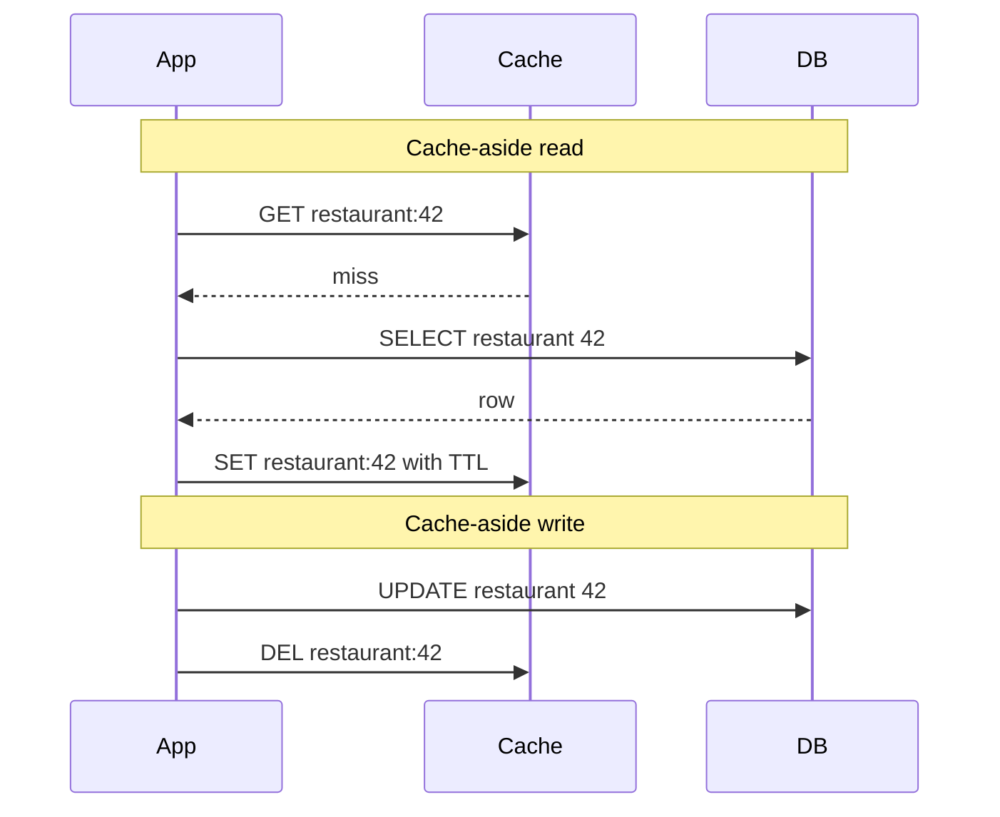

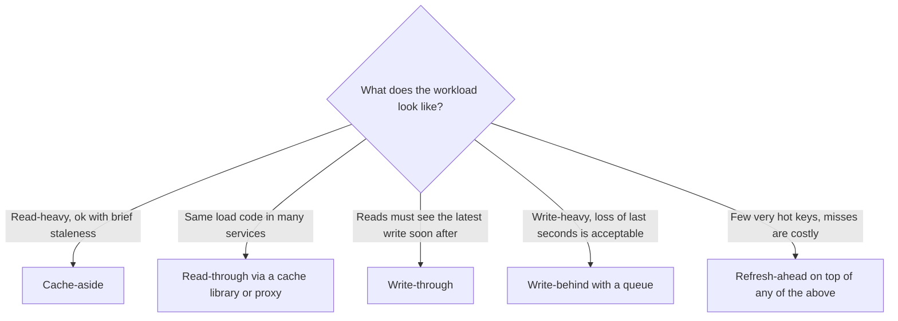

| Pattern | Read path | Write path | Strength | Weakness |
| --- | --- | --- | --- | --- |
| Cache-aside | App checks cache, loads DB on miss | Write DB, delete key | Simple, cache outage is survivable | Brief staleness, stampede on miss |
| Read-through | Cache layer loads DB on miss | Usually write DB, delete key | Loading logic in one place | Needs a library or proxy |
| Write-through | Cache is always warm | Write cache and DB in one operation | Fewer misses after writes | Slower writes, cache pollution with never-read data |
| Write-behind | Cache is warm | Write cache, DB updated later | Very fast writes, batching | Data can be lost if the cache dies before flush |
| Refresh-ahead | Hot keys reloaded before expiry | Same as base pattern | No miss spike on hot keys | Wasted loads for keys nobody asks for again |

> [!warning] Common mistake
> Write-through does not make the cache and database strongly consistent. Two concurrent writers can still leave the cache holding the older value. See [[Caching Patterns]].

**Example with numbers:** a counter incremented 5,000 times per second can be written to Redis and flushed to the database once a second (write-behind): 1 database write instead of 5,000. The price is up to 1 second of counts lost on a crash.

### Step 3: how it stays fresh (TTL versus invalidation)

**In plain words:** a **TTL** (time to live) is an expiry clock on each key. **Invalidation** means you delete or update the key when the source changes. TTL is simple and always works eventually. Invalidation is precise but you can forget a code path.

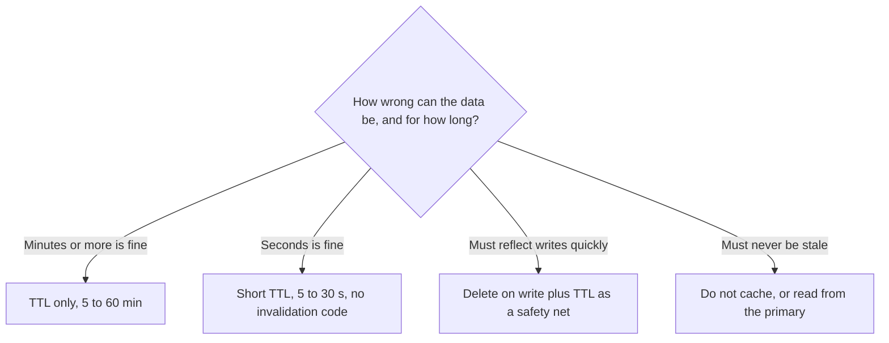

The rule that holds up in interviews: **always set a TTL, even when you also invalidate.** The TTL is the safety net for the delete you forgot or that failed.

- **TTL only:** blog posts, product descriptions, weather.
- **TTL plus delete-on-write:** user profile, restaurant menu, cart.
- **Versioned keys** (`menu:42:v17`): never invalidate, just bump the version. Old keys expire on their own.
- **Event-driven invalidation:** a change event (from [[Transactional Outbox and CDC]]) deletes keys in every region.

**Example with numbers:** a menu TTL of 60 s and delete on write means the worst case staleness is 60 s if the delete is lost, and near zero otherwise.

See [[Cache Invalidation, TTL and Consistency]].

### Step 4: which store (local, Redis, Memcached)

**In plain words:** A cache inside your app's own memory is fastest but each copy of the app has its own. A shared cache like Redis is one copy for everyone, one network hop away.

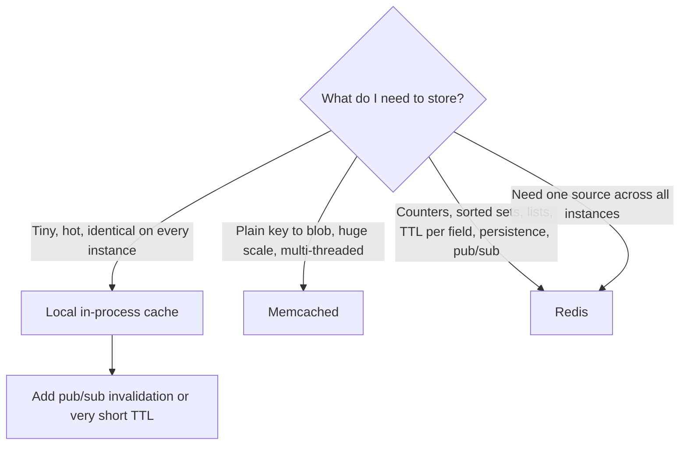

| Dimension | Local (in process) | Redis | Memcached |
| --- | --- | --- | --- |
| Latency (estimate) | tens of nanoseconds to microseconds | sub-millisecond on a good network | sub-millisecond on a good network |
| Data model | Any Go type | Strings, hashes, lists, sets, sorted sets, streams | Strings (opaque blobs) |
| Shared across instances | No | Yes | Yes |
| Persistence | No | Optional (RDB, AOF) | No |
| Replication and failover | None | Built in (replicas, Sentinel, Cluster) | Not in the server; clients shard, tools replicate |
| Threading | Your code | Command execution is mostly single-threaded per shard (I/O threads help) | Multi-threaded |
| Memory overhead | Inside your heap, adds GC pressure | Separate process | Separate process |
| Best at | Config, flags, lookups | Hot rows, sessions, rate limits, leaderboards, locks | Simple, very large fleets of read caches |
| Wrong when | You need one consistent value everywhere | You only need dumb blobs at huge scale and want simplicity | You need counters, sorted sets, persistence |

**Why it matters:** local caches are the fastest, but N instances means N copies that go stale at different times. Use them for data where a 30 s skew between pods does not matter.

See [[Redis Fundamentals]], [[Redis Data Structures and When to Use Each]] and [[Redis Use Cases]].

### Step 5: stampede and the other failure modes

**In plain words:** when a hot key expires, every request misses at the same moment and all of them hit the database together. That is a **cache stampede** (also called a thundering herd).

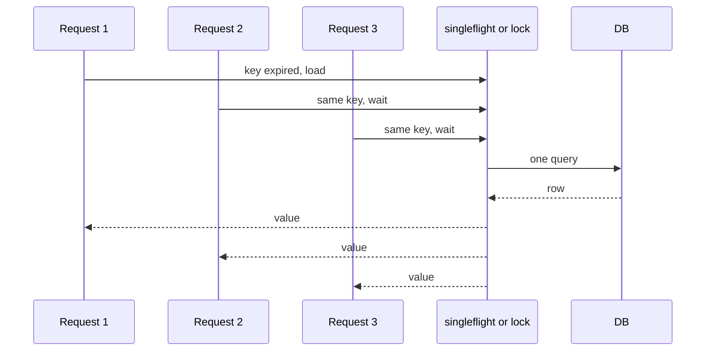

| Problem | What happens | Defence |
| --- | --- | --- |
| Stampede | One hot key expires, thousands of misses at once | In-process `singleflight`, a per-key lock, refresh-ahead, serve stale while one request reloads |
| Avalanche | Many keys expire at the same time | Add random jitter to TTLs (for example 60 s plus 0 to 10 s) |
| Penetration | Requests for keys that do not exist skip the cache every time | Cache the "not found" result with a short TTL, or a Bloom filter in front |
| Hot key | One key gets far more traffic than one node can serve | Local copy in front, replicate the key under several names |
| Cache down | All traffic falls onto the database | Timeouts, circuit breaker, load shedding, keep the database sized for degraded mode |

Facebook's memcache paper describes **leases** as its fix: a miss hands one client a token to refill the key and tells the others to wait briefly, which stops both stampedes and stale refills.

See [[Cache Failure Modes - Stampede, Avalanche, Penetration, Hot and Big Keys]], [[Hot Keys and Hot Partitions]], [[Bloom Filters and Probabilistic Data Structures]] and [[Circuit Breaker]].

> [!tip] Remember
> Jitter the TTL, coalesce the miss, cache the "not found", and size the database for a cold cache.

## 4. Worked example 🟡

**Problem:** the "restaurant details" endpoint of a food delivery app. Facts (estimates): 20,000 reads per second at peak, 200 writes per day per restaurant, 500,000 restaurants, 4 KB per restaurant document.

1. **Size it.** 500,000 times 4 KB is about 2 GB. That fits in one Redis node, so no sharding is needed yet.
2. **Edge.** The public part (name, photos, cuisine) is the same for everyone. Serve images from a CDN and set `Cache-Control: public, max-age=300, stale-while-revalidate=60` on the details JSON.
3. **App cache.** Open-hours rules and feature flags go in a local cache with a 30 s TTL.
4. **Redis.** Use cache-aside. Key `restaurant:{id}`, TTL 10 minutes plus random 0 to 60 s of jitter.
5. **Write path.** The menu service updates PostgreSQL, then deletes `restaurant:{id}`. If the delete fails, the TTL fixes it within about 11 minutes.
6. **Stampede.** Wrap the loader in `singleflight` so one instance issues one query per key. Cache "not found" for 30 s.
7. **Failure.** Redis timeout is 50 ms. On timeout, fall through to the database with a circuit breaker so a Redis outage does not take out the app.
8. **Check.** At a 95 percent hit ratio (an estimate), the database sees 1,000 reads per second instead of 20,000.

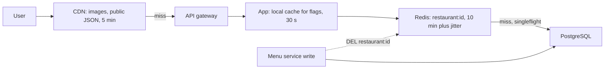

A runnable cache-aside version in Go lives in [[Caching Patterns]] and [[Redis in Go]].

### Whiteboard version

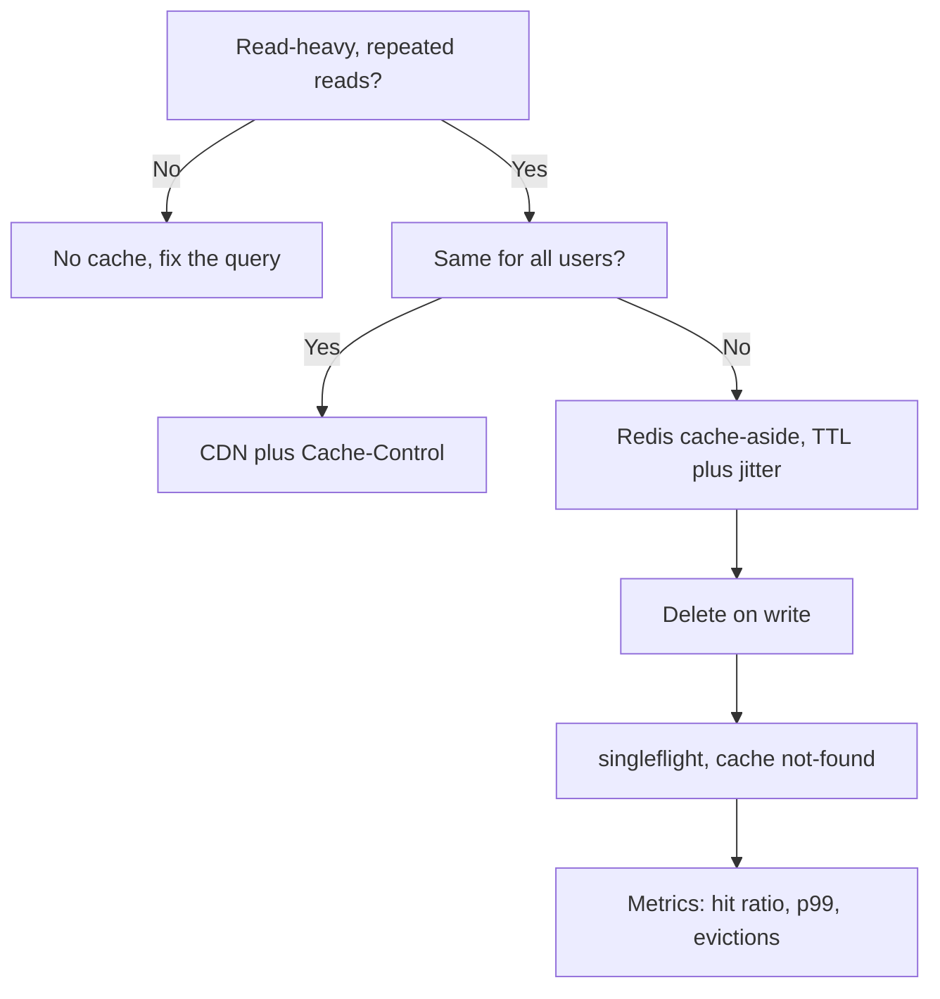

> [!tip] Remember
> Size the data first. If it fits in one node's RAM, you do not need a clustered cache yet.

## 5. Variants and comparison 🟡

### The full comparison table

**In plain words:** Four ways to fill a cache, side by side. Cache-aside (the app fills it on a miss) is the usual default.

| Dimension | Cache-aside | Read-through | Write-through | Write-behind |
| --- | --- | --- | --- | --- |
| Consistency | Eventual, brief stale window | Eventual | Cache matches DB after a successful write; races possible | Cache is ahead of DB |
| Read latency on hit | Fast | Fast | Fast | Fast |
| Read latency on miss | App pays DB cost | Cache layer pays DB cost | Rare, cache is warm | Rare |
| Write latency | DB only | DB only | DB plus cache, slower | Cache only, fastest |
| Durability of writes | DB | DB | DB | Cache plus queue, loss window |
| Throughput (relative estimate) | High | High | Medium on writes | Highest on writes |
| Scaling model | Scale cache and DB separately | Same | Same | Needs a reliable flush pipeline |
| Operational cost | Low | Medium, extra component | Medium | High, flush failures and ordering |
| Typical failure | Stampede, stale entry | Library bug, stampede | Partial write between cache and DB | Lost writes, reorder |
| Managed options | ElastiCache, MemoryDB, Memorystore | Some proxies and caches (for example DAX for DynamoDB) | Same | Rarely managed; build with a queue |
| Wrong choice when | You need read-your-writes everywhere | You have one service and no library | Data is rarely read after write | Money, orders, anything you cannot lose |

### Picking by data type

**In plain words:** Not all data needs the same care. Static images can live for days; a stock count may need seconds or no cache at all.

| Data | Where | Pattern | Freshness |
| --- | --- | --- | --- |
| Static assets, images | CDN, browser | Versioned URLs | Immutable, `max-age=31536000` |
| Catalogue pages | CDN plus Redis | Cache-aside | TTL minutes |
| User profile | Redis | Cache-aside | TTL plus delete on write |
| Session | Redis | Write-through style, store is the source | TTL equal to session lifetime |
| Cart | Redis or DB | Write-through | Strong for the owner |
| Counters, likes | Redis | Write-behind | Seconds of loss acceptable |
| Rate-limit counters | Redis | Direct atomic ops | Window length |
| Leaderboard | Redis sorted set | Cache is the source | Live |
| Feature flags | Local plus pub/sub | Push invalidation | Seconds |
| Payments, balances | Do not cache | Read the primary | Strong |

## 6. Trade-offs 🟡

- **Staleness versus speed.** Every cache is a promise that old data is acceptable for some time. Write that time down.
- **Complexity.** A cache adds invalidation bugs, a new failure mode, and a new thing to monitor.
- **Cost.** RAM costs more than disk. Cache what is hot, not everything.
- **Cold start.** After a deploy or failure the cache is empty and the database takes the full load. Warm it or size for it.
- **When not to cache.**
  - The data is written as often as it is read.
  - Every request is unique (low hit ratio).
  - Correctness cannot tolerate any staleness, such as account balances.
  - The database query is already fast and cheap.

> [!warning] Common mistake
> Adding a cache to hide a slow query. Fix the index first ([[Query Plans and EXPLAIN]]), then cache what is still hot.

## 7. In production 🔴

Real systems, with what is publicly documented:

- **Facebook** runs memcache at very large scale and wrote about it in the NSDI 2013 paper: delete-on-write invalidation, leases against stampedes, regional pools and a cold-start warm-up from another cluster.
- **Netflix** built EVCache on memcached and replicates it across zones and regions to keep reads local (Netflix Tech Blog).
- **Instagram** used Redis early to map media IDs to user IDs for hundreds of millions of keys, tuning hashes for memory (Instagram Engineering, 2011).
- **Browsers and CDNs** follow the HTTP caching rules in RFC 9111, including `stale-while-revalidate` from RFC 5861.

Monitor:

| Metric | Why | Alert idea |
| --- | --- | --- |
| Hit ratio per key family | Tells if the cache pays for itself | Drop of more than 10 points from baseline |
| p99 cache latency | Redis slowness becomes app slowness | Above 5 ms (estimate) |
| Evictions per second | Memory is too small or TTLs too long | Sustained non-zero |
| DB queries per second | Early sign of stampede or cold cache | Spike with hit ratio drop |
| Memory used and big keys | Out-of-memory kills | Above 80 percent |

See [[Redis in Production - Memory, Latency, Security]] and [[Cache Eviction Policies - LRU, LFU, TTL]].

## 8. Deep dive 🔴

### Two-level caches

**In plain words:** A tiny cache inside the app, in front of Redis, saves trips. But now there are two copies that can go stale, so keep the inner one very short-lived.

A local cache in front of Redis cuts Redis traffic and latency but doubles the staleness problem. Use a tiny local TTL (1 to 5 s) or invalidate with Redis pub/sub. Redis also offers server-assisted client-side caching that tells a client when a tracked key changed.

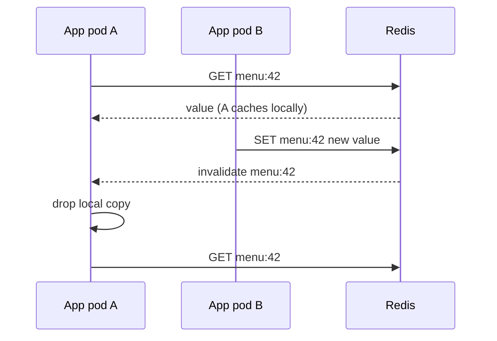

### Multi-region

**In plain words:** Each region keeps its own cache. When data changes, a message tells other regions to drop their copy, and they are a little behind for a moment.

Each region has its own cache. Writes go to the primary region and a change stream deletes keys in the other regions. Accept that remote regions are stale by the replication lag plus the delete delay. Facebook's paper describes the same idea with invalidations sent from the database log.

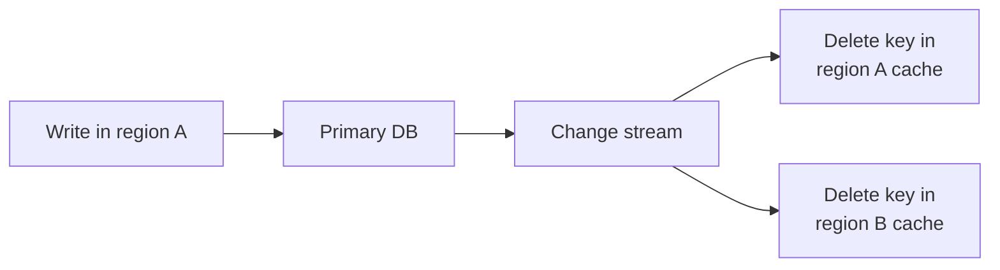

### Negative caching and Bloom filters

**In plain words:** Remember "this does not exist" too. Otherwise bots asking for fake ids hit your database every single time.

If 5 percent of requests ask for IDs that do not exist (bots, scans), each one reaches the database. Cache "not found" for 30 s, or put a Bloom filter of valid IDs in front.

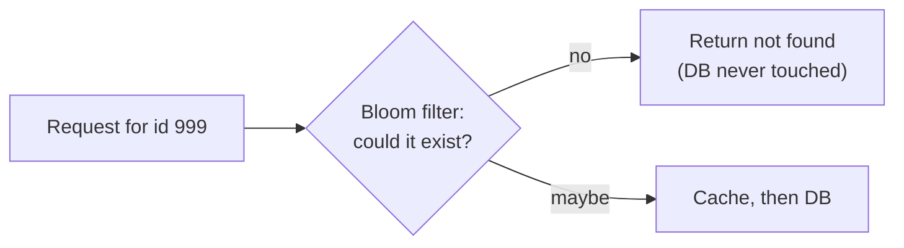

### Why delete instead of update on write

**In plain words:** If two writers both update the cache, they can land in the wrong order and leave a wrong value. Deleting is safe: the next reader loads the fresh value.

Updating the cache on write has a race: two writers can set the cache in the opposite order of their database writes, leaving the wrong value until TTL. Deleting is safe because the next reader reloads the latest value. A rare race remains where a slow reader refills an old value after the delete, which is why the TTL stays.

> [!tip] Remember
> Delete beats update. TTL backs up the delete.

## 9. Interview questions 🔴

> [!question]- Where would you cache for a read-heavy product catalogue and why?
> Public, same-for-everyone data goes to the CDN with `Cache-Control: public` and a short `max-age` plus `stale-while-revalidate`. Behind it, Redis cache-aside for the JSON documents with a TTL and delete on write. The CDN removes traffic from my servers entirely; Redis removes it from the database.

> [!question]- Cache-aside or write-through, how do you choose?
> Cache-aside is the default: simple, and a cache outage only makes things slower. I choose write-through when reads must see a write almost immediately and the data is read often after being written. I would not pick write-behind for anything I cannot lose.

> [!question]- TTL or explicit invalidation?
> Both. Invalidation keeps the cache fresh in the normal path; the TTL is the safety net when a delete is lost or a code path forgets to invalidate. TTL alone is fine when minutes of staleness are acceptable.

> [!question]- How do you prevent a cache stampede?
> Coalesce concurrent misses so only one loads (singleflight in-process, or a short Redis lock across instances), add jitter to TTLs so keys do not expire together, refresh hot keys ahead of expiry, and cache "not found". Keep the database able to survive a cold cache.

> [!question]- Redis or Memcached?
> Memcached when I only need simple blob caching at very large scale with minimal operations. Redis when I need counters, sorted sets, lists, pub/sub, persistence or failover. In practice many teams choose Redis because one tool covers the cache plus rate limits, sessions and leaderboards.

> [!question]- Your cache goes down at peak. What happens?
> The design should degrade, not fail: short timeouts, a circuit breaker so we stop calling a dead cache, load shedding or rate limits to protect the database, and a database sized for a degraded mode. I would also drill it in a game day.

> [!question]- How do you keep a local cache consistent across 50 pods?
> I would not promise strong consistency. I use a very short TTL, or publish invalidations over Redis pub/sub or a message bus so every pod drops its copy. For data that must be exact, skip the local layer.

## 10. Cheat sheet 🟢

- Layers, outside in: browser, CDN, gateway, app memory, Redis or Memcached, database.
- Default: cache-aside, TTL with jitter, delete on write, singleflight, cache not-found.
- Write-through for read-after-write; write-behind only for data you can lose.
- Always set a TTL, even with invalidation.
- Redis for rich types, persistence and failover; Memcached for simple blobs; local for tiny hot data.
- Never cache balances or anything that must be exact.
- Size the data before choosing the store.
- Monitor hit ratio, evictions, database QPS, p99.

## Real-life scenario drills 🟡

| Scenario | Choice | Why | What you say in the interview |
| --- | --- | --- | --- |
| Product images and JS bundles | CDN, versioned URLs, long `max-age` | Same for everyone, never changes in place | "I put them on a CDN with content-hashed names, so I never need to purge." |
| Restaurant menu | Redis cache-aside, TTL plus delete on write | Read-heavy, changes rarely | "Brief staleness is fine, and the TTL guards against a lost delete." |
| User session | Redis with TTL | Shared by all app pods, expiry is natural | "Sessions live in Redis so any pod can serve the user." |
| Like counter on a viral post | Redis `INCR`, flush to DB in batches | Write-heavy, small loss acceptable | "Write-behind in batches; I accept losing a second of counts on a crash." |
| Leaderboard | Redis sorted set as the primary view | Rank queries are the point | "A sorted set gives O(log n) updates and top-N reads." |
| Feature flags | Local cache plus pub/sub invalidation | Read on every request, tiny | "Local memory for speed, push invalidation for freshness." |
| Account balance | No cache, read the primary | Must be exact | "I would not cache money; correctness beats latency here." |
| Flash sale on one hot product | Local cache plus replicated key plus singleflight | One key overloads one Redis shard | "I shield the hot key with a local copy and coalesce misses." |
| Search suggestions | CDN or Redis with short TTL | Popular prefixes repeat | "Cache by prefix with a short TTL; long-tail prefixes are not worth it." |
| API rate limiting | Redis atomic counters | Shared state across instances | "A shared counter in Redis, see rate limiting design." |

## How to say it in the interview 🔴

- "I cache at the outermost layer where the data is shareable, so public data goes to the CDN and per-user data to Redis."
- "I use cache-aside with a TTL and delete on write. The TTL is my safety net."
- "I accept eventual consistency of up to N seconds here because the business can tolerate it. For balances I read the primary."
- "To handle a stampede I coalesce misses, add TTL jitter, and cache not-found results."
- "If Redis fails, the app falls back to the database behind a circuit breaker, and the database is sized for that."
- Trade-off line: "The cost of this cache is staleness and one more thing to operate, which I think is worth it at 20k reads per second."

## Links 🟢

- Before this: [[Caching Fundamentals]], [[Caching Patterns]]
- Deep notes: [[Cache Invalidation, TTL and Consistency]], [[Cache Eviction Policies - LRU, LFU, TTL]], [[Cache Failure Modes - Stampede, Avalanche, Penetration, Hot and Big Keys]], [[Redis Fundamentals]], [[Redis Data Structures and When to Use Each]], [[Redis Use Cases]], [[Redis Replication, Sentinel and Cluster]], [[Redis Persistence - RDB and AOF]], [[Redis in Production - Memory, Latency, Security]], [[Redis Hands-on Setup with Go]], [[Redis in Go]]
- Edge: [[CDN and Edge]], [[HTTP Caching - Cache-Control, ETag, Conditional Requests]], [[API Gateway and BFF]]
- System design: [[Hot Keys and Hot Partitions]], [[Rate Limiting - Algorithms and Distributed Design]], [[Bloom Filters and Probabilistic Data Structures]], [[Case Study - Leaderboard and Top-K]], [[System Design Interview Framework]]
- Related decisions: [[Choosing an API and Communication Style - Decision Guide]], [[Choosing a Database - Decision Guide]], [[Choosing Consistency, Replication and Partitioning - Decision Guide]], [[HLD Trade-offs Master Cheat Sheet]]

### Watch on YouTube

- [Every Caching Strategy Explained in 15 Minutes / System Design Interviews](https://www.youtube.com/watch?v=sW6wPHX-ij0) · Shubham Kulkarni / Coding and Interviews · 14 min · 630 views
