# Choosing a Database - Decision Guide

> [!summary] TL;DR
> Pick a database by the **questions you must answer** (the access pattern) and the **guarantees you cannot lose** (consistency, durability), not by hype. Start with PostgreSQL unless a specific need pushes you elsewhere, then name the need out loud: "this is a key lookup at huge scale, so DynamoDB" or "this is full-text search, so Elasticsearch".

> [!abstract] Core idea
> - Every database makes a bet: what to make fast, and what to give up.
> - Ask five questions in order: shape of data, query pattern, consistency need, scale, and who operates it.
> - Most systems use **polyglot persistence**: one source of truth (usually relational) plus derived stores (cache, search index, warehouse) fed from it.
> - In an interview the winning move is to state the access pattern first, then the choice, then the cost you accept.

## Start here: the basics 🟢

> [!info] How to read this note (pick your level)
> - 🟢 **New to this?** Read "From zero" below, then sections 1, 2 and the cheat sheet (12). Stop there, that is a full first pass.
> - 🟡 **Know the basics?** Add section 3 (the five questions and family map), 4 (worked example), 5, 6 and 9 (drills).
> - 🔴 **Interview / SDE-3 prep?** Add 7, 8, 10 and 11. Headings are tagged 🟢🟡🔴 so you always know where you are.

**From zero, in 60 seconds** 🟢

There is no single best database. Each kind is built for one shape of work.
Orders and payments need tables, links between them, and safe all-or-nothing saves. That is a **relational** database, like Postgres.
A flood of simple "get item by id" reads at huge scale fits a **key-value** store, like DynamoDB.
Text search, giant reports, and friend-of-friend questions each have their own special kind too.
So you first write down how the data is read and written. Then the database picks itself.

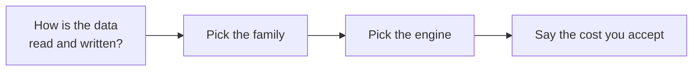

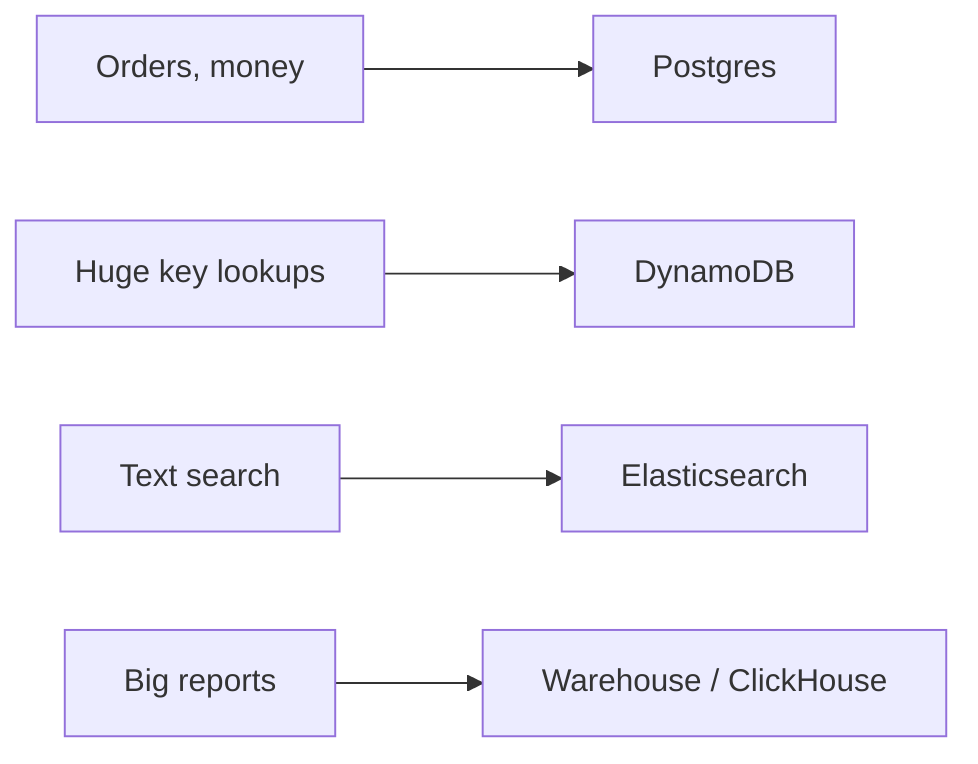

The rest of this note is just these 3 questions:
1. What does the data look like, and how is it read?
2. Which family and which engine fit that pattern?
3. When should you stay on Postgres, and when must you move?

**The problem in one story**

You are storing orders for a shop. Orders must never be lost or double-charged.
You also store a stream of clicks, millions per hour, where losing a few is fine.
One kind of database is great at the first job, another at the second. Choosing a database means matching the tool to the job.

**Words you need first**

| Word | Plain meaning | Tiny example |
|---|---|---|
| Relational (SQL) | Data in tables with rows, columns and joins | `orders` joined to `customers` |
| NoSQL | Non-table stores: key-value, document, wide-column, graph | DynamoDB, MongoDB, Cassandra |
| Transaction | Several changes that all happen or none happen | Debit A and credit B together |
| ACID | Guarantees of a transaction: atomic, consistent, isolated, durable | A crash never leaves half a transfer |
| Access pattern | The exact queries the app runs, and how often | "get orders by customer, newest first" |
| Index | An extra structure that makes a lookup fast | Index on `email` |
| Sharding | Splitting data across machines by a key | Users A-M on node 1, N-Z on node 2 |
| Replica | A copy of the data on another machine | Read replica for reports |

**Picture it**

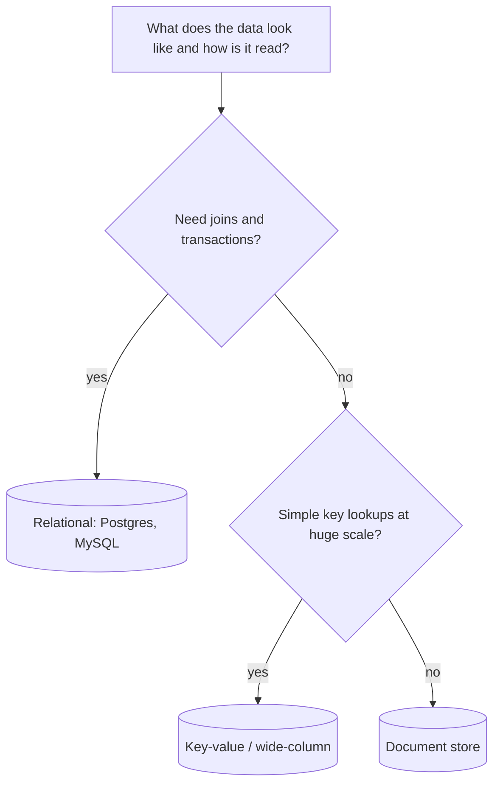

**Analogy**

Choosing a database is like choosing a vehicle: a truck carries heavy loads safely, a bike is fast in traffic, and nobody does both well.
Where it breaks: you can run several databases side by side and copy data between them, which you cannot do with one trip.

**How the rest of this note builds up**

- First, why many kinds of database exist and the five-question mental model (sections 1-2).
- Then how each family works and a worked example (sections 3-4).
- Next, variant comparisons, trade-offs and production lessons (sections 5-7).
- Finally, the SDE-3 deep dive on storage engines, consistency, scale thresholds and migration safety, then drills and interview questions (sections 8-12).

> [!tip] Remember
> State the access pattern first, then the database, then the cost you accept.

## 1. Why it exists 🟢

Imagine you are building a food delivery app. You hear four opinions in one meeting: "use MongoDB, it is flexible", "use Postgres, we know it", "use DynamoDB, it scales forever", "use Elasticsearch for restaurant search". All four are right for something, and wrong as the only database.

The cost of a wrong first choice is high. Moving 2 TB of live data between engines takes months, needs dual writes, and risks data loss. Discord moved its message store twice (MongoDB to Cassandra, then Cassandra to ScyllaDB) and wrote long posts about it, because each move was a major project.

This note is a map. It tells you which family of database fits which question so you can choose once and choose well.

> [!tip] Remember
> The database choice is a one-way door. Spend ten minutes on the access pattern before you spend ten months on a migration.

## 2. Mental model 🟢

Think of databases as **different kinds of storage rooms**.

- A **relational** database is a well-organised filing room with a cross-reference index: you can ask nearly any question, and rules keep files consistent, but the room is one building.
- A **key-value** store is a locker wall: give the exact locker number and you get the item instantly, but you cannot ask "which lockers contain red items".
- A **document** store is a locker that holds a whole folder of related papers.
- A **wide-column** store is a huge write-optimised mailroom that splits mail across many buildings by address.
- A **search engine** is a book index at the back of a book: it answers "which pages mention this word" fast.
- A **column store** is a warehouse that stores each attribute in its own aisle so counting one attribute across a billion rows is cheap.

The analogy breaks at consistency: a real filing room has no concept of two copies disagreeing, while distributed databases must decide what happens when they do.

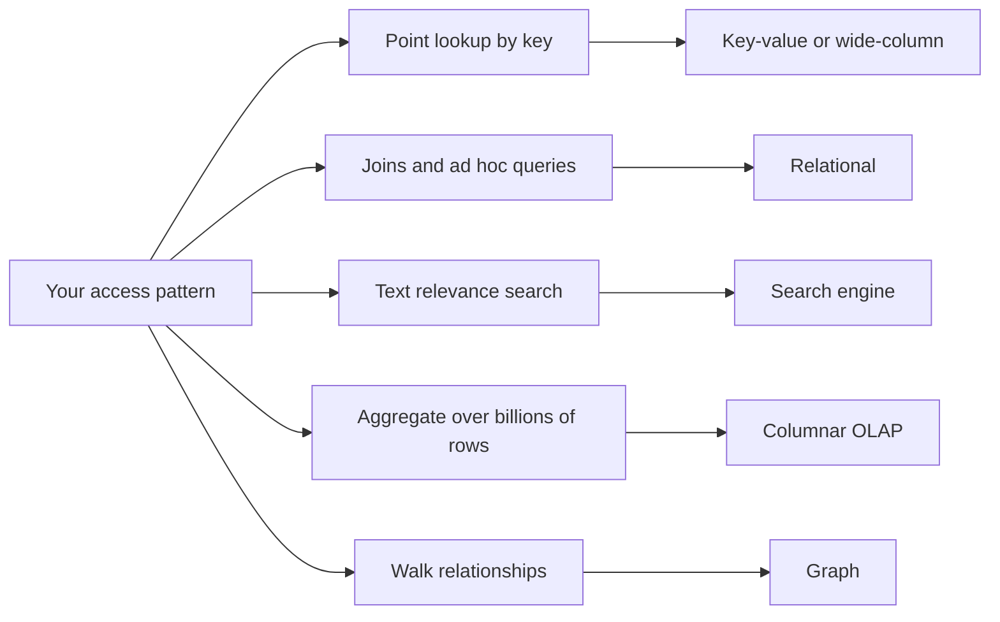

## 3. How it works 🟡

### The five questions

**In plain words:** Do not start from product names. Answer five questions about your data, and the shortlist writes itself.

1. **What is the shape of the data?** Rows with relations, nested documents, simple key to blob, time-stamped events, a graph?
2. **How will you read it?** By primary key only, by many different filters, by text, by aggregation?
3. **What must never go wrong?** Money and inventory need transactions and strong consistency. A like counter can be a little stale.
4. **How big and how fast?** One node holds a few TB and tens of thousands of simple queries per second. Beyond that you shard or pick a distributed engine.
5. **Who runs it?** A managed service (RDS, DynamoDB, Atlas) trades money for fewer 3 a.m. pages.

**Why it matters:** the order matters. Shape and read pattern decide the family; consistency and scale decide the product inside the family.

### The decision flowchart

**In plain words:** Answer one yes/no question at a time and follow the arrows. You end up at the family that fits.

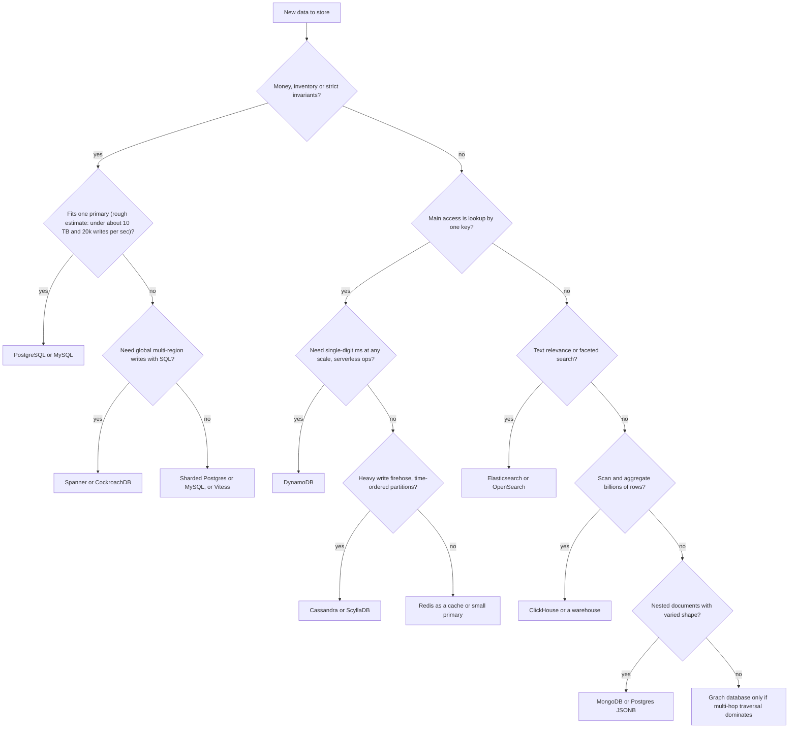

> [!tip] Remember
> The first fork is "do I need transactions and joins". If yes, you are in relational or NewSQL territory.

### Family map

**In plain words:** Each family stores data in its own shape: tables, documents, key and value, columns, or graphs. This table maps shape to tools.

| Family | Data model | Typical engines | Built for |
| --- | --- | --- | --- |
| Relational | Tables, foreign keys, SQL | PostgreSQL, MySQL | Transactions, joins, ad hoc queries |
| Document | JSON documents | MongoDB, Couchbase | Nested aggregates read as a unit |
| Key-value | Key to opaque value | Redis, DynamoDB, Riak | Lookup by key at low latency |
| Wide-column | Partition key plus sorted clustering columns |

Cassandra, ScyllaDB, HBase | Huge write volume, time-ordered reads per partition |
| Graph | Nodes and edges | Neo4j, Neptune | Multi-hop relationship queries |
| Time-series | Timestamp plus tags plus value | TimescaleDB, InfluxDB, Prometheus | Append-only metrics with retention |
| Search | Inverted index | Elasticsearch, OpenSearch, Solr | Relevance ranked text search |
| Columnar OLAP | Columns stored together | ClickHouse, BigQuery, Snowflake | Aggregations over huge tables |
| NewSQL | SQL on a distributed log | Spanner, CockroachDB, TiDB, YugabyteDB | SQL plus horizontal scale and multi-region |

## 4. Worked example 🟡

**Scenario: design storage for a food delivery app (restaurants, menus, orders, live driver location, search, analytics).**

Walk the data one entity at a time.

1. **Orders and payments.** Money, status transitions, joins to users and restaurants. Pick **PostgreSQL**. It gives ACID transactions, constraints and the ability to ask new questions later. A single primary handles this load for a long time (an estimate: a well-tuned instance does thousands of order writes per second).
2. **Restaurant menus.** Read-heavy, nested (menu, sections, items, options). Keep them in Postgres with JSONB for the flexible option parts, or in MongoDB if the team already runs it. The read path is cached in Redis.
3. **Driver location pings.** 100k drivers sending a ping every 4 seconds is 25k writes per second, mostly overwrites of "latest position". Use **Redis** (geo commands) for the latest position, and optionally append to **Cassandra** or a time-series store for history.
4. **Restaurant search ("pizza near me, open now, rated 4+").** Text plus filters plus geo. Use **Elasticsearch**, fed from Postgres by change data capture (see [[Transactional Outbox and CDC]]).
5. **Business dashboards.** "Orders per city per hour for 2 years" scans billions of rows. Use **ClickHouse** or a warehouse, loaded from the event stream.
6. **Sessions and rate limits.** Short-lived, key-based. **Redis** again.

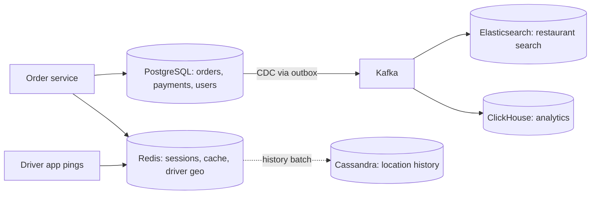

The point: one app, five engines, each chosen for one question. Only Postgres is the source of truth. Everything else can be rebuilt from it or from the event log.

> [!warning] Common mistake
> Making Elasticsearch or Redis the only copy of important data. Search indexes and caches are derived views. Keep the truth in a database with durable transactions.

## 5. Variants and comparison 🟡

### The comparison table

**In plain words:** The main engines side by side. Treat the numbers as rough sizes, not promises.

Numbers below are rough orders of magnitude for orientation. They come from public docs or typical benchmarks and are labelled as estimates, not guarantees. Always benchmark with your own data.

| Dimension | PostgreSQL / MySQL | MongoDB | DynamoDB | Cassandra / ScyllaDB | Redis | Elasticsearch | ClickHouse | Spanner / CockroachDB |
| --- | --- | --- | --- | --- | --- | --- | --- | --- |
| Model | Relational | Document | Key-value / wide item | Wide-column | In-memory structures | Inverted index | Column store | Relational (distributed) |
| Consistency | Strong on primary; replicas lag | Tunable; strong on primary reads | Eventual by default; strongly consistent read optional | Tunable per query (ONE, QUORUM, ALL) | Strong on one node; async replicas | Near real time (refresh default 1 s) | Eventual across replicas by default | Serializable or external consistency |
| Transactions | Full multi-statement ACID | Multi-document since 4.0 | Up to 100 items per transaction | Lightweight transactions only (Paxos) | MULTI and Lua on one shard | None across documents | None (not OLTP) | Full distributed ACID |
| Read latency (estimate) | 1 to 10 ms | 1 to 10 ms | Single-digit ms (documented goal) | 1 to 10 ms | Sub-ms to 1 ms | 10 to 100 ms | 10 ms to seconds per analytic query | 5 to 50 ms, more cross-region |
| Write scaling | Vertical plus shard it yourself | Native sharding | Automatic partitioning | Add nodes, linear | Redis Cluster slots | Add shards | Insert in big batches | Automatic range splits |
| Joins | Yes, rich | Limited ($lookup) | None | None | None | Limited | Yes, but analytic | Yes |
| Ordering | By index | By index | Sort key within partition | Clustering key within partition | Sorted sets | By score or field | By sorting key | By index |
| Ops cost | Low to medium (RDS, Aurora) | Medium (Atlas) | Very low (serverless) | High (repair, compaction, tuning) | Low to medium; memory is expensive | High (shards, heap, mappings) | Medium | Medium to high |
| Typical failure mode | Primary saturated; long transactions; replica lag | Unindexed queries; unbounded documents | Hot partition throttling; cost surprise | Tombstones, wide partitions, GC pauses | Out of memory; big keys; eviction surprises | Mapping explosion; split brain history; heap | Too many small parts; mutations are slow | Cross-region latency; contention on hot ranges |
| Wrong choice when | You need 500k writes per sec on one table without sharding | You need strict multi-entity transactions | You need ad hoc queries or joins | You need transactions or secondary-index-heavy queries | Data must survive without care and is bigger than RAM budget | It must be your system of record | You need single-row updates and low-latency OLTP | A single region and small scale suffice (you pay for what you do not need) |

> [!tip] Remember
> Read the "wrong choice when" row first. It is the fastest way to rule out an option.

### Relational: PostgreSQL vs MySQL

**In plain words:** Both are safe, proven choices. Postgres has more features; MySQL is simple and very common at big web companies.

Both are mature relational engines. Pick PostgreSQL for richer SQL (window functions, JSONB, partial indexes, extensions such as PostGIS) and strict correctness. Pick MySQL when the team knows it, or when you rely on its replication and tooling ecosystem (Vitess, ProxySQL).

Uber publicly described moving from Postgres to MySQL in 2016 because of write amplification in Postgres indexes and replication design at their scale. That is a case where a specific scale pattern drove the choice, not a general verdict.

Deep notes: [[Relational Schema Design]], [[SQL Essentials]], [[Indexing Fundamentals]], [[Isolation Levels and MVCC]].

### Document: MongoDB vs Postgres JSONB

**In plain words:** If you always load and save a whole record at once, a document store fits. But Postgres can store documents too, with transactions included.

If your document is read and written as one unit and fields vary per record, a document store fits. But Postgres JSONB covers many such cases with transactions and joins included, so "we need flexible schema" alone is not enough to leave Postgres. Pick MongoDB when you want native sharding and a document-first workflow. See [[NoSQL Data Modeling]].

### Key-value and wide-column

**In plain words:** These are giant, fast lookup tables. You must know your queries up front, because you cannot freely search or join later.

**DynamoDB** is the choice for known access patterns at any scale with almost no operations. You design tables from the queries (single-table design) and accept no ad hoc queries. **Cassandra and ScyllaDB** give the same Dynamo-style leaderless design you run yourself, with a cheaper cost at very high volume and multi-region replication. See [[Wide-Column Stores and Cassandra]] and [[Quorums and Leaderless Replication]].

### Redis

**In plain words:** Redis keeps everything in memory, so it is very fast but limited by RAM. Great for caches, counters and leaderboards; not your main record of truth.

Redis is memory-first. Use it as a cache, session store, rate limiter, leaderboard or geo index. It can persist (RDB snapshots, AOF log) but you size it by RAM, so it is rarely the right home for large primary data. See [[Redis Use Cases]] and [[Redis Persistence - RDB and AOF]].

### Search and analytics

**In plain words:** Search engines find text. Analytics engines add up huge tables. Neither should be your main store for orders.

**Elasticsearch** answers relevance and filter queries over text. **ClickHouse** answers scan-and-aggregate queries over huge tables. Neither supports OLTP well. See [[Search Engines and Inverted Indexes]] and [[Time-Series and Columnar Storage]].

### NewSQL: Spanner and CockroachDB

**In plain words:** These give you SQL and safe transactions spread over many machines and regions. You pay for it in cost and slower writes.

Use them when you need SQL transactions **and** horizontal scale **and** multi-region writes. Spanner uses TrueTime (GPS and atomic clocks) for external consistency. CockroachDB runs serializable isolation by default on a Raft-replicated key space. The price is higher write latency (consensus round trips) and higher cost. See [[Distributed SQL]] and [[Consensus - Raft and Paxos]].

### Graph

**In plain words:** Use a graph database only for "friend of a friend of a friend" style questions. Simple follower lists work fine in normal tables.

Pick a graph database only when queries are multi-hop ("friends of friends who like X within 4 hops") and slow as joins. Many "social graph" problems are served by relational tables plus caches. Facebook's TAO is a cache layer over MySQL, not a graph database.

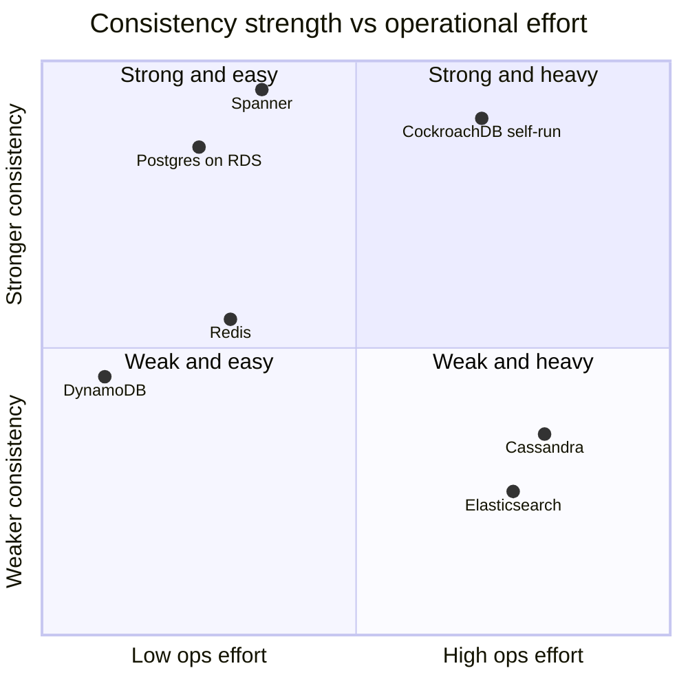

(The positions are a rough judgement, not measurements.)

## 6. Trade-offs 🟡

| Choice | You gain | You pay |
| --- | --- | --- |
| Stay on one Postgres | Simplicity, transactions, joins | A ceiling on write throughput and size without sharding |
| Shard Postgres or MySQL | Horizontal scale, SQL kept | Cross-shard joins and transactions become your problem |
| DynamoDB | No servers, predictable latency | Query flexibility; cost at high throughput; lock-in |
| Cassandra or ScyllaDB | Write throughput, multi-region, no single leader | Operations burden; denormalised tables per query |
| MongoDB | Flexible schema, native sharding | Easy to build unindexed or unbounded documents |
| NewSQL | SQL plus scale plus multi-region | Latency and cost of consensus |
| Polyglot persistence | Right tool per question | Sync pipelines, more on-call surface, eventual consistency between stores |

### When not to leave Postgres

**In plain words:** Postgres handles far more than most people think. Do not switch until you hit a real limit you can name.

- You have fewer than about 1 TB and a few thousand writes per second (an estimate, depends on hardware).
- Your queries change often and need joins.
- You do not yet know the access patterns. Relational is the most forgiving when you are still learning them.

> [!warning] Common mistake
> Choosing a NoSQL store "because it scales" before measuring. A single well-indexed Postgres node often outlasts the company's growth. Notion, for example, ran on a single Postgres instance for years before sharding it in 2021.

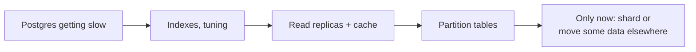

## 7. In production 🔴

### Real company examples

**In plain words:** Public stories of which company picked what, and why. Good proof points for an interview.

| Company | What they use | Why (as publicly described) |
| --- | --- | --- |
| Discord | MongoDB, then Cassandra, then ScyllaDB for messages | Cassandra fit time-ordered messages per channel; hot partitions and JVM garbage collection pauses pushed them to ScyllaDB (2023 post) |
| Uber | MySQL based Schemaless, earlier Postgres | Their 2016 post describes write amplification and replication issues with Postgres at their scale; Uber later also described ClickHouse for log analytics (Uber Engineering, 2021) |
| Instagram | PostgreSQL logical shards (Cassandra was added for some other workloads later) | 2012 post describes thousands of logical shards mapped to a few Postgres servers, with IDs generated inside Postgres |
| Netflix | Cassandra for many services | Multi-region active-active, high availability over strict consistency |
| Notion | Sharded PostgreSQL | 2021 post describes sharding by workspace id across many Postgres instances |
| Cloudflare | ClickHouse for HTTP analytics | 2018 post: moved analytics from Postgres and Citus to ClickHouse for ingest and query speed |
| Amazon | Dynamo (2007 paper), whose design inspired DynamoDB | Always-writable shopping cart, availability over consistency (2007 paper) |
| Google | Spanner | Global consistent transactions for the ads backend (OSDI 2012 paper) |
| Stripe | A custom document database layer built on MongoDB | Publicly described as DocDB; details in Stripe engineering talks |

> [!note]
> Company choices are time-stamped. They tell you what pressure led to a choice, not what you should copy. Read the source posts for the actual numbers.

### Failure modes and what to watch

**In plain words:** Each engine has its own typical way of getting sick. This table tells you which number to watch for each.

| Engine | Watch this | Why |
| --- | --- | --- |
| PostgreSQL | Replica lag, connection count, long transactions, autovacuum | Bloat and lag degrade everything. See [[Connection Pooling]] |
| MongoDB | Slow query log, index hit ratio, chunk balance | Missing index means collection scan |
| DynamoDB | Throttled requests, hot partition keys | One hot key caps throughput. See [[Hot Keys and Hot Partitions]] |
| Cassandra | Pending compactions, tombstone warnings, p99 read latency | Deletes create tombstones that slow reads |
| Redis | Used memory, evictions, slow log, big keys | One slow command blocks others |
| Elasticsearch | Heap use, shard count, indexing queue | Too many small shards hurt |
| ClickHouse | Parts count per partition, merge backlog | Many small inserts create too many parts |

## 8. Deep dive 🔴

### Why the engine type follows the storage engine

**In plain words:** Under the hood, some databases are tuned for fast reads (B-trees) and some for fast writes (LSM trees). That one choice shapes everything else.

Relational engines such as Postgres and InnoDB use **B-trees**: reads are fast, in-place updates cost random IO. Cassandra, ScyllaDB, RocksDB and many others use **LSM trees**: writes go to a memory table and an append-only log, so writes are fast, and reads may check several files.

This is why Cassandra absorbs write firehoses and why it needs compaction. See [[Storage Engines - B-tree vs LSM and WAL]].

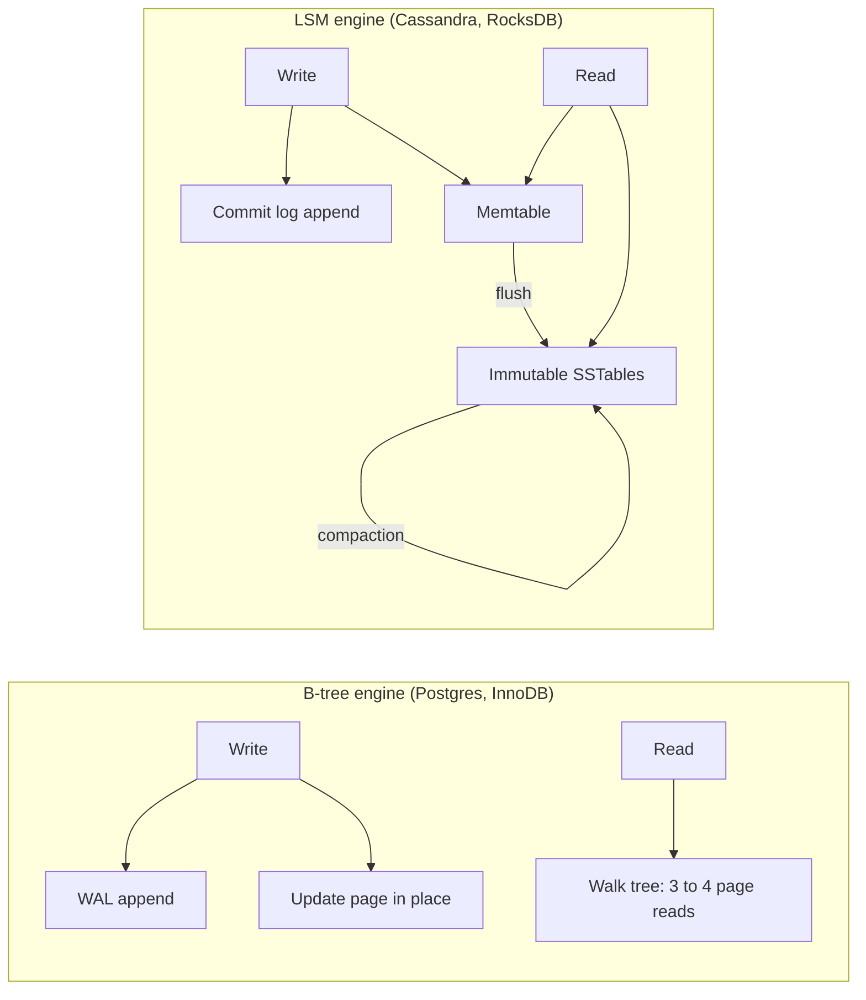

### Consistency choices in plain terms

**In plain words:** When machines cannot talk, you choose: wait for the right answer, or give a quick answer that may be old.

**CAP** says that during a network partition you pick between consistency and availability. **PACELC** adds that even without a partition you trade latency for consistency. Dynamo-style systems (DynamoDB default, Cassandra) lean to availability and low latency. Spanner, CockroachDB, and a single Postgres primary lean to consistency. See [[CAP and PACELC]] and [[Consistency Models]].

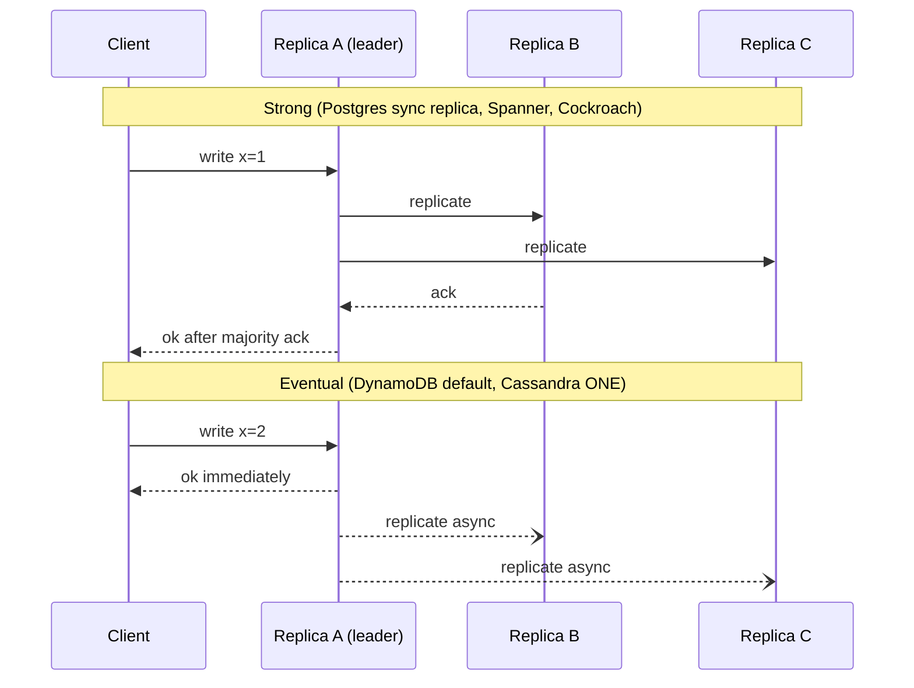

### Scale thresholds (estimates)

**In plain words:** Signs that tell you it is time for the next step, like adding replicas or splitting the data.

| Signal | Likely next step |
| --- | --- |
| Reads saturate one node | Add read replicas and a cache ([[Replication]]) |
| One table over a few hundred GB with slow queries | Partition it ([[Partitioning and Sharding]]) |
| Writes saturate the primary | Shard by a high-cardinality key, or move that workload to a partitioned store |
| Multi-region users need local writes | NewSQL or leaderless store ([[Multi-Region Architecture]]) |

### Migration safety

**In plain words:** Moving to a new database is copy, compare, then switch. Never switch in one big jump.

Whichever engine you add, move data with dual writes or CDC plus a backfill, compare, then switch reads. See [[Zero-Downtime Schema Migrations]] and [[Transactional Outbox and CDC]].

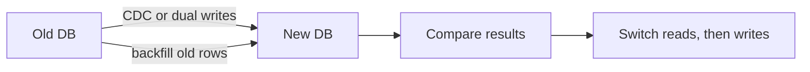

### Whiteboard version

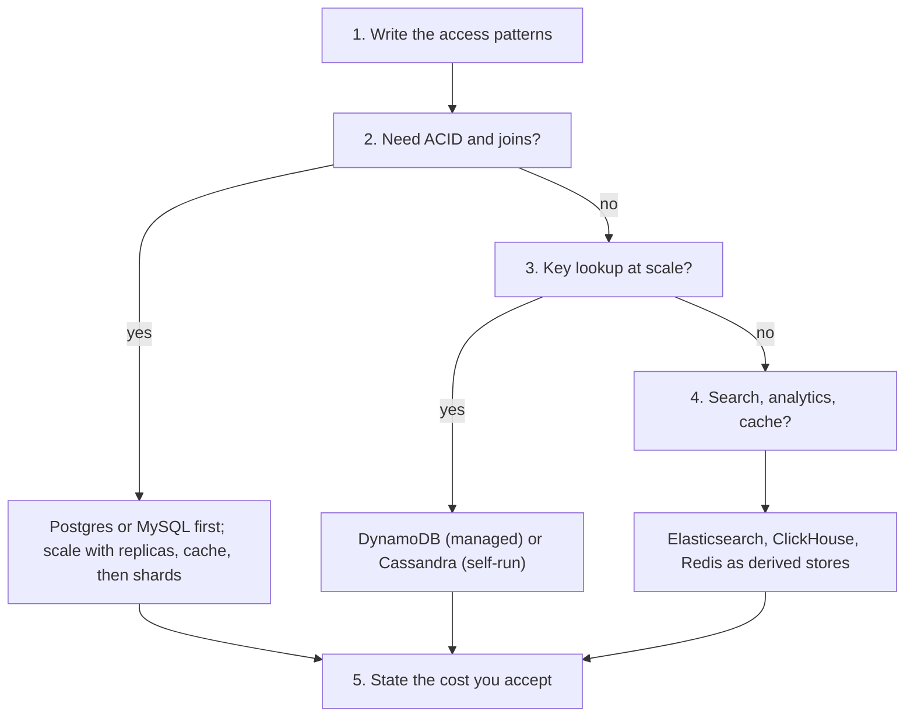

## 9. Scenario drills (scenario, choice, why) 🟡

| # | Scenario | Pick | Why | What to say in the interview |
| --- | --- | --- | --- | --- |
| 1 | Payment ledger | PostgreSQL (or Spanner at global scale) | Double-entry rows need ACID and constraints | "Money needs serializable transactions, so I keep it relational and shard by account if needed." |
| 2 | Chat messages | Cassandra or ScyllaDB (or DynamoDB) | Append-heavy, read by channel and time; partition by channel and time bucket | "I partition by channel plus a time bucket so no partition grows without bound. Discord does the same." |
| 3 | Shopping cart | DynamoDB or Redis | Key lookup by user, high availability, tolerates stale reads | "Cart is a per-user key, so a Dynamo-style store; this is what Dynamo was built for." |
| 4 | Product catalogue with varied attributes | MongoDB or Postgres JSONB, plus Elasticsearch for search | Variable fields, nested options | "Document store for the product, search index for discovery, both fed from one source." |
| 5 | Leaderboard | Redis sorted sets | Rank and score in O(log N), in memory | "ZADD and ZREVRANGE give top-K in log time, and I persist the scores elsewhere." See [[Case Study - Leaderboard and Top-K]]. |
| 6 | Clickstream analytics | Kafka into ClickHouse | Append-only, aggregate over billions of rows | "Events land in Kafka, then batch-insert into ClickHouse; OLTP is untouched." |
| 7 | Full-text restaurant search | Elasticsearch fed by CDC | Relevance, typo tolerance, filters | "Postgres is the source of truth; the index is rebuildable." |
| 8 | Metrics and monitoring | Time-series store (Prometheus, TimescaleDB, InfluxDB) | Time-stamped, retention policies, downsampling | "Write once, read by time range, with automatic expiry." |
| 9 | Global user profile, strong consistency, multi-region writes | Spanner or CockroachDB | SQL transactions across regions | "I accept cross-region commit latency to avoid conflict resolution in the app." |
| 10 | Social graph, friends of friends | Relational with caches first; graph DB only if hop depth is large | Two hops are cheap in SQL | "I start with adjacency tables and a cache; a graph DB only when multi-hop queries dominate." |
| 11 | Session store and rate limiter | Redis | TTLs, atomic counters, sub-ms | "Redis gives atomic INCR with expiry; losing it means users log in again, not data loss." |
| 12 | IoT sensor firehose, 1M points per second | Time-series or Cassandra plus a Kafka buffer | Append-only writes, time-partitioned | "Buffer in Kafka to absorb spikes, write time-bucketed partitions." |

## 10. How to say it in the interview 🔴

Use this four-part sentence:

1. **Access pattern:** "The dominant read is X by Y, and the dominant write is Z."
2. **Choice:** "So I'd use A."
3. **Reason:** "Because it gives guarantee G cheaply."
4. **Cost:** "I accept limit L, and if that bites at scale S, I'd move to B."

Example: "Orders are read by user and by id and written transactionally, so I'd use Postgres. It gives ACID and joins. I accept a single-writer ceiling; past about 10k writes per second I'd shard by user id."

Avoid:

- Naming a product without naming the access pattern.
- Saying "NoSQL scales better" without saying what you give up.
- Using one database for everything, or five databases for no stated reason.

## 11. Interview questions 🔴

> [!question]- Why would you start with PostgreSQL for a new product?
> It handles transactions, joins, JSON and full-text basics, so you can change queries as you learn them. One well-sized node serves most early products. You move a specific workload out only when a measured limit appears.

> [!question]- When is DynamoDB better than Postgres, and when is it worse?
> Better when access is by known key at huge scale and you want no servers to run: single-digit millisecond lookups and automatic partitioning. Worse when you need ad hoc queries, joins or multi-entity transactions beyond its 100-item transaction limit, or when a hot key can throttle you.

> [!question]- Cassandra or DynamoDB?
> Both use the Dynamo-style partitioned design. DynamoDB is managed and priced per request, so it suits teams that want low ops. Cassandra or ScyllaDB suits teams with the skills to run it and a very high steady volume where self-hosting is cheaper, or who need cloud neutrality. Discord chose to run ScyllaDB for cost and tail latency reasons.

> [!question]- Why not use Elasticsearch as the primary database?
> It is near real time (a document is visible after the refresh, 1 second by default), has no multi-document transactions, and recovery from corruption or mapping mistakes often means reindexing. Keep a durable source of truth and rebuild the index from it.

> [!question]- When do you need Spanner or CockroachDB?
> When you need relational transactions across partitions or regions, and a single-leader database cannot give users local writes. You pay with consensus latency and higher cost. If one region suffices, a single primary with replicas is simpler.

> [!question]- How do you keep several databases consistent with each other?
> Write to the source of truth, and publish a change event in the same transaction (transactional outbox) or read its log (CDC). Consumers update the search index, cache and warehouse idempotently. Accept that they lag by seconds.

## 12. Cheat sheet 🟢

- Start relational; leave only for a named, measured reason.
- Key lookups at huge scale: DynamoDB (managed) or Cassandra and ScyllaDB (self-run).
- Text search or relevance: Elasticsearch, as a derived index.
- Aggregations over billions of rows: ClickHouse or a warehouse.
- Cache, counters, leaderboards, sessions: Redis.
- SQL plus global scale: Spanner or CockroachDB, at a latency and cost price.
- Polyglot is normal; one source of truth, many derived views.
- Interview formula: access pattern, choice, reason, accepted cost.

## 13. Links 🟢

- Before this: [[SQL vs NoSQL]], [[Transactions and ACID]], [[System Design Interview Framework]]
- Relational depth: [[Relational Schema Design]], [[SQL Essentials]], [[Indexing Fundamentals]], [[Index Types and Index Design]], [[Query Plans and EXPLAIN]], [[Isolation Levels and MVCC]], [[Locking - Optimistic vs Pessimistic]]
- Scale: [[Replication]], [[Partitioning and Sharding]], [[Consistent Hashing]], [[Connection Pooling]], [[Distributed SQL]]
- Non-relational: [[NoSQL Data Modeling]], [[Wide-Column Stores and Cassandra]], [[Search Engines and Inverted Indexes]], [[Time-Series and Columnar Storage]], [[Storage Engines - B-tree vs LSM and WAL]]
- Derived data: [[Materialized Views and Denormalization]], [[Transactional Outbox and CDC]], [[Redis Use Cases]], [[Caching Patterns]]
- Theory: [[CAP and PACELC]], [[Consistency Models]], [[Quorums and Leaderless Replication]], [[Multi-Region Architecture]]
- Case studies: [[Case Study - Key-Value Store]], [[Case Study - Chat System]], [[Case Study - Payment System]], [[Case Study - Leaderboard and Top-K]]
- Next: [[Kafka vs RabbitMQ vs SQS - Choosing a Message Broker]]

## Links 🟢

### Watch on YouTube

- [Choosing a Database for Systems Design: All you need to know in one video](https://www.youtube.com/watch?v=6GebEqt6Ynk) · Jordan has no life · 23 min · 85,343 views
- [Database Design Tips / Choosing the Best Database in a System Design Interview](https://www.youtube.com/watch?v=cODCpXtPHbQ) · codeKarle · 23 min · 616,842 views
