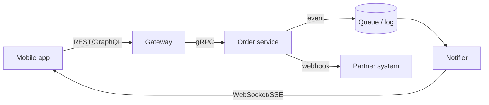
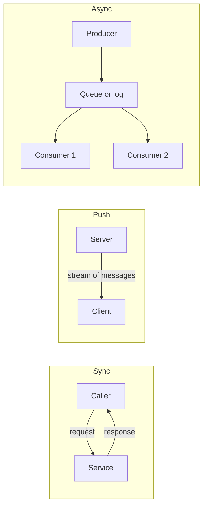
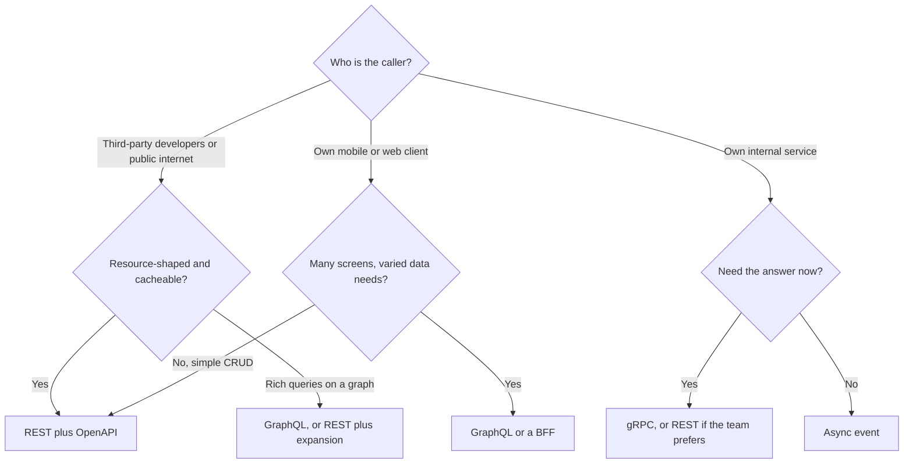
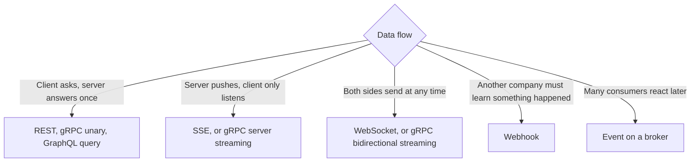
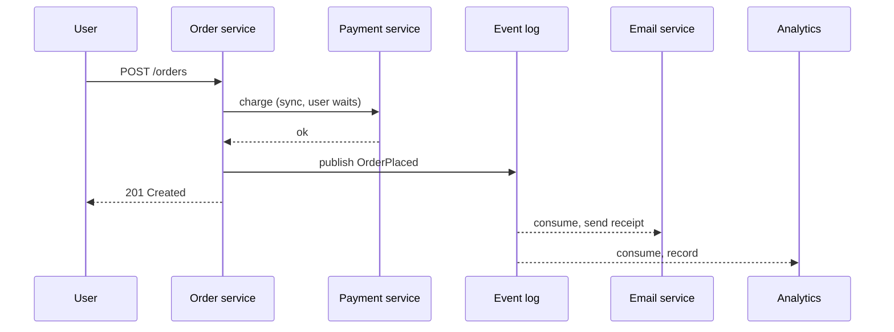
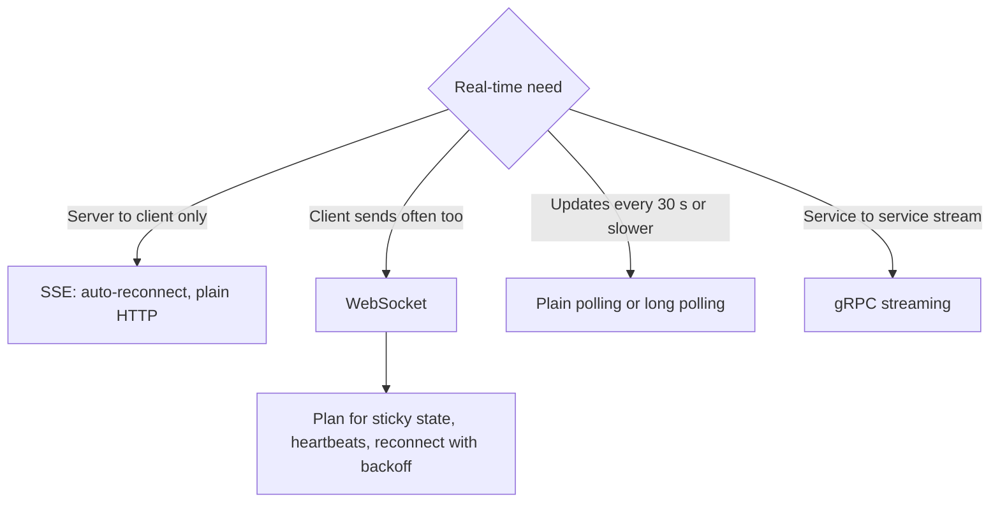
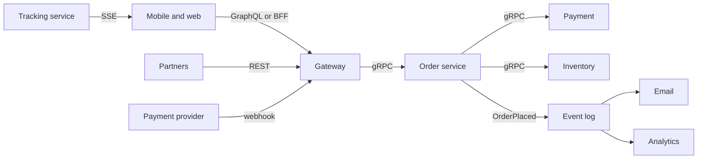
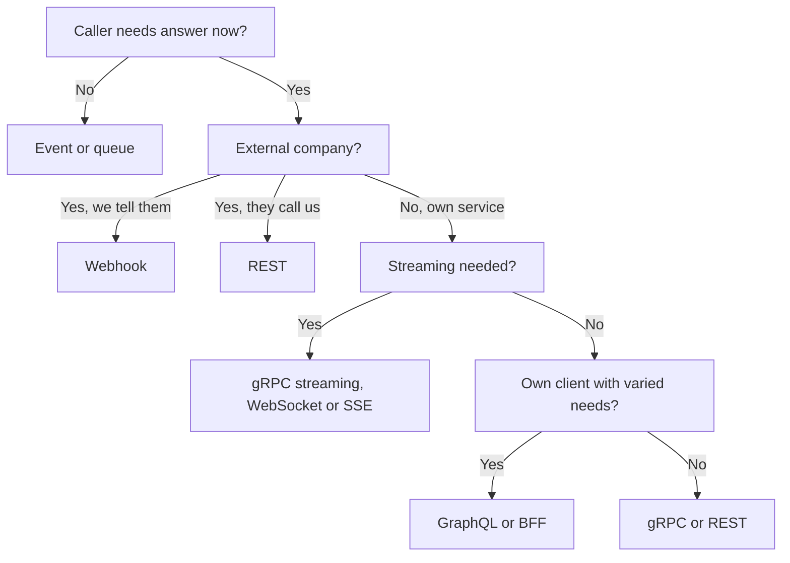
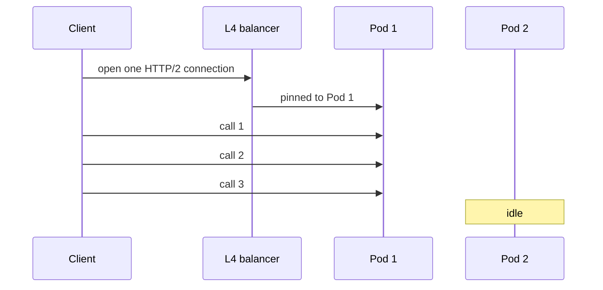

# Choosing an API and Communication Style - Decision Guide

> [!summary] TL;DR
> A **communication style** is how two parts of a system exchange data: who starts the call, whether the caller waits, and how long the connection lives. Decide in three cuts: **who is calling** (browser, mobile, your own service, another company), **which way data flows** (ask and answer, server push, two-way, event), and **does the caller need the answer now** (sync) or can it be told later (async). Default to REST for public resource APIs, gRPC between your own services, and events for anything that can happen later.

> [!abstract] Core idea
> - **REST** for public, cacheable, resource-shaped APIs. **gRPC** for internal service-to-service calls and streaming. **GraphQL** when many clients need different slices of the same data.
> - **WebSocket** for two-way, low-latency traffic (chat, games). **SSE** for one-way server push (notifications, live scores). **Webhooks** to tell another company that something happened.
> - **Async events** (queue or log) when the caller does not need the result now or when many consumers care.
> - Synchronous chains multiply failure and latency. Break them with events where the business allows.
> - Numbers here are estimates unless a source is named.

## Start here: the basics

**The problem in one story**

A food app needs to show a menu, let two services talk inside the company, push "your rider is near" to a phone, and tell a restaurant's own system about a new order.
Each of these is a different kind of conversation. Some ask and wait, some push, some just drop a note and move on.
Picking an API style means picking the right kind of conversation for each.

**Words you need first**

| Word | Plain meaning | Tiny example |
|---|---|---|
| API | The agreed way one program asks another for something | `GET /orders/42` |
| Synchronous | Caller waits for the answer before moving on | Checkout waits for the payment reply |
| Asynchronous | Caller sends a message and does not wait | Publish `OrderPlaced`; email sends later |
| REST | HTTP API built around resources and verbs | `POST /orders` |
| gRPC | Fast binary calls between services, with a typed contract | `OrderService.Get(id)` |
| GraphQL | Client asks for exactly the fields it wants in one query | `{ order { id total } }` |
| WebSocket / SSE | Long-lived connection so the server can push | Live score updates |
| Webhook | An HTTP call your system makes to another company's URL on an event | Payment provider calls `/payment-done` |

**Picture it**

**Analogy**

A phone call (synchronous: both wait on the line), a text message (async: reply later), and a radio broadcast (server push to whoever listens).
Where it breaks: a text can be lost silently, but a well-built queue keeps the message until a consumer handles it.

**How the rest of this note builds up**

- First, why many styles exist and a mental model of sync vs async (sections 1-2).
- Then how each style works (section 3) and a worked example (section 4).
- Next, comparisons, trade-offs and production lessons (sections 5-7).
- Finally, the SDE-3 deep dive on gRPC streams, webhook guarantees, the dual write trap and timeouts, then interview questions, cheat sheet and drills.

> [!tip] Remember
> Ask "does the caller need the answer now?" If no, use an event.

## 1. Why it exists

Take a food delivery app. The customer places an order and sees live courier location. The restaurant tablet gets the order. The payment provider calls back when the charge settles. The email service sends a receipt. The analytics team wants every event.

That is six different conversations, and one style does not fit all of them:

- The mobile app wants one fast call for the home screen, not 12 calls.
- The courier map wants a stream, not polling every second.
- The payment provider is another company, so it needs a callback.
- The receipt email can happen a few seconds late and must not block checkout.

Choosing wrong shows up as slow screens, fragile call chains, and outages that spread from one service to all.

> [!tip] Remember
> The style follows the conversation: who talks, which direction, how long they can wait.

## 2. Mental model

Compare ways of getting a pizza and its updates.

- **REST** is phoning the shop: ask a question, wait on the line for the answer.
- **gRPC** is a private hotline between two kitchens in the same company: fast, strict script.
- **GraphQL** is a custom order form: you tick only the fields you want.
- **WebSocket** is an open phone line both sides can speak on at any time.
- **SSE** is a radio broadcast: the shop talks, you listen.
- **Webhook** is the shop calling you back when the pizza is ready.
- **Async event** is dropping a note in the shop's order box and leaving.

The analogy breaks on failure: a phone call that drops tells you at once, while a note in a box can sit unread. Async needs explicit acknowledgements and retries.

## 3. How it works

### Step 1: who is the caller?

**In plain words:** the caller decides what you can use. Browsers speak HTTP and WebSocket well. Your own Go services can use any binary protocol. Other companies can only reach you through public, simple, documented endpoints.

### Step 2: which direction does data flow?

### Step 3: must the caller wait?

**In plain words:** if the user cannot proceed without the answer (the price, the login result), the call is **synchronous**. If the work can finish later (send an email, update a search index), make it **asynchronous**.

The user waits only for what must be true before the order exists (payment). The rest follows from the event.

**Example with numbers:** if checkout calls 5 services in a chain and each is 99.9 percent available, the chain is about 99.5 percent available (0.999 to the power 5), which is roughly 3.6 hours of downtime a month instead of 43 minutes (arithmetic). Each service moved behind an event removes one factor.

> [!warning] Common mistake
> Making everything async "for scalability". Async hides failures and makes the user experience harder: "Order placed" with no payment result is confusing. Keep sync where the user needs the answer.

### The comparison table

| Dimension | REST | gRPC | GraphQL | WebSocket | SSE | Webhook | Async events |
| --- | --- | --- | --- | --- | --- | --- | --- |
| Transport | HTTP/1.1 to 3 | HTTP/2, Protocol Buffers | HTTP POST (usually) | TCP upgrade from HTTP | HTTP, long-lived response | HTTP POST to the receiver | Broker protocol (Kafka, AMQP, SQS API) |
| Direction | Request and response | Unary and three streaming modes | Request and response (plus subscriptions) | Full duplex | Server to client | Server to server, you push | Producer to many consumers |
| Contract | OpenAPI (optional) | `.proto`, strict, generated code | Typed schema | None, you design it | None | Documented payload | Schema registry or convention |
| Latency (estimate) | Low | Lowest of the request styles | Low plus resolver cost | Lowest once connected | Low | Depends on retry schedule | Seconds or less, not request-bound |
| Caching | Native HTTP caching, CDN | Hard | Hard (POST), needs persisted queries | None | None | None | None |
| Browser support | Native | Needs gRPC-Web | Native | Native | Native (`EventSource`) | n/a | n/a |
| Consistency model | Per request | Per request | Per request | Per message you define | Per message | At-least-once with retries | Usually at-least-once |
| Scaling model | Stateless, easy | Stateless, needs L7 balancing per call | Stateless but query cost can explode | Stateful connections, harder | Stateful connections | Receiver controls rate | Partitions or queues scale consumers |
| Operational cost | Low | Medium (tooling, proxies) | High (query limits, N+1) | High (sticky state, reconnect) | Medium | Medium (retries, signing) | High (broker, DLQ, ordering) |
| Typical failure | Chatty calls, timeouts | Load balancer pinning one connection | Expensive nested queries | Idle timeouts, reconnect storms | Proxy buffering, 6-connection browser cap on HTTP/1.1 | Lost or duplicated callbacks | Duplicates, poison messages, lag |
| Wrong choice when | You need streams or tight binary contracts | Public third-party API or browser-first | Simple CRUD, heavy caching | One-way push only | Client must send frequent messages | You need a response in the same call | You need the answer right now |

Related deep notes: [[Choosing an API Style]], [[REST and HTTP API Design]], [[gRPC]], [[GraphQL]], [[Real-time APIs - WebSocket, SSE and Long Polling]], [[Webhooks - Sending and Receiving]].

### Step 4: pick the real-time option

**Example with numbers:** a delivery-tracking screen gets a location update every 3 s. SSE from the server is enough (one-way). Polling would mean about 20 requests per minute per user for the same data, and most would be answered with "no change".

### Step 5: pick the style for events

| Need | Choice |
| --- | --- |
| Simple job to run once, retry on failure | Queue (SQS, RabbitMQ) |
| Replay history, many independent consumers, ordering per key | Log (Kafka) |
| Tell an external company | Webhook with signing and retries |
| Orchestrate a long business process | Saga or workflow engine |

See [[Queues vs Streams and Broker Comparison]], [[Kafka and Event Streaming]], [[Delivery Semantics and Exactly-Once]] and [[Saga Pattern]].

## 4. Worked example

**Problem:** the API surface for the food delivery app. Pick a style per conversation.

1. **Mobile and web apps to backend.** Many screens need different slices (restaurant, menu, offers, ETA). Put a **BFF or GraphQL** layer in front so the home screen is one round trip. Plain REST would need many calls.
2. **Public partner API (restaurants and aggregators).** **REST with OpenAPI**: easy for outside developers, cacheable, versioned.
3. **Order service to payment, inventory, pricing.** Internal, latency-sensitive, strict contracts: **gRPC** with deadlines.
4. **Live courier location to the customer.** One-way push: **SSE** (or WebSocket if the customer can also chat with the courier).
5. **Restaurant tablet receiving orders.** The tablet needs low-latency pushes and acknowledgements: **WebSocket** with a fallback to push notification.
6. **Payment provider result.** The provider calls our **webhook**. We verify the signature, store the event ID, and answer `2xx` quickly ([[Receiving Webhooks Idempotently]]).
7. **Receipt email, loyalty points, analytics.** **Events** on a log after `OrderPlaced`; each consumer is independent.
8. **Duplicate safety.** The create-order call takes an `Idempotency-Key`, and consumers deduplicate by event ID ([[Idempotency and Idempotency Keys]]).

### Whiteboard version

> [!tip] Remember
> One system uses many styles. Choose per conversation, not per company.

## 5. Variants and comparison

### Sync versus async

| Dimension | Synchronous | Asynchronous |
| --- | --- | --- |
| Caller waits | Yes | No |
| Failure visibility | Immediate error | Delayed; needs DLQs and alerts |
| Coupling | Caller needs the callee up | Decoupled in time |
| Latency to the user | Sum of the chain | Only the sync part |
| Debugging | A single trace | Trace across a broker |
| Consistency | Easier to reason about | Eventual |
| Best for | Login, price, payment authorisation | Email, indexing, analytics, fan-out |

### Polling, long polling, SSE, WebSocket

| Style | Round trips | Server cost | Works through old proxies | Best for |
| --- | --- | --- | --- | --- |
| Polling | One per interval | Low per request, wasteful | Yes | Slow updates |
| Long polling | One per event | Held connections | Yes | Fallback |
| SSE | One connection | Held connection | Mostly (disable buffering) | Notifications, feeds |
| WebSocket | One connection, two-way | Held connection plus state | Sometimes needs config | Chat, collaboration, games |

### Putting a gateway in front

An API gateway can terminate TLS, authenticate, rate limit, and route REST, gRPC and WebSocket traffic. A BFF shapes responses per client. See [[API Gateway and BFF]].

## 6. Trade-offs

- **REST** is universal but can be chatty and over-fetch.
- **gRPC** is fast and typed but awkward for browsers and for caching. Long-lived HTTP/2 connections can pin traffic to a few backends behind a connection-level balancer ([[Load Balancing]]).
- **GraphQL** removes over-fetching but moves cost to the server: unbounded nested queries, N+1 resolvers ([[N+1 Query Problem]]), and little HTTP caching. Set depth and cost limits.
- **WebSocket** gives the best interactivity but makes servers stateful: memory per connection, sticky routing, reconnect storms ([[Scaling WebSockets]]).
- **Webhooks** push the retry and ordering problem to both sides; the receiver must be idempotent.
- **Async** buys resilience and costs observability and simplicity.
- **When not to use each:** no gRPC for a public third-party API; no GraphQL for 5 simple endpoints; no WebSocket for one-way updates; no async where the user needs the result.

> [!warning] Common mistake
> Calling REST "stateless so it scales" and WebSocket "does not scale". Both scale; WebSocket just needs more care because the server holds state per connection.

## 7. In production

Public, documented examples:

- **Stripe** exposes a REST API with idempotency keys for safe retries and sends events to customers by webhooks with signed payloads (Stripe docs).
- **GitHub** offers both a REST API and a GraphQL API, so clients choose between simple resource calls and one query for nested data (GitHub docs).
- **Slack** delivers events to apps over HTTP (Events API) or over a WebSocket (Socket Mode) for apps that cannot expose a public URL (Slack docs).
- **Kubernetes** clients use HTTP watch for change streams on the API server, and **etcd**, its store, exposes a gRPC API (Kubernetes and etcd docs).
- **LinkedIn** created Kafka for activity-stream and log pipelines, which is the origin of the event-log style (Kafka NetDB 2011 paper).
- **AWS SQS** standard queues deliver at least once, so consumers must tolerate duplicates (AWS docs).

What to watch:

| Concern | Signal | Fix |
| --- | --- | --- |
| Sync chain slow | p99 latency per hop in traces | Deadlines, parallel calls, move work to events |
| Retry storms | Request rate spikes after a failure | Exponential backoff with jitter, circuit breaker |
| WebSocket drops | Idle connection closures (ALB idle timeout default is 60 s) | Heartbeats every 20 to 30 s |
| Webhook failures | Non-2xx rate, retry queue age | Return 2xx fast, process async, replay tool |
| Consumer lag | Offset lag or queue age | Scale consumers, fix slow handlers |
| GraphQL cost | Slow resolvers, deep queries | Query cost limits, persisted queries, dataloaders |

See [[Circuit Breaker]], [[Backpressure and Flow Control]], [[Dead Letter Queues and Poison Messages]].

## 8. Deep dive

### Why gRPC streams can overload one pod

gRPC multiplexes many calls over one long-lived HTTP/2 connection. A layer 4 load balancer picks a backend once per connection, so one client can send all its calls to one pod. Use a layer 7 balancer, client-side balancing or a mesh to spread per-call traffic.

### Webhook delivery guarantees

A webhook sender retries until it gets `2xx`, so delivery is at least once and may reorder. Receivers verify a signature, record the event ID, return `2xx` quickly, and process in the background. Always offer a way to re-fetch the object by ID.

### Events versus commands

A **command** asks one service to do something ("charge this card"), so it is a request and usually sync. An **event** states that something happened ("OrderPlaced"), so the producer does not know who listens. Mixing them leads to hidden coupling.

### The dual write trap

If a service writes to its database and then publishes an event, a crash between the two loses the event. The [[Transactional Outbox and CDC]] pattern writes the event in the same transaction and publishes it from there.

### Timeouts everywhere

Every sync call needs a deadline shorter than its caller's deadline, or the chain of waiting requests exhausts threads and connections. Propagate deadlines (gRPC does this natively with `context`).

> [!tip] Remember
> Sync needs deadlines and circuit breakers. Async needs idempotent consumers and a dead-letter queue.

## 9. Interview questions

> [!question]- REST, gRPC or GraphQL for a new service?
> Public or partner callers: REST with OpenAPI, since it is simple, cacheable and universal. Internal service to service: gRPC for speed, strict contracts and deadlines. Many client apps needing different shapes of the same data: GraphQL or a BFF. I pick by caller, then by data shape.

> [!question]- WebSocket or SSE for live updates?
> SSE if only the server sends: it is plain HTTP, reconnects automatically and is easier to run. WebSocket if the client also sends frequent messages, as in chat or collaboration. Either way I plan heartbeats, reconnect with backoff and how connections spread across servers.

> [!question]- When would you make a call asynchronous?
> When the user does not need the result to proceed and the work can be retried safely: emails, search indexing, analytics, notifications. I keep the authorisation or validation that determines the user's outcome synchronous, and publish an event for the rest.

> [!question]- What are webhooks and what can go wrong?
> They are HTTP callbacks that tell another system something happened. Delivery is at least once, so duplicates and out-of-order events occur. The receiver verifies the signature, deduplicates by event ID, answers quickly and processes in the background.

> [!question]- How do you stop a synchronous chain from taking everything down?
> Deadlines on every call, retries with backoff and jitter only for idempotent operations, circuit breakers, bulkheads, and moving non-essential calls behind events so a slow downstream does not block the user path.

> [!question]- How would you design the API for a mobile app with 10 screens?
> A BFF or GraphQL layer returns exactly what each screen needs in one call. Behind it, services talk over gRPC. I would add pagination, field limits and caching at the BFF, and keep a REST API for partners.

> [!question]- Why not use GraphQL everywhere?
> HTTP caching is weak, nested queries can be expensive, authorisation is per field, and the server needs cost limits. For simple CRUD or public cacheable data, REST is cheaper to run.

## 10. Cheat sheet

- External developers: REST. Internal services: gRPC. Many shapes for many clients: GraphQL or BFF.
- Server to client only: SSE. Two-way: WebSocket. Tell another company: webhook.
- Answer needed now: sync. Can happen later or has many reactors: events.
- Sync needs deadlines, backoff with jitter, circuit breakers.
- Async needs idempotent consumers, DLQs, lag alerts.
- Webhooks are at-least-once, so verify, dedupe, answer fast.
- Use the outbox pattern to avoid dual-write loss.
- Pick per conversation; real systems mix styles.

## Real-life scenario drills

| Scenario | Choice | Why | What you say in the interview |
| --- | --- | --- | --- |
| Public API for partners | REST plus OpenAPI, versioned | Universal, cacheable, easy to document | "Third parties need the simplest, most cacheable contract." |
| Order service calling payment | gRPC with a deadline | Internal, latency-sensitive, strict types | "Typed contract and deadline propagation between our services." |
| Mobile home screen | GraphQL or BFF | Avoids 10 round trips | "One request shaped for the screen over a slow network." |
| Live delivery tracking | SSE | One-way, auto-reconnect | "Server pushes only, so SSE beats WebSocket on simplicity." |
| Chat messages | WebSocket | Two-way, low latency | "Both sides send at any time; I will add heartbeats and reconnect." |
| Payment provider result | Webhook plus reconcile job | They are external, retries happen | "Verify signature, dedupe by event ID, and reconcile by polling for gaps." |
| Receipt email | Queue or event | Not on the user's path | "Emit OrderPlaced; email service consumes and retries independently." |
| Clickstream analytics | Kafka log | High volume, replay, many consumers | "A log with partitions by user ID so consumers scale and can replay." |
| Stock price ticker to browsers | WebSocket or SSE with fan-out | Many subscribers, push | "Fan-out through pub/sub behind the connection servers." |
| Long business flow (booking) | Saga or workflow engine | Several steps and compensations | "Orchestrate with events and compensating actions, not one distributed transaction." |

## How to say it in the interview

- "I choose the style per conversation. For partners, REST. Between our services, gRPC with deadlines. For the mobile app, a BFF."
- "The user waits only for what must be true before the order exists: payment. Everything else is an event."
- "I use SSE for one-way updates because it is plain HTTP and reconnects on its own; I would move to WebSocket only if clients also send often."
- "Webhooks are at least once, so the receiver verifies and deduplicates."
- "The cost of async is eventual consistency and harder debugging, so I add tracing across the broker and a dead-letter queue."
- Trade-off line: "gRPC gives me speed and contracts but costs browser support, so I keep REST at the edge."

## Links

- Before this: [[Choosing an API Style]], [[Event-Driven Architecture Basics]]
- APIs: [[REST and HTTP API Design]], [[gRPC]], [[GraphQL]], [[Real-time APIs - WebSocket, SSE and Long Polling]], [[Webhooks - Sending and Receiving]], [[API Gateway and BFF]], [[Idempotency and Idempotency Keys]], [[Protocol Buffers and Schema Evolution]], [[API Versioning and Backward Compatibility]]
- Messaging: [[Queues vs Streams and Broker Comparison]], [[Kafka and Event Streaming]], [[Delivery Semantics and Exactly-Once]], [[Transactional Outbox and CDC]], [[Dead Letter Queues and Poison Messages]], [[Backpressure and Flow Control]], [[AWS SQS, SNS and EventBridge]], [[Workflow Engines and Durable Execution]]
- Resilience and scale: [[Saga Pattern]], [[Circuit Breaker]], [[Load Balancing]], [[Scaling WebSockets]], [[Receiving Webhooks Idempotently]], [[WebSockets and SSE in Go]]
- Related decisions: [[Choosing a Caching Strategy - Decision Guide]], [[Kafka vs RabbitMQ vs SQS - Choosing a Message Broker]], [[HLD Trade-offs Master Cheat Sheet]], [[System Design Interview Framework]]

### Watch on YouTube

- [Top 6 Most Popular API Architecture Styles](https://www.youtube.com/watch?v=4vLxWqE94l4) · ByteByteGo · 4 min · 1,183,838 views
- [Every Popular API Style Explained... Like You're 5](https://www.youtube.com/watch?v=xJFzPSAw4Fo) · Code Wrap · 8 min · 74,252 views
