# HLD Round - Complete Step-by-Step Guide

> [!summary] TL;DR
> A high-level design (HLD) round is a 45 to 60 minute conversation where you design a large system on a whiteboard. This guide is the minute-by-minute playbook: what to ask, what to calculate, what to draw, what to say at each step, what interviewers score at SDE-2, SDE-3 and Staff level, and how to answer "what if traffic grows 10 times?". It goes deeper than [[System Design Interview Framework]], which gives the outline; this note gives the scripts.

> [!abstract] Core idea
> - The round is judged on **how you decide**, not on which boxes you draw. Every box must trace back to a requirement or a number.
> - Work in nine steps: requirements, estimates, API, data model, simple design, deep dives, scaling, reliability and security, wrap-up.
> - Spend 40 percent of the time on one or two deep dives chosen from the riskiest non-functional requirement.
> - Say every decision as "I pick X over Y because Z, and the cost is W".
> - A working simple design first; complexity only when a number demands it.

## Start here: the basics 🟢

> [!info] How to read this note (pick your level)
> - 🟢 **New to this?** Read "From zero" below, then sections 1, 2 and the cheat sheet (10). Stop there, that is a full first pass.
> - 🟡 **Know the basics?** Add section 3 (the nine steps), 4 (worked example) and 5 (what is scored, red flags, follow-ups).
> - 🔴 **Interview / SDE-3 prep?** Add 6, 7, 8 and 9. Headings are tagged 🟢🟡🔴 so you always know where you are.

**From zero, in 60 seconds** 🟢

In a system design round, the interviewer names an app ("design a food delivery app") and gives you about 45 minutes.
There is no single right answer. They watch how you think.
The trap is drawing boxes right away. You then build the wrong thing and run out of time.
So you follow the same steps every time: ask what it must do, guess the size, sketch a simple design, then go deep on the hardest part.
Every box you draw should point back to a need or a number. Every choice should come with its cost: "I pick X over Y because Z, and it costs W". That is called a **trade-off**.

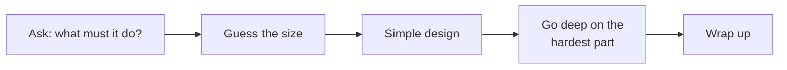

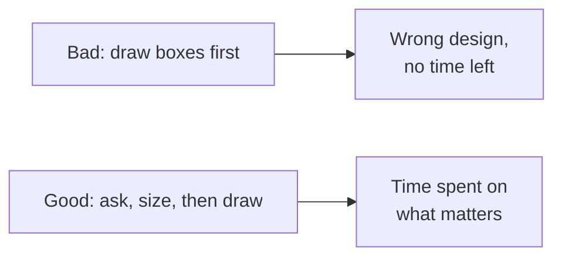

The rest of this note is just these 3 questions:
1. What do you do in each step, and for how many minutes?
2. What does a strong answer look like on a real example?
3. What do interviewers score at SDE-2, SDE-3 and Staff level?

**The problem in one story**

An interviewer says "Design a food delivery app" and gives you 45 minutes.
If you start drawing boxes at once, you will miss what matters and run out of time.
If you follow a fixed set of steps, you ask the right questions, size the system, and spend your time on the hardest part.

**Words you need first**

| Word | Plain meaning | Tiny example |
|---|---|---|
| HLD | High-level design: the big boxes and how they talk | Clients, gateway, services, DBs, queues |
| Functional requirement | What the system must do | "User can place an order" |
| Non-functional requirement | How well it must do it | "p99 under 200 ms, 99.9% uptime" |
| QPS | Queries (requests) per second | 1,750 orders per second at peak |
| Back-of-envelope estimate | Quick rough math to size the system | 10M orders/day ÷ 86,400 s ≈ 116/s |
| Deep dive | Zooming into the riskiest part in detail | How to assign riders without double booking |
| Trade-off | What you give up to get something | Faster reads, but data can be seconds stale |

**Picture it**

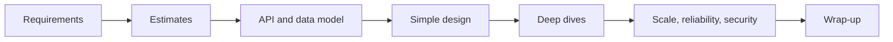

**Analogy**

The round is like a doctor's visit: ask about symptoms, take measurements, give a first diagnosis, then run detailed tests on the worrying part.
Where it breaks: a doctor has a lab, but you only have estimates, so you must say which numbers are guesses.

**How the rest of this note builds up**

- First, why the round exists and the mental model of what is judged (sections 1-2).
- Then the nine steps in detail (section 3) and a worked food delivery example (section 4).
- Next, variants of the round, trade-offs and what real teams care about (sections 5-7).
- Finally, the SDE-3 deep dive: phrasing bank, choosing the deep dive by problem type, and consistency, then interview questions and the cheat sheet (sections 8-10).

> [!tip] Remember
> Every box traces back to a requirement or a number; say "X over Y because Z, cost W".

## 1. Why it exists 🟢

Imagine two candidates asked to "design Instagram".

- Candidate A talks for 12 minutes about the tech stack (Kafka, Cassandra, Kubernetes), never asks who the users are, and cannot say how a photo reaches a follower's feed.
- Candidate B asks six questions in 4 minutes, finds out it is photo upload plus a home feed for 100 M daily users, computes about 1,150 uploads per second (assuming one upload per user per day), draws a simple flow, and then goes deep on feed fan-out with numbers.

Both know the technologies. Only B shows how they would behave on a real team: clarify the goal, size the problem, build the simplest thing that works, and reason about the hard part.

Companies use the HLD round because it is the closest cheap simulation of a design review. It reveals scoping, quantitative judgement, breadth of knowledge, depth in one area, and communication, all in 45 minutes.

> [!tip] Remember
> The interviewer is not grading a drawing. They are grading the conversation that produced it.

## 2. Mental model 🟢

Think of the round as **plan, build, stress, defend**.

| Phase | Real-world analogy | Your output |
| --- | --- | --- |
| Plan | A builder asks the client about family size and budget | Requirements and numbers |
| Build | The builder sketches the floor plan | A simple working design |
| Stress | The engineer asks "what if 10 floors are added?" | Deep dives and scaling |
| Defend | The builder explains why concrete and not wood | Trade-offs and failure handling |

Where the analogy breaks: a builder is not interrupted every five minutes. An interviewer will steer you; treat each interruption as new information about what they care about, not as an attack.

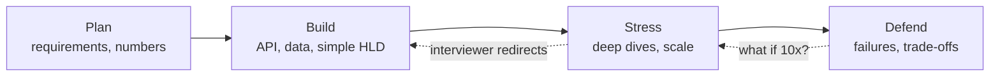

## 3. How it works 🟡

### The timebox

In plain words: the hour is short, so give every phase a budget and keep the deep dive biggest. The two budgets below are the defaults; shrink the early phases first if the interviewer jumps ahead.

```mermaid
gantt
    title 60-minute round versus 45-minute round (minutes)
    dateFormat  mm
    axisFormat  %M
    section 60 min
    Requirements            :a1, 00, 6m
    Estimates               :a2, after a1, 4m
    API and data model      :a3, after a2, 8m
    High-level design       :a4, after a3, 10m
    Deep dives              :a5, after a4, 20m
    Reliability and security :a6, after a5, 7m
    Wrap-up                 :a7, after a6, 5m
```

| Phase | 45 min | 60 min | Hard stop signal |
| --- | --- | --- | --- |
| 1 Requirements | 5 | 6 | You have 3-5 features and 3-4 numbers |
| 2 Estimates | 3 | 4 | QPS, storage, one more number tied to a decision |
| 3 API and data model | 5 | 8 | Endpoints and keys written |
| 4 High-level design | 8 | 10 | One write and one read traced end to end |
| 5 Deep dives | 15 | 20 | Two options per dive, one chosen |
| 6 Reliability, security, observability | 5 | 7 | Failure table and key metrics |
| 7 Wrap-up | 4 | 5 | 4-5 sentence summary |

> [!tip] Remember
> Put a clock on the table. At the end of each phase say the next phase out loud: "Requirements are done, let me do quick numbers."

### Step 1: Requirements (functional, non-functional, scale, SLA)

**In plain words.** Before drawing, find out what the system must do, how big it is, and how good it must be. The questions below are a script; adapt wording, keep the order.

**Picture it.**

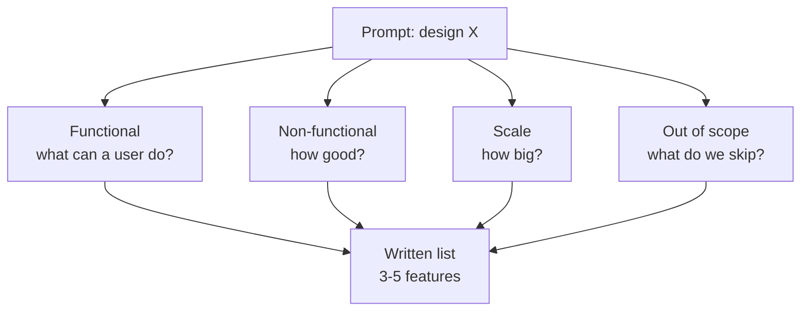

The exact questions to ask:

| Group | Question | Why you ask it |
| --- | --- | --- |
| Functional | "Who are the users and what are the 3 core actions?" | Defines the API |
| Functional | "Read-heavy or write-heavy?" | Drives cache and storage choices |
| Functional | "Is real-time needed, or is minutes of delay fine?" | Decides push vs poll vs batch |
| Functional | "Any search, notifications or payments?" | Surfaces hidden subsystems |
| Non-functional | "Latency target for the main path?" (p99 in ms) | Sets caching and placement |
| Non-functional | "Availability target?" (99.9 or 99.99) | Sets redundancy and failover |
| Non-functional | "Is stale data acceptable? For how long?" | Chooses consistency model |
| Non-functional | "Can we ever lose data or double-charge?" | Flags idempotency and durability |
| Scale | "Daily active users? Peak vs average?" | Feeds estimation |
| Scale | "One region or global?" | Decides multi-region work |
| SLA | "What happens if we are down for 10 minutes?" | Gives a business cost to downtime |
| Out of scope | "May I skip auth, admin tools, analytics?" | Protects your time |

**Example.** For "design a food delivery app": "Customers browse restaurants, order, pay and track the courier; restaurants accept orders; couriers get assigned. 5 M orders a day, peak 3x at dinner. Tracking updates within 5 seconds. Orders are never lost or double-charged. Out of scope: promotions engine, support chat."

**Why it matters.** Wrong scope is the most common reason a good design scores badly.

> [!warning] Common mistake
> Asking 20 questions. Ask 6 to 8, summarise the answers in a written list, and say "I will assume the rest, tell me if wrong". If the interviewer says "you decide", decide and state it.

### Step 2: Estimation

**In plain words.** Turn users into per-second numbers so each design choice has a reason. Estimate only what changes a decision. Method details live in [[Back-of-the-Envelope Estimation]].

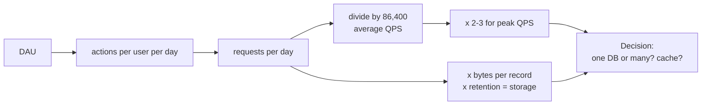

**Example (food delivery, all values are assumptions).**

| Number | Calculation | Result | Decision it drives |
| --- | --- | --- | --- |
| Orders per second | 5 M / 86,400 | about 58 average, about 175 peak | One primary DB can take writes; no sharding yet |
| Menu reads | 100 M views per day / 86,400 | about 1,150 average, about 3,500 peak | Cache menus |
| Courier pings | 200 k couriers online, 1 ping per 5 s | about 40 k writes per second | Not a SQL workload; in-memory geo index |
| Order storage | 5 M x 2 KB x 365 | about 3.6 TB per year | Fits a partitioned SQL store with archiving |

Round aggressively: 86,400 is about 10^5, so a million per day is about 12 per second. Use the latency table (RAM about 100 ns, SSD read about 100 microseconds, same-datacenter round trip about 0.5 ms, cross-continent about 150 ms; order-of-magnitude values) when reasoning about p99 targets.

**Why it matters.** "40 k writes per second of locations" is the sentence that justifies not using your main database for tracking.

> [!tip] Remember
> Every number ends with "so we need ...". A number without a consequence is wasted time.

### Step 3: API design

**In plain words.** List the calls clients make. Keep to 4 to 8 endpoints covering the functional requirements. Name the identifier, pagination style and idempotency for writes.

| Concern | What to say |
| --- | --- |
| Style | REST for public CRUD, gRPC between services, WebSocket or SSE for live updates (see [[Choosing an API Style]]) |
| Writes | `Idempotency-Key` header on anything that charges or creates ([[Idempotency and Idempotency Keys]]) |
| Lists | Cursor pagination, not offset ([[Pagination, Filtering and Sorting]]) |
| Evolution | `/v1` prefix, additive changes only ([[API Versioning and Backward Compatibility]]) |

```text
POST /v1/orders            {restaurant_id, items[], address}  -> 202 {order_id}   (Idempotency-Key)
GET  /v1/orders/{id}                                          -> {status, eta, courier}
GET  /v1/restaurants?lat=&lng=&cursor=                        -> {items[], next_cursor}
WS   /v1/orders/{id}/track                                    -> stream of {lat, lng, eta}
```

> [!tip] Remember
> The API is the contract the rest of the design must satisfy. If a requirement has no endpoint, you missed something.

### Step 4: Data model

**In plain words.** Name the entities, their keys, and how they are accessed. Choose the store by access pattern, not by habit. The decision guides for choosing databases and brokers sit in [[07 Databases MOC]] and [[09 Messaging & Async MOC]].

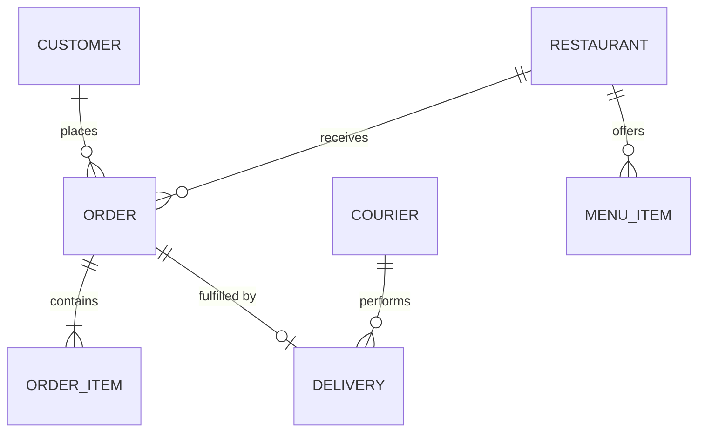

| Entity | Primary key and partition key | Access pattern | Store |
| --- | --- | --- | --- |
| Order | `order_id`, shard by `customer_id` or city | Read by id, list by customer | SQL |
| Menu item | `restaurant_id, item_id` | Read-heavy by restaurant | SQL plus cache |
| Courier location | `courier_id` | 40 k writes per second, nearby query | In-memory geo index |
| Events | `order_id` (ordering per key) | Append, replay | Log or broker |

**Why it matters.** The partition key chosen here decides your hot-spot problems later ([[Hot Keys and Hot Partitions]]).

### Step 5: The high-level diagram

**In plain words.** Draw the simplest design that satisfies every functional requirement. Then trace one write and one read through it, out loud. Resist adding components "for scale" yet.

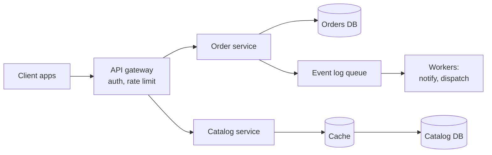

Walkthrough script, step by step:

1. "A client places an order. It hits the gateway, which authenticates and rate-limits."
2. "The order service writes the order row in one transaction and returns 202."
3. "It publishes an order-created event; workers handle notifications and dispatch off the request path."
4. "Reads of menus go to a cache first, then the catalog DB."

> [!warning] Common mistake
> Adding a box you cannot justify. Ask of each box: which requirement or number needs it? If none, remove it.

### Step 6: Deep dives

**In plain words.** Pick the hardest part, name two or three ways to solve it, choose one, and say what it costs. This is where SDE-3 is won or lost.

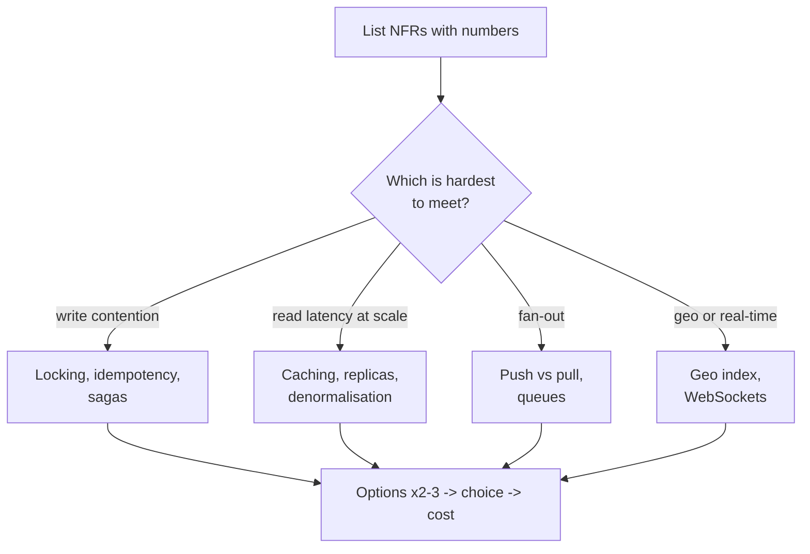

The deep-dive recipe, in four sentences you can literally say:

1. "The riskiest part is X because the requirement is Y at number Z."
2. "Option A does ... Option B does ... Option C does ..."
3. "I pick B because ..., and I accept that ..."
4. "That breaks when ..., and the next step would be ..."

**Example.** Courier assignment at 40 k pings per second. Option A: store pings in SQL (rejected, 40 k writes per second would dominate the primary). Option B: in-memory geo cells sharded by city (chosen, location is soft state refreshed every 5 seconds). Cost: a restart loses state for one ping interval. Full version in [[Case Study - Ride Sharing and Proximity]].

### Step 7: Bottlenecks and scaling

**In plain words.** Walk the request path and ask "what saturates first?" Then name the fix and the trigger for it.

| Layer | First thing to saturate | Fix | Trigger (state it) |
| --- | --- | --- | --- |
| Stateless services | CPU | Add replicas behind the load balancer ([[Load Balancing]]) | CPU above 60 percent at peak |
| Read path | DB read QPS | Cache, then read replicas | Cache hit rate and replica lag |
| Write path | Primary write throughput, disk | Partition by key ([[Partitioning and Sharding]]) | Write QPS near benchmarked limit |
| Hot keys | One shard hot | Key splitting, local cache | One shard above 3x median |
| Fan-out | Queue depth | More partitions and consumers | Consumer lag growing |
| Connections | DB connection count | Pooling ([[Connection Pooling]]) | Connections near `max_connections` |

> [!tip] Remember
> Scale in this order: stateless first, then cache, then replicas, then partitioning. Each step is more costly and harder to undo.

### Step 8: Reliability, failure handling, security, observability

**In plain words.** Show what breaks and what the user sees. Then show how you would find out and how you keep attackers out.

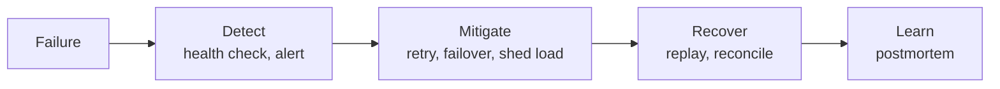

| Topic | What to say in 30 seconds |
| --- | --- |
| Failure of a dependency | Timeouts, retries with backoff and jitter, circuit breaker ([[Timeouts, Retries and Backoff]], [[Circuit Breaker]]) |
| Data loss | Replication, backups, point-in-time recovery |
| Duplicates | Idempotency keys, at-least-once plus dedup ([[Delivery Semantics and Exactly-Once]]) |
| Overload | Rate limiting, load shedding, graceful degradation ([[Load Shedding and Graceful Degradation]]) |
| Security | TLS, OAuth or JWT at the gateway, least privilege, secrets in a vault, rate limits for abuse ([[OWASP API Security Top 10]]) |
| Observability | RED metrics per service (rate, errors, duration), traces across services, SLO alerts ([[SLIs, SLOs, SLAs and Error Budgets]]) |

The four golden signals from the Google SRE book are latency, traffic, errors and saturation. Naming them shows you operate systems.

### Step 9: Wrap-up

**In plain words.** The last four minutes make the interviewer's notes easy to write. Summarise, name the weakest point and say what you would build next.

Script: "To summarise, we built X with A, B and C. The two key trade-offs were P over Q and R over S. The first thing to break at 10 times is T, and I would fix it with U. Monitoring: these three SLIs. If I had another week: V."

## 4. Worked example 🟡

### Whiteboard version

**In plain words:** The whole food delivery answer in one small sketch you could draw in the last 2 minutes.

```text
0-5    REQ   features(3-5) | NFR (p99, 99.9x, consistency) | scale (DAU, peak) | out of scope
5-9    EST   QPS avg/peak, storage/yr, one special number -> each ends "so we need ..."
9-17   API   4-8 endpoints, idempotency on writes, cursor pagination
       DATA  entities, PK, partition key, store per access pattern
17-27  HLD   gateway -> services -> DB/cache -> async events; trace 1 write + 1 read
27-47  DEEP  riskiest NFR: 2-3 options -> choose -> cost -> breaks when
47-54  SCALE bottleneck order; FAIL table; SEC; OBS (4 golden signals)
54-60  WRAP  summary, 2 trade-offs, first 10x bottleneck, next step
```

### Handling "what if traffic grows 10 times?"

**In plain words.** The interviewer wants to see that you know which parts scale linearly, which do not, and what you would measure first. Do not say "add more servers" and stop.

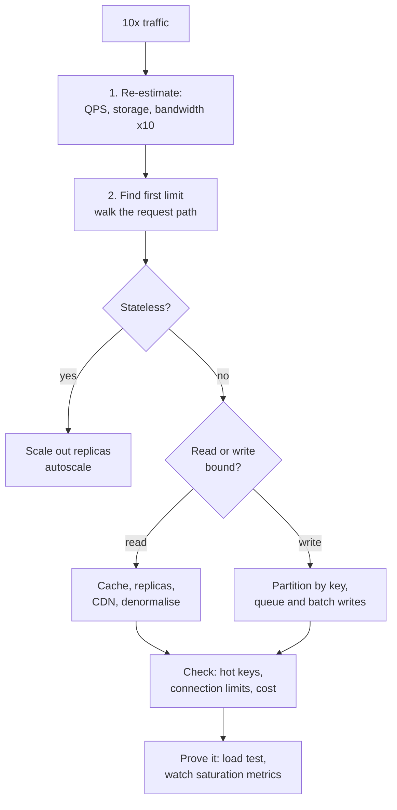

Worked numbers from the food delivery example: orders go from 175 to 1,750 peak per second.

Say: "One Postgres primary on good hardware commonly handles thousands of simple writes per second, 1,750 per second of multi-row order transactions leaves thin headroom on one node (this is an estimate, hardware dependent), so I would plan to partition orders by customer id into N shards, and I would validate that with a load test first."

The honest note on measured limits shows judgement.

Answer structure: re-estimate, find the first bottleneck, fix, check side effects (hot keys, connection counts, cost), prove with a load test.

## 5. Variants and comparison 🟡

### What interviewers score by level

**In plain words:** The same answer is judged more strictly as the level goes up. Senior levels must lead the talk and name the costs on their own.

| Dimension | SDE-2 | SDE-3 | Staff |
| --- | --- | --- | --- |
| Requirements | Asks sensible questions | Quantifies NFRs, states out of scope | Frames business constraints and cost |
| Estimation | Computes QPS | Every number drives a decision | Spots which number is wrong or sensitive |
| Design | Working design | Simple design that meets numbers | Several viable designs, migration path |
| Deep dive | Answers when asked | Chooses the riskiest area unprompted | Cross-team impact, build vs buy, org cost |
| Trade-offs | Names some | "X over Y because Z, cost W" every time | Ties trade-offs to business risk |
| Operations | Mentions monitoring | Failure modes, alerts, deploy and rollback | Multi-region, compliance, cost of ownership |
| Communication | Clear | Drives the session | Teaches the interviewer something |

This table is a rule of thumb from common industry practice, not a published rubric of any company.

### Red flags and the fix

**In plain words:** These are the habits that quietly sink a round. Each comes with a simple fix.

| Red flag | What it looks like | Fix |
| --- | --- | --- |
| Buzzword stacking | "Kafka, Redis, Cassandra, k8s" in minute 3 | Name the requirement before each component |
| No numbers | "It will be a lot of traffic" | Compute QPS and storage |
| Silent drawing | 3 minutes without speaking | Narrate every decision |
| Single point of failure ignored | One DB, no replica | Ask "what if this dies?" for every box |
| Over-engineering | Microservices for a 100 QPS system | State the trigger for splitting |
| Fighting hints | "No, my design is right" | Treat hints as changed requirements |
| No trade-offs | Only upsides | End every choice with its cost |

### Common follow-ups and short answers

**In plain words:** Questions you will almost surely hear, with the shape of a good short answer.

| Follow-up | Answer shape |
| --- | --- |
| "What if a region goes down?" | Active-passive or active-active, RTO and RPO, data replication lag ([[Multi-Region Architecture]]) |
| "How do you avoid double charging?" | Idempotency keys, unique constraint on the payment attempt, reconcile with the provider ([[Idempotency and Idempotency Keys]]) |
| "How do you keep cache consistent?" | TTL plus invalidate on write, accept bounded staleness ([[Cache Invalidation, TTL and Consistency]]) |
| "SQL or NoSQL?" | By access pattern, consistency and query needs ([[SQL vs NoSQL]]) |
| "How do you handle a hot partition?" | Detect, split the key, local cache ([[Hot Keys and Hot Partitions]]) |
| "How do you deploy safely?" | Canary, feature flag, backward compatible migrations ([[Zero-Downtime Schema Migrations]]) |

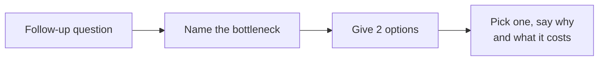

## 6. Trade-offs and when not to use 🟡

- **The 9-step flow is a default, not a script.** If the interviewer opens with "go deep on the matching algorithm", follow them and fold the other steps in later.
- **Depth beats breadth** once the simple design stands. Two dives with options and costs beat six boxes named.
- **Do not estimate what does not matter.** A write-only audit log needs storage, not cache size.
- **Do not pre-build for 100x.** State the trigger instead: "I will shard when write QPS passes what a load test shows one primary sustains".
- **Do not use a technology to look current.** A queue you can explain beats a streaming platform you cannot.

## 7. In production 🔴

- **Real design reviews** follow this order: context, requirements, numbers, options, decision, risks, monitoring. See [[Architecture Decision Records]].
- **Practice loop that works:** one problem per sitting against a timer; redraw from memory next day; explain one failure end to end; compare one alternative.
- **Common failures in a real round and the fix:**
  - Spent 15 minutes on requirements: set a 6-minute stop and write "assuming ..." for the rest.
  - Interviewer silent: keep going; silence is not disapproval.
  - Lost track mid-dive: say "let me restate where we are" and recap in two sentences.
- **What to track across practice runs:** time per phase, number of explicit trade-off sentences, number of boxes you could not justify.

## 8. Deep dive 🔴

### Phrasing bank

**In plain words:** Ready-made sentences for each moment of the round, so you sound clear and calm.

| Moment | Say this |
| --- | --- |
| Opening | "Before I design, I would like to clarify scope and scale." |
| Assuming | "I will assume 100 M DAU and 5 percent peak concurrency; correct me if that is off." |
| Choosing | "I pick A over B because the requirement is C, and the cost is D." |
| Not knowing | "I have not used that in production. My reasoning is ..., and I would verify by ..." |
| Redirected | "Good point, that changes the design in this way ..." |
| Checking in | "Does this level of detail work, or should I go deeper here?" |
| Closing | "The first bottleneck at 10 times would be X, fixed by Y." |

### Choosing the deep dive by problem type

**In plain words:** Each kind of system has one part most likely to break. Spend your deep-dive time there.

| System type | Usual riskiest part | Typical options |
| --- | --- | --- |
| Feeds and timelines | Fan-out | Push, pull or hybrid ([[Case Study - News Feed]]) |
| Booking and inventory | Contention | Holds with TTL, row locks, optimistic version ([[Case Study - Ticket Booking]]) |
| Payments | Duplicates and unknown outcomes | Idempotency, ledger, reconciliation ([[Case Study - Payment System]]) |
| Chat | Ordering and delivery | Per-conversation sequence, WebSockets ([[Case Study - Chat System]]) |
| Geo apps | Proximity at write volume | Geohash, H3, in-memory index ([[Geospatial Indexing]]) |
| Pipelines | Late and duplicate events | Windows, idempotent sinks ([[Case Study - Ad Click Aggregation]]) |
| Rate limiting | Distributed counters | Token bucket in Redis ([[Rate Limiting - Algorithms and Distributed Design]]) |

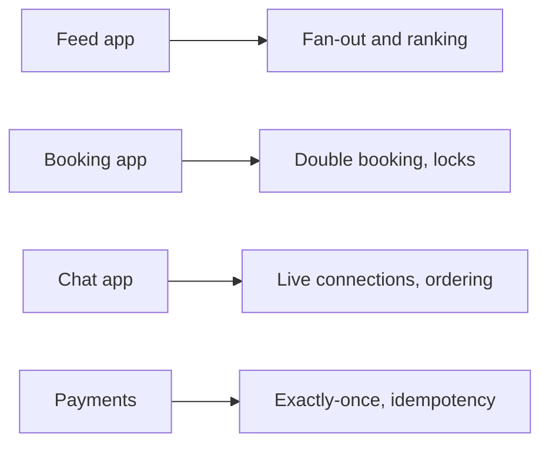

### Consistency decision in one picture

**In plain words:** Ask "what goes wrong if a user sees old data?" If the answer is "money or safety", pick strong; otherwise eventual is fine.

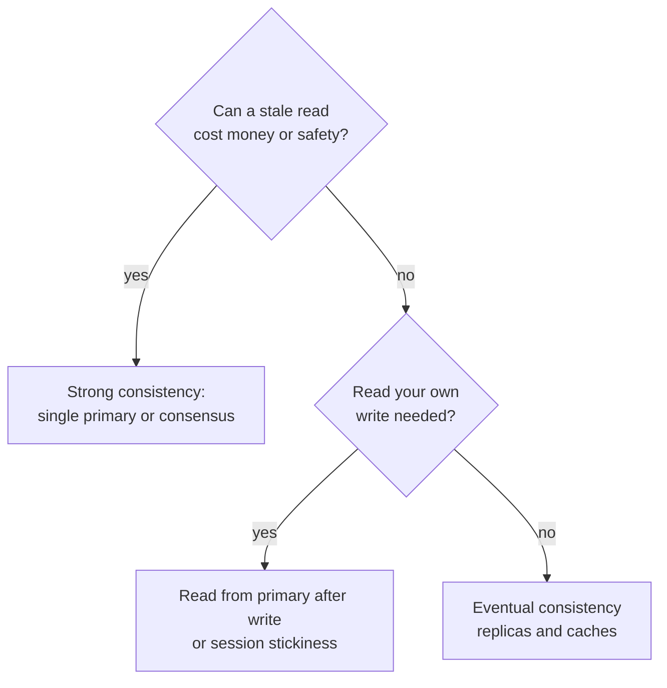

See [[Consistency Models]] and [[CAP and PACELC]] for the theory behind each branch.

## 9. Interview questions 🔴

> [!question]- Walk me through how you start a design interview.
> Clarify functional scope (3 to 5 features), non-functional targets with numbers (latency, availability, consistency), scale (DAU, peak, read to write ratio) and out of scope. Write them down, assume what is unspecified and say so. Then estimate only the numbers that change a decision.

> [!question]- How do you decide which part to deep dive on?
> Find the non-functional requirement hardest to meet at the stated scale: contention, fan-out, latency, geo, duplicates. Offer two or three options with costs, choose one, and name when it breaks. Choose it yourself before the interviewer asks.

> [!question]- The interviewer says "now 10 times the traffic". What do you do?
> Re-estimate QPS and storage, walk the request path to find the first saturation point, fix it in order (stateless scale-out, cache, replicas, partitioning), check side effects such as hot keys and connection counts, and say you would confirm with a load test and saturation metrics.

> [!question]- How do you show senior-level judgement rather than naming technologies?
> Tie every component to a requirement and a number, choose the simplest design that meets the numbers, state the trigger for the next step, and say the cost of each choice. Mention operations: deploys, migrations, alerts, on-call load.

> [!question]- What do you do when you get stuck or do not know a technology?
> Say so briefly, reason from first principles to a plausible design, and state how you would verify it. Interviewers prefer honest reasoning to confident guessing.

> [!question]- Trap: the interviewer asks "why not just use microservices from the start?"
> Because splitting costs network calls, partial failure, distributed transactions and operational overhead. Start with a modular service and split when a stated reason appears: independent scaling, team ownership, different release cadence, or fault isolation.

## 10. Cheat sheet 🟢

- Timebox: requirements 5, estimates 3-4, API and data 5-8, HLD 8-10, deep dives 15-20, reliability 5, wrap-up 4-5.
- Ask 6-8 requirement questions; write them; assume the rest out loud.
- Each estimate ends with "so we need ...".
- Trace one write and one read through the simple design.
- Deep dive recipe: riskiest part, 2-3 options, choose, cost, when it breaks.
- 10x: re-estimate, first bottleneck, scale in order, side effects, load test.
- Always say failure, security, observability (four golden signals).
- SDE-3 = drive, quantify, operate, keep it simple.

## Links 🟢

- **Before this:** [[System Design Interview Framework]], [[Back-of-the-Envelope Estimation]], [[Scaling Basics]]
- **Next:** [[HLD Round - Full Worked Mock (Food Delivery App)]] applies every step to one design
- **Theory behind decisions:** [[Queues vs Streams and Broker Comparison]], [[Caching Patterns]], [[Partitioning and Sharding]], [[Consistency Models]], [[CAP and PACELC]], [[Choosing an API Style]]
- **Case studies:** [[Case Study - URL Shortener]], [[Case Study - News Feed]], [[Case Study - Payment System]], [[Case Study - Ride Sharing and Proximity]]
- **Compare with:** [[LLD Round Playbook]], [[SDE-3 Readiness Checklist]]

### Watch on YouTube

- [Complete System Design Roadmap 2026 / HLD & LLD by Shradha Ma'am](https://www.youtube.com/watch?v=CuQmQpvw04I) · Apna College · 20 min · 795,135 views
- [How to crack HLD ( High Level Design) round in an interview? / System Design Interviews](https://www.youtube.com/watch?v=EB4XAkcz2Zw) · Recro · 3 min · 765 views
