# HLD Round - Full Worked Mock (Food Delivery App)

> [!summary] TL;DR
> A complete 60-minute HLD answer for "design a food delivery app" (think Swiggy, Zomato, DoorDash), written as a transcript with timestamps.
>
> At every decision point it lists the alternatives, the pick and the reason, and points to the note that teaches the choice.
>
> Use it as a model for pacing and phrasing, then redo it yourself against [[HLD Round - Complete Step-by-Step Guide]].

> [!abstract] Core idea
> - Three flows make the system: **browse** (read-heavy, cacheable), **order** (money, must not duplicate or be lost) and **deliver** (real-time, geo, write-heavy).
> - Each flow has a different store: SQL for orders, cache for menus, in-memory geo index for couriers.
> - The order lifecycle is a **saga** across payment, restaurant and courier, driven by events published through a transactional outbox.
> - The deep dives are courier matching and order consistency: the two places a mistake costs money.
> - Every figure below is an assumption stated to the interviewer, not a measured fact.

## Start here: the basics 🟢

> [!info] How to read this note (pick your level)
> - 🟢 **New to this?** Read "From zero" below, then sections 1, 2 and the cheat sheet (10). Stop there, that is a full first pass.
> - 🟡 **Know the basics?** Add section 3 (the minute-by-minute transcript and decision points), 4 (deep dive spoken, wrap-up) and 5.
> - 🔴 **Interview / SDE-3 prep?** Add 6, 7, 8 and 9. Headings are tagged 🟢🟡🔴 so you always know where you are.

> [!note] Before this note
> - [[HLD Round - Complete Step-by-Step Guide]]: the nine steps of the round, from requirements to wrap-up; this note runs them once on a real problem.
> - [[System Design Interview Framework]]: questions first, then numbers, a simple design, deep dives and trade-offs said out loud.
> - [[Geospatial Indexing]]: to find nearby riders fast, the map is cut into cells and you search your cell plus its neighbours.

**From zero, in 60 seconds** 🟢

This note is a full sample answer to "design a food delivery app", spoken minute by minute.
The app looks like one thing, but it is really three jobs.
Job one: show menus fast. Menus rarely change, so they come from a **cache** (a fast saved copy).
Job two: take orders and money safely. Nothing may be lost or charged twice, so orders go in a normal SQL database.
Job three: match a rider and show them moving on the map, live. Rider positions change every few seconds, so they live in fast memory.
The jobs talk through **events**: short "this happened" messages like "order paid".

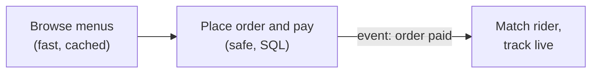

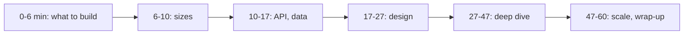

The rest of this note is just these 3 questions:
1. What do you say in each block of minutes?
2. Which choice do you make at each decision point, and why?
3. How do you handle scale, failures and follow-up questions?

**The problem in one story.**
You open a food app, scroll restaurants, order a biryani, pay, and watch a rider move on a map.
That feels like one app, but it is really three jobs: showing menus, taking money safely, and tracking riders live.
In an interview you get 60 minutes to design all three out loud.
This note is a full sample answer, minute by minute.

**Words you need first**

| Word | Plain meaning | Tiny example |
| --- | --- | --- |
| HLD (high-level design) | The boxes-and-arrows plan of a system, not the code | "App → API → Order service → Postgres" |
| QPS | Queries (requests) per second | 2,000 order QPS at dinner peak |
| Service | A separately deployed program owning one job | Order service, Courier service |
| Cache | A fast copy of data that is read often | Menus kept in Redis |
| Message broker | A system that carries events between services | Kafka topic `order-events` |
| p99 | 99 out of 100 requests are faster than this | menu p99 under 300 ms |
| Idempotency key | A unique ID sent with a request so a retry does not repeat it | the same "place order" sent twice makes one order |
| Outbox | A table written in the same transaction as the order; a relay publishes its rows as events | no event lost if the process dies |
| At-least-once | Every message arrives, but some may arrive twice | consumers must ignore repeats |
| Saga | A business process split into local steps, each with an undo step | pay, then refund if no courier |
| Cache-aside / TTL | Check the cache, on a miss read the DB and fill it / how long a cached copy lives | menus cached 5 minutes |
| Soft state | Data you can lose and rebuild quickly, so it needs no durable storage | rider's latest position |
| Shard key | The field that decides which machine holds the data | `city_id` for rider locations |
| Two-phase commit | Making several databases commit together through a coordinator | rejected: payment providers do not support it |
| Idempotent | Safe to repeat: doing it twice has the same effect as once | Retrying "create order" with the same key |
| Saga | A multi-step process where each step can be undone if a later step fails | Refund the payment if no courier is found |
| Geo index | A lookup that finds things near a location | "Couriers within 3 km" |

**Picture it**

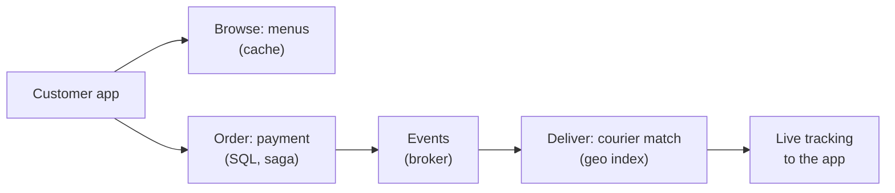

**Analogy.** A restaurant chain has a menu board (browse), a cash counter (order), and delivery riders with a dispatcher (deliver). Each runs differently but they pass tickets to each other.
Where it breaks: a real counter clerk can just shout to the kitchen; services must survive lost or duplicated messages.

**How the rest of this note builds up**

- First, why a worked mock helps and the three-flow mental model (sections 1-2).
- Then the transcript: requirements, estimates, API and data model, high-level design (section 3).
- Then each decision point: sync vs async, broker, outbox, courier locations, matching, the payment saga, tracking and menu caching.
- Finally the SDE-3 deep dive spoken out loud, scale and failure handling, wrap-up, variants and trade-offs (sections 4-8).

> [!tip] Remember
> Split the app into browse, order and deliver; give each the store and guarantees it needs, and justify every choice with a number.

## 1. Why it exists 🟢

Reading about decisions in isolation (cache vs no cache, queue vs stream) does not teach you how to chain them under a clock. This note shows one design where each choice constrains the next.

Example of chaining: because we chose to keep courier locations in memory (decision 5), we cannot rely on the database for "nearest courier" (decision 6), which forces a geo-cell index (decision 7), which must be sharded by city, which in turn fixes the partition key for the whole dispatch service.

A mock that shows only the final diagram would hide exactly this reasoning, which is what the interviewer scores.

> [!tip] Remember
> Decisions are connected. State the consequence of each one on the next.

## 2. Mental model 🟢

Treat the app as **three small systems sharing an order id**.

| System | Analogy | Dominant load | Failure that hurts |
| --- | --- | --- | --- |
| Browse | A printed menu board | Reads, 3,500 per second peak | Slow pages, stale price |
| Order | A cashier till | Few writes, strong guarantees | Double charge, lost order |
| Deliver | A dispatch radio room | 40 k small writes per second | Two couriers on one order, no courier |

Where the analogy breaks: a radio room has one operator; ours is a distributed fleet, so "one courier per order" needs an atomic check, not a convention.

### Real-life example: your biryani order 🟢

You open Swiggy at 8 pm and scroll restaurants: that is the browse system, served mostly from caches.
You tap "Pay": the order system saves your order once, safely, and makes sure a double tap does not charge you twice.
A rider 2 km away gets the job: the deliver system searched nearby riders and gave the order to exactly one of them.
You watch the bike move on the map: the rider's phone sends its position every few seconds, and your screen gets pushed updates.
Three different jobs, three different designs, one order ID tying them together.

## Common beginner mistakes 🟢

- **Writing every rider ping into the orders database** → 40,000 writes a second fight with real orders → keep only the latest position, in memory.
- **One long synchronous chain from "pay" to "rider assigned"** → a slow rider search fails checkout → save the order, then continue with events.
- **Saving the order and publishing the event as two separate steps** → a crash in between loses the event → use an outbox in the same transaction.
- **Assigning riders without an atomic check** → two orders grab the same rider → use one conditional update ("only if the rider is still free").
- **Charging from the cached menu price** → a stale price gets charged → show from cache, charge from the database.


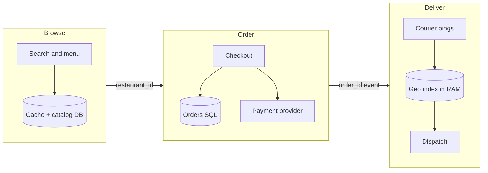

## 3. How it works 🟡

> 🟢 → 🟡 **You now know** the app is three small systems (browse, order, deliver) sharing an order ID. **Next we play the round** minute by minute, then walk each design decision with its options, choice and cost.

The transcript below is what you would say. Times assume a 60-minute round.

### Minutes 0-6: Requirements

**In plain words:** Before drawing anything, agree on what the app must do and how big and fast it must be.

**Step by step:**
1. Name the actors: customers, restaurants, couriers.
2. Pick the core flow: browse, order and pay, accept, assign courier, track.
3. Get the numbers: 5 million orders a day, dinner peak 3 times average.
4. Get the hard rules: no double charge, no lost order, never two couriers on one order.
5. Say what is out of scope, then move on.

**Say:** "Let me clarify scope before designing."

Questions asked and the answers assumed:

| Question | Answer (assumed) |
| --- | --- |
| Who are the actors? | Customers, restaurants, couriers |
| Core features? | Browse and search restaurants, place and pay for an order, restaurant accepts, courier is assigned, live tracking |
| Scale? | 50 M monthly users, 5 M orders per day, dinner peak 3x |
| Geography? | One country, many cities, single region first |
| Latency? | Menu p99 under 300 ms, tracking updates within 5 s |
| Consistency? | No double charge, no lost order, no order given to two couriers |
| Availability? | 99.95 percent for ordering |
| Out of scope | Promotions, ratings, support chat, restaurant onboarding |

**Why these numbers:** the interviewer can change them; every later choice cites them.

### Minutes 6-10: Estimates

**In plain words:** Rough maths, rounded numbers. The goal is to find which part is heavy, not to be exact.

**Step by step:**
1. Orders: 5 million ÷ about 86,400 s ≈ 58 a second; peak ×3 ≈ 175. One SQL primary is fine.
2. Menu views: about 3,500 a second at peak. Cache them.
3. Courier pings: 200,000 couriers, one every 5 s = 40,000 writes a second. That is the surprise.
4. Say it aloud: "the courier pings are the heavy part; I will come back to them in the deep dive".

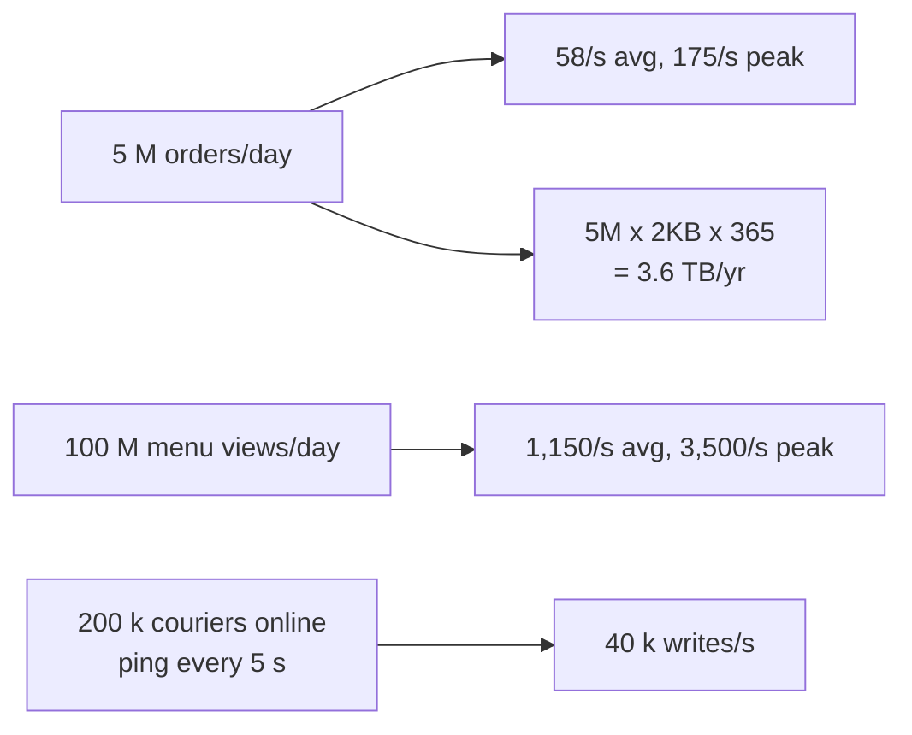

| Number | Implication said aloud |
| --- | --- |
| 175 orders/s peak | A single SQL primary is fine initially; shard later |
| 3,500 menu reads/s | Cache menus; they change rarely |
| 40 k location writes/s | Not a SQL workload; keep in memory, soft state |
| 3.6 TB per year | Partition by time or city, archive old orders |
| 200 k couriers x ~100 bytes | About 20 MB of live locations; fits in RAM trivially |

> [!tip] Remember
> The surprising number is the courier pings. Say so; it sets up the deep dive.

### Minutes 10-17: API and data model

**In plain words:** List the few calls the app makes, and the main tables behind them.

**Step by step:**
1. `POST /orders` with an idempotency key; `GET /orders/{id}`; `GET /restaurants?near=...`.
2. A WebSocket for live tracking.
3. Main tables: `orders`, `order_items`, `payments`, `couriers`.
4. Pick the order store with a reason: money needs transactions, so relational SQL.

```text
GET  /v1/restaurants?lat=&lng=&q=&cursor=    -> list (cacheable)
GET  /v1/restaurants/{id}/menu               -> menu (cacheable)
POST /v1/orders          Idempotency-Key     -> 202 {order_id, status:"PLACED"}
GET  /v1/orders/{id}                         -> status, eta, courier
WS   /v1/orders/{id}/track                   -> {lat, lng, eta} every 5 s
PUT  /v1/couriers/{id}/location   {lat,lng}  -> 204 (high rate)
POST /v1/restaurants/{id}/orders/{oid}/accept
```

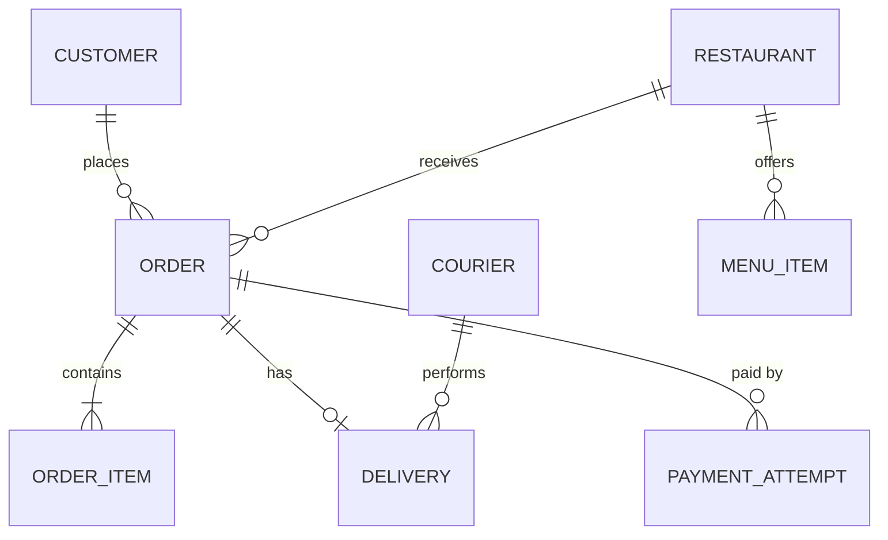

Core tables: `orders(order_id PK, customer_id, restaurant_id, status, total_cents, created_at)`, `order_items`, `payment_attempts(idempotency_key UNIQUE)`, `deliveries(order_id PK, courier_id, status)`. Partition orders by `customer_id` when sharding. Money is stored in integer cents.

**Decision 1: store for orders.**

| Option | For | Against |
| --- | --- | --- |
| Postgres (chosen) | Transactions, constraints, joins, familiar | Single primary write limit |
| DynamoDB | Scales writes horizontally | Cross-item transactions limited, awkward queries |
| Cassandra | Huge write rate | No multi-row transactions; wrong for money |

Choice: relational SQL. Reason: orders need transactions and unique constraints (idempotency); 175 per second is well inside one primary. Cost: sharding later. See [[SQL vs NoSQL]] and [[Transactions and ACID]].

### Minutes 17-27: High-level design

**In plain words:** Draw the boxes for browse, order and deliver, and how they connect.

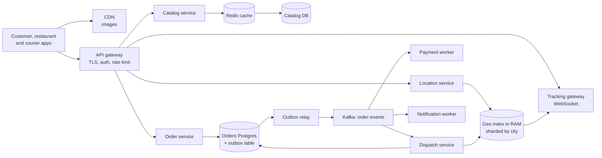

Walkthrough, numbered:

1. The customer submits an order with an idempotency key. The order service inserts the order and an outbox row in one transaction, returning 202.
2. The outbox relay publishes `OrderPlaced` to Kafka, keyed by `order_id`.
3. The payment worker charges the customer through the payment provider, then publishes `PaymentCaptured`.
4. The restaurant is notified and accepts; the dispatch service finds nearby free couriers and offers the job.
5. Courier pings flow into the location service, update the in-memory geo index, and feed the tracking gateway for the customer.
6. Each state change updates the order row and notifies the customer.

### Decision points, one by one

**In plain words:** Each block below is one choice: the options, the pick, why, and what it costs.

Each block: alternatives, choice, reason, cost, where to read more.

#### Decision 2: sync or async order handling

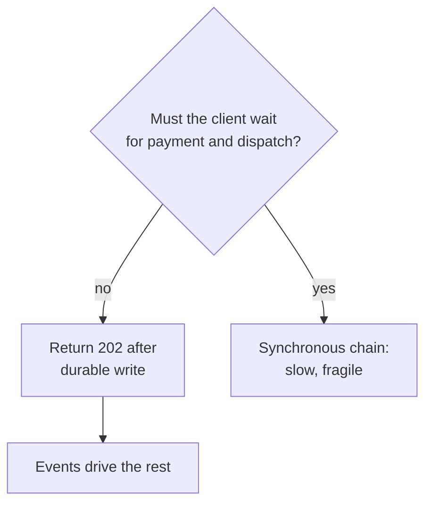

- Alternatives: fully synchronous call chain; async events.
- Choice: durable write, then async events.
- Reason: dispatch can take seconds and the payment provider can be slow; a failing courier lookup must not fail checkout.
- Cost: the client must poll or listen for status; eventual consistency of status.
- Read: [[Event-Driven Architecture Basics]], [[Saga Pattern]].

#### Decision 3: message broker

| Option | Pick when | Here |
| --- | --- | --- |
| RabbitMQ or SQS | Simple task queue, per-message ack, no replay | Good for notification jobs |
| Kafka (chosen for order events) | Per-key ordering, replay, many consumers (payment, dispatch, analytics) | Needed: three independent consumers and replay after a bug |

- Choice: Kafka for order events keyed by `order_id`; a plain queue for email and push jobs.
- Reason: ordering per order, replay when a consumer has a bug, independent consumers.
- Cost: partition planning, at-least-once so every consumer must be idempotent.
- Read: [[Queues vs Streams and Broker Comparison]], [[Message Ordering and Partition Keys]], [[Kafka and Event Streaming]].

#### Decision 4: no lost events (dual write problem)

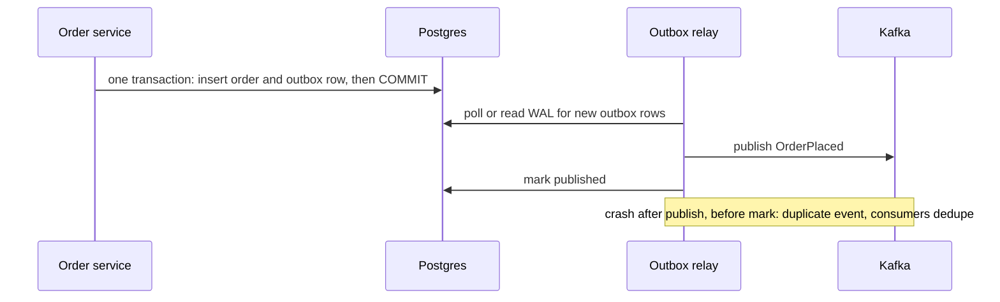

- Alternatives: write DB then publish (can lose the event if the process dies between), publish then write (can announce a missing order), two-phase commit (heavy), **transactional outbox** (chosen).
- Reason: one local transaction guarantees both or neither.
- Cost: an extra table and relay; duplicates possible, so consumers dedupe by event id.
- Read: [[Transactional Outbox and CDC]], [[Delivery Semantics and Exactly-Once]].

#### Decision 5: where courier locations live

| Option | Writes it can take | Verdict |
| --- | --- | --- |
| Postgres rows updated on every ping | 40 k per second on the same DB as orders | Rejected: contends with orders, wasteful, data is useless in 10 s |
| Cassandra or DynamoDB | Handles the volume | Possible but we only need the latest position |
| Redis geo or in-process grid (chosen) | Hundreds of thousands per second per node (estimate) | Latest position only; soft state |

- Reason: a position older than 15 seconds is worthless, so durability is not required.
- Cost: a restart loses state for up to one ping interval; couriers re-send.
- Read: [[Case Study - Ride Sharing and Proximity]], [[Redis Data Structures and When to Use Each]].

#### Decision 6 and 7: finding nearby couriers

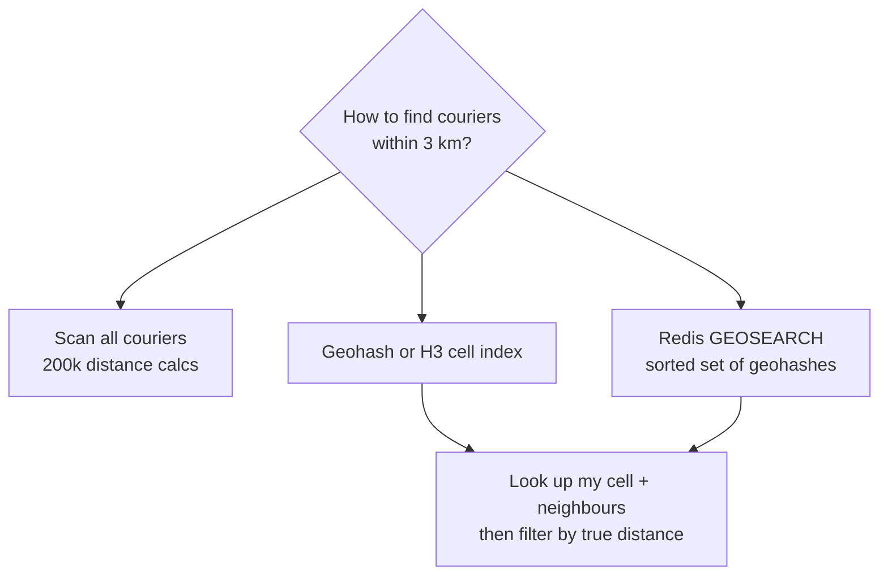

- Alternatives: full scan (fine for a city of 5 k couriers, bad globally), cell index, Redis `GEOSEARCH` (a built-in geohash-in-sorted-set since Redis 6.2).
- Choice: shard by city; inside a city use Redis geo sets or an H3 grid with a cell size at least as wide as the search radius, then rank candidates by ETA.
- Reason: a city has at most tens of thousands of couriers; cells reduce each query to a few hundred candidates.
- Cost: the city is the shard key, so a huge city is a hot shard; split by sub-region.
- Read: [[Geospatial Indexing]], [[Hot Keys and Hot Partitions]].

#### Decision 8: never assign two couriers (or one courier twice)

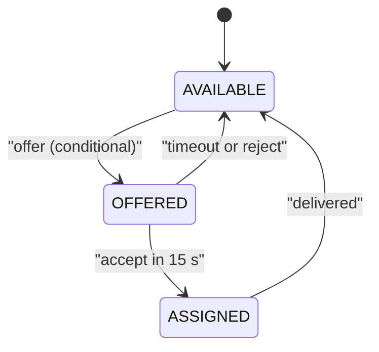

The assignment is one atomic conditional update:

```sql
UPDATE couriers SET state = 'OFFERED', offer_order = $1
WHERE courier_id = $2 AND state = 'AVAILABLE';
-- rows affected = 0 means someone else got them; try the next candidate
```

- Alternatives: distributed lock per courier, optimistic version column, single-writer per city, conditional update (chosen).
- Reason: one statement, no lock service, correct under concurrency.
- Note: only the courier's availability state (a few writes per assignment) needs this atomicity; the 40 k per second location pings stay in RAM.
- Cost: courier state lives in a durable store or atomic cache script; a stuck OFFERED needs a timeout sweeper.
- Read: [[Locking - Optimistic vs Pessimistic]], [[Distributed Locks and Fencing Tokens]].

#### Decision 9: payment and the order saga

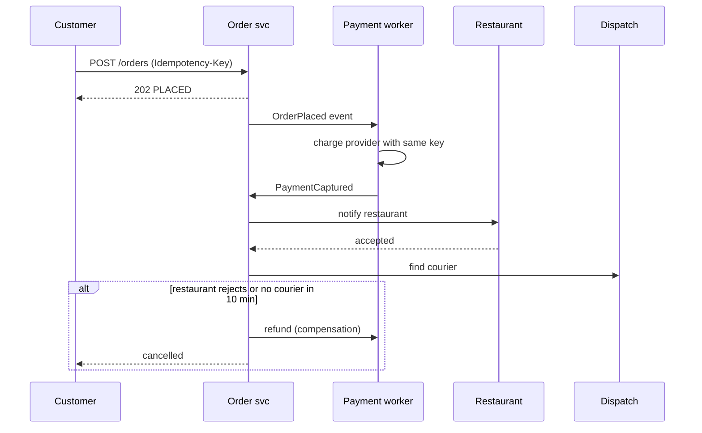

- Alternatives: two-phase commit across services (blocks, not supported by payment providers), saga with compensation (undo steps such as a refund) (chosen).
- Reason: each step is a local transaction; failures are undone by compensating actions such as a refund.
- Cost: intermediate states are visible (PLACED, PAID); every step must be idempotent.
- Read: [[Saga Pattern]], [[Idempotency and Idempotency Keys]], [[Case Study - Payment System]], [[Two-Phase Commit]].

#### Decision 10: real-time tracking transport

| Option | Verdict |
| --- | --- |
| Polling every 5 s | Simple, wasteful: 5 M orders x many polls |
| SSE | One-way, simple, fine for tracking |
| WebSocket (chosen) | Two-way, also used by couriers and restaurants; needs sticky connection handling |

Choice: WebSocket, with SSE as a valid simpler alternative because the customer only receives. Cost: connection state and scaling gateways ([[Scaling WebSockets]]). Read: [[Real-time APIs - WebSocket, SSE and Long Polling]].

#### Decision 11: caching menus

Cache-aside in Redis keyed by `restaurant_id`, TTL 5 minutes, explicit invalidation when a restaurant edits the menu; prices are re-read from the database at checkout so a stale cache can never charge a wrong price.

Cost: up to 5 minutes of stale display. Read: [[Caching Patterns]], [[Cache Invalidation, TTL and Consistency]], [[Cache Failure Modes - Stampede, Avalanche, Penetration, Hot and Big Keys]].

> [!warning] Common mistake
> Trusting cached prices at checkout. Show from cache, charge from the source of truth.

## 4. Worked example 🟡

### Whiteboard version

**In plain words:** The whole design in one small sketch.

```text
FLOWS  browse (cache) | order (SQL + saga) | deliver (RAM geo index)
EST    58 orders/s (175 peak) | 3.5k menu reads/s | 40k pings/s | 3.6 TB/yr
API    POST /orders (Idempotency-Key) 202 | WS track | PUT courier location
DB     Postgres orders + outbox | Redis menus | Redis geo per city
BUS    Kafka order-events key=order_id; queue for email/push
DEEP   1) dispatch: city shard, cell index, conditional UPDATE offer
       2) order saga: outbox, idempotent consumers, refund compensation
FAIL   Kafka down -> outbox grows, checkout still works | geo node down -> couriers re-ping
10x    shard orders by customer, more geo shards, more partitions
```

### The deep dive, spoken (minutes 27-47)

**In plain words:** Pick the two riskiest parts (rider matching and order safety) and talk through them out loud.

"The riskiest parts are dispatch and order consistency.

First, dispatch. We get 40 k pings per second, so I keep only the latest position in RAM, sharded by city.

A request for a courier looks up the restaurant's cell and its neighbours, filters by real distance, ranks by estimated time, then tries candidates in order with a conditional update from AVAILABLE to OFFERED.

If the update affects zero rows, another order got them and I try the next. A courier who does not accept in 15 seconds returns to AVAILABLE by a timeout sweeper. That prevents double assignment without any lock service.

Second, order consistency. The client sends an idempotency key; a unique constraint on the key in `payment_attempts` means retries cannot double-charge. The order row and outbox row commit together, so an event is never lost. Consumers are idempotent because delivery is at least once. If the restaurant rejects or no courier appears in 10 minutes, a compensating refund runs."

### Minutes 47-55: Scale, failure, security, observability

**In plain words:** Now ask "what breaks at 10 times the load, or when a part dies?" and fix each answer.

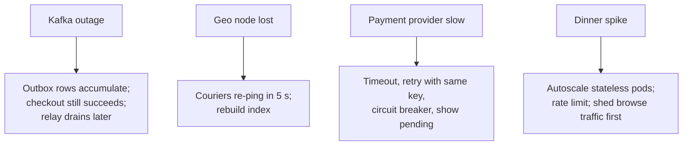

| Area | What I would say |
| --- | --- |
| Scaling at 10x | Orders reach about 1,750 per second peak: shard Postgres by customer id (validate by load test), more Kafka partitions, more geo shards, bigger cache |
| Security | TLS, OAuth at the gateway, courier and restaurant scopes, PCI-scope kept at the payment provider via tokenisation, rate limits on login and order creation |
| Observability | Order funnel (placed, paid, accepted, assigned, delivered), time to assign p95, outbox lag, consumer lag, WebSocket connections, payment error rate |
| SLOs | 99.95 percent order success, p99 menu under 300 ms, assignment within 60 s for 95 percent of orders |
| Deploys | Canary by city, backward-compatible migrations, feature flags for dispatch algorithm |
| Cost | Cache and CDN cut database and bandwidth cost; geo state is tiny |

Read: [[Load Shedding and Graceful Degradation]], [[Timeouts, Retries and Backoff]], [[Circuit Breaker]], [[SLIs, SLOs, SLAs and Error Budgets]], [[OWASP API Security Top 10]].

### Minutes 55-60: Wrap-up

**In plain words:** Sum up in a few sentences, name the costs you accepted, and say what you would do next.

"We split the product into browse, order and deliver. Menus come from cache; orders are in Postgres with an outbox that feeds Kafka; couriers live in an in-memory geo index sharded by city.

The two key trade-offs: async saga over a synchronous chain (accepting intermediate states), and in-memory soft state over durable location storage (accepting a short loss on restart).

First to break at 10x is the orders primary, fixed by sharding by customer. Next I would add surge-aware dispatch scoring and multi-region failover."

## 5. Variants and comparison 🟡

How the design changes with the prompt:

| Variant | What changes |
| --- | --- |
| Grocery quick-commerce (10 minute delivery) | Dark stores, inventory reservation becomes the deep dive ([[Case Study - Ticket Booking]] pattern), batching small orders |
| Ride sharing | No restaurant leg; locations on both sides ([[Case Study - Ride Sharing and Proximity]]) |
| Global marketplace | Multi-region, data residency, currency ([[Multi-Region Architecture]]) |
| Cloud kitchens | Own kitchens: capacity scheduling replaces restaurant acceptance |

Alternative designs that are also acceptable:

| Design | When it wins |
| --- | --- |
| Modular monolith with Postgres queue | Early stage, under about 50 orders per second, small team |
| Full microservices + Kafka (this mock) | Many teams, independent scaling needs |
| Orchestrated workflow engine instead of choreographed saga | Complex, long-running order flows needing visibility ([[Workflow Engines and Durable Execution]]) |

## 6. Trade-offs and when not to use 🟡

- **Kafka is heavy.** At a few hundred orders per second a Postgres-backed queue or SQS would do; say so and name the trigger (multiple consumers, replay).
- **Choreography gets hard to follow.** Beyond about five steps, an orchestrator gives one place to see the state.
- **Soft-state location data** is fine only because positions expire in seconds; never use that pattern for balances.
- **City as shard key** gives locality but uneven load; mega-cities need sub-sharding.
- **The saga leaks intermediate states** to users; the UI must show them honestly.

## 7. In production 🔴

> 🟡 → 🔴 **You now know** the full design and why each choice was made. **Next comes the senior view**: running it in production, then the hard details: matching is not just "nearest", ordering inside one order, refunds when a payment result is unknown, and the final data layout.

- **Real practice:** companies in this space publish engineering posts on geo indexing and dispatch (for example Uber's H3 index, open source at h3geo.org); treat those as inspiration and cite when you use them.
- **Failure modes and fixes:**
  - Duplicate OrderPlaced events: consumers dedupe on `event_id`.
  - Courier stuck OFFERED: timeout sweeper returns to AVAILABLE.
  - Outbox lag: alert when oldest unpublished row is older than 30 s.
  - Menu cache stampede on a viral restaurant: single-flight rebuild and jittered TTL.
  - Poison event blocks a partition: dead letter queue ([[Dead Letter Queues and Poison Messages]]).
- **What to watch:** outbox lag, consumer lag, time to assign, payment error rate, cache hit rate, geo index size per city, WebSocket connection count.

## 8. Deep dive 🔴

### Matching: nearest is not always best

**In plain words:** The closest rider may be stuck in traffic or already busy. Pick the rider who can reach the restaurant soonest.

Rank by estimated time to pickup (traffic aware), restaurant preparation time, courier load (batching), and fairness. Offering to one courier at a time is slow; offering to the top three and taking the first accept is faster but wastes courier attention. State the trade-off.

### Ordering inside one order

**In plain words:** Send all events of one order down the same lane, so "placed" always comes before "paid".

Keying Kafka by `order_id` keeps all events of one order in one partition, so consumers see PLACED before PAID. Across orders there is no ordering and none is needed ([[Message Ordering and Partition Keys]]).

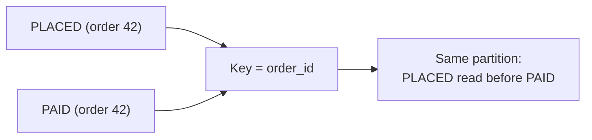

### Refunds and unknown payment outcomes

**In plain words:** If the payment call times out, you do not know if it worked. Retry with the same key so it cannot charge twice, and check later with a cleanup job.

If the payment call times out, the result is unknown. Retry with the same idempotency key (the provider returns the first result), and run a reconciliation job comparing provider records to ours ([[Case Study - Payment System]]).

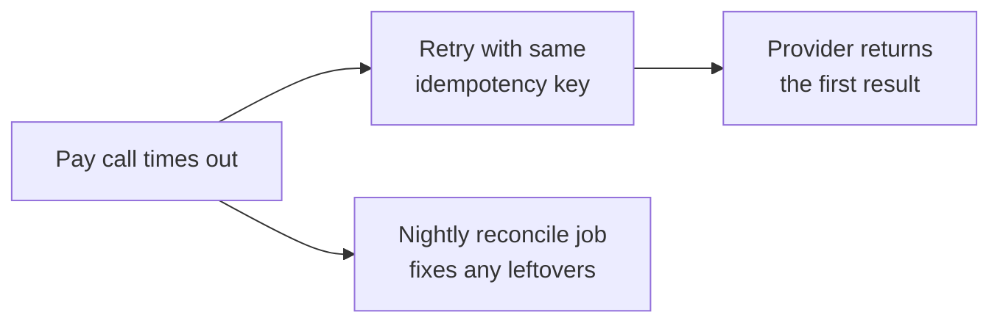

### Data layout summary

**In plain words:** One table showing where each kind of data lives and how long it is kept.

| Data | Store | Key | Durable? | Retention |
| --- | --- | --- | --- | --- |
| Orders, items | Postgres | order_id (shard by customer_id) | Yes | Years, archive |
| Outbox | Postgres | outbox_id | Yes | Delete after publish |
| Menus | Redis plus catalog DB | restaurant_id | Cache no, DB yes | TTL 5 min |
| Courier location | Redis geo per city | courier_id | No | 15 s expiry |
| Events | Kafka | order_id | Yes | 7 days (assumed) |

## 9. Interview questions 🔴

> [!question]- Why not store courier locations in the orders database?
> 40 k writes per second of data that is stale after seconds would compete with money-critical order writes. Location is soft state: keep only the latest position in memory, sharded by city, and let couriers re-ping after a restart.

> [!question]- How do you guarantee one courier per order and one order per courier?
> Use an atomic conditional update (AVAILABLE to OFFERED only if still AVAILABLE). Zero rows affected means another dispatch won, so try the next candidate. A timeout sweeper releases unaccepted offers.

> [!question]- How do you avoid double charging if the client retries checkout?
> The client sends an idempotency key, stored with a unique constraint. The payment worker forwards the same key to the provider. A duplicate returns the first result instead of a second charge.

> [!question]- Why Kafka instead of RabbitMQ here?
> Three independent consumers (payment, dispatch, notifications and analytics), ordering per order id and the need to replay after a consumer bug favour a log. For one-off jobs like emails, a simple queue is enough; I would use both.

> [!question]- What breaks first at 10 times traffic?
> The single orders primary, at roughly 1,750 peak writes per second of multi-row transactions. Shard by customer id after validating with a load test; also add Kafka partitions and geo shards.

> [!question]- Trap: "just use a distributed transaction across payment, restaurant and courier."
> Payment providers do not participate in two-phase commit and it blocks on failures. Use a saga with compensating actions (refund, release courier) and idempotent steps.

## 10. Cheat sheet 🟢

- Three flows: browse (cache), order (SQL + saga), deliver (RAM geo index).
- Key numbers: 175 orders per second peak, 3,500 menu reads, 40 k pings per second (assumptions).
- Idempotency key plus unique constraint stops double charge.
- Outbox: order row and event in one transaction.
- Kafka keyed by order_id; consumers idempotent.
- Dispatch: city shard, cell index, conditional UPDATE offer, timeout sweeper.
- Show menu from cache, charge from the source of truth.
- 10x: shard orders by customer, more partitions and geo shards.

## Self-check 🟢🟡

> [!question]- (easy) What are the three small systems inside a food delivery app?
> Browse (menus), order (payment and order state), deliver (courier matching and tracking).

> [!question]- (easy) Why are menus cached?
> They are read thousands of times a second and change rarely.

> [!question]- (easy) Which number was the surprise in the estimates?
> About 40,000 courier location writes a second.

> [!question]- (medium) Why keep courier locations in memory instead of Postgres?
> Only the latest position matters and old ones are worthless, so losing a few seconds is fine, and 40,000 writes a second would hurt the orders DB.

> [!question]- (medium) How do you stop two orders taking the same courier?
> One atomic conditional update that sets the courier busy only if they are still free.

> [!question]- (medium) Why use an outbox for order events?
> The order row and the event row are saved in one transaction, so an event is never lost if the process crashes.

## Links 🟢

- **Before this:** [[HLD Round - Complete Step-by-Step Guide]], [[System Design Interview Framework]], [[Back-of-the-Envelope Estimation]]
- **Case studies to read next:** [[Case Study - Ride Sharing and Proximity]], [[Case Study - Payment System]], [[Case Study - Notification System]]
- **Decision theory:** [[Queues vs Streams and Broker Comparison]], [[Transactional Outbox and CDC]], [[Saga Pattern]], [[Geospatial Indexing]], [[SQL vs NoSQL]], [[Caching Patterns]]
- **Compare with:** [[Case Study - Ticket Booking]] (scarce resource) and [[Case Study - News Feed]] (fan-out)

### Watch on YouTube

- [✅ System Design 6: Design Food Delivery Application like Zomato / Swiggy / Uber Eats / HLD / LLD](https://www.youtube.com/watch?v=rZyAgZuuZiA) · InterviewWithBunny · 67 min · 47,803 views
- [How Food Delivery Apps Like Swiggy & Zomato Work – Full Backend Architecture Explained](https://www.youtube.com/watch?v=F9x686m-yYo) · FullStackDev · 6 min · 11,096 views
