# HLD Trade-offs Master Cheat Sheet

> [!summary] TL;DR
> Every high-level design question is a pile of small either-or choices: SQL or NoSQL, queue or stream, push or pull, cache or not. This note puts the common choices on one page as "if you see X, pick Y, because Z, but watch out for W", with a link to the full decision guide for each family.

> [!abstract] Core idea
> - A good HLD answer is a chain of justified choices. Naming a technology is worth little; naming the requirement that forced it and the cost you accepted is worth a lot.
> - Almost every choice is decided by a small set of questions: how much data, how many requests, what read/write ratio, what happens if data is stale or lost, what latency the user feels.
> - There is no best option, only the option whose weak spot your system does not touch.
> - Use this note as a fast lookup during prep. When a row is not enough, open the linked guide.

## Start here: the basics 🟢

> [!info] How to read this note (pick your level)
> - 🟢 **New to this?** Read "From zero" below, then sections 1, 2, 3.1 (the five questions) and the cheat sheet (10). Stop there, that is a full first pass.
> - 🟡 **Know the basics?** Add the rest of section 3 (the choice tables), 4 (worked example), 5 and 6.
> - 🔴 **Interview / SDE-3 prep?** Add 7, 8 and 9. Headings are tagged 🟢🟡🔴 so you always know where you are.

**From zero, in 60 seconds** 🟢

Designing a system is a long list of forks in the road. SQL or NoSQL? Queue or stream? Cache or not?
No option is the best. Each one is good at some things and bad at others.
Picking one means giving something up. That give-and-take is a **trade-off**.
So you never just name a tool. You say what your system needs, what you pick, and what it costs you.
This note is a map of the common forks, with the usual pick for each.

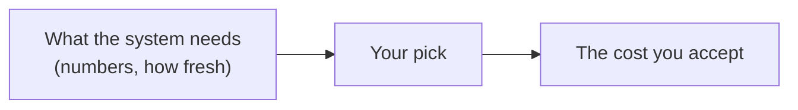

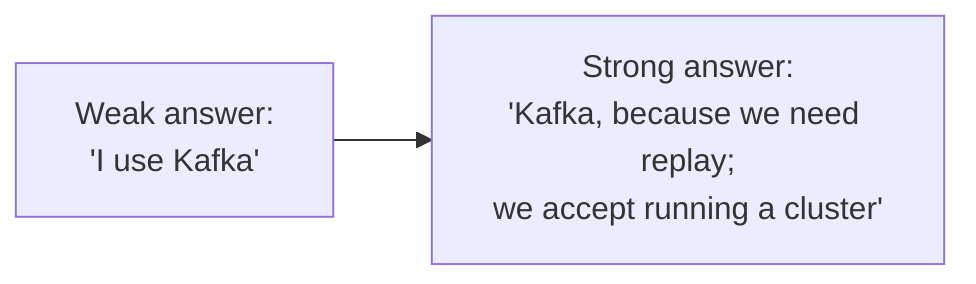

The rest of this note is just these 3 questions:
1. Which five questions decide almost every choice?
2. For each family (stores, queues, caches, APIs and more), what is the usual pick?
3. How do choices affect each other?

**The problem in one story.**
In a design interview, you keep hitting forks in the road: SQL or NoSQL? Queue or stream? Cache or not?
Picking one by name earns little.
Saying "I pick X because my system needs Y, and I accept cost Z" earns a lot.
This note is a one-page map of those forks.

**Words you need first**

| Word | Plain meaning | Tiny example |
| --- | --- | --- |
| Trade-off | Gaining one thing by giving up another | Faster reads, but data may be a bit stale |
| Read/write ratio | How many reads happen per write | 100 reads per 1 write for a menu |
| Latency | How long one request takes | p99 = 200 ms |
| Throughput | How much work per second | 10,000 writes per second |
| Consistency | Whether every reader sees the latest write | Bank balance must be exact |
| Partitioning (sharding) | Splitting data across machines | Users A-M on node 1, N-Z on node 2 |
| Async | The caller does not wait for the work to finish | Put "send email" on a queue |
| Cache | A fast copy of data to avoid slow lookups | Redis in front of Postgres |

**Picture it**

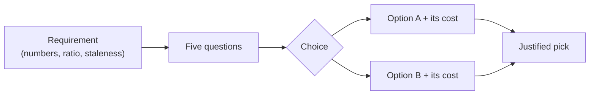

**Analogy.** Choosing a vehicle: a bike, a car or a truck. None is "best"; it depends on the distance, the load and the budget.
Where it breaks: vehicles are chosen once, but system choices interact, so one pick (say, async) changes others (say, consistency).

**How the rest of this note builds up**

- First, why the sheet exists and a mental model for choosing (sections 1-2).
- Then the five questions, then families of choices: data stores, messaging, sync vs async, caching, APIs, consistency, storage, compute, load balancers (section 3).
- Then a worked example narrated with numbers, plus variants and trade-offs (sections 4-6).
- Finally the SDE-3 deep dive: how choices interact, PACELC, the cost of asynchrony and back-pressure (sections 7-8).

> [!tip] Remember
> There is no best option, only the one whose weak spot your system does not touch; always say the requirement and the cost.

## 1. Why it exists 🟢

In a 45-minute design round you make 20 to 30 decisions. A candidate who stops 40 seconds on each choice to recall the trade-offs runs out of time. A candidate who has the trade-offs memorised as short rules spends the time on the interesting parts: the bottleneck, the failure, the scaling story.

Take "design a chat app". Within ten minutes you must have chosen a transport (WebSocket or polling), a message store (wide-column or SQL), a delivery path (direct push or via a broker), and a way to fan out to groups. Each is a row in this note. The pattern "requirement in, choice out, cost named" is what interviewers listen for.

The eight decision guides go deep on one family each. This page is the index and the summary: read it first, dive into a guide when a row is unfamiliar.

## 2. Mental model 🟢

Think of a toolbox with labelled drawers. You do not invent a screwdriver each time; you look at the screw. Each drawer here is a decision family (data store, broker, cache), and each tool has a "use it when" label and a "do not use it when" label.

The analogy breaks down in one place: tools in a toolbox are independent, but design choices interact. Choosing Kafka for the broker pushes you toward partition keys, which pushes you toward per-key ordering, which constrains how you scale consumers. A choice in one drawer changes the right answer in another.

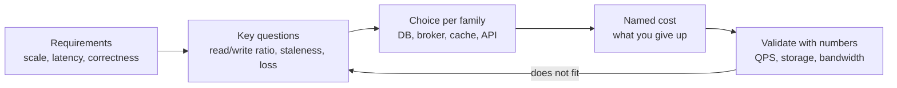

> [!tip] Remember
> Requirement, choice, cost. Say all three every time.

## 3. How it works 🟡

### 3.1 The five questions behind almost every choice

In plain words: before picking any component, answer five questions. Most rows in the tables below are just these questions applied to one family.

1. Is the workload read-heavy or write-heavy, and by what ratio?
2. How wrong may the data be, and for how long (staleness tolerance)?
3. Can the data be lost, and if so how much (durability need)?
4. What latency does the user or caller feel (p99 target)?
5. How big will it get in a year (rows, QPS, bytes)?

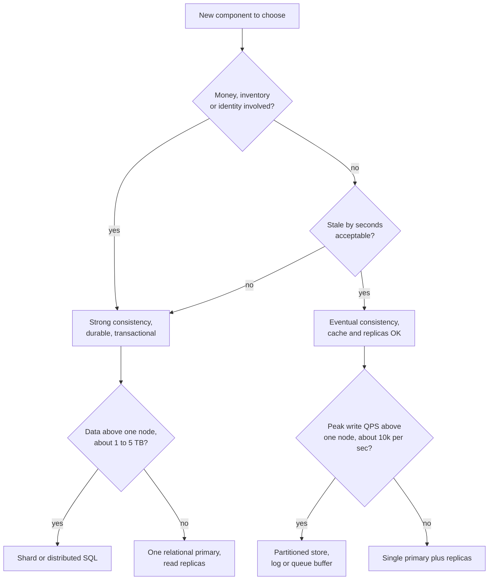

The thresholds (10k writes per second, 1 to 5 TB per node) are rough rules of thumb for a single well-tuned relational node, not hard limits. They depend on row size, indexes and hardware. Treat them as estimates to trigger the conversation.

> [!warning] Common mistake
> Reaching for a distributed database at 50 GB. A single PostgreSQL or MySQL primary with replicas handles most products for years. Interviewers mark premature distribution as a red flag.

### 3.2 Data store choices

**In plain words:** Read each row as "if you see this need, pick this store, and watch out for this".

| If you see | Pick | Because | Watch out for | Guide |
| --- | --- | --- | --- | --- |
| Money, orders, inventory, joins, constraints | Relational (PostgreSQL, MySQL) | ACID transactions and constraints protect invariants | Vertical limit; sharding is painful later | [[Choosing a Database - Decision Guide]] |
| Huge write volume, access by key, simple queries | Wide-column (Cassandra, ScyllaDB) | Log-structured writes, linear horizontal scale | Query by partition key only; tombstones; no joins | [[Choosing a Database - Decision Guide]] |
| Document-shaped data read as a whole, flexible schema | Document store (MongoDB, DynamoDB) | One read returns the whole aggregate | Cross-document transactions are limited or costly | [[Choosing a Database - Decision Guide]] |
| Session, counters, leaderboards, rate limits | Redis | In-memory, rich structures, sub-millisecond | Memory cost; persistence is not a ledger | [[Choosing a Database - Decision Guide]] |
| Global scale plus SQL plus strong consistency | Distributed SQL (Spanner, CockroachDB) | Consensus-replicated, SQL interface | Commit latency crosses regions; cost | [[Choosing a Database - Decision Guide]] |
| Time-stamped metrics or events, aggregate queries | Time-series or columnar (ClickHouse, Timescale) | Compression and column scans | Poor for point updates | [[Choosing Storage for Files, Search and Analytics - Decision Guide]] |
| Relationships are the query (friends of friends) | Graph database | Traversal without recursive joins | Hard to shard; niche | [[Choosing a Database - Decision Guide]] |

Why the first row wins by default: relational databases give you transactions, constraints and ad hoc queries for free. You leave them only when a measured limit forces you to. See [[SQL vs NoSQL]] and [[Storage Engines - B-tree vs LSM and WAL]].

> [!tip] Remember
> Start relational; leave when a number, not a feeling, says so.

### 3.3 SQL versus NoSQL in one table

**In plain words:** SQL is safe and flexible to query. NoSQL scales out easily but you must plan your queries up front.

| Question | Leans SQL | Leans NoSQL |
| --- | --- | --- |
| Need multi-row transactions? | Yes | No, or single-key only |
| Access pattern known and narrow? | Not required | Yes, model per query |
| Schema changes often? | Migrations cost | Flexible documents |
| Write volume beyond one node? | Needs sharding | Built to scale out |
| Ad hoc analytics on live data? | Strong | Weak |
| Team knows it? | Usually | Varies |

The honest summary: SQL is the default, NoSQL is a deliberate trade of query flexibility for write scale or latency. Many real systems use both (polyglot persistence). See [[NoSQL Data Modeling]].

### 3.4 Messaging and async choices

**In plain words:** A queue hands out jobs once. A stream (log) keeps history that many readers can replay.

| If you see | Pick | Because | Watch out for | Guide |
| --- | --- | --- | --- | --- |
| Event log, replay, many independent consumers, high throughput | Kafka | Durable partitioned log; consumers track offsets | Ordering only inside a partition; operational weight | [[Kafka vs RabbitMQ vs SQS - Choosing a Message Broker]] |
| Task queue with routing, priorities, per-message ack | RabbitMQ | Flexible exchanges, low latency, acks | Classic queues are not built for replay or huge backlogs (RabbitMQ Streams exist for log-style use) | [[Kafka vs RabbitMQ vs SQS - Choosing a Message Broker]] |
| On AWS, want zero broker ops | SQS (plus SNS for fan-out) | Fully managed, scales without capacity planning | Standard queue is at-least-once and unordered; FIFO has throughput caps | [[Kafka vs RabbitMQ vs SQS - Choosing a Message Broker]] |
| Need exactly-once effect | At-least-once plus idempotent consumer | True exactly-once delivery is not available end to end | Needs an idempotency key and a dedupe store | [[Delivery Semantics and Exactly-Once]] |
| Write to DB and publish event atomically | Transactional outbox plus CDC | Avoids dual-write inconsistency | Extra table and relay process | [[Transactional Outbox and CDC]] |
| Failing messages block the queue | Dead-letter queue | Isolates poison messages | Needs an alert and a replay path | [[Dead Letter Queues and Poison Messages]] |

### 3.5 Sync versus async, push versus pull

**In plain words:** Sync means wait for the answer; async means drop a note and move on. Push means do the work early; pull means do it when asked.

| Decision | Choose the first when | Choose the second when | Cost to name |
| --- | --- | --- | --- |
| Sync call vs async queue | Caller needs the answer now (login, price check) | Work is slow or can be retried (email, thumbnail, report) | Sync couples availability; async adds eventual completion and a status path |
| Push vs pull | Consumer must react in real time; few consumers | Consumers vary in speed or may be offline | Push can overwhelm a slow consumer; pull adds latency and idle polling |
| Fan-out on write vs on read | Reads dominate and followers are few per author | Authors have millions of followers | Write: storage and write amplification. Read: slow, expensive reads |
| Polling vs WebSocket | Updates are rare and a few seconds late is fine | Frequent two-way updates, sub-second latency | WebSocket holds a connection per user; needs sticky or stateful scaling |

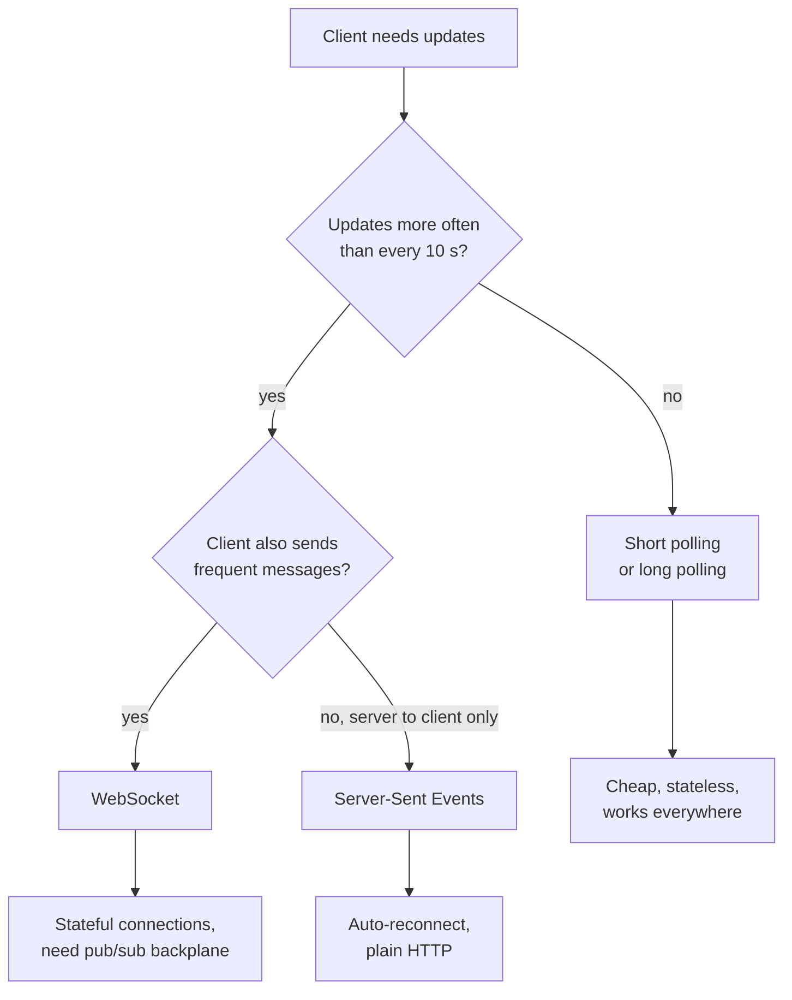

See [[Real-time APIs - WebSocket, SSE and Long Polling]] and [[Scaling WebSockets]].

Fan-out example with numbers: a user with 300 followers posting fan-out on write means 300 timeline inserts, fine.

An account with 30 million followers means 30 million inserts per post, so the common hybrid is fan-out on write for ordinary users and fan-out on read (merge at read time) for celebrities.

This is the approach described in Twitter's public talks on timelines. See [[Case Study - News Feed]].

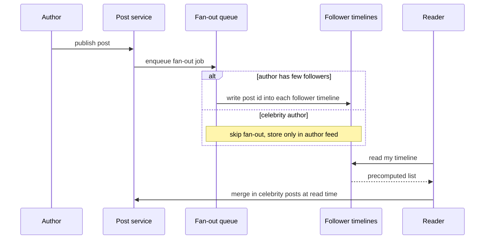

### 3.6 Caching choices

**In plain words:** Where to keep fast copies, and how to stop them going stale.

| If you see | Pick | Because | Watch out for | Guide |
| --- | --- | --- | --- | --- |
| Read-heavy, tolerates short staleness | Cache-aside with TTL | Simple, app controls what is cached | Stale reads; stampede on expiry | [[Choosing a Caching Strategy - Decision Guide]] |
| Must never read stale after write | Write-through, or invalidate on write | Cache updated with the DB write | Higher write latency; invalidation bugs | [[Choosing a Caching Strategy - Decision Guide]] |
| Write bursts, can lose a few seconds | Write-behind (write-back) | Batches writes to the DB | Data loss if cache dies before flush | [[Choosing a Caching Strategy - Decision Guide]] |
| Static assets, public pages | CDN | Serves near the user, offloads origin | Purge delays; cache key mistakes | [[Choosing a Caching Strategy - Decision Guide]] |
| One key gets huge traffic | Local in-process cache plus replicated key | Spreads the hot key | Per-node staleness | [[Hot Keys and Hot Partitions]] |
| Memory bounded | LRU or LFU eviction plus TTL | Keeps useful items | LRU is hurt by scans; LFU adapts slowly | [[Cache Eviction Policies - LRU, LFU, TTL]] |

Read the failure modes before you commit: [[Cache Failure Modes - Stampede, Avalanche, Penetration, Hot and Big Keys]] and [[Cache Invalidation, TTL and Consistency]].

### 3.7 API style choices

**In plain words:** How programs talk: ask and wait, keep a live line open, or get called back later.

| If you see | Pick | Because | Watch out for | Guide |
| --- | --- | --- | --- | --- |
| Public API, many unknown clients | REST over HTTP and JSON | Universal tooling, cacheable | Over- and under-fetching | [[Choosing an API and Communication Style - Decision Guide]] |
| Mobile clients needing flexible shapes | GraphQL | Client picks fields, one round trip | Query cost control, N+1 in resolvers, caching is harder | [[Choosing an API and Communication Style - Decision Guide]] |
| Internal service to service, low latency | gRPC | Binary protobuf, streaming, typed contracts | Browser support needs a proxy; harder to debug | [[Choosing an API and Communication Style - Decision Guide]] |
| Notify third parties of events | Webhooks | They do not poll; you push | Retries, signatures, ordering | [[Webhooks - Sending and Receiving]] |
| Retried requests must not double-charge | Idempotency keys | Safe retries | Need a key store and a TTL | [[Idempotency and Idempotency Keys]] |
| Large lists | Cursor pagination | Stable under inserts, fast on indexed key | No random page jump | [[Pagination, Filtering and Sorting]] |

### 3.8 Consistency, replication and partitioning

**In plain words:** How fresh reads must be, how many copies you keep, and how you split data across machines.

| If you see | Pick | Because | Watch out for | Guide |
| --- | --- | --- | --- | --- |
| Balance, stock count, booking seat | Strong consistency, single leader | One ordering of writes, no lost updates | Leader is a bottleneck and failover risk | [[Choosing Consistency, Replication and Partitioning - Decision Guide]] |
| Likes, views, feeds | Eventual consistency | Higher availability and lower latency | Users briefly see old data | [[Choosing Consistency, Replication and Partitioning - Decision Guide]] |
| Read-heavy, single region | Leader plus read replicas | Scales reads | Replication lag; read-your-writes broken | [[Replication]] |
| Writes beyond one node | Partition (shard) by key | Scales writes and storage | Hot partitions; cross-shard queries and transactions | [[Partitioning and Sharding]] |
| Even spread, easy resharding | Hash partitioning with consistent hashing | Moves little data when nodes change | Range queries become scatter-gather | [[Consistent Hashing]] |
| Range scans by time or id | Range partitioning | Efficient scans | Hot recent range | [[Partitioning and Sharding]] |
| Multi-service business transaction | Saga | Avoids distributed locks | Compensations are hard to write | [[Saga Pattern]] |
| Multi-region active-active | Quorums or CRDTs, accept conflicts | Local writes everywhere | Conflict resolution logic | [[Multi-Region Architecture]] |

Why partition key choice matters most: the key decides the hot spot. Sharding orders by `user_id` spreads evenly; sharding by `created_date` sends all new writes to one shard. See [[CAP and PACELC]] for the theory behind the first two rows.

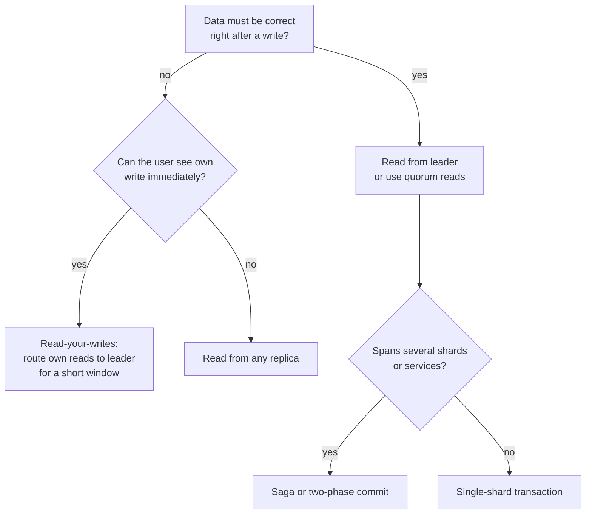

### 3.9 Storage for files, search and analytics

**In plain words:** Files go to object storage, text search to a search index, big reports to a warehouse.

| If you see | Pick | Because | Watch out for | Guide |
| --- | --- | --- | --- | --- |
| Images, video, backups, any large blob | Object storage (S3) | Cheap, durable, effectively unlimited | Higher latency; no in-place edit | [[Choosing Storage for Files, Search and Analytics - Decision Guide]] |
| Full-text search, ranking, filters | Search engine (Elasticsearch, OpenSearch) | Inverted index | Eventually consistent with source; not a system of record | [[Search Engines and Inverted Indexes]] |
| Dashboards over billions of rows | Columnar warehouse (ClickHouse, BigQuery) | Column scans and compression | Poor at point writes | [[Time-Series and Columnar Storage]] |
| Upload large files from clients | Presigned URL direct to object store | Server does not proxy bytes | Need completion callback and virus scan | [[File Upload Architecture]] |
| Serve video | Chunked adaptive streaming via CDN | Adjusts to bandwidth | Transcoding pipeline cost | [[Case Study - Video Streaming]] |

### 3.10 Compute, scaling and deployment

**In plain words:** Where the code runs, how you add capacity, and how you ship new versions safely.

| If you see | Pick | Because | Watch out for | Guide |
| --- | --- | --- | --- | --- |
| Stateless web tier | Horizontal scaling behind an LB | Add nodes for capacity | State must live elsewhere | [[Choosing Compute, Scaling and Deployment - Decision Guide]] |
| Spiky or rare workload | Serverless functions | Pay per use, no idle cost | Cold starts, execution limits | [[Choosing Compute, Scaling and Deployment - Decision Guide]] |
| Steady load, many services | Containers on Kubernetes | Bin packing, rollouts, self-healing | Operational complexity | [[Kubernetes Fundamentals]], [[Deployment Strategies - Rolling, Blue-Green, Canary]] |
| Early product, small team | Modular monolith | One deploy, simple debugging | Needs discipline to keep modules separate | [[Choosing Compute, Scaling and Deployment - Decision Guide]] |
| Safe releases | Rolling, blue-green or canary | Limit blast radius | Schema changes need expand-contract | [[Zero-Downtime Schema Migrations]] |
| Long, multi-step, must survive crashes | Workflow engine | Durable state and retries | New programming model | [[Workflow Engines and Durable Execution]] |

### 3.11 Load balancers, gateways and mesh

**In plain words:** What sits in front of your services to spread traffic, check logins and handle calls between services.

| If you see | Pick | Because | Watch out for | Guide |
| --- | --- | --- | --- | --- |
| Spread HTTP requests by path or header | L7 load balancer | Content-aware routing, TLS termination | More CPU per request than L4 | [[Choosing Load Balancers, Gateways and Service Mesh - Decision Guide]] |
| Raw TCP or UDP, extreme throughput | L4 load balancer | Fast, simple | No path-based routing | [[Choosing Load Balancers, Gateways and Service Mesh - Decision Guide]] |
| One entry point for auth, limits, routing | API gateway | Central cross-cutting concerns | Single point of failure; do not put business logic in it | [[API Gateway and BFF]] |
| Per-client response shaping | Backend for frontend | Tailored payloads | One more service per client | [[API Gateway and BFF]] |
| Many services needing mTLS, retries, tracing | Service mesh | Uniform policy without code changes | Sidecar overhead and operational cost | [[Choosing Load Balancers, Gateways and Service Mesh - Decision Guide]] |
| Dynamic instances | Service discovery | Clients find healthy instances | Stale registry entries | [[Service Discovery]] |
| Uneven request cost | Least connections or weighted | Balances actual load | Round robin ignores request cost | [[Load Balancing]] |

### 3.12 The master decision flowchart

**In plain words:** One big "follow the arrows" chart. Start at the top with your new part, and it points you to the right family.

Read this top to bottom for a new component. Each exit names a family and its guide.

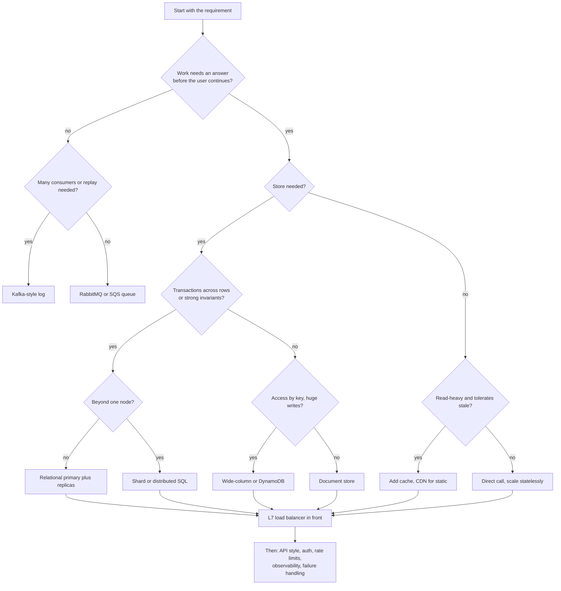

> [!tip] Remember
> Sync or async first, then store, then cache, then edge. Name a cost at each exit.

## 4. Worked example 🟡

Problem: a ride-booking app, 5 million daily users, 1 million rides per day.

Estimates: 1 million rides per day is about 12 rides per second on average, perhaps 10 times that at peak, so about 120 per second. That is small for a relational primary. Driver location updates are the real volume: 500,000 active drivers sending a ping every 5 seconds is 100,000 writes per second.

| Component | Choice | Reason | Cost named |
| --- | --- | --- | --- |
| Ride and payment records | PostgreSQL primary plus replicas | 120 per second peak, needs transactions | Failover plan needed |
| Driver locations | Redis geo index, async to a log | 100k writes per second, short-lived | Memory; location lost on failure is acceptable |
| Location history | Kafka into columnar storage | Replay and analytics | Eventual freshness |
| Rider-to-driver updates | WebSocket via gateway | Sub-second push | Connection state, needs pub/sub backplane |
| Ride matching | Sync call to matching service | Rider waits for a result | Timeout and fallback |
| Receipts and emails | SQS queue | Slow, retryable | Idempotent worker |
| Payments | Idempotency key plus saga | Retries must not double-charge | Compensation logic |

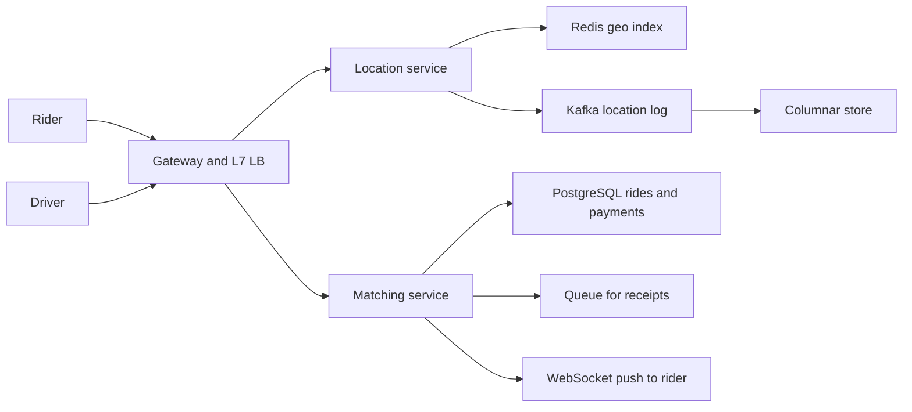

Interview-style narration: "Rides are 120 per second at peak, so one PostgreSQL primary suffices and gives me transactions. The firehose is driver location at 100k writes per second, so that goes to Redis with a log behind it.

I accept that a Redis failure loses a few seconds of positions because they are refreshed every 5 seconds anyway." See [[Case Study - Ride Sharing and Proximity]] for the full design.

## 5. Variants and comparison 🟡

How the same requirement can resolve differently depending on one changed fact.

| Same requirement | If this fact changes | The choice flips to |
| --- | --- | --- |
| Store user profiles | 10 billion profiles, key lookup only | Wide-column or DynamoDB instead of relational |
| Send order email | Must happen before checkout returns | Sync call instead of queue (rare; usually keep async) |
| Show product page fast | Prices change every second | Short TTL or no cache instead of 5 minute TTL |
| Notify mobile app | App is closed | Push notification service instead of WebSocket |
| Count page views | Exact billing accuracy required | Durable log plus aggregation instead of Redis counter |
| Search products | Need typo tolerance and ranking | Search engine instead of SQL LIKE |
| Deploy service | Traffic is two requests per hour | Serverless instead of always-on containers |

Reading the table: the right answer is a function of facts. Interviewers deliberately change one fact ("now users are global") to see whether your choice flips correctly.

## 6. Trade-offs and when not to use 🟡

Using a cheat sheet has its own failure modes.

- Rules of thumb are not laws. "Use Kafka for events" is wrong for a system with 10 messages per minute; SQS or a database table is simpler.
- Do not name five technologies when one will do. Every extra component is something that can fail at 3 a.m.
- Numbers in this note (thresholds, QPS limits) are estimates. In an interview, say "roughly" and show the arithmetic.
- Cost is a requirement too. The best technical answer may be too expensive for a startup.
- Do not skip the boring option. A relational database with a good index beats a clever distributed design for most products.

| Temptation | Why it hurts | Better |
| --- | --- | --- |
| Microservices on day one | Distributed failures, slow debugging | Modular monolith, split later |
| Kafka for a small job queue | Operational weight | SQS or a Postgres-backed queue |
| Sharding at 100 GB | Cross-shard pain with no benefit | Replicas and indexes |
| Cache everything | Stale data bugs and extra failure modes | Cache measured hot paths |
| Strong consistency everywhere | Latency and availability cost | Strong only where invariants need it |

## 7. In production 🔴

Real systems show these trade-offs. Details are from public engineering material; treat specifics as summaries.

- LinkedIn built Kafka to move activity data and metrics through one durable log (LinkedIn engineering, Kafka origin papers), the textbook case for "many consumers plus replay".
- Discord publicly described moving message storage from Cassandra to ScyllaDB because of Cassandra garbage-collection and compaction pain at large scale, a "same model, better engine" choice (Discord engineering blog).
- Twitter's public talks describe fan-out on write for most accounts with a read-time merge for very high-follower accounts.
- Netflix serves video bytes from its own CDN appliances placed inside ISPs (Open Connect), which is the "serve near the user" row taken to the extreme.
- Stripe's public API documents an `Idempotency-Key` header for safe retries of payment requests, a widely copied pattern.

What to monitor for each choice family:

| Family | Watch |
| --- | --- |
| Database | Replication lag, connection saturation, slow queries, disk growth |
| Broker | Consumer lag, DLQ depth, unacknowledged messages |
| Cache | Hit ratio, eviction rate, p99 latency, memory |
| Gateway or LB | 5xx rate, upstream latency, active connections |
| Compute | CPU, memory, restarts, queue wait time |

## 8. Deep dive 🔴

### 8.1 Why choices interact

**In plain words:** One pick changes the others. Choose a user-based key for order, and now one very busy user can overload one machine.

A partitioned log (Kafka) gives per-partition order. If you also need per-user order, the partition key must be the user id. That makes a hot user a hot partition.

If your database is sharded by a different key (say order id), a consumer that updates the database now crosses shards.

The master lesson: pick the partition key once and reuse it through the log, the cache and the database wherever you can. See [[Message Ordering and Partition Keys]] and [[Hot Keys and Hot Partitions]].

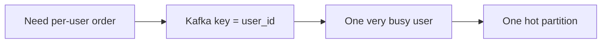

### 8.2 PACELC in one paragraph

**In plain words:** When the network breaks, you pick right-answer or always-answer. When it works, you still pick right-answer or fast-answer.

CAP says that during a network partition you choose between consistency and availability. PACELC adds that even with no partition you choose between latency and consistency.

That second trade-off is the one you feel daily: reading from a nearby replica is fast and maybe stale; reading from the leader is correct and maybe far. See [[CAP and PACELC]] and [[Consistency Models]].

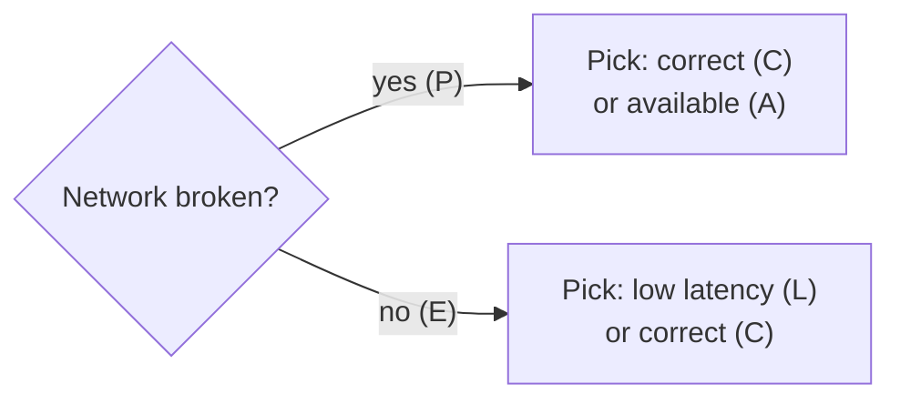

### 8.3 The cost of asynchrony

**In plain words:** Going async makes the system tougher, but now you need status screens, duplicate checks and ways to handle out-of-order messages.

Async decouples availability and absorbs bursts, but it adds: a status path ("your report is being prepared"), duplicate handling (at-least-once delivery), ordering questions, and monitoring for lag and dead letters. If none of those are acceptable, the call should stay synchronous with timeouts and a circuit breaker. See [[Circuit Breaker]] and [[Timeouts, Retries and Backoff]].

### 8.4 Back-pressure and shedding

**In plain words:** If more work comes in than you can handle, you need a rule: make callers wait, turn some away, or drop the least important work.

Any choice that accepts more traffic than the slowest component can handle needs a rule for overload: bounded queues, rate limits, or load shedding. See [[Backpressure and Flow Control]] and [[Load Shedding and Graceful Degradation]].

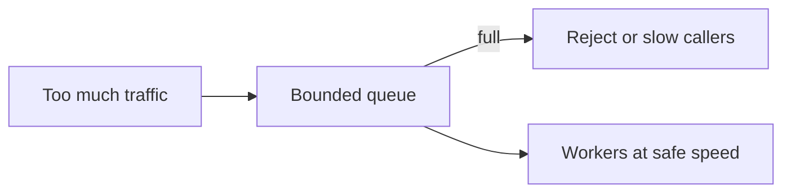

### Whiteboard version

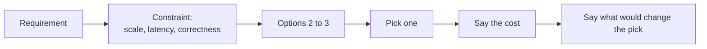

Say it as: "Because [requirement], I choose [X] over [Y]. The cost is [Z]. If [fact] changed, I would switch to [Y]."

## 9. Interview questions 🔴

> [!question]- How do you decide between SQL and NoSQL?
> Start from the access pattern and invariants. If you need multi-row transactions, ad hoc queries and moderate scale, use relational. If you need very high write throughput, key-based access and horizontal scale, a wide-column or key-value store fits. Name the cost: NoSQL gives up joins and flexible queries, and you model data per query.

> [!question]- Kafka or SQS for an order pipeline?
> If several independent consumers need the same events, or you need replay and per-key ordering at high throughput, Kafka. If it is a single consumer group doing work items on AWS and you want no operations, SQS. Both are at-least-once in normal use, so the consumer must be idempotent.

> [!question]- Fan-out on write or on read for a news feed?
> Fan-out on write precomputes timelines so reads are fast, but costs write amplification, which is huge for accounts with millions of followers. The usual answer is a hybrid: fan-out on write for normal accounts, merge celebrity posts at read time.

> [!question]- Polling, long polling, SSE or WebSocket?
> Match update frequency and direction. Rare updates: polling. Server to client only: SSE. Frequent two-way: WebSocket. WebSockets cost a held connection per user and need a pub/sub backplane to reach the right server.

> [!question]- Traffic grows 10 times. What do you change first?
> Measure first to find the bottleneck. Typical order: add cache and read replicas, scale the stateless tier horizontally, move slow work to queues, then partition the data store. Partitioning is last because it is the hardest to undo.

> [!question]- When is strong consistency worth its cost?
> When a stale or conflicting read causes a real loss: balances, inventory, seat booking, uniqueness constraints. For likes, views and feeds, eventual consistency gives better latency and availability with no business harm.

> [!question]- Why not just use microservices for everything?
> Each service boundary adds network failures, versioning and distributed debugging. Start with a modular monolith and split when team size or scaling needs of one module demand it.

## 10. Cheat sheet 🟢

- Requirement, choice, cost: say all three.
- Default store is relational; leave only when a measured limit forces you to.
- Queue for retryable work; log when you need replay or many consumers.
- At-least-once plus idempotent consumer beats chasing exactly-once.
- Cache read-heavy data with a TTL; know the stampede and invalidation story.
- Push for real time, pull when consumers vary in speed.
- Fan-out on write for normal users, on read for celebrities.
- Partition key decides the hot spot; choose it carefully and reuse it.
- Strong consistency only where invariants demand it.
- For 10 times traffic: measure, cache, scale out stateless, queue slow work, partition last.

## 11. Links 🟢

Decision guides in this folder:

- [[Choosing a Database - Decision Guide]]
- [[Kafka vs RabbitMQ vs SQS - Choosing a Message Broker]]
- [[Choosing a Caching Strategy - Decision Guide]]
- [[Choosing an API and Communication Style - Decision Guide]]
- [[Choosing Consistency, Replication and Partitioning - Decision Guide]]
- [[Choosing Storage for Files, Search and Analytics - Decision Guide]]
- [[Choosing Compute, Scaling and Deployment - Decision Guide]]
- [[Choosing Load Balancers, Gateways and Service Mesh - Decision Guide]]

Foundations and next steps:

- [[System Design Fundamentals]], [[System Design Interview Framework]], [[Back-of-the-Envelope Estimation]]
- [[Queues vs Streams and Broker Comparison]], [[Choosing an API Style]], [[Caching Patterns]]
- [[Case Study - News Feed]], [[Case Study - Chat System]], [[Case Study - Payment System]]

## Links 🟢

### Watch on YouTube

- [System Design Was HARD - Until You Knew the Trade-Offs](https://www.youtube.com/watch?v=1nENigGr-a0) · ByteByteGo · 5 min · 209,309 views
- [System Design Was HARD - Until You Knew the Trade-Offs, Part 2](https://www.youtube.com/watch?v=2g1G8Jr88xU) · ByteByteGo · 6 min · 64,310 views
